# Managing Gpt Email Generation

## When to Use This Skill

Manage the GPT Email Generation (Sales Email Assistant) setup page. Reads/writes the EinsteinGPTSalesEmails master pref plus 8 related ECI/Sales-Signals/Coaching feature toggles. Also exposes a composite getState aggregator (28+ keys: pref values, feature-access flags, Hawking ML-platform tenant provisioning status, Conversation Mining provisioning status, CDP/Genie status, Signals2DC status, computed UI-state enum ENABLED/DISABLED/IN_PROGRESS/HAWKING_TENANT_ERROR) and a refresh action that kicks off Conversation Mining background work. All toggles return Boolean (resulting pref/perm value); some have value-add behavior agents must know about — sales-email enable atomically also flips OnlyUseBuilderPrompts so open-prompt is on by default; open-prompt's enabled=true means OnlyUseBuilderPrompts=false (semantic inversion).

## Workflow

Read get-state first to discover current pref/perm/provisioning state and the computed UI-state enum (ENABLED/DISABLED/IN_PROGRESS/HAWKING_TENANT_ERROR). Toggle ordering: when enabling Sales Email Assistant via toggle-sales-email-pref, run toggle-open-prompt AFTER if you want explicit open-prompt control (enabling sales-email auto-flips OnlyUseBuilderPrompts to false in legacy-discovery-off orgs). For Conversation Mining: toggle-sales-conversation-mining-pref must run before toggle-sales-conversation-mining-apd360-perm and refresh-sales-mining (the perm and refresh sit on top of the feature pref). Each write returns Boolean (the resulting pref/perm value); follow with the paired verify-* step to read back via get-state and confirm. Note that toggle-sales-email-pref's enable path performs an atomic dual-pref bulk write (EinsteinGPTSalesEmails=true + OnlyUseBuilderPrompts=false); a single failure rolls back both. Hawking ML-platform tenant must be ready (getState.isHawkingTenantReady) before the UI state reaches ENABLED.

## Critical Constraints

**Preconditions:**

- User must have ConversationalIntelligence AccessConversationMiningSettings access (gates conversation-mining/signals2dc/refresh-sales-mining toggles). (check: `Conversation Mining Settings access`)
- User must have SalesEmailAssistant ModifyOpenPromptAccess access (gates toggle-open-prompt only). (check: `Modify Sales Email prompt access`)
- User must have SfaGenerative AccessSalesRecordSummaries access (gates call-explorer / APD360-perm / sales-rep-feedback / generative-insights toggles). (check: `Sales Record Summaries access`)
- Setup admin permission (View Setup + Setup admin) is required ONLY on the single-pref and perm writes — a non-admin gets NoAccessException on those. That covers: signals2dc, sales-rep-feedback, generative-insights, the APD360 perm, and the discovery-framework-OFF single-pref writes (call-summarization / call-explorer / conversation-mining, and sales-email DISABLE). It does NOT cover the sales-email ENABLE bulk-pref path (no admin check) or ANY discovery-framework-ON path (no admin check) — those enforce their own feature-scoped access instead.
- Einstein GPT platform must be enabled at the org level — getState surfaces this as hasEinsteinGPTSetupDisabled (true means the platform is OFF and the page renders disabled).
- For sales-email enablement to reach UI state ENABLED: the Hawking ML-platform tenant must be in PROVISION_SUCCESS — getState surfaces this as isHawkingTenantReady. PROVISION_FAILED resets the pref to false; PROVISIONING surfaces UI state IN_PROGRESS.
- Einstein Conversation Insights (ECI) must be enabled — call-summarization, call-explorer, and conversation-mining feature access requires hasECIEnabled = ORG_PERMISSION_CONVERSATION_PILOT + ORG_PREFERENCE_CONVERSATION_PILOT_PREF + ORG_PERMISSION_CALL_COACHING_READY (getState computes this combined flag).
- For Signals2DC: CDP/Genie must be enabled (Data Cloud enabled) for the salesConversationMiningDataCloudStatus to reflect a real provisioning state; otherwise getState returns -1 indicating CDP/Genie unavailable.

## Verification Checklist

After every write operation, confirm the effect by re-reading state:

- After `toggle-sales-email-pref`: call `verify-toggle-sales-email-pref` (`GET /headless/invoke/platform/gptemail-generation`)
- After `toggle-open-prompt`: call `verify-toggle-open-prompt` (`GET /headless/invoke/platform/gptemail-generation`)
- After `toggle-sales-call-summarization-pref`: call `verify-toggle-sales-call-summarization-pref` (`GET /headless/invoke/platform/gptemail-generation`)
- After `toggle-sales-call-explorer-pref`: call `verify-toggle-sales-call-explorer-pref` (`GET /headless/invoke/platform/gptemail-generation`)
- After `toggle-sales-conversation-mining-pref`: call `verify-toggle-sales-conversation-mining-pref` (`GET /headless/invoke/platform/gptemail-generation`)
- After `toggle-signals2dc-pref`: call `verify-toggle-signals2dc-pref` (`GET /headless/invoke/platform/gptemail-generation`)
- After `toggle-sales-conversation-mining-apd360-perm`: call `verify-toggle-sales-conversation-mining-apd360-perm` (`GET /headless/invoke/platform/gptemail-generation`)
- After `toggle-sales-rep-feedback-pref`: call `verify-toggle-sales-rep-feedback-pref` (`GET /headless/invoke/platform/gptemail-generation`)
- After `toggle-sales-call-generative-insights-pref`: call `verify-toggle-sales-call-generative-insights-pref` (`GET /headless/invoke/platform/gptemail-generation`)
- After `refresh-sales-mining`: call `verify-refresh-sales-mining` (`GET /headless/invoke/platform/gptemail-generation`)

## Operations Reference

Operations grouped by purpose. Use these as the building blocks for the workflows above.

### Summary

| Operation | Purpose | Status | Call | Depends on |
|-----------|---------|--------|------|------------|
| `toggle-sales-email-pref` | write | proposed | `PATCH /headless/invoke/platform/gptemail-generation/handle-sales-email-pref-toggle` | — |
| `toggle-open-prompt` | write | proposed | `PATCH /headless/invoke/platform/gptemail-generation/handle-open-prompt-toggle` | `toggle-sales-email-pref` |
| `toggle-sales-call-summarization-pref` | write | proposed | `PATCH /headless/invoke/platform/gptemail-generation/handle-sales-call-summarization-pref-toggle` | — |
| `toggle-sales-call-explorer-pref` | write | proposed | `PATCH /headless/invoke/platform/gptemail-generation/handle-sales-call-explorer-pref-toggle` | — |
| `toggle-sales-conversation-mining-pref` | write | proposed | `PATCH /headless/invoke/platform/gptemail-generation/handle-sales-conversation-mining-pref-toggle` | — |
| `toggle-signals2dc-pref` | write | proposed | `PATCH /headless/invoke/platform/gptemail-generation/handle-signals2-dcpref-toggle` | — |
| `toggle-sales-conversation-mining-apd360-perm` | write | implemented | `PATCH /headless/invoke/platform/gptemail-generation/handle-sales-conversation-mining-apd360-perm-toggle` | `toggle-sales-conversation-mining-pref` |
| `toggle-sales-rep-feedback-pref` | write | proposed | `PATCH /headless/invoke/platform/gptemail-generation/handle-sales-rep-feedback-pref-toggle` | — |
| `toggle-sales-call-generative-insights-pref` | write | proposed | `PATCH /headless/invoke/platform/gptemail-generation/handle-sales-call-generative-insights-pref-toggle` | — |
| `get-state` | read | implemented | `GET /headless/invoke/platform/gptemail-generation` | — |
| `refresh-sales-mining` | write | proposed | `PATCH /headless/invoke/platform/gptemail-generation/handle-sales-mining-refresh` | `toggle-sales-conversation-mining-pref` |
| `verify-toggle-sales-email-pref` | verify | — | `GET /headless/invoke/platform/gptemail-generation` | `toggle-sales-email-pref` |
| `verify-toggle-open-prompt` | verify | — | `GET /headless/invoke/platform/gptemail-generation` | `toggle-open-prompt` |
| `verify-toggle-sales-call-summarization-pref` | verify | — | `GET /headless/invoke/platform/gptemail-generation` | `toggle-sales-call-summarization-pref` |
| `verify-toggle-sales-call-explorer-pref` | verify | — | `GET /headless/invoke/platform/gptemail-generation` | `toggle-sales-call-explorer-pref` |
| `verify-toggle-sales-conversation-mining-pref` | verify | — | `GET /headless/invoke/platform/gptemail-generation` | `toggle-sales-conversation-mining-pref` |
| `verify-toggle-signals2dc-pref` | verify | — | `GET /headless/invoke/platform/gptemail-generation` | `toggle-signals2dc-pref` |
| `verify-toggle-sales-conversation-mining-apd360-perm` | verify | — | `GET /headless/invoke/platform/gptemail-generation` | `toggle-sales-conversation-mining-apd360-perm` |
| `verify-toggle-sales-rep-feedback-pref` | verify | — | `GET /headless/invoke/platform/gptemail-generation` | `toggle-sales-rep-feedback-pref` |
| `verify-toggle-sales-call-generative-insights-pref` | verify | — | `GET /headless/invoke/platform/gptemail-generation` | `toggle-sales-call-generative-insights-pref` |
| `verify-refresh-sales-mining` | verify | — | `GET /headless/invoke/platform/gptemail-generation` | `refresh-sales-mining` |

### Dependency graph

```mermaid
graph TD
  toggle_sales_email_pref["toggle-sales-email-pref (write)"]
  toggle_open_prompt["toggle-open-prompt (write)"]
  toggle_sales_call_summarization_pref["toggle-sales-call-summarization-pref (write)"]
  toggle_sales_call_explorer_pref["toggle-sales-call-explorer-pref (write)"]
  toggle_sales_conversation_mining_pref["toggle-sales-conversation-mining-pref (write)"]
  toggle_signals2dc_pref["toggle-signals2dc-pref (write)"]
  toggle_sales_conversation_mining_apd360_perm["toggle-sales-conversation-mining-apd360-perm (write)"]
  toggle_sales_rep_feedback_pref["toggle-sales-rep-feedback-pref (write)"]
  toggle_sales_call_generative_insights_pref["toggle-sales-call-generative-insights-pref (write)"]
  get_state["get-state (read)"]
  refresh_sales_mining["refresh-sales-mining (write)"]
  verify_toggle_sales_email_pref["verify-toggle-sales-email-pref (verify)"]
  verify_toggle_open_prompt["verify-toggle-open-prompt (verify)"]
  verify_toggle_sales_call_summarization_pref["verify-toggle-sales-call-summarization-pref (verify)"]
  verify_toggle_sales_call_explorer_pref["verify-toggle-sales-call-explorer-pref (verify)"]
  verify_toggle_sales_conversation_mining_pref["verify-toggle-sales-conversation-mining-pref (verify)"]
  verify_toggle_signals2dc_pref["verify-toggle-signals2dc-pref (verify)"]
  verify_toggle_sales_conversation_mining_apd360_perm["verify-toggle-sales-conversation-mining-apd360-perm (verify)"]
  verify_toggle_sales_rep_feedback_pref["verify-toggle-sales-rep-feedback-pref (verify)"]
  verify_toggle_sales_call_generative_insights_pref["verify-toggle-sales-call-generative-insights-pref (verify)"]
  verify_refresh_sales_mining["verify-refresh-sales-mining (verify)"]
  toggle_sales_email_pref --> toggle_open_prompt
  toggle_sales_conversation_mining_pref --> toggle_sales_conversation_mining_apd360_perm
  toggle_sales_conversation_mining_pref --> refresh_sales_mining
  toggle_sales_email_pref --> verify_toggle_sales_email_pref
  toggle_open_prompt --> verify_toggle_open_prompt
  toggle_sales_call_summarization_pref --> verify_toggle_sales_call_summarization_pref
  toggle_sales_call_explorer_pref --> verify_toggle_sales_call_explorer_pref
  toggle_sales_conversation_mining_pref --> verify_toggle_sales_conversation_mining_pref
  toggle_signals2dc_pref --> verify_toggle_signals2dc_pref
  toggle_sales_conversation_mining_apd360_perm --> verify_toggle_sales_conversation_mining_apd360_perm
  toggle_sales_rep_feedback_pref --> verify_toggle_sales_rep_feedback_pref
  toggle_sales_call_generative_insights_pref --> verify_toggle_sales_call_generative_insights_pref
  refresh_sales_mining --> verify_refresh_sales_mining
```

### Read operations

#### `get-state`

Read the composite Sales Email Assistant + Conversation Intelligence setup state. Returns a Map<String,Object> aggregating: the computed UI-state enum (ENABLED/DISABLED/IN_PROGRESS/HAWKING_TENANT_ERROR), per-feature access flags, every controller-managed pref/perm value, Hawking ML-platform tenant provisioning status, conversation-mining provisioning status, CDP/Genie status, signalsDC status + details, and a SIQ-in-migration flag. The UI-state enum derives from sales-email pref + Hawking provisioning status; on PROVISION_FAILED with the pref enabled, getState ALSO resets the pref to false (side-effect). Read this first for state discovery and for verify-* steps confirming pref/perm writes.

**Call:** `GET /headless/invoke/platform/gptemail-generation`   — status: `implemented`

**Output:** Map<String,Object> with ~28 keys: state (computed UI-state enum: ENABLED/DISABLED/IN_PROGRESS/HAWKING_TENANT_ERROR), hasSalesEmailAssistant (boolean), isSalesEmailAssistantPrefEnabled (boolean), isOpenPromptEnabled (boolean — already-inverted; true means open-prompt allowed), hasSalesCallSummarization, isSalesCallSummarizationPrefEnabled, hasSalesCallExplorer, isSalesCallExplorerPrefEnabled, hawkingTenantStatus (ProvisioningStatusEnum: PROVISION_SUCCESS/PROVISIONING/PROVISION_FAILED), isHawkingTenantReady, hasEinsteinGPTSetupDisabled (true means Einstein GPT platform pref is OFF), hasSalesRepFeedback, isSalesRepFeedbackPrefEnabled, hasSalesCallGenerativeInsights, isSalesCallGenerativeInsightsPrefEnabled, isSIQInMigration, isECIToCoreMigrationInProgress, isSalesConversationMiningPermEnabled, isSalesConversationMiningPrefEnabled, isSalesConversationMiningAPD360PermEnabled, salesConversationMiningProvisioningStatus (ConversationMiningProvisioningStatusEnum stringified), salesConversationMiningDataCloudStatus (number; -1 indicates CDP/Genie unavailable), salesConversationMiningAPD360ECIStatus (string), salesConversationMiningStatus (ConversationMiningStatus object — populated only when conversation-mining pref is on), eciSignals2DCFeatureAccess (boolean), eciSignals2DCPref (boolean), signalsDCStatus (string), signalsDCDetails (string).

### Write operations

#### `toggle-sales-email-pref`

Toggle the EinsteinGPTSalesEmails org pref. On enable in legacy-discovery-off orgs performs an atomic dual-pref bulk write that also flips OnlyUseBuilderPrompts=false (open-prompt on by default); a SaveResult failure on either pref returns false and rolls back. On enable in discovery-on orgs the write routes through the Discovery Framework path for the Sales Email feature, which runs pre-enablement validation. Returns the resulting EinsteinGPTSalesEmails value. No public Connect/Tooling/Metadata alternative replicates the dual-pref atomic batch.

**Call:** `PATCH /headless/invoke/platform/gptemail-generation/handle-sales-email-pref-toggle`   — status: `proposed`

**Inputs:**

- `enabled` *(`boolean`)* — Whether d is enabled.

#### `toggle-open-prompt`

Toggle open-prompt mode for Sales Email Assistant by writing the OnlyUseBuilderPrompts org pref to the INVERSE of `enabled` (enabled=true → OnlyUseBuilderPrompts=false → open prompts allowed). Returns whether open-prompt is enabled after the write (also inverted). Gated by Modify Sales Email prompt access. No public Connect/Tooling alternative; raw OrgPreferences write of OnlyUseBuilderPrompts is technically possible but semantic inversion makes substitution error-prone.

**Call:** `PATCH /headless/invoke/platform/gptemail-generation/handle-open-prompt-toggle`   — status: `proposed`

**Inputs:**

- `enabled` *(`boolean`)* — Whether d is enabled.

**Depends on:** `toggle-sales-email-pref`

#### `toggle-sales-call-summarization-pref`

Toggle the CallSummarization org pref (Conversational Intelligence). Dual-mode: legacy-discovery-off orgs do a direct pref write; discovery-on orgs route through the Discovery Framework path for the Call Summarization feature. Returns the resulting pref value. Public alternative `POST /connect/setup/discovery/feature/sales-cloud-call-summaries/{enable,disable}` exists but splits one toggle into two endpoints — substituting changes SOR shape; controller is the unified-toggle public surface.

**Call:** `PATCH /headless/invoke/platform/gptemail-generation/handle-sales-call-summarization-pref-toggle`   — status: `proposed`

**Inputs:**

- `enabled` *(`boolean`)* — Whether d is enabled.

#### `toggle-sales-call-explorer-pref`

Toggle the CallExplorerEnabled org pref (Conversational Intelligence). Dual-mode: legacy direct pref write, or discovery-on orgs route through the Discovery Framework path for the Call Explorer feature. Returns the resulting pref value. Gated by Sales Record Summaries access. Public alternative `POST /connect/setup/discovery/feature/sales-cloud-call-explorer/{enable,disable}` (Connect API SetupDiscovery) exists with shape mismatch.

**Call:** `PATCH /headless/invoke/platform/gptemail-generation/handle-sales-call-explorer-pref-toggle`   — status: `proposed`

**Inputs:**

- `enabled` *(`boolean`)* — Whether d is enabled.

#### `toggle-sales-conversation-mining-pref`

Toggle the ConversationMining org pref (Sales Signals). Dual-mode: legacy direct pref write, or discovery-on orgs route through the Discovery Framework path for the Sales Signals feature. Returns the resulting pref value. Gated by Conversation Mining Settings access. Prerequisite step for the APD360-perm and refresh-sales-mining toggles. Public alternative `POST /connect/setup/discovery/feature/sales-cloud-sales-signals/{enable,disable}` exists with shape mismatch.

**Call:** `PATCH /headless/invoke/platform/gptemail-generation/handle-sales-conversation-mining-pref-toggle`   — status: `proposed`

**Inputs:**

- `enabled` *(`boolean`)* — Whether d is enabled.

#### `toggle-signals2dc-pref`

Toggle the ECISignals2DC org pref (Signals to DataCloud). Single direct pref write (no discovery-framework branch for this pref). Returns the resulting pref value. Gated by Conversation Mining Settings access. CDP/Genie should be enabled for the resulting signalsDCStatus to reflect a real provisioning state. No public Connect/Tooling/Metadata alternative for this specific pref.

**Call:** `PATCH /headless/invoke/platform/gptemail-generation/handle-signals2-dcpref-toggle`   — status: `proposed`

**Inputs:**

- `enabled` *(`boolean`)* — Whether d is enabled.

#### `toggle-sales-conversation-mining-apd360-perm`

Toggle the aPD360ForECI org-permission bit. Direct org-permission write (NOT a pref). Returns the resulting perm value. Gated by Sales Record Summaries access. Should run AFTER toggle-sales-conversation-mining-pref — the perm sits on top of the conversation-mining feature pref. No public Metadata/Tooling alternative for org-permission bits at this level.

**Call:** `PATCH /headless/invoke/platform/gptemail-generation/handle-sales-conversation-mining-apd360-perm-toggle`   — status: `implemented`

**Inputs:**

- `enabled` *(`boolean`)* — Whether d is enabled.

**Depends on:** `toggle-sales-conversation-mining-pref`

#### `toggle-sales-rep-feedback-pref`

Toggle the EinsteinSalesRepFdbkEnab org pref (Enablement Coaching). Single direct pref write. Returns the resulting pref value. Gated by Sales Record Summaries access. No public Connect/Tooling/Metadata Settings type covers this specific pref.

**Call:** `PATCH /headless/invoke/platform/gptemail-generation/handle-sales-rep-feedback-pref-toggle`   — status: `proposed`

**Inputs:**

- `enabled` *(`boolean`)* — Whether d is enabled.

#### `toggle-sales-call-generative-insights-pref`

Toggle the GenerativeConvInsights org pref (Conversational Intelligence). Single direct pref write, plus a server-side info log. Returns the resulting pref value. Gated by Sales Record Summaries access. No public Metadata Settings type covers this specific pref.

**Call:** `PATCH /headless/invoke/platform/gptemail-generation/handle-sales-call-generative-insights-pref-toggle`   — status: `proposed`

**Inputs:**

- `enabled` *(`boolean`)* — Whether d is enabled.

#### `refresh-sales-mining`

Kick off a Sales Conversation Mining refresh and return the resulting ConversationMiningStatus (typically PROCESSING immediately after start). An imperative service trigger, not a pref/perm write. Gated by Conversation Mining Settings access. Should run after toggle-sales-conversation-mining-pref enables the feature. No public Connect/Tooling alternative — service-action without CRUD equivalent.

**Call:** `PATCH /headless/invoke/platform/gptemail-generation/handle-sales-mining-refresh`   — status: `proposed`

**Depends on:** `toggle-sales-conversation-mining-pref`

**Output:** ConversationMiningStatus object — the conversation-mining state immediately after the refresh kicks off. Typically PROCESSING when refresh just started; contains status enum + status details. Inspect getState.salesConversationMiningStatus or re-call refresh-sales-mining to poll for completion.

### Verify operations

#### `verify-toggle-sales-email-pref`

Read getState; confirm isSalesEmailAssistantPrefEnabled equals the value passed to toggle-sales-email-pref. On enable, also confirm isOpenPromptEnabled=true (the dual-pref atomic batch flips OnlyUseBuilderPrompts in legacy-discovery-off orgs). Inspect the state UI-enum: ENABLED if Hawking is ready, IN_PROGRESS if PROVISIONING, HAWKING_TENANT_ERROR if PROVISION_FAILED (in which case getState resets the pref to false — re-toggle if needed).

**Call:** `GET /headless/invoke/platform/gptemail-generation`

**Depends on:** `toggle-sales-email-pref`

#### `verify-toggle-open-prompt`

Read getState; confirm isOpenPromptEnabled equals the value passed to toggle-open-prompt (already inverted server-side; getState returns !OnlyUseBuilderPrompts so true means open-prompt allowed).

**Call:** `GET /headless/invoke/platform/gptemail-generation`

**Depends on:** `toggle-open-prompt`

#### `verify-toggle-sales-call-summarization-pref`

Read getState; confirm isSalesCallSummarizationPrefEnabled equals the value passed to toggle-sales-call-summarization-pref.

**Call:** `GET /headless/invoke/platform/gptemail-generation`

**Depends on:** `toggle-sales-call-summarization-pref`

#### `verify-toggle-sales-call-explorer-pref`

Read getState; confirm isSalesCallExplorerPrefEnabled equals the value passed to toggle-sales-call-explorer-pref.

**Call:** `GET /headless/invoke/platform/gptemail-generation`

**Depends on:** `toggle-sales-call-explorer-pref`

#### `verify-toggle-sales-conversation-mining-pref`

Read getState; confirm isSalesConversationMiningPrefEnabled equals the value passed to toggle-sales-conversation-mining-pref. Optionally inspect salesConversationMiningProvisioningStatus and salesConversationMiningStatus (only populated when pref is on).

**Call:** `GET /headless/invoke/platform/gptemail-generation`

**Depends on:** `toggle-sales-conversation-mining-pref`

#### `verify-toggle-signals2dc-pref`

Read getState; confirm eciSignals2DCPref equals the value passed to toggle-signals2dc-pref. Inspect signalsDCStatus / signalsDCDetails for the underlying provisioning state when CDP/Genie is enabled.

**Call:** `GET /headless/invoke/platform/gptemail-generation`

**Depends on:** `toggle-signals2dc-pref`

#### `verify-toggle-sales-conversation-mining-apd360-perm`

Read getState; confirm isSalesConversationMiningAPD360PermEnabled equals the value passed to toggle-sales-conversation-mining-apd360-perm.

**Call:** `GET /headless/invoke/platform/gptemail-generation`

**Depends on:** `toggle-sales-conversation-mining-apd360-perm`

#### `verify-toggle-sales-rep-feedback-pref`

Read getState; confirm isSalesRepFeedbackPrefEnabled equals the value passed to toggle-sales-rep-feedback-pref.

**Call:** `GET /headless/invoke/platform/gptemail-generation`

**Depends on:** `toggle-sales-rep-feedback-pref`

#### `verify-toggle-sales-call-generative-insights-pref`

Read getState; confirm isSalesCallGenerativeInsightsPrefEnabled equals the value passed to toggle-sales-call-generative-insights-pref.

**Call:** `GET /headless/invoke/platform/gptemail-generation`

**Depends on:** `toggle-sales-call-generative-insights-pref`

#### `verify-refresh-sales-mining`

Read getState; inspect salesConversationMiningStatus (the ConversationMiningStatus object) for the post-refresh state. Refresh kicked from PROCESSING to a terminal status (success/failure) over time — re-poll if still PROCESSING. Also surfaces salesConversationMiningProvisioningStatus.

**Call:** `GET /headless/invoke/platform/gptemail-generation`

**Depends on:** `refresh-sales-mining`
