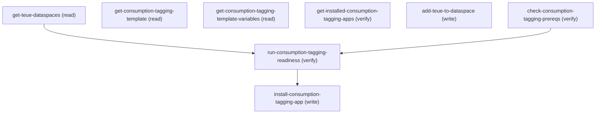

# Managing Digital Wallet

## When to Use This Skill

DigitalWallet Setup is a 2-tab page; each tab has a separate access guard and audience, and the two do NOT compose — pick a workflow by intent.

Install Digital Wallet tab (SDO / unmanaged orgs): installs the Digital Wallet metadata bundle. Production customer orgs do NOT use this tab; only SDO / dev / paid-prod orgs that missed install do. Its install methods are rejected (internal-only) — not callable steps here.

Consumption Tagging tab (production — the agent-driveable surface): installs the optional Consumption Tagging app.
- An automatic "Check Required Permissions" preflight gates the tab; you cannot continue if it fails. It requires BOTH the "Data Cloud Architect" perm set (GenieAdmin) AND the Manage App Templates permission.
- Prereq: the TenantEnrichedUsageEvent (TEUE) Data Lake Object must be mapped to a dataspace. get-teue-dataspaces VERIFIES this — non-empty means eligible; empty means map TEUE_dll to a dataspace first before readiness can pass.
- Only one app installs (maxAppCount=1); install is NOT idempotent — re-running on an already-installed org fails.

Cross-workflow: the two tabs have different guards and a user can have one without the other — a 200 on get-teue-dataspaces does NOT mean the Install-tab surface is callable, or vice versa. The Tag Data Sharing preference toggle is NOT agent-callable (rejected for Headless 360 — mandatory user consent); direct users to the Setup page to flip it. See agent_guidance for the ordered workflow and mechanics.

## Workflow

The 4 steps in this SOR back two DIFFERENT workflows on two DIFFERENT
tabs of the Setup page. Pick the right workflow based on intent — they
do NOT compose as a single chain.

Workflow A — Consumption Tagging tab (production agent flow):
  Full chain (all in this SOR):
    check-consumption-tagging-prereqs
      -> get-teue-dataspaces
      -> (if TEUE not mapped) add-teue-to-dataspace
      -> get-consumption-tagging-template
      -> get-consumption-tagging-template-variables
      -> run-consumption-tagging-readiness
      -> get-installed-consumption-tagging-apps (pre-flight)
      -> install-consumption-tagging-app
      -> get-installed-consumption-tagging-apps (verify)
  The install/poll steps for Workflow B DO NOT belong to this
  workflow — do NOT call them when driving Consumption Tagging.

### Phase 1: check-consumption-tagging-prereqs — confirm Data Cloud Architect

check-consumption-tagging-prereqs — confirm Data Cloud Architect
     perm set (PermissionSet.Name = GenieAdmin) is assigned. Empty
     result -> fail-fast: tell user to assign perm set in
     Setup > Permission Sets.

### Phase 2: get-teue-dataspaces — list dataspaces with the TEUE DLO...

get-teue-dataspaces — list dataspaces with the TEUE DLO already
     mapped. Empty result OR target dataspace not in the list ->
     continue to step 3 to add the mapping. Non-empty result ->
     continue to step 4 (but treat as necessary-not-sufficient — the
     readiness chain is the authoritative gate).

### Phase 3: add-teue-to-dataspace — call

add-teue-to-dataspace — call
     `PATCH /headless/invoke/platform/cdp-data-spaces/save-data-space-members`
     with body
     `{dataSpaceMemberUiConfig:{dataSpaceId:"<id>",members:[{objectDeveloperName:"TenantEnrichedUsageEvent__dll",objectType:"DLO",filterExpression:null}]}}`
     to upsert the binding (UPSERT — idempotent on re-call). Note
     `dataSpaceId` is the DataSpaceDefinition record id (NOT the
     developer name); resolve via
     `GET /services/data/v67.0/app-framework/data-spaces` first.
     Verify by re-calling get-teue-dataspaces. Owned by CDP Core
     Actions team. See step description for verified-live body shape
     + alternative endpoints.

### Phase 4: get-consumption-tagging-template — fetch the canonical template

get-consumption-tagging-template — fetch the canonical template
     (sfdc_internal__DigitalWalletConsumptionTagging). Returns
     readinessUrl, autoSetupUrl, maxAppCount=1. Cheap; do this for
     agent grounding even if the template id is hardcoded.

### Phase 5: get-consumption-tagging-template-variables — discover the

get-consumption-tagging-template-variables — discover the
     body shape for readiness + install. Returns the dloDataspace
     variable schema (DataSpaceType wrapper around dataSpaceName).
     Skip if the agent already knows the canonical body shape.

### Phase 6: run-consumption-tagging-readiness — AUTHORITATIVE gate. POST

run-consumption-tagging-readiness — AUTHORITATIVE gate. POST
     body `{templateValues:{dloDataspace:{dataSpaceName:"<n>"}}}`.
     Read tasks[].readinessStatus — any "Failed" task means do NOT
     proceed to install; the message tells the user what to fix.
     A 403 here means the user lacks
     Manage App Templates permission (the
     server-side access check the LWC consumes via @salesforce/accessCheck).

### Phase 7: get-installed-consumption-tagging-apps (pre-flight) — call

get-installed-consumption-tagging-apps (pre-flight) — call
     with templateSourceId=sfdc_internal__DigitalWalletConsumptionTagging.
     If apps[] non-empty, app is already installed (maxAppCount=1
     means no second install possible) — stop here, the workflow is
     complete.

### Phase 8: install-consumption-tagging-app — POST /app-framework/apps with

install-consumption-tagging-app — POST /app-framework/apps with
     the same dloDataspace + templateSourceId. Body must include
     label + name (developer name) + templateSourceId + templateValues.
     NOT idempotent — re-running on already-installed orgs fails.

### Phase 9: get-installed-consumption-tagging-apps (verify) — re-call after

get-installed-consumption-tagging-apps (verify) — re-call after
     install to confirm the new app appears in apps[]. Use
     appHubUrl from install response to surface to the user as the
     link to the live Consumption Insights dashboard.

Workflow B — Install Digital Wallet tab (SDO / unmanaged orgs only):
  Steps: get-install-status -> initiate-digital-wallet-install-unmanaged ->
  get-install-status (poll loop).
  Production customer orgs do NOT use this workflow — Digital Wallet
  auto-installs during Data Cloud provisioning. Only SDO / dev /
  paid-prod orgs that missed install drive this.

### Phase 10: get-install-status — read first. If statusValue=NOT_RUNNING AND

get-install-status — read first. If statusValue=NOT_RUNNING AND
     isDigitalWalletEnabled=true, install is already done; stop.
     If statusValue=NOT_RUNNING AND isDigitalWalletEnabled=false,
     proceed to initiate. Other statuses
     (PENDING/IN_PROGRESS/FAILED) — see step description for handling.

### Phase 11: initiate-digital-wallet-install-unmanaged — fire-and-forget

initiate-digital-wallet-install-unmanaged — fire-and-forget
     async kickoff. 200/204 just means queued, not done.

### Phase 12: get-install-status — re-poll until NOT_RUNNING +

get-install-status — re-poll until NOT_RUNNING +
     isDigitalWalletEnabled=true (success) or FAILED (escalate).
     The NOT_RUNNING-as-success enum gotcha REQUIRES reading both
     fields together (see step descriptions).
  403 ACCESS_DENIED on either step -> user lacks the
  `Digital Wallet setup access` access
  check (NOT install failure). Production orgs without this guard
  should never see this tab; the agent should not retry.

Workflow C — Tag Data Sharing toggle (NOT agent-callable):
  The org preference TagDataSharingEnabled (toggle-tag-data-sharing-pref)
  is REJECTED for Headless 360 MCP. Flipping it requires MANDATORY user
  disclosure and explicit consent on every transition — a UI-side gate
  not enforced at runtime, which fails the Headless 360 onboarding
  attestation (agents cannot be trusted to consistently present a
  required consent notice).

If a user asks to change tag-data-sharing, do NOT attempt the flip;
  direct them to the Digital Wallet Setup page
  (/lightning/setup/DigitalWallet/home) → Consumption Tagging tab,
  where the human admin flips the preference against the required
  disclosure. See step's /reason + /replacement for the full policy
  citation.

Cross-workflow: get-teue-dataspaces is gated by a different access
check (CustomTaggingTabSetup) than the Install-tab steps
(UnmanagedOrgsSetup). A user can have one without the other — never
assume a 200 on get-teue-dataspaces means the install steps are
callable, or vice versa. The tag-data-sharing pref is NOT agent-
callable at all (see Workflow C) — the CustomTaggingTabSetup gate
grants the Setup-page UI, not an API surface for the toggle.

Access-guard method mapping (relocated from agent_description; execution detail):
  Two distinct DigitalWallet access checks back the controller methods —
  - userCanAccessDigitalWalletCustomTaggingTabSetup gates get-teue-dataspaces
    (the Consumption Tagging tab's eligibility surface); maps to the
    canAccessConsumptionTaggingTabSetup tab-visibility flag.
  - userCanAccessDigitalWalletUnmanagedOrgsSetup gates the Install-tab methods
    (initiate-digital-wallet-install-unmanaged and get-install-status; the GET poll
    carries the NOT_RUNNING-as-success enum gotcha — read statusValue and
    isDigitalWalletEnabled together); maps to the canAccessUnmanagedOrgs flag.
  A user can hold one guard without the other, so never infer one tab's callability
  from the other's 200.
  Consumption Tagging install detail (controllers/endpoints/template id) already
  documented in Workflow A steps above: the Digital Wallet setup service.getTEUEDataspaces,
  CDP Data Space operations.saveDataSpaceMembers, and the public app-framework-connect-api
  template/readiness/apps endpoints anchored on template id
  sfdc_internal__DigitalWalletConsumptionTagging (templateType=app, maxAppCount=1). The
  Manage App Templates access check is server-side (LWC consumes @salesforce/accessCheck);
  no callable endpoint — a 403 on readiness/apps is how the agent observes it.

## Critical Constraints

**Preconditions:**

- User must have DigitalWallet AccessDigitalWalletCustomTaggingTabSetup access (check: `Digital Wallet tagging setup access`)
- User must have DigitalWallet AccessDigitalWalletUnmanagedOrgsSetup access (check: `Digital Wallet setup access`)
- Org must NOT be a FREE edition. Digital Wallet does not install in FREE orgs.
Local dev requires license-editor giving Enterprise + GenieDataPlatformStarter.
- Data Cloud license (GenieDataPlatformStarter or higher) must be provisioned.
Without it, install completes-but-empty: TEUE DLOs (TenantBillingUsageEvent__dll,
TenantEnrichedUsageEvent__dll, etc.) won't populate.
- Org perm `DigitalWalletEnabled` must be true. Provisioned by license-editor / TA
pipeline; not settable through this SOR. Setup-page button + this SOR's initiate
step force-install when set; otherwise local dev orgs skip install by Data Cloud
resource policy.
- Data Cloud (PRG) provisioning must complete BEFORE install for DLOs to materialize.
Sequence: enable license -> wait for TA -> run Data Cloud Setup provisioning -> run
this SOR's install kickoff.

## Verification Checklist

After every write operation, confirm the effect by re-reading state:

- After `get-teue-dataspaces`, `check-consumption-tagging-prereqs`: call `run-consumption-tagging-readiness` (`POST /services/data/v67.0/app-framework/templates/sfdc_internal__DigitalWalletConsumptionTagging/readiness`)
- After (write): call `get-installed-consumption-tagging-apps` (`GET /services/data/v67.0/app-framework/apps`)
- After (write): call `check-consumption-tagging-prereqs` (`GET /services/data/v67.0/query`)

## Operations Reference

Operations grouped by purpose. Use these as the building blocks for the workflows above.

### Summary

| Operation | Purpose | Status | Call | Depends on |
|-----------|---------|--------|------|------------|
| `get-teue-dataspaces` | read | implemented | `GET /headless/invoke/platform/digital-wallet` | — |
| `get-consumption-tagging-template` | read | implemented | `GET /services/data/v67.0/app-framework/templates/sfdc_internal__DigitalWalletConsumptionTagging` | — |
| `get-consumption-tagging-template-variables` | read | implemented | `GET /services/data/v67.0/app-framework/templates/sfdc_internal__DigitalWalletConsumptionTagging/variables` | — |
| `run-consumption-tagging-readiness` | verify | implemented | `POST /services/data/v67.0/app-framework/templates/sfdc_internal__DigitalWalletConsumptionTagging/readiness` | `get-teue-dataspaces`, `check-consumption-tagging-prereqs` |
| `install-consumption-tagging-app` | write | implemented | `POST /services/data/v67.0/app-framework/apps` | `run-consumption-tagging-readiness` |
| `get-installed-consumption-tagging-apps` | verify | implemented | `GET /services/data/v67.0/app-framework/apps` | — |
| `add-teue-to-dataspace` | write | implemented | `PATCH /headless/invoke/platform/cdp-data-spaces/save-data-space-members` | — |
| `check-consumption-tagging-prereqs` | verify | implemented | `GET /services/data/v67.0/query` | — |

### Dependency graph

### Read operations

#### `get-teue-dataspaces`

Verify-DLO-mapped step for the Consumption Tagging tab. Returns the
list of CDP dataspace names that are mapped to the TenantEnrichedUsageEvent
Data Lake Object (TEUE_dll). Production semantics: this step is the eligibility gate for the
Consumption Tagging install workflow. A non-empty array means the user
has mapped TEUE to at least one dataspace in Data Cloud setup and can
continue to the Install Consumption Tagging App action. An empty array
means the user must first add TEUE_dll to a dataspace via Data Cloud's
dataspace-binding UI; this SOR does not perform that binding. Wire shape: array<string> of dataspace names (e.g., ["default"]). Confirmed via live probe on project-branch-orgfarm 2026-06-09
(returned ["default"]). NOT array<object> as some earlier framings
assumed — the controller signature is List<String> and the wire form
matches. Access gate: Digital Wallet tagging setup access
(different from the Install-tab steps' UnmanagedOrgsSetup gate; an org
user can have one without the other). For listing ALL dataspaces (not just TEUE-mapped), use the public
GET /services/data/v67.0/app-framework/data-spaces Connect API instead
— that returns the full DataSpace object (id, label, status, description)
for every dataspace the user can see. This step is intentionally
narrower; it filters to the TEUE DLO mapping which IS the production
Consumption-Tagging eligibility signal. Once this step returns a non-empty array, the agent can drive the rest
of the Consumption Tagging install workflow via the public
app-framework-connect-api family (see /notes.related_workflows for the
canonical template id + endpoint chain). IMPORTANT — weak-gate caveat: a non-empty return does NOT guarantee the
TEUE DLO is fully queryable. This step calls
DigitalWalletCdpDataService.getAllDataSpacesMappedForDLO, which returns
the dataspace name when a mapping record exists; it does not verify the
underlying TenantEnrichedUsageEvent__dll table is materialized in the
Data Cloud tenant. The authoritative gate is the
POST /app-framework/templates/sfdc_internal__DigitalWalletConsumptionTagging/readiness
chain, which evaluates `TenantEnrichedUsageEventDLOCheck` against the
Data Cloud tenant (verified live 2026-06-09: a "default" dataspace with
no actual TEUE_dll table returns this step as 200 ["default"], but the
readiness chain returns FailedStatus with task "The TenantEnrichedUsageEvent
DLO isn't in the selected data space or can't be loaded"). Treat
get-teue-dataspaces as a NECESSARY-not-sufficient eligibility hint; drive the readiness chain for the authoritative verdict.

**Call:** `GET /headless/invoke/platform/digital-wallet`   — status: `implemented`

**Output:** `array<string>` — dataspace names (e.g., `["default"]`) mapped to the
`TenantEnrichedUsageEvent__dll` DLO. Empty array means no CDP dataspaces have the
DLO mapping; valid response, not an error.

**Notes:** error_contracts: 403 ACCESS_DENIED -> user lacks
Digital Wallet tagging setup access. Wrong-verb (POST/PUT/PATCH/DELETE)
-> 404 NOT_FOUND (dispatcher route resolves on method+path; missing pair = 404, not 405).; peer_apis: For the unfiltered list (all dataspaces in the org, not just TEUE-mapped): use
`GET /services/data/v67.0/app-framework/data-spaces` (returns full DataSpace objects
with id/label/status/etc.).

#### `get-consumption-tagging-template`

Fetch the canonical Consumption Tagging template definition. Returns
the AppFramework template record with readinessUrl, autoSetupUrl,
configurationUrl, variablesUrl, chainDefinitions, maxAppCount=1,
templateStatus=published. Use the returned URLs to drive the
subsequent readiness + install steps.

Verified live 2026-06-10: 200 OK on project-branch-orgfarm. Template
id `sfdc_internal__DigitalWalletConsumptionTagging` is the
published canonical template across all orgs.

Access guard: standard app-framework template read access
(read App Templates permission or equivalent;
the LWC consumes this via @wire(getTemplateConfig)).

**Call:** `GET /services/data/v67.0/app-framework/templates/sfdc_internal__DigitalWalletConsumptionTagging`   — status: `implemented`

**Output:** Full AppFrameworkTemplate object: {id, name, label, description,
templateType, assetVersion, maxAppCount, variableDefinition,
layoutDefinition, rules, releaseInfo, icons, chainDefinitions[],
tags, url, configurationUrl, readinessUrl, autoSetupUrl,
variablesUrl, layoutUrl, rulesUrl, assetsUrl, chainsUrl,
templateStatus}. Use readinessUrl + maxAppCount in subsequent
install logic.

**Notes:** cross_team: Endpoint owner: TUA-Intel-App Dev Platform (app-framework-connect-api).; verify_via: Returns 200 with full template body; templateStatus should be
"published". maxAppCount is 1 — only one Consumption Tagging
app per org.

#### `get-consumption-tagging-template-variables`

Discover the variable schema for readiness + install body. Returns
the dloDataspace variable definition (variableType=DataSpaceType,
properties.dataSpaceName=StringType, required=[dataSpaceName],
strictValidation=true).

Use this to construct the templateValues body for run-readiness
and install-app: the dloDataspace must be an OBJECT with
dataSpaceName property, NOT a bare string. Verified live
2026-06-10 — passing a bare string returns 400 BAD_REQUEST
"not of expected type [Object]".

Access guard: same as get-consumption-tagging-template.

**Call:** `GET /services/data/v67.0/app-framework/templates/sfdc_internal__DigitalWalletConsumptionTagging/variables`   — status: `implemented`

**Output:** `{variables: {<varname>: {label, description, required, variableType:
{type, required[], properties: {<prop>: {type, enums[]}},
strictValidation}}}}`. For Consumption Tagging the only variable
is `dloDataspace` (DataSpaceType wrapping `dataSpaceName: StringType`).

**Notes:** verify_via: Use the returned shape to construct templateValues for the
readiness POST. The schema's strictValidation=true means
unrecognized fields cause a 400.

### Write operations

#### `install-consumption-tagging-app`

Install the Consumption Tagging app from the canonical template.
Creates the app + provisions metadata/objects + Tableau Next
workspace assets needed by the Consumption Insights dashboard.

Body shape (per the `POST /app-framework/apps` OAS):
  {
    "label": "<user-facing app name>",
    "name": "<api name (developer name) for the new app>",
    "description": "<optional description>",
    "assetIcon": "<optional 1.png-20.png>",
    "templateSourceId": "sfdc_internal__DigitalWalletConsumptionTagging",
    "templateValues": {
      "dloDataspace": {"dataSpaceName": "<dataspace-name>"}
    }
  }

`templateSourceId` references the Consumption Tagging template;
`templateValues` carries the same dloDataspace binding used by the
readiness check.

NOT verified live during this review (would create a real app on
the test org). Body shape is derived from the public OAS schema
(AppCreateInputRepresentation) + the verified readiness body
shape. Agents should be ready to handle the full install flow's
runtime status (the response carries `runtimeRequestId` for
polling if the chain is async).

Pre-flight: only call after run-consumption-tagging-readiness
returns Complete (no Failed tasks). Post-flight: call
get-installed-consumption-tagging-apps to verify creation.

maxAppCount=1 from the template — re-running on an org that
already has a Consumption Tagging app will fail with "max app
count exceeded" or similar; use get-installed-consumption-tagging-apps
to detect already-installed.

Access guard: implicitly verifies
Manage App Templates permission. 403
ACCESS_DENIED here means the user lacks that access check
(same gate as readiness — the same 403 from readiness predicts
403 here).

**Call:** `POST /services/data/v67.0/app-framework/apps`   — status: `implemented`

**Inputs:**

- `label` *(`string`)* — User-facing name for the new Consumption Tagging app instance.
- `name` *(`string`)* — API name (developer name) for the new app. Must be unique within
the org. Convention: derive from label by stripping spaces +
adding org-specific suffix, or match the template's
`consumption_tagging_<dataspace>` pattern.
- `templateSourceId` *(`string`)* — Template id to provision from. For Consumption Tagging, must be
`sfdc_internal__DigitalWalletConsumptionTagging`.
- `templateValues` *(`object`)* — Template variable bindings. For Consumption Tagging, must include
`dloDataspace: {dataSpaceName: "<name>"}` — same shape used by
the readiness check.
- `description` *(`string`)* — Optional description for the new app instance.
- `assetIcon` *(`string`)* — Optional icon enum 1.png-20.png; default chosen by template if omitted.

**Depends on:** `run-consumption-tagging-readiness`

**Output:** `{app: AppRepresentation, appHubUrl: string, failureMessage: string,
runtimeRequestId: string, state: object}`. On success, `app.id` is the
new app's record id; `appHubUrl` is the Tableau Next URL for the
installed app. `runtimeRequestId` is for polling async chains.
Failure populates `failureMessage`.

**Notes:** cross_team: Endpoint owner: TUA-Intel-App Dev Platform (app-framework-connect-api).; idempotency: NOT idempotent on success — re-calling after a successful install
with maxAppCount=1 will fail. Always pre-check via
get-installed-consumption-tagging-apps.; alt_path: `POST /app-framework/templates/{id}/autosetup` runs the templated
autosetup chain instead of an explicit /apps create. Useful when
the template defines a complete auto-setup flow (which Consumption
Tagging's chainDefinitions does — chainDefinitions[type=create]
+ type=update for upgrade-app + calc-field-update). Either path
is acceptable; /apps is more direct.

#### `add-teue-to-dataspace`

Add the TenantEnrichedUsageEvent (TEUE) Data Lake Object to a dataspace
so the Consumption Tagging install readiness chain (TEUE DLO check)
can find it. This is the step that closes the gap between
get-teue-dataspaces returning a dataspace name (necessary) and the
readiness-chain TenantEnrichedUsageEventDLOCheck passing (sufficient
— see weak-gate caveat on get-teue-dataspaces).

Cross-team prereq: this Setup page does not author this binding;
the user does it elsewhere in Data Cloud setup. Verified
2026-06-10 against project-branch-orgfarm: the agent-driveable
surface is the headless route
`PATCH /headless/invoke/platform/cdp-data-spaces/save-data-space-members`,
which dispatches to.saveDataSpaceMembers.
UPSERT semantics — re-running with already-mapped members is a
no-op. Owned by the CDP Core Actions team.

Body shape (verified live, 200 OK on the test org):
  {
    "dataSpaceMemberUiConfig": {
      "dataSpaceId": "<DataSpaceDefinition Id, e.g. 0vhxx0000000001AAA>",
      "members": [
        {
          "objectDeveloperName": "TenantEnrichedUsageEvent__dll",
          "objectType": "DLO",
          "filterExpression": null
        }
      ]
    }
  }

`dataSpaceId` is the DataSpaceDefinition record id (NOT the
developer name). To resolve dataspace name -> id, call the
DataSpace list (e.g., `GET /services/data/v67.0/app-framework/data-spaces`
returns id + name pairs) before this step.

Per-member required fields (per the data-space validator):
  - `objectDeveloperName`: DLO developer name like
    `TenantEnrichedUsageEvent__dll`. The `__dll` suffix is required.
  - `objectType`: literal string `"DLO"` (NOT "DataLakeObject" —
    the controller checks for "DLO" specifically).
  - `filterExpression`: optional row-level filter; pass `null`
    for the no-filter case (TEUE for Consumption Tagging).

Returns 200 with empty body on success (Java void return type).
Re-running with the same DLO/dataspace pair is idempotent — no error,
no double-add.

Access guard: feature-gated on Data Cloud setup access. 403 means the
user lacks the perm; the dispatcher's silent no-op kicks in when
`dataSpaceService.isDataSpaceEnabled()` returns false.

Headless alternatives (cross-team, also agent-driveable):
  - PATCH /headless/data/cdp/data-lake-object/add-dlos-to-dataspace
    (the data lake object operation.addDlosToDataspace; same payload —
    delegates to the same saveDataSpaceMembers method. On test org
    this returned generic "Invalid request" 400 even with the
    verified shape; route mounting may differ on some orgs.)
  - PATCH /headless/analytics/unified-analytics/tableau-app/add-dloto-data-spaces
    (Tab Next; ADDITIVE — preserves existing memberships; body
    shape verified `{dloName, dataSpaceNames: array}`. Different
    access guard — unified-analytics-tableau-app perm.)
  - PUT /services/data/v67.0/ssot/data-spaces/{idOrName}/members
    (CDP Connect API — public; documented body shape
    `{members: [{memberName}]}` but live-probe returned a parser
    error suggesting spec-vs-impl drift on the test org).
See /notes.related_workflows.add_teue_to_dataspace_prereq for
additional context.

**Call:** `PATCH /headless/invoke/platform/cdp-data-spaces/save-data-space-members`   — status: `implemented`

**Inputs:**

- `dataSpaceMemberUiConfig` *(`object`)* — Wrapper object with `dataSpaceId` (DataSpaceDefinition record id,
NOT developer name — resolve via GET /app-framework/data-spaces
first) plus `members` array.

**Output:** `200` with empty body on success (Java void return type). Re-running
with the same DLO/dataspace pair is idempotent — the underlying
DataSpaceMemberService.create no-ops on duplicate (verified live
2026-06-10: TEUE_dll already in "default" dataspace, returned 200
with empty body, get-teue-dataspaces and
get-data-lake-object-instances both confirmed unchanged state).

**Notes:** verify_via: Re-call `get-teue-dataspaces` (this SOR's step) — should now return
the target dataspace name. For full eligibility, run
`POST /app-framework/templates/sfdc_internal__DigitalWalletConsumptionTagging/readiness`
with `{templateValues: {dloDataspace: {dataSpaceName: "<target>"}}}`
— the TEUE DLO check should change from FailedStatus to a Complete
readiness when the binding is right.; access_guard: Wrapper checks `dataSpaceService.isDataSpaceEnabled()` and silently
no-ops when false. Underlying DataSpaceController is gated on
CDP perms (Data Cloud app access / Data Cloud setup access
depending on action).; cross_team: Endpoint owner: CDP Core Actions (the headless route) +
CDP Core Onboarding (the underlying ui-cdp-components controller).
Encoded here as a peer step rather than a sibling SOR because it's
the gate that the Consumption Tagging install workflow has on TEUE
DLO membership; out-of-scope for the DigitalWallet team's controllers,
but in-scope for the agent driving Consumption Tagging install.; live_probe_2026_06_10: Verified 200 OK on project-branch-orgfarm with body
{"dataSpaceMemberUiConfig":{"dataSpaceId":"0vhxx0000000001AAA",
"members":[{"objectDeveloperName":"TenantEnrichedUsageEvent__dll",
"objectType":"DLO","filterExpression":null}]}}. TEUE_dll was already
mapped to "default" before the call — re-call was idempotent.

### Verify operations

#### `run-consumption-tagging-readiness`

Run the org-readiness chain for the Consumption Tagging template.
This is the AUTHORITATIVE eligibility gate (vs the weak-gate
get-teue-dataspaces): runs `chainDefinitions[type=orgreadiness]`
against the Data Cloud tenant, evaluating
`TenantEnrichedUsageEventDLOCheck` + `UniqueDMOCheck`. Returns
runtime status + tasks; success means the org is ready to
install Consumption Tagging.

Verified live 2026-06-10 against project-branch-orgfarm: 201 returned
with status=FailedStatus when TEUE DLO is not actually queryable
in the selected dataspace (the readiness chain hit
INVALID_ARGUMENT on the underlying TEUE table query, even though
get-teue-dataspaces returned ["default"] — that's the weak-gate
caveat in action).

Body shape (verified):
  {
    "templateValues": {
      "dloDataspace": {"dataSpaceName": "<dataspace-name>"}
    }
  }

The dloDataspace must be an OBJECT with dataSpaceName property
(per variableType=DataSpaceType in get-...-template-variables) —
NOT a bare string. Passing a string returns 400 BAD_REQUEST
"not of expected type [Object]".

Access guard: implicitly verifies
Manage App Templates permission (the access
check the LWC consumes via @salesforce/accessCheck). 403
ACCESS_DENIED here means the user lacks that access check.

Read tasks[].readinessStatus to interpret:
  - "Complete" — gate passed
  - "Warning" — proceeded with default value-on-error (some
    underlying check failed but the chain continued)
  - "Failed" — gate failed; do NOT proceed to install. Read
    the task's `message` for the user-facing reason (e.g.,
    "TenantEnrichedUsageEvent DLO isn't in the selected data
    space or can't be loaded").

**Call:** `POST /services/data/v67.0/app-framework/templates/sfdc_internal__DigitalWalletConsumptionTagging/readiness`   — status: `implemented`

**Inputs:**

- `templateValues` *(`object`)* — Object containing the template variables. For Consumption Tagging,
must include `dloDataspace: {dataSpaceName: "<name>"}`. The
dataspace name comes from get-teue-dataspaces; resolve to the
full DataSpace object via app-framework/data-spaces if needed.
  - **Source:** output of `get-teue-dataspaces`

**Depends on:** `get-teue-dataspaces`, `check-consumption-tagging-prereqs`

**Output:** `{id: string, runtimeRequestId: string, state: object, status: string
(enum: SuccessStatus | FailedStatus | RunningStatus | etc.),
tasks: [{type, readinessStatus: enum (Complete|Warning|Failed),
message, tags}], warningMessage: string}`. The authoritative
readiness signal is `tasks[?(.type=="TemplateRequirementEvaluation")]
.readinessStatus` — look for "Failed" with a TenantEnrichedUsageEvent
DLO message to detect the binding-not-actually-mapped case.

**Notes:** cross_team: Endpoint owner: TUA-Intel-App Dev Platform (app-framework-connect-api).; verify_pattern: This step IS the verify pattern — its result determines whether
install-consumption-tagging-app should be called.

#### `get-installed-consumption-tagging-apps`

List Consumption Tagging app instances installed in the org. Use
to (a) detect already-installed before calling
install-consumption-tagging-app (maxAppCount=1 means re-install
will fail), and (b) verify after install that the app was
created successfully.

Verified live 2026-06-10: 200 OK on project-branch-orgfarm.
Returned `{apps: []}` (no Consumption Tagging app installed yet on
this test org).

Filter by `templateSourceId` query parameter to scope to
Consumption Tagging only (vs all app-framework apps in the org).

**Call:** `GET /services/data/v67.0/app-framework/apps`   — status: `implemented`

**Inputs:**

- `templateSourceId` *(`string`)* — Template id to filter app list by. For Consumption Tagging
detection, pass `sfdc_internal__DigitalWalletConsumptionTagging`.

**Output:** `{apps: [{id, name, label, templateSourceId, ...}]}`. Empty array
means no app from this template is installed; non-empty means at
least one exists (with maxAppCount=1, exactly one).

**Notes:** cross_team: Endpoint owner: TUA-Intel-App Dev Platform (app-framework-connect-api).; idempotency_use: Always call BEFORE install-consumption-tagging-app to detect
already-installed; the install endpoint is NOT idempotent on
a maxAppCount=1 template.

#### `check-consumption-tagging-prereqs`

Verify the calling user is assigned the "Data Cloud Architect" perm set
(PermissionSet.Name = "GenieAdmin"), which is the explicitly checkable
half of the Consumption Tagging tab's "Check Required Permissions"
preflight. Returns a record on hit (user is assigned), zero records
on miss (user is not assigned — the agent should fail-fast and tell
the user to get the Data Cloud Architect perm set assigned in
Setup > Permission Sets before proceeding to readiness check or
app install).

The preflight's OTHER check —
Manage App Templates permission — is a server-side
access check the LWC consumes via @salesforce/accessCheck/...; it
has no public callable endpoint. The agent verifies it IMPLICITLY by
attempting the gated POST /app-framework/templates/{id}/readiness
or POST /app-framework/apps action: a 403 ACCESS_DENIED there
indicates this access check failed. Document both outcomes when
orchestrating the install workflow.

Wire form: SOQL via REST. Bind `:userId` to `$User.Id` (or pass an
explicit Id literal) and use the existing PermissionSetAssignment
shape — `LDS GraphQL does NOT expose PermissionSetAssignment` (it's
not a UIAPI entity), so the canonical agent path is the SOQL query
endpoint, not /graphql.

**Call:** `GET /services/data/v67.0/query`   — status: `implemented`

**Inputs:**

- `q` *(`string`)* — SOQL query string. Canonical form:
`SELECT Id, AssigneeId, PermissionSet.Name, PermissionSet.Label
 FROM PermissionSetAssignment
 WHERE AssigneeId = ':userId' AND PermissionSet.Name = 'GenieAdmin'
 LIMIT 1`

**Output:** {totalSize: int, done: bool, records: [{Id: string, AssigneeId: string, PermissionSet: {Name: string, Label: string}}]}
Empty records[] means the user lacks the Data Cloud Architect perm
set. Verified live 2026-06-09 against project-branch-orgfarm:
assigned user returned totalSize=1 with PermissionSet.Name='GenieAdmin',
Label='Data Cloud Architect'.

**Notes:** perm_set: {'name': 'GenieAdmin', 'label': 'Data Cloud Architect', 'why': 'The Consumption Tagging preflight requires the Data Cloud Architect\nperm set so the user has authority to administer Data Cloud objects\n(DLO mappings, dataspace bindings) — without it, the install\ntemplate cannot bind to a dataspace.'}; implicit_access_check: Manage App Templates permission; implicit_check_verified_by: POST /services/data/v67.0/app-framework/templates/sfdc_internal__DigitalWalletConsumptionTagging/readiness
— a 403 ACCESS_DENIED on this call indicates the user lacks the
Manage App Templates permission access check.

## Notes

- **related_workflows:** {'consumption_tagging_app_install': {'description': 'The full "Install Consumption Tagging App" workflow on the\nConsumption Tagging tab is implemented client-side in the\nconsumptionTaggingPrereqStep / consumptionTaggingInstallStep\nLWC modules (under core/ui-digital-wallet-components/modules/\nsetup_digital_wallet/) and routes to the public\napp-framework-connect-api family — anchored on the canonical\ntemplate id `sfdc_internal__DigitalWalletConsumptionTagging`\n(templateType=app, maxAppCount=1, templateStatus=published).\n\nThe chain an agent would drive:\n\n1. PermissionSetAssignment check (LDS GraphQL on the calling\n   user) + Enhanced Permission Set List enabled check —\n   the "Check Required Permissions" preflight. Pure UI / LDS\n   surface — no Apex controller equivalent.\n2. get-teue-dataspaces (this SOR\'s step) — verify TEUE_dll is\n   mapped to a dataspace. Eligibility gate.\n3. GET /app-framework/templates/sfdc_internal__DigitalWalletConsumptionTagging\n   — fetch template config. Returns readinessUrl + autoSetupUrl\n   + maxAppCount=1.\n4. POST /app-framework/templates/sfdc_internal__DigitalWalletConsumptionTagging/readiness\n   — run the org-readiness chain (defined inline by the template\n   at chainDefinitions[type=orgreadiness]).\n5. POST /app-framework/apps — create the app from the template.\n   Body carries label + name + assetIds + dataSpace binding.\n   Alt: POST .../templates/{id}/autosetup — runs the templated\n   auto-setup chain instead of an explicit create.\n\nThe LWC analyticsAppFrameworkApi imports (`getTemplateConfig`,\n`readinessCheck`, `createApp`, `getApps`) are the JS wrappers\naround endpoints 3-5 above. NOT the older wave/* family — that\nauthors templates rather than installs them.\n\nVerified live 2026-06-09 against project-branch-orgfarm:\nGET /app-framework/templates/sfdc_internal__DigitalWalletConsumptionTagging\nreturned 200 with the full template definition.', 'canonical_template_id': 'sfdc_internal__DigitalWalletConsumptionTagging', 'connect_api_chain': [{'method': 'GET', 'path': '/services/data/v67.0/app-framework/templates', 'module': 'app-framework-connect-api', 'note': 'List templates the org can install (filter by type=app); Consumption Tagging is sfdc_internal__DigitalWalletConsumptionTagging.'}, {'method': 'GET', 'path': '/services/data/v67.0/app-framework/templates/sfdc_internal__DigitalWalletConsumptionTagging', 'module': 'app-framework-connect-api', 'note': 'Fetch template config (analyticsAppFrameworkApi.getTemplateConfig). Returns readinessUrl, autoSetupUrl, maxAppCount=1, chainDefinitions.'}, {'method': 'GET', 'path': '/services/data/v67.0/app-framework/templates/sfdc_internal__DigitalWalletConsumptionTagging/variables', 'module': 'app-framework-connect-api', 'note': 'Discover the readiness/install body schema. Returns dloDataspace variable definition (variableType=DataSpaceType, required=[dataSpaceName]); use the returned schema to construct templateValues for /readiness and /apps.'}, {'method': 'POST', 'path': '/services/data/v67.0/app-framework/templates/sfdc_internal__DigitalWalletConsumptionTagging/readiness', 'module': 'app-framework-connect-api', 'note': 'Run the org-readiness chain before installing (analyticsAppFrameworkApi.readinessCheck).\nREQUIRED body: `{"templateValues": {"dloDataspace": {"dataSpaceName": "<dataspace>"}}}`.\nThe dloDataspace variable is typed `DataSpaceType` (object with required `dataSpaceName`\nproperty), NOT a bare string — verified via GET .../variables on the template.\nReturns runtime status + tasks; the authoritative readiness signal is\n`tasks[?(.type=="TemplateRequirementEvaluation")].readinessStatus` — look for "Failed"\nwith message about TenantEnrichedUsageEvent DLO not being in the data space.'}, {'method': 'POST', 'path': '/services/data/v67.0/app-framework/apps', 'module': 'app-framework-connect-api', 'note': 'Create the Consumption Tagging app from the template (analyticsAppFrameworkApi.createApp). Body includes label / name / dataspace binding / template reference.'}, {'method': 'POST', 'path': '/services/data/v67.0/app-framework/templates/sfdc_internal__DigitalWalletConsumptionTagging/autosetup', 'module': 'app-framework-connect-api', 'note': 'Alternative install path — runs the templated autosetup chain instead of an explicit POST /apps.'}, {'method': 'GET', 'path': '/services/data/v67.0/app-framework/data-spaces', 'module': 'app-framework-connect-api', 'note': 'List all dataspaces the user can see (peer to get-teue-dataspaces; UNFILTERED — returns full DataSpace objects).'}], 'factory_gap_observed': "The factory's controller-introspection extracts only @AuraEnabled\nmethods on DigitalWalletSetupController, so it correctly captured\nthe 3 install-tab steps but had no signal for the Consumption\nTagging tab actions (those are LWC client-side calls to\nanalyticsAppFrameworkApi + LDS GraphQL, with no Apex/Aura layer).\nA future factory pass that walks LWC sub-component imports\n(analyticsAppFrameworkApi, accessControlServices,\nlightning/uiGraphQLApi) could detect this and either suggest\nsibling-SOR creation OR extend the SOR's steps with the public\nConnect API chain documented above. Filed informally — see PR\ndescription."}}
