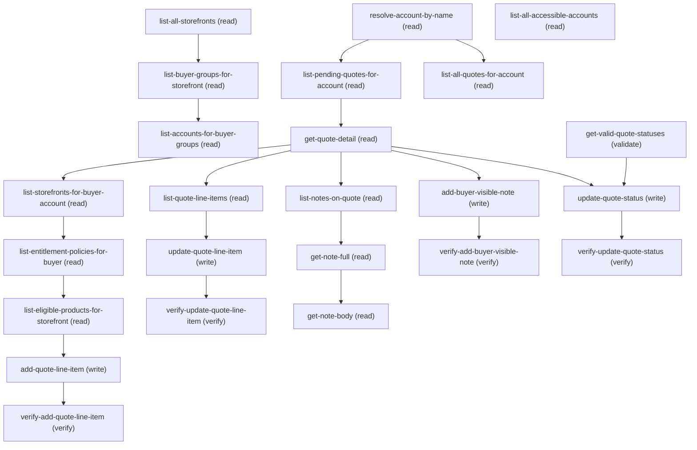

# Managing B2b Merchant Quote Management

## When to Use This Skill

B2B Commerce merchant quote management — sales rep / sales ops / commerce admin working buyer-submitted RFQs. Reviews pending quotes for a customer Account, edits line-item pricing (UnitPrice, Discount), adds line items from the buyer's entitled catalog (including free promotional items via Discount=100), adds buyer-visible notes, approves/rejects. Trigger phrases: "approve a quote for a customer", "review pending B2B quotes", "discount a quote", "add a free product to a customer quote", "process an RFQ", "sales rep quote approval", "merchant quote review", "quote negotiation", "reject a customer quote", "adjust quote pricing", "give a buyer a goodwill discount". Two entry modes: (1) know the account name → resolve-account-by-name first; (2) have the AccountId → skip resolve, start at list-pending-quotes-for-account. Notes take plain title + plain text; the skill handles HTML wrap + base64 on write. Always call get-valid-quote-statuses before update-quote-status (orgs customize the picklist heavily). Status semantics matter — see update-quote-status for the merchant-column vs buyer-column refuse-then-confirm guardrail.

## Workflow

Flows (drop resolve-account-by-name if the merchant already has an AccountId; start at list-pending-quotes-for-account):
- Happy path (approve with adjustments):
  resolve-account-by-name → list-pending-quotes-for-account → (pick)
  → get-quote-detail → list-quote-line-items → update-quote-line-item
  → verify-update-quote-line-item → add-buyer-visible-note →
  verify-add-buyer-visible-note → get-valid-quote-statuses →
  update-quote-status(newStatus="Approved") →
  verify-update-quote-status.

- Goodwill / free-giveaway (add free promo, then approve):
  resolve-account-by-name → list-pending-quotes-for-account →
  get-quote-detail (capture Pricebook2Id + AccountId/QuoteAccountId)
  → list-storefronts-for-buyer-account → list-entitlement-policies-
  for-buyer → list-eligible-products-for-storefront (uses Quote's
  Pricebook2Id, NOT WebStore's) → add-quote-line-item(Discount=100,
  description="Promotional item") → verify-add-quote-line-item →
  add-buyer-visible-note → get-valid-quote-statuses →
  update-quote-status("Approved") → verify-update-quote-status.

- Rejection: resolve-account-by-name →
  list-pending-quotes-for-account → get-quote-detail →
  list-quote-line-items → add-buyer-visible-note(reason) →
  get-valid-quote-statuses → update-quote-status("Rejected") →
  verify-update-quote-status.

- Fast approval: resolve-account-by-name →
  list-pending-quotes-for-account → get-quote-detail →
  get-valid-quote-statuses → update-quote-status("Approved") →
  verify-update-quote-status.

Session tips: always call get-valid-quote-statuses before update-quote-status (org-specific picklist). Buyer visibility on notes requires org-level Experience Cloud external file sharing — composite succeeds either way but the buyer won't see the note if it's off; confirm once per environment. update-quote-line-item is field-level merge (omit=unchanged, null=clear). list-all-quotes-for-account is for historical review, off the primary path.
# Pagination contract (uniform across all list steps — agent-first, NOT UI-scroll-first)
Defaults: `pageSize=20` on every list step (10 on resolve-account-by-name — LIKE search is noisy, top matches only). Never pass pageSize > 50 unless the merchant explicitly asks for exhaustive results.
Page-1-then-wait (CRITICAL): after page 1, the agent MUST STOP and hand back to the merchant even when the page is saturated (`len(records) == pageSize`). Do NOT auto-walk pages 2+ in the same turn. Correct behavior:

### Phase 1: Fetch page 1 with the step's default pageSize

Fetch page 1 with the step's default pageSize.

### Phase 2: Render the rows

Render the rows.

### Phase 3: If len(records) == pageSize, tell the merchant

"showing first
     {pageSize} — say 'more' / 'next' to load the next page, or
     narrow with a filter (nameFilter, status) if you're looking
     for something specific." Then WAIT.
Only fetch subsequent pages on explicit merchant reaction ("more", "next", "keep going", "show the rest"). Agentic clients (Slack, Teams, Claude Desktop) don't want a wall-of-text dump. One page per merchant turn.
Cursor keying (why fields differ across steps):
  - Account, Quote, Product steps → cursor on `afterId` with
    `Id < 'lastIdFromPreviousPage'` and `ORDER BY Id DESC`. Id is
    unique; wall-clock cursors DROP rows on bulk-load orgs
    (verified 2026-07-27: 4 Accounts sharing
    CreatedDate=2026-07-01T10:02:10.000 were skipped by a
    CreatedDate cursor).
  - list-quote-line-items → cursor on `afterLineNumber` (LineNumber
    is Salesforce-issued per-Quote monotonic + unique — the one
    case where a non-Id cursor is provably safe). String-quoted:
    `LineNumber > '00000005'`.
  - list-all-storefronts, list-storefronts-for-buyer-account,
    list-buyer-groups-for-storefront, list-notes-on-quote → NO
    cursor; natural universe is bounded — expand pageSize instead.

Cursor SOQL shape (CRITICAL): the `q:` template on each cursor step is the PAGE-1 shape (no cursor clause). Page 2+ requires the agent to REBUILD the SOQL by injecting the cursor predicate before `ORDER BY`. Example (list-all-accessible-accounts):
  Page 1: `SELECT ... WHERE IsBuyer = true ORDER BY Id DESC LIMIT 20`
  Page 2: `SELECT ... WHERE IsBuyer = true AND Id <
    'lastIdFromPage1' ORDER BY Id DESC LIMIT 20`
Do NOT try `OR afterId = null` — SOQL rejects `null = null` and `'X' = null` (verified 2026-07-27). Conditional injection is the only working shape.
Stop-when-tail: if a step returns fewer rows than pageSize, that's the tail — do NOT invoke again with a cursor.
Hard ceilings (safety net, NOT the default; page-1-then-wait means reaching page 5 requires the merchant to have said "more" 5 times): Accounts 5 pages · Quotes 5 · Products 5 (push toward nameFilter before walking >250 SKUs) · Quote line items 10 (Cart→Quote max 2000) · Notes 3. At ceiling with a still-saturated page: warn the merchant + suggest a narrower filter.
# Auto-refresh after every mutation (no confirmation needed)
Every write step is paired with a verify-* step. The agent MUST invoke the paired verify AUTOMATICALLY after the write succeeds — do NOT ask permission. The verify is part of the write's contract. After verify, ALSO refresh + DISPLAY the affected Quote state:
  - After update-quote-line-item or add-quote-line-item: run
    list-quote-line-items (page 1) AND re-fetch get-quote-detail
    for Subtotal / Discount / GrandTotal / LineItemCount. Show
    before/after on both the mutated line and Quote rollups.
  - After add-buyer-visible-note: run list-notes-on-quote so the
    merchant sees the new note in the full list.
  - After update-quote-status: run get-quote-detail for the
    Status transition + LastModifiedDate; if Status moved to
    Approved / Rejected / Presented, ALSO re-run
    list-quote-line-items so the merchant captures the buyer-facing
    snapshot.
Merchant should never have to ask "what does the quote look like now?" Skip auto-refresh only on explicit "just do the update, don't re-fetch".

## Critical Constraints

**Preconditions:**

- Caller is an INTERNAL Salesforce user (User.UserType='Standard'). NOT for portal / community buyer users — they use the buyer-facing commerce-quotes-connect-api skill. Internal identity unlocks cross-Account visibility, QuoteLineItem edit access, and the ability to create ContentDocumentLink with Visibility=AllUsers. (check: `User.UserType == 'Standard'`)
- Read + Edit CRUD on Quote sObject with editable FLS on Status. Without it, update-quote-status returns HTTP 400 INSUFFICIENT_ACCESS / INVALID_FIELD_FOR_INSERT_UPDATE. (check: `User.hasQuoteEditAccess`)
- Read + Edit CRUD on QuoteLineItem with editable FLS on UnitPrice and Discount. Standard Sales User profiles have this; custom sales-ops profiles may not. Without it, update-quote-line-item returns HTTP 400 INSUFFICIENT_ACCESS. (check: `User.hasQuoteLineItemEditAccess`)
- Record-level access to the target Quote / QuoteLineItem via ownership, role hierarchy, sharing rules, or manual shares. In B2B Commerce orgs, buyer-created quotes are typically owned by the buyer's community user and shared with merchants via Account ownership or account-team rules. Without access, SOQL returns zero rows (silent) and GET returns 404 — org config issue, not fixable in the skill. (check: `RecordLevelAccess.Quote`)
- Create on ContentNote and ContentDocumentLink (standard users have this by default). Without it, add-buyer-visible-note composite returns HTTP 403 on the first sub-call. (check: `User.hasContentNoteCreateAccess`)
- Org does NOT have Salesforce CPQ installed, OR (if installed) the target Quotes are standard Quote records, not SBQQ__Quote__c. This skill targets standard Quote / QuoteLineItem; CPQ orgs working exclusively with SBQQ objects need a CPQ-specific variant (QLI edits may be blocked by CPQ triggers). (check: `Org.noCPQOrStandardQuoteInUse`)
- No active Approval Process locking Quote.Status. If the Quote is mid-approval, PATCH returns HTTP 400 UNABLE_TO_LOCK_ROW / ENTITY_IS_LOCKED — that flow needs a separate skill built around ProcessInstanceWorkitem + /process/approvals. (check: `Quote.noActiveApprovalProcessLock`)
- For add-quote-line-item ONLY — Quote.Pricebook2Id must be set, the buyer Account must be in a BuyerGroup with an active CommerceEntitlementPolicy + at least one CommerceEntitlementProduct, and at least one of those products must have an active PricebookEntry in the Quote's pricebook. Misalignment → empty eligible-products query or INVALID_CROSS_REFERENCE_KEY on POST. (check: `BuyerAccount.hasEntitledProductsInQuotePricebook`)
- For buyer-visible notes ONLY — Experience Cloud external file sharing must be enabled at the org level (Setup → Sharing Settings → File Sharing = "Set by Record"). If off, the note is created + linked successfully but NOT visible to buyers in Experience Cloud (silent — the 2xx response doesn't indicate buyer visibility). (check: `ExperienceCloud.externalFileSharingEnabled`)

## Verification Checklist

After every write operation, confirm the effect by re-reading state:

- After `update-quote-line-item`: call `verify-update-quote-line-item`
- After `add-quote-line-item`: call `verify-add-quote-line-item`
- After `add-buyer-visible-note`: call `verify-add-buyer-visible-note`
- After `update-quote-status`: call `verify-update-quote-status`

## Operations Reference

Operations grouped by purpose. Use these as the building blocks for the workflows above.

### Summary

| Operation | Purpose | Status | Call | Depends on |
|-----------|---------|--------|------|------------|
| `resolve-account-by-name` | read | — | `queryAccounts` | — |
| `list-all-storefronts` | read | — | `queryAllStorefronts` | — |
| `list-buyer-groups-for-storefront` | read | — | `queryBuyerGroupsForStorefront` | `list-all-storefronts` |
| `list-accounts-for-buyer-groups` | read | — | `queryAccountsForBuyerGroups` | `list-buyer-groups-for-storefront` |
| `list-all-accessible-accounts` | read | — | `queryAllAccessibleAccounts` | — |
| `list-pending-quotes-for-account` | read | — | `queryQuotesPendingReview` | `resolve-account-by-name` |
| `list-all-quotes-for-account` | read | — | `queryAllQuotesForAccount` | `resolve-account-by-name` |
| `get-quote-detail` | read | — | `getQuoteDetail` | `list-pending-quotes-for-account` |
| `list-quote-line-items` | read | — | `queryQuoteLineItems` | `get-quote-detail` |
| `list-storefronts-for-buyer-account` | read | — | `queryStorefrontsForBuyerAccount` | `get-quote-detail` |
| `list-entitlement-policies-for-buyer` | read | — | `queryEntitlementPoliciesForBuyer` | `list-storefronts-for-buyer-account` |
| `list-eligible-products-for-storefront` | read | — | `queryEligibleProductsForStorefront` | `list-entitlement-policies-for-buyer` |
| `update-quote-line-item` | write | — | `updateQuoteLineItem` | `list-quote-line-items` |
| `verify-update-quote-line-item` | verify | — | `getQuoteLineItem` | `update-quote-line-item` |
| `add-quote-line-item` | write | — | `createQuoteLineItem` | `list-eligible-products-for-storefront` |
| `verify-add-quote-line-item` | verify | — | `getQuoteLineItem` | `add-quote-line-item` |
| `list-notes-on-quote` | read | — | `queryQuoteContentDocumentLinks` | `get-quote-detail` |
| `get-note-full` | read | — | `getContentNote` | `list-notes-on-quote` |
| `get-note-body` | read | — | `getContentNoteBody` | `get-note-full` |
| `add-buyer-visible-note` | write | — | `addBuyerVisibleQuoteNote` | `get-quote-detail` |
| `verify-add-buyer-visible-note` | verify | — | `queryQuoteContentDocumentLinks` | `add-buyer-visible-note` |
| `get-valid-quote-statuses` | validate | — | `getQuoteStatusPicklistValues` | — |
| `update-quote-status` | write | — | `updateQuoteStatus` | `get-quote-detail`, `get-valid-quote-statuses` |
| `verify-update-quote-status` | verify | — | `getQuoteDetail` | `update-quote-status` |

### Dependency graph

### Read operations

#### `resolve-account-by-name`

Resolve an AccountId from a merchant-supplied account name or partial name. Use SOQL LIKE to match on Account.Name; return the top matches so the merchant can disambiguate. If the merchant already has an AccountId, skip this step and pass the id directly to list-pending-quotes-for-account.

**Call:** `queryAccounts`

**Inputs:**

- `accountNameQuery` *(`String`)* — Merchant-supplied account name or fragment. Use SOQL LIKE semantics — %fragment% for substring match, or an exact name for exact match. Case-insensitive.

- `pageSize` *(`Integer`)* — Rows to return. Defaults to 10 (agent-first UX). Bump up to 50 only if the merchant explicitly asks for more matches. See the top-level "Pagination contract" section.

#### `list-all-storefronts`

List B2B Commerce storefronts (WebStore Type='B2B'). Entry point for browsing buyer accounts by storefront. Followed by list-buyer-groups-for-storefront then list-accounts-for-buyer-groups.

**Call:** `queryAllStorefronts`

**Inputs:**

- `includeAllStorefrontTypes` *(`Boolean`)* — Default false → filter WHERE Type='B2B' (B2C / D2C storefronts don't have merchant quote review). Pass true only when the merchant explicitly wants all storefronts on the org (rare, e.g. org-wide inventory review) — the agent drops the WHERE entirely (see agent_guidance).

- `pageSize` *(`Integer`)* — Rows to return. Defaults to 20 — the merchant is picking one storefront so seeing the full spread at once beats paginating. Bump to 50 only if the merchant explicitly asks. No cursor on this step — storefronts are org-bounded (≤100/org), so if the first page hits the ceiling, expand pageSize rather than paginating. See the top-level "Pagination contract".

#### `list-buyer-groups-for-storefront`

List BuyerGroups mapped to a storefront. Step 1 of the 2-hop "browse buyer accounts by storefront" flow (feeds list-accounts-for-buyer-groups). Split to stay under SOQL's 2-level semi-join limit.

**Call:** `queryBuyerGroupsForStorefront`

**Inputs:**

- `webStoreId` *(`String`)* — Id of the target WebStore, from list-all-storefronts or supplied directly by the merchant.

  - **Source:** output of `list-all-storefronts`
- `pageSize` *(`Integer`)* — Rows to return. Defaults to 20 — buyer groups per storefront are typically <20 so the first page captures the full mapping in one call, letting the merchant pick without paginating. Expand to 50 only for the rare storefront with more buyer groups than that. No cursor — the natural universe is bounded per storefront. See top-level "Pagination contract".

**Depends on:** `list-all-storefronts`

#### `list-accounts-for-buyer-groups`

List the buyer Accounts that are members of a set of BuyerGroups, ordered by Account.Id DESC and paged via Id cursor. Step 2 of the 2-hop "browse buyer accounts by storefront" flow — takes BuyerGroupIds from list-buyer-groups-for-storefront and returns the reachable Accounts.

**Call:** `queryAccountsForBuyerGroups`

**Inputs:**

- `buyerGroupIds` *(`List<String>`)* — Array of BuyerGroupIds from list-buyer-groups-for-storefront.buyer_groups[*].BuyerGroupId. Rendered into a SOQL IN clause.

  - **Source:** output of `list-buyer-groups-for-storefront`
- `pageSize` *(`Integer`)* — Rows to return. Default 20; bump to 50 on merchant request. See top-level "Pagination contract".

- `afterId` *(`String`)* — Cursor. Omit on page 1. On saturated pages, pass the LAST record's Id. See top-level "Pagination contract".

**Depends on:** `list-buyer-groups-for-storefront`

#### `list-all-accessible-accounts`

List every buyer Account visible to the merchant (across all storefronts), paged via Id cursor. Filtered on IsBuyer = true so partner / internal / non-commerce Accounts do not clutter the list. Use when the merchant does not know the account name or storefront and wants to browse.

**Call:** `queryAllAccessibleAccounts`

**Inputs:**

- `pageSize` *(`Integer`)* — Rows to return. Default 20; bump to 50 on merchant request. See top-level "Pagination contract".

- `afterId` *(`String`)* — Cursor. Omit on page 1. On saturated pages, pass the LAST record's Id. See top-level "Pagination contract".

#### `list-pending-quotes-for-account`

List all quotes for a specific Account that still need merchant review — i.e., Status is neither Approved nor Rejected. Returns the fields commonly needed to triage which quote to drill into.

**Call:** `queryQuotesPendingReview`

**Inputs:**

- `accountId` *(`String`)* — Id of the Account whose pending quotes are being listed. Comes from resolve-account-by-name.accounts[*].Id, or supplied directly by the merchant.

  - **Source:** output of `resolve-account-by-name`
- `pageSize` *(`Integer`)* — Rows to return. Default 20; bump to 50 on merchant request. See top-level "Pagination contract".

- `afterId` *(`String`)* — Cursor. Omit on page 1. On saturated pages, pass the LAST record's Id. See top-level "Pagination contract".

**Depends on:** `resolve-account-by-name`

#### `list-all-quotes-for-account`

List all quotes for an Account regardless of Status — for when the merchant wants to see historical / already-decided quotes too. Same shape as list-pending-quotes-for-account but without the Status filter.

**Call:** `queryAllQuotesForAccount`

**Inputs:**

- `accountId` *(`String`)*
- `pageSize` *(`Integer`)* — Rows to return. Default 20; bump to 50 on merchant request. See top-level "Pagination contract".

- `afterId` *(`String`)* — Cursor. Omit on page 1. On saturated pages, pass the LAST record's Id. See top-level "Pagination contract".

**Depends on:** `resolve-account-by-name`

#### `get-quote-detail`

Retrieve full field detail for a single Quote by Id. Returns all accessible fields on the Quote sObject subject to FLS — including pricing rollups, addresses, contact, opportunity linkage, status, description, and any org-defined custom fields.

**Call:** `getQuoteDetail`

**Inputs:**

- `quoteId` *(`String`)* — Id of the target Quote. Comes from a prior list step's records[*].Id.

**Depends on:** `list-pending-quotes-for-account`

#### `list-quote-line-items`

List line items on a specific Quote with their pricing and product references, paged by LineNumber ASC with a small agent-first default. This is the surface the merchant reviews before deciding to adjust price / discount, add a note, or approve / reject.

**Call:** `queryQuoteLineItems`

**Inputs:**

- `quoteId` *(`String`)*
- `pageSize` *(`Integer`)* — Rows to return. Default 20; bump to 50 on merchant request (Cart→Quote conversions can reach 2000 lines). See top-level "Pagination contract".

- `afterLineNumber` *(`String`)* — Cursor. Omit on page 1. On saturated pages, pass the LAST record's LineNumber as a zero-padded string (e.g. "00000005"). See top-level "Pagination contract" for the string-quoting requirement.

**Depends on:** `get-quote-detail`

#### `list-storefronts-for-buyer-account`

List B2B storefronts (WebStore) a buyer Account is entitled to. Runs before list-eligible-products-for-storefront: an Account can belong to multiple BuyerGroups across WebStores — merchant picks one. Walks Account → BuyerGroupMember → BuyerGroup → WebStoreBuyerGroup → WebStore.

**Call:** `queryStorefrontsForBuyerAccount`

**Inputs:**

- `accountId` *(`String`)* — Id of the buyer Account (Quote.AccountId OR Quote.QuoteAccountId — buyer-created quotes populate the latter; use whichever is non-null).

- `pageSize` *(`Integer`)* — Rows to return. Default 20; bump to 50 on merchant request. No cursor — storefront entitlements per Account are naturally bounded.

**Depends on:** `get-quote-detail`

#### `list-entitlement-policies-for-buyer`

Resolve CommerceEntitlementPolicy Ids a buyer Account is entitled under (BuyerGroupMember → CommerceEntitlementBuyerGroup). Preliminary step for list-eligible-products-for-storefront — SOQL forbids nested semi-joins, so the full entitlement walk is split into TWO queries (this one produces PolicyIds; the next inlines them into a PricebookEntry query).

**Call:** `queryEntitlementPoliciesForBuyer`

**Inputs:**

- `accountId` *(`String`)* — Id of the buyer Account (from Quote.AccountId or Quote.QuoteAccountId). Passed to BuyerGroupMember.BuyerId.

**Depends on:** `list-storefronts-for-buyer-account`

#### `list-eligible-products-for-storefront`

List products a buyer Account is entitled to buy from a storefront, joined with the Quote's Pricebook so each carries a resolvable PricebookEntryId + UnitPrice. Used before add-quote-line-item so the merchant picks from a genuinely eligible catalog. Consumes PolicyIds from list-entitlement-policies-for-buyer (SOQL single-semi-join limit — the walk is split into two steps).

**Call:** `queryEligibleProductsForStorefront`

**Inputs:**

- `policyIds` *(`String`)* — Comma-separated, single-quoted PolicyId list from list-entitlement-policies-for-buyer.records[*].PolicyId (inlined into a SOQL IN(...) clause). Example: `'1Ce000000000001AAA','1Ce000000000002AAA'`. If the policies list is empty, DO NOT call this step; surface "buyer has no entitlements".

  - **Source:** output of `list-entitlement-policies-for-buyer`
- `quotePricebookId` *(`String`)* — Pricebook2Id from Quote.Pricebook2Id (via get-quote-detail). NOT WebStore's default pricebook — the two can differ, and QuoteLineItem.PricebookEntryId must resolve against the Quote's pricebook. See agent_guidance for the trap.

- `nameFilter` *(`String`)* — Optional SOQL LIKE fragment on Product2.Name. Omit → all eligible products (paged). Pass "Alpine" → "%Alpine%". Recommended for catalogs >50 SKUs.

- `pageSize` *(`Integer`)* — Rows to return. Default 20; bump to 50 on merchant request. Prefer nameFilter over walking a large catalog. See top-level "Pagination contract".

- `afterId` *(`String`)* — Cursor. Omit on page 1. On saturated pages, pass the LAST PricebookEntry.Id. See top-level "Pagination contract".

**Depends on:** `list-entitlement-policies-for-buyer`

#### `list-notes-on-quote`

List notes attached to a Quote via ContentDocumentLink, filtered to notes only (ContentDocument.FileType='SNOTE'). Returns metadata + TextPreview snippet (~255 chars) — not the full body. Use to show note history without pulling full content per note.

**Call:** `queryQuoteContentDocumentLinks`

**Inputs:**

- `quoteId` *(`String`)*
- `pageSize` *(`Integer`)* — Rows to return. Defaults to 20 — a Quote typically has ≤20 notes so the first page usually captures the entire history in one call, avoiding the paginate/expand round-trip. Bump to 50 only for pathological Quotes. See top-level "Pagination contract".

**Depends on:** `get-quote-detail`

#### `get-note-full`

Metadata + TextPreview for a single ContentNote by Id. Content is a URL reference (relative /Content path), NOT the inline body — the real note body is base64 HTML served by a separate binary GET (see get-note-body). TextPreview is plain-text and usually enough for display.

**Call:** `getContentNote`

**Inputs:**

- `contentDocumentId` *(`String`)* — The ContentDocumentId returned by list-notes-on-quote — it is the Id of the underlying ContentNote (ContentNote inherits its Id from ContentDocument at storage time).

**Depends on:** `list-notes-on-quote`

#### `get-note-body`

Fetch the full HTML body of a ContentNote from its /Content binary endpoint. Only needed when TextPreview is insufficient (note longer than ~255 chars or full formatting required). Response is the raw HTML string, not a JSON envelope.

**Call:** `getContentNoteBody`

**Inputs:**

- `contentDocumentId` *(`String`)*

**Depends on:** `get-note-full`

### Write operations

#### `update-quote-line-item`

Update UnitPrice, Discount, and/or Description on one QuoteLineItem. UnitPrice and Discount are independent (updating one doesn't clear the other). TotalPrice + Quote rollups (Subtotal, GrandTotal) recompute automatically. Discount is a percentage 0-100, NOT a fraction.

**Call:** `updateQuoteLineItem`

**Inputs:**

- `quoteLineItemId` *(`String`)*
- `unitPrice` *(`Number`)* — New per-unit price for the line, in the Quote's currency. Omit to leave UnitPrice unchanged. Cannot be negative.

- `discount` *(`Number`)* — Discount percentage 0-100 (NOT 0-1). Omit to leave Discount unchanged. Zero clears any existing discount.

- `description` *(`String`)* — Line-item description / notes visible to buyer in the storefront.

**Depends on:** `list-quote-line-items`

**Rollback:** {'description': 'Re-PATCH the line item with the ORIGINAL UnitPrice / Discount / Description values captured from list-quote-line-items before the write. sObject PATCH does not track history; the merchant (or agent) is responsible for capturing prior values if rollback is needed.\n', 'operation': 'updateQuoteLineItem', 'invocation': {'kind': 'rest', 'method': 'PATCH', 'path': '/sobjects/QuoteLineItem/{quoteLineItemId}', 'body': {'UnitPrice': '{originalUnitPrice}', 'Discount': '{originalDiscount}', 'Description': '{originalDescription}'}}}

#### `add-quote-line-item`

Add a NEW line item to a Quote — used for goodwill operations like a free promotional product (Discount=100). Product MUST come from list-eligible-products-for-storefront so entitlement is honored and PricebookEntry resolves against the Quote's pricebook. TotalPrice + Quote rollups recompute via triggers.

**Call:** `createQuoteLineItem`

**Inputs:**

- `quoteId` *(`String`)*
- `product2Id` *(`String`)* — Product2Id of the entitled product. Comes from list-eligible-products-for-storefront.eligible_products[*].Product2Id.

  - **Source:** output of `list-eligible-products-for-storefront`
- `pricebookEntryId` *(`String`)* — PricebookEntry Id for the (product, pricebook) pair. Comes from list-eligible-products-for-storefront.eligible_products[*].Id. MUST resolve against the Quote's pricebook — using a PricebookEntry from a different pricebook fails with INVALID_CROSS_REFERENCE_KEY.

  - **Source:** output of `list-eligible-products-for-storefront`
- `quantity` *(`Number`)* — Quantity of the product to add. Must be >= 1.

- `unitPrice` *(`Number`)* — Per-unit price to stamp on the line. REQUIRED on the sObject REST POST — Salesforce does NOT auto-default from PricebookEntry.UnitPrice on this endpoint (verified 2026-07-24: POST with PricebookEntryId only + Quantity but no UnitPrice returns HTTP 400 REQUIRED_FIELD_MISSING: [UnitPrice]). Fetch the pricebook's list price from list-eligible-products-for-storefront.eligible_products[*].UnitPrice and pass it through explicitly (or pass a merchant-negotiated value). Cannot be negative.

  - **Source:** output of `list-eligible-products-for-storefront`
- `discount` *(`Number`)* — Discount percentage 0-100. Use 100 to give the item free (TotalPrice = 0). Omit for no discount.

- `description` *(`String`)* — Line-item description / notes visible to buyer in the storefront. Recommended to fill this in for goodwill / promotional lines so the buyer sees why the free item was added (e.g., "Promotional item — thank you for your business").

**Depends on:** `list-eligible-products-for-storefront`

**Rollback:** {'description': 'DELETE the QuoteLineItem. Quote-level rollups (Subtotal, GrandTotal) auto-recalculate down after the delete via standard triggers.\n', 'operation': 'deleteQuoteLineItem', 'invocation': {'kind': 'rest', 'method': 'DELETE', 'path': '/sobjects/QuoteLineItem/{quote_line_item_id}'}}

#### `add-buyer-visible-note`

Create a buyer-visible note on a Quote. Composite two-record op: (1) INSERT ContentNote (title + base64 HTML body); (2) INSERT ContentDocumentLink linking that note to the Quote with ShareType='V' + Visibility='AllUsers' (visible to external buyer users). Both commit atomically in one /composite/ call.

**Call:** `addBuyerVisibleQuoteNote`

**Inputs:**

- `quoteId` *(`String`)* — Id of the Quote to attach the note to.
- `title` *(`String`)* — Note title. Max 200 chars. Shown to buyer in note list.

- `bodyText` *(`String`)* — Plain-text body of the note. THE AGENT MUST base64-encode the HTML-wrapped body before dispatch — see agent_guidance below for the exact transformation. Max ~500 KB decoded.

**Depends on:** `get-quote-detail`

**Rollback:** {'description': 'Delete both records: DELETE the ContentDocumentLink first, then DELETE the ContentNote. If the ContentNote is deleted while links still exist, Salesforce cascades but leaves orphan entries in some audit tables — clean up the link first.\n', 'operation': 'deleteBuyerVisibleQuoteNote', 'invocation': {'kind': 'rest', 'method': 'POST', 'path': '/composite', 'body': {'compositeRequest': [{'method': 'DELETE', 'url': '/sobjects/ContentDocumentLink/{content_document_link_id}', 'referenceId': 'dropLink'}, {'method': 'DELETE', 'url': '/sobjects/ContentNote/{content_note_id}', 'referenceId': 'dropNote'}]}}}

#### `update-quote-status`

Approve or reject a quote by flipping Quote.Status to a specific picklist value. This is a direct field PATCH — no Approval Process is invoked. The merchant is responsible for picking a valid value (typically "Approved" or "Rejected") based on get-valid-quote-statuses output.

**Call:** `updateQuoteStatus`

**Inputs:**

- `quoteId` *(`String`)*
- `newStatus` *(`String`)* — Target Quote.Status value. Must be an active value from get-valid-quote-statuses. Typical values: "Approved", "Rejected". Some orgs use "Denied" or "Accepted" instead.

  - **Source:** output of `get-valid-quote-statuses`

**Depends on:** `get-quote-detail`, `get-valid-quote-statuses`

**Rollback:** {'description': 'PATCH Quote.Status back to its prior value (captured from get-quote-detail before the update). Salesforce does not track prior-status automatically for direct PATCHes.\n', 'operation': 'updateQuoteStatus', 'invocation': {'kind': 'rest', 'method': 'PATCH', 'path': '/sobjects/Quote/{quoteId}', 'body': {'Status': '{priorStatus}'}}}

### Verify operations

#### `verify-update-quote-line-item`

Re-read the QuoteLineItem after update to confirm UnitPrice / Discount / Description landed.

**Call:** `getQuoteLineItem`

**Inputs:**

- `quoteLineItemId` *(`String`)*

**Depends on:** `update-quote-line-item`

#### `verify-add-quote-line-item`

Re-read the newly created QuoteLineItem to confirm the Quantity, UnitPrice, Discount, and TotalPrice landed correctly — especially useful for the Discount=100 free-giveaway pattern (asserts TotalPrice == 0).

**Call:** `getQuoteLineItem`

**Inputs:**

- `quoteLineItemId` *(`String`)*

**Depends on:** `add-quote-line-item`

#### `verify-add-buyer-visible-note`

Re-list ContentDocumentLinks on the quote (filtered to FileType='SNOTE') and confirm the newly added note appears with the expected title and correct share/visibility settings.

**Call:** `queryQuoteContentDocumentLinks`

**Inputs:**

- `quoteId` *(`String`)*
- `expectedTitle` *(`String`)*

**Depends on:** `add-buyer-visible-note`

#### `verify-update-quote-status`

Re-read the Quote after status update to confirm the new Status persisted.

**Call:** `getQuoteDetail`

**Inputs:**

- `quoteId` *(`String`)*

**Depends on:** `update-quote-status`

### Other operations

#### `get-valid-quote-statuses`

Fetch valid Quote.Status picklist values via the UI-API picklist-values endpoint (master record type 012000000000000AAA — the standard record type used when Quote has no custom types). Status is customizable; call before update-quote-status so the agent picks a value the org accepts. Returns just active values (~1KB) — NOT the full sObject describe (~800KB), which trips result-truncation gates.

**Call:** `getQuoteStatusPicklistValues`
