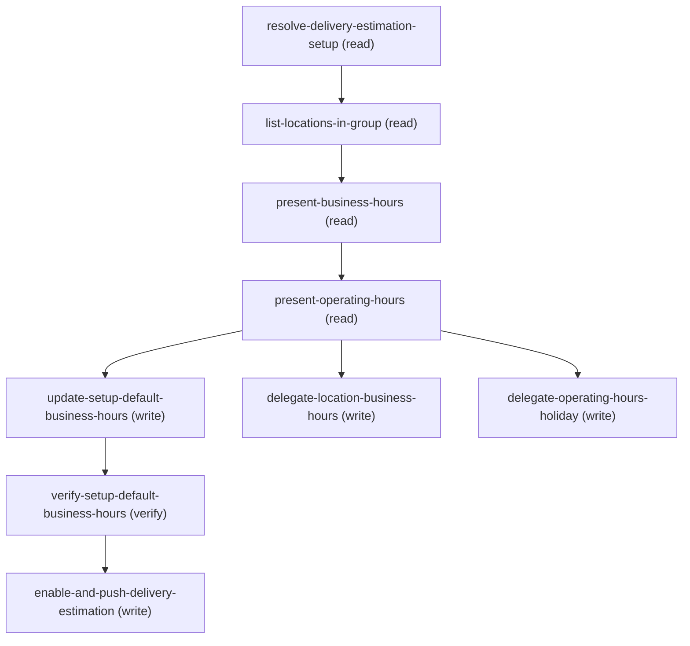

# Managing Update Delivery Business Hours

## When to Use This Skill

Use this workflow when an admin wants to change the hours behind delivery estimation. There
are TWO independent hours systems, and this front door presents BOTH across all levels
before asking what to change:

  A. FLAT BusinessHours (weekly open/close per day + timezone). Reached by
     DeliveryEstimationSetup.DefaultBusinessHoursId (the group-wide default) and
     Location.FulfillingBusinessHoursId (a per-location override). It has NO holidays and NO
     timeslots — just Monday..Sunday start/end times. Edited by a DIRECT sObject Data-API
     PATCH on the BusinessHours record. NEVER via a Connect API.

  B. OperatingHours (weekly TimeSlots + Holiday exceptions). Reached PER LOCATION by
     Location.FulfillingOperationalHoursId (minApiVersion 264 = API v68 — you MUST use
     v68.0 to see/set it). The Holiday/TimeSlot graph (OperatingHours -> TimeSlot children,
     OperatingHours -> OperatingHoursHoliday -> Holiday) is edited ONLY through the
     fulfilling-operating-hours Connect API. This is delegated to
     update-location-temporary-operating-hours.

FLOW:
  1. resolve-delivery-estimation-setup -> by Name/ExternalReference (may match more than one —
     confirm which with the customer, never default to the first) -> the CHOSEN setup's Id,
     LocationGroupId, ExternalReference, DefaultBusinessHoursId.
  2. list-locations-in-group -> LocationGroupAssignment -> Location, capturing BOTH
     FulfillingBusinessHoursId and FulfillingOperationalHoursId (query at v68 so the latter
     is visible).
  3. present-business-hours + present-operating-hours -> READ AND PRESENT ALL LEVELS: the setup default BusinessHours,
     each location's BusinessHours (or "inherits default"), and each location's
     OperatingHours (weekly TimeSlots + Holidays, or "none"). Show the complete picture so
     the admin can choose.
  4. ASK hours-scope: setup default BusinessHours | a location's BusinessHours | a
     location's operating hours / holiday override.
  5. Apply: setup-default BusinessHours inline (Data-API PATCH); per-location BusinessHours
     -> delegate update-location-business-hours; operating hours / holiday ->
     delegate update-location-temporary-operating-hours.
  6. propagate (enable-and-push).

Mechanism + version rules and the verified wire contracts (HTTP codes, field names, per-day
formats, v67-vs-v68) live in agent_guidance and on the individual steps — kept off this card,
which stays a high-level "what/when to use this" summary.

## Workflow

Front door for changing delivery-estimation hours. TWO independent systems, presented across
ALL levels before the admin chooses:
  - FLAT BusinessHours (weekly open/close + timezone) — setup default
    (DeliveryEstimationSetup.DefaultBusinessHoursId) + per-location
    (Location.FulfillingBusinessHoursId). Edited by sObject Data-API PATCH (v67). No holidays.
  - OperatingHours (weekly TimeSlots + Holiday overrides) — per-location
    (Location.FulfillingOperationalHoursId, v68). Edited ONLY via the fulfilling-operating-hours
    Connect API (delegated).
Flow: resolve -> list-locations (v68, both FKs) -> present-business-hours + present-operating-hours
(read + show every level) -> ASK hours-scope -> setup-default BusinessHours inline (Data-API PATCH) | delegate
per-location BusinessHours | delegate operating-hours/holiday -> enable-and-push.
MECHANISM RULE (hard): BusinessHours = Data API PATCH; Holiday/OperatingHours = Connect API.
Never cross them. VERSION RULE: anything touching FulfillingOperationalHoursId /
OperatingHours = v68.0 (minApiVersion 264); BusinessHours Data-API steps = v67.0.
WIRE CONTRACT: BusinessHours PATCH returns 204 (read-back + restore supported);
Location.FulfillingOperationalHoursId is settable only at v68 (204).

## Critical Constraints

**Preconditions:**

- Commerce Order Management with Delivery Estimation must be enabled (DeliveryEstimationSetup
+ Location + LocationGroupAssignments exist). (check: `Delivery Estimation enabled + LocationGroup populated`)
- Editing flat BusinessHours needs Edit on the BusinessHours object + FLS on the per-day
fields. Editing operating hours / holidays needs the Delivery operating-hours ("special
hours") feature (which provisions Location.FulfillingOperationalHoursId at API v68) and
USER_HAS_DELIVERY_ESTIMATION for the Connect API. (check: `BusinessHours edit/FLS; operating-hours feature (v68 field) for the OH path`)
- A DeliveryEstimationSetup record (with a LocationGroup) must already exist. This workflow
edits existing hours; it does not create setups or location groups. (check: `DeliveryEstimationSetup + LocationGroup exist`)

**Operational rules:**

- CUSTOMER-FACING WORDING: on the setup-default branch, only after enable-and-push-delivery-estimation
confirms the push, say exactly: "Your change has been saved and synced." followed by a compact
recap — the CHOSEN setup's Name + ExternalReference (resolve-delivery-estimation-setup.setup_names /
.setup_external_references, at the customer-picked index), and the hours field(s) changed with
old -> new values (e.g. "Monday: 09:00-17:00 -> 09:00-18:00"). BusinessHours itself has NO
ExternalReference field — do not invent one; the setup is the recap anchor, not the BusinessHours
record. If you have the setup's Id (resolve-delivery-estimation-setup.setup_ids, at the chosen
index), add a best-effort link:
[<setup_name>](<orgHost>/lightning/r/DeliveryEstimationSetup/<setup_id>/view) — keep the `]` and
`(` together with no space/break between them, or the Markdown link renders broken; never speak
the raw Id itself.
RECAP LAYOUT — ONE setup changed: a single plain sentence. If the customer asked for the SAME
change across MULTIPLE setups in this conversation, give ONE consolidated table covering all of
them instead of repeated sentences — | Setup | Reference | Changed | header row, one row per
setup, same shape as the sibling per-location SORs' multi-row recap. Never say "CDS", "Commerce
Delivery Service", or "delivery estimation service" to the customer, and never imply there are two
separate systems — describe it as one seamless save. Keep the whole closing + recap under ~200
characters where possible (soft target, not a hard limit — prioritize the required recap content).
Still never surface sObject/field API names, Ids, or raw HTTP codes.

## Verification Checklist

After every write operation, confirm the effect by re-reading state:

- After `update-setup-default-business-hours`: call `verify-setup-default-business-hours`

## Operations Reference

Operations grouped by purpose. Use these as the building blocks for the workflows above.

### Summary

| Operation | Purpose | Status | Call | Depends on |
|-----------|---------|--------|------|------------|
| `resolve-delivery-estimation-setup` | read | implemented | `querySoql` | — |
| `list-locations-in-group` | read | implemented | `querySoql` | `resolve-delivery-estimation-setup` |
| `present-business-hours` | read | implemented | `querySoql` | `list-locations-in-group` |
| `present-operating-hours` | read | implemented | `getFulfillingOperatingHours` | `present-business-hours` |
| `update-setup-default-business-hours` | write | implemented | `updateBusinessHours` | `present-operating-hours` |
| `verify-setup-default-business-hours` | verify | implemented | `querySoql` | `update-setup-default-business-hours` |
| `delegate-location-business-hours` | write | — | → `cc-om-fast-and-furious/update-location-business-hours` | `present-operating-hours` |
| `delegate-operating-hours-holiday` | write | — | → `cc-om-fast-and-furious/update-location-temporary-operating-hours` | `present-operating-hours` |
| `enable-and-push-delivery-estimation` | write | — | → `cc-om-fast-and-furious/enable-and-push-delivery-estimation-setup` | `verify-setup-default-business-hours` |

### Dependency graph

### Read operations

#### `resolve-delivery-estimation-setup`

Resolve the DeliveryEstimationSetup by Name/ExternalReference and capture its
LocationGroupId (to list locations), ExternalReference (for the push), and
DefaultBusinessHoursId (the group-wide BusinessHours record).

**Call:** `querySoql`   — status: `implemented`

**Inputs:**

- `name` *(`String`)* — The DeliveryEstimationSetup's Name OR ExternalReference (e.g. "west") — the query matches
either. Source: user_input.

#### `list-locations-in-group`

List the setup's group locations with BOTH hours FKs. Queried at v68 so
FulfillingOperationalHoursId (minApiVersion 264) is visible; FulfillingBusinessHoursId is
also returned.

**Call:** `querySoql`   — status: `implemented`

**Inputs:**

- `locationGroupId` *(`String`)* — LocationGroup Id (0gh...) of the CHOSEN setup. Source: resolve-delivery-estimation-setup.location_group_ids (the one the customer picked when the lookup matched more than one).

**Depends on:** `resolve-delivery-estimation-setup`

#### `present-business-hours`

READ + present the flat BusinessHours levels (Data API): the setup's default BusinessHours AND
each location's own BusinessHours (per-day open/close + timezone). present-operating-hours reads
the OperatingHours level next — together they present ALL levels before the admin chooses.

**Call:** `querySoql`   — status: `implemented`

**Inputs:**

- `businessHoursIds` *(`Array`)* — The BusinessHours Ids to read — the CHOSEN setup's default_business_hours_ids[chosen index]
(ALWAYS include it, so the set is never empty) plus every non-null
Location.FulfillingBusinessHoursId. Source: resolve-delivery-estimation-setup (the entry at
the customer-picked index) + list-locations-in-group.

**Depends on:** `list-locations-in-group`

#### `present-operating-hours`

READ + present the OperatingHours level (Connect API, v68): for each location with a non-null
FulfillingOperationalHoursId, its weekly TimeSlots + Holidays. A first-class Connect read (bound
output) so the operating-hours level is visible + auditable, not buried in a follow-up.

**Call:** `getFulfillingOperatingHours`   — status: `implemented`

**Inputs:**

- `operatingHoursId` *(`String`)* — A location's OperatingHours Id (0OH...), from Location.FulfillingOperationalHoursId (the v68
list query). Loop one GET per non-null id; skip locations whose FK is null. Source:
list-locations-in-group.

**Depends on:** `present-business-hours`

### Write operations

#### `update-setup-default-business-hours`

Change the group-wide default weekly hours: PATCH the BusinessHours record referenced by
DeliveryEstimationSetup.DefaultBusinessHoursId. Direct sObject Data-API write (partial
merge — send only the day(s)/timezone being changed).

**Call:** `updateBusinessHours`   — status: `implemented`

**Inputs:**

- `businessHoursId` *(`String`)* — The setup default BusinessHours Id (01m...) of the CHOSEN setup. Source: resolve-delivery-estimation-setup.default_business_hours_ids (the one the customer picked when the lookup matched more than one).
- `dayFields` *(`Object`)* — The per-day open/close fields to change and/or TimeZoneSidKey. Keys are BusinessHours
field API names (e.g. MondayStartTime, MondayEndTime, ... TimeZoneSidKey); values are
times in HH:mm:ss.SSSZ (e.g. "09:00:00.000Z"). Include ONLY the fields being changed
(partial merge). Source: user_input.
  - schema: `{'type': 'object', 'minProperties': 1, 'additionalProperties': False, 'properties': {'MondayStartTime': {'type': 'string'}, 'MondayEndTime': {'type': 'string'}, 'TuesdayStartTime': {'type': 'string'}, 'TuesdayEndTime': {'type': 'string'}, 'WednesdayStartTime': {'type': 'string'}, 'WednesdayEndTime': {'type': 'string'}, 'ThursdayStartTime': {'type': 'string'}, 'ThursdayEndTime': {'type': 'string'}, 'FridayStartTime': {'type': 'string'}, 'FridayEndTime': {'type': 'string'}, 'SaturdayStartTime': {'type': 'string'}, 'SaturdayEndTime': {'type': 'string'}, 'SundayStartTime': {'type': 'string'}, 'SundayEndTime': {'type': 'string'}, 'TimeZoneSidKey': {'type': 'string'}}}`

**Depends on:** `present-operating-hours`

#### `delegate-location-business-hours`

PER-LOCATION business hours branch — hand off to update-location-business-hours, which
PATCHes the BusinessHours at each chosen location's FulfillingBusinessHoursId.

**Delegates to:** `cc-om-fast-and-furious/update-location-business-hours`

**Depends on:** `present-operating-hours`

#### `delegate-operating-hours-holiday`

OPERATING HOURS / HOLIDAY branch — hand off to update-location-temporary-operating-hours,
which manages a location's OperatingHours (weekly TimeSlots + Holiday overrides) via the
fulfilling-operating-hours Connect API (v68).

**Delegates to:** `cc-om-fast-and-furious/update-location-temporary-operating-hours`

**Depends on:** `present-operating-hours`

#### `enable-and-push-delivery-estimation`

Propagate the SETUP-DEFAULT hours change to the delivery estimation service (the inline branch),
keyed on the setup's ExternalReference. Scoped to the setup-default branch and gated on its verify
so it can never push stale config ahead of the write; the per-location and operating-hours/holiday
branches self-push via their own delegates (avoids a redundant double push).

**Delegates to:** `cc-om-fast-and-furious/enable-and-push-delivery-estimation-setup`

**Depends on:** `verify-setup-default-business-hours`

### Verify operations

#### `verify-setup-default-business-hours`

Re-read the setup default BusinessHours record and confirm the changed fields.

**Call:** `querySoql`   — status: `implemented`

**Inputs:**

- `businessHoursId` *(`String`)* — Source: update-setup-default-business-hours / resolve.

**Depends on:** `update-setup-default-business-hours`
