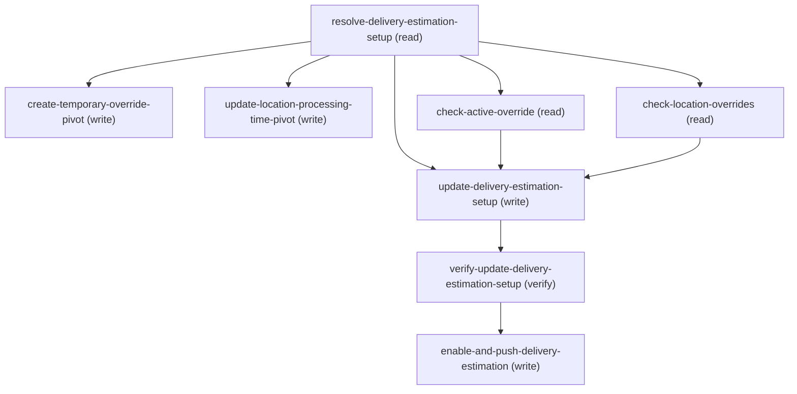

# Managing Update Delivery Estimation Setup

## When to Use This Skill

THE FRONT DOOR for ANY delivery-estimation processing-time change — use this whenever
an admin wants to change how long processing takes, at ANY level. It first asks the
SCOPE (override-scope: permanent vs temporary); for a permanent change it then asks the
LEVEL (permanent-target: the group-wide setup default vs a specific location), so the
three levels a customer can mean are all reachable from here:

  1. SETUP (group-wide default) — PATCH DeliveryEstimationSetup.DefaultProcessingTime /
     DefaultProcessingTimeUnit. The fallback every non-overridden location inherits.
     Handled inline by this SOR (resolve → shadowing reads → PATCH → verify → push).
  2. LOCATION (specific-location override) — permanent-target = location delegates to
     update-location-delivery-processing-time (PATCH Location.DefaultProcessingTime /
     DefaultProcessingTimeUnit; null clears a location's override → it inherits the
     setup default).
  3. TEMPORARY (time-boxed / holiday override) — override-scope = temporary delegates to
     create-temporary-processing-time-override (creates a time-windowed ProcessingTimeSpec
     linked to the setup).

e.g. "set the West channel's default processing time to 2 days" → SETUP; "make the
Seattle warehouse take 3 days" → LOCATION; "add 2 extra days over the Dec holidays" →
TEMPORARY. DeliveryEstimationSetup is a standard, updateable sObject (keyPrefix 2A0);
records are scoped per delivery Channel + LocationGroup, so an org can hold more than one.
For the SETUP level: resolve the target record (by its Name, or a 2A0... Id passed
directly), PATCH the two fields, then re-read to confirm.

PRECEDENCE (why this SOR reads more than it writes): the group DEFAULT is the
LOWEST-priority value. It is shadowed by (a) any per-location override
(Location.DefaultProcessingTime) and (b) within its active window, a temporary
ProcessingTimeSpec linked to the setup (ProcessingTimeSpecId). So changing the default
can be a silent no-op for locations that are overridden or inside an active holiday
window. Before the PATCH this SOR reads BOTH — the setup's linked ProcessingTimeSpecId
and the group's per-location overrides — and WARNS which locations won't reflect the new
default. This is read-and-warn: the change is still allowed, the admin just sees what
masks it.

Contracts verified live against a Core org (sObject REST v67.0, 2026-08-03):

  1. DefaultProcessingTimeUnit is a RESTRICTED picklist — the only accepted
     values are `Hours`, `Days`, `Weeks`. Any other value fails the PATCH with
     HTTP 400 INVALID_OR_NULL_FOR_RESTRICTED_PICKLIST ("bad value for restricted
     picklist field: <value>"). This is a platform-standard restricted set (not
     an org-tenant-configurable admin picklist), so the three values are safe to
     rely on across orgs; if a given org has customized the set, resolve it live
     from the DeliveryEstimationSetup describe
     (fields[DefaultProcessingTimeUnit].picklistValues) instead of assuming.

  2. Both DefaultProcessingTime and DefaultProcessingTimeUnit are required on the
     record (nillable:false) — you cannot null either one. A PATCH is a partial
     MERGE, so send only the field(s) you are changing; omitted fields keep their
     current value.

  3. A successful sObject PATCH returns HTTP 204 (no body); read the record back
     to confirm the new values (verify step).

  4. PRECEDENCE / SHADOWING (why the read steps exist). The group default is the
     fallback, overridden by two more-specific values:
       a. Location.DefaultProcessingTime — a location with its own override ignores the
          group default (verified in update-location-delivery-processing-time: a location
          with no override inherits the setup default; one with an override does not).
       b. A temporary ProcessingTimeSpec linked via
          DeliveryEstimationSetup.ProcessingTimeSpecId — within its startDate..endDate
          window, for its scoped locations, it takes effect over the default.
     So a PATCH to the default can produce a clean 204 + verify yet no observable change
     for overridden or holiday-window locations. This SOR therefore reads
     ProcessingTimeSpecId (resolve step) and the per-location overrides
     (check-location-overrides step) and warns — it does NOT block; changing the default
     while overrides exist is legitimate.

## Workflow

Live-verified on a Core org (2026-08-03, record "west") — SETUP path:
  • PATCH {DefaultProcessingTime:3, DefaultProcessingTimeUnit:"Weeks"} → 204;
    read-back = 3 / Weeks.
  • PATCH {DefaultProcessingTimeUnit:"Months"} → 400
    INVALID_OR_NULL_FOR_RESTRICTED_PICKLIST.
  • Rollback PATCH {1, "Days"} → 204; read-back = 1 / Days (record restored).
(The LOCATION and TEMPORARY paths are validated in their own delegate SORs.)

## Critical Constraints

**Preconditions:**

- Commerce Order Management with Delivery Estimation must be enabled in the org,
so the DeliveryEstimationSetup sObject exists and is populated. (check: `DeliveryEstimationSetup sObject present`)
- The running user must have Edit access on the DeliveryEstimationSetup object
AND field-level Edit on DefaultProcessingTime + DefaultProcessingTimeUnit.
Without object edit the PATCH returns 403 INSUFFICIENT_ACCESS_OR_READONLY;
without FLS the fields are silently dropped from the update. (check: `UserPermissions edit on DeliveryEstimationSetup + FLS on the two fields`)
- At least one DeliveryEstimationSetup record must already exist. Records are
created per delivery Channel + LocationGroup through Commerce/Delivery setup;
this workflow UPDATES an existing record and does not create one. (check: `DeliveryEstimationSetup record exists`)

**Operational rules:**

- FRONT DOOR for any delivery-estimation processing-time change. It routes across the THREE
levels a customer can mean via two chained choice_points, then either runs the group-default
update inline or delegates. Per-step agent_guidance is authoritative for each step's contract;
this is the orchestration map + the entry decision tree.
- ENTRY DECISION TREE (drive the conversation in this order):
  1. resolve-delivery-estimation-setup → find the record by Name (or accept a 2A0... Id
     through the resolver's direct-record GET). Disambiguate when more than one matches
     (records are per Channel + LocationGroup) — you MUST get an explicit customer choice,
     never default to the first match. Capture the CHOSEN record's current values (for
     rollback) + its Name / ExternalReference — needed for the SETUP push AND to pass to
     either delegate (both delegates resolve by Name/ExternalReference, NOT the 2A0 Id).
     Runs on every branch.
  2. ASK override-scope: PERMANENT or TEMPORARY (time-boxed / holiday)?
     • TEMPORARY → create-temporary-override-pivot delegates to
       create-temporary-processing-time-override (collects the period + time/unit + location/
       product scope, creates a time-windowed ProcessingTimeSpec). ALL permanent steps + the
       level choice + the shadowing reads are SKIPPED. Done.
     • PERMANENT → ASK permanent-target: the group-wide SETUP default, or a specific LOCATION?
  3a. permanent-target = SETUP (group-wide default) — the inline path (steps below):
      • SHADOWING READS (before the PATCH — read-and-warn, never block):
        - check-active-override → if the chosen record's active_spec_id (from
          resolve-delivery-estimation-setup.active_spec_ids at the chosen index) is non-null,
          read the linked temporary ProcessingTimeSpec's window + scope and warn the new
          default won't apply within that window for the spec's locations.
        - check-location-overrides → list the group's locations; warn about any with their own
          Location.DefaultProcessingTime (they won't inherit the new default — those need the
          LOCATION path / update-location-delivery-processing-time).
      • update-delivery-estimation-setup → PATCH only the field(s) being changed (partial
        merge). DefaultProcessingTimeUnit ∈ {Hours, Days, Weeks} (restricted picklist;
        out-of-set → 400). Success = HTTP 204.
      • verify-update-delivery-estimation-setup → re-read the two fields and confirm.
      • enable-and-push-delivery-estimation → (always runs automatically, no ask) delegate to
        enable-and-push-delivery-estimation-setup, keyed on the record's ExternalReference.
  3b. permanent-target = LOCATION (specific-location override) — update-location-processing-
      time-pivot delegates to update-location-delivery-processing-time (lists the group's
      locations, admin picks one or more, PATCHes each Location.DefaultProcessingTime /
      DefaultProcessingTimeUnit — null clears an override → inherit the setup default —
      verifies, then pushes once keyed on the SETUP's ExternalReference). The group-default
      PATCH/verify/push + the shadowing reads are SKIPPED (the delegate owns its own listing,
      verify, and push). Done.
- THE THREE LEVELS (and how to pick):
  • SETUP  — group-wide default; every non-overridden location inherits it. "set the group's
    default to 2 days". Inline here (permanent-target = setup).
  • LOCATION — one/several specific locations. "make the Seattle warehouse take 3 days".
    Delegated to update-location-delivery-processing-time (permanent-target = location).
  • TEMPORARY — a time-boxed / holiday window. "add 2 days over the Dec holidays". Delegated
    to create-temporary-processing-time-override (override-scope = temporary).
PRECEDENCE (most-specific-active wins): a temporary ProcessingTimeSpec within its window, then
a per-location override, then the group-wide setup default as the fallback. That is exactly
why the SETUP path runs the two shadowing reads before its PATCH — a more-specific value may
mask the new group default.
- CUSTOMER-FACING WORDING: on the SETUP path, once verify-update-delivery-estimation-setup AND
enable-and-push-delivery-estimation have both completed, say the canonical closing line
verbatim: "Your change has been saved and synced." followed by a compact recap: the CHOSEN
setup's Name + ExternalReference (resolve-delivery-estimation-setup.names / .external_references
at the chosen index) and the
field(s) changed with old -> new values in plain language (e.g. "default processing time: 1 Day
-> 3 Days") — never the API field name itself (DefaultProcessingTime/Unit). If the setup's Id is
known, add a best-effort link: [<Name>](<orgHost>/lightning/r/DeliveryEstimationSetup/<Id>/view)
— the standard record-link form used across the corpus; never speak the raw Id itself.
RECAP LAYOUT — ONE setup changed: a single plain sentence with the Name link-wrapped.
If the customer asked for the SAME change across MULTIPLE setups in this conversation
(e.g. "set West and East both to 3 days" — this SOR runs once per setup, so that's multiple
invocations), give ONE consolidated table at the end covering all of them, not a repeated
sentence per setup —
  | Setup | Reference | Changed |
  |---|---|---|
  | [<Name>](<orgHost>/lightning/r/DeliveryEstimationSetup/<Id>/view) | <ExternalReference> | default processing time: <old> -> <new> |
Keep a single-setup response under ~200 characters of VISIBLE text where possible (soft target — the link URL
doesn't count against this; prioritize the recap content over
strict truncation). Never say "CDS", "Commerce Delivery Service", or "delivery estimation
service", or otherwise imply there are two separate systems — describe the save + sync as one
seamless operation. On the LOCATION and TEMPORARY paths, the delegate SOR owns this same
closing wording. Still don't surface sObject / field API names, the 2A0 Id itself, the Connect
path, or raw HTTP status codes.
PUSH FAILURE (SETUP path): enable-and-push-delivery-estimation-setup is synchronous — its own
POST response is the complete answer, no polling involved. If it returns success:false or a
non-empty errors[], do NOT say "saved and synced" — the PATCH above already succeeded (the
Core-side change is real), but the propagation didn't. Say something like "Your change was
saved, but couldn't be synced; it can be retried shortly." — the same fallback wording used by
the sibling SORs in this family. Never echo the raw errors[] content.

## Verification Checklist

After every write operation, confirm the effect by re-reading state:

- After `update-delivery-estimation-setup`: call `verify-update-delivery-estimation-setup`

## Operations Reference

Operations grouped by purpose. Use these as the building blocks for the workflows above.

### Summary

| Operation | Purpose | Status | Call | Depends on |
|-----------|---------|--------|------|------------|
| `resolve-delivery-estimation-setup` | read | implemented | `querySoql` | — |
| `create-temporary-override-pivot` | write | — | → `cc-om-fast-and-furious/create-temporary-processing-time-override` | `resolve-delivery-estimation-setup` |
| `update-location-processing-time-pivot` | write | — | → `cc-om-fast-and-furious/update-location-delivery-processing-time` | `resolve-delivery-estimation-setup` |
| `check-active-override` | read | implemented | `getProcessingTimeSpecDefinitions` | `resolve-delivery-estimation-setup` |
| `check-location-overrides` | read | implemented | `querySoql` | `resolve-delivery-estimation-setup` |
| `update-delivery-estimation-setup` | write | implemented | `updateDeliveryEstimationSetup` | `resolve-delivery-estimation-setup`, `check-active-override`, `check-location-overrides` |
| `verify-update-delivery-estimation-setup` | verify | implemented | `querySoql` | `update-delivery-estimation-setup` |
| `enable-and-push-delivery-estimation` | write | — | → `cc-om-fast-and-furious/enable-and-push-delivery-estimation-setup` | `verify-update-delivery-estimation-setup` |

### Dependency graph

### Read operations

#### `resolve-delivery-estimation-setup`

Resolve the target DeliveryEstimationSetup record and capture its current
values (needed for the update, for disambiguation, and for rollback).
DeliveryEstimationSetup is scoped per delivery Channel + LocationGroup, so a
single org can hold several records; the human-facing handle is Name (e.g.
"west"). If the caller already holds the record Id (starts with `2A0`), use the
direct-record GET path below so the same current values are captured before the update.

**Call:** `querySoql`   — status: `implemented`

**Inputs:**

- `name` *(`String`)* — The DeliveryEstimationSetup's 2A0... Id, Name, OR ExternalReference (e.g. "west") —
the identifier the customer uses to point at the setup. Id-shaped input uses the
direct-record GET path in agent_guidance; other input uses the query below.

#### `check-active-override`

SHADOWING READ (permanent path only). If the CHOSEN setup has a linked temporary override
(its ProcessingTimeSpecId, i.e. resolve-delivery-estimation-setup.active_spec_ids at the
chosen index, non-null), read that ProcessingTimeSpec's window + scope from
the Commerce Delivery list so the admin can be warned that within its active window the
new group default will not apply to the spec's scoped locations. Read-and-warn: does NOT
block the PATCH. Skip the API call entirely when that value is null (no linked spec).

**Call:** `getProcessingTimeSpecDefinitions`   — status: `implemented`

**Inputs:**

- `activeSpecId` *(`String`)* — The CHOSEN setup's linked ProcessingTimeSpec Id (1fH...). Source:
resolve-delivery-estimation-setup.active_spec_ids (the one at the chosen index — the
customer's pick when the lookup matched more than one). When null there is no linked
temporary override — skip this step's read.

**Depends on:** `resolve-delivery-estimation-setup`

#### `check-location-overrides`

SHADOWING READ (permanent path only). List the group's locations and flag which carry
their own per-location processing-time override (Location.DefaultProcessingTime non-null).
Those locations will NOT inherit the new group default. Read-and-warn: does NOT block the
PATCH. Reads LocationGroupAssignment joined to Location, the same relationship query the
companion update-location-delivery-processing-time uses.

**Call:** `querySoql`   — status: `implemented`

**Inputs:**

- `locationGroupId` *(`String`)* — LocationGroup Id (0gh...) of the CHOSEN setup. Source:
resolve-delivery-estimation-setup.location_group_ids (the one at the chosen index — the
customer's pick when the lookup matched more than one).

**Depends on:** `resolve-delivery-estimation-setup`

### Write operations

#### `create-temporary-override-pivot`

PIVOT — when the customer wants a TEMPORARY (time-boxed / holiday) override rather than a
permanent change, hand off to create-temporary-processing-time-override instead of PATCHing
the permanent field(s). Selected by the override-scope choice_point BEFORE any permanent
update runs.

**Delegates to:** `cc-om-fast-and-furious/create-temporary-processing-time-override`

**Depends on:** `resolve-delivery-estimation-setup`

#### `update-location-processing-time-pivot`

PIVOT — PERMANENT change scoped to a SPECIFIC location rather than the group-wide default.
Hand off to update-location-delivery-processing-time, which lists the setup's LocationGroup
members, lets the admin pick one or more, PATCHes each Location's DefaultProcessingTime /
DefaultProcessingTimeUnit (null clears an override → that location falls back to the setup
default), verifies, and pushes. Selected by the permanent-target choice_point (= location)
BEFORE any group-default PATCH runs; the group-default steps + the shadowing reads are
skipped on this branch.

**Delegates to:** `cc-om-fast-and-furious/update-location-delivery-processing-time`

**Depends on:** `resolve-delivery-estimation-setup`

#### `update-delivery-estimation-setup`

Update DefaultProcessingTime and/or DefaultProcessingTimeUnit on the resolved
DeliveryEstimationSetup record via a direct sObject PATCH. PATCH is a partial
MERGE — include only the field(s) you are changing; the other is preserved.

**Call:** `updateDeliveryEstimationSetup`   — status: `implemented`

**Inputs:**

- `deliveryEstimationSetupId` *(`String`)* — DeliveryEstimationSetup Id (2A0...) of the CHOSEN setup. Source:
resolve-delivery-estimation-setup.setup_ids (the one at the chosen index — the customer's
pick when the lookup matched more than one, or the single-element array populated by the
resolver's direct-Id GET path).
- `currentDefaultProcessingTime` *(`Integer`)* — The CHOSEN setup's PRE-CHANGE DefaultProcessingTime — the rollback baseline. Source:
resolve-delivery-estimation-setup.current_processing_times, at the SAME index as
deliveryEstimationSetupId above (read both from the same chosen row, never re-derive
separately). The resolver populates this from either the Name/ExternalReference query or
the direct-Id GET. Only used by the rollback body below, never the main PATCH.
- `currentDefaultProcessingTimeUnit` *(`String`)* — The CHOSEN setup's PRE-CHANGE DefaultProcessingTimeUnit — the rollback baseline. Source:
resolve-delivery-estimation-setup.current_processing_time_units, at the SAME index as
deliveryEstimationSetupId above, from either resolver path. Only used by the rollback body
below, never the main PATCH.
- `DefaultProcessingTime` *(`Integer`)* — New default processing time as a whole number (e.g. 2). Field type is int,
required on the record (cannot be null). Include only if changing it.
Source: user_input — the new value the admin wants to set.
- `DefaultProcessingTimeUnit` *(`String`)* — New unit — RESTRICTED picklist, exactly one of Hours | Days | Weeks. Any
other value → HTTP 400 INVALID_OR_NULL_FOR_RESTRICTED_PICKLIST. Include only
if changing it. Source: user_input — the new value the admin wants to set.

**Depends on:** `resolve-delivery-estimation-setup`, `check-active-override`, `check-location-overrides`

**Rollback:** {'operation': 'updateDeliveryEstimationSetup', 'invocation': {'kind': 'rest', 'method': 'PATCH', 'path': '/services/data/v67.0/sobjects/DeliveryEstimationSetup/{deliveryEstimationSetupId}', 'body': {'DefaultProcessingTime': '{currentDefaultProcessingTime}', 'DefaultProcessingTimeUnit': '{currentDefaultProcessingTimeUnit}'}}}

#### `enable-and-push-delivery-estimation`

Propagate the updated processing time to the delivery estimation service. The
sObject update above only changes the stored fields; the delivery estimation
service does not pick up the change until the configuration is (re-)enabled and
pushed. Delegates to the enable-and-push-delivery-estimation-setup SOR, which
calls the Commerce Delivery "Delivery Configuration Setup" Connect endpoint
(POST /commerce/delivery/estimation/configuration?isEnabled=true) keyed on the
record's ExternalReference.

**Delegates to:** `cc-om-fast-and-furious/enable-and-push-delivery-estimation-setup`

**Depends on:** `verify-update-delivery-estimation-setup`

### Verify operations

#### `verify-update-delivery-estimation-setup`

Confirm the update landed by re-reading the two fields from the record.

**Call:** `querySoql`   — status: `implemented`

**Inputs:**

- `deliveryEstimationSetupId` *(`String`)* — Source: update-delivery-estimation-setup / resolve-delivery-estimation-setup.

**Depends on:** `update-delivery-estimation-setup`
