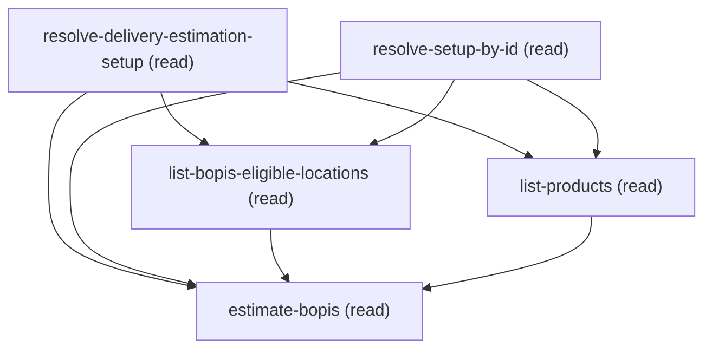

# Querying Estimate Bopis

## When to Use This Skill

Use this workflow when someone wants a real-time BUY-ONLINE-PICKUP-IN-STORE (BOPIS) estimate — "which
stores can I pick this up from?", "when can I collect these items in store?", "find pickup locations
near <address>". It does NOT change any configuration; it is a read-only estimate over the current
DeliveryEstimationSetup and its pickup-eligible locations. To turn a location's pickup eligibility
ON, use the sibling enable-location-bopis skill instead.

It guides the caller through building the request one piece at a time — do not ask for raw JSON:
pick the DeliveryEstimationSetup, then EITHER name the specific store(s) to check (each must be
BOPIS/pickup-eligible — this skill verifies that first) OR ask the service to find nearby
pickup-eligible stores within a radius of an address, choose products + quantities, collect the
address — then calls EstimateBopis (at API v68.0) and reads back, per store, the earliest pickup
time, order cutoff, distance, and available inventory.

TWO WAYS TO CHOOSE STORES (the location-selection choice_point): (1) SPECIFIC — the customer names
the store(s); each named store must be pickup-eligible (the skill checks and, if one isn't, says so
and offers enable-location-bopis); an address is optional. (2) NEARBY — the customer gives an
address + a radius and the service returns the closest pickup-eligible stores; here the address,
radius, and a max-store count are all required.

TWO WAYS TO IDENTIFY THE SETUP (the setup-selection choice_point): (1) FILTER — the default when a
person runs this skill directly; an optional Name/ExternalReference substring narrows the setup
list, and the customer picks one. (2) PIN — used when another skill (e.g. enable-location-bopis) has
already resolved and chosen the setup for you; it hands off the exact record Id and no further
customer-facing selection happens on this path.

ADMIN/CUSTOMER-FACING WORDING: answer in plain language — e.g. "2 units of SKU-1042 can be picked
up at Downtown Store (2.8 mi away) from Aug 8, 6:20 PM Pacific; order by Aug 8, 9:59 AM
Pacific." ALWAYS NAME THE ZONE: the response's times carry an explicit "Z" and are UTC, so quoting
the raw clock face can be off by a full calendar day (see the estimate step's TIMES ARRIVE AS UTC
guidance). Multi-store answers go in complete table(s), not a sentence per store — see that step's
RECAP LAYOUT. Don't surface the Connect path, sObject/field API names, external-reference strings, or raw
HTTP codes.

## Workflow

Guided real-time BUY-ONLINE-PICKUP-IN-STORE (BOPIS) estimate. Read-only: builds an EstimateBopis
request with the customer, one piece at a time, and returns each store's pickup estimate. Changes
nothing. To turn a location's pickup eligibility ON, use enable-location-bopis (this skill only
reads it).

Flow:

### Phase 1: resolve-delivery-estimation-setup (FILTER) or resolve-setup-by-id (PIN) -> exactly one...

resolve-delivery-estimation-setup (FILTER) or resolve-setup-by-id (PIN) -> exactly one runs, per
     the setup-selection choice; either way it captures the setup's Id and Name for the recap,
     ExternalReference (the URL PATH segment), and LocationGroupId. FILTER lists setups for the customer
     to pick from; PIN resolves the one exact Id a delegating skill already chose — no customer-facing
     selection on that path.

### Phase 2: list-bopis-eligible-locations -> show the group's stores + pickup...

list-bopis-eligible-locations -> show the group's stores + pickup eligibility. SPECIFIC mode:
     verify each named store is pickup-eligible (match on ExternalReference); NEARBY mode:
     informational. If none are eligible, suggest enable-location-bopis and STOP.

### Phase 3: list-products -> present SKU'd products; customer picks products...

list-products -> present SKU'd products; customer picks products + a positive whole-number
     quantity each.

### Phase 4: estimate-bopis -> build the body per the location-selection...

estimate-bopis -> build the body per the location-selection choice and POST; read back the
     per-store pickup estimate.

## Critical Constraints

**Preconditions:**

- The Delivery Estimation Service must be enabled/provisioned in the org. Without it the estimate
call is rejected. (check: `Delivery Estimation Service enabled`)
- At least one DeliveryEstimationSetup record (with its ExternalReference) must exist — this skill
estimates against an existing setup; it does not create one. (check: `DeliveryEstimationSetup record exists`)
- At least one Location in the setup's LocationGroup must be pickup-eligible
(Location.IsEligibleForPickup = true). BOPIS estimates only against pickup-eligible stores; if
none are eligible, enable one first with the enable-location-bopis skill. (check: `A pickup-eligible Location exists in the setup's group`)
- The products being estimated must exist as Product2 records with a StockKeepingUnit (the request
keys products by SKU). (check: `Product2 records with StockKeepingUnit exist`)

**Operational rules:**

- SETUP-SELECTION choice_point (FILTER vs PIN) decides how step 1 resolves the setup:
  • FILTER (default): interactive substring search over Name/ExternalReference — runs
    resolve-delivery-estimation-setup; the customer picks one from the (possibly multi-row) result.
  • PIN: resolves by the setup's exact record Id — runs resolve-setup-by-id instead. Used when a
    delegating skill (e.g. enable-location-bopis) already resolved and chose the setup; no
    customer-facing selection happens on this path.
- LOCATION-SELECTION choice_point (SPECIFIC vs NEARBY) decides the body shape:
  • SPECIFIC (default): send locations[] of pickup-eligible ExternalReferences; address optional.
  • NEARBY: OMIT locations; send address + radius + maxReturnedLocations (all required) + unit; the
    service returns the closest pickup-eligible stores.
This is a hard validator rule, not a preference: an empty/omitted locations list REQUIRES address +
radius(>0) + maxReturnedLocations(>0), each with its own 400 if missing.
- UNIT: "mi" or "km" only. ADDRESS goes under the wire key "address" (not "deliveryAddress", which
400s) and uses inner countryCode (not country); countryCode+postalCode or lat+long.
- VERSION: pin v68.0 on every call — the BOPIS endpoint is available at API v68.0 only (404 at
v67.0/v64.0, live-proven end-to-end).
- ADMIN/CUSTOMER-FACING WORDING: answer in plain language (store + earliest pickup time + order cutoff
+ distance + whether inventory covers the quantity); don't surface the Connect path, sObject/field
API names, ExternalReference strings, or raw HTTP codes. Never echo this guidance's own internal
vocabulary either: "Core" and "SOR" are reasoning terms for you ("Core" is the platform side of a
validation; "SOR" names this workflow). Say "Salesforce" or "your org" for the platform side, and
"this workflow" for the recipe itself.
TIMES: earliestPickupTime and orderCutoffTime arrive as explicit-"Z" UTC instants. CONVERT them into
one display zone and NAME that zone before quoting either — an unconverted cutoff can land on the
wrong CALENDAR DAY, handing the customer a deadline that already passed. Resolve the zone from the
customer's statement, else User.TimeZoneSidKey, else Organization.TimeZoneSidKey, else ask; if none
resolve, quote the raw value labelled "UTC".
SHAPE: results[] is one entry per (store x product), so multi-row is the norm — give complete,
deterministically sorted table(s), each with a header and a |---| separator, and use
"—" for a value the response didn't carry (orderCutoffTime, or the whole inStore object) even
though success is true. Note inStore arrives as an explicit null rather than a missing key when
availableToOrder is 0, so test its VALUE and not its presence. Full rules live in the estimate
step's RECAP LAYOUT.

## Operations Reference

Operations grouped by purpose. Use these as the building blocks for the workflows above.

### Summary

| Operation | Purpose | Status | Call | Depends on |
|-----------|---------|--------|------|------------|
| `resolve-delivery-estimation-setup` | read | implemented | `querySoql` | — |
| `resolve-setup-by-id` | read | implemented | `querySoql` | — |
| `list-bopis-eligible-locations` | read | implemented | `querySoql` | `resolve-delivery-estimation-setup`, `resolve-setup-by-id` |
| `list-products` | read | implemented | `querySoql` | `resolve-delivery-estimation-setup`, `resolve-setup-by-id` |
| `estimate-bopis` | read | implemented | `EstimateBopis` | `resolve-delivery-estimation-setup`, `resolve-setup-by-id`, `list-bopis-eligible-locations`, `list-products` |

### Dependency graph

### Read operations

#### `resolve-delivery-estimation-setup`

List / resolve the DeliveryEstimationSetup and capture its ExternalReference (the URL path
segment for the estimate call) and its LocationGroupId (used next to list the group's
pickup-eligible stores). Optionally filter by a Name/ExternalReference substring.

**Call:** `querySoql`   — status: `implemented`

**Inputs:**

- `nameFilter` *(`String`)* — OPTIONAL Name or ExternalReference filter (e.g. "west"). When provided the query matches either
field with a LIKE; when omitted, all setups are listed. Source: user_input.

#### `resolve-setup-by-id`

Resolve the ONE DeliveryEstimationSetup whose exact record Id was handed in (the delegated / pinned
path). Captures the SAME fields as the substring resolve step — Id and Name for recap, plus
ExternalReference (the estimate URL path segment) and LocationGroupId (the group to list) — so
every downstream step binds identically regardless of which resolve branch ran.

**Call:** `querySoql`   — status: `implemented`

**Inputs:**

- `setupId` *(`String`)* — The exact DeliveryEstimationSetup record Id (2A0...) to resolve. Source: a delegating skill that
already resolved AND chose the setup (e.g. enable-location-bopis.resolve-delivery-estimation-setup.setup_ids[chosen]).
An Id is exact + unique, so this pins the exact setup with no re-search and no Name/ExternalReference
collision.

#### `list-bopis-eligible-locations`

List the stores in the resolved setup's LocationGroup together with each one's pickup eligibility
(Location.IsEligibleForPickup), so the caller can (in SPECIFIC mode) confirm the store(s) they
name are pickup-eligible, or (in NEARBY mode) see which stores are eligible for context. The BOPIS
request keys locations by Location.ExternalReference, so this step surfaces exactly those
references.

**Call:** `querySoql`   — status: `implemented`

**Inputs:**

- `locationGroupId` *(`String`)* — LocationGroup Id (0gh...) of the chosen setup. Source: whichever resolve branch ran — resolve-delivery-estimation-setup.location_group_ids[chosen] (filter) or resolve-setup-by-id.location_group_ids[0] (pin).

**Depends on:** `resolve-delivery-estimation-setup`, `resolve-setup-by-id`

#### `list-products`

List Product2 records that have a StockKeepingUnit so the customer can choose which products to
estimate and enter a quantity for each. Products are keyed by SKU in the request. Optionally filter
by a Name/SKU substring.

**Call:** `querySoql`   — status: `implemented`

**Inputs:**

- `productFilter` *(`String`)* — OPTIONAL Name or StockKeepingUnit filter. When provided the query matches either with a LIKE;
when omitted, active products with a SKU are listed. Source: user_input.

**Depends on:** `resolve-delivery-estimation-setup`, `resolve-setup-by-id`

#### `estimate-bopis`

Call EstimateBopis with the assembled request — the resolved setup ExternalReference in the URL
path, EITHER the chosen pickup-eligible store references (SPECIFIC mode) OR a radius + max store
count (NEARBY mode), the chosen products + quantities, and the address — and read back, per store,
the earliest pickup time, order cutoff, distance, and inventory. Read-only: computes an estimate,
changes nothing.

**Call:** `EstimateBopis`   — status: `implemented`

**Inputs:**

- `externalReference` *(`String`)* — The chosen DeliveryEstimationSetup's ExternalReference — the URL PATH segment (NOT a body field,
NOT the 2A0 Id). Source: whichever resolve branch ran —
resolve-delivery-estimation-setup.setup_external_references[chosen] (filter) or
resolve-setup-by-id.setup_external_references[0] (pin).
- `locations` *(`Array`)* — SPECIFIC mode only: the pickup-eligible store(s) to estimate, each entry a Location
ExternalReference (NOT a Name — a Name is rejected 400 "Location reference '<x>' not found in
delivery estimation setup"). Every entry MUST be one of
list-bopis-eligible-locations.eligible_location_external_references. OMIT this field entirely in
NEARBY mode (see the location-selection choice_point): an empty/absent locations list switches
the service into radius discovery, which then REQUIRES address + radius + maxReturnedLocations.
Source: customer selection over list-bopis-eligible-locations.
  - schema: `{'type': 'array', 'minItems': 1, 'maxItems': 100, 'items': {'type': 'string', 'pattern': '^[^\\x00-\\x1F\\x7F]{1,255}$', 'description': "A pickup-eligible Location's ExternalReference (from list-bopis-eligible-locations)."}}`
- `products` *(`Array`)* — The products to estimate, each a (SKU, quantity) pair. Source: customer selection over
list-products. quantity must be a positive whole number.
  - schema: `{'type': 'array', 'minItems': 1, 'maxItems': 2000, 'items': {'type': 'object', 'required': ['stockKeepingUnit', 'quantity'], 'properties': {'stockKeepingUnit': {'type': 'string', 'minLength': 1, 'description': 'Product StockKeepingUnit (non-blank; Core 400s INVALID_API_INPUT on a blank SKU).'}, 'quantity': {'type': 'integer', 'minimum': 1, 'maximum': 2147483647, 'description': 'Positive whole-number quantity in [1, 2147483647] (fractional values are rejected).'}}}}`
- `address` *(`Object`)* — The destination/search address. The WIRE KEY IS "address" — NOT "deliveryAddress", which the
endpoint rejects with 400 JSON_PARSER_ERROR 'Unrecognized field "deliveryAddress"' in both
modes (measured on 2026-08-25). NOTE the inner field name is countryCode (NOT country
as in the delivery-date estimate) — the outer key differs from delivery-date too, so do not
pattern-match either name off that sibling. REQUIRED in NEARBY mode (locations omitted) — 400
"Address is required when locations list is empty" otherwise; OPTIONAL in SPECIFIC mode.
Provide countryCode+postalCode and/or latitude+longitude (both forms live-proven 201;
lat/long alone is accepted and drives the distance). Sending BOTH is also accepted (201),
and when both are present THE COORDINATES WIN: they do not supplement the postal code, they
replace it as the distance origin. Measured on 2026-08-26 — postalCode 94105 (San
Francisco) sent together with Miami coordinates returned distances byte-identical to
Miami-coordinates-alone at all 5 stores over 5 calls each, and identical to the 94105 control
at none of them. Source: customer input.
  - schema: `{'type': 'object', 'properties': {'countryCode': {'type': ['string', 'null'], 'description': 'ISO 3166-1 alpha-2 country code (e.g. "US"). Pair with postalCode.'}, 'postalCode': {'type': ['string', 'null'], 'description': 'Postal code. Pair with countryCode.'}, 'latitude': {'type': ['number', 'null'], 'minimum': -90, 'maximum': 90, 'description': 'Optional latitude in [-90,90]; latitude+longitude alone is an accepted address form and drives the distance. TAKES PRECEDENCE over countryCode+postalCode when both are supplied — send it only if you want the coordinates, not the postal code, to be the distance origin.'}, 'longitude': {'type': ['number', 'null'], 'minimum': -180, 'maximum': 180, 'description': 'Optional longitude in [-180,180]; pair with latitude. Same precedence over countryCode+postalCode as latitude.'}}}`
- `unit` *(`String`)* — Distance unit for the radius and the returned distance. EXACTLY "mi" or "km" (any other value ->
400 "Unit must be either 'mi' or 'km'"). Defaults to mi when omitted. Source: user_input.
- `radius` *(`Number`)* — NEARBY mode only: the search radius (in `unit`) within which to find pickup-eligible stores.
REQUIRED and > 0 when locations is omitted (400 "Radius must be greater than 0 when locations
list is empty" otherwise). Ignored/omit in SPECIFIC mode. Source: user_input.
  - schema: `{'type': 'number', 'exclusiveMinimum': 0}`
- `maxReturnedLocations` *(`Integer`)* — NEARBY mode only: the maximum number of nearby pickup-eligible stores to return. REQUIRED and > 0
when locations is omitted (400 "Max returned locations must be greater than 0 when locations list
is empty" otherwise). Ignored/omit in SPECIFIC mode. Source: user_input.
  - schema: `{'type': 'integer', 'minimum': 1, 'maximum': 1000}`
- `orderDate` *(`String`)* — OPTIONAL simulated "now" for the estimate — an ISO-8601 UTC timestamp passed through to the
delivery service so pickup times / order cutoffs are computed relative to it instead of the
actual current time (useful for "if I ordered at <time>, when could I pick up?"). Omit to use the
real current time. Source: user_input.

**Depends on:** `resolve-delivery-estimation-setup`, `resolve-setup-by-id`, `list-bopis-eligible-locations`, `list-products`
