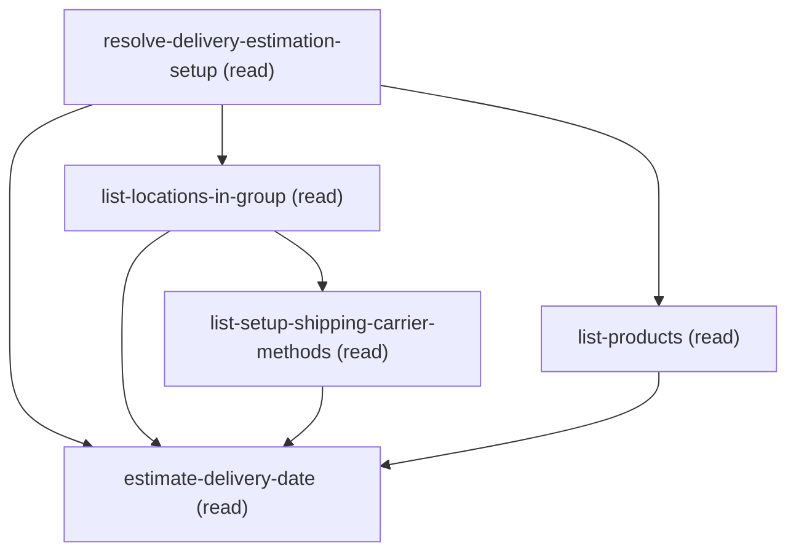

# Querying Estimate Delivery Date

## When to Use This Skill

Use this workflow when someone wants a real-time DELIVERY DATE ESTIMATE for one or more products
shipping to a customer address — "when will this arrive?", "estimate the delivery date", "what's
the ship date for these items to <address>?". It does NOT change any configuration; it is a
read-only estimate that reflects the current DeliveryEstimationSetup, its per-location and any
active temporary processing-time overrides, and the chosen carrier/method routing.

It guides the caller through building the request one piece at a time — do not ask for raw JSON:
pick the DeliveryEstimationSetup, choose products + quantities, collect the delivery address —
then calls EstimateDeliveryDate (at API v68.0) and reads back the per-method ship-date /
delivery-date window. The shipping carrier methods are NOT a customer choice: every method
attached to the setup's LocationGroup or any Location in that group is selected automatically, and
the customer is told which ones were used. The full request contract (endpoint, the
singular-vs-plural carrier rule, the
delivery-address part-combinations, product/quantity limits, and the optional order date) lives
in agent_guidance and the steps.

ADMIN/CUSTOMER-FACING WORDING: answer in plain language — e.g. "For 51 units shipping from your
West locations to Hollywood, FL, estimating with the shipping methods set up for this
configuration." followed by a per-method table of ship date + delivery window + order-by deadline.
EVERY time value in the response is offset-less UTC — convert all of them into one named display
zone before quoting, and derive the ship/delivery DAY from the converted instant rather than the
wire string's date part (reading it raw is a full day late for any location whose wire time falls
before the display zone's offset). Don't surface the
Connect path, sObject/field API names, external-reference strings, internal class or annotation
names, or raw HTTP codes.

## Workflow

Guided real-time DELIVERY DATE ESTIMATE. Read-only: builds an EstimateDeliveryDate request with
the customer, one piece at a time, and returns the ship/delivery window. Changes nothing.

Flow:

### Phase 1: resolve-delivery-estimation-setup -> list setups (Name + ExternalReference); customer...

resolve-delivery-estimation-setup -> list setups (Name + ExternalReference); customer picks
     one. Its ExternalReference is the URL PATH segment (the ONLY setup identifier — no body key);
     capture its Id, Name, and LocationGroupId too for the recap and joins.

### Phase 2: list-locations-in-group -> the group's Locations. Their Ids PLUS...

list-locations-in-group -> the group's Locations. Their Ids PLUS the LocationGroup Id are the
     location sources for the next step.

### Phase 3: list-setup-shipping-carrier-methods -> every method attached to that setup...

list-setup-shipping-carrier-methods -> every method attached to that setup at EITHER level
     (the group itself or any Location in it), with its parent carrier. DEDUPE to distinct methods
     first — the union returns one row per (source, method). ALL of them are selected
     AUTOMATICALLY — the customer is TOLD what was picked, not asked to pick. Group by distinct
     carrier. This step also returns each method's MinTransitTime, which is the PUSH PRE-CHECK: a
     null there means the setup push in step 5 would be rejected, so don't offer it (see that
     step's PUSH PRE-CHECK).

### Phase 4: list-products -> present SKU'd products; customer picks products...

list-products -> present SKU'd products; customer picks products + a positive whole-number
     quantity each (<=2000 products).

### Phase 5: estimate-delivery-date -> collect the delivery address (country +...

estimate-delivery-date -> collect the delivery address (country + postalCode REQUIRED); ask the
     order-date choice_point (now vs a specific order date, and if specific, what date — ISO-8601
     WITH a timezone offset); then POST and report the per-method ship/delivery window — as ONE
     complete table(s) (see the step's RECAP LAYOUT), plus a no-result section that distinguishes
     evidence-backed sync cases from unexplained absences and offers a push only when supported.

Contract authored from the endpoint's own request contract rather than the generated v67 OAS,
which is stale (singular-only), then live-validated end-to-end on bopis 2026-08-06 at v68.0:
singular carrier, plural shippingCarriers, and singular+orderDate all returned 201 (orderDate
observed to shift the estimate).

## Critical Constraints

**Preconditions:**

- The Delivery Estimation Service must be enabled/provisioned in the org (Connect
org-access-check Delivery Estimation Service enabled). Without it the
estimate call is rejected. (check: `Delivery Estimation Service enabled`)
- At least one DeliveryEstimationSetup record (with its ExternalReference) must exist — this
skill estimates against an existing setup; it does not create one. (check: `DeliveryEstimationSetup record exists`)
- At least one ShippingCarrierMethod must be assigned (via LocationShippingCarrierMethod) to the
setup at EITHER level — the LocationGroup itself or any Location in that group. Both levels are
estimable and both are auto-selected: on setup DE-1 the group alone holds 2 methods while
the group-plus-locations union holds 12, and all twelve estimated cleanly in one call. See
list-setup-shipping-carrier-methods for the measurements. (check: `ShippingCarrierMethod assigned with LocationSourceId = the setup's LocationGroupId or any of its Location Ids`)
- The setup must have been PUSHED to the delivery service since those methods were attached. The
estimate resolves methods from the service's synced copy, so a freshly attached
method is rejected as "not configured" until the setup is pushed
(enable-and-push-delivery-estimation-setup). DeliveryEstimationSetup.SyncStatus is not a
reliable indicator — it reads SYNCED even while a newly attached method is still unpushed.
This is a SOFT precondition: a stale retained configuration can yield partial results plus a
matching "not configured" error. The skill reports every no-result method, offers a push only
when response evidence supports it, and retries once after an accepted push. No Core-queryable
signal for push state exists, which is why it is handled reactively. (check: `Setup pushed to the delivery service after the current method set was attached`)
- The chosen DeliveryEstimationSetup must have a LocationGroupId — it is the only path from the
setup to its estimable shipping methods. (check: `DeliveryEstimationSetup.LocationGroupId is set`)
- The products being estimated must exist as Product2 records with a StockKeepingUnit (the
request keys products by SKU). (check: `Product2 records with StockKeepingUnit exist`)

**Operational rules:**

- METHOD AUTO-SELECTION (why steps 2-3 exist, and why they span BOTH levels): DeliveryEstimationSetup
has NO carrier or method field, so the only route to its shipping methods is
LocationGroupId -> LocationShippingCarrierMethod -> ShippingCarrierMethod -> ShippingCarrier.
LocationSourceId is polymorphic, and a method attached at EITHER level — the group itself or any
Location in it — is estimable, so the lookup unions both. Measured on setup DE-1: the
group-only filter returns 2 methods while the union returns 12, and all twelve estimated cleanly in
one combined call (36 rows, zero errors). Dedupe is mandatory on the union: 146 raw rows collapse
to 12 distinct methods.
- ESTIMABILITY IS DECIDED BY THE DELIVERY SERVICE'S RETAINED COPY, WHICH CORE CANNOT READ. Attachment
at either level is necessary but not sufficient: a freshly attached method appears in step 3 and is
still rejected by step 5 until the setup is pushed. NO CORE SIGNAL FOR PUSH STATE
EXISTS — SyncStatus, LastSyncedMessage, the junction's field set, a LastModifiedDate-vs-
LastSyncedDate heuristic, and a read endpoint were all investigated and all fail (the step's NO
PUSH-STATE SIGNAL block records each). That negative is WHY this skill submits everything attached
and reports missing results rather than trying to predict them. Sending a method that is not in
the service's retained copy is safe:
measured 2026-08-26, it does NOT suppress the good rows or its carrier group; it only contaminates
the per-date success FLAGS, which is why those must not be used to suppress rows when any
"not configured" error is present. So treat step 5's
"is not configured for DeliveryEstimation" as evidence supporting a likely push remedy, not as a
reason to label every absent method unsynced. Offer enable-and-push-delivery-estimation-setup only
for evidenced/affected-carrier cases, then retry once and report the actual outcome. Match that
condition on the MESSAGE text, not on a code — the value has been observed as both
SHIPPING_CARRIER_METHOD_NOT_FOUND and INVALID_API_INPUT, and even the key differs by payload (the
group-level `error` object uses `code`; the setup-push failure array uses `errorCode`).
- ORDER DATE (order-date choice_point): ask whether to estimate as of NOW (omit orderDate) or as of
a SPECIFIC order date (send orderDate). NEVER forward the customer's raw words — normalize to
YYYY-MM-DDTHH:MM:SS(Z|±HH:MM) yourself, then gate the string on
^\d{4}-\d{2}-\d{2}T\d{2}:\d{2}:\d{2}(\.\d+)?(Z|[+-]\d{2}:\d{2})$ plus a real-calendar check before
calling. Offset-less timestamps, bare dates, unpadded month/day, space-separated timestamps and
impossible dates are all live-proven 400s with one identical ZonedDateTime message. There is no
API-side default instant: ASK for a missing time-of-day (it can move the ship date a full day) and
RESOLVE a missing zone from org data — customer's own statement > User.TimeZoneSidKey >
Organization.TimeZoneSidKey > ask — never a silent UTC, then disclose the instant used. Supplying
orderDate shifts the ship date but returns NO delivery window (success:true, no min/max, on every
row), so it answers "when would it ship" and not "when would it arrive" — surface that trade-off
rather than showing blank dates. Response times carry no offset and are UTC; convert them into ONE
explicitly-named display zone (resolved even when no orderDate was collected) and keep
orderCutoffTime PER ROW WHEN PRESENT, since the locations' cutoffs are different instants — but the
cutoff is OPTIONAL under EVERY routing type (measured null on all groups 2026-08-26, present
2026-08-25, same STANDARD setup), so read it before quoting one and never reconstruct a deadline
you were not given. Full procedure,
phrasing map, zone-precedence evidence and the measured accept/reject matrix live in the estimate
step's ORDER DATE guidance.
- CARRIER XOR (auto-derived by count of DISTINCT attached carriers): 1 carrier -> singular
"shippingCarrier" object; 2+ -> plural "shippingCarriers" array. Exactly one key — both ->
INVALID_API_INPUT, neither -> MISSING_ARGUMENT. Both shapes are live-proven 201 at v68.0.
- VERSION: pin v68.0 on every call. The plural "shippingCarriers" key and "orderDate" are
release-264 fields — REJECTED at v67.0 (HTTP 400), live-proven 201 at v68.0.
- ADMIN/CUSTOMER-FACING WORDING: answer in plain language (ship date + delivery window + order-by
deadline per method); don't surface the Connect path, sObject/field API names, ExternalReference
strings, internal class or annotation names, or raw HTTP codes.
Never say "CDS", "Commerce Delivery Service", or otherwise imply two separate systems — from the
customer's side this is one estimate. The guidance above names that service where it identifies
WHICH layer rejects what (the front door accepts an address the estimate service then refuses);
that distinction is for your reasoning, and what the customer hears is which address parts are
required. Never echo this guidance's own internal vocabulary either: "Core", "SOR" and "corpus"
are reasoning terms for you ("Core" separates the platform's own records from the estimate
service's retained copy; "SOR" and "corpus" name this workflow and the catalog it lives in). Say
"Salesforce" or "your org" for the platform side, and "this workflow" for the recipe itself.
TIMES: estimatedShipDate, estimatedDeliveryDate and orderCutoffTime are ALL offset-less UTC.
Convert all three into one named display zone; take the ship/delivery DAY from the converted
instant, never from the wire string. Multi-row answers go in ONE table whose columns include
Order by. Full rules live in the estimate step's RECAP LAYOUT.

## Operations Reference

Operations grouped by purpose. Use these as the building blocks for the workflows above.

### Summary

| Operation | Purpose | Status | Call | Depends on |
|-----------|---------|--------|------|------------|
| `resolve-delivery-estimation-setup` | read | implemented | `querySoql` | — |
| `list-locations-in-group` | read | implemented | `querySoql` | `resolve-delivery-estimation-setup` |
| `list-setup-shipping-carrier-methods` | read | implemented | `querySoql` | `list-locations-in-group` |
| `list-products` | read | implemented | `querySoql` | `resolve-delivery-estimation-setup` |
| `estimate-delivery-date` | read | implemented | `EstimateDeliveryDate` | `resolve-delivery-estimation-setup`, `list-locations-in-group`, `list-setup-shipping-carrier-methods`, `list-products` |

### Dependency graph

### Read operations

#### `resolve-delivery-estimation-setup`

List the DeliveryEstimationSetup records and present each one's Name + ExternalReference so the
customer can choose which setup to estimate against. The chosen ExternalReference is the URL
path segment for the estimate call, and the chosen LocationGroupId is what the next step
follows to work out which shipping carrier methods this setup can actually estimate.
Optionally filter by a Name/ExternalReference substring.

**Call:** `querySoql`   — status: `implemented`

**Inputs:**

- `nameFilter` *(`String`)* — OPTIONAL Name or ExternalReference filter (e.g. "west", "NON_PICKUP_DAYS_DEMO"). When
provided the query matches either field with a LIKE; when omitted, all setups are listed.
Source: user_input.

#### `list-locations-in-group`

List the Locations belonging to the chosen setup's LocationGroup. Those Location Ids — plus the
LocationGroup Id itself — are the "location sources" a ShippingCarrierMethod can be assigned
to, and the next step reads the assignments for all of them together. Read-only lookup.

**Call:** `querySoql`   — status: `implemented`

**Inputs:**

- `locationGroupId` *(`String`)* — The chosen setup's LocationGroupId. Source:
resolve-delivery-estimation-setup.setup_location_group_ids (at the index of the setup the
customer picked).

**Depends on:** `resolve-delivery-estimation-setup`

#### `list-setup-shipping-carrier-methods`

Read every ShippingCarrierMethod ATTACHED to the chosen setup — assigned via
LocationShippingCarrierMethod either to the setup's LocationGroup itself or to any Location in
that group — along with each method's parent ShippingCarrier. ALL of them are selected
AUTOMATICALLY for the estimate; the customer is told what was selected rather than asked to
pick. Read-only lookup.

**Call:** `querySoql`   — status: `implemented`

**Inputs:**

- `locationSourceIds` *(`Array`)* — The location sources to read assignments for: the chosen setup's LocationGroupId TOGETHER
WITH every Location Id in that group. Source:
resolve-delivery-estimation-setup.setup_location_group_ids (chosen index) +
list-locations-in-group.location_ids. The query's {locationSourceIdsInClause} is the
SOQL-safe rendering of THIS input — a comma-separated list of single-quoted Ids (see
agent_guidance) — not a separate input.
  - schema: `{'type': 'array', 'minItems': 1, 'items': {'type': 'string', 'description': 'A LocationGroup Id (0gh...) or Location Id (131...).', 'pattern': '^(0gh|131)[a-zA-Z0-9]{12,15}$'}}`

**Depends on:** `list-locations-in-group`

#### `list-products`

List Product2 records that have a StockKeepingUnit so the customer can choose which products to
estimate and enter a quantity for each. Products are keyed by SKU in the request. Optionally
filter by a Name/SKU substring.

**Call:** `querySoql`   — status: `implemented`

**Inputs:**

- `productFilter` *(`String`)* — OPTIONAL Name or StockKeepingUnit filter. When provided the query matches either with a LIKE;
when omitted, active products with a SKU are listed. Source: user_input.

**Depends on:** `resolve-delivery-estimation-setup`

#### `estimate-delivery-date`

Call EstimateDeliveryDate with the assembled request — the resolved setup ExternalReference in
the URL path, the chosen carrier(s)+method(s), the chosen products+quantities, the collected
delivery address, and an optional order date — and read back the estimated ship-date /
delivery-date window per shipping method. Read-only: computes an estimate, changes nothing.

**Call:** `EstimateDeliveryDate`   — status: `implemented`

**Inputs:**

- `externalReference` *(`String`)* — The chosen DeliveryEstimationSetup's ExternalReference — the URL PATH segment (NOT a body
field, NOT the 2A0 Id). Source: resolve-delivery-estimation-setup.setup_external_references
(the one the customer picked).
- `shippingCarriers` *(`Array`)* — The carrier(s) whose methods this setup can estimate, each with its method(s) — derived
AUTOMATICALLY, not picked by the customer. Source: list-setup-shipping-carrier-methods,
grouped by DISTINCT carrier ExternalReference. The COUNT drives the wire key (XOR — see
agent_guidance): exactly 1 entry -> emit the SINGULAR "shippingCarrier" object; 2+ entries ->
emit the PLURAL "shippingCarriers" array. Never send both keys and never send an empty
carriers set. A customer may narrow this to a SUBSET on request, but nothing outside the set
may be added — a method not attached to the setup's LocationGroup is live-proven to come back
"not configured for DeliveryEstimation" AND to degrade the success flags of the methods that
do work (see list-setup-shipping-carrier-methods).
  - schema: `{'type': 'array', 'minItems': 1, 'maxItems': 50, 'description': 'Canonical list of chosen carriers (each with its methods). The wire body emits EXACTLY ONE of "shippingCarrier" (singular, when this list has 1 entry) or "shippingCarriers" (plural, 2+ entries) — an XOR key transform the schema cannot enforce; the agent performs it (see agent_guidance). Do not treat this array as the literal request shape.', 'items': {'type': 'object', 'required': ['externalReference', 'shippingCarrierMethods'], 'properties': {'externalReference': {'type': 'string', 'description': 'ShippingCarrier.ExternalReference (from list-setup-shipping-carrier-methods.carrier_external_references, distinct values).'}, 'shippingCarrierMethods': {'type': 'array', 'minItems': 1, 'maxItems': 100, 'items': {'type': 'object', 'required': ['externalReference'], 'properties': {'externalReference': {'type': 'string', 'description': 'ShippingCarrierMethod.ExternalReference from the globally deduplicated aggregate of list-setup-shipping-carrier-methods.method_external_references.'}}}}}}}`
- `products` *(`Array`)* — The products to estimate, each a (SKU, quantity) pair. Source: customer selection over
list-products. quantity must be a positive whole number.
  - schema: `{'type': 'array', 'minItems': 1, 'maxItems': 2000, 'items': {'type': 'object', 'required': ['stockKeepingUnit', 'quantity'], 'properties': {'stockKeepingUnit': {'type': 'string', 'description': 'Product StockKeepingUnit (non-blank).'}, 'quantity': {'type': 'integer', 'minimum': 1, 'maximum': 2147483647, 'description': 'Positive whole-number quantity in [1, 2147483647] (fractional values are rejected; values above the 32-bit int max are rejected by the API).'}}}}`
- `deliveryAddress` *(`Object`)* — The destination address. country + postalCode are REQUIRED. The Core front-door validator's
error lists three accepted part-combinations — (latitude+longitude) | (country+postalCode) |
(country+state+city) — and it accepts lat/long-alone, BUT the downstream estimate service
(Commerce Delivery Service) then rejects any address lacking country+postalCode: its request
contract declares both unconditionally required and non-empty (state/city/lat/long carry no
constraints). This is NOT setup-dependent. PROVEN LIVE (bopis 2026-08-06, setup "west"):
country+postalCode -> 201; latitude+longitude ALONE -> 400 ("Postal code is required. / Country
code ..."); country+state+city ALONE -> 400 ("Postal code is required."). So ALWAYS send
country + postalCode; latitude/longitude (and state/city) are optional extras accepted alongside
but cannot substitute. Source: customer input.
  - schema: `{'type': 'object', 'required': ['country', 'postalCode'], 'properties': {'country': {'type': 'string', 'description': 'ISO 3166-1 alpha-2 country code (e.g. "US"). REQUIRED by the downstream estimate service (must be non-empty and a valid ISO code).'}, 'state': {'type': ['string', 'null'], 'description': 'Optional state/province; accepted alongside but cannot substitute for country+postalCode.'}, 'city': {'type': ['string', 'null'], 'description': 'Optional city; accepted alongside but cannot substitute for country+postalCode.'}, 'postalCode': {'type': 'string', 'description': 'Postal code, >= 4 characters. REQUIRED by the downstream estimate service (must be non-empty).'}, 'latitude': {'type': ['number', 'null'], 'minimum': -90, 'maximum': 90, 'description': 'Optional latitude in [-90,90]; accepted alongside country+postalCode but cannot substitute for it.'}, 'longitude': {'type': ['number', 'null'], 'minimum': -180, 'maximum': 180, 'description': 'Optional longitude in [-180,180]; accepted alongside country+postalCode but cannot substitute for it.'}}}`
- `orderDate` *(`String`)* — OPTIONAL order date. Gated by the order-date choice_point: ask the customer whether to
estimate as of NOW (omit orderDate) or as of a SPECIFIC order date (supply orderDate). When
set, the estimate is computed as of that order time (e.g. a future order) — live-proven to
shift the result. Omit it entirely for a current-time estimate; it is optional/omitted, not
sent as an explicit null.
NEVER pass the customer's raw words through as this value. Normalize first (see the estimate
step's ORDER DATE procedure), then emit ONLY the canonical zero-padded form: a full ISO-8601
timestamp WITH a timezone designator (deserialized as a ZonedDateTime) — trailing "Z" for UTC
(e.g. "2026-09-10T10:00:00Z") or an explicit offset (e.g. "2026-09-10T10:00:00-04:00",
"2026-09-10T10:00:00+05:30"; half-hour offsets accepted).
REJECTED with 400 INVALID_API_INPUT ("Invalid value '...' at orderDate for type
ZonedDateTime") — all live-verified: an offset-less local timestamp
("2026-09-10T10:00:00"), a bare date with no time ("2026-09-10"), an unpadded month/day
("2026-9-10T10:00:00Z"), a space instead of the "T" separator ("2026-09-10 10:00:00Z"), and a
pattern-shaped but non-existent date ("2026-13-45T10:00:00Z" — the pattern is a format gate,
not a calendar check, so verify the date is real too).
THE INSTANT MATTERS, not just the calendar date: the value is compared against each fulfilling
location's own order cutoff as an absolute instant, so the time-of-day you choose can move the
ship date a full day (2026-08-25: 2026-09-10T15:59:59Z -> ships 09-11, but
2026-09-10T16:00:00Z -> ships 09-12). There is no API-side default instant, so ASK for the time
when the customer gave only a date, RESOLVE the zone from org data (customer's own statement >
User.TimeZoneSidKey > Organization.TimeZoneSidKey > ask — never a silent UTC), and disclose the
instant you used. Measured mitigation: start-of-day readings at 00:00:00Z, 00:00:00-04:00 and
00:00:00-07:00 all returned the SAME estimate, so the zone only becomes material near a cutoff.
TRADE-OFF: supplying orderDate shifts the ship date and order-by cutoff but SUPPRESSES the
delivery window — estimatedDeliveryDate returns success:true with no min/max on every row.
Requires API v68.0 (this skill pins it). Source: user_input.

**Depends on:** `resolve-delivery-estimation-setup`, `list-locations-in-group`, `list-setup-shipping-carrier-methods`, `list-products`
