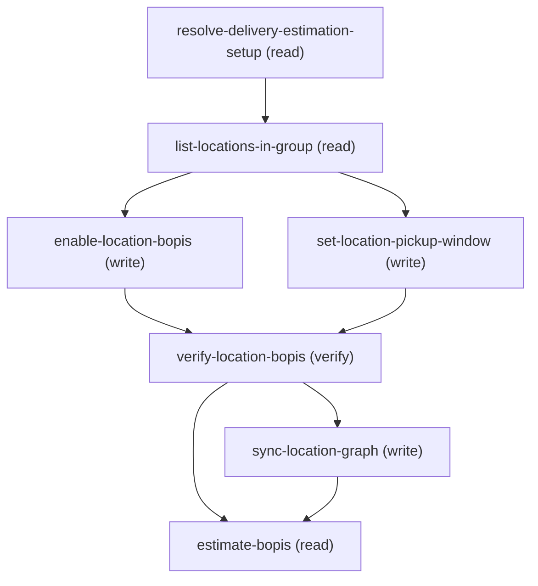

# Managing Enable Location Bopis

## When to Use This Skill

Use this workflow when someone wants to turn a store location ON for in-store pickup / BOPIS — "make
my SF warehouse available for pickup", "enable BOPIS for these stores", "let customers collect orders
from this location". The indicator is Location.IsEligibleForPickup (Boolean); this skill sets it via
the Data API. It can also DISABLE pickup (set it false) for a location, but enabling is the default.

It can ALSO set (or clear) a per-location PICKUP TIME WINDOW — EarliestPickupTimeOffset /
LatestPickupTimeOffset, minutes-based OFFSETS from the location's business-hours open/close (e.g.
"pickup opens 15 minutes after we open and cuts off 30 minutes before we close"), NOT literal times.
This is a SEPARATE PATCH from the eligibility change (the set-location-pickup-window step, which only
runs for locations whose entry actually carries both window fields) — most eligibility toggles don't
touch it. See that step's guidance for the validation contract (both-or-neither, must be positive
when set, no ordering check).

It guides the caller in plain language — do not ask for raw JSON or field API names: resolve the
Delivery Estimation setup, list the stores in its LocationGroup each showing whether pickup is
currently on (and its window, if set), let the caller choose which store(s) to enable, PATCH
Location.IsEligibleForPickup — plus, for any location whose entry also carries a pickup window, a
SEPARATE PATCH for those two fields — verify the change, then automatically publish the updated
location graph downstream (no ask — this always runs now), then ONE optional follow-up gated by a
choice_point:
  • RUN AN ESTIMATE (estimate-after-enable choice_point): since the location is now pickup-enabled,
    offer to run a BOPIS pickup estimate for it by delegating to the estimate-bopis skill (a
    delegates_to leaf). Skippable.

This is the WRITE counterpart to the read-only estimate-bopis skill: this one turns pickup
eligibility ON; estimate-bopis reads it to compute a pickup estimate.

CUSTOMER-FACING WORDING: once the change is verified and the downstream publish completes, say
"Your change has been saved and synced." Then a compact recap: Location Name + ExternalReference
(ExternalReference is fine to show — it's typically the customer's own business key) and what
changed. Never say "CDS", "Commerce Delivery Service", or otherwise imply two separate systems —
this is one seamless save. Don't surface sObject/field API names, the Connect path, Ids, or raw
HTTP codes.

## Workflow

Turn a store location ON for in-store pickup / BOPIS (Location.IsEligibleForPickup), automatically
sync the change downstream, and optionally run a pickup estimate. WRITE counterpart to the read-only
estimate-bopis skill. Flow:

### Phase 1: resolve-delivery-estimation-setup -> by Name/ExternalReference -> LocationGroupId + Name...

resolve-delivery-estimation-setup -> by Name/ExternalReference -> LocationGroupId + Name +
     ExternalReference.

### Phase 2: list-locations-in-group -> LocationGroupAssignment (junction) -> Location details; present...

list-locations-in-group -> LocationGroupAssignment (junction) -> Location details; present each
     location's current pickup state ("ON"/"OFF") + capture ExternalReference + baseline. Caller picks
     which to enable (or disable).

### Phase 3: enable-location-bopis -> PATCH each chosen Location.IsEligibleForPickup (true =...

enable-location-bopis -> PATCH each chosen Location.IsEligibleForPickup (true = enable, default;
     false = disable). Loop; in-group guard; rollback to baseline on failure; 204 each. This call's
     body is ALWAYS exactly this one field — the pickup window is a separate step (next).

### Phase 4: set-location-pickup-window -> for locations whose entry ALSO carries...

set-location-pickup-window -> for locations whose entry ALSO carries a pickup time window
     (EarliestPickupTimeOffset / LatestPickupTimeOffset — both-or-neither, must be positive when set),
     a SEPARATE PATCH with just those two fields. Entries with neither key are skipped — no call is
     made for them, so the window fields are never emitted for a location whose window isn't being
     touched.

### Phase 5: verify-location-bopis -> re-read the changed locations; capture the...

verify-location-bopis -> re-read the changed locations; capture the now-eligible ExternalReferences.

### Phase 6: sync-location-graph (ALWAYS runs automatically, immediately after verify —...

sync-location-graph (ALWAYS runs automatically, immediately after verify — no ask, no choice)
     -> delegates_to the shared sync-location-graph SOR, which publishes the location graph
     (triggerFullLocationGraphSync) AND polls to terminal success before returning — this step,
     not the enqueue alone, is what actually confirms the eligibility takes effect.

### Phase 7: estimate-bopis (choice-gated by estimate-after-enable; default estimate) -> delegate...

estimate-bopis (choice-gated by estimate-after-enable; default estimate) -> delegate to the
     estimate-bopis skill to run a pickup estimate for the just-enabled store(s).

## Critical Constraints

**Preconditions:**

- Commerce Order Management with Delivery Estimation must be enabled (the DeliveryEstimationSetup +
Location objects exist and the group has LocationGroupAssignments). Location.IsEligibleForPickup is
only meaningful/visible when Delivery Estimation is enabled for the org. (check: `Delivery Estimation enabled + LocationGroup populated`)
- The running user must have Edit access on Location AND field-level Edit on
Location.IsEligibleForPickup (and, if setting a pickup window, on EarliestPickupTimeOffset /
LatestPickupTimeOffset too). Without it the PATCH returns 403, or the field is silently dropped. (check: `UserPermissions edit on Location + FLS on IsEligibleForPickup (+ the two offset fields if used)`)
- A DeliveryEstimationSetup record (with a LocationGroup + LocationGroupAssignments) must exist. This
workflow toggles pickup eligibility on locations within that group; it does not create records. (check: `DeliveryEstimationSetup + LocationGroupAssignments exist`)

**Operational rules:**

- ONE CHOICE_POINT:
  • estimate-after-enable (estimate | done): run a BOPIS estimate now via the delegates_to leaf, or
    stop. Default estimate. (The location-graph publish is NOT a choice anymore — it always runs
    automatically after the change is verified; never ask the admin about it.)
- WHY THIS SOR ALWAYS PUBLISHES (internal rationale — not customer wording): Location.IsEligibleForPickup
is one of the BOPIS fields synced downstream via the location graph, and the downstream system filters
BOPIS estimates against ITS copy — so without a publish a freshly-enabled store may not appear in an
estimate. This location-graph publish is functionally distinct from enable-and-push-delivery
-estimation-setup (config push) and sync-delivery-routing-specs (routing specs), but the customer
should never be told there are multiple systems involved — from their side, this is one save.
- VERSION: pin v68.0 on every call to match the estimate-bopis family (Location.IsEligibleForPickup
exists since API 258, but the family standardizes on v68.0). WIRE CONTRACT, live-validated
end-to-end: PATCH returns 204 with read-back confirming the flag; the CDS publish returns 201; the
delegated estimate returns 201.
- PICKUP WINDOW CONTRACT (EarliestPickupTimeOffset / LatestPickupTimeOffset), applied by the SEPARATE
set-location-pickup-window step (NOT part of enable-location-bopis's PATCH — that call is
IsEligibleForPickup only, unconditionally). WIRE CONTRACT, live-validated end-to-end: both-or-neither
is a HARD Core rule — one without the other -> 400
FIELD_INTEGRITY_EXCEPTION "Either the earliest and latest pickup times must both be set or both be
null.", confirmed symmetric on either field alone. set-location-pickup-window's inputs schema mirrors
this with a dependentRequired constraint (each offset field requires the other), rejecting a one-sided
entry before dispatch rather than relying on agent_guidance prose alone. Negative -> 400
FIELD_INTEGRITY_EXCEPTION ("Specify a value for earliest pickup time that's greater than 0." — the
message text says >0, and Core's own live boundary is actually >=0, but this step's schema now
enforces `minimum: 1` on both fields when non-null — a caller-side 0 is rejected before the PATCH is
ever sent, so this Core-side message should not normally be reachable in practice). NO
earliest-vs-latest ordering check (100/30 PATCHed 204 despite earliest > latest). null/null clears an
existing window (204, read-back
null/null). Per Core/CDS source research (not live-tested): the downstream delivery system's
validator for this same pair is STRICTER — it requires a value > 0 — and since sync-location-graph
now ALWAYS publishes (never skippable), a 0/0 window would always eventually fail downstream even
though Core itself would accept it; that's exactly why the schema now rejects 0 up front instead of
leaving it as a "prefer avoiding" note.
WHY TWO STEPS, NOT ONE PATCH WITH OPTIONAL FIELDS: enable-location-bopis and set-location-pickup-window
read the SAME locationUpdates array but each emits a call with ZERO optional fields — the eligibility
PATCH always sends just IsEligibleForPickup; the window PATCH is skipped entirely (not sent with
omitted/null-placeholder keys) for any entry that doesn't carry both window fields, and sends both
together whenever it does run. This makes the optionality a property of WHETHER a call happens, not of
which keys appear inside an always-made call's static body.
- CUSTOMER-FACING WORDING: the canonical closing line — "Your change has been saved and synced."
verbatim — may ONLY be said after the delegated sync-location-graph's poll reaches TERMINAL
SUCCESS, not merely after its enqueue POST returns. Enqueue succeeding is NOT synced yet.
  - TERMINAL FAILURE (the delegate's poll ended in Error/ServiceException, or success:false): the
    entity change (the earlier PATCH) DID succeed, but the downstream sync did not — do NOT say
    "saved and synced." IF the delegate's poll_status is 'Error' AND poll_error is non-empty: it
    carries a plain-enough, per-location explanation designed to be shown to end users (e.g.
    "Location 'X' has invalid country code"). COMPARE the location it names against the
    location(s) THIS flow just enabled/disabled: if DIFFERENT, make that clear so the customer
    doesn't think their own change caused it — "Your change was saved, but the sync couldn't
    complete because of an unrelated issue elsewhere — <what poll_error says>. It can be retried
    once that's fixed." (No link here — poll_error names that OTHER location by text only, not a
    record this flow read back, so there's nothing to link safely.) If it names one of the
    locations THIS flow just changed, do NOT say "elsewhere" — report the issue against that
    location, and this IS a case a link is possible: verify-location-bopis.verified already
    carries that location's Name AND Id, so match poll_error's location to its row there and
    link it rather than naming it in plain text — "Your change was saved, but the sync couldn't
    complete for [<Name>](<orgHost>/lightning/r/Location/<Id>/view): <issue from poll_error>. It
    can be retried once that's fixed." — keep the `]` and `(` adjacent with no space/break, or
    the Markdown link renders broken. If you CAN'T TELL which location poll_error means, use
    that same non-"elsewhere" wording (claiming "elsewhere" when it might not be is the more
    misleading error) but WITHOUT a link, naming it plainly instead: "Your change was saved, but
    the sync couldn't complete: this location <issue from poll_error>. It can be retried once
    that's fixed." — this skill changes several locations at once, so an unmatched guess could
    link the wrong record. IF poll_status is 'ServiceException', or poll_error is
    empty/absent: do NOT relay raw poll_error content (that status is a generic/transport
    failure path with no evidence its content is customer-safe) — fall back to the generic
    "saved but could not be synced; retry shortly" without inventing detail.
  - STILL IN PROGRESS (the delegate's bounded poll exhausted its attempts still New/InProgress):
    do NOT claim success or failure either way. Tell the customer the change was saved and is
    still taking effect, and not to worry if an estimate doesn't reflect it immediately.
Never surface the raw job Id, status enum value, Connect path, or HTTP codes — this is all
internal-mechanism detail; only the outcome (synced / not yet / failed) matters to the customer.
Once terminal success is confirmed: the canonical line, then a compact recap: Name, ExternalReference
(fine to show now — it's typically the customer's own business key), and what changed (pickup
enabled/disabled; the pickup time window, if set) for EVERY changed Location — enabled or disabled.
Source this from verify-location-bopis.verified (the full read-back), NOT enabled_external_references
(that field is enabled-only, scoped for the estimate leaf — using it here would silently drop any
disabled locations from the recap). If you have the
Location Id, add a best-effort link:
[<Name>](<orgHost>/lightning/r/Location/<Id>/view) — the standard record-link form used across the
corpus; never speak the raw Id itself.
RECAP LAYOUT — ONE location changed: a single plain sentence, e.g. "West Warehouse: pickup
enabled." with the Name link-wrapped — if its ExternalReference is blank/null, just leave it out of
the sentence (a sentence has no column alignment to preserve). MULTIPLE locations changed (this SOR
loops over a caller-picked set, so this is common): use a compact markdown table instead of repeating
sentences —
  | Location | Reference | Changed |
  |---|---|---|
  | [<Name>](<orgHost>/lightning/r/Location/<Id>/view) | <ExternalReference> | pickup enabled |
One row per changed Location. In a TABLE, every row needs the same number of cells — if an
individual Location's ExternalReference is blank/null, put "—" in that cell rather than dropping it
(an empty/missing cell misaligns the row). Only drop the Reference COLUMN entirely (header + every
row) when EVERY changed Location lacks an ExternalReference. Never say "CDS", "Commerce Delivery
Service", "delivery service", or otherwise imply two separate systems — this is one seamless save from
the customer's point of view. Keep the closing + recap under ~200 characters of VISIBLE text where
possible for a single-location change (the link URL doesn't count against this — soft
target, prioritize the recap content over strict truncation). Still don't surface sObject/field API
names, the Connect path, Ids, or raw HTTP codes. This can be immediately followed by the separate
estimate-after-enable follow-up question.

## Verification Checklist

After every write operation, confirm the effect by re-reading state:

- After `enable-location-bopis`, `set-location-pickup-window`: call `verify-location-bopis`

## Operations Reference

Operations grouped by purpose. Use these as the building blocks for the workflows above.

### Summary

| Operation | Purpose | Status | Call | Depends on |
|-----------|---------|--------|------|------------|
| `resolve-delivery-estimation-setup` | read | implemented | `querySoql` | — |
| `list-locations-in-group` | read | implemented | `querySoql` | `resolve-delivery-estimation-setup` |
| `enable-location-bopis` | write | implemented | `updateLocation` | `list-locations-in-group` |
| `set-location-pickup-window` | write | implemented | `updateLocation` | `list-locations-in-group` |
| `verify-location-bopis` | verify | implemented | `querySoql` | `enable-location-bopis`, `set-location-pickup-window` |
| `sync-location-graph` | write | — | → `cc-om-fast-and-furious/sync-location-graph` | `verify-location-bopis` |
| `estimate-bopis` | read | — | → `cc-om-fast-and-furious/estimate-bopis` | `verify-location-bopis`, `sync-location-graph` |

### Dependency graph

### Read operations

#### `resolve-delivery-estimation-setup`

Resolve the parent DeliveryEstimationSetup by Name / ExternalReference and capture its
LocationGroupId (to list the group's locations) and its Name + ExternalReference (used to hand off
to the estimate-bopis leaf, which resolves the setup by name/reference). Skip if the caller already
has the group id.

**Call:** `querySoql`   — status: `implemented`

**Inputs:**

- `name` *(`String`)* — The DeliveryEstimationSetup's Name OR ExternalReference (e.g. "west") — the query matches either
field. Source: user_input.

#### `list-locations-in-group`

List the locations in the setup's LocationGroup with each one's current pickup eligibility (and, if
set, pickup time window). Reads LocationGroupAssignment (the group->location junction) joined to its
Location. Present each location as "pickup ON" or "pickup OFF" so the caller can choose which to
enable (or disable). Also captures each location's ExternalReference (the value the estimate-bopis
leaf keys locations by) and the pre-change IsEligibleForPickup + EarliestPickupTimeOffset /
LatestPickupTimeOffset (the rollback baseline).

**Call:** `querySoql`   — status: `implemented`

**Inputs:**

- `locationGroupId` *(`String`)* — LocationGroup Id (0gh...) of the CHOSEN setup. Source: resolve-delivery-estimation-setup.location_group_ids (the one the customer picked when the lookup matched more than one).

**Depends on:** `resolve-delivery-estimation-setup`

#### `estimate-bopis`

Since the location is now pickup-enabled, optionally run a BOPIS pickup estimate for it by
delegating to the estimate-bopis skill. Choice-gated by the estimate-after-enable choice_point
(skipped when the caller is done after enabling). The delegated skill owns the estimate + its
result; nothing is read back here.

**Delegates to:** `cc-om-fast-and-furious/estimate-bopis`

**Depends on:** `verify-location-bopis`, `sync-location-graph`

### Write operations

#### `enable-location-bopis`

Apply the pickup-eligibility change. For EACH location the caller chose, PATCH
Location.IsEligibleForPickup (true = enable BOPIS, the default; false = disable). Loop over the
selected locations — one PATCH per Location record. This call's body carries ONLY
IsEligibleForPickup, unconditionally, on every invocation — a caller-supplied pickup time window is
a SEPARATE PATCH, applied by the sibling set-location-pickup-window step, not here.

**Call:** `updateLocation`   — status: `implemented`

**Inputs:**

- `locationUpdates` *(`Array`)* — One entry per location being changed. Each entry: the Location Id and the target
isEligibleForPickup (true to enable pickup — the default; false to disable). An entry MAY also
carry a pickup time window (earliestPickupTimeOffset / latestPickupTimeOffset) for the SAME
location — this step does not read those two keys at all; the sibling set-location-pickup-window
step reads them from this same array and issues its own PATCH. Include only locations that are
actually changing eligibility. Source: user selection over list-locations-in-group.
  - schema: `{'type': 'array', 'minItems': 1, 'maxItems': 200, 'items': {'type': 'object', 'required': ['locationId'], 'properties': {'locationId': {'type': 'string', 'pattern': '^131[a-zA-Z0-9]{12,15}$', 'description': 'Location Id to update (from list-locations-in-group).'}, 'isEligibleForPickup': {'type': 'boolean', 'default': True, 'description': 'Target BOPIS pickup eligibility — true enables pickup (default), false disables it. Emit as an UNQUOTED JSON boolean (true / false), never a quoted string.'}}}}`

**Depends on:** `list-locations-in-group`

**Rollback:** {'operation': 'updateLocation', 'invocation': {'kind': 'rest', 'method': 'PATCH', 'path': '/services/data/v68.0/sobjects/Location/{locationId}', 'body': {'IsEligibleForPickup': '{list-locations-in-group.locations_before[?(@.LocationId==locationId)].Location.IsEligibleForPickup}'}}}

#### `set-location-pickup-window`

Set or clear a per-location pickup time window — Location.EarliestPickupTimeOffset /
LatestPickupTimeOffset (minutes-based offsets from business hours, both required together). This is
a SEPARATE PATCH from enable-location-bopis's eligibility change, over the SAME locationUpdates
array: this step iterates ONLY the entries that carry BOTH earliestPickupTimeOffset AND
latestPickupTimeOffset as explicit keys (including both-explicitly-null, to clear) — an entry
carrying NEITHER key is skipped entirely, so no window PATCH is ever issued for it. Because the call
itself is what's conditional (not a field inside an always-made call), this step's body always
carries exactly these two keys together whenever it runs at all.

**Call:** `updateLocation`   — status: `implemented`

**Inputs:**

- `locationUpdates` *(`Array`)* — The SAME array passed to enable-location-bopis. This step reads only entries that carry BOTH
earliestPickupTimeOffset AND latestPickupTimeOffset (both required together; both null clears an
existing window) — entries carrying neither key are skipped by this step (no call is made for
them; see SKIP-IF-ABSENT in agent_guidance). Source: user selection over list-locations-in-group.
  - schema: `{'type': 'array', 'minItems': 1, 'maxItems': 200, 'items': {'type': 'object', 'required': ['locationId'], 'dependentRequired': {'earliestPickupTimeOffset': ['latestPickupTimeOffset'], 'latestPickupTimeOffset': ['earliestPickupTimeOffset']}, 'properties': {'locationId': {'type': 'string', 'pattern': '^131[a-zA-Z0-9]{12,15}$', 'description': 'Location Id to update (from list-locations-in-group). Same value as the matching entry\npassed to enable-location-bopis.'}, 'earliestPickupTimeOffset': {'type': ['integer', 'null'], 'minimum': 1, 'description': "Minutes AFTER the location's business-hours opening that pickup becomes available — an OFFSET, not a literal time (don't confuse with Location.DefaultPickupTime, an unrelated literal time-of-day field). Required together with latestPickupTimeOffset — the dependentRequired constraint above rejects an entry carrying exactly one of the two keys before this step ever runs; Core's own FIELD_INTEGRITY_EXCEPTION (live-confirmed) is the second line of defense if a caller bypasses schema validation. An entry carrying NEITHER key is skipped by this step entirely (see SKIP-IF-ABSENT in agent_guidance) — to clear an existing window, send BOTH as null rather than omitting the entry. When non-null, MUST be >= 1 — Core itself accepts 0, but the location-graph publish this SOR always runs afterward rejects 0 (requires a strictly positive value), so 0 would write successfully here and then fail downstream. Reject a non-null 0 (or negative) before this step ever runs; null/null for clearing is unaffected. No upper bound and no earliest-vs-latest ordering check on the Core side — see PICKUP WINDOW in agent_guidance for the ordering sanity-check."}, 'latestPickupTimeOffset': {'type': ['integer', 'null'], 'minimum': 1, 'description': "Minutes BEFORE the location's business-hours closing that pickup cuts off — an OFFSET, not a literal time. Same both-or-neither / minimum-1-when-non-null / skip-if-absent rules as earliestPickupTimeOffset; see that field's description and PICKUP WINDOW in agent_guidance."}}}}`

**Depends on:** `list-locations-in-group`

**Rollback:** {'operation': 'updateLocation', 'invocation': {'kind': 'rest', 'method': 'PATCH', 'path': '/services/data/v68.0/sobjects/Location/{locationId}', 'body': {'EarliestPickupTimeOffset': '{list-locations-in-group.locations_before[?(@.LocationId==locationId)].Location.EarliestPickupTimeOffset}', 'LatestPickupTimeOffset': '{list-locations-in-group.locations_before[?(@.LocationId==locationId)].Location.LatestPickupTimeOffset}'}}}

#### `sync-location-graph`

Publish the updated location graph downstream so its copy of the locations — including the
just-changed IsEligibleForPickup — is current, and poll to terminal success before anything is
reported as synced. Runs automatically, unconditionally, immediately after verify-location-bopis
succeeds — never gated on a customer choice. EXTRACTED (2026-08-22) into its own delegates_to
target — update-location-shipping-carrier-method needs the identical mechanism (confirmed via
Core source trace: the same location-graph sync serializes ShippingCarrierMethod /
LocationShippingCarrierMethod fields too) — see sync-location-graph/sor.yaml for the full wire
contract, poll_config, and WIRE GOTCHA reasoning (all carried forward unchanged from this SOR's
own prior live validation).

**Delegates to:** `cc-om-fast-and-furious/sync-location-graph`

**Depends on:** `verify-location-bopis`

### Verify operations

#### `verify-location-bopis`

Re-read the changed Location records and confirm each now holds the requested pickup eligibility
(from enable-location-bopis) and, for any location whose window was set/cleared by
set-location-pickup-window, the requested window.

**Call:** `querySoql`   — status: `implemented`

**Inputs:**

- `locationIds` *(`Array`)* — Ids of the changed locations (from locationUpdates[].locationId). Source: enable-location-bopis.
The query's {locationIdsInClause} is the SOQL-safe rendering of THIS input — a comma-separated
list of single-quoted Ids (see agent_guidance) — not a separate input.

**Depends on:** `enable-location-bopis`, `set-location-pickup-window`
