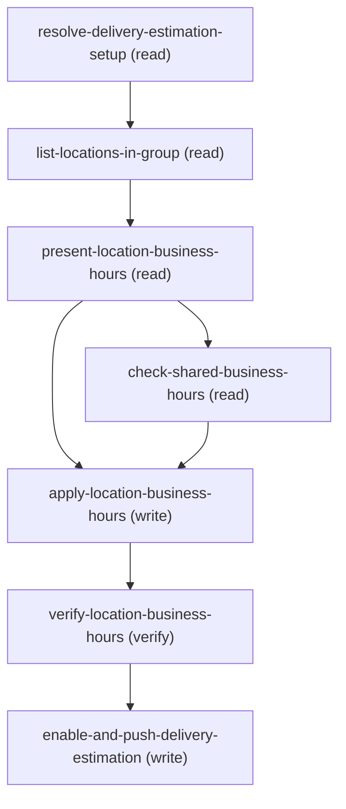

# Managing Update Location Business Hours

## When to Use This Skill

Use this workflow to change a SPECIFIC location's weekly business hours (not the group-wide
default). Each Location optionally references its own BusinessHours via
Location.FulfillingBusinessHoursId; when null, the location inherits the setup's default
BusinessHours. This edits the flat weekly hours (Monday..Sunday start/end + TimeZoneSidKey)
by a DIRECT sObject Data-API PATCH on that BusinessHours record. It does NOT touch holidays
or operating-hours timeslots — those live on OperatingHours and go through the Connect API
(see update-location-temporary-operating-hours).

Flow: resolve the setup by Name/ExternalReference -> list the group's locations with each
one's FulfillingBusinessHoursId -> present each location's current hours -> admin picks the
location(s) -> PATCH each chosen location's BusinessHours record -> verify -> push.

Key contract facts (details + wire format on the steps / in agent_guidance, kept off this card):
  - A PATCH is a partial MERGE — send only the day(s)/timezone you're changing; omitted fields
    keep their value.
  - A location with FulfillingBusinessHoursId = null inherits the setup default. To change THAT,
    use the setup-default path in update-delivery-business-hours; giving a location its OWN
    distinct schedule requires creating a BusinessHours record first (out of scope for this
    edit skill).

## Workflow

Per-location flat BusinessHours (companion to update-delivery-business-hours). Flow: resolve
the setup by Name/ExternalReference -> list locations (with FulfillingBusinessHoursId and
ExternalReference) -> present each location's current hours -> admin picks location(s) -> PATCH
each chosen location's BusinessHours record (partial merge, HH:mm:ss.SSSZ) -> verify -> push,
AUTOMATICALLY, right after verify succeeds.
MECHANISM: sObject Data-API PATCH on BusinessHours only — NO Connect API, NO holidays/timeslots
(those are OperatingHours -> update-location-temporary-operating-hours). Times are HH:mm:ss.SSSZ.
SHARED-RECORD CAVEAT: warn if the BusinessHours record is shared (setup default or multiple
locations) — editing it affects all of them. A location with a null FulfillingBusinessHoursId
inherits the setup default (change that via the front door's setup-default path).
KNOWN LIMITATION — CROSS-SETUP SYNC GAP: check-shared-business-hours finds referencing Locations
ORG-WIDE (not scoped to the current group), but enable-and-push-delivery-estimation below only
pushes the ONE DeliveryEstimationSetup this flow entered through. If the shared BusinessHours
record is also referenced by a Location in a DIFFERENT LocationGroup (a different setup —
Location.FulfillingBusinessHoursId is a plain, freely-shareable reference field, so this is a
realistic scenario, not a rare edge case), that OTHER setup's delivery-estimation copy goes stale
until independently re-synced. Closing this needs enumerating every referencing Location's own
LocationGroup/DeliveryEstimationSetup and pushing each distinct one — a materially bigger,
separately-validated change, not a wording fix — so it's flagged here rather than silently
claimed as covered. Do not imply in the closing message that OTHER setups were also synced.
WIRE CONTRACT: BusinessHours PATCH -> 204 (read-back + restore supported). The
enable-and-push-delivery-estimation step ALWAYS runs right after verify succeeds — never ask the
admin whether to push; the customer should never be told this involves a separate sync/service,
treat it as one seamless save.
CUSTOMER-FACING WORDING: once verify + push both succeed, say exactly: "Your change has been
saved and synced." Then give a compact recap: Name and ExternalReference (from
list-locations-in-group), and the day/time(s) that changed (old -> new where known), per
changed location. BusinessHours itself has no ExternalReference field — anchor the recap on the
Location, not the BusinessHours record. If check-shared-business-hours found the target is
SHARED (refCount > 1, or it's the setup default), add one line noting the OTHER locations also
affected — name a few from referencing_locations_sample (excluding the one(s) just changed)
when refCount is small, e.g. "Note: this schedule is shared with West Warehouse and East
Warehouse, which were also affected"; fall back to a bare count for a large refCount, e.g.
"Note: 12 other locations share this schedule and were also affected" — without naming the
BusinessHours record itself. If the target equals the setup default, also fold in any
null-FulfillingBusinessHoursId siblings from list-locations-in-group.locations_before (see
NULL-FK GAP on check-shared-business-hours) into that same count/naming. If you have the
Location's Id, add a best-effort
link: [<Name>](<orgHost>/lightning/r/Location/<Id>/view) — the standard record-link form used
across the corpus.
RECAP LAYOUT — ONE location changed: a single plain sentence with the Name link-wrapped.
MULTIPLE locations changed (an admin can pick more than one in list-locations-in-group): use a
compact markdown table instead of repeating sentences —
  | Location | Reference | Changed |
  |---|---|---|
  | [<Name>](<orgHost>/lightning/r/Location/<Id>/view) | <ExternalReference> | Monday: 09:00-17:00 -> 09:00-18:00 |
One row per changed location. In a table, every row needs the same number of cells — if a
Location's ExternalReference is blank/null, put "—" in that cell rather than dropping it; only
drop the Reference column entirely if EVERY row lacks one. Keep the whole response under ~200 characters where
possible for a single-location change (soft target — prioritize the recap content over strict truncation). Never say "CDS",
"Commerce Delivery Service", or "delivery estimation service" to the customer, and never surface
sObject/field API names, raw Ids, the Connect path, or HTTP status codes.

## Critical Constraints

**Preconditions:**

- Delivery Estimation enabled; the setup's LocationGroup has LocationGroupAssignments. (check: `Delivery Estimation enabled + LocationGroup populated`)
- Edit access on BusinessHours + field-level Edit on the per-day fields / TimeZoneSidKey.
Without it the PATCH returns 403 or the fields are silently dropped. (check: `UserPermissions edit on BusinessHours + FLS on the fields`)

## Verification Checklist

After every write operation, confirm the effect by re-reading state:

- After `apply-location-business-hours`: call `verify-location-business-hours`

## Operations Reference

Operations grouped by purpose. Use these as the building blocks for the workflows above.

### Summary

| Operation | Purpose | Status | Call | Depends on |
|-----------|---------|--------|------|------------|
| `resolve-delivery-estimation-setup` | read | implemented | `querySoql` | — |
| `list-locations-in-group` | read | implemented | `querySoql` | `resolve-delivery-estimation-setup` |
| `present-location-business-hours` | read | implemented | `querySoql` | `list-locations-in-group` |
| `check-shared-business-hours` | read | implemented | `querySoql` | `present-location-business-hours` |
| `apply-location-business-hours` | write | implemented | `updateBusinessHours` | `present-location-business-hours`, `check-shared-business-hours` |
| `verify-location-business-hours` | verify | implemented | `querySoql` | `apply-location-business-hours` |
| `enable-and-push-delivery-estimation` | write | — | → `cc-om-fast-and-furious/enable-and-push-delivery-estimation-setup` | `verify-location-business-hours` |

### Dependency graph

### Read operations

#### `resolve-delivery-estimation-setup`

Resolve the DeliveryEstimationSetup by Name/ExternalReference; capture LocationGroupId (to
list locations) and ExternalReference (for the push). Skip if the caller already has both.

**Call:** `querySoql`   — status: `implemented`

**Inputs:**

- `name` *(`String`)* — The DeliveryEstimationSetup's Name OR ExternalReference (e.g. "west"). Source: user_input.

#### `list-locations-in-group`

List the group's locations with each one's FulfillingBusinessHoursId (the per-location
weekly-hours FK; null = inherits the setup default).

**Call:** `querySoql`   — status: `implemented`

**Inputs:**

- `locationGroupId` *(`String`)* — LocationGroup Id (0gh...) of the CHOSEN setup. Source: resolve-delivery-estimation-setup.location_group_ids (the one the customer picked when the lookup matched more than one).

**Depends on:** `resolve-delivery-estimation-setup`

#### `present-location-business-hours`

Read + present each selected location's current BusinessHours (per-day open/close + timezone) so the admin sees what they're changing.

**Call:** `querySoql`   — status: `implemented`

**Inputs:**

- `businessHoursIds` *(`Array`)* — The non-null FulfillingBusinessHoursId values for the locations of interest. Source:
list-locations-in-group.locations_before[*].Location.FulfillingBusinessHoursId.

**Depends on:** `list-locations-in-group`

#### `check-shared-business-hours`

Before editing, detect whether each target BusinessHours is SHARED — an aggregate COUNT
(pagination-safe by construction, so it can never undercount even if the record is
referenced by hundreds of Locations org-wide) plus a SEPARATE, bounded follow-up query for
a few representative Names, so the shared-record warning is backed by real data and the
closing recap can name a handful of the other affected locations without requiring an
unbounded org-wide fetch.

**Call:** `querySoql`   — status: `implemented`

**Inputs:**

- `businessHoursIds` *(`Array`)* — The target BusinessHours Ids (the chosen locations' non-null FulfillingBusinessHoursId).
Source: present-location-business-hours.

**Depends on:** `present-location-business-hours`

### Write operations

#### `apply-location-business-hours`

Apply the change: for each selected location, PATCH the BusinessHours record referenced by
its FulfillingBusinessHoursId. Direct sObject Data-API write; partial merge (only the
day(s)/timezone being changed). One PATCH per BusinessHours record.

**Call:** `updateBusinessHours`   — status: `implemented`

**Inputs:**

- `businessHoursUpdates` *(`Array`)* — One entry per BusinessHours record being changed. Each entry: the businessHoursId (the
chosen location's FulfillingBusinessHoursId) plus the day/timezone fields to set (HH:mm:ss.SSSZ
times). Include only fields actually changing (partial merge). Source: user selection over
present-location-business-hours.
  - schema: `{'type': 'array', 'minItems': 1, 'maxItems': 200, 'items': {'type': 'object', 'required': ['businessHoursId', 'fields'], 'properties': {'businessHoursId': {'type': 'string', 'pattern': '^01m[a-zA-Z0-9]{12,15}$', 'description': "The location's BusinessHours Id (from FulfillingBusinessHoursId)."}, 'fields': {'type': 'object', 'minProperties': 1, 'additionalProperties': False, 'description': 'Allowlisted BusinessHours day/timezone fields to change (partial merge); only these keys\nare accepted. Times are HH:mm:ss.SSSZ; TimeZoneSidKey is an IANA id.', 'properties': {'MondayStartTime': {'type': 'string', 'pattern': '^\\d{2}:\\d{2}:\\d{2}\\.\\d{3}Z$'}, 'MondayEndTime': {'type': 'string', 'pattern': '^\\d{2}:\\d{2}:\\d{2}\\.\\d{3}Z$'}, 'TuesdayStartTime': {'type': 'string', 'pattern': '^\\d{2}:\\d{2}:\\d{2}\\.\\d{3}Z$'}, 'TuesdayEndTime': {'type': 'string', 'pattern': '^\\d{2}:\\d{2}:\\d{2}\\.\\d{3}Z$'}, 'WednesdayStartTime': {'type': 'string', 'pattern': '^\\d{2}:\\d{2}:\\d{2}\\.\\d{3}Z$'}, 'WednesdayEndTime': {'type': 'string', 'pattern': '^\\d{2}:\\d{2}:\\d{2}\\.\\d{3}Z$'}, 'ThursdayStartTime': {'type': 'string', 'pattern': '^\\d{2}:\\d{2}:\\d{2}\\.\\d{3}Z$'}, 'ThursdayEndTime': {'type': 'string', 'pattern': '^\\d{2}:\\d{2}:\\d{2}\\.\\d{3}Z$'}, 'FridayStartTime': {'type': 'string', 'pattern': '^\\d{2}:\\d{2}:\\d{2}\\.\\d{3}Z$'}, 'FridayEndTime': {'type': 'string', 'pattern': '^\\d{2}:\\d{2}:\\d{2}\\.\\d{3}Z$'}, 'SaturdayStartTime': {'type': 'string', 'pattern': '^\\d{2}:\\d{2}:\\d{2}\\.\\d{3}Z$'}, 'SaturdayEndTime': {'type': 'string', 'pattern': '^\\d{2}:\\d{2}:\\d{2}\\.\\d{3}Z$'}, 'SundayStartTime': {'type': 'string', 'pattern': '^\\d{2}:\\d{2}:\\d{2}\\.\\d{3}Z$'}, 'SundayEndTime': {'type': 'string', 'pattern': '^\\d{2}:\\d{2}:\\d{2}\\.\\d{3}Z$'}, 'TimeZoneSidKey': {'type': 'string', 'minLength': 1, 'maxLength': 40}}}}}}`

**Depends on:** `present-location-business-hours`, `check-shared-business-hours`

#### `enable-and-push-delivery-estimation`

Propagate the per-location hours change to the delivery estimation service — ONE push keyed
on the PARENT setup's ExternalReference. Delegates to enable-and-push-delivery-estimation-setup.

**Delegates to:** `cc-om-fast-and-furious/enable-and-push-delivery-estimation-setup`

**Depends on:** `verify-location-business-hours`

### Verify operations

#### `verify-location-business-hours`

Re-read the changed BusinessHours records and confirm the requested values.

**Call:** `querySoql`   — status: `implemented`

**Inputs:**

- `businessHoursIds` *(`Array`)* — Ids of the changed BusinessHours (from businessHoursUpdates[].businessHoursId).

**Depends on:** `apply-location-business-hours`
