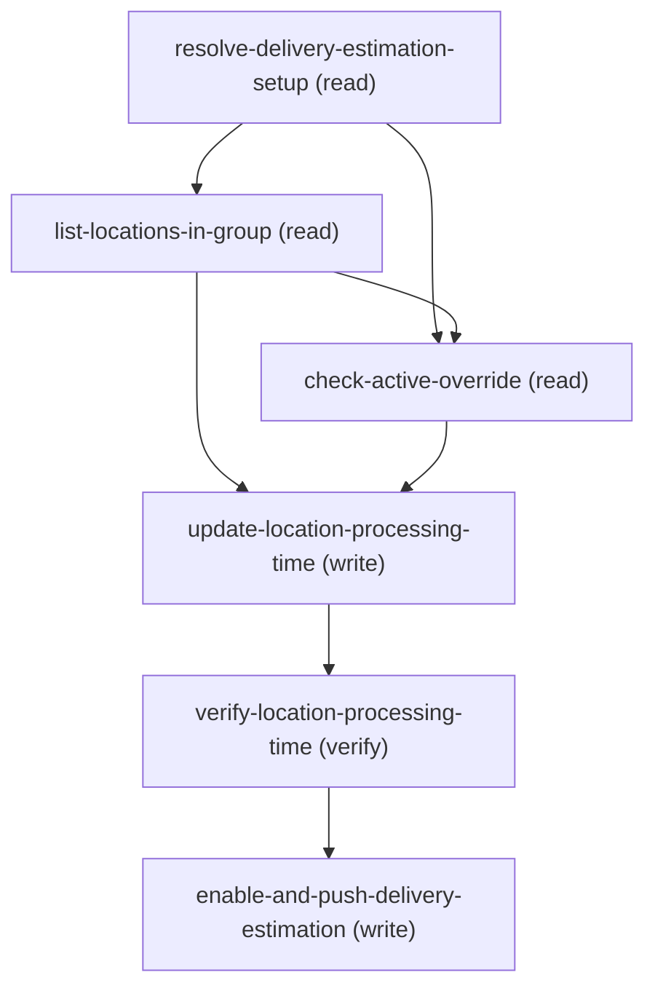

# Managing Update Location Delivery Processing Time

## When to Use This Skill

Use this workflow when an admin wants a SPECIFIC location (or several) to use a
different delivery processing time than the group-wide default set on
DeliveryEstimationSetup. Each Location in the setup's LocationGroup carries its own
optional DefaultProcessingTime + DefaultProcessingTimeUnit; when null, the location
inherits the DeliveryEstimationSetup default. Resolve the setup, list its locations
(each with its current override or "uses default"), let the admin pick one or more,
warn if a temporary override is active (shadowing read), PATCH those Location records,
verify, then push once (see below).

PRECEDENCE (why the shadowing read exists): most-specific-active wins — a temporary
ProcessingTimeSpec within its window, THEN a per-location override, THEN the group-wide
setup default. Because a temporary spec outranks a per-location override, setting a
location's processing time while an active temporary spec covers that location is a
silent no-op within the spec's window. So when the chosen setup has a linked temporary spec
(resolve.active_spec_ids, at the chosen index, non-null), check-active-override reads its
window + scope and warns the admin before the PATCH — it does NOT block (setting the override is still
valid; it simply takes effect once the temporary window passes).

Contracts verified live against a Core org (2026-08-03, setup "west" group, location
Warehouse-SFxmhlV):

  1. Location.DefaultProcessingTime (int) + DefaultProcessingTimeUnit (restricted
     picklist Hours|Days|Weeks) are UPDATEABLE and OPTIONAL (nillable). PATCH to a
     value sets an override (HTTP 204); PATCH both to null CLEARS the override so the
     location falls back to the setup default (verified: null round-trips).

  2. PROPAGATION IS BY THE SETUP's ExternalReference, NOT the location's. The push
     endpoint (postCommerceDeliveryEstimationConfiguration) rejects a Location's
     ExternalReference with HTTP 403 INVALID_INPUT "A Delivery Estimation Setup
     record doesn't exist with external reference <ref>". So after editing location
     overrides, propagate by delegating ONE enable-and-push keyed on the parent
     DeliveryEstimationSetup's ExternalReference — that re-pushes the whole config
     incl. the location overrides. A location's ExternalReference is display-only.

  3. Same restricted picklist as the setup: Hours | Days | Weeks; an out-of-set unit
     → HTTP 400 INVALID_OR_NULL_FOR_RESTRICTED_PICKLIST.

  4. SHADOWING BY A TEMPORARY SPEC (precedence live-confirmed 2026-08-05). A temporary
     ProcessingTimeSpec linked to the setup (DeliveryEstimationSetup.ProcessingTimeSpecId)
     outranks a per-location override within its start..end window (temporary > location >
     group-default). check-active-override surfaces this as a warning before the PATCH.
     CONFIRMED LIVE on "west": with the location holding a 12-Day override and a 1-Hour
     temporary spec (window Aug 5-12) linked to the setup, EstimateDeliveryDate returned a
     ship date of cutoff + 1 HOUR (not + 12 days) — the temporary time masked the location
     override, exactly as the warning predicts. SCOPE CAVEAT (still holds): the list endpoint
     returns the window + counts (locationOverrideCount) but NOT the scoped location Ids, so
     the pre-PATCH warning is window/count-based, not a precise per-location match.

## Workflow

Per-location delivery processing-time overrides (companion to
update-delivery-estimation-setup, which sets the group-wide default). Flow:

### Phase 1: resolve-delivery-estimation-setup → by Name → LocationGroupId + ExternalReference

resolve-delivery-estimation-setup → by Name → LocationGroupId + ExternalReference
     (+ the group default, for display) + ProcessingTimeSpecId (active_spec_ids — the
     linked temporary override, if any) for EVERY match; the agent picks one when the
     lookup is ambiguous and reads all fields at that same index from then on.

### Phase 2: list-locations-in-group → LocationGroupAssignment (junction) → Location details

list-locations-in-group → LocationGroupAssignment (junction) → Location details;
     present each location's current override or "uses default". Admin picks one or
     more.

### Phase 3: check-active-override → SHADOWING READ (read-and-warn, never block). If

check-active-override → SHADOWING READ (read-and-warn, never block). If
     resolve.active_spec_ids at the chosen index is non-null, read the linked temporary ProcessingTimeSpec's
     window + scope and warn that within that window its scoped locations use the
     temporary time — so the per-location override being set won't take effect until the
     window passes (temporary > location). Skipped internally when no spec is linked.

### Phase 4: update-location-processing-time → PATCH each chosen

update-location-processing-time → PATCH each chosen
     Location.DefaultProcessingTime / DefaultProcessingTimeUnit (loop). null clears an
     override → inherit the setup default. Restricted picklist Hours|Days|Weeks.

### Phase 5: verify-location-processing-time → re-read the changed locations

verify-location-processing-time → re-read the changed locations.

### Phase 6: enable-and-push-delivery-estimation → ONE delegated push, keyed on the...

enable-and-push-delivery-estimation → ONE delegated push, keyed on the SETUP's
     ExternalReference (NOT a location's — that 403s), to propagate.

Live-verified on a Core org (2026-08-03, setup "west", location Warehouse-SFxmhlV):
  • PATCH Location {DefaultProcessingTime:2, DefaultProcessingTimeUnit:"Hours"} → 204;
    read-back 2/Hours. PATCH {null,null} → 204; read-back null/null (override cleared).
  • Push with the LOCATION's ExternalReference → HTTP 403 INVALID_INPUT (a
    DeliveryEstimationSetup ExternalReference is required); propagation is by the
    setup's ExternalReference only.
  • temporary-spec-shadows-a-location-override precedence — CONFIRMED LIVE 2026-08-05: with
    Warehouse-SFxmhlV holding a 12-Day override and a 1-Hour temporary spec (window Aug 5-12)
    linked to "west", EstimateDeliveryDate returned ship = cutoff + 1 HOUR (not + 12 days), so
    the temporary time masked the location override (temporary > location > group-default),
    exactly as check-active-override warns.

For the group-wide default (all locations), use update-delivery-estimation-setup
instead.

## Critical Constraints

**Preconditions:**

- Commerce Order Management with Delivery Estimation must be enabled (the
DeliveryEstimationSetup + Location objects exist and the group has
LocationGroupAssignments). (check: `Delivery Estimation enabled + LocationGroup populated`)
- The running user must have Edit access on Location AND field-level Edit on
Location.DefaultProcessingTime / DefaultProcessingTimeUnit. Without it the PATCH
returns 403, or the fields are silently dropped. (check: `UserPermissions edit on Location + FLS on the two fields`)
- A DeliveryEstimationSetup record (with a LocationGroup + LocationGroupAssignments)
must exist. This workflow overrides locations within that group; it does not create
records. (check: `DeliveryEstimationSetup + LocationGroupAssignments exist`)

**Operational rules:**

- PRECEDENCE: most-specific-active wins — a temporary ProcessingTimeSpec within its
window, then a per-location override, then the group-wide setup default. That is why
step 3 runs the shadowing read before the PATCH: a linked temporary spec can mask the
new per-location override within its window (mirrors the same-named guard on the
group-default path in update-delivery-estimation-setup).
- CUSTOMER-FACING WORDING: once verify-location-processing-time confirms the values AND
enable-and-push-delivery-estimation completes, say exactly: "Your change has been saved
and synced." Follow with a compact recap: Name, ExternalReference, and the field(s)
changed in plain language, old -> new (e.g. "default processing time: 2 Days -> 3 Days")
— never the API field name itself (DefaultProcessingTime/Unit) — per changed
location. If you have the Location Id, add a best-effort link:
[<Name>](<orgHost>/lightning/r/Location/<Id>/view) — the standard record-link form used
across the corpus; never speak the raw Id itself.
MATCH BY Id, NOT ARRAY POSITION: verify-location-processing-time.updated_locations /
location_names / location_external_references all come from ONE query response so they're
aligned WITH EACH OTHER by index, but SOQL's `WHERE Id IN (...)` does NOT guarantee its
response is ordered to match locationUpdates' input order. When building a multi-row recap,
match each locationUpdates[] entry to its row in updated_locations by comparing Id — never
assume row i of the recap corresponds to locationUpdates[i].
RECAP LAYOUT — ONE location changed: a single plain sentence with the Name link-wrapped.
MULTIPLE locations changed (the SELECT above can return several): use a compact markdown
table instead of repeating sentences —
  | Location | Reference | Changed |
  |---|---|---|
  | [<Name>](<orgHost>/lightning/r/Location/<Id>/view) | <ExternalReference> | default processing time: <old> -> <new> |
One row per changed location. In a table, every row needs the same number of cells — if a
Location's ExternalReference is blank/null, put "—" in that cell rather than dropping it; only
drop the Reference column entirely if EVERY row lacks one. Keep the whole response under ~200
characters of VISIBLE text where possible for a single-location change (the link URL doesn't count — soft target, the
recap's completeness wins over strict truncation). Never say
"CDS", "Commerce Delivery Service", or "delivery estimation service" to the customer —
it's one seamless save, not two systems. Still don't surface sObject / field API names,
raw HTTP codes, or the Connect path.

## Verification Checklist

After every write operation, confirm the effect by re-reading state:

- After `update-location-processing-time`: call `verify-location-processing-time`

## Operations Reference

Operations grouped by purpose. Use these as the building blocks for the workflows above.

### Summary

| Operation | Purpose | Status | Call | Depends on |
|-----------|---------|--------|------|------------|
| `resolve-delivery-estimation-setup` | read | implemented | `querySoql` | — |
| `list-locations-in-group` | read | implemented | `querySoql` | `resolve-delivery-estimation-setup` |
| `check-active-override` | read | implemented | `getProcessingTimeSpecDefinitions` | `resolve-delivery-estimation-setup`, `list-locations-in-group` |
| `update-location-processing-time` | write | implemented | `updateLocation` | `list-locations-in-group`, `check-active-override` |
| `verify-location-processing-time` | verify | implemented | `querySoql` | `update-location-processing-time` |
| `enable-and-push-delivery-estimation` | write | — | → `cc-om-fast-and-furious/enable-and-push-delivery-estimation-setup` | `verify-location-processing-time` |

### Dependency graph

### Read operations

#### `resolve-delivery-estimation-setup`

Resolve the parent DeliveryEstimationSetup by Name and capture its LocationGroupId
(to list the group's locations), ExternalReference (needed for the propagation push
in the final step), and ProcessingTimeSpecId (the linked temporary override, if any —
read by check-active-override so we can warn when a temporary spec would shadow the
location override being set). Skip if the caller already has both.

**Call:** `querySoql`   — status: `implemented`

**Inputs:**

- `name` *(`String`)* — The DeliveryEstimationSetup's Name OR ExternalReference (e.g. "west") — the query
matches either field. Source: user_input.

#### `list-locations-in-group`

List the locations in the setup's LocationGroup with each one's current override.
Reads LocationGroupAssignment (the group→location junction) then the Location
details. Present each location as "override N <Unit>" or "uses default" so the
admin can choose which to change.

**Call:** `querySoql`   — status: `implemented`

**Inputs:**

- `locationGroupId` *(`String`)* — LocationGroup Id (0gh...) of the CHOSEN setup. Source: resolve-delivery-estimation-setup.location_group_ids (the one the customer picked when the lookup matched more than one).

**Depends on:** `resolve-delivery-estimation-setup`

#### `check-active-override`

SHADOWING READ. If the chosen setup has a linked temporary override
(resolve.active_spec_ids, at the chosen index, non-null), read that ProcessingTimeSpec's
window + scope from the Commerce Delivery list so the admin can be warned that within its
active window the per-location override being set will not take effect for the spec's
scoped locations (precedence: a temporary spec within its window outranks a per-location
override). Read-and-warn: does NOT block the PATCH. Skip the API call entirely when that
value is null (no linked spec). This is the location-path counterpart of the same-named step
in update-delivery-estimation-setup, which guards the group-default PATCH.

**Call:** `getProcessingTimeSpecDefinitions`   — status: `implemented`

**Inputs:**

- `activeSpecId` *(`String`)* — The CHOSEN setup's linked ProcessingTimeSpec Id (1fH...). Source:
resolve-delivery-estimation-setup.active_spec_ids (the one the customer picked when the
lookup matched more than one), read at that same chosen index. When null there is no
linked temporary override — skip this step's read.

**Depends on:** `resolve-delivery-estimation-setup`, `list-locations-in-group`

### Write operations

#### `update-location-processing-time`

Apply the per-location override(s). For EACH location the admin chose, PATCH
Location.DefaultProcessingTime / DefaultProcessingTimeUnit. Setting both to null
CLEARS the override (the location reverts to the setup default). Loop over the
selected locations — one PATCH per Location record.

**Call:** `updateLocation`   — status: `implemented`

**Inputs:**

- `locationUpdates` *(`Array`)* — One entry per location being changed. Each entry: the Location Id plus the new
DefaultProcessingTime + DefaultProcessingTimeUnit (or both null to clear the
override → inherit the setup default). Include only locations that are actually
changing. Source: user selection over list-locations-in-group.
  - schema: `{'type': 'array', 'maxItems': 200, 'items': {'type': 'object', 'required': ['locationId'], 'properties': {'locationId': {'type': 'string', 'pattern': '^131[a-zA-Z0-9]{12,15}$', 'description': 'Location Id to update (from list-locations-in-group).'}, 'DefaultProcessingTime': {'type': ['integer', 'null'], 'description': 'New processing time (whole number); null clears the override.'}, 'DefaultProcessingTimeUnit': {'type': ['string', 'null'], 'pattern': '^(Hours|Days|Weeks)$', 'x-codey-enum-source': 'Location.DefaultProcessingTimeUnit', 'description': 'New unit — Hours | Days | Weeks (restricted); null clears the override.'}}}}`

**Depends on:** `list-locations-in-group`, `check-active-override`

**Rollback:** {'operation': 'updateLocation', 'invocation': {'kind': 'rest', 'method': 'PATCH', 'path': '/services/data/v67.0/sobjects/Location/{locationId}', 'body': {'DefaultProcessingTime': '{list-locations-in-group.locations_before[?(@.LocationId==locationId)].Location.DefaultProcessingTime}', 'DefaultProcessingTimeUnit': '{list-locations-in-group.locations_before[?(@.LocationId==locationId)].Location.DefaultProcessingTimeUnit}'}}}

#### `enable-and-push-delivery-estimation`

Propagate the location override(s) so the change takes effect end-to-end. Delegates to
enable-and-push-delivery-estimation-setup — ONE push, keyed on the PARENT
DeliveryEstimationSetup's ExternalReference (NOT any location's). That single push
re-sends the whole configuration, including the per-location overrides just set.

**Delegates to:** `cc-om-fast-and-furious/enable-and-push-delivery-estimation-setup`

**Depends on:** `verify-location-processing-time`

### Verify operations

#### `verify-location-processing-time`

Re-read the changed Location records and confirm each now holds the requested override (or null, if the override was cleared).

**Call:** `querySoql`   — status: `implemented`

**Inputs:**

- `locationIds` *(`Array`)* — Ids of the changed locations (from locationUpdates[].locationId). Source:
update-location-processing-time. The query's {locationIdsInClause} is the SOQL-safe
rendering of THIS input — a comma-separated list of single-quoted Ids (see
agent_guidance) — not a separate input.

**Depends on:** `update-location-processing-time`
