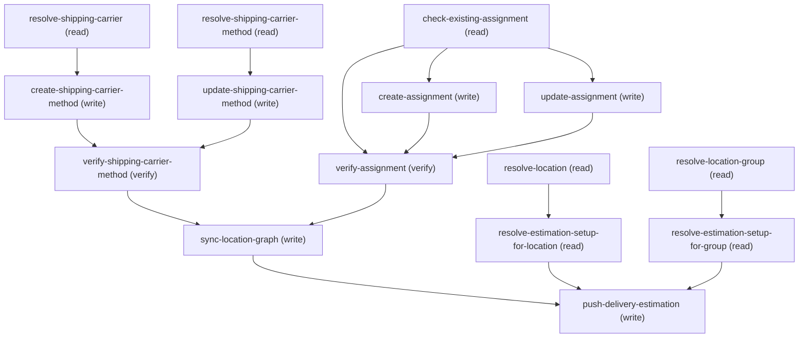

# Managing Update Location Shipping Carrier Method

## When to Use This Skill

Use this workflow when an admin wants to configure WHICH shipping carrier methods are
available at a location (or a whole location group) and HOW LONG they take. Two
independent choices drive the flow:

  method_action — CREATE a brand-new ShippingCarrierMethod under an existing
  ShippingCarrier, or use/UPDATE an EXISTING one.
  assign_to — assign to a single Location, or to a LocationGroup (every location
  currently in the group inherits the assignment).

These two choices are independent but NOT optional to combine: this skill never
creates or updates a ShippingCarrierMethod without also creating/updating its
LocationShippingCarrierMethod assignment in the SAME run — a method with no
assignment (unreachable by any location) is not a supported end-state here.
method_action / assign_to decide HOW the method is created/updated and WHERE it's
assigned, never WHETHER it's assigned.

ENTITIES (all confirmed live against the platform's own entity definitions, NOT the
cached Data-API docs, which were found stale for this object):
  - ShippingCarrierMethod (keyPrefix 2A1) — the reusable carrier+transit-time
    definition. Name (REQUIRED — live-confirmed, not in any cached field
    reference), ExternalReference (required, unique together with ShippingCarrierId),
    ShippingCarrierId (required FK, keyPrefix 2A2), MinTransitTime (REQUIRED BY THIS
    SKILL — platform itself treats it as an optional int; see RANGE below),
    MaxTransitTime (REQUIRED int), TransitTimeUnit (REQUIRED enum
    Hours|Days|Weeks), ProcessingTime (optional int), ProcessingTimeUnit (optional
    enum Hours|Days|Weeks — same TimeUnitEnum as TransitTimeUnit). Treat
    ProcessingTime and ProcessingTimeUnit as BOTH-OR-NEITHER — live-confirmed the
    platform does NOT actually enforce this (a lone ProcessingTime saves fine with
    ProcessingTimeUnit left null), but a processing time with no unit is
    meaningless partial data, so this skill collects both together anyway. This is
    the METHOD-level processing time —
    shared across every location the method is assigned to — and NOT the same
    field as either of the other "default processing time" fields the platform
    also has (see SCOPE LEVELS below).
  - LocationShippingCarrierMethod (keyPrefix 2A3) — the assignment/junction row
    linking a method to a Location OR LocationGroup (LocationSourceId is a
    polymorphic lookup over both, resolved by the Id's keyPrefix — no separate
    discriminator field). PickupTime (optional Time) lives HERE, per location/group
    PER METHOD — not on the method, and NOT the same field as either of the two
    OTHER "default pickup time" fields the platform also has (see SCOPE
    LEVELS below — confirm scope with the admin before setting it). DB-ENFORCED
    UNIQUE INDEX on (LocationSourceId, ShippingCarrierMethodId) — a location/group can
    have at most ONE assignment row per method; a duplicate POST hard-fails at the
    platform level. Always resolve the existing row first (check-existing-assignment)
    and POST vs PATCH accordingly.

SCOPE LEVELS — pickup time and processing time each exist at MULTIPLE levels on
the platform; only ONE level of each is this skill's field. An admin saying "set
the pickup/processing time" doesn't by itself say which level they mean — consult
this before setting either:

Pickup time (2 levels):
  - SETUP — DeliveryEstimationSetup.DefaultPickupTime. Per-channel default
    applying across the whole delivery estimation configuration. A DIFFERENT
    skill (Delivery Estimation Setup) — NOT settable here.
  - LOCATION-PER-METHOD — LocationShippingCarrierMethod.PickupTime. THIS skill's
    field, and the correct entity for a location-level carrier pickup time.
    Scoped to one (Location-or-LocationGroup × ShippingCarrierMethod) assignment;
    set by create-assignment / update-assignment below.
  Unrelated decoys (real fields, NOT either scope above, NOT settable by this
  skill): Location.DefaultPickupTime (location-WIDE, not carrier- or
  method-specific — applies regardless of which carrier method is used);
  Location.EarliestPickupTimeOffset / LatestPickupTimeOffset (BOPIS
  customer-pickup-window offsets, minutes before end of business hours — about
  when a CUSTOMER picks up an order, not when a CARRIER picks one up from the
  location — different concept and use case entirely).

Processing time (4 levels — live-org validation added the 4th; earlier authoring
incorrectly assumed the assignment row had none):
  - SETUP — DeliveryEstimationSetup.DefaultProcessingTime / DefaultProcessingTimeUnit.
    Per-channel default. A DIFFERENT skill — NOT settable here.
  - LOCATION-WIDE — Location.DefaultProcessingTime / DefaultProcessingTimeUnit.
    Location-wide, independent of any specific carrier method (requires Order
    Management; hidden by field-level security by default). NOT settable by this
    skill.
  - METHOD — ShippingCarrierMethod.ProcessingTime / ProcessingTimeUnit. THIS
    skill's field, set by create-shipping-carrier-method /
    update-shipping-carrier-method above. Shared by every location/group the
    method ends up assigned to — NOT per-location.
  - ASSIGNMENT — LocationShippingCarrierMethod.ProcessingTime / ProcessingTimeUnit.
    A per-(location-or-group × method) override, more specific than the
    method-level field above. THIS skill's field too — set by create-assignment /
    update-assignment below, independent of the method-level ProcessingTime.
  Unrelated decoy: Location.PickupProcessingTime — the processing time for BOPIS
  (customer pickup) orders at a location. Unrelated to a carrier method's
  processing time. NOT settable by this skill.

DISAMBIGUATION BEHAVIOR — step 1, IN SCOPE OR NOT (pickup time and processing time
both work this way): if the admin's ask names a specific carrier or shipping
method ("pickup time for FedEx Ground at the downtown store", "processing time
for FedEx Ground"), that's in scope for this skill — proceed to step 2 below. If
it's ambiguous or reads as a store-wide/channel-wide setup default (no carrier or
method mentioned), ask which level they mean before setting anything; if they
mean a level this skill doesn't own (setup-level for either; location-wide for
processing time), tell them plainly and point them to a different skill.

DISAMBIGUATION BEHAVIOR — step 2, WHICH of this skill's levels (pickup time has
only ONE settable level here, so step 2 only applies to processing time):
pickup time is always assignment-level (LocationShippingCarrierMethod.PickupTime,
set by create-assignment / update-assignment) — there is no method-level pickup
time, so no further question once step 1 confirms it's in scope. Processing time
has TWO settable levels here, and an in-scope ask does NOT by itself say which:
if the admin wants the value to apply everywhere this method is assigned
(method-level — "set FedEx Ground's processing time to 2 days"), use
create-shipping-carrier-method / update-shipping-carrier-method. If they want it
to apply ONLY at one specific location or group (assignment-level override —
"for the downtown store's FedEx Ground assignment, use a 1-day processing time
instead"), use create-assignment / update-assignment's processingTime /
processingTimeUnit. If the ask doesn't make the scope clear ("set the processing
time for FedEx Ground" with no location/group context and no "for this location"
qualifier), ask the admin whether they mean the method everywhere it's used or
just this one assignment before calling either.

EXCLUDED BY DESIGN (confirmed to exist but out of scope for this skill):
  - ShippingCarrierMethod.ShippingAreaType — platform-required but
    apiAccess/createAccess/editAccess="isSfdcInternal": NOT settable via the public
    API. Never attempt to set it; the platform applies its own default.
  - ShippingCarrierMethod.ManagedShippingCarrierMethod and .ShippingScope —
    optional enums for Salesforce-managed carrier integrations / shipping-scope
    classification; the customer did not ask to set these here. Leave unset.
  - Per-day pickup-time fields — BOTH ShippingCarrierMethod and
    LocationShippingCarrierMethod additionally carry seven day-specific fields
    (MondayPickUpTime..SundayPickUpTime, minApiVersion=262). This skill exposes only
    the single generic LocationShippingCarrierMethod.PickupTime the customer asked
    for ("a pickup time"). If an admin wants a per-day pickup schedule instead, that
    is a natural follow-up enhancement to this skill, not covered here.
  - Every non-settable field listed under SCOPE LEVELS above (the setup-level and
    location-wide defaults, and both BOPIS decoys) — none of those are settable
    by this skill; if the admin actually wants one of them, say so plainly instead
    of silently setting this skill's own field in its place. (The
    ASSIGNMENT-level processing-time override IS settable by this skill — see
    SCOPE LEVELS above; it is not excluded.)
  - Creating a new ShippingCarrier, or expanding a LocationGroup's membership — both
    out of scope; the carrier and the target Location/LocationGroup must already
    exist (see preconditions).

API VERSION: every call is pinned to /services/data/v68.0/ (release 264).
This is comfortably above the v67.0 minimum actually needed
for ProcessingTime/ProcessingTimeUnit (minApiVersion=262 → public API v67.0, derived
from the same file's ManagedShippingCarrierMethod/ShippingScope fields at
minApiVersion=258 → confirmed v65.0 in the cached Data-API doc, and
LocationShippingCarrierMethod.PickupTime at minApiVersion=260 → confirmed v66.0 in
the same doc — a consistent +2-release = +1-API-version step).

FEATURE GATES (from the entity definitions, more specific than "B2B/D2C Commerce
license"): ShippingCarrierMethod / ShippingCarrier require
CommerceDelivery.orgHasDeliveryEstimationEnabled OR
CommerceStore.orgHasCommerceStoreEnabledOrRepricingEnabled. LocationShippingCarrierMethod
requires the NARROWER CommerceDelivery.orgHasDeliveryEstimationEnabled only (no
CommerceStore fallback) — so the binding precondition for this whole skill is delivery
estimation being enabled.

ADMIN-FACING WORDING: name the carrier method / location / group in plain language;
don't surface sObject or field API names, Ids, or raw HTTP codes.

## Workflow

Flow:

### Phase 1: method_action (create vs existing) and assign_to (location vs...

method_action (create vs existing) and assign_to (location vs group) are
     independent choices — ask both up front.
  2a. CREATE path: resolve-shipping-carrier (validate the carrier exists) →
      create-shipping-carrier-method (Name[required], ExternalReference[required],
      MinTransitTime[required by this skill — platform itself treats it as
      optional], MaxTransitTime[required], TransitTimeUnit[required],
      ProcessingTime[optional],
      ProcessingTimeUnit[optional, both-or-neither with ProcessingTime] — this is
      the METHOD-level processing time, shared by every location the method ends up
      assigned to, and not either of the two other "default processing time" fields
      on Location / DeliveryEstimationSetup — see SCOPE LEVELS and
      EXCLUDED BY DESIGN below; confirm scope with the admin first if their ask
      doesn't clearly name a carrier/method).
  2b. EXISTING path: resolve-shipping-carrier-method (by Id, captures baseline) →
      update-shipping-carrier-method (partial-merge PATCH; skip the call entirely
      if the admin wants no field changes on the method itself — UNLESS the
      captured baseline's MinTransitTime is already null, which forces a
      minTransitTime on this call regardless; see BASELINE MINIMUM in that step's
      agent_guidance).

### Phase 2: verify-shipping-carrier-method — ALWAYS runs (regardless of method_action)

verify-shipping-carrier-method — ALWAYS runs (regardless of method_action).
     Re-reads the method and confirms its transit/processing time fields.
  4a. LOCATION path: resolve-location (by Id/ExternalReference/Name).
  4b. GROUP path: resolve-location-group (by Id/Name) — every location currently in
      the group inherits the assignment.

### Phase 3: check-existing-assignment — ALWAYS runs. LocationShippingCarrierMethod has a

check-existing-assignment — ALWAYS runs. LocationShippingCarrierMethod has a
     DB-enforced unique index on (LocationSourceId, ShippingCarrierMethodId); this read
     decides create-assignment (no existing row) vs update-assignment (existing
     row) — never both.

### Phase 4: create-assignment OR update-assignment — sets PickupTime (the customer's...

create-assignment OR update-assignment — sets PickupTime (the customer's "a
     pickup time" ask; the single generic LocationShippingCarrierMethod.PickupTime
     field, not the separate day-of-week fields, and not either of the two other
     "default pickup time" fields on Location / DeliveryEstimationSetup) and,
     independently, an optional ASSIGNMENT-level ProcessingTime/ProcessingTimeUnit
     override (more granular than the method-level field from step 2a; both-or
     -neither, same convention) — see SCOPE LEVELS and EXCLUDED BY DESIGN below;
     confirm scope with the admin first if their ask doesn't clearly name a
     carrier/method.

### Phase 5: verify-assignment — re-read and confirm. INTERIM status, not...

verify-assignment — re-read and confirm. INTERIM status, not final — step 8 still has to run.

### Phase 6: sync-location-graph (ALWAYS runs automatically, immediately after BOTH verify...

sync-location-graph (ALWAYS runs automatically, immediately after BOTH verify steps succeed
     — no ask, no choice) -> delegates_to the shared sync-location-graph SOR, which publishes
     the location graph AND polls it to terminal success before returning. This carries
     LOCATION-level data. It does NOT carry the transit/processing/pickup times this SOR writes
     into delivery estimates — step 10 does. Necessary, not sufficient.

### Phase 7: resolve-estimation-setup-for-location (LOCATION path) OR resolve-estimation-setup-for-group

resolve-estimation-setup-for-location (LOCATION path) OR resolve-estimation-setup-for-group
     (GROUP path) — read-only lookup of the DeliveryEstimationSetup(s) covering the target, so
     step 10 knows which configuration to push. Zero results is a normal, non-error answer.

### Phase 8: push-delivery-estimation (ALWAYS runs automatically when a covering ENABLED...

push-delivery-estimation (ALWAYS runs automatically when a covering ENABLED setup was found
     — no ask, no choice) -> delegates_to enable-and-push-delivery-estimation-setup, once per
     enabled setup. THIS is the step that makes the change reach a delivery estimate; measured
     on 2026-08-26, nothing this SOR writes shows up in an estimate until it runs. Skip
     a setup whose IsEnabled is false rather than silently re-enabling it.

## Critical Constraints

**Preconditions:**

- Delivery Estimation must be enabled for LocationShippingCarrierMethod
(CommerceDelivery.orgHasDeliveryEstimationEnabled). ShippingCarrierMethod /
ShippingCarrier additionally allow a CommerceStore fallback gate, but the
assignment object does not — treat delivery estimation as the binding gate for
this whole skill. (check: `CommerceDelivery.orgHasDeliveryEstimationEnabled`)
- The running user needs Create/Edit access on ShippingCarrierMethod and
LocationShippingCarrierMethod, plus field-level Edit on the fields being set.
Without it, calls return 403 or the fields are silently dropped. (check: `UserPermissions create/edit on ShippingCarrierMethod + LocationShippingCarrierMethod`)
- The ShippingCarrier the new/existing method belongs to must already exist. This
skill does not create ShippingCarrier records — resolve-shipping-carrier stops
with a friendly message if the given carrier can't be found. (check: `ShippingCarrier.exists`)
- The target Location or LocationGroup must already exist. This skill does not
create locations or groups, or expand a group's membership. (check: `Location.exists OR LocationGroup.exists`)

**Operational rules:**

- EXCLUDED BY DESIGN: ShippingAreaType (internal-only, never settable via the public
API), ManagedShippingCarrierMethod / ShippingScope (optional, unrequested, left
unset), the seven day-of-week PickUpTime fields on both entities (customer asked
for a single generic pickup time — LocationShippingCarrierMethod.PickupTime — not a
per-day schedule; flag this as a possible future enhancement if the admin wants
more granularity), DeliveryEstimationSetup.DefaultPickupTime (the setup-level
carrier pickup time — a different skill's job), Location.DefaultPickupTime (a
location-wide, non-carrier-specific default), and Location.EarliestPickupTimeOffset
/ LatestPickupTimeOffset (BOPIS customer-pickup-window offsets — unrelated to
carrier pickup at all; see SCOPE LEVELS above),
DeliveryEstimationSetup.DefaultProcessingTime / DefaultProcessingTimeUnit (the
setup-level processing-time default — a different skill's job),
Location.DefaultProcessingTime / DefaultProcessingTimeUnit (a location-wide,
non-carrier-specific default), and Location.PickupProcessingTime (BOPIS
customer-pickup processing time — unrelated to carrier processing time; see
SCOPE LEVELS above), creating a ShippingCarrier, and expanding
LocationGroup membership.
- API VERSION: pinned to /services/data/v68.0/ (release 264) throughout — above the
v67.0 minimum actually required for ProcessingTime.
- CUSTOMER-FACING WORDING: the canonical closing line "Your change has been saved and synced."
requires ALL FOUR of verify-shipping-carrier-method, verify-assignment, sync-location-graph's
delegate reaching TERMINAL SUCCESS (not merely its enqueue returning), AND
push-delivery-estimation reporting success. The push is the one that determines whether the
change actually reaches a delivery estimate, so a graph sync that succeeded on its own does NOT
earn this line. The one exception is a target no delivery estimation configuration covers
(setup_count == 0): there the save and the graph sync ARE the whole of what can be done, so say
the canonical line and add that no delivery estimate is configured for this location/group yet.
Then a compact recap:
  - The ShippingCarrierMethod's Name (+ ExternalReference if you have it) — CREATE path: echo
    the exact name/externalReference values you sent (the create API doesn't echo them back);
    EXISTING path: the resolved method's own Name and ExternalReference, already captured by
    resolve-shipping-carrier-method. Either path has the Id (create-shipping-carrier-method.
    method_id or resolve-shipping-carrier-method.matched[0].Id) — add a best-effort link:
    [<Name>](<orgHost>/lightning/r/ShippingCarrierMethod/<Id>/view), where <orgHost> is
    https://<instance>, the org host this request was issued against. Always absolute — never a
    bare /lightning/r/... path. This flow holds the Id directly, so no reference-to-Id join is
    needed here (unlike the estimate skills, whose responses carry references only); still, if
    the Id is somehow absent, name the method plainly rather than inventing a URL.
  - What it's assigned to: the target Location (resolve-location.location_names +
    .location_external_references, at the index the admin chose when the lookup matched more
    than one — if blank/null, just leave the reference out; best-effort
    link [<Name>](<orgHost>/lightning/r/Location/<Id>/view)) or LocationGroup
    (resolve-location-group.location_group_names + .location_group_external_references, at
    the chosen index, if set — LocationGroup's ExternalReference is org-optional and often
    blank, so leave it out rather than inventing one; no standard record page confirmed to
    link here, so name it plainly).
  - What changed, in plain language (e.g. "transit time: 2-5 Days", "pickup time: 2:30pm",
    "processing time: 1 Day") — never the raw field names (MinTransitTime/MaxTransitTime/
    ProcessingTime/PickupTime).
RECAP LAYOUT — ONE method/target changed (the common case): the sentence form above. If the
customer asked for the SAME method assigned to MULTIPLE Locations/Groups in this conversation
(this SOR runs once per target, so that's multiple invocations), give ONE consolidated table
at the end instead of a repeated sentence per target —
  | Method | Target | Reference | Changed |
  |---|---|---|---|
  | [<Name>](<orgHost>/lightning/r/ShippingCarrierMethod/<Id>/view) | <target Location/Group name> | <target ExternalReference> | transit time: 2-5 Days |
One row per target; the Reference cell is the TARGET's ExternalReference, matching the sibling
per-location SORs' | ... | Reference | Changed | shape. In a table, every row needs the same
number of cells — use "—" for an individual row's missing value (e.g. a LocationGroup target,
whose ExternalReference is org-optional and often blank) rather than dropping the cell; only
drop the Reference column entirely if every row lacks it. Still say the canonical line
once, before the table, if every row synced successfully; if any row ended in TERMINAL
FAILURE (see below), that row's own failure wording goes in the table's Changed cell instead
of a plain "changed" description, and the canonical line is omitted (or only covers the rows
that actually succeeded, named separately from the failed ones).
If sync-location-graph's delegate ends in TERMINAL FAILURE, do NOT say "saved and synced". IF
the delegate's poll_status is 'Error' AND poll_error is non-empty: it carries a plain-enough,
per-location explanation already designed to be shown to end users (e.g. "Location 'X' has
invalid country code"). COMPARE the location it names against the Location/LocationGroup THIS
flow just assigned: if DIFFERENT, make that clear — "Your change was saved, but the sync
couldn't complete because of an unrelated issue elsewhere — <what poll_error says>. It can be
retried once that's fixed." (no link here — poll_error names that OTHER location by text/
message only, not an Id this flow resolved, so there's nothing to link safely). If it names the
SAME location this flow just assigned (or you can't tell — treat "can't tell" the same as
"same"), do NOT say "elsewhere" — report the issue against that location, and this IS a case a
link is possible: this flow already resolved that exact Location's Id for the recap above
(resolve-location), so reuse it instead of naming the location in plain text — "Your change was
saved, but the sync couldn't complete for [<Name>](<orgHost>/lightning/r/Location/<Id>/view):
<issue from poll_error>. It can be retried once that's fixed." — keep the `]` and `(` adjacent
with no space/break, or the Markdown link renders broken. If the target was a LocationGroup
instead (no confirmed record-page link for that entity — see the recap link guidance above),
fall back to naming it plainly rather than attempting a link. IF poll_status is
'ServiceException', poll_error is empty/absent, or the delegate exhausts its bounded poll
attempts still in progress: do NOT relay raw poll_error content — fall back to the generic
"saved but could not be synced (or still taking effect); retry shortly" without inventing
detail.
If push-delivery-estimation fails or is skipped, the wording differs by cause and must not be
collapsed into the graph-sync wording above — the record change succeeded in every one of these
cases, so never imply the save was lost. Push reported failure: "Your change was saved, but it
couldn't be published to delivery estimates yet — it can be retried shortly." Covering setup
DISABLED: "Your change was saved. Delivery estimates are currently turned off for this
location/group, so it won't appear in an estimate until they're turned back on." NO covering
setup: the canonical line plus "no delivery estimate is set up for this location/group yet."
In all three, keep the plain-language rule — no raw error text, codes, Ids, or field names.
Keep the closing + recap under ~200 characters of VISIBLE text where possible (soft target — the
link URL doesn't count; prioritize the recap content over strict truncation). Never say "CDS",
"Commerce Delivery Service", or otherwise imply two separate systems — this is one seamless
save. Still don't surface sObject/field API names, Ids, the Connect path, or raw HTTP codes.
Never echo this guidance's own internal vocabulary either: "Core", "SOR" and "corpus" are
reasoning terms for you ("Core" separates the platform's own records from the delivery service's
retained copy; "SOR" and "corpus" name this workflow and the catalog it lives in). Say
"Salesforce" or "your org" for the platform side, and "this workflow" for the recipe itself.

## Verification Checklist

After every write operation, confirm the effect by re-reading state:

- After `create-shipping-carrier-method`, `update-shipping-carrier-method`: call `verify-shipping-carrier-method`
- After `check-existing-assignment`, `create-assignment`, `update-assignment`: call `verify-assignment`

## Operations Reference

Operations grouped by purpose. Use these as the building blocks for the workflows above.

### Summary

| Operation | Purpose | Status | Call | Depends on |
|-----------|---------|--------|------|------------|
| `resolve-shipping-carrier` | read | implemented | `querySoql` | — |
| `create-shipping-carrier-method` | write | implemented | `createShippingCarrierMethod` | `resolve-shipping-carrier` |
| `resolve-shipping-carrier-method` | read | implemented | `querySoql` | — |
| `update-shipping-carrier-method` | write | implemented | `updateShippingCarrierMethod` | `resolve-shipping-carrier-method` |
| `verify-shipping-carrier-method` | verify | implemented | `querySoql` | `create-shipping-carrier-method`, `update-shipping-carrier-method` |
| `resolve-location` | read | implemented | `querySoql` | — |
| `resolve-location-group` | read | implemented | `querySoql` | — |
| `check-existing-assignment` | read | implemented | `querySoql` | — |
| `create-assignment` | write | implemented | `createLocationShippingCarrierMethod` | `check-existing-assignment` |
| `update-assignment` | write | implemented | `updateLocationShippingCarrierMethod` | `check-existing-assignment` |
| `verify-assignment` | verify | implemented | `querySoql` | `check-existing-assignment`, `create-assignment`, `update-assignment` |
| `sync-location-graph` | write | — | → `cc-om-fast-and-furious/sync-location-graph` | `verify-shipping-carrier-method`, `verify-assignment` |
| `resolve-estimation-setup-for-location` | read | implemented | `querySoql` | `resolve-location` |
| `resolve-estimation-setup-for-group` | read | implemented | `querySoql` | `resolve-location-group` |
| `push-delivery-estimation` | write | — | → `cc-om-fast-and-furious/enable-and-push-delivery-estimation-setup` | `sync-location-graph`, `resolve-estimation-setup-for-location`, `resolve-estimation-setup-for-group` |

### Dependency graph

### Read operations

#### `resolve-shipping-carrier`

Resolve the ShippingCarrier the new method will belong to, by Id or
ExternalReference. Runs only when creating a new method — an existing method
already has its carrier set.

**Call:** `querySoql`   — status: `implemented`

**Inputs:**

- `carrierIdOrExternalReference` *(`String`)* — The ShippingCarrier's Id (2A2...) or ExternalReference. Source: user_input.

#### `resolve-shipping-carrier-method`

Resolve an existing ShippingCarrierMethod by Id and capture its current field
values as a baseline for a partial-merge PATCH and for rollback.

**Call:** `querySoql`   — status: `implemented`

**Inputs:**

- `methodId` *(`String`)* — ShippingCarrierMethod Id (2A1...). Source: user_input.

#### `resolve-location`

Resolve the target Location by Id, ExternalReference, or Name.

**Call:** `querySoql`   — status: `implemented`

**Inputs:**

- `locationIdOrRef` *(`String`)* — Location Id (131...), ExternalReference, or Name. Source: user_input.

#### `resolve-location-group`

Resolve the target LocationGroup by Id or LocationGroupName.

**Call:** `querySoql`   — status: `implemented`

**Inputs:**

- `groupIdOrName` *(`String`)* — LocationGroup Id (0gh...) or LocationGroupName. Source: user_input.

#### `check-existing-assignment`

Check whether this Location/LocationGroup already has an assignment row for this
ShippingCarrierMethod. LocationShippingCarrierMethod has a DB-enforced unique
index on (LocationSourceId, ShippingCarrierMethodId) — a location/group can have at
most one assignment per method — so this determines whether the next step must
be a create or an update (a duplicate POST hard-fails at the platform level, not
merely creates redundant data).

**Call:** `querySoql`   — status: `implemented`

**Inputs:**

- `locationSourceId` *(`String`)* — The Location or LocationGroup Id. Source: resolve-location.location_source_ids when
assign_to=location, or resolve-location-group.location_source_id (ID SHORTCUT path) or
.location_source_ids (query path) when assign_to=group — in every array case, at the
index the admin picked when the lookup matched more than one.
- `methodId` *(`String`)* — The ShippingCarrierMethod Id. Source: create-shipping-carrier-method.method_id
when method_action=create, or resolve-shipping-carrier-method.method_id when
method_action=existing.

#### `resolve-estimation-setup-for-location`

LOCATION path only. Find the DeliveryEstimationSetup(s) covering the target Location, so
push-delivery-estimation knows which configuration to push. A Location reaches a setup
indirectly: setup -> LocationGroup -> LocationGroupAssignment -> Location.

**Call:** `querySoql`   — status: `implemented`

**Inputs:**

- `locationId` *(`String`)* — Source: resolve-location.matched[0].Id (the Location Id chosen by the admin when the lookup
matched more than one). The 131-prefixed Location Id, never an ExternalReference or Name.

**Depends on:** `resolve-location`

#### `resolve-estimation-setup-for-group`

GROUP path only. Find the DeliveryEstimationSetup(s) whose LocationGroup is the target group,
so push-delivery-estimation knows which configuration to push.

**Call:** `querySoql`   — status: `implemented`

**Inputs:**

- `locationGroupId` *(`String`)* — Source: resolve-location-group.matched[0].Id (the LocationGroup Id chosen by the admin when
the lookup matched more than one). The 0gh-prefixed LocationGroup Id, never a name.

**Depends on:** `resolve-location-group`

### Write operations

#### `create-shipping-carrier-method`

Create the new ShippingCarrierMethod. Name, MaxTransitTime, and TransitTimeUnit
are platform-required; MinTransitTime is platform-optional but REQUIRED by this
skill (every method must carry a real transit-time range, not just a max).
ProcessingTime and ProcessingTimeUnit remain optional, treated as both-or-neither
by this skill (the platform itself does not enforce that pairing).

**Call:** `createShippingCarrierMethod`   — status: `implemented`

**Inputs:**

- `shippingCarrierId` *(`String`)* — ShippingCarrier Id. Source: resolve-shipping-carrier.carrier_id (ID SHORTCUT path — the
input was already Id-shaped) or .carrier_ids at the chosen index (query path — the one the
admin picked when the lookup matched more than one).
- `name` *(`String`)* — Display name for this method (Name, distinct from externalReference — the
platform requires Name on every ShippingCarrierMethod insert; live-confirmed,
not documented in the cached field reference). If the admin has no preference,
default to the same value as externalReference. Source: user_input.
- `externalReference` *(`String`)* — A unique identifier for this method (unique together with shippingCarrierId —
a duplicate pair is rejected by the platform's own unique index, not merely
discouraged). Source: user_input.
- `minTransitTime` *(`Integer`)* — Minimum transit time (whole number of transitTimeUnit units). REQUIRED by this
skill — the platform itself treats MinTransitTime as optional, but this skill
always collects it alongside maxTransitTime so every method carries a real
transit-time range, not just an upper bound. Source: user_input.
- `maxTransitTime` *(`Integer`)* — Maximum transit time (whole number of transitTimeUnit units). REQUIRED by the
platform. Source: user_input.
- `transitTimeUnit` *(`String`)* — Unit for minTransitTime/maxTransitTime. REQUIRED by the platform. One of Hours,
Days, Weeks (Days is the platform default when a unit must be assumed, but this
field itself cannot be omitted here). Source: user_input.
- `processingTime` *(`Integer`)* — Optional processing time (whole number of processingTimeUnit units) — time the
carrier needs before transit starts. This is the METHOD-level processing time
(ShippingCarrierMethod.ProcessingTime), shared by every location this method
ends up assigned to — NOT Location's or DeliveryEstimationSetup's own
processing-time default (see SCOPE LEVELS in the top-level
agent_description if the admin's ask doesn't clearly name a carrier/method). Must
be given together with processingTimeUnit (both-or-neither); omit both if not
needed. Source: user_input.
- `processingTimeUnit` *(`String`)* — Unit for processingTime — Hours, Days, or Weeks. Required WHENEVER
processingTime is given (both-or-neither); omit both if not needed. Source:
user_input.

**Depends on:** `resolve-shipping-carrier`

#### `update-shipping-carrier-method`

PATCH the fields the admin wants changed on an existing ShippingCarrierMethod.
Partial merge — include only the fields being changed, with one exception:
MinTransitTime must be explicitly settled on every update (show the current
value, keep or change it) rather than silently skipped, and must be supplied
outright when the stored value is null. MaxTransitTime, TransitTimeUnit, and
(per this skill's own rule) MinTransitTime must never be nulled; ProcessingTime
and ProcessingTimeUnit may still be explicitly nulled to clear
(both-or-neither).

**Call:** `updateShippingCarrierMethod`   — status: `implemented`

**Inputs:**

- `methodId` *(`String`)* — Source: resolve-shipping-carrier-method.method_id.
- `name` *(`String`)* — New display name (Name). Optional — omit to leave unchanged; Name itself is
platform-required so it can never be nulled. Source: user_input.
- `externalReference` *(`String`)* — New ExternalReference. Optional — omit to leave unchanged. Must stay unique
together with the method's ShippingCarrierId. Source: user_input.
- `minTransitTime` *(`Integer`)* — New minimum transit time. Not optional in the "may be left unspoken" sense —
it must be SETTLED on every update, but settled is not the same as retyped:
show the admin the current value from
resolve-shipping-carrier-method's method_before[MinTransitTime] and let them keep
it or replace it. Keeping it means OMITTING this input, which preserves the
stored value under partial merge; changing it means supplying the new number
(see SETTLE THE MINIMUM in this step's agent_guidance). When
method_before.MinTransitTime is null there is nothing to keep, so a value is
mandatory here even if the admin never mentioned transit time (see BASELINE
MINIMUM). Never send null for this field. The platform itself treats
MinTransitTime as nillable; this skill enforces it as always-set because every
method it manages must carry both a min and a max transit time, and because a
null minimum breaks the downstream delivery-estimation push. Source:
user_input.
- `maxTransitTime` *(`Integer`)* — New maximum transit time. Optional to CHANGE (omit to leave unchanged) but
platform-required overall — never send null for this field. Source:
user_input.
- `transitTimeUnit` *(`String`)* — New transit time unit. Optional to CHANGE (omit to leave unchanged) but
platform-required overall — never send null for this field. Source:
user_input.
- `processingTime` *(`Integer`)* — New processing time. This is the METHOD-level processing time
(ShippingCarrierMethod.ProcessingTime), shared by every location this method
ends up assigned to — NOT Location's or DeliveryEstimationSetup's own
processing-time default (see SCOPE LEVELS in the top-level
agent_description if the admin's ask doesn't clearly name a carrier/method).
Optional — omit to leave unchanged; send explicit JSON null (together with
processingTimeUnit null) to clear the override entirely. Source: user_input.
- `processingTimeUnit` *(`String`)* — New processing time unit. Optional — omit to leave unchanged; send explicit
JSON null (together with processingTime null) to clear. Source: user_input.

**Depends on:** `resolve-shipping-carrier-method`

**Rollback:** {'operation': 'updateShippingCarrierMethod', 'invocation': {'kind': 'rest', 'method': 'PATCH', 'path': '/services/data/v68.0/sobjects/ShippingCarrierMethod/{methodId}', 'body': {'Name': '{resolve-shipping-carrier-method.method_before[Name]}', 'ExternalReference': '{resolve-shipping-carrier-method.method_before[ExternalReference]}', 'MinTransitTime': '{resolve-shipping-carrier-method.method_before[MinTransitTime]}', 'MaxTransitTime': '{resolve-shipping-carrier-method.method_before[MaxTransitTime]}', 'TransitTimeUnit': '{resolve-shipping-carrier-method.method_before[TransitTimeUnit]}', 'ProcessingTime': '{resolve-shipping-carrier-method.method_before[ProcessingTime]}', 'ProcessingTimeUnit': '{resolve-shipping-carrier-method.method_before[ProcessingTimeUnit]}'}}}

#### `create-assignment`

Create the LocationShippingCarrierMethod assignment row. Run ONLY when
check-existing-assignment found no existing row (match_count == 0) — never run
both create-assignment and update-assignment in the same execution. PickupTime
and the ASSIGNMENT-level ProcessingTime/ProcessingTimeUnit override (see SCOPE
LEVELS in the top-level agent_description) are both optional and independent.

**Call:** `createLocationShippingCarrierMethod`   — status: `implemented`

**Inputs:**

- `locationSourceId` *(`String`)* — Source: check-existing-assignment.locationSourceId (the resolved Location/LocationGroup Id).
- `methodId` *(`String`)* — Source: check-existing-assignment.methodId (the resolved ShippingCarrierMethod Id).
- `pickupTime` *(`String`)* — Pickup time for THIS location/group + THIS method
(LocationShippingCarrierMethod.PickupTime) — NOT the location's own default
pickup time, and NOT the delivery estimation setup's default (see SCOPE
LEVELS in the top-level agent_description if the admin's ask doesn't clearly
name a carrier/method). e.g. "14:30:00.000Z" (Salesforce Time wire format).
Optional — omit if the admin doesn't want to set one. Source: user_input.
- `processingTime` *(`Integer`)* — ASSIGNMENT-level processing-time override for THIS location/group + THIS
method (LocationShippingCarrierMethod.ProcessingTime) — more specific than
ShippingCarrierMethod's own method-level ProcessingTime (see SCOPE LEVELS in
the top-level agent_description). Only set this when the admin's ask is
scoped to this one location/group assignment, not the method as a whole.
Both-or-neither with processingTimeUnit; omit both if the admin doesn't want
an assignment-level override. Source: user_input.
- `processingTimeUnit` *(`String`)* — Unit for the ASSIGNMENT-level processingTime override — Hours, Days, or
Weeks. Required WHENEVER processingTime is given (both-or-neither); omit both
if not needed. Source: user_input.

**Depends on:** `check-existing-assignment`

#### `update-assignment`

Update the existing LocationShippingCarrierMethod assignment row's PickupTime
and/or its ASSIGNMENT-level ProcessingTime/ProcessingTimeUnit override. Partial
merge — include only the fields being changed. Run ONLY when
check-existing-assignment found an existing row (match_count > 0) — never run
both create-assignment and update-assignment in the same execution.

**Call:** `updateLocationShippingCarrierMethod`   — status: `implemented`

**Inputs:**

- `assignmentId` *(`String`)* — Source: check-existing-assignment.existing_assignment_id.
- `pickupTime` *(`String`)* — New pickup time for THIS assignment row (LocationShippingCarrierMethod.
PickupTime) — NOT the location's own default pickup time, and NOT the delivery
estimation setup's default (see SCOPE LEVELS in the top-level
agent_description if the admin's ask doesn't clearly name a carrier/method). e.g.
"14:30:00.000Z" (Salesforce Time wire format). Optional — omit to leave
unchanged; send explicit JSON null to clear an existing pickup time.
Source: user_input.
- `processingTime` *(`Integer`)* — New ASSIGNMENT-level processing-time override for THIS assignment row
(LocationShippingCarrierMethod.ProcessingTime) — more specific than
ShippingCarrierMethod's own method-level ProcessingTime (see SCOPE LEVELS in
the top-level agent_description). Optional — omit to leave unchanged; send
explicit JSON null (together with processingTimeUnit null) to clear the
override entirely. Source: user_input.
- `processingTimeUnit` *(`String`)* — New unit for the ASSIGNMENT-level processingTime override. Optional — omit to
leave unchanged; send explicit JSON null (together with processingTime null)
to clear. Source: user_input.

**Depends on:** `check-existing-assignment`

**Rollback:** {'operation': 'updateLocationShippingCarrierMethod', 'invocation': {'kind': 'rest', 'method': 'PATCH', 'path': '/services/data/v68.0/sobjects/LocationShippingCarrierMethod/{assignmentId}', 'body': {'PickupTime': '{check-existing-assignment.assignment_before[PickupTime]}', 'ProcessingTime': '{check-existing-assignment.assignment_before[ProcessingTime]}', 'ProcessingTimeUnit': '{check-existing-assignment.assignment_before[ProcessingTimeUnit]}'}}}

#### `sync-location-graph`

Publish the location graph, which carries LOCATION-level data (pickup eligibility, business
hours, addresses) to the downstream services. It does NOT carry the ShippingCarrierMethod /
LocationShippingCarrierMethod fields this SOR writes into delivery estimates — that is
push-delivery-estimation's job, two steps later. Runs automatically, unconditionally, after
both verify steps succeed — never gated on a customer choice.

**Delegates to:** `cc-om-fast-and-furious/sync-location-graph`

**Depends on:** `verify-shipping-carrier-method`, `verify-assignment`

#### `push-delivery-estimation`

Push the covering delivery estimation configuration so the transit / processing / pickup times
this SOR just wrote actually reach delivery estimates. This — not sync-location-graph — is the
step that makes the change visible to an estimate. Runs automatically after the graph sync,
for each ENABLED covering setup.

**Delegates to:** `cc-om-fast-and-furious/enable-and-push-delivery-estimation-setup`

**Depends on:** `sync-location-graph`, `resolve-estimation-setup-for-location`, `resolve-estimation-setup-for-group`

### Verify operations

#### `verify-shipping-carrier-method`

Re-read the ShippingCarrierMethod and confirm its transit/processing time
fields reflect what was requested — whether it was just created or just
updated (or left unchanged). Always runs, regardless of method_action.

**Call:** `querySoql`   — status: `implemented`

**Inputs:**

- `methodId` *(`String`)* — Source: create-shipping-carrier-method.method_id when method_action=create,
or resolve-shipping-carrier-method.method_id when method_action=existing.

**Depends on:** `create-shipping-carrier-method`, `update-shipping-carrier-method`

#### `verify-assignment`

Re-read the assignment row and confirm it links the intended
Location/LocationGroup to the intended ShippingCarrierMethod with the requested
pickup time and/or assignment-level processing-time override.

**Call:** `querySoql`   — status: `implemented`

**Inputs:**

- `assignmentId` *(`String`)* — Source: create-assignment.assignment_id when a new row was created, or
check-existing-assignment.existing_assignment_id /
update-assignment.assignmentId when an existing row was updated.

**Depends on:** `check-existing-assignment`, `create-assignment`, `update-assignment`
