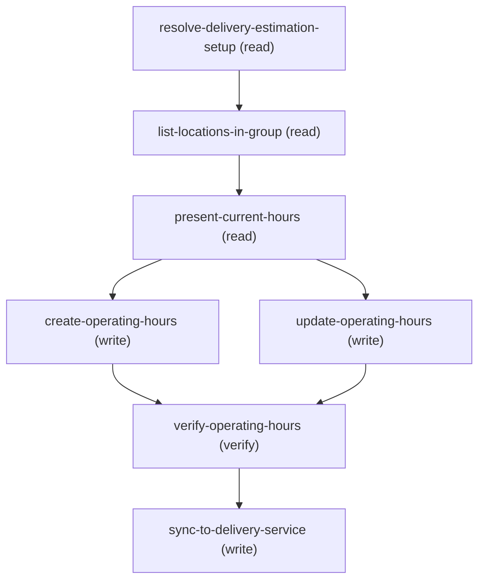

# Managing Update Location Temporary Operating Hours

## When to Use This Skill

Use this workflow to add a temporary HOLIDAY CLOSURE (a full-day, or a timed closed window on a
date) — or to set a location's weekly delivery OPERATING HOURS — for delivery estimation, via the
Commerce Delivery fulfilling-operating-hours Connect API. Everything goes through that Connect API
— NEVER direct sObject writes to OperatingHours/TimeSlot/OperatingHoursHoliday/Holiday. ALL v68
(Location.FulfillingOperationalHoursId is minApiVersion 264).

HOW CDS ACTUALLY USES HOURS (source-verified — read before touching anything):
  - TWO hour systems, resolved by a 3-tier FALLBACK, NOT merged:
      Tier 1  Location.FulfillingBusinessHoursId   -> BusinessHours (flat weekly)  [WINS if present]
      Tier 2  Location.FulfillingOperationalHoursId -> OperatingHours (TimeSlots + Holidays)
      Tier 3  DeliveryEstimationSetup.DefaultBusinessHoursId -> BusinessHours (setup default)
    If a location has its OWN BusinessHours, CDS uses Tier 1 and its OperatingHours — TimeSlots
    AND holidays — is IGNORED. A holiday closure on a BusinessHours-backed location is a SILENT
    NO-OP. (Never expect a holiday to fire while Location.FulfillingBusinessHoursId is set.)
  - On the OperatingHours model: a weekly TimeSlot is an OPEN window (fulfillment happens DURING
    it; a day with NO TimeSlot is CLOSED). A Holiday is a CLOSURE — isAllDay:true = whole day
    closed; isAllDay:false + startTimeInMinutes/endTimeInMinutes = a closed window SUBTRACTED from
    that day's open windows. A TimeSlot never encodes closure; a Holiday never encodes open time.
  - An OperatingHours must carry BOTH the regular open TimeSlots AND the closure Holidays. A
    HOLIDAY-ONLY OH (no TimeSlots) is broken in CDS: the ship-date consumer treats every day as
    closed ("closed forever"), the cutoff consumer drops the closure — opposite failures. Never
    create a holiday-only OH for a location that should be open on normal days.

WHAT A HOLIDAY OVERRIDE ACTUALLY REQUIRES (the common request):
    1. Read the location's current regular weekly hours — its OWN BusinessHours AND the setup
       default — and offer to REUSE either as the OPEN TimeSlots (or enter custom).
    2. Create ONE OperatingHours carrying those weekly hours as OPEN TimeSlots + the closure
       Holiday(s); link the location in the SAME POST via `locationIds`. Keep the OperatingHours'
       timeZone == the location's TimeZone.
  If the location already resolves via an OperatingHours (Tier 2; no Location BusinessHours), just
  add/change the holiday via PATCH (edit-existing).

KNOWN LIMITATION — CDS GAP (do NOT work around by clearing BusinessHours): because CDS uses a
strict 3-tier fallback with NO cross-tier merge, a location that still has its OWN
Location.FulfillingBusinessHoursId (Tier 1) will NOT yet honor this OperatingHours holiday closure
(Tier 2 is never consulted). This skill DELIBERATELY does NOT clear FulfillingBusinessHoursId —
that gap is intended to be resolved on the CDS side (teaching CDS to overlay an OperatingHours'
holiday closures onto the BusinessHours baseline). Consequence for now: the OperatingHours +
closure are recorded and linked, but for a BusinessHours-backed location the closure will not
affect delivery estimates until the CDS fix lands. A location with NO own BusinessHours already
honors the closure today via Tier 2. Tell the admin plainly, without naming internal systems, e.g.
"Heads up: this closure will not take effect for this location, because it already has its own
separate hours set directly on it — that would need to change for the closure to apply. Want to
proceed anyway?"

CREATE CONTRACT (source: CreateFulfillingOperatingHoursInputRepresentation, module
commerce-delivery-connect-api, min v262; wire-validated). POST
/commerce/delivery/fulfilling-operating-hours with a FLAT body (no wrapper, despite the resource
being named ...CollectionResource):
  { name (req), timeZone (req, IANA), description?,
    timeSlots:[{dayOfWeek (Monday..Sunday), type (Normal|Extended), startTime "HH:mm", endTime "HH:mm"}],
    holidays:[{name, activityDate "YYYY-MM-DD", isAllDay, startTimeInMinutes, endTimeInMinutes, + recurrence...}],
    locationIds:["131...", ... up to 100] }  -> 201 {success, operatingHoursId}.
Times: TimeSlots use "HH:mm" (strict — "9:00am" 400s); Holiday windows use INTEGER minutes after
midnight (e.g. close 3-9 PM = startTimeInMinutes 900, endTimeInMinutes 1260). UPDATE
(PATCH .../{operatingHoursId}) uses nested buckets: {"holidays":{"holidaysCreate|holidaysUpdate|holidaysDelete"},
"timeSlots":{"timeSlotsCreate|timeSlotsUpdate|timeSlotsDelete"}}; a delete may time out client-side
but completes — verify by GET, retry-safe.

CAVEATS: (1) CDS partial-holiday latent bug — a PARTIAL (timed) holiday is applied by day-of-week
across CDS's ~60-day horizon, NOT per-exact-date, so a one-off timed closure repeats on every
matching weekday; prefer an all-day closure for a true one-off date. (2) The OMS "Special Hours"
UI can only emit all-day, holiday-only OHs and writes regular hours to a separate BusinessHours
object — exactly the broken Tier-1 combination; this skill deliberately does the full working
migration instead.

Flow: resolve setup -> list locations (v68: FulfillingBusinessHoursId + FulfillingOperationalHoursId
+ TimeZone) -> present current regular hours (the location's own BusinessHours AND the setup
default, as reuse options) + any existing OH -> ASK oh-target (edit-existing vs create-new) -> on
create, ASK weekly-hours-source (reuse the location or setup BusinessHours, or enter custom) -> for
EACH closure ASK closure-type (full-day vs a partial/timed closed window) -> [create-new] POST
create (open TimeSlots + closure Holidays + locationIds) and link; [edit-existing] PATCH
holiday/timeslot buckets -> verify (GET) -> automatically enable-and-push (ALWAYS runs, never
asked). We do NOT clear the location's BusinessHours (see KNOWN LIMITATION). ADMIN WORDING: once
verify + push both complete, say exactly "Your change has been saved and synced." then a compact
recap — the location's Name + ExternalReference, and what changed (open/closed days, times,
closure date range); add a best-effort link ([<Name>](<orgHost>/lightning/r/Location/<Id>/view)
— the standard record-link form used across the corpus) if you have the Id. Never speak the
raw Id itself — the Name is the anchor text. This SOR runs once per location, so if the customer
asked for the SAME closure across MULTIPLE locations in this conversation, give ONE consolidated
table at the end instead of repeating this sentence — | Location | Reference | Changed | header
row, one row per location (same shape used by the sibling per-location SORs).
Keep a single-location response under ~200 characters of VISIBLE text where possible (the link URL doesn't count).
Never say "CDS" or "Commerce Delivery Service" — one
seamless save. Still never surface raw Ids, sObject/field names, or HTTP codes.

## Workflow

A location's delivery OperatingHours (weekly OPEN TimeSlots + Holiday CLOSURES) via the
fulfilling-operating-hours Connect API — the ONLY mechanism (never sObject-poke
OperatingHours/TimeSlot/OperatingHoursHoliday/Holiday). ALL v68.
CDS MODEL (source-verified): 3-tier FALLBACK, NOT merged — Location.BusinessHours (Tier 1) beats
Location.OperatingHours (Tier 2) beats setup default BusinessHours (Tier 3). TimeSlot = OPEN
window (no slot on a day = closed); Holiday = CLOSURE (all-day, or a timed window subtracted from
the open windows). An OH must carry BOTH open TimeSlots AND closure Holidays; a holiday-only OH is
broken (ship-date "closed forever" / cutoff drops the closure). A holiday on a location that still
has its own BusinessHours is IGNORED (Tier 1 wins).
FLOW: resolve -> list locations (v68: both FKs + TimeZone) -> present current regular hours
(BusinessHours) + any existing OH -> ASK oh-target -> ASK closure-type per closure (full-day vs
partial/timed) -> [create-new] POST create {name,timeZone,
description?,timeSlots(open, "HH:mm"),holidays(closures, minutes),locationIds} and link;
[edit-existing] PATCH holiday/timeslot buckets -> verify (GET; confirm TimeSlots non-empty +
holidays) -> automatically enable-and-push (always runs, never asked).
KNOWN LIMITATION: we do NOT clear the location's own BusinessHours; while the location has its own
separate weekly hours set directly on it, this closure won't take effect until a current
limitation is addressed. Locations with no separate hours of their own honor it today.
CREATE CONTRACT: FLAT body (CreateFulfillingOperatingHoursInputRepresentation, v262+); despite the
...CollectionResource name it is a single flat object, no wrapper/list. name + timeZone required.
UPDATE: nested holidays/timeSlots create|update|delete buckets; delete may time out but completes
(verify by GET, retry-safe). CAVEAT: partial (timed) holidays over-apply by weekday across a
~60-day horizon — prefer all-day for a true one-off date.
PUSH FAILURE: enable-and-push-delivery-estimation-setup is synchronous — its own POST response
is the complete answer, no polling involved. If it returns success:false or a non-empty
errors[], do NOT say "saved and synced" — the OperatingHours create/update above already
succeeded (the Core-side change is real), but the propagation didn't. Say "Your change was
saved, but couldn't be synced; it can be retried shortly." — the same fallback wording used by
the sibling SORs in this family. Never echo the raw errors[] content.
ADMIN WORDING: once verify + push both complete, say exactly "Your change has been saved and
synced." AS ITS OWN SENTENCE — if the location has its own BusinessHours (see KNOWN
LIMITATION), repeat the earlier Tier-1 caveat as a SEPARATE sentence right after it (e.g. "Your
change has been saved and synced. Though as mentioned, it won't affect estimates yet while
this location has its own separate hours.") — never splice the caveat onto the canonical line
with a dash/clause, since that reads as walking back the save confirmation rather than adding
a caveat — then a compact recap — the location's Name + ExternalReference (if blank/null, just leave it out
of the sentence), and what changed
(open/closed days, times, closure date range); add a best-effort link
([<Name>](<orgHost>/lightning/r/Location/<Id>/view) — the standard record-link form used
across the corpus) if you have the Id. Never speak the raw Id itself. RECAP LAYOUT — ONE
location: the sentence above. MULTIPLE locations (same closure requested repeatedly in one
conversation): ONE consolidated | Location | Reference | Changed | table instead, one row per
location — same shape the sibling per-location SORs use; in a table, use "—" for an individual
row's missing Reference (a blank/dropped cell misaligns the row), and drop the Reference column
entirely only if every row lacks one.
Keep a single-location response under ~200 characters of VISIBLE text where possible (the link URL doesn't count).
Never say "CDS" or "Commerce Delivery Service" — one seamless save. Still never surface raw Ids,
sObject/field names, or HTTP codes.

## Critical Constraints

**Preconditions:**

- Delivery Estimation + the delivery operating-hours ("special hours") feature must be enabled —
it provisions Location.FulfillingOperationalHoursId (API v68) and the fulfilling-operating-hours
Connect API (gated by USER_HAS_DELIVERY_ESTIMATION). (check: `Delivery Estimation + operating-hours feature (v68 FulfillingOperationalHoursId) enabled`)
- A DeliveryEstimationSetup with a LocationGroup + locations must exist to target the override at. (check: `DeliveryEstimationSetup + locations exist`)
- KNOWN LIMITATION (CDS gap): a holiday closure on the OperatingHours takes effect only for a
location that resolves via the OperatingHours path (Tier 2) — i.e. one with NO own
Location.FulfillingBusinessHoursId. If the location has its own BusinessHours (Tier 1), CDS
ignores the OperatingHours (no cross-tier merge) and the closure will not affect estimates yet.
This workflow deliberately does NOT clear FulfillingBusinessHoursId — the gap is intended to be
resolved on the CDS side; the closure is still recorded + linked for when that fix lands. (check: `Closure effective now only for locations with no own BusinessHours; BH-backed = pending CDS fix`)

## Verification Checklist

After every write operation, confirm the effect by re-reading state:

- After `create-operating-hours`, `update-operating-hours`: call `verify-operating-hours`

## Operations Reference

Operations grouped by purpose. Use these as the building blocks for the workflows above.

### Summary

| Operation | Purpose | Status | Call | Depends on |
|-----------|---------|--------|------|------------|
| `resolve-delivery-estimation-setup` | read | implemented | `querySoql` | — |
| `list-locations-in-group` | read | implemented | `querySoql` | `resolve-delivery-estimation-setup` |
| `present-current-hours` | read | implemented | `querySoql` | `list-locations-in-group` |
| `create-operating-hours` | write | implemented | `createFulfillingOperatingHours` | `present-current-hours` |
| `update-operating-hours` | write | implemented | `updateFulfillingOperatingHours` | `present-current-hours` |
| `verify-operating-hours` | verify | implemented | `getFulfillingOperatingHours` | `create-operating-hours`, `update-operating-hours` |
| `sync-to-delivery-service` | write | — | → `cc-om-fast-and-furious/enable-and-push-delivery-estimation-setup` | `verify-operating-hours` |

### Dependency graph

### Read operations

#### `resolve-delivery-estimation-setup`

Resolve the DeliveryEstimationSetup by Name/ExternalReference; capture LocationGroupId (to list locations), ExternalReference (for the push), and DefaultBusinessHoursId (the setup default weekly hours — the fallback source when a location has no own BusinessHours).

**Call:** `querySoql`   — status: `implemented`

**Inputs:**

- `name` *(`String`)* — The DeliveryEstimationSetup Name OR ExternalReference (e.g. "west"). Source: user_input.

#### `list-locations-in-group`

List the group's locations with BOTH hours FKs + TimeZone (v68). FulfillingBusinessHoursId reveals whether a location is on the Tier-1 BusinessHours path (which would ignore any OperatingHours).

**Call:** `querySoql`   — status: `implemented`

**Inputs:**

- `locationGroupId` *(`String`)* — LocationGroup Id (0gh...) of the CHOSEN setup. Source: resolve-delivery-estimation-setup.location_group_ids (the one the customer picked when the lookup matched more than one).

**Depends on:** `resolve-delivery-estimation-setup`

#### `present-current-hours`

Read + present the regular weekly hours available to REUSE as the OperatingHours' OPEN TimeSlots — the location's OWN BusinessHours (Location.FulfillingBusinessHoursId) AND the DeliveryEstimationSetup DEFAULT BusinessHours — plus, if the location already has an OperatingHours, its current TimeSlots + Holidays.

**Call:** `querySoql`   — status: `implemented`

**Inputs:**

- `businessHoursIds` *(`Array`)* — The BusinessHours Ids to present as reuse sources: the target location's FulfillingBusinessHoursId
(if non-null) AND resolve-delivery-estimation-setup.default_business_hours_ids at the CHOSEN
setup's index (the one the customer picked when the lookup matched more than one). Source:
list-locations-in-group + resolve. Dedupe if they are the same record.
  - schema: `{'type': 'array', 'minItems': 1, 'maxItems': 2, 'items': {'type': 'string', 'pattern': '^01m[a-zA-Z0-9]{12,15}$'}}`

**Depends on:** `list-locations-in-group`

### Write operations

#### `create-operating-hours`

CREATE path: create ONE OperatingHours carrying the location's regular weekly OPEN TimeSlots AND
the closure Holiday(s), linking the target location(s) in the same POST via locationIds. Connect
API create (v68).

**Call:** `createFulfillingOperatingHours`   — status: `implemented`

**Inputs:**

- `name` *(`String`)* — A label for the OperatingHours record (e.g. "Store-SF hours").
- `description` *(`String`)* — OPTIONAL short note written through to OperatingHours.Description (declared input; validated
live 2026-08-07). The Connect GET does not echo it — confirm via SOQL if needed.
- `timeZone` *(`String`)* — IANA time zone (e.g. America/Los_Angeles). MUST equal the target Location's TimeZone (closures
are interpreted in this tz). Default to the location's TimeZone; if the location's TimeZone is
null, set Location.TimeZone (sObject PATCH) to this same tz so they match.
- `timeSlots` *(`Array`)* — The location's regular weekly OPEN windows. REQUIRED for a usable OH: a day with no TimeSlot is
CLOSED in CDS, so an OH with no TimeSlots is "closed every day". Each: {dayOfWeek (Monday..Sunday),
type (Normal|Extended), startTime "HH:mm", endTime "HH:mm"}. Multiple entries on one day = a
split shift. POPULATE from weekly-hours-source: when reusing the location's own or the setup
default BusinessHours, copy present-current-hours per-day open/close here (HH:mm:ss.SSSZ ->
"HH:mm", one entry per OPEN day, omit closed days); when custom, the admin's own windows.
  - schema: `{'type': 'array', 'minItems': 1, 'items': {'type': 'object', 'required': ['dayOfWeek', 'startTime', 'endTime'], 'properties': {'dayOfWeek': {'type': 'string', 'pattern': '^(Sunday|Monday|Tuesday|Wednesday|Thursday|Friday|Saturday)$'}, 'type': {'type': 'string', 'pattern': '^(Normal|Extended)$'}, 'startTime': {'type': 'string', 'pattern': '^\\d{2}:\\d{2}$'}, 'endTime': {'type': 'string', 'pattern': '^\\d{2}:\\d{2}$'}}}}`
- `holidays` *(`Array`)* — Holiday CLOSURES. Each: {name, activityDate "YYYY-MM-DD", + all-day-vs-window: isAllDay:true =
CLOSED all day (omit the window); OR isAllDay:false + startTimeInMinutes/endTimeInMinutes =
CLOSED during that window (minutes after midnight, e.g. 3-9 PM = 900..1260), subtracted from
that day's open TimeSlots}. Optional recurrence (isRecurrence, recurrenceType
RecursDaily|RecursWeekly|RecursMonthly|RecursMonthlyNth|RecursYearly|..., recurrenceDayOfWeekMask,
recurrenceInstance First..Last, recurrenceStartDate, recurrenceEndDateOnly). A plain one-off
all-day closure = one entry {name, activityDate, isAllDay:true}.
- `locationIds` *(`Array`)* — The specific Location Id(s) the admin CONFIRMED as the target — selected from
list-locations-in-group, NOT its full location_ids list. Usually exactly one. Each links to the
new OperatingHours via Location.FulfillingOperationalHours in this POST. Max 100.
  - schema: `{'type': 'array', 'minItems': 1, 'maxItems': 100, 'items': {'type': 'string', 'pattern': '^131[a-zA-Z0-9]{12,15}$'}}`

**Depends on:** `present-current-hours`

#### `update-operating-hours`

EDIT-EXISTING path: add / change / remove holiday closures (and/or weekly TimeSlots) on the
location's existing OperatingHours via the Connect API's nested create/update/delete buckets.

**Call:** `updateFulfillingOperatingHours`   — status: `implemented`

**Inputs:**

- `operatingHoursId` *(`String`)* — The location's OperatingHours Id (0OH...). Source: Location.FulfillingOperationalHoursId.
- `holidaysCreate` *(`Array`)* — New holiday CLOSURES to add. Each: {name, activityDate "YYYY-MM-DD", + isAllDay:true = CLOSED
all day, OR isAllDay:false + startTimeInMinutes/endTimeInMinutes = CLOSED during that window;
optional recurrence}.
- `holidaysUpdate` *(`Array`)* — Holidays to edit: [{id (the 0C0 Holiday id from the GET), + changed fields}].
- `holidaysDelete` *(`Array`)* — Holiday ids to remove: ["0C0..."] (the Holiday record ids from the GET).
- `timeSlotsChanges` *(`Object`)* — OPTIONAL weekly-hours edits on the same OH, mirroring holidays:
{timeSlotsCreate:[{dayOfWeek,type,startTime,endTime}], timeSlotsUpdate:[{id (0Gj...),...}],
timeSlotsDelete:["0Gj..."]}. Use to add/adjust the OPEN windows.

**Depends on:** `present-current-hours`

#### `sync-to-delivery-service`

Propagate the saved OperatingHours configuration downstream. OperatingHours writes fire an
automatic best-effort re-sync, but ALWAYS ALSO run the deterministic setup-level enable-and-push
immediately afterward, automatically (a BusinessHours-clear on the location is a Data-API write
with no auto-push). This propagates the SAVED configuration — it does NOT make a holiday closure
take effect for a location that still has its own BusinessHours (see KNOWN LIMITATION); Tier 1
ignores OperatingHours regardless of how many times this sync runs.

**Delegates to:** `cc-om-fast-and-furious/enable-and-push-delivery-estimation-setup`

**Depends on:** `verify-operating-hours`

### Verify operations

#### `verify-operating-hours`

Re-read the OperatingHours and confirm the OPEN TimeSlots + Holiday closures are as intended, and that the location is linked to it (FulfillingOperationalHoursId).

**Call:** `getFulfillingOperatingHours`   — status: `implemented`

**Inputs:**

- `operatingHoursId` *(`String`)* — The OperatingHours Id — create-operating-hours.operating_hours_id (create-new) or the existing FulfillingOperationalHoursId (edit-existing).

**Depends on:** `create-operating-hours`, `update-operating-hours`
