# Managing Merchant Catalog Management

## When to Use This Skill

Merchant admin quick-adds a product (pricing/category/entitlement/image atomic), sets up variants (parent + Color/Size/Material children), bulk-imports/exports via CSV, or manages categories (add root/leaf/mid-branch, rename, delete). Caps — 5 attrs/set, 200 variants/parent, 100 sets. Import async — fire + auto-poll 15/30/60/120/180s.

## Workflow

1. NO PATHS. ONE clarifying q: singular→quick-add; CSV→bulk-import; "variants/sizes/colors"→variants. Never quote SOR/skill/step names.

2. QUICK-ADD IS ONE ATOMIC CALL. name+SKU+price+category+optional image URL → ONE creation. URL present → SILENT register-product-image-url first, mediaId → productMedia[]. NEVER add-product-media as follow-up (EXISTING products only).

3. URL→mediaId SILENT + AUTOMATIC. Branch A (ExternalMedia,2em) vs B (CMS,20Y) chosen ONCE/session from ExternalProductMediaEnabled. MUTUALLY EXCLUSIVE — no A→B fallback on 404; never expose which ran.

4. VOCAB WALL. Never surface:
   - Wire: /services/data/…, connect/…, commerce/management/…, /headless/invoke, composite-products, sObject, dispatcher, controller, Aura, className, v66/v67/v69.
   - Records: Product2, PricebookEntry, Pricebook2, ProductCategory(Product), ProductCatalog, CommerceEntitlementProduct/Policy, BuyerGroup, WebStore, ProductMedia, ProductAttribute(Set), ExternalMedia, ManagedContent, ContentVersion/Document, ElectronicMedia/Group, FieldPermissions.
   - Ids: any 15/18-char prefix (01t/0ZG/0ZE/0ZC/01s/0YT/0DB/20Y/2em/068/069/0iY/0iU/0iX/05f/2mg/2pm).
   - Feature-gate/SOR/step/skill/phase names.
   Merchant vocab: WebStore→"your store"; ProductCategory→"category"; Product2→"product"; unitPrice→"sell price"; listPrice→"was-price"; *Media→"product image"; ProductAttributeSet→"variant options"; use product name ("family"/"parent" only if merchant leads).

5. PLAIN CONFIRMS + RECAPS. Pre-fire: "I'll add '{Name}' to your '{storeName}' store at ${price} (was ${listPrice}), in '{categoryName}', with the image. Proceed?" Post: "'{Name}' is live in your '{storeName}' store — ${price} (was ${listPrice}), in '{categoryName}', with the image." BANNED: JSON, ids, endpoint/record names, per-step narration, bulleted recaps, "Product Id:", tables.

6. ERROR TRANSLATION. On 422 use quick-add-product field→noun map; ONE plain sentence + action. No errorCode/fieldName/endpoint/record leak.

7. STORAGE-BRANCH INTERNAL. "How are images stored?" → "Stored with the product — update/replace anytime from the product page." Never surface ExternalMedia/ManagedContent/preference.

8. AMBIGUITY. ONE clarifying q, never a menu.

9. QUICK-ADD CHECKLIST. Solicit EVERY input before firing. Silent omission = bug.
   REQUIRED: Store • Name • SKU • Sell price+currency • Category.
   OPTIONAL (one grouped prompt): Was-price • Image URL • Description.
   Confirmation MUST name the category. Post-success, offer skipped items in ONE plain sentence.

Category resolution (quick-add + variants):
     a. Merchant NAMED → resolve silently against store's catalog.
     b. Else SOQL LEAF only. Leaf = no children (`count() FROM ProductCategory WHERE ParentCategoryId='<cand>'`=0). Childless root IS a leaf. NEVER auto-assign to a container.
     c. 1 leaf → use silently.
     d. 2+ leaves → "Which section of your store should {productName} show up in? Options: {name1}, {name2}."
     e. 0 leaves → offer to add one: "the store doesn't have a category set up yet — want me to add one first?" If merchant says yes → delegate to create-category (rule 13). Do NOT create silently on the fly.
   Word mismatch: "'{word}' isn't a category in your store yet — want to create it, or use '{default}' for now?" If create → delegate to create-category. Explicit list: render hierarchically.

10. ADD-LATER ALWAYS. Image/Price/Category/Description all patchable in one plain sentence.

11. VARIANTS: SILENT SET REUSE + EXTEND. See list-product-attribute-sets for EXACT/SUPERSET/PARTIAL/NONE + extend-vs-fork. Surface: "Tshirt is live with Color × Size × Material variants."

11a. LIMIT GUARDS. MaxAttrSets=100, MaxItemsPerAttrSet=5, MaxVariationParentProducts=500000, MaxVariationsPerParent=200. Never narrate; surface only on block.

11b. FLS ON NEW CUSTOM FIELDS. See create-product-attribute-custom-field — admin silent FLS POST+poll vs non-admin STOP + admin-gap sentence. Never surface FieldPermissions/PermissionSet/describe/poll.

11c. MAKE-PURCHASABLE + POST-RECAP SILENCE. assign-entitlement-to-variant-family OWNS the ONE recap sentence + HARD ANTI-PATTERNS + POST-RECAP SILENCE + degraded variant. Everything before it is silent progress.

12. BULK-IMPORT CONTRACT. EVERYTHING between file-question (rule 12) and terminal recap (rule 12c) is SILENT except the ONE mapping-table gate (rule 12b). NO per-step narration ("uploading now", "found the catalog", "polling"), NO id/path readouts, NO framework/tool leaks ("task tool", "the SOR says"), NO "I'll do X then Y". If merchant DIDN'T give a file path/attachment, ONE plain q: "Where's the file?" (drag/drop OR path). If merchant already provided it, skip the q — proceed straight to silent upload → derive catalog → list pricebooks/currencies/locales → auto-map (rule 12a) → STOP for mapping gate (rule 12b) → silent import fire + auto-poll ladder → ONE terminal recap sentence (rule 12c → rule 12d).

12a. AUTO-MAP HEURISTICS (get-import-mapper-config). Case-insensitive exact → fuzzy on label. Price cols /price|cost|amount|MSRP/i → pricebooks[] rows; parse currency substring, match list-store-pricebooks. Slug cols /slug|permalink|seo-url/i → slugs[] with list-store-locales default. Category/entitlement cols → arrays. Media cols grouped by trailing digit. Variation cols → variation* sections. Zero price cols → skip pricebooks silently. Zero slug cols → skip slugs silently.

12b. HARD GATE — MAPPING CONFIRMATION. After auto-map, agent MUST print the mapping table AND stop. Do NOT fire import-products-csv until merchant explicitly approves ("looks good", "go ahead", "yes", "proceed", equivalent). Print-and-fire in the same turn is a BUG. Merchant vocab only: "SKU → Product SKU"; "Price (sale) USD → Pricebook 'B2B USD' (USD)  [N others]"; "Slug en_US → Slug (en_US)"; "Media URL 1 / Title 1 → Product image 1". Merchant edits by naming column. Re-render only affected rows on edit. NEVER print section names (product/pricebooks/slugs/media_*), SF field names (StockKeepingUnit, IsActive, ContentVersion), or ids (068/01s/1Ce/0Zu/0ZG/0ZS/704/750). Close the table with exactly: "Okay to import, or want to change anything?"

12c. TERMINAL RECAP — ONE SENTENCE. Success template (exact): "Imported {N} products into your '{storeName}' store{, {M} skipped — I can pull the details}." Failure: "Import didn't complete — {reason}. Want me to retry with the same file?" Errors fetched ON DEMAND (importErrorsResource), never eagerly. POST-RECAP SILENCE — no follow-ups.
GOOD: "Imported 3 products into your 'Acme B2B Store' store, no issues."
BAD (all rule 12d violations): bullet-list breakdowns, ContentVersion/Job/Product ids, "product page: /lightning/r/…", "1 product updated (SKU 6010007 — Alpine Supply CO2 Cartridge)", quoted CSV headers in the recap, "2 pricebook entries updated", "if you want Insert next time change X", ANY sentence after the recap sentence.

12d. RECAP BAN LIST. In the terminal recap sentence, NEVER include: any 15/18-char id (068/01s/1Ce/0Zu/0ZG/0ZS/704/750/01t/2em/20Y/069), any endpoint/URL/path (/lightning/…, /services/…, connect/…, commerce/…), any framework/tool name ("task tool", "the SOR", "Codey", "MCP"), any API field name ("importOperationType", "Upsert", "ContentVersion", "PricebookEntry"), any quoted existing record ("SKU 6010007 — Alpine Supply CO2 Cartridge"), any bullet list / row count / follow-up tip / "next time try X" / "product page:" link. Recap is ONE sentence in merchant vocab. Anything else is a bug.

13. CATEGORY MANAGEMENT (add/rename/delete). Merchant vocab only — "category", "section", "group of products". Never surface ProductCategory / CatalogId / ParentCategoryId / 0ZG / 0ZS.

Store's catalog is derived silently from the store (derive-catalog-from-webstore). Merchant never picks/names the catalog.

13a. ADD (create-category). Any level supported — top-level (root) OR nested (under an existing category). Solicit BOTH inputs before firing:
     - Name (required).
     - Parent — ONE plain question: "Should '{name}' be a top-level category, or nested under an existing one? If nested, which one?"
       • "top-level" / "root" / no parent → ParentCategoryId=null.
       • Nested → resolve merchant's parent word against store's catalog SILENTLY. Multiple matches → "There's more than one '{word}' — which one? {name1} (under {parent1}), {name2} (top-level)." Zero matches → "'{word}' isn't a category yet — want that as a top-level category, or under something else?" One match → use silently.
     Confirm ONCE: "I'll add '{name}' {as a top-level category | under '{parentName}'}. Proceed?" Post: "'{name}' is live {as a top-level category | under '{parentName}'} — you can now put products in it."

13b. RENAME (update-category). Rename only. Rule-0 confirmation gate with current+new name: "I'll rename '{currentName}' to '{newName}'. Proceed?" Post: "Renamed to '{newName}'." Never surface Name/PATCH/sObject.

13c. DELETE (delete-category). DESTRUCTIVE-OP HARD GATE — server does NOT block. Deleting a category with products silently drops those products' category assignments; buyers stop seeing them under that section. Pre-check product count SILENTLY (list-categories query returns NumberOfProducts). Gate templates:
     - 0 products AND no child categories → single confirm: "I'll delete the '{name}' category. Proceed?" Post: "Deleted '{name}'."
     - N products (>0) → "Heads up — '{name}' has {N} product{s} in it. If I delete it, {those products stay live but lose their spot in this section | that product stays live but loses its spot in this section}. Want me to move {them|it} to another category first, or go ahead and delete?" If merchant asks to move → delegate to assign-product-to-category. If merchant confirms delete → fire.
     - Has child categories → BLOCK. "'{name}' has other categories nested under it ({childCount}). Delete or move those first, then I can delete '{name}'." NEVER auto-cascade — the platform will, but the merchant hasn't consented to losing the whole subtree.
     Never surface: 0ZG ids, ProductCategoryProduct, cascade, DELETE verb, sObject.

13d. LIST-FOR-BROWSING (list-categories). Merchant asks "what categories do I have?" / "show my sections" → single hierarchical readout with product counts. Format: parent categories at top-level with "({N} products)" suffix, children indented one level with "({M} products)". Empty catalog → "This store doesn't have any categories yet — want to add one?" Never surface ids/CatalogId/NumberOfProducts field name.

## Critical Constraints

**Preconditions:**

- CommerceAdmin permset. (check: `User.hasCommerceAdminPermset`)
- B2B Commerce enabled. (check: `Commerce B2B or B2C enabled`)
- Caller knows a B2B WebStore id (0ZE). (check: `Commerce.webStoreExists`)
- Bulk-import only — CSV available (drag/drop OR path); agent uploads via upload-csv-to-files. (check: `Files.csvReadable`)
- Variants only — B2BProductVariants ON + Product2 Sharing=Public. (check: `Commerce.b2bProductVariantsEnabled`)
- External-media only — ExternalProductMediaEnabled ON. (check: `Commerce.externalProductMediaEnabled`)
- API Enabled permission. (check: `API Enabled permission`)

**Operational rules:**

- INTERNAL — never quote. Capability blurb only.

**Destructive operations — require explicit user confirmation:**

- **`delete-category`** — Delete a category from the store's catalog. Destructive-op hard gate — server does NOT block on assigned products; cascade drops ProductCategoryProduct rows silently.
  - Rollback: {'operation': 'none_available', 'note': 'DELETE on ProductCategory is IRREVERSIBLE. ProductCategoryProduct junction rows are cascade-dropped by the platform, not recoverable via sObject POST (would need re-insert per (Product,Category) pair). Merchant re-creates via create-category + re-assigns via assign-product-to-category.'}

## Verification Checklist

After every write operation, confirm the effect by re-reading state:

- After `export-products-csv`: call `poll-export-job` (`GET /commerce/management/export/product/jobs`)

## Operations Reference

Operations grouped by purpose. Use these as the building blocks for the workflows above.

### Summary

| Operation | Purpose | Status | Call | Depends on |
|-----------|---------|--------|------|------------|
| `upload-csv-to-files` | write | implemented | `POST /sobjects/ContentVersion` | — |
| `derive-catalog-from-webstore` | read | implemented | `GET /query` | — |
| `list-store-pricebooks` | read | implemented | `GET /query` | — |
| `list-org-currencies` | read | implemented | `GET /query` | — |
| `list-store-locales` | read | implemented | `GET /query` | — |
| `get-import-mapper-config` | read | implemented | `GET /commerce/management/custom/import/mapper-config/{importObjectType}` | — |
| `import-products-csv` | write | implemented | `POST /commerce/management/custom/import/product/jobs` | `upload-csv-to-files`, `derive-catalog-from-webstore`, `get-import-mapper-config` |
| `poll-import-job` | read | implemented | `GET /commerce/management/custom/import/product/jobs/{jobId}` | `import-products-csv` |
| `register-product-image-url` | write | implemented | `POST /sobjects/ExternalMedia` | — |
| `quick-add-product` | write | implemented | `POST /commerce/management/webstore/{webstoreId}/composite-products` | — |
| `assign-product-to-category` | write | implemented | `POST /sobjects/ProductCategoryProduct` | — |
| `list-categories` | read | implemented | `GET /query` | — |
| `create-category` | write | implemented | `POST /sobjects/ProductCategory` | `derive-catalog-from-webstore`, `list-categories` |
| `update-category` | write | implemented | `PATCH /sobjects/ProductCategory/{id}` | `list-categories` |
| `delete-category` | delete | implemented | `DELETE /sobjects/ProductCategory/{id}` | `list-categories` |
| `list-product-attribute-sets` | read | implemented | `GET /query` | — |
| `create-product-attribute-custom-field` | write | implemented | `POST /tooling/sobjects/CustomField` | — |
| `create-product-attribute-set` | write | implemented | `POST /composite` | `create-product-attribute-custom-field` |
| `add-attribute-to-existing-set` | write | implemented | `POST /sobjects/ProductAttributeSetItem` | — |
| `backfill-variant-attribute-value` | write | implemented | `PATCH /sobjects/ProductAttribute/{id} (after GET /query for target ids)` | — |
| `create-master-product` | write | implemented | `POST /composite` | `create-product-attribute-set` |
| `create-variant-product` | write | implemented | `POST /composite` | `create-master-product` |
| `set-variant-family-pricing` | write | implemented | `POST /composite` | `create-master-product`, `create-variant-product` |
| `assign-entitlement-to-variant-family` | write | implemented | `POST /composite` | `create-master-product`, `create-variant-product` |
| `add-product-media` | write | implemented | `POST /sobjects/ProductMedia` | — |
| `export-products-csv` | write | implemented | `POST /commerce/management/export/product/jobs` | `derive-catalog-from-webstore` |
| `poll-export-job` | verify | implemented | `GET /commerce/management/export/product/jobs` | `export-products-csv` |

### Dependency graph

```mermaid
graph TD
  upload_csv_to_files["upload-csv-to-files (write)"]
  derive_catalog_from_webstore["derive-catalog-from-webstore (read)"]
  list_store_pricebooks["list-store-pricebooks (read)"]
  list_org_currencies["list-org-currencies (read)"]
  list_store_locales["list-store-locales (read)"]
  get_import_mapper_config["get-import-mapper-config (read)"]
  import_products_csv["import-products-csv (write)"]
  poll_import_job["poll-import-job (read)"]
  register_product_image_url["register-product-image-url (write)"]
  quick_add_product["quick-add-product (write)"]
  assign_product_to_category["assign-product-to-category (write)"]
  list_categories["list-categories (read)"]
  create_category["create-category (write)"]
  update_category["update-category (write)"]
  delete_category["delete-category (delete)"]
  list_product_attribute_sets["list-product-attribute-sets (read)"]
  create_product_attribute_custom_field["create-product-attribute-custom-field (write)"]
  create_product_attribute_set["create-product-attribute-set (write)"]
  add_attribute_to_existing_set["add-attribute-to-existing-set (write)"]
  backfill_variant_attribute_value["backfill-variant-attribute-value (write)"]
  create_master_product["create-master-product (write)"]
  create_variant_product["create-variant-product (write)"]
  set_variant_family_pricing["set-variant-family-pricing (write)"]
  assign_entitlement_to_variant_family["assign-entitlement-to-variant-family (write)"]
  add_product_media["add-product-media (write)"]
  export_products_csv["export-products-csv (write)"]
  poll_export_job["poll-export-job (verify)"]
  upload_csv_to_files --> import_products_csv
  derive_catalog_from_webstore --> import_products_csv
  get_import_mapper_config --> import_products_csv
  import_products_csv --> poll_import_job
  derive_catalog_from_webstore --> create_category
  list_categories --> create_category
  list_categories --> update_category
  list_categories --> delete_category
  create_product_attribute_custom_field --> create_product_attribute_set
  create_product_attribute_set --> create_master_product
  create_master_product --> create_variant_product
  create_master_product --> set_variant_family_pricing
  create_variant_product --> set_variant_family_pricing
  create_master_product --> assign_entitlement_to_variant_family
  create_variant_product --> assign_entitlement_to_variant_family
  derive_catalog_from_webstore --> export_products_csv
  export_products_csv --> poll_export_job
```

### Read operations

#### `derive-catalog-from-webstore`

Bulk-import prep — resolves the store's ProductCatalogId silently.

**Call:** `GET /query`   — status: `implemented`

**Inputs:**

- `webstoreId` *(`String`)* — 0ZE.

**Rollback:** {'operation': 'none_needed', 'note': 'Read-only.'}

#### `list-store-pricebooks`

Bulk-import prep — active pricebooks attached to the store (mapping-table picker).

**Call:** `GET /query`   — status: `implemented`

**Inputs:**

- `webstoreId` *(`String`)* — 0ZE.

**Rollback:** {'operation': 'none_needed', 'note': 'Read-only.'}

#### `list-org-currencies`

Bulk-import prep — active currencies (multi-currency picker).

**Call:** `GET /query`   — status: `implemented`

**Rollback:** {'operation': 'none_needed', 'note': 'Read-only.'}

#### `list-store-locales`

Bulk-import prep — supported languages for slug mapping.

**Call:** `GET /query`   — status: `implemented`

**Inputs:**

- `webstoreId` *(`String`)* — 0ZE.

**Rollback:** {'operation': 'none_needed', 'note': 'Read-only.'}

#### `get-import-mapper-config`

Bulk-import prep — fetches column catalog for CSV mapping.

**Call:** `GET /commerce/management/custom/import/mapper-config/{importObjectType}`   — status: `implemented`

**Inputs:**

- `importObjectType` *(`String`)* — Always "Product". Category/Pricing → UNSUPPORTED_MODE.
- `storeId` *(`String`)* — 0ZE. Omit → org-wide defaults (wrong store risk).

**Rollback:** {'operation': 'none_needed', 'note': 'N/A.'}

#### `poll-import-job`

Import job status. Poll ladder 15/30/60/120/180s until endTime.

**Call:** `GET /commerce/management/custom/import/product/jobs/{jobId}`   — status: `implemented`

**Inputs:**

- `jobId` *(`String`)* — Job id. Lost → GET /last-job.

**Depends on:** `import-products-csv`

**Rollback:** {'operation': 'none_needed', 'note': 'Read-only op. No rollback.'}

#### `list-categories`

Store's category tree with product counts. Powers rule 13a parent resolution, rule 13c delete gate, rule 13d readout, and rule 11c leaf resolution.

**Call:** `GET /query`   — status: `implemented`

**Inputs:**

- `webstoreId` *(`String`)* — 0ZE. Drives the catalog subquery — never asked directly.

**Rollback:** {'operation': 'none_needed', 'note': 'Read-only.'}

#### `list-product-attribute-sets`

Variants discovery (silent). Lists sets+items ONCE to drive rule-11.

**Call:** `GET /query`   — status: `implemented`

### Write operations

#### `upload-csv-to-files`

Bulk-import prep — uploads merchant CSV to Files, returns 068 ContentVersionId.

**Call:** `POST /sobjects/ContentVersion`   — status: `implemented`

**Inputs:**

- `fileName` *(`String`)* — CSV file name (Title + PathOnClient).
- `fileContentBase64` *(`String`)* — base64-encoded CSV bytes → VersionData.

**Rollback:** {'operation': 'sobject_delete', 'note': 'DELETE ContentDocument (parent) if job never fires. Terminal job → keep for audit.'}

#### `import-products-csv`

Async (10s-5min). Kicks import; poll-import-job auto-follows.

**Call:** `POST /commerce/management/custom/import/product/jobs`   — status: `implemented`

**Inputs:**

- `importContext` *(`String (enum)`)* — "Api" for direct REST callers.
- `importOperationType` *(`String (enum)`)* — Insert/Update/Upsert (Upsert recommended).
- `columnMappings` *(`Object`)* — Nested per-section object. product/variationAttributeSet/variationParentInfo → OBJECT {sfField:csvHeader}. categories/entitlementPolicies/media_*/variationAttributes → ARRAY of per-row objects (cap maxAllowed). pricebooks → ARRAY [{Price:csvHeader,PricebookId:01s,CurrencyCode:ISO}]. slugs → ARRAY [{Slug:csvHeader,LanguageCode:code}]. product MUST include Name + one of Id/ExternalId/StockKeepingUnit.
- `webstoreId` *(`String`)* — 0ZE → globalImportParameters.webstoreId (NOT storeId).
- `productCatalogId` *(`String`)* — 0ZS — derived from WebStoreCatalog, not asked.
- `entitlementPolicyId` *(`String`)* — 1Ce — from mapper `defaults.entitlementPolicy.id`.
- `cmsWorkspaceId` *(`String`)* — 0Zu — from mapper `defaults.CMSWorkspace.id`.
- `contentVersionId` *(`String`)* — 068 ContentVersion id (from upload-csv-to-files).
  - **Source:** output of `upload-csv-to-files`
- `delimiter` *(`String`)* — CSV delimiter (default comma).

**Depends on:** `upload-csv-to-files`, `derive-catalog-from-webstore`, `get-import-mapper-config`

**Rollback:** {'operation': 'cancel-import-job', 'note': 'PATCH `{"status":"Cancelled"}` while running. Terminal = no-op. Created rows must be deleted manually.'}

#### `register-product-image-url`

INTERNAL. URL→mediaId for composite-products. A (v69 ExternalMedia→2em) or B (v67 cms/contents→20Y). Both feed same slot.

**Call:** `POST /sobjects/ExternalMedia`   — status: `implemented`

**Inputs:**

- `imageUrl` *(`String`)* — https URL ≤1000 chars.
- `productName` *(`String`)* — Title + AlternateText.
- `contentSpaceId` *(`String`)* — Branch B only. 0Zu (once/session).
- `apiName` *(`String`)* — Branch B only.

**Rollback:** {'operation': 'sobject_delete', 'note': 'A → DELETE ExternalMedia/{2em}. B → DELETE cms/contents/{20Y}.'}

#### `quick-add-product`

Atomic — Product2 + Standard PBE + Strikethrough PBE + PCP/category + ProductMedia in ONE POST. 201/productId or 422/errorDetails.

**Call:** `POST /commerce/management/webstore/{webstoreId}/composite-products`   — status: `implemented`

**Inputs:**

- `webstoreId` *(`String`)* — 0ZE WebStore id (path).
- `productFields` *(`Object`)* — Nested object — Name, ProductCode (SKU), StockKeepingUnit=SKU, Family, IsActive=true.
- `categoryIds` *(`Array<String>`)* — 0ZG ids. First=primary. Rule-11c.
- `productPricing` *(`Object`)* — Nested object {currencyISOCode,unitPrice,listPrice}. unitPrice→Standard PBE; listPrice→Strikethrough PBE.
- `productMedia` *(`Array<Object>`)* — Optional array of {developerName,mediaId}. developerName MUST be "productListImage" or "productDetailImage" (ElectronicMediaGroup.DeveloperName — NOT an arbitrary label). Emit BOTH entries with same mediaId. 2em/20Y interchangeable.
- `attributeSetInfo` *(`Object`)* — Variation flow only.

**Rollback:** {'operation': 'sobject_delete', 'note': 'DELETE Product2/{productId} cascades to PBE/PCP/ProductMedia. Irreversible.'}

#### `assign-product-to-category`

POST ProductCategoryProduct (IsPrimaryCategory=FALSE for quick-add). Reassign = DELETE prior PCP.

**Call:** `POST /sobjects/ProductCategoryProduct`   — status: `implemented`

**Inputs:**

- `productId` *(`String`)* — 01t. Variants → MASTER only.
- `categoryId` *(`String`)* — 0ZG. Must be in store's catalog; never a root container.
- `isPrimaryCategory` *(`Boolean`)* — Default true.

**Rollback:** {'operation': 'sobject_delete', 'note': 'DELETE ProductCategoryProduct/{pcp_id}. 404 on retry OK.'}

#### `create-category`

Add a category to the store's catalog. Supports any hierarchy level — top-level (ParentCategoryId=null), leaf (ParentCategoryId=leaf-parent), or mid-branch (ParentCategoryId=intermediate).

**Call:** `POST /sobjects/ProductCategory`   — status: `implemented`

**Inputs:**

- `name` *(`String`)* — Category display name (Name field, ≤200 chars).
- `webstoreId` *(`String`)* — 0ZE. Drives catalogId derivation — never asked.
- `productCatalogId` *(`String`)* — 0ZS. Silent — never surfaced.
- `parentCategoryId` *(`String`)* — 0ZG parent Id, or null/omitted for top-level. Rule 13a resolves merchant's parent word silently.

**Depends on:** `derive-catalog-from-webstore`, `list-categories`

**Rollback:** {'operation': 'sobject_delete', 'note': 'DELETE ProductCategory/{category_id}. Note — if products already assigned via ProductCategoryProduct, deletion cascades those junction rows silently.'}

#### `update-category`

Rename a category. PATCH Name only — no other field changes in scope.

**Call:** `PATCH /sobjects/ProductCategory/{id}`   — status: `implemented`

**Inputs:**

- `categoryId` *(`String`)* — 0ZG target category Id. Merchant names the category; agent resolves silently.
- `newName` *(`String`)* — New display name (≤200 chars).

**Depends on:** `list-categories`

**Rollback:** {'operation': 'sobject_update', 'note': 'PATCH Name back to prior value. Note — no server-side undo.'}

#### `create-product-attribute-custom-field`

Variants picklist CustomField on ProductAttribute. Returns Tooling Id.

**Call:** `POST /tooling/sobjects/CustomField`   — status: `implemented`

**Inputs:**

- `FullName` *(`String`)* — ProductAttribute.<apiName>__c
- `label` *(`String`)* — Label.
- `type` *(`String (enum)`)* — Picklist.
- `values` *(`Array<String>`)* — Values (locked at create).
- `restricted` *(`Boolean`)* — true.

**Rollback:** {'operation': 'metadata_delete', 'note': 'DELETE Tooling CustomField/{id}. Access errors = silent no-op.'}

#### `create-product-attribute-set`

Variants ProductAttributeSet grouping the parent CFs. Max 5 items; 1 set/parent.

**Call:** `POST /composite`   — status: `implemented`

**Inputs:**

- `name` *(`String`)* — Set name.
- `description` *(`String`)* — Optional.
- `assignedAttributeFieldIds` *(`Array<String>`)* — 00N Tooling Ids ≤5. Field=ID not apiName.
- `groupedByAttributeId` *(`String`)* — One id gets IsGroupedBy=true.

**Depends on:** `create-product-attribute-custom-field`

**Rollback:** {'operation': 'sobject_delete', 'note': 'DELETE ProductAttributeSet/{id} — cascades to items. Not reversible.'}

#### `add-attribute-to-existing-set`

Rule-11 EXTEND. Adds one attr to existing set. After custom-field, before backfill.

**Call:** `POST /sobjects/ProductAttributeSetItem`   — status: `implemented`

**Inputs:**

- `ProductAttributeSetId` *(`String`)* — 0iY set Id.
- `Field` *(`String`)* — Tooling CustomField Id (00Nxxx), NOT apiName. Passing apiName → INVALID_OR_NULL_FOR_RESTRICTED_PICKLIST.
- `Sequence` *(`Integer`)* — Display order.

#### `backfill-variant-attribute-value`

Rule-11 EXTEND. Backfills existing variants with a default value. HARD GATE — prompt for default up front.

**Call:** `PATCH /sobjects/ProductAttribute/{id} (after GET /query for target ids)`   — status: `implemented`

**Inputs:**

- `ProductAttributeSetId` *(`String`)* — Extended set.
- `fieldApiName` *(`String`)* — e.g. Material__c (include __c).
- `defaultValue` *(`String`)* — Default applied to ALL existing children. Must match one of the picklist values. HARD GATE.

#### `create-master-product`

Variants parent. Composite — Product2 Type=Base + ProductAttributeSetProduct.

**Call:** `POST /composite`   — status: `implemented`

**Inputs:**

- `Name` *(`String`)* — Parent name.
- `ProductCode` *(`String`)* — Parent SKU (org-unique).
- `StockKeepingUnit` *(`String`)* — =ProductCode.
- `Family` *(`String`)* — Optional.
- `attributeSetId` *(`String`)* — 0iY set id.

**Depends on:** `create-product-attribute-set`

**Rollback:** {'operation': 'sobject_delete', 'note': 'DELETE master Product2 (variants FIRST — VariantParentId blocks master).'}

#### `create-variant-product`

Variants children. Composite — Product2 + ProductAttribute per child.

**Call:** `POST /composite`   — status: `implemented`

**Inputs:**

- `masterProductId` *(`String`)* — 01t master.
- `variants` *(`Array<Object>`)* — {Name,ProductCode,StockKeepingUnit,Family,attributes:{Color__c,…}} per variant. Attr keys=picklist fields in master set.

**Depends on:** `create-master-product`

**Rollback:** {'operation': 'sobject_delete', 'note': 'DELETE each variant Product2. BEFORE master (VariantParentId blocks).'}

#### `set-variant-family-pricing`

Variants pricing. Standard PBEs then Store PBEs — order matters.

**Call:** `POST /composite`   — status: `implemented`

**Inputs:**

- `masterProductId` *(`String`)* — 01t master.
- `variantProductIds` *(`Array<String>`)* — 01t variant ids.
- `unitPrice` *(`Number`)* — Sell price.
- `listPrice` *(`Number`)* — Optional was-price.
- `storePricebookIds` *(`Array<String>`)* — 01s store pricebooks.
- `standardPricebookId` *(`String`)* — 01s Standard PB (first).

**Depends on:** `create-master-product`, `create-variant-product`

**Rollback:** {'operation': 'sobject_delete', 'note': 'DELETE each PBE Id. Standard first → cascades custom entries.'}

#### `assign-entitlement-to-variant-family`

Variants entitlement. CommerceEntitlementProduct across master+variants × policies. Without this buyers see nothing.

**Call:** `POST /composite`   — status: `implemented`

**Inputs:**

- `masterProductId` *(`String`)* — 01t master.
- `variantProductIds` *(`Array<String>`)* — 01t variant ids.
- `entitlementPolicyIds` *(`Array<String>`)* — 2rt policy ids.

**Depends on:** `create-master-product`, `create-variant-product`

**Rollback:** {'operation': 'sobject_delete', 'note': 'DELETE each CommerceEntitlementProduct Id.'}

#### `add-product-media`

Attach image URL to EXISTING product. Silent — 2× ProductMedia (List+Detail). NOT for quick-add.

**Call:** `POST /sobjects/ProductMedia`   — status: `implemented`

**Inputs:**

- `productId` *(`String`)* — 01t.
- `imageUrl` *(`String`)* — HTTPS URL.
- `altText` *(`String`)* — Screen-reader text. Skippable.
- `title` *(`String`)* — Optional; defaults to Name.

**Rollback:** {'operation': 'sobject_delete', 'note': 'DELETE each ProductMedia (2pm). Underlying media record NOT deleted.'}

#### `export-products-csv`

Async export (10s-2min). Store-scoped SOQL over Product2 → CSV in Files.

**Call:** `POST /commerce/management/export/product/jobs`   — status: `implemented`

**Inputs:**

- `productsInCompositeList` *(`String`)* — Source: output of derive-catalog-from-webstore (for the store-wide 0ZS catalog id), merchant.confirmedColumns
(from the pre-fire columns gate, see agent_guidance rule 1), and merchant.exportScope (either "catalog"
default or "category" with a merchant-picked 0ZG).

Despite the wire field name, this is a SOQL SELECT string against Product2 (LIMIT 300000), NOT a
CompositeList Id. The SELECT list becomes the CSV column headers; the WHERE clause scopes the export
via a subquery on ProductCategoryProduct.CatalogId (store-wide) or ProductCategoryProduct.ProductCategoryId
(category-scoped). Agent composes the full string just before firing. Raw product ids in the WHERE clause
fail accept-stage validation — always route through the ProductCategoryProduct join.

**Depends on:** `derive-catalog-from-webstore`

**Rollback:** {'operation': 'none_available', 'note': 'Export cannot be cancelled. Post-run — DELETE ContentDocument.'}

### Verify operations

#### `poll-export-job`

Verify + poll — export job status. Ladder 15/30/60/120/180s until endTime populates. Confirms the export-products-csv write landed.

**Call:** `GET /commerce/management/export/product/jobs`   — status: `implemented`

**Inputs:**

- `jobId` *(`String`)* — Job id captured from the export POST. Used client-side to filter the collection response.

**Depends on:** `export-products-csv`

**Rollback:** {'operation': 'none_needed', 'note': 'Read-only op. No rollback.'}

### Destructive operations

#### `delete-category`

Delete a category from the store's catalog. Destructive-op hard gate — server does NOT block on assigned products; cascade drops ProductCategoryProduct rows silently.

**Call:** `DELETE /sobjects/ProductCategory/{id}`   — status: `implemented`

**Inputs:**

- `categoryId` *(`String`)* — 0ZG target category Id. Merchant names the category; agent resolves silently.

**Depends on:** `list-categories`

**Rollback:** {'operation': 'none_available', 'note': 'DELETE on ProductCategory is IRREVERSIBLE. ProductCategoryProduct junction rows are cascade-dropped by the platform, not recoverable via sObject POST (would need re-insert per (Product,Category) pair). Merchant re-creates via create-category + re-assigns via assign-product-to-category.'}

## Notes

Act 2 of b2b-store-setup. Consumes a WebStore from merchant-storefront-lifecycle.

Recovery: import timeout → GET .../import/product/last-job; resume or retry. 500 "another import in progress" → wait 60-120s+retry. Poll 404 → jobId expired (~7d). create-variant 500 UNABLE_TO_LOCK_ROW → serialize+retry. 401 re-auth. 403 = missing CommerceAdmin/userIsStoreMerchandiser.

Out of scope: CSV upload, product deletion, catalog/pricebook creation, cross-catalog moves, moving a category to a new parent (rename-in-place only), category image (ProductCategoryMedia). Category ADD/RENAME/DELETE are in scope (rule 13, create-category / update-category / delete-category).
