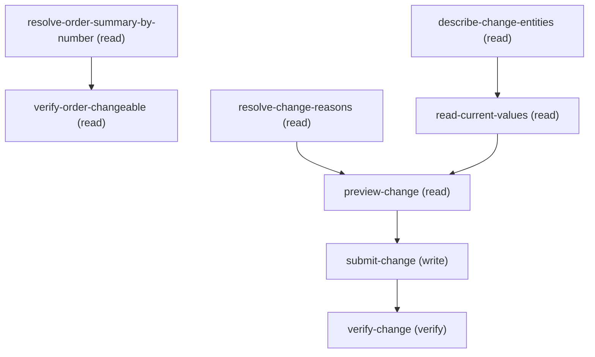

# Managing Change Order Summary

## When to Use This Skill

Use when a customer or CSR needs to CHANGE (not cancel) an existing order — line-item quantity/price, shipping/delivery address, discounts, taxes, order-level adjustments, order header/billing fields, or the order's BUNDLE STRUCTURE (link a component/add-on to a bundle/set/add-on parent line, or edit an existing bundle link's scaling/pricing/inventory). Bundle relationships (orderItemSummaryRelationships) are the seventh change entity — same New/Update, preview-then-submit experience as the other six.

## Workflow

change-order-summary guides a user through modifying an existing order via the Change Order Summary
Connect API's preview-then-submit pair. Per-step agent_guidance is authoritative for each step's
contract; this is the orchestration map + entry decision tree + contract index.

## Critical Constraints

**Preconditions:**

- Org must have Order Management Connect API enabled (check: `Order Management API enabled`)
- Org must have the Change Order Summary feature enabled and the user must hold the
UseOrderSummaryChangeAPIs permission. The endpoints declare userDynamicChecks
{userHasOrderSummaryChangeApiAccess, orgHasChangeOrderSummary} and require an Order
Management Growth license. Missing any of these → friendly denial (not a workflow bug). (check: `OrderSummary.orgHasChangeOrderSummary && OrderSummary.userHasOrderSummaryChangeApiAccess`)
- `changeReason` is REQUIRED on every request and must match the org's
OrderItemSummaryChange.Reason picklist (org-tenant-specific; picklist
ORDER_ITEM_SUMMARY_CHG_RSN). The OAS types it a free-form string; the controller
validates it as an enum. Resolve the picklist via resolve-change-reasons before previewing. (check: `OrderItemSummaryChange.Reason picklist`)
- The OrderSummary must be MANAGED. An order with OrderLifeCycleType == 'UNMANAGED'
cannot be changed through the Order Management change APIs (the change API rejects it).
Read OrderLifeCycleType (verify-order-changeable, or the
resolve-order-summary-by-number record) and stop with a friendly message BEFORE previewing
if it is UNMANAGED. (check: `OrderSummary.OrderLifeCycleType != 'UNMANAGED'`)
- The OrderSummary must not already have an operation in progress. When
OrderSummary.OperationInProgress is anything other than null or the literal 'None' (e.g.
'Cancellation'), the order is locked and the change API rejects it
(→ INVALID_STATE / INVALID_API_INPUT). This is BROADER than the cancel workflow's check (which
only blocks the exact string 'Cancellation'): for change, ANY non-None operation blocks. Read
it via verify-order-changeable and stop with a friendly message before previewing. (check: `OrderSummary.OperationInProgress in (null, 'None')`)
- Each OrderItemSummary being modified (and any item whose tax/adjustment is being changed)
must NOT be fulfilled — OrderItemSummary.QuantityAllocated must be 0. A fulfilled item returns
400 INVALID_STATUS. Verify via read-current-values before previewing. For a bundle relationship
change, this applies to BOTH linked items (the MainOrderItemSummary parent AND the
AssociatedOrderItemSummary component/add-on) — either one fulfilled fails the relationship with
400 INVALID_STATUS. (check: `OrderItemSummary.QuantityAllocated == 0`)

**Operational rules:**

- ENTRY DECISION TREE (drive the conversation in this order):
  0. resolve-order-summary-by-number → OrderNumber → 1Os... Id. NOT unique; disambiguate when
     totalSize > 1. Skip if the caller already has the Id.
  0.5 verify-order-changeable → ORDER-LEVEL ELIGIBILITY GATE (runs before anything touches the
     order). Two hard stops: OrderLifeCycleType == 'UNMANAGED' → STOP ("can't be changed here");
     OperationInProgress not in {null,'None'} → STOP ("order is busy, an operation is in progress").
     If step 0 ran (FIELDS(STANDARD)), both fields are already on that record — reuse them.
  1. resolve-change-reasons → fetch the org's ACTIVE Reason picklist; the customer SELECTS one value
     → the single top-level changeReason (required). Do NOT free-type it.
  2. which-entities (CHOICE, multi-select) → ASK what the customer wants to change (line items,
     item taxes, item discounts, delivery/shipping, order-level discounts, order header, or bundle
     relationships) and, per record, whether they're ADDING (New) or UPDATING (Update). OrderSummary
     is Update-only. A bundle relationship links a parent line to a component/add-on (New) or edits a
     link's structural fields (Update).
  3. describe-change-entities → describe each chosen sObject for field types/labels/picklists so you
     prompt correctly and validate enum inputs client-side.
  4. read-current-values → for each Update target, read current values + QuantityAllocated, then:
       • WARN-NOT-STOP: any changed field NOT in the entity's modifiable allowlist → warn + drop +
         proceed (never send it; it 400s the whole request). Offer the legitimate alternative.
       • FULFILLED (QuantityAllocated > 0) → exclude the item with a friendly message.
       • NEW records → collect the per-entity required fields; give each a referenceId; cross-link
         with @{referenceId}.
       • If nothing changeable remains → STOP (≥1 change required).
  5. preview-change → build the UNWRAPPED ChangeOrderSummaryInput body (only the touched slots),
     call preview. HARD STOP: surface the financial impact from changeBalances, WAIT for explicit
     confirmation.
  6. submit-change → ONLY after "yes": submit the SAME payload. Returns preFulfillmentChangeOrderId
     (null if non-financial) + createdEntities[] (referenceId → new Id). No customer-facing message
     here — silent handoff to verify-change.
  7. verify-change → read back the changed records + OrderSummary to confirm the new values landed,
     then deliver the ONE customer-facing confirmation per its RECAP CONTRACT (non-financial recap of
     what changed, sourced from this read-back — not preview's snapshot, not a repeat of the totals).
- CUSTOMER-FACING WORDING (mandatory — user-facing workflow):
  - HARD STOP between preview and submit on every change. A successful preview is NOT consent.
  - WARN-NOT-STOP: when a requested field can't be changed, tell the customer plainly and continue
    with what CAN change; never silently drop without saying so, and never send it (it breaks the
    whole request). Offer the real alternative where one exists.
  - CURRENCY: never hard-code a symbol; amounts are in the order's own currency (CurrencyIsoCode on
    multicurrency orgs; org/user default otherwise). Present as "129.00 USD" or locale-formatted.
  - NO INTERNAL JARGON OR TELEMETRY: never surface step names, Connect API operation names,
    field/sObject/response-shape names, raw 1Os.../0ai... Ids, change-order Ids, or the words
    "SOR"/"workflow".
  - POST-SUBMIT CONFIRMATION: submit-change itself is silent to the customer; verify-change's RECAP
    CONTRACT is the single customer-facing confirmation after a change, and it is non-financial (no
    dollar amounts) — see that step's agent_guidance.
- CONTRACT INDEX (full detail in each step's agent_guidance):
  - ORDER-LEVEL GATE (before preview): MANAGED (OrderLifeCycleType != 'UNMANAGED') AND
    OperationInProgress in {null,'None'} (broader than cancel) → verify-order-changeable
  - changeReason REQUIRED + enum-validated; single TOP-LEVEL value (not per-line); customer SELECTS
    from the live ACTIVE OrderItemSummaryChange.Reason picklist → resolve-change-reasons
  - WARN-NOT-STOP non-modifiable fields: on Update, a changed field outside the entity's
    modifiable allowlist → 400 INVALID_FIELD_FOR_INSERT_UPDATE (whole request
    fails). Warn + drop + proceed. Allowlists are in read-current-values. Changed-fields-only means
    setting a non-modifiable field to its current value is a silent no-op → read-current-values
  - FULFILLED items (QuantityAllocated > 0) can't be changed → 400 INVALID_STATUS; exclude them →
    read-current-values
  - New vs Update: New carries referenceId (no id) + required fields; Update carries the id + only
    changed modifiable fields; @{referenceId} cross-links new records; OrderSummary is Update-only;
    OrderItemSummaryRelationship supports both New and Update → read-current-values / preview-change
  - REQUEST BODY is the ChangeOrderSummaryInput at TOP LEVEL (unwrapped); include only touched slots;
    every sObject map needs attributes.type; ≥1 change, ≤100 changes → preview-change
  - HARD STOP between preview and submit (no auto-chain); submit reuses the EXACT preview payload →
    preview-change / submit-change
  - preview may return 200 or 201; persists nothing → preview-change
  - submit returns preFulfillmentChangeOrderId (NULL when non-financial) + createdEntities[]
    (referenceId → new Id, v264/v68) → submit-change
  - both endpoints synchronous (no async poll, unlike full-cancel) → preview-change / submit-change
  - access gates: orgHasChangeOrderSummary + userHasOrderSummaryChangeApiAccess + OM Growth license;
    portal users blocked → preconditions
  - SOQL INPUT SAFETY: validate every interpolated value ({orderNumber}, {orderSummaryId}, record
    Ids, {sObjectName} against the fixed 7-sObject allowlist) and escape quotes/backslashes; never
    splice raw input into a query → resolve-order-summary-by-number / read-current-values /
    describe-change-entities
  - BUNDLE RELATIONSHIPS (orderItemSummaryRelationships) are the SEVENTH change entity (New + Update),
    handled like the other six. New requires MainOrderItemSummaryId, AssociatedOrderItemSummaryId,
    MainOrderItemSummaryRole, AssociatedOrderItemSummaryRole (do NOT send MainOrderSummaryId — set from
    the URL order); item ids may be existing OrderItemSummary Ids or @{referenceId} of new lines in the
    same request. Roles are a FIXED static pairing: Bundle→BundleComponent|ClassificationComponent,
    Set→SetComponent, AddOn→AddOnComponent (no live picklist resolve). Update modifiable set:
    AssociatedOrderItemInventory, AssociatedOrderItemSumPricing, AssociatedQuanScaleMethod,
    ProductRelationshipTypeId, ProductRelatedComponentId (roles + item links are set-once; changing
    them → INVALID_FIELD_FOR_INSERT_UPDATE, warn+drop). Enforced 400s: incompatible roles / self-link
    (INVALID_INPUT_COMBINATION); an item id not on this order (INVALID_API_INPUT); duplicate link
    (DUPLICATE_VALUE); missing required field (MISSING_ARGUMENT); BOTH linked items must be unfulfilled
    (INVALID_STATUS). A relationship-only change is NON-FINANCIAL (preFulfillmentChangeOrderId null). →
    which-entities / read-current-values / preview-change / submit-change / verify-change
- REQUEST ENTITY SLOTS (the 7 entities the Change Order Summary Connect API supports; each is an input slot on the top-level unwrapped ChangeOrderSummaryInput body):
  - orderSummary                     (order header; UPDATE only)
  - orderItemSummaries               (line items; New + Update)
  - orderItemTaxLineItemSummaries    (item tax lines; New + Update)
  - orderItemAdjustmentLineSummaries (item discount/adjustment lines; New + Update)
  - orderDeliveryGroupSummaries      (delivery/shipping groups; New + Update)
  - orderAdjustmentGroupSummaries    (order-level adjustment groups; New + Update)
  - orderItemSummaryRelationships    (bundle relationships — parent↔component/add-on links; New + Update)
- SOURCE OF TRUTH: the contracts above (non-modifiable fields, changed-fields-only validation, changeReason, fulfilled items) are enforced by the Change Order Summary Connect API on both preview and submit — the per-entity modifiable allowlist is the API's, not describe's `updateable` flag. changeReason's allowed values come from the org's OrderItemSummaryChange.Reason picklist (ORDER_ITEM_SUMMARY_CHG_RSN); a value not in that picklist → 400 INVALID_API_INPUT. The bundle-relationship contract (required/modifiable fields, role pairing, self-link / same-order / duplicate-key / fulfilled-item checks) is likewise enforced by the change API on both preview and submit; the role pairing is fixed by the MainOrderItemSummaryRole / AssociatedOrderItemSummaryRole picklists on OrderItemSummaryRelationship (Bundle→BundleComponent|ClassificationComponent, Set→SetComponent, AddOn→AddOnComponent).

## Verification Checklist

After every write operation, confirm the effect by re-reading state:

- After `submit-change`: call `verify-change`

## Operations Reference

Operations grouped by purpose. Use these as the building blocks for the workflows above.

### Summary

| Operation | Purpose | Status | Call | Depends on |
|-----------|---------|--------|------|------------|
| `resolve-order-summary-by-number` | read | implemented | `querySoql` | — |
| `verify-order-changeable` | read | implemented | `querySoql` | `resolve-order-summary-by-number` |
| `resolve-change-reasons` | read | implemented | `describeOrderItemSummaryChange` | — |
| `describe-change-entities` | read | implemented | `describeChangeEntity` | `which-entities` |
| `read-current-values` | read | implemented | `querySoql` | `describe-change-entities` |
| `preview-change` | read | implemented | `postOrderSummaryPreviewChange` | `resolve-change-reasons`, `read-current-values` |
| `submit-change` | write | implemented | `postOrderSummarySubmitChange` | `preview-change` |
| `verify-change` | verify | implemented | `querySoql` | `submit-change` |

### Dependency graph

### Read operations

#### `resolve-order-summary-by-number`

Resolve a customer-provided OrderNumber to its OrderSummary Id.
Customers and CSRs work with OrderNumber (the printed order number on
receipts/email); the change APIs require the internal Id (1Os...).

IMPORTANT: OrderNumber is NOT unique on this sObject — a single
OrderNumber can resolve to multiple OrderSummaries (orgs reuse it across
storefronts/locales). When this step returns more than one row, the agent
MUST surface the candidates (date, total, line count) and ask the customer
which one they meant before proceeding. Do NOT auto-pick by OrderedDate or
any heuristic — changing the wrong order is the worst outcome here.

**Call:** `querySoql`   — status: `implemented`

**Inputs:**

- `orderNumber` *(`String`)* — Customer-facing OrderNumber (the printed order number from the
receipt/confirmation email). Skip this step entirely if the caller
already has the OrderSummary Id (starts with '1Os') — pass that
directly into downstream steps.

#### `verify-order-changeable`

Confirm the OrderSummary itself is eligible to be changed BEFORE doing any
entity work or previewing. Two order-level guardrails enforced by the change
APIs:

  G1 — MANAGED only. OrderLifeCycleType must not be 'UNMANAGED'. Unmanaged
       orders are not changeable through these APIs.
  G2 — NOT LOCKED. OperationInProgress must be null or the literal 'None'.
       ANY other value (e.g. 'Cancellation') means an operation is already
       running for this order and the change API will reject it. NOTE this is
       broader than the cancel workflow, which only blocks 'Cancellation'.

Fail-fast read so the agent gives a clear customer-facing message instead of a
downstream 400.

**Call:** `querySoql`   — status: `implemented`

**Inputs:**

- `orderSummaryId` *(`String`)* — OrderSummary Id (1Os...). Source: output of resolve-order-summary-by-number,
or passed directly by the caller. Validated to ^[a-zA-Z0-9]{15,18}$ before interpolation.

**Depends on:** `resolve-order-summary-by-number`

#### `resolve-change-reasons`

Resolve the org's allowed change reasons from the live OrderItemSummaryChange.Reason
picklist (ORDER_ITEM_SUMMARY_CHG_RSN). Required because the controller validates the
top-level `changeReason` against this picklist on both preview and submit; sending an
unrecognized value returns 400 INVALID_API_INPUT.

**Call:** `describeOrderItemSummaryChange`   — status: `implemented`

#### `describe-change-entities`

Describe each sObject the customer chose to change (in which-entities), so the agent can prompt
intelligently: field labels, data types, whether a field is a picklist (and its values), and
required-ness for New. Run once per selected entity type. The supported entity → sObject map:
  order-item-summaries                 → OrderItemSummary
  order-item-tax-line-item-summaries   → OrderItemTaxLineItemSummary
  order-item-adjustment-line-summaries → OrderItemAdjustmentLineSummary
  order-delivery-group-summaries       → OrderDeliveryGroupSummary
  order-adjustment-group-summaries     → OrderAdjustmentGroupSummary
  order-summary                        → OrderSummary
  order-item-summary-relationships     → OrderItemSummaryRelationship
NOTE: describe's generic `updateable` flag is NOT the same as this API's modifiable allowlist —
use the allowlists in read-current-values for the WARN-NOT-STOP decision, and use describe only
for field TYPES, LABELS, and PICKLIST values (to prompt and to validate enum inputs client-side).
(For OrderItemSummaryRelationship, describe marks ProductRelatedComponentId non-updateable even
though the change API DOES allow it on Update — trust the read-current-values allowlist, not the
describe flag, exactly as this NOTE says.)

**Call:** `describeChangeEntity`   — status: `implemented`

**Inputs:**

- `sObjectName` *(`String`)* — The sObject API name for a selected entity (e.g. OrderItemSummary). One describe call per
selected entity type. Validated against the fixed allowlist of the 7 supported sObjects above;
never interpolate an arbitrary caller-supplied type.

**Depends on:** `which-entities`

#### `read-current-values`

For each EXISTING record the customer wants to Update, read its current field values (and, for
line items, QuantityAllocated) so the agent can (a) apply the WARN-NOT-STOP non-modifiable-field
filter, (b) exclude fulfilled items, and (c) later verify the change landed. New (add) records
have nothing to read — skip them here; validate their required fields instead (see agent_guidance).
Issue one read per entity type/target set; the exact SELECT columns depend on the entity.

**Call:** `querySoql`   — status: `implemented`

**Inputs:**

- `orderSummaryId` *(`String`)* — OrderSummary Id (1Os...). Source: verify-order-changeable / resolve-order-summary-by-number.

**Depends on:** `describe-change-entities`

#### `preview-change`

Preview the expected financial impact of the change WITHOUT persisting. Returns changeBalances (financial deltas), success, errors, and orderSummaryId.

**Call:** `postOrderSummaryPreviewChange`   — status: `implemented`

**Inputs:**

- `orderSummaryId` *(`String`)* — ID of the order summary (must match ^1Os\w*). Path parameter.
Source: verify-order-changeable / read-current-values.
- `changeReason` *(`String`)* — REQUIRED top-level reason for the whole change. Must be an active value from the
OrderItemSummaryChange.Reason picklist (see resolve-change-reasons). Not-in-picklist → 400
INVALID_API_INPUT.
- `changeOrdersReferenceNumber` *(`String`)* — OPTIONAL customer reference number for the resulting Change Order. Must be unique among the
parent order's existing change orders, else 400 ORDER_MANAGEMENT_DUPLICATE_ORDER_REFERENCE_NUMBER.
Omit unless the customer supplies one.
- `orderSummary` *(`Object`)* — OPTIONAL order-header (OrderSummary) changes — UPDATE only. sObject map with
attributes.type='OrderSummary', the record Id, and only MODIFIABLE header fields (see
read-current-values allowlist). Omit if the header isn't changing.
- `orderItemSummaries` *(`Array`)* — List of line-item changes. Each entry has referenceId (New only), changeType (New|Update),
and an orderItemSummary sObject map.
  - schema: `{'items': {'type': 'object', 'required': ['changeType', 'orderItemSummary'], 'properties': {'referenceId': {'type': 'string', 'description': "Unique reference id for a New line; used to cross-link (@{referenceId}) and returned in the submit response's createdEntities[]. Required for New, omit for Update."}, 'changeType': {'type': 'string', 'description': 'New (add a line) or Update (edit an existing line). New must NOT carry an id; Update MUST carry the record id in orderItemSummary.', 'enum': ['New', 'Update']}, 'orderItemSummary': {'type': 'object', 'description': "The OrderItemSummary sObject map with attributes.type='OrderItemSummary'. For Update,\ninclude the record id + only MODIFIABLE fields whose value is actually changing (see\nread-current-values — non-modifiable changed fields are WARNED + DROPPED, not sent). For\nNew, include the required fields (OrderDeliveryGroupSummaryId, Product2Id, Quantity,\nTotalLineAmount, Name, + PricebookEntryId or ListPrice)."}}}}`
- `orderItemTaxLineItemSummaries` *(`Array`)* — List of item tax-line changes. Each entry has referenceId (New only), changeType, and an
orderItemTaxLineItemSummary sObject map. Update modifiable fields Type/Amount/Description/
Rate/TaxEffectiveDate/Name; New requires Type/Amount/TaxEffectiveDate/Name/OrderItemSummaryId
(OrderItemSummaryId waived when OrderItemAdjustmentLineSummaryId is set).
- `orderItemAdjustmentLineSummaries` *(`Array`)* — List of item discount/adjustment-line changes. Each entry has referenceId (New only),
changeType, and an orderItemAdjustmentLineSummary sObject map. Update modifiable fields
Amount/Description/Name; New requires Amount/Name/OrderItemSummaryId.
- `orderDeliveryGroupSummaries` *(`Array`)* — List of delivery/shipping-group changes. Each entry has referenceId (New only), changeType,
and an orderDeliveryGroupSummary sObject map. Update modifiable fields include the
DeliverTo* address fields, OrderDeliveryMethodId, gift + delivery-date fields; New requires
OrderDeliveryMethodId (and must be referenced by a new line item).
- `orderAdjustmentGroupSummaries` *(`Array`)* — List of order-level adjustment-group changes. Each entry has referenceId (New only),
changeType, and an orderAdjustmentGroupSummary sObject map. Update modifiable fields
Name/Description; New requires Name/Type.
- `orderItemSummaryRelationships` *(`Array`)* — List of bundle-relationship changes. Each entry has referenceId (New only), changeType
(New|Update), and an orderItemSummaryRelationship sObject map. New links a parent line to a
component/add-on line; Update edits an existing link's structural fields.
  - schema: `{'items': {'type': 'object', 'required': ['changeType', 'orderItemSummaryRelationship'], 'properties': {'referenceId': {'type': 'string', 'description': "Unique reference id for a New link; used to cross-link (@{referenceId}) and returned in the submit response's createdEntities[]. Required for New, omit for Update."}, 'changeType': {'type': 'string', 'description': 'New (create a bundle link) or Update (edit an existing link). New must NOT carry an id; Update MUST carry the record id in orderItemSummaryRelationship.', 'enum': ['New', 'Update']}, 'orderItemSummaryRelationship': {'type': 'object', 'description': 'The OrderItemSummaryRelationship sObject map with attributes.type=\'OrderItemSummaryRelationship\'.\nFor New, include MainOrderItemSummaryId, AssociatedOrderItemSummaryId,\nMainOrderItemSummaryRole, AssociatedOrderItemSummaryRole (roles must be a valid pairing —\nBundle→BundleComponent|ClassificationComponent, Set→SetComponent, AddOn→AddOnComponent);\nthe two item ids may be existing OrderItemSummary Ids on this order or "@{referenceId}" of\nnew lines in the same request. Do NOT send MainOrderSummaryId (set from the URL order).\nFor Update, include the record id + only MODIFIABLE fields whose value is actually changing\n(AssociatedOrderItemInventory, AssociatedOrderItemSumPricing, AssociatedQuanScaleMethod,\nProductRelationshipTypeId, ProductRelatedComponentId — non-modifiable changed fields are\nWARNED + DROPPED, not sent).'}}}}`

**Depends on:** `resolve-change-reasons`, `read-current-values`

### Write operations

#### `submit-change`

Submit the change to the Order Summary with the SAME payload that was previewed. Creates a
pre-fulfillment Change Order and returns preFulfillmentChangeOrderId (null when the change is
non-financial) plus createdEntities[] (referenceId → new Id for any New records). This is an
irreversible financial write — only call it after an explicit HARD-STOP confirmation.

**Call:** `postOrderSummarySubmitChange`   — status: `implemented`

**Inputs:**

- `orderSummaryId` *(`String`)* — Same order summary ID from the preview step (path parameter).
- `changeReason` *(`String`)* — Same changeReason sent to preview. Source: preview-change.
- `changeOrdersReferenceNumber` *(`String`)* — Same optional reference number sent to preview (if any). Source: preview-change.
- `changeOrderSummaryInput` *(`Object`)* — The SAME entity-slot payload sent to preview-change (orderSummary / orderItemSummaries /
orderItemTaxLineItemSummaries / orderItemAdjustmentLineSummaries / orderAdjustmentGroupSummaries
/ orderDeliveryGroupSummaries / orderItemSummaryRelationships), byte-for-byte identical so the
committed change matches what the customer approved. Source: preview-change.

**Depends on:** `preview-change`

### Verify operations

#### `verify-change`

Verify the change landed by reading back the affected records (and the OrderSummary) and
confirming the new values are present. Run AFTER submit-change succeeds.

**Call:** `querySoql`   — status: `implemented`

**Inputs:**

- `orderSummaryId` *(`String`)* — Source: submit-change / preview-change.

**Depends on:** `submit-change`
