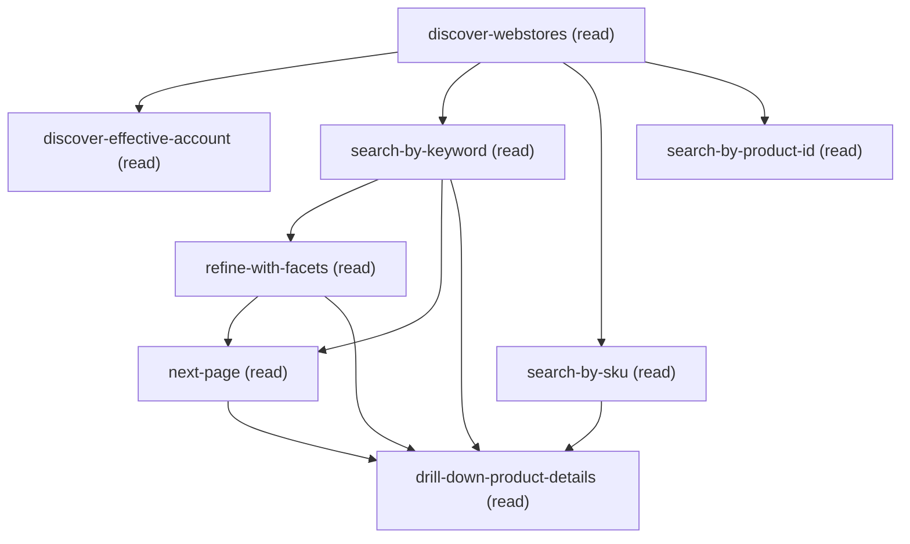

# Querying Product Search

## When to Use This Skill

Buyer-facing catalog discovery for Commerce webstores: search a store's product catalog by keyword, SKU, or product Id, then optionally refine by facets or paginate. Read-only discovery — add-to-cart, checkout, and place-order are OUT OF SCOPE and belong to separate SORs.

## Workflow

Render values VERBATIM from the response:
  • Product NAME ($.name) — never reformat, never
    abbreviate. "Boardroom Sheath Dress" stays "Boardroom
    Sheath Dress", not "Boardroom Sheath" or "the dress".
  • SKU ($.stockKeepingUnit) — verbatim. The full
    string is the cross-reference key customers use.
  • Description ($.description) — product summary text.
  • Status / availability (when present in $.fields) —
    verbatim string, never translate ("Active" stays "Active",
    not "Available"; "Released" stays "Released", not "Live").

Format for human readability:
  • SEARCH RESULTS HAVE NO PRICING. ProductSearchProductOutputRepresentation
    contains name, SKU, description, and image (singular) only.
    Pricing fields ($.unitPrice, $.listPrice, $.currencyIsoCode)
    are ONLY available on the detail endpoint
    (ProductDetailsOutputRepresentation). To show price, you
    must drill down via drill-down-product-details or
    search-by-product-id. Present search lists with name + SKU +
    description + image; offer "select a product to see pricing."
  • Price (detail endpoint only) as `{currency-symbol}{amount}`
    with 2 decimals — `$24.99`, not `24.99 USD` (unless the
    currency is non-USD, then use the symbol from currencyIsoCode).
  • Image from search results is $.image (singular object),
    NOT $.imageGroups[] which only exists on detail endpoint.
    Present as thumbnail or hyperlink — NEVER paste raw URLs.
  • Field and attribute data should be rendered in clear,
    human-readable format avoiding raw API names where
    possible.

total_count: 0 (or empty $.products) — friendly
"no products found matching {criteria} in this webstore — try
a broader keyword or different facets." Do NOT auto-retry with
a relaxed term; the user picked the criteria deliberately.

productSearch is PAGE-BASED, not cursor-based. Unlike SOQL:
  • `total_count` IS reliable (use for "showing N of M").
  • No LIMIT-21 sentinel, no $.records[19] cursor seed.
  • PAGE IS ZERO-INDEXED (wire-verified on q3-som-e2e 2026-06-29).
    First call: `page: 0` (or omit — omitted is equivalent to 0).
    Subsequent calls: `page: 1`, `page: 2`, ... until
    products.length < pageSize.
  • OM API returns real $.pageNumber field that can be used for
    pagination logic. Stop when $.pageNumber >= ceil($.totalRecordsFound / $.pageSize)
    or when products.length < pageSize (last page is short).
  • ALWAYS SPECIFY pageSize EXPLICITLY. Server default varies by
    org (default is 25, org-configurable). Recommend 20 for chat-list
    ergonomics; cap historically 25-100 on the legacy POST resource —
    values above the cap return 400.
  • next-page step exists ONLY on the keyword path (search-by-
    keyword + refine-with-facets). by-sku and by-product-id are
    single-item results — no pagination.

webstoreId is REQUIRED on every search step, but the SOR's
discover-webstores step now sources it from a SOQL list of
WebStore Id/Name/Type. The agent presents Names to the user,
the user picks, the chosen record's Id is threaded through
downstream steps via prior_step. The agent should NEVER echo
the raw 0ZE Id back to a buyer in customer-facing reply text;
CSRs may see it for disambiguation. The user does not need to
know the 0ZE Id up front.

The primary v244+ resource caches responses for 15 minutes
(public cache, max-age 900s, s-maxage 1800s). Responses may
be stale by that window. For chat UX this is usually fine —
catalog data doesn't change minute-to-minute — but if the
user reports "I just changed the price and it's still
showing the old one", note the 15-minute cache and suggest
a retry after the window.

Operational heuristic (legacy, retained for completeness): on B2B
if a search returns an unexpectedly empty result, treat that
as a likely missing-effectiveAccountId signal and confirm the
account was supplied. With the redesign, discover-effective-account
makes this much less likely — the input is sourced from the
account-picker rather than a freeform field.

Server-side patterns (confirmed via source review against
ICommerceProductSearchResource v244+ annotations):
  webstoreId            → ^0ZE[A-Za-z0-9]{12}([A-Za-z0-9]{3})?$  (WebStore)
  productId / categoryId → ^01t[A-Za-z0-9]{12}([A-Za-z0-9]{3})?$ / ^0ZG[A-Za-z0-9]{12}([A-Za-z0-9]{3})?$  (Product2 / Catalog)
  sortRuleId            → ^0qU[A-Za-z0-9]{12}([A-Za-z0-9]{3})?$  (Sort Rule, future use)
  effectiveBuyerGroupIds → ^0ZI[A-Za-z0-9]{12}([A-Za-z0-9]{3})?$ (Buyer Group, future use)
Reject any input that fails the pattern with a friendly
error before invoking. Failing fast at the agent layer is
better UX than waiting for the server's 400.

The three search dimensions are mutually exclusive; the choice_points
runtime hard-skips the other two:
  • by-keyword     → GET Order Management getProducts with searchTerm
  • by-sku         → GET Order Management getProducts with searchTerm: <sku>.
                     The Commerce Catalog productView path REJECTS SKU at
                     the routing layer, so the OM API is canonical for SKU
                     lookup.
  • by-product-id  → GET Order Management getProduct with the 01t Id.

The customer-friendly wording rules above are the same rules that apply to
the search-order-summaries SOR (NO internal field names, sObject names, raw
18-char Ids, or webstoreId in the user-facing reply).

## Critical Constraints

**Preconditions:**

- Org must have Commerce B2B or B2C enabled — both productSearch and
productDetails endpoints carry the x-sfdc.org-access-check for
Commerce B2B or B2C enabled. Without this feature,
every step returns FEATURE_NOT_ENABLED.
 (check: `Commerce B2B or B2C enabled`)
- User must have READ access to the WebStore (the 0ZE-prefixed
record every step targets). On the primary v244+ commerce
search resource this is implicit via the Commerce Store
feature gate; unauthenticated/portal flows ARE allowed there.
(Note: an alternate OM-specific repricing resource enforces
USER_HAS_ORDER_MANAGEMENT_OR_REPRICING_API_ACCESS, but this
SOR does NOT target that resource — it routes through the
buyer-facing storefront search.)
 (check: `WebStore.READ`)
- User must have READ access to Product2 — every step in this
workflow projects Product2 fields (Name, StockKeepingUnit,
custom fields). Without FLS the response is empty.
 (check: `Product2.READ`)
- When querying a B2B webstore, the caller must supply
effectiveAccountId and have READ access to that Account. The
storeType choice_point routes the workflow into the B2B branch
(effectiveAccountId required on every step) for B2B;
B2C and B2CE branches treat effectiveAccountId as optional.
 (check: `Account.READ`)
- Calling user must have a Contact record (User.ContactId) for
discover-effective-account to resolve. CSR / internal users who
shop on behalf of buyers must have AccountContactRelation rows
linking them to the target buyer accounts. Without either, the
account-discovery query returns empty and the B2B branch
blocks.
 (check: `AccountContactRelation.READ`)

**Operational rules:**

- TYPICAL FLOW
- STEP 1 — Discover the webstore (always runs)
  Invoke discover-webstores. Present $.records[*] as a numbered
  menu using Name + Type:
    "Which store?
      1) BrightBundle Co (B2B)
      2) B2C Codecept (B2C)
      3) RefArch USD (B2CE)"
  NEVER echo the raw 0ZE Id to a buyer. Once the user picks, map
  that record's Type column to the store-type choice value:
    Type == "B2B"  → store-type = b2b
    Type == "B2CE" → store-type = b2ce
    Type == "B2C"  → store-type = b2c
  The chosen record's Id becomes the webstoreId threaded through
  every downstream step.
- STEP 2 — Discover the buyer account (B2B only; skipped on B2C and B2CE)
  On B2B the runtime fires discover-effective-account.
  Present $.records[*].Account.Name as a numbered menu:
    "Which account are you shopping for?
      1) Acme Corp
      2) Global Industries"
  The chosen record's AccountId becomes the effectiveAccountId
  threaded through every search step. On B2C and B2CE the step is hard-
  skipped (see store-type choice option `b2c` and `b2ce` skip_steps); the
  search steps run without effectiveAccountId.
- STEP 3 — Gather search criteria
  Ask the user which of three dimensions they want:
    • keyword — free-text catalog scan
    • SKU — exact-match SKU lookup
    • product Id — exact-match 01t-prefixed Id lookup
  Facets and pagination are not peer dimensions — they're follow-
  on refinements of the keyword path (see STEP 5 below).
- STEP 4 — Run the matching search-by-* step
  The choice_points runtime hard-skips the other two peer
  dimensions and (for sku / product-id) hard-skips
  refine-with-facets + next-page. Pre-validate Id shapes BEFORE
  invoking:
    webstoreId  → ^0ZE[A-Za-z0-9]{12}([A-Za-z0-9]{3})?$
    productId   → ^01t[A-Za-z0-9]{12}([A-Za-z0-9]{3})?$
- STEP 5 — Refine and paginate (keyword path only)
  From by-keyword:
    • The response's $.facets enumerates what's facetable for the
      matching products. If $.facets is EMPTY ([]), the catalog has
      no facetable attributes — skip the refine prompt entirely
      (don't ask "what filter?" when there are no filters). If
      $.facets is populated, present them ("filter by Color (Red,
      Blue, Green), Size (S, M, L)") and invoke refine-with-facets
      with the user's picks.
    • Walk additional pages via next-page. Stop when
      products.length < pageSize (last page is short) OR when
      $.pageNumber >= ceil($.totalRecordsFound / $.pageSize).
- STEP 6 — Present results in customer-friendly wording
  • Product NAME ($.name) — verbatim, never abbreviate.
  • SKU ($.stockKeepingUnit) — verbatim. Customers
    cross-reference SKUs when calling in; truncating breaks
    that.
  • Description ($.description) — product summary text from
    search results, if present.
  • Image ($.image) — present as thumbnail or hyperlink, NOT
    raw URL. Search results have a SINGULAR image object, not
    $.imageGroups[] (imageGroups only available on detail endpoint).
  • PRICING NOT AVAILABLE FROM SEARCH. Search results contain
    name, SKU, description, and image only. To show pricing
    ($.unitPrice, $.listPrice, $.currencyIsoCode), you must
    drill down to the detail endpoint via drill-down-product-details
    or search-by-product-id. Present the search list with
    name + SKU + description + image, then offer "select a product
    to see pricing and full details."
  • Product fields ($.fields) and attributes ($.attributes) —
    render in human-readable format where possible.
  NO internal field names, sObject names, FQCNs, internal
  step names, 18-char Ids, webstoreId, correlationId, or
  Apex class names in the user-facing reply.
- STEP 7 — Drill into a chosen product (optional)
  From by-keyword / refine-with-facets / next-page, run
  drill-down-product-details once the user picks a row. This
  delegates to the product-details SOR for comprehensive product
  information. From by-sku / by-product-id the drill-down may be
  redundant — only invoke if the user explicitly asks for more detail.
- STEP 8 — Hand off to checkout / cart actions
  OUT OF SCOPE for this SOR. The agent picks the next workflow
  from the conversation, not from this SOR. Likely targets:
  add-to-cart, place-order, etc. (separate SORs).
- CUSTOMER-FRIENDLY WORDING RULES
- Never echo:
  • Apex class names, FQCNs, internal step names.
  • $.correlationId — debugging-only, leaks internal trace IDs.
  • webstoreId — internal Id; customers shouldn't see 0ZE
    identifiers in chat.
  • Raw error envelope ($.errors[].errorCode) — translate to
    friendly language. INVALID_ID_FIELD → "I don't recognize
    that product Id"; FEATURE_NOT_ENABLED → "your org doesn't
    have Commerce enabled."
- EMPTY RESULTS vs ERRORS
- HTTP errors:
  400 INVALID_ID_FIELD       → id-shape mismatch (webstoreId,
                                productId). Pre-validate at
                                the agent layer to fail fast.
  400 VALIDATION_ERROR       → typo'd facet nameOrId or
                                malformed refinement shape.
                                Translate to customer terms
                                ("that filter isn't valid for
                                this catalog"); do NOT echo the
                                raw API field name.
  401 / 403                  → user lacks WebStore READ or
                                buyer access. Surface "you
                                don't have access to this
                                webstore" — never the raw
                                PermissionDeniedException.
  404                        → product not found on a single-
                                item lookup. Offer to retry as
                                a keyword search across the
                                catalog (render the suggestion
                                in natural language, never echo
                                the internal `by-keyword` token).
  503 FEATURE_NOT_ENABLED    → org missing Commerce B2B/B2C.
                                Surface "your org doesn't have
                                Commerce enabled" — direct the
                                user to Setup if appropriate.
- PAGINATION
- WEBSTOREID — SOURCED FROM DISCOVERY
- CACHING (advisory)
- EFFECTIVE ACCOUNT ID (driven by store-type choice)
- Required-ness is driven by the store-type choice_point + the
discover-effective-account step:
  • store-type = b2b   → discover-effective-account runs.
                         effectiveAccountId is REQUIRED on every
                         search step (B2B buyer-scoped pricing +
                         entitlement enforcement).
  • store-type = b2ce  → discover-effective-account is SKIPPED.
                         effectiveAccountId is OPTIONAL on every
                         search step.
  • store-type = b2c   → discover-effective-account is hard-
                         skipped. effectiveAccountId is OPTIONAL
                         on every search step (classic B2C ignores
                         it — uniform pricing across buyers).
The store-type value is derived from the Type column on the
webstore the user picked in discover-webstores (B2B → b2b,
B2CE → b2ce, B2C → b2c). The agent does NOT prompt for store-
type independently — the prior_step source on the choice_point
pulls it from discover-webstores' chosen record.
- ID-SHAPE PRE-VALIDATION (catches 400s before round-trip)
- SEARCH-DIMENSION ROUTING (relocated from routing summary)
- WORDING-RULE PROVENANCE

## Operations Reference

Operations grouped by purpose. Use these as the building blocks for the workflows above.

### Summary

| Operation | Purpose | Status | Call | Depends on |
|-----------|---------|--------|------|------------|
| `discover-webstores` | read | implemented | `querySoql` | — |
| `discover-effective-account` | read | implemented | `querySoql` | `discover-webstores` |
| `search-by-keyword` | read | implemented | `getProductSearch` | `discover-webstores` |
| `search-by-sku` | read | implemented | `getProductSearch` | `discover-webstores` |
| `search-by-product-id` | read | implemented | `getProductDetails` | `discover-webstores` |
| `refine-with-facets` | read | implemented | `getProductSearch` | `search-by-keyword` |
| `next-page` | read | implemented | `getProductSearch` | `search-by-keyword`, `refine-with-facets` |
| `drill-down-product-details` | read | — | → `cc-om-fast-and-furious/product-details` | `search-by-keyword`, `search-by-sku`, `refine-with-facets`, `next-page` |

### Dependency graph

### Read operations

#### `discover-webstores`

Enumerate active Commerce webstores with Id, Name, and Type. Runs
FIRST in the workflow; no choice gate (always executes). The Type
column drives the downstream store-type choice_point — B2B / B2CE
go to the B2B branch; B2C goes to the classic B2C branch.

**Call:** `querySoql`   — status: `implemented`

#### `discover-effective-account`

List the buyer accounts the calling user can shop as, via
AccountContactRelation. Runs after discover-webstores; gated on
the store-type choice — skipped for B2C classic, runs for B2B
and B2CE. The agent uses this output to populate the
`effectiveAccountId` input on downstream search steps.

**Call:** `querySoql`   — status: `implemented`

**Inputs:**

- `webstoreId` *(`String`)* — WebStore Id from discover-webstores. Used here only as
context (the AccountContactRelation query doesn't filter by
webstore); future enhancement could scope this query through
WebStoreBuyerGroup + BuyerGroupMember for webstore-specific
buyer-account lists.

  - **Source:** output of `discover-webstores`

**Depends on:** `discover-webstores`

#### `search-by-keyword`

Free-text keyword search across a webstore's product catalog.
Page-based pagination (page + pageSize) — re-call with page: N+1
until products.length < pageSize. Returns a list of product
summaries with facets echoed for downstream by-facet re-search.

**Call:** `getProductSearch`   — status: `implemented`

**Inputs:**

- `webstoreId` *(`String`)* — WebStore Id sourced from discover-webstores. The agent
updates this after the user picks a webstore from
discover-webstores.$.stores. Pre-validate against
^0ZE[A-Za-z0-9]{12}([A-Za-z0-9]{3})?$ before invoking.

  - **Source:** output of `discover-webstores`
- `searchTerm` *(`String`)* — Free-text query. Matched against product Name + indexed attributes.
- `effectiveAccountId` *(`String`)* — Buyer Account Id, threaded from discover-effective-account
on B2B only. Empty on the B2C and B2CE branches.

  - **Source:** output of `discover-effective-account`
- `page` *(`Integer`)* — Page index, ZERO-BASED. First page is `page: 0` (or omit;
omitted is equivalent to 0 — wire-verified on q3-som-e2e
2026-06-29). Subsequent pages via next-page step
(page+1). The OM API response returns real $.pageNumber.

- `pageSize` *(`Integer`)* — Rows per page. ALWAYS SPECIFY EXPLICITLY — server default
varies by org (default is 25, org-configurable). Recommend
20 for chat-list ergonomics. Hard cap is historically
25-100 on the legacy POST resource; values above the cap
return 400.

**Depends on:** `discover-webstores`

#### `search-by-sku`

Exact-match lookup of a single product by SKU. Routes through
Order Management Repricing API getProducts with `searchTerm: <sku>`
and filters the response to the row whose StockKeepingUnit matches
exactly. The GET productView path rejects SKU at the routing layer
(live-org probe confirmed: GET /commerce/webstores/{id}/products/{sku}
returns generic 404 NOT_FOUND for unknown {productId} shapes,
vs PRODUCT_NOT_FOUND for valid 01t Ids that don't exist).

**Call:** `getProductSearch`   — status: `implemented`

**Inputs:**

- `webstoreId` *(`String`)* — WebStore Id sourced from discover-webstores. Pre-validate
against ^0ZE[A-Za-z0-9]{12}([A-Za-z0-9]{3})?$.

  - **Source:** output of `discover-webstores`
- `sku` *(`String`)* — StockKeepingUnit value, exact match. Customer-facing SKUs
are not Id-shaped — accept any non-empty string. The runtime
substitutes this into the getProducts `searchTerm` query
parameter; the agent filters the response to an exact
StockKeepingUnit match.

- `effectiveAccountId` *(`String`)* — Buyer Account Id, threaded from discover-effective-account
on B2B only. Empty on the B2C and B2CE branches.

  - **Source:** output of `discover-effective-account`

**Depends on:** `discover-webstores`

#### `search-by-product-id`

Exact-match lookup of a single product by Product Id
(01t-prefixed, 15- or 18-char). Routes through Order Management
Repricing API getProduct with the skuOrProductId at the path slot.

**Call:** `getProductDetails`   — status: `implemented`

**Inputs:**

- `webstoreId` *(`String`)* — WebStore Id sourced from discover-webstores. Pre-validate
against ^0ZE[A-Za-z0-9]{12}([A-Za-z0-9]{3})?$.

  - **Source:** output of `discover-webstores`
- `skuOrProductId` *(`String`)* — Product2 Id (01t-prefixed, 15- or 18-char). Pre-validate
against ^01t[A-Za-z0-9]{12}([A-Za-z0-9]{3})?$.

- `effectiveAccountId` *(`String`)* — Buyer Account Id, threaded from discover-effective-account
on B2B only. Empty on the B2C and B2CE branches.

  - **Source:** output of `discover-effective-account`

**Depends on:** `discover-webstores`

#### `refine-with-facets`

Narrow a prior keyword search by applying facet filters (color,
size, price-range, custom attributes). Re-invokes Order Management
getProducts with refinements[] populated from the prior search's
$.facets output. Depends on a prior search-by-keyword result — NOT
a mutually-exclusive search dimension.

**Call:** `getProductSearch`   — status: `implemented`

**Inputs:**

- `webstoreId` *(`String`)* — WebStore Id, threaded from search-by-keyword's webstore_id
echo (originally sourced from discover-webstores).

  - **Source:** output of `search-by-keyword`, `discover-webstores`
- `searchTerm` *(`String`)* — Keyword from the prior search-by-keyword. Re-sent on the
refinement call so facets narrow the same keyword universe;
omitting it would refine across the whole catalog.

- `effectiveAccountId` *(`String`)* — Buyer Account Id, threaded from discover-effective-account
on B2B only. Empty on the B2C and B2CE branches.

  - **Source:** output of `discover-effective-account`
- `facets` *(`String`)* — Facet filter string. The OM Repricing API accepts facets as a
string parameter (not an array). Format and encoding details
are derived from the served OM API spec. The MCP commerce-oms
tool advertises this as its `facets` parameter — pass the
structure verbatim from the MCP tool's input schema when
invoking via that tool path.

Legacy note: the retired Commerce Search API used an array-shaped
`refinements` parameter with RefinementInputRepresentation objects.
That contract is replaced by the OM API's string-based `facets`
parameter.

- `page` *(`Integer`)* — Page index. Reset to 1 when entering refinement (the result
universe just changed); subsequent pagination via next-page.

- `pageSize` *(`Integer`)* — Rows per page. ALWAYS SPECIFY EXPLICITLY — server default
varies by org (default is 25, org-configurable). Recommend
20 for chat-list ergonomics; cap historically 25-100 on the
legacy POST resource — values above the cap return 400.

**Depends on:** `search-by-keyword`

#### `next-page`

Load the next page of results from a prior search-by-keyword or
refine-with-facets. Re-invokes Order Management getProducts with
all inputs threaded from the upstream step and `page` incremented
by 1.

**Call:** `getProductSearch`   — status: `implemented`

**Inputs:**

- `webstoreId` *(`String`)*
- `searchTerm` *(`String`)* — Keyword from the prior search step.
- `effectiveAccountId` *(`String`)* — Buyer Account Id, threaded from discover-effective-account
on B2B only. Empty on the B2C and B2CE branches.

  - **Source:** output of `discover-effective-account`
- `facets` *(`String`)* — Facets from refine-with-facets if that's the upstream
step; null/empty if the upstream is search-by-keyword
(unrefined pagination).

  - **Source:** output of `refine-with-facets`
- `page` *(`Integer`)* — Agent's local pagination counter + 1, or sourced from prior
step's $.pageNumber. Server is ZERO-INDEXED (wire-verified) —
first call is page:0, next-page sends page:1, then page:2, etc.
The OM API response returns real $.pageNumber that can be
incremented.

- `pageSize` *(`Integer`)* — Rows per page from the upstream step; preserved unchanged
across pagination so result-set windowing is consistent.

**Depends on:** `search-by-keyword`, `refine-with-facets`

#### `drill-down-product-details`

Retrieve full product details for the selected product from search results.
Delegates to the product-details SOR for comprehensive product information
including pricing, images, variations, bundles, and custom fields.

**Delegates to:** `cc-om-fast-and-furious/product-details`

**Depends on:** `search-by-keyword`, `search-by-sku`, `refine-with-facets`, `next-page`
