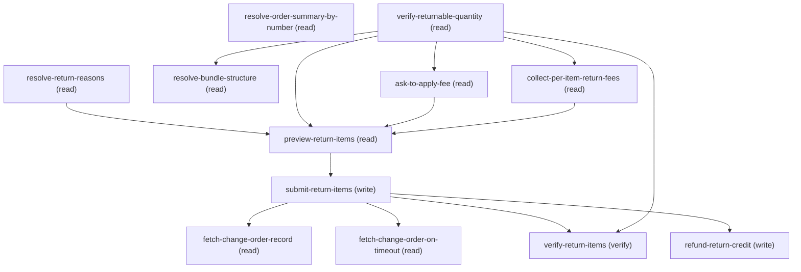

# Managing Return Order Summary

## When to Use This Skill

Use when a customer needs to return one or more items on an order that has already been fulfilled or delivered, via a preview-then-submit flow that submits only after explicit customer confirmation. Returns are always per-item — there is no full-order-return path (the core API exposes only preview-return / submit-return, not a *ReturnAll variant).

## Workflow

╔══════════════════════════════════════════════════════════════════════════╗
║ HARD STOP between preview-return-items and submit-return-items.          ║
║                                                                          ║
║ The agent MUST NOT invoke submit-return-items without ALL of:            ║
║   1. preview-return-items invoked in THIS conversation, success: true.   ║
║   2. preview's changeBalances surfaced to the customer in plain language ║
║      (lines, quantities, credit amount).                                 ║
║   3. Customer's verbatim affirmative reply received in this conversation.║
║   4. That verbatim reply passed into submit-return-items's required      ║
║      `customer_confirmation` input (NOT a value the agent supplies).     ║
║                                                                          ║
║ A `success: true` from preview is NOT consent. Ambiguous customer        ║
║ replies ("ok", "sure", "I think so", a question back) are NOT consent —  ║
║ ask again plainly. Re-read submit-return-items's REFUSAL PROTOCOL        ║
║ before calling it.                                                       ║
╚══════════════════════════════════════════════════════════════════════════╝

return-order-summary has a single linear execution path (preview → submit) —
Return has NO full-order variant (only OrderSummaryPreviewReturnResource +
OrderSummarySubmitReturnResource exist in core-264, no *ReturnAllResource).
Per-step agent_guidance is authoritative for each step's contract; this is
the orchestration map + entry decision tree + contract index.

1. `reason` is REQUIRED on every changeItems[] entry, and its allowed values come from
     the org-tenant's OrderItemSummaryChange.Reason picklist (the SAME picklist cancel uses
     — the controller validates Return and Cancel reasons against one enum). Send a value
     not in that picklist → 400 INVALID_API_INPUT "No matching reason found." Resolve the
     live picklist via the resolve-return-reasons step before previewing; do NOT hard-code
     the enum across orgs.

2. The target line item must have `OrderItemSummary.QuantityAvailableToReturn > 0`. An
     item that hasn't shipped yet (or has already been returned) returns 400
     INVALID_API_INPUT before the financial preview runs. Run the verify-returnable-quantity
     step (or an equivalent SOQL) before previewing so the agent fails fast with a clear
     customer-facing message instead of cascading into a 400.

3. `shippingReductionFlag` is REQUIRED on every changeItems[] entry. Wire-verified against
     pbtest-ws on 2026-06-29: omitting the flag on preview-return returns HTTP 500 with
     errorCode UNKNOWN_EXCEPTION (response envelope: enhancedErrorType=RecordError,
     output.errors[0] carries the UNKNOWN_EXCEPTION + a "contact Salesforce Support" string
     with an error ID). Sending the flag (true or false) is accepted and the request
     progresses to business-rule validation. Always send the flag explicitly (false unless
     the customer asks to also credit shipping). This parity-with-cancel finding holds for
     return as well.

## Critical Constraints

**Preconditions:**

- Org must have Order Management Connect API enabled (check: `Order Management API enabled`)
- User must have access to Order Management Return features. Service-level access is gated by the ORDER_ITEM_SUMMARY_RETURN_API_ACCESS permission (verified in core-264 OrderSummaryPreviewReturnResource + OrderSummarySubmitReturnResource impl). Users without it get a 403 INSUFFICIENT_ACCESS on both preview and submit. (check: `UserPermissions.ORDER_ITEM_SUMMARY_RETURN_API_ACCESS`)
- Each line item being returned must have OrderItemSummary.QuantityAvailableToReturn > 0.
Items not yet shipped or already returned have QuantityAvailableToReturn == 0 and will
fail preview with 400 INVALID_API_INPUT. Verify via SOQL before invoking preview-return-items. (check: `OrderItemSummary.QuantityAvailableToReturn`)
- Each `reason` value sent in changeItems[] must match the org's
OrderItemSummaryChange.Reason picklist (org-tenant-specific). The OAS
types `reason` as a free-form string; the controller validates it as
an enum. Resolve the picklist via resolve-return-reasons before previewing.
Cancel and Return share this same picklist. (check: `OrderItemSummaryChange.Reason picklist`)
- OrderSummary must be a MANAGED order (i.e. an order the OMS workflow can
modify). The old flow stops UNMANAGED orders up-front with a friendly
message; this SOR should do the same rather than let submit-return fail
late with an opaque 400/500. TODO(W-23144076-followup): source the exact
field name (candidates: `OrderSummary.IsManaged`, an OrderLifeCycleType
check, or a service-level `OrderManagement.isManaged(orderSummary)` call)
from the OMS legacy Aura flow that today gates the "Return Order" button.
Cancel has the SAME gap — track under the same followup and land in both
SORs together. No `check:` here until the real field name is sourced; the
gate is prose-only for now (evaluated by the agent per step 0's
ELIGIBILITY GATE), not machine-checkable.
- OrderSummary must not be LOCKED by an in-progress cancellation. The old
flow refuses to open the return workflow if a cancel is already running
against the same OrderSummary — otherwise the two ChangeOrders race and
the outcome is inconsistent. This SOR should surface the same friendly
"there's an active cancellation on this order — please try again in a
moment" message rather than let the API decide. TODO(W-23144076-followup):
source the exact discriminator from the old flow (candidates: an
OrderSummary status field, an OrderChangeLog / AsyncOperationLog probe on
the parent, or a service-level lock check). Cancel has the SAME gap —
track and land in both together. No `check:` here until the real
discriminator is sourced; the gate is prose-only for now (evaluated by
the agent per step 0's ELIGIBILITY GATE), not machine-checkable.

**Operational rules:**

- ENTRY DECISION TREE (drive the conversation in this order):
  0. resolve-order-summary-by-number → OrderNumber → 1Os... Id. NOT unique;
       disambiguate when totalSize > 1. Skip if the caller already has the Id.
       AFTER confirming the specific order, run the ELIGIBILITY GATE from
       step 0's agent_guidance:
         - unmanaged order → friendly stop, END
         - cancellation already in progress → friendly stop, END
       (TODO: field names pending — see step 0's ELIGIBILITY GATE.)
  1. resolve-return-reasons → fetch the org's Reason picklist (map the
       customer's reason internally; never show raw tokens). Same picklist as cancel.
  2. verify-returnable-quantity → read the returnable lines. If none are
       returnable, short-circuit with the friendly already-returned / not-shipped
       wording (do NOT proceed). Otherwise SHOW the customer the returnable
       line items and let them pick which to return.
  3. For EACH line the customer chose, collect two things before previewing:
       a. QUANTITY — if that line's QuantityAvailableToReturn > 1, ASK how
          many units (1..available, whole units). If == 1, use 1 without asking.
       b. SHIPPING — ask whether to also credit that line's delivery/shipping
          charge → shippingReductionFlag (false = keep, true = credit).
       Build one changeItems[] entry per chosen line from these answers, then
       go to preview-return-items → (confirm) → submit-return-items → verify.
- CORE FLOW:
  4. preview-return-items   → financial impact. HARD STOP for confirmation.
  5. submit-return-items    → execute with the SAME payload. SYNC — returns
                              changeOrderId in the response (no async polling).
  6. fetch-change-order-record → internal verification of the ChangeOrder row.
  7. verify-return-items    → two reads; don't trust OrderSummary.Status.
- CUSTOMER-FACING WORDING (mandatory — this is a user-facing workflow):
  - NO MONEY / CREDIT / REFUND MESSAGING. When a return submit completes,
    confirm it in one short sentence and END (e.g. "Done — that return is
    processed." / "Done — those returns are processed."). Do NOT tell the
    customer about a credit, a change order, a refund, a billing follow-up,
    an order total, or any dollar/amount figure — not even to say a refund
    is "handled separately." The customer asked to return items; confirm
    the return and stop. (Financial records like the ChangeOrder still
    exist server-side and may be read for internal verification, but they
    are NOT surfaced to the customer.) NOTE: actual refund issuance DOES run
    inside this SOR — the refund-return-credit step delegates to
    ensure-order-refund (credit memo + ensure-refunds-async) after submit.
    That refund is SERVER-SIDE and SILENT: its existence does NOT license a
    credit/refund sentence in the customer reply. The success wording above is
    the complete customer response regardless of the refund delegation.
  - CURRENCY: never hard-code a currency symbol (no "$"); amounts are in the
    OrderSummary's own currency, which is NOT always USD. The OrderSummary
    reads use SELECT FIELDS(STANDARD), so the currency is handled without a
    hard-coded column or a per-org query variant:
      • Multicurrency org: CurrencyIsoCode is a standard field, so it comes
        back in the record (e.g. "USD", "EUR") — use it.
      • Single-currency org: CurrencyIsoCode does not exist, so it simply
        won't be in the record. Fall back to the org/user default currency
        (Apex UserInfo.getDefaultCurrency(); the CurrencyType sObject does not
        exist on single-currency orgs).
    Present money as the amount followed by its ISO code (e.g. "129.00 USD",
    "129.00 EUR") or the locale-formatted value — never assume dollars.
    "zero" is currency-agnostic and fine for a fully-credited total.
  - NO INTERNAL JARGON OR TELEMETRY. The friendly templates are the COMPLETE
    customer response. Never surface step names, Connect API operation names,
    field / response-shape names, sObject type names, raw 18-char Ids, or
    the words "SOR"/"workflow". Do NOT append a verification recap / audit
    trail after the success message — that belongs in logs.
- CONTRACT INDEX (full detail in each step's agent_guidance):
  - reason REQUIRED + enum-validated against OrderItemSummaryChange.Reason
    (same picklist as cancel) → resolve-return-reasons
  - shippingReductionFlag REQUIRED on every entry (wire-verified against
    pbtest-ws: omit → 500 UNKNOWN_EXCEPTION) → preview-return-items
  - QuantityAvailableToReturn > 0 precondition → verify-returnable-quantity
  - HARD STOP between preview and submit (no auto-chain)
  - submit reuses the exact preview payload → submit-return-items
  - submit is SYNC — returns changeOrderId directly (no async polling,
    unlike full-cancel) → submit-return-items
  - ChangeOrder lives in the Order sObject (RelatedOrderType='ChangeOrder',
    negative TotalAmount) → fetch-change-order-record
  - OrderSummary.Status does not change on return (expected, mirrors cancel)
    → verify-return-items
  - Refund issuance (credit memo + ensure-refunds-async) IS reproduced here
    by delegating to ensure-order-refund → refund-return-credit; it runs
    server-side and is NOT surfaced to the customer
  - SOQL INPUT SAFETY (consumer contract — no runtime gate). Steps
    resolve-order-summary-by-number ({orderNumber}), verify-returnable-quantity
    ({orderSummaryId}), resolve-bundle-structure ({orderSummaryId}),
    fetch-change-order-on-timeout ({orderSummaryId} + {originalOrderId}),
    and verify-return-items ({orderSummaryId} + the IN-list) each splice
    an untrusted value into a SOQL WHERE clause. The per-input `pattern:`
    / `validation:` fields are NOT enforced by any runtime in this repo:
    MCP `dispatch` takes an already-rendered query string, and the
    Salesforce REST `/query` endpoint has no bind-variable form (bind vars
    exist only in Apex `Database.query`, not at REST). The caller building
    the tool call is the only enforcement point. Validate every
    interpolated value against its declared pattern before splicing and
    reject on mismatch — do NOT escape-and-retry. The declared patterns
    already exclude every SOQL metacharacter, so a matching value cannot
    inject; the injection risk is entirely in skipping the check.
- EMPIRICAL CONTRACTS (OAS-uncaptured; relocated from the discover-surfaced summary;
inherited from the cancel-order-summary workflow's wire-validated findings against the
shared ChangeInputRepresentation + OrderItemSummaryChange.Reason picklist):

## Verification Checklist

After every write operation, confirm the effect by re-reading state:

- After `submit-return-items`, `verify-returnable-quantity`: call `verify-return-items`

## Operations Reference

Operations grouped by purpose. Use these as the building blocks for the workflows above.

### Summary

| Operation | Purpose | Status | Call | Depends on |
|-----------|---------|--------|------|------------|
| `resolve-order-summary-by-number` | read | implemented | `querySoql` | — |
| `resolve-return-reasons` | read | implemented | `describeOrderItemSummaryChange` | — |
| `verify-returnable-quantity` | read | implemented | `querySoql` | — |
| `resolve-bundle-structure` | read | implemented | `querySoql` | `verify-returnable-quantity` |
| `ask-to-apply-fee` | read | implemented | `interactive_prompt` | `verify-returnable-quantity` |
| `collect-per-item-return-fees` | read | implemented | `interactive_prompt` | `verify-returnable-quantity` |
| `preview-return-items` | read | implemented | `postOrderSummaryPreviewReturn` | `resolve-return-reasons`, `verify-returnable-quantity`, `ask-to-apply-fee`, `collect-per-item-return-fees` |
| `submit-return-items` | write | implemented | `postOrderSummarySubmitReturn` | `preview-return-items` |
| `fetch-change-order-record` | read | implemented | `getOrder` | `submit-return-items` |
| `fetch-change-order-on-timeout` | read | implemented | `querySoql` | `submit-return-items` |
| `verify-return-items` | verify | implemented | `querySoql` | `submit-return-items`, `verify-returnable-quantity` |
| `refund-return-credit` | write | — | → `cc-om-fast-and-furious/ensure-order-refund` | `submit-return-items` |

### Dependency graph

### Read operations

#### `resolve-order-summary-by-number`

Resolve a customer-provided OrderNumber to its OrderSummary Id.
Customers and CSRs work with OrderNumber (the printed order number on
receipts/email); the return APIs require the internal Id (1Os...).

IMPORTANT: OrderNumber is NOT unique on this sObject — a single
OrderNumber can resolve to multiple OrderSummaries (orgs reuse it across
storefronts/locales). When this step returns more than one row, the agent
MUST surface the candidates (date, total, line count) and ask the customer
which one they meant before proceeding. Do NOT auto-pick by OrderedDate or
any heuristic — the wrong order is the worst outcome in a return workflow.

**Call:** `querySoql`   — status: `implemented`

**Inputs:**

- `orderNumber` *(`String`)* — Customer-facing OrderNumber (the printed order number from the
receipt/confirmation email). Skip this step entirely if the caller
already has the OrderSummary Id (starts with '1Os') — pass that
directly into downstream steps.

#### `resolve-return-reasons`

Resolve the org's allowed return reasons from the live
OrderItemSummaryChange.Reason picklist. Required because the
controller validates `reason` against this picklist on both preview
and submit; sending an unrecognized value returns 400
INVALID_API_INPUT "No matching reason found." Cancel and Return share
the same Reason picklist (one enum on OrderItemSummaryChange).

**Call:** `describeOrderItemSummaryChange`   — status: `implemented`

#### `verify-returnable-quantity`

Confirm each target OrderItemSummary has QuantityAvailableToReturn > 0
before invoking preview-return. Items that haven't shipped (or have
already been returned) will fail preview with 400 INVALID_API_INPUT.

**Call:** `querySoql`   — status: `implemented`

**Inputs:**

- `orderSummaryId` *(`String`)* — ID of the order summary (starts with 1Os)

#### `resolve-bundle-structure`

Fetch and present the bundle structure for an order that contains a bundle
(detected in verify-returnable-quantity via a non-null MainOrderItemSummaryId
on any line). Bundle structure lives in OrderItemSummaryRelationship, which
links a MainOrderItemSummary (the bundle parent) to each
AssociatedOrderItemSummary (a component / add-on), with roles and a
ProductRelationshipType. Run this only when a bundle was detected; skip for
orders with no bundle. Return uses the same OrderItemSummaryRelationship
schema as cancel — bundle structure is a property of the order, not of the
action being performed on it.

**Call:** `querySoql`   — status: `implemented`

**Inputs:**

- `orderSummaryId` *(`String`)* — OrderSummary Id (1Os...). Source: output of verify-returnable-quantity.

**Depends on:** `verify-returnable-quantity`

#### `ask-to-apply-fee`

Ask whether the customer wants to add a return fee (restocking fee, processing fee, etc.).
If they choose YES, delegate to fees-support to collect fee product, description, amount,
and fee-input representation. If NO, proceed directly to preview-return-items with zero fees.

**Call:** `interactive_prompt`   — status: `implemented`

**Depends on:** `verify-returnable-quantity`

#### `collect-per-item-return-fees`

Collect separate fee for each returned item

**Call:** `interactive_prompt`   — status: `implemented`

**Depends on:** `verify-returnable-quantity`

#### `preview-return-items`

Preview the expected financial impact of returning specific order items

**Call:** `postOrderSummaryPreviewReturn`   — status: `implemented`

**Inputs:**

- `orderSummaryId` *(`String`)* — ID of the order summary (1Os...).
Source: `order_summary_id` output of resolve-order-summary-by-number
(only valid when `match_count == 1`; on multi-match cases, source it
from the customer's disambiguation reply per step 0's agent_guidance).
A caller that already holds the 1Os Id can pass it in directly and skip
step 0.
- `changeItems` *(`Array`)* — List of order items to return with quantities. Each entry pairs an
OrderItemSummary Id (from verify-returnable-quantity's returnable_items)
with a customer-confirmed quantity, a resolved picklist reason (from
resolve-return-reasons.allowed_reasons), and shippingReductionFlag.
Source: verify-returnable-quantity (line Ids + QuantityAvailableToReturn)
+ resolve-return-reasons (allowed picklist values) + the customer's
quantity / shipping-credit answers per the entry decision tree.
  - schema: `{'items': {'type': 'object', 'required': ['orderItemSummaryId', 'quantity', 'reason', 'shippingReductionFlag'], 'properties': {'orderItemSummaryId': {'type': 'string', 'description': 'ID of the OrderItemSummary to return (must have QuantityAvailableToReturn > 0)'}, 'quantity': {'type': 'number', 'description': "Number of units to return for this line. Must be a whole number with 1 <= quantity <= OrderItemSummary.QuantityAvailableToReturn. When that line's QuantityAvailableToReturn > 1, this value MUST come from an explicit customer choice (see verify-returnable-quantity QUANTITY CONFIRMATION) — do not default to 1 or to all-available."}, 'reason': {'type': 'string', 'description': 'Return reason. REQUIRED. Must be a value from the org\'s\nOrderItemSummaryChange.Reason picklist (see resolve-return-reasons).\nSending a string that isn\'t in the picklist returns 400\nINVALID_API_INPUT "No matching reason found." Cancel and Return\nshare the same picklist.', 'x-codey-enum-source': 'OrderItemSummaryChange.Reason', 'x-codey-enum-resolver-step': 'resolve-return-reasons'}, 'reasonForChangeText': {'type': 'string', 'description': 'Free-form description of the reason for change'}, 'shippingReductionFlag': {'type': 'boolean', 'description': 'REQUIRED — wire-verified against pbtest-ws on 2026-06-29: omitting it returns HTTP 500 UNKNOWN_EXCEPTION on preview-return (parity with cancel via the same ChangeInputRepresentation). Always send it explicitly: false keeps the delivery/shipping charge, true also credits shipping (affects totalAdjustedDeliveryAmount). Send false unless the customer asks to also credit shipping.'}, 'changeItemFees': {'type': 'array', 'description': 'Optional fee adjustments accompanying the return'}}}}`
  - **Source:** output of `verify-returnable-quantity`

**Depends on:** `resolve-return-reasons`, `verify-returnable-quantity`, `ask-to-apply-fee`, `collect-per-item-return-fees`

#### `fetch-change-order-record`

Optional: read the ChangeOrder record produced by submit-return-items.
ChangeOrders live in the standard `Order` sObject (NOT a separate
`ChangeOrder` sObject — that does not exist). Discriminate via
`RelatedOrderType = 'ChangeOrder'` and `RelatedOrderId` pointing at
the parent Order. `TotalAmount` is NEGATIVE on returns (it represents
the reduction). `IsReductionOrder` is unreliable (false on cancels —
expected same on returns); the reduction signal is the
`RelatedOrderType` + negative-amount combination, not that flag.

**Call:** `getOrder`   — status: `implemented`

**Inputs:**

- `changeOrderId` *(`String`)* — changeOrderId returned by submit-return-items

**Depends on:** `submit-return-items`

#### `fetch-change-order-on-timeout`

Optional recovery step. Run ONLY when submit-return-items returned an
ambiguous failure (timeout / 5xx after sending) and the per-line
QuantityReturned re-read was inconclusive. Locates a freshly-created
ChangeOrder for this OrderSummary so the agent can distinguish "landed
but response lost" from "never applied" before deciding to retry.
Return's submit is SYNCHRONOUS — on the happy path submit's response
already carries changeOrderId, so fetch-change-order-record (path lookup)
is the normal read; this step exists only for the response-lost case.

Two-step query mirroring cancel's async recovery: first fetch
OriginalOrderId from OrderSummary; then query Order filtered by
RelatedOrderId = OriginalOrderId AND RelatedOrderType='ChangeOrder',
newest first. Do NOT rely on IsReductionOrder (stays false on returns).
A no-match result means the return did NOT land — safe to retry.

**Call:** `querySoql`   — status: `implemented`

**Inputs:**

- `orderSummaryId` *(`String`)* — OrderSummary Id; used to look up OriginalOrderId.
Source: input of submit-return-items.

**Depends on:** `submit-return-items`

### Write operations

#### `submit-return-items`

Irreversibly process the customer's return on the order. Must run AFTER preview-return-items
AND after the customer has been shown the preview's changeBalances output AND has explicitly
confirmed (a verbatim yes-equivalent reply). The agent MUST NOT call this step from its own
inference of consent — if no preview output has been surfaced to the customer in this
conversation, or if no explicit affirmative reply has been received in response, REFUSE this
call and route back to preview-return-items instead. A `success: true` from preview is NOT
consent.

**Call:** `postOrderSummarySubmitReturn`   — status: `implemented`

**Inputs:**

- `customer_confirmation` *(`String`)* — The customer's VERBATIM affirmative reply, captured AFTER preview-return-items has been
invoked AND its changeBalances output has been read back to the customer in plain language
(line names, quantities, credit amount). Must be the unmodified customer-typed/spoken
response (e.g. "yes", "yes please go ahead", "confirm", "do it"). The agent MUST NOT
synthesize, paraphrase, or supply this value from its own reasoning; that is the bug class
this field exists to block. If you (the agent) do not have such a reply in the conversation
transcript, STOP — route back to preview-return-items, surface the preview to the customer,
and ask. A `success: true` from preview is NOT a substitute for the customer's reply. An
agent-supplied value here is a guardrail violation reportable as W-23144076 followup.
- `orderSummaryId` *(`String`)* — Same order summary ID from preview step
- `changeItems` *(`Array`)* — Same changeItems array used in preview (MUST match exactly,
including BOTH the resolved reason values AND shippingReductionFlag
(true|false) on every entry). Submit shares cancel's contract: HTTP
500 UNKNOWN_EXCEPTION if shippingReductionFlag is omitted (verified
against pbtest-ws 2026-06-29) — do NOT strip it when reusing the
preview payload.
Source: output of preview-return-items.

**Depends on:** `preview-return-items`

#### `refund-return-credit`

Move money back to the customer after the return's ChangeOrder is created.
submit-return-items only records the financial reduction (the ChangeOrder);
it does NOT itself return any money. This step delegates to the
ensure-order-refund SOR for the credit-memo + refund money movement.

It mirrors the shipped Core OMS Return flow — Return_Item-1.flow (in
core/ui-commerce-ordermanagement-components/flows/runtime_commerce_oms/) — which
runs ONE refund pipeline after Return_Order_Item_Summaries_Submit: the
CREDIT-MEMO path (return has no excess-funds branch like cancel/adjust have),
in this exact element order:
  • Fee_Change_Order_Id_Exists — [if submitReturnOutput.feeChangeOrderId not null]
    Create_An_Invoice → createInvoiceFromChangeOrders(feeChangeOrderId) → invoicesToPay
  • createCreditMemoId → createCreditMemoOrderSummary(changeOrderIds = [return
    changeOrderId])   [UNCONDITIONAL — runs on every return]
  • Is_Refund_Needed — submitReturnOutput.changeBalances.totalRefundableAmount > 0
  • Ensure_Payment_Credit_Required — [if paymentCredit.amount > 0 AND
    paymentCreditSequence non-empty] Ensure_Payment_Credit → ensurePaymentCredit
  • Credit_Memo_Balance — Credit_Memo.Balance == 0 → done (nothing to refund);
    else → ensureRefund
  • ensureRefund → ensureRefundsOrderSummaryAsync(creditMemoId, invoicesToPay, sequences)
ensure-order-refund performs every one of these; return-order-summary only
produces the ChangeOrder — the identical division of labor as
cancel-order-summary / adjust-order-summary → ensure-order-refund.

**Delegates to:** `cc-om-fast-and-furious/ensure-order-refund`

**Depends on:** `submit-return-items`

### Verify operations

#### `verify-return-items`

Verify the return landed by reading back BOTH the OrderSummary
(for the GrandTotalAmount delta) and each returned OrderItemSummary
(for QuantityReturned and QuantityAvailableToReturn transitions).
One read is not enough — see assertions and agent_guidance below.

**Call:** `querySoql`   — status: `implemented`

**Inputs:**

- `orderSummaryId` *(`String`)* — Source: output of submit-return-items.
- `orderItemSummaryIds` *(`Array`)* — IDs of the returned lines, sourced from submit-return-items.output
.order_item_summary_ids (which projects $.changeItems[*]
.orderItemSummaryId). Used to scope the line-item read-back so the
assertion checks the exact set the agent returned. The follow_up_query
references these via the {orderItemSummaryIdsInClause} placeholder —
see agent_guidance for the rendering rule. Every element MUST match
the per-item pattern below before it's rendered into the IN-list; the
IN-list join is a raw string splice into SOQL.
  - schema: `{'minItems': 1, 'items': {'type': 'string', 'pattern': '^10u[a-zA-Z0-9]{12,15}$'}}`
  - **Source:** output of `submit-return-items`
- `preReturnSnapshot` *(`Array`)* — Per-line pre-submit snapshot captured from verify-returnable-quantity's
`pre_return_snapshot` output, filtered to just the lines being returned
AND paired with the returned quantity for each. Each entry is an object:
  {orderItemSummaryId, quantityReturnedBefore, quantityAvailableToReturnBefore, returnedQty}
The assertion uses these pre-values to compute the exact delta — without
them the verify cannot distinguish "return landed" from "no-op". Build
this by joining verify-returnable-quantity's records to the changeItems[]
the agent sent to submit-return-items (matching on Id, quantity → returnedQty).
  - schema: `{'minItems': 1, 'items': {'type': 'object', 'required': ['orderItemSummaryId', 'quantityReturnedBefore', 'quantityAvailableToReturnBefore', 'returnedQty'], 'properties': {'orderItemSummaryId': {'type': 'string', 'pattern': '^10u[a-zA-Z0-9]{12,15}$'}, 'quantityReturnedBefore': {'type': 'number'}, 'quantityAvailableToReturnBefore': {'type': 'number'}, 'returnedQty': {'type': 'number'}}}}`
  - **Source:** output of `verify-returnable-quantity`

**Depends on:** `submit-return-items`, `verify-returnable-quantity`
