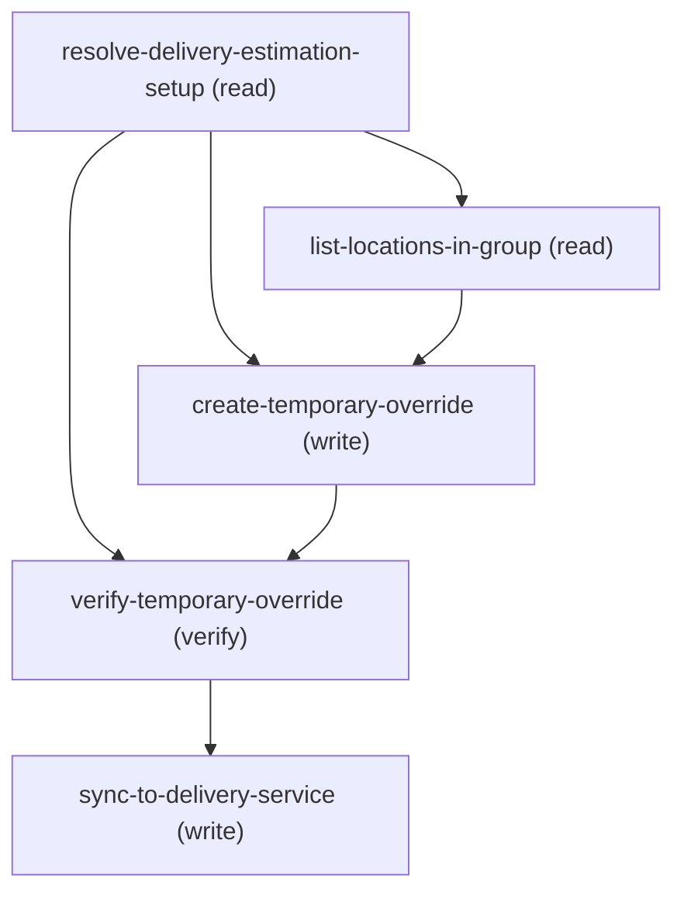

# Managing Create Temporary Processing Time Override

## When to Use This Skill

Use this workflow when a customer wants a delivery processing time to apply only for a
PERIOD (e.g. a holiday) rather than as a permanent default. It creates a
ProcessingTimeSpec via the Commerce Delivery Connect API
(POST /commerce/delivery/processing-time-specs, operation createProcessingTimeSpecDefinition,
owned by CC OM Royal Flush), which persists a FulfmtRoutgSpec of Type='ProcessingTime'
with a start/end date, a processing time + unit, and location/product scope, assigned to
one or more DeliveryEstimationSetup records. This SOR is the pivot target of
update-delivery-estimation-setup (chosen when the customer wants a temporary, not
permanent, change).

Contracts verified live against a Core org (Connect API v67.0, 2026-08-03, setup "west"):

  1. AT LEAST ONE location OR product is REQUIRED at runtime even though the OAS marks
     every field optional. An empty payload (period + time only) → HTTP 400
     MISSING_ARGUMENT "Select at least one location or product." Always include at least
     one locationId (or productSourceId).

  2. The setup is linked by its 18-char Id (deliveryEstimationSetupIds), NOT by
     ExternalReference — the opposite of the enable-and-push endpoint. Get the Id from
     resolve-delivery-estimation-setup.setup_ids (the customer-chosen index, if the lookup
     matched more than one).

  3. processingTimeUnit is the same restricted set as the permanent fields:
     Hours | Days | Weeks.

  4. WIRE SHAPE: the list fields are nested wrappers, verified live:
     locations: {locations: [{locationId}]}, products: {products: [{productSourceId,
     type}]} (type ∈ PRODUCT | CATEGORY), deliveryEstimationSetupIds:
     {deliveryEstimationSetupIds: [<setupId>]}. startDate/endDate are ISO-8601 date-time.

  5. A successful create returns HTTP 200/201 {success:true, errors:[], id:<1fH...>}
     (verified: 201). The list read (GET /commerce/delivery/processing-time-specs) echoes
     it under definitions[] with processingTimeRange ("5 Days"), startDate/endDate,
     locationOverrideCount, deliveryEstimationSetupCount.

  6. NO CLEAN API UNDO. The Connect delete (deleteFulfmtRoutgSpec, keyed on
     externalReference) returned HTTP 500 UNKNOWN_EXCEPTION for a Core-only (unsynced)
     spec, and a direct sObject delete of FulfmtRoutgSpec is 403
     INSUFFICIENT_ACCESS_OR_READONLY. Treat a temporary override as self-expiring at its
     endDate; to cancel one early, set isActive=false / remove it via the Processing Time
     Setup UI — do NOT rely on an API delete as rollback.

  7. PROPAGATION TO THE CDS. A created spec exists in Core but is NOT live in the external
     Commerce Delivery Service until it is synced. This workflow's final step
     (sync-to-delivery-service) delegates to sync-delivery-routing-specs, ALWAYS with a
     TARGETED single-spec sync of just this new spec (syncSingleFulfmtRoutgSpec, POST
     /commerce/delivery/fulfillment-routing-specs/sync/{specId}) — hardcoded, never asked, and
     never an org-wide bulk from this flow, so only this override is pushed. Verified live: a
     created spec is absent from the CDS until synced (single-spec sync 2026-08-05 -> 201).

## Workflow

Create a TEMPORARY, time-boxed delivery processing-time override (holiday/seasonal), as
opposed to the permanent field change in update-delivery-estimation-setup /
update-location-delivery-processing-time. Flow:

### Phase 1: resolve-delivery-estimation-setup → by Name → setup Id (link...

resolve-delivery-estimation-setup → by Name → setup Id (link is BY ID) + LocationGroupId.

### Phase 2: list-locations-in-group → present the group's locations; customer picks...

list-locations-in-group → present the group's locations; customer picks which the
     override covers (≥1 location OR product required). ALWAYS also ask whether to limit the
     override to specific products/SKUs (or categories) vs. ALL products — omitting products
     is not a skip, it applies to all products at the chosen locations.

### Phase 3: create-temporary-override → POST /commerce/delivery/processing-time-specs with the

create-temporary-override → POST /commerce/delivery/processing-time-specs with the
     period (startDate/endDate), processingTime + unit (Hours|Days|Weeks), the location/
     product scope (nested wrappers), and deliveryEstimationSetupIds=[setup Id]. Success =
     200/201 {success:true, id:<1fH...>}.

### Phase 4: verify-temporary-override → GET the list; confirm the new...

verify-temporary-override → GET the list; confirm the new spec's period + range.

### Phase 5: sync-to-delivery-service → runs AUTOMATICALLY, never asked — delegates...

sync-to-delivery-service → runs AUTOMATICALLY, never asked — delegates to
     sync-delivery-routing-specs with sync-scope HARDCODED to single (this flow only ever
     creates one spec, so that's always the correct scope) to push the new spec live. A spec
     exists in Core but is NOT live until synced. (A full org-wide reconcile, if genuinely
     needed, is a separate standalone invocation of sync-delivery-routing-specs — not reachable
     from this flow.)

Live-verified on a Core org (2026-08-03, setup "west"):
  • Empty scope → 400 MISSING_ARGUMENT ("Select at least one location or product").
  • With one location → 201 {success:true, id:1fH...}; GET list shows processingTimeRange
    "5 Days", the Dec 24–26 window, locationOverrideCount 1, deliveryEstimationSetupCount 1.
  • Delete is unreliable: deleteFulfmtRoutgSpec → 500 (unsynced spec); sObject delete → 403.
    So the override self-expires at endDate; early cancel = deactivate / Setup UI.

This SOR is the PIVOT TARGET of update-delivery-estimation-setup (chosen when the customer
wants a temporary, not permanent, change). CUSTOMER-FACING WORDING: verify-temporary-override
reports the window + new time as an interim status (not "done" yet); only AFTER
sync-to-delivery-service confirms should the agent say the canonical closing line verbatim —
"Your change has been saved and synced." — followed by a short recap: the new override's own
Name + ExternalReference (the values sent to create-temporary-override — FulfmtRoutgSpec has
both fields; the create API doesn't echo them back, so echo what you sent) + the window + time,
plus a best-effort link if you have spec_id:
[<name>](<orgHost>/lightning/r/FulfmtRoutgSpec/<spec_id>/view) — the standard record-link
form used across the corpus; link text is the Name, not the raw Id.
RECAP LAYOUT — ONE override created: a single plain sentence with the Name link-wrapped. If
the customer asked for the SAME override across MULTIPLE setups in this conversation (this SOR
creates one spec per run), give ONE consolidated table at the end instead of repeated
sentences — | Setup | Override | Reference | Window | Time | header row, one row per created
override, same shape as the sibling per-location SORs' multi-row recap. The Setup cell is the
chosen setup's own Name (resolve-delivery-estimation-setup.matched[<chosen index>].Name) and is
the ONLY column that distinguishes the rows when the customer reused one override name/window
across setups — never drop it in the multi-row form.
Keep a single-override response
under ~200 characters of VISIBLE text where possible (soft target — the link URL itself
doesn't count against this, only what the customer reads). Never SPEAK a raw Id,
sObject/field API names, HTTP codes, or the words "CDS"/
"Commerce Delivery Service" — describe the save as one seamless action, not two systems.

## Critical Constraints

**Preconditions:**

- Commerce Order Management with Delivery Estimation + the fulfillment-routing / CDS
FulfmtRoutgSpec feature (Delivery Routing Engine) must be enabled, so the
ProcessingTimeSpec Connect resource is reachable. (check: `Delivery Estimation + CDS FulfmtRoutgSpec feature enabled`)
- A DeliveryEstimationSetup record (with a LocationGroup + LocationGroupAssignments) must
exist to scope the override to; obtain its Id + locations via
resolve-delivery-estimation-setup / list-locations-in-group. (check: `DeliveryEstimationSetup + locations exist`)

## Verification Checklist

After every write operation, confirm the effect by re-reading state:

- After `resolve-delivery-estimation-setup`, `create-temporary-override`: call `verify-temporary-override`

## Operations Reference

Operations grouped by purpose. Use these as the building blocks for the workflows above.

### Summary

| Operation | Purpose | Status | Call | Depends on |
|-----------|---------|--------|------|------------|
| `resolve-delivery-estimation-setup` | read | implemented | `querySoql` | — |
| `list-locations-in-group` | read | implemented | `querySoql` | `resolve-delivery-estimation-setup` |
| `create-temporary-override` | write | implemented | `createProcessingTimeSpecDefinition` | `resolve-delivery-estimation-setup`, `list-locations-in-group` |
| `verify-temporary-override` | verify | implemented | `getProcessingTimeSpecDefinitions` | `resolve-delivery-estimation-setup`, `create-temporary-override` |
| `sync-to-delivery-service` | write | — | → `cc-om-fast-and-furious/sync-delivery-routing-specs` | `verify-temporary-override` |

### Dependency graph

### Read operations

#### `resolve-delivery-estimation-setup`

Resolve the parent DeliveryEstimationSetup by Name and capture its Id (the temporary
spec links by Id) and LocationGroupId (to offer the group's locations). Skip if the
caller already has the setup Id + a target location/product.

**Call:** `querySoql`   — status: `implemented`

**Inputs:**

- `name` *(`String`)* — The DeliveryEstimationSetup's Name OR ExternalReference (e.g. "west") — the query
matches either field. Source: user_input.

#### `list-locations-in-group`

List the setup's group locations so the customer can pick which the temporary override
applies to (at least one location OR product is required). Reads LocationGroupAssignment
then Location details.

**Call:** `querySoql`   — status: `implemented`

**Inputs:**

- `locationGroupId` *(`String`)* — LocationGroup Id (0gh...) of the CHOSEN setup. Source: resolve-delivery-estimation-setup.location_group_ids (the one the customer picked when the lookup matched more than one).

**Depends on:** `resolve-delivery-estimation-setup`

### Write operations

#### `create-temporary-override`

Create the temporary ProcessingTimeSpec via the Commerce Delivery Connect API. Persists a
FulfmtRoutgSpec (Type='ProcessingTime' — set server-side) with the period, processing
time + unit, location/product scope, and setup assignment.

**Call:** `createProcessingTimeSpecDefinition`   — status: `implemented`

**Inputs:**

- `startDate` *(`String`)* — Override period start, ISO-8601 date-time (e.g. 2026-12-24T00:00:00.000Z).
- `endDate` *(`String`)* — Override period end, ISO-8601 date-time. The override applies only between startDate and endDate, then self-expires. MUST be strictly after startDate.
- `processingTime` *(`Integer`)* — Temporary processing time as a whole number (must be a positive integer).
- `processingTimeUnit` *(`String`)* — Unit — RESTRICTED to Hours | Days | Weeks.
- `locationIds` *(`Array`)* — Location Ids the override applies to (from list-locations-in-group). At least one
location OR product is REQUIRED (empty scope → 400 MISSING_ARGUMENT). Each becomes a
locations.locations[] entry {locationId}.
  - schema: `{'type': 'array', 'items': {'type': 'string', 'pattern': '^131[a-zA-Z0-9]{12,15}$'}}`
  - **Source:** output of `list-locations-in-group`
- `products` *(`Array`)* — Product/category scope. Each entry {productSourceId, type} where type ∈ PRODUCT |
CATEGORY. Supply this OR locationIds (at least one of the two is required at runtime).
NOT NEUTRAL WHEN OMITTED: leaving products empty does NOT skip product scoping — it
applies the override to ALL products at the selected location(s). Because that silently
widens the blast radius, the agent MUST always ask the customer whether to limit the
override to specific products/SKUs (or categories) before creating; only then is
"all products" a deliberate, confirmed choice. The field stays optional so a
location-only (all-products) override remains valid once explicitly confirmed.
  - schema: `{'type': 'array', 'items': {'type': 'object', 'properties': {'productSourceId': {'type': 'string'}, 'type': {'type': 'string', 'pattern': '^(PRODUCT|CATEGORY)$'}}}}`
- `deliveryEstimationSetupId` *(`String`)* — The CHOSEN setup's 18-char Id (NOT ExternalReference). Source: resolve-delivery-estimation-setup.setup_ids (the one the customer picked when the lookup matched more than one). Becomes deliveryEstimationSetupIds.deliveryEstimationSetupIds[].
- `name` *(`String`)* — Human label for the spec (e.g. "Winter Holiday 2026"). REQUIRED — this is the primary
identifier the closing recap uses for this record; the create API never echoes it back,
so it must be captured up front. Ask the customer for one if they haven't given it; if
they have no preference, propose a reasonable label from the window (e.g. "Dec 24-26
Override") and confirm it with them rather than leaving it blank.
- `externalReference` *(`String`)* — A stable business reference for this override — used as a recap/identification field (same
as name) and as the key the underlying delete mechanism looks up by internally. REQUIRED. Ask
the customer if they have a preferred reference; if not, derive a slug from the name (e.g.
"National Day 2026" -> "national-day-2026") rather than leaving it blank. See agent_guidance.

**Depends on:** `resolve-delivery-estimation-setup`, `list-locations-in-group`

#### `sync-to-delivery-service`

Propagate the newly-created ProcessingTimeSpec to the external Commerce Delivery
Service. A spec created above exists in Core but is NOT live in the CDS until it is
synced. Delegates to sync-delivery-routing-specs with sync-scope hardcoded to single —
this flow only ever creates ONE spec, so that's always the correct scope; never asked,
never left to a default that could silently drift to org-wide.

**Delegates to:** `cc-om-fast-and-furious/sync-delivery-routing-specs`

**Depends on:** `verify-temporary-override`

### Verify operations

#### `verify-temporary-override`

Confirm the temporary override was created by reading the ProcessingTimeSpec list and finding the new spec.

**Call:** `getProcessingTimeSpecDefinitions`   — status: `implemented`

**Inputs:**

- `deliveryEstimationSetupId` *(`String`)* — The CHOSEN setup Id, to read its ProcessingTimeSpecId back. Source: resolve-delivery-estimation-setup.setup_ids (the one the customer picked when the lookup matched more than one).

**Depends on:** `resolve-delivery-estimation-setup`, `create-temporary-override`
