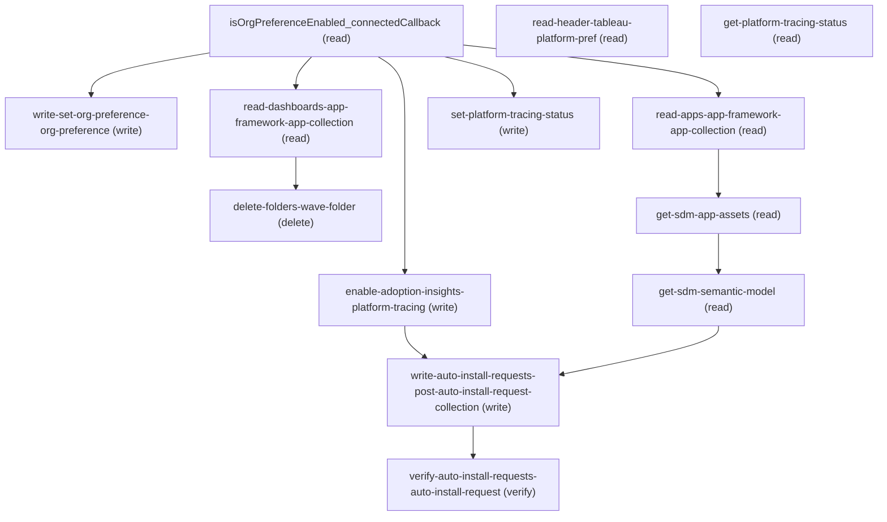

# Managing Adoption Insights Setup

## When to Use This Skill

Enable, verify, or remove Tableau Adoption Insights for the org. Two layers: (1) the `TableauAdoptionInsightsEnabled` org preference (gated by Administer Tableau permission and a server-side org-preference allowlist); (2) a templated Wave-app install via the `lightning/analyticsAppFrameworkApi` analytics_install pattern, backed by templates `TableauNextAdoptionInsightsSdm` and `TableauNextAdoptionInsightsDashboard`. The Setup page reads the org-pref, lets the admin toggle it, and orchestrates auto-install / uninstall of the Wave folder. Both templates require `OrgPreferences.TableauAdoptionInsightsEnabled=true`.

## Workflow

Read `isOrgPreferenceEnabled_connectedCallback` FIRST — the current `TableauAdoptionInsightsEnabled` value is the branch decision and gates which write is legal. (The header also reads a SEPARATE pref, `read-header-tableau-platform-pref` → `TableauPlatformEnabled`, only to gate the "Go to Tableau Next" CTA — it is NOT the feature on/off switch.) IF FALSE (feature off): ENABLE via `enable-adoption-insights-platform-tracing` (`setupPlatformTracing`, dataSpaces=["default"]) — this is the ONLY enable path; it synchronously provisions the observability pipeline, maps the DLO→DMO, installs the Adoption Insights SDM app, and flips the pref to true at the end, returning {semanticModelAppId}. NEVER set the pref true directly to enable — that skips provisioning and leaves the feature broken. (The page marks `set-platform-tracing-status` → Inprogress right before calling enable, and polls `get-platform-tracing-status` for Notstarted|Inprogress|Success|Failed; both are optional when driving enable programmatically since enable sets the terminal status itself.) Then INSTALL THE DASHBOARDS APP — this is a multi-step sub-flow, NOT a single call: (1) `read-apps-app-framework-app-collection` (getApps filtered to the SDM templateSourceId) to get the SDM app `id`; (2) `get-sdm-app-assets` to resolve that app's SemanticModel asset; (3) `get-sdm-semantic-model` to fetch the model's id + apiName; (4) `write-auto-install-requests-post-auto-install-request-collection` (createApp → `POST /app-framework/apps`) installing the DASHBOARDS templated app with a MANDATORY `templateValues.adminInsightsSdm:{modelId, modelName}` linkage built from steps 2-3 — a wrong/missing model makes provisioning fail async on field resolution; (5) poll `verify-auto-install-requests-auto-install-request` (getApps filtered to the DASHBOARDS templateSourceId) until `applicationStatus` is terminal (SuccessStatus/SuccessWithWarningsStatus vs FailedStatus/AbortedStatus/CancelledStatus). Install is NOT `/wave/auto-install-requests` (a legacy Tableau-CRM family this page does not use). IF TRUE (feature on): enable is unavailable — the legal actions are DISABLE (`write-set-org-preference-org-preference`, value=false; pref-only, no Connect call, Data Cloud objects retained) or REMOVE (`delete-folders-wave-folder`: `DELETE /app-framework/apps/{appId}` passing the DASHBOARDS app `id` from `read-dashboards-app-framework-app-collection` (Dashboard_App-filtered getApps — NOT the SDM-filtered `read-apps-app-framework-app-collection`, which returns the SDM app id); there is NO folderId; do not use `/wave/folders/*`). Every read/write requires the Administer Tableau permission; enable + install additionally require Tableau platform activated and Adoption Insights observability enabled, and are blocked in Data Cloud One companion orgs and personal orgs (see preconditions).

## Critical Constraints

**Preconditions:**

- Feature gate `Gater.unifiedAnalytics.admin.insights.enableCustomerTracing` must be open — the primary on/off switch for Adoption Insights. When the gate is closed the Setup page is not shown and the enable/install/remove APIs are blocked. (check: `Gater.unifiedAnalytics.admin.insights.enableCustomerTracing`)
- Tableau platform must be activated in the org (`UnifiedAnalytics.orgHasTableauPlatformActivated`); without it the Adoption Insights pref cannot be set true and the page/API are blocked. (check: `UnifiedAnalytics.orgHasTableauPlatformActivated`)
- Adoption Insights / observability must be enabled for the org (`UnifiedAnalytics.orgHasTableauAdoptionInsightsObservabilityEnabled`). (check: `UnifiedAnalytics.orgHasTableauAdoptionInsightsObservabilityEnabled`)
- Org must NOT be a Data Cloud One companion org (`!Data Cloud One companion license`). In companion orgs the Setup page is hidden and the enable/install/remove APIs are blocked. (check: `!Data Cloud One companion license`)
- Org must NOT be a personal org (`!PersonalOrgUdd.orgIsPersonalOrg`). In personal orgs the Setup page is hidden and the enable/install/remove APIs are blocked. (check: `!PersonalOrgUdd.orgIsPersonalOrg`)
- Caller can administer Tableau (`Administer Tableau permission` — the access gate the analytics setup service enforces on every read/write of `TableauAdoptionInsightsEnabled`). (check: `Administer Tableau permission`)
- The org-pref name `TableauAdoptionInsightsEnabled` is on the server-side allowlist of settable org preferences.

**Destructive operations — require explicit user confirmation:**

- **`delete-folders-wave-folder`** — Remove the installed Adoption Insights app. Delete via the native Connect app-framework resource: `DELETE /services/data/v67.0/app-framework/apps/{appId}`, passing the DASHBOARDS app `id` from `read-dashboards-app-framework-app-collection` — NOT a `folderId` (the list does not return one; the app `id` is the addressable key, symmetric with list/get/install). Maps to `lightning/analyticsAppFrameworkApi.deleteApp`. Returns HTTP 204; the actual teardown is async (the app may still resolve by id briefly after the 204 while the background worker processes). STATE GUARD: only meaningful when an Adoption Insights app is installed — list first to obtain the app `id`.
  - Rollback: No automatic rollback.

## Verification Checklist

After every write operation, confirm the effect by re-reading state:

- After `write-auto-install-requests-post-auto-install-request-collection`: call `verify-auto-install-requests-auto-install-request` (`GET /services/data/v67.0/app-framework/apps?templateSourceId=sfdc_internal__Tableau_Next_Adoption_Insights_Dashboard_App`)

## Operations Reference

Operations grouped by purpose. Use these as the building blocks for the workflows above.

### Summary

| Operation | Purpose | Status | Call | Depends on |
|-----------|---------|--------|------|------------|
| `isOrgPreferenceEnabled_connectedCallback` | read | — | `GET /headless/invoke/platform/setup/setup-metadata/is-org-preference-enabled` | — |
| `write-set-org-preference-org-preference` | write | — | `PATCH /headless/invoke/platform/setup/setup-metadata/set-org-preference` | `isOrgPreferenceEnabled_connectedCallback` |
| `read-apps-app-framework-app-collection` | read | — | `GET /services/data/v67.0/app-framework/apps?templateSourceId=sfdc_internal__Tableau_Next_Adoption_Insights_Sdm_App` | `isOrgPreferenceEnabled_connectedCallback` |
| `write-auto-install-requests-post-auto-install-request-collection` | write | — | `POST /services/data/v67.0/app-framework/apps` | `enable-adoption-insights-platform-tracing`, `get-sdm-semantic-model` |
| `verify-auto-install-requests-auto-install-request` | verify | — | `GET /services/data/v67.0/app-framework/apps?templateSourceId=sfdc_internal__Tableau_Next_Adoption_Insights_Dashboard_App` | `write-auto-install-requests-post-auto-install-request-collection` |
| `delete-folders-wave-folder` | delete | — | `DELETE /services/data/v67.0/app-framework/apps/{appId}` | `read-dashboards-app-framework-app-collection` |
| `enable-adoption-insights-platform-tracing` | write | — | `POST /services/data/v67.0/tableau/platform-tracing/setup` | `isOrgPreferenceEnabled_connectedCallback` |
| `read-dashboards-app-framework-app-collection` | read | — | `GET /services/data/v67.0/app-framework/apps?templateSourceId=sfdc_internal__Tableau_Next_Adoption_Insights_Dashboard_App` | `isOrgPreferenceEnabled_connectedCallback` |
| `read-header-tableau-platform-pref` | read | — | `GET /headless/invoke/platform/setup/setup-metadata/is-org-preference-enabled` | — |
| `get-platform-tracing-status` | read | — | `GET /services/data/v67.0/tableau/platform-tracing/setup/status` | — |
| `set-platform-tracing-status` | write | — | `POST /services/data/v67.0/tableau/platform-tracing/setup/status` | `isOrgPreferenceEnabled_connectedCallback` |
| `get-sdm-app-assets` | read | — | `GET /services/data/v67.0/app-framework/apps/{appId}/assets?assetType=SemanticModel` | `read-apps-app-framework-app-collection` |
| `get-sdm-semantic-model` | read | — | `GET /services/data/v67.0/ssot/semantic/models/{modelApiNameOrId}` | `get-sdm-app-assets` |

### Dependency graph

### Read operations

#### `isOrgPreferenceEnabled_connectedCallback`

Read `TableauAdoptionInsightsEnabled` to decide whether the page is in the enable, manage, or remove state — this is the read-first branch decision for the whole workflow. Dispatch `GET /headless/invoke/platform/setup/setup-metadata/is-org-preference-enabled` with `orgPreferences: ["TableauAdoptionInsightsEnabled"]`. Returns the map `{TableauAdoptionInsightsEnabled: boolean}`. Gated by the setup view guard (View Setup permission) plus the per-pref `userIsTableauPlatformBasicsAdmin` access check.

**Call:** `GET /headless/invoke/platform/setup/setup-metadata/is-org-preference-enabled`

**Output:** Map of pref name to boolean. For this call: `{TableauAdoptionInsightsEnabled: boolean}`. true → feature on (enable unavailable; disable/remove legal); false → feature off (enable is the legal action).

#### `read-apps-app-framework-app-collection`

List the installed Adoption Insights SDM app via the App-Framework `getApps` adapter → `GET /services/data/v67.0/app-framework/apps?templateSourceId=sfdc_internal__Tableau_Next_Adoption_Insights_Sdm_App`. Returns `{apps:[...]}`; the SDM app (provisioned by the enable step) carries the `id` used to resolve its SemanticModel asset (get-sdm-app-assets) and to remove it. The page issues the SAME call with the DASHBOARDS templateSourceId (see the verify step) to detect the dashboards app.

**Call:** `GET /services/data/v67.0/app-framework/apps?templateSourceId=sfdc_internal__Tableau_Next_Adoption_Insights_Sdm_App`

**Depends on:** `isOrgPreferenceEnabled_connectedCallback`

**Output:** `{apps: array}` — each app carries `id` (the `1zA…` application id; the key get-sdm-app-assets and the remove step pass), `label`, `templateSourceId`, `applicationStatus`, and resource URLs (`url`, `assetUrl`, `refreshUrl`). There is NO `folderId` field.

#### `read-dashboards-app-framework-app-collection`

List the installed Adoption Insights DASHBOARDS app via the App-Framework `getApps` adapter → `GET /services/data/v67.0/app-framework/apps?templateSourceId=sfdc_internal__Tableau_Next_Adoption_Insights_Dashboard_App`. Returns `{apps:[...]}`; the dashboards app (installed by the createApp step) carries the `id` the remove step deletes. This is the SAME getApps call the verify step issues during install — here it is the fresh pre-remove lookup. Empty `{apps:[]}` means no dashboards app is installed (nothing to remove).

**Call:** `GET /services/data/v67.0/app-framework/apps?templateSourceId=sfdc_internal__Tableau_Next_Adoption_Insights_Dashboard_App`

**Depends on:** `isOrgPreferenceEnabled_connectedCallback`

**Output:** `{apps: [...]}` — the dashboards app carries the `id` (`1zA…`) the remove step passes as `appId`. Empty when no dashboards app is installed.

#### `read-header-tableau-platform-pref`

The page HEADER (setupHeader child) reads a DIFFERENT org pref — `TableauPlatformEnabled` (NOT the page body's `TableauAdoptionInsightsEnabled`) — to gate the "Go to Tableau Next" CTA. `GET /headless/invoke/platform/setup/setup-metadata/is-org-preference-enabled` with `orgPreferences: ["TableauPlatformEnabled"]`. Returns `{TableauPlatformEnabled: boolean}`. Independent of enable/disable/install; informational.

**Call:** `GET /headless/invoke/platform/setup/setup-metadata/is-org-preference-enabled`

**Output:** `{TableauPlatformEnabled: boolean}`. Gates the header "Go to Tableau Next" button; also client-gated by accessCheck Administer Tableau permission.

#### `get-platform-tracing-status`

Read platform-tracing setup status (the page polls on load, with a 10-min recency check and FAILED/INPROGRESS branching). `GET /services/data/v67.0/tableau/platform-tracing/setup/status`. Returns `{status, lastUpdated}` where status ∈ Notstarted|Inprogress|Success|Failed. Use to decide whether enable is needed / in-flight / failed.

**Call:** `GET /services/data/v67.0/tableau/platform-tracing/setup/status`

**Output:** `{status: Notstarted|Inprogress|Success|Failed, lastUpdated: ISO-8601}`.

#### `get-sdm-app-assets`

Resolve the installed SDM app's SemanticModel asset (needed to build the dashboards install linkage). `GET /services/data/v67.0/app-framework/apps/{appId}/assets?assetType=SemanticModel` where {appId} is the SDM app id from read-apps-app-framework-app-collection. Returns `{appId, assets:[{assetIdOrName (the SemanticModel id, `2SM…`), assetIdOrName2 (model apiName), type: "SemanticModel"}]}`. Empty `assets:[]` means the SDM model is not yet materialized — the dashboards install cannot be built until it is.

**Call:** `GET /services/data/v67.0/app-framework/apps/{appId}/assets?assetType=SemanticModel`

**Depends on:** `read-apps-app-framework-app-collection`

**Output:** `{appId, assets:[{assetIdOrName: "2SM…" (SemanticModel id), assetIdOrName2: apiName, type: "SemanticModel"}]}`. Empty when the model has not materialized.

#### `get-sdm-semantic-model`

Fetch the SDM SemanticModel to obtain its apiName/label for the dashboards install `templateValues.adminInsightsSdm` linkage. `GET /services/data/v67.0/ssot/semantic/models/{modelApiNameOrId}` where {modelApiNameOrId} is the SemanticModel id (`2SM…`) or apiName from get-sdm-app-assets. Returns the semantic model representation. Supplies the model's `id` + `apiName`, mapped into the createApp body's `adminInsightsSdm.modelId`/`modelName` keys respectively.

**Call:** `GET /services/data/v67.0/ssot/semantic/models/{modelApiNameOrId}`

**Depends on:** `get-sdm-app-assets`

**Output:** SemanticModelOutputRepresentation — `{id, apiName, label, app, ...model content...}` (identifier field is `id`, format Id, `2SM…`; there is NO `modelId` field on this response). Supplies `id` + `apiName`, mapped to the createApp body's `adminInsightsSdm.modelId`/`modelName` keys. Large payload.

### Write operations

#### `write-set-org-preference-org-preference`

Disable path only. Set `TableauAdoptionInsightsEnabled` to false via the generic platform setup-metadata org-preference write (`PATCH /headless/invoke/platform/setup/setup-metadata/set-org-preference`). The param is a MAP of pref-name→boolean, so the body is `{orgPreferences: {TableauAdoptionInsightsEnabled: false}}` — NOT a (name, value) pair. No Connect API is called on disable (enable goes through the setupPlatformTracing step). A server-side org-preference allowlist + the `userIsTableauPlatformBasicsAdmin` access check (the "Administer Tableau permission" precondition) gate the write. Data Cloud objects are retained. STATE GUARD: only valid when the current `TableauAdoptionInsightsEnabled` pref is true (feature enabled) — read it first (`isOrgPreferenceEnabled_connectedCallback`). When it is already false, Enable is the available action instead.

**Call:** `PATCH /headless/invoke/platform/setup/setup-metadata/set-org-preference`

**Depends on:** `isOrgPreferenceEnabled_connectedCallback`

**Output:** void — HTTP success indicates the pref was persisted (no body). Re-read via `isOrgPreferenceEnabled_connectedCallback` to confirm `{TableauAdoptionInsightsEnabled: false}`.

#### `write-auto-install-requests-post-auto-install-request-collection`

Install the Adoption Insights DASHBOARDS templated app via the App-Framework `createApp` adapter → `POST /services/data/v67.0/app-framework/apps`. Body is a `BaseAppInputRepresentation` (flat, NOT wrapped): `{templateSourceId: "sfdc_internal__Tableau_Next_Adoption_Insights_Dashboard_App", label, name, logLevel: "Warning", templateValues: {adminInsightsSdm: {modelId, modelName}}}`. The createApp body key `adminInsightsSdm.modelId` is sourced from the SemanticModel's `id` field, and `modelName` from its `apiName` — both from the installed SDM app's SemanticModel asset (resolve via `read-apps-app-framework-app-collection` → `get-sdm-app-assets` → `get-sdm-semantic-model`; note the getSemanticModel response has NO `modelId` field — its identifier is `id`) — a wrong/missing model makes the async provisioning fail on visualization field resolution. Returns 201 with `{app: {id, applicationStatus}}`; provisioning is ASYNC — poll `applicationStatus` via the verify step until terminal. NOTE: this is NOT `/wave/auto-install-requests` (a different legacy Tableau-CRM family the page does not use).

**Call:** `POST /services/data/v67.0/app-framework/apps`

**Depends on:** `enable-adoption-insights-platform-tracing`, `get-sdm-semantic-model`

**Output:** 201 `{app: {id, applicationStatus, templateValues:{adminInsightsSdm:{modelId, modelName, modelLabel}}, ...}}`. Provisioning is async — `applicationStatus` transitions through `NewStatus`/`EnqueuedStatus`/`InProgressStatus` to a terminal `SuccessStatus`/`SuccessWithWarningsStatus`/`FailedStatus`. Persist `app.id`; poll via the verify step.

#### `enable-adoption-insights-platform-tracing`

Enable Adoption Insights. The UI "Enable" action calls the `setupPlatformTracing` adapter (`dataSpaces: ["default"]`) → Aura-backed Connect resource `AnalyticsPlatformTracingSetupResource`. Synchronous: provisions the observability-spans pipeline, maps the required DLO→DMO, installs the Adoption Insights SDM app, and enables `TableauAdoptionInsightsEnabled` at the end. Do NOT set the org preference directly to enable — that skips provisioning. Prerequisite for the Wave-app install/verify steps. STATE GUARD: only valid when the current `TableauAdoptionInsightsEnabled` pref is false — read it first (`isOrgPreferenceEnabled_connectedCallback`). If it is already true, Adoption Insights is enabled and this action is unavailable (the UI Enable button is disabled); use the disable step instead.

**Call:** `POST /services/data/v67.0/tableau/platform-tracing/setup`

**Depends on:** `isOrgPreferenceEnabled_connectedCallback`

**Output:** `{semanticModelAppId: string}` — app id of the installed Adoption Insights SDM. Synchronous. Poll `GET /tableau/platform-tracing/setup/status` (`Notstarted|Inprogress|Success|Failed`) only if a decoupled status check is wanted.

#### `set-platform-tracing-status`

UI-orchestration write the page performs immediately BEFORE calling enable (setupPlatformTracing): marks the tracing status `Inprogress`. `POST /services/data/v67.0/tableau/platform-tracing/setup/status` with FLAT body `{status: "Inprogress"}` (NOT wrapped in `platformTracingStatusInputRepresentation` — the wrapper returns 400 JSON_PARSER_ERROR). Returns 204. Optional when driving enable programmatically (enable sets the terminal status itself), but represented for UI fidelity.

**Call:** `POST /services/data/v67.0/tableau/platform-tracing/setup/status`

**Depends on:** `isOrgPreferenceEnabled_connectedCallback`

**Output:** 204 no body. Re-read via get-platform-tracing-status to confirm.

### Verify operations

#### `verify-auto-install-requests-auto-install-request`

Verify the dashboards install by polling the App-Framework app collection filtered to the dashboards template: `GET /services/data/v67.0/app-framework/apps?templateSourceId=sfdc_internal__Tableau_Next_Adoption_Insights_Dashboard_App`, and inspecting the returned app's `applicationStatus` until terminal. Terminal SUCCESS values: `SuccessStatus` / `SuccessWithWarningsStatus`; FAILURE: `FailedStatus`/`AbortedStatus`/`CancelledStatus`; in-flight: `NewStatus`/`EnqueuedStatus`/`InProgressStatus`. NOTE: this is NOT `/wave/auto-install-requests/{id}` — the page does not use that family.

**Call:** `GET /services/data/v67.0/app-framework/apps?templateSourceId=sfdc_internal__Tableau_Next_Adoption_Insights_Dashboard_App`

**Depends on:** `write-auto-install-requests-post-auto-install-request-collection`

**Output:** `{apps: [...]}` — each app carries `id` + `applicationStatus` (`ConnectRuntimeRequestStatusEnum`). Poll until the dashboards app reaches a terminal status. Empty `{apps:[]}` means the install has not yet registered (or failed before create).

### Destructive operations

#### `delete-folders-wave-folder`

Remove the installed Adoption Insights app. Delete via the native Connect app-framework resource: `DELETE /services/data/v67.0/app-framework/apps/{appId}`, passing the DASHBOARDS app `id` from `read-dashboards-app-framework-app-collection` — NOT a `folderId` (the list does not return one; the app `id` is the addressable key, symmetric with list/get/install). Maps to `lightning/analyticsAppFrameworkApi.deleteApp`. Returns HTTP 204; the actual teardown is async (the app may still resolve by id briefly after the 204 while the background worker processes). STATE GUARD: only meaningful when an Adoption Insights app is installed — list first to obtain the app `id`.

**Call:** `DELETE /services/data/v67.0/app-framework/apps/{appId}`

**Depends on:** `read-dashboards-app-framework-app-collection`

**Output:** Empty body; HTTP 204 on success. Teardown is async — re-list to confirm the app is gone rather than trusting the 204 alone.
