# Managing Custom Report Type Lightning

## When to Use This Skill

Manage Custom Report Types (CRT) on the Lightning Setup page. Discovery: list reportable primary objects, walk to child objects via join, list reportable fields per object. Create/update flow: validate apiName+label uniqueness, save the CRT envelope (developerName, masterLabel, category, joined objects with joinType + foreignKeyField), then save the layout (sections + selected columns). Lookups: apiName↔crtId. Read flow: describe the CRT (objects, joins, layoutSections), load the layout, list recent reports built on it. Delete flow: check managed-package state first, then delete. Feature gates: EinsteinGPT-CRT generation availability, managed-package install state. Read steps for objects, CRT details, and layout substitute to /analytics/connect/report-types/* Connect APIs (same team, same AnalyticsDirectRest backend); create/update/delete and managed-package guards remain on the Aura controller because the Connect surface lacks SUPPRESS_DEFAULT_LAYOUT, full-envelope updates, and the managed-deletion guard.

## Workflow

Discovery: get-primary-object-list → optionally get-child-object-list(parentApiName) → get-fields-for-object(objectNameOrId, crtObjectId). Create: validate-unique-crt(API_NAME, MASTER_LABEL) → save-new-crt(crtMetadata, SUPPRESS_DEFAULT_LAYOUT) → save-layout(reportType, layoutMetadata) → verify-save-new-crt. Update: get-crt-details(reportType) → update-crt(crtMetadata, reportType) → verify-update-crt. Delete: check-managed-deletion(reportType) → delete-crt(reportType). Lookups: get-crt-id-from-api-name / get-crt-api-name-from-id. Feature/state gates (call before mutation): is-egpt-crt-generation-enabled, is-crt-manage-state-installed. Recent usage: load-recent-reports-using-report-type(reportType, isCurrentUser, pageSize, offset). UX pref: disable-onboarding-modal.

## Critical Constraints

**Preconditions:**

- User must have AnalyticsReporting ManageCustomReportTypesLEX access (check: `Manage Custom Report Types`)
- User must have AnalyticsReporting ViewCustomReportTypesLEX access (check: `View Custom Report Types permission`)

**Destructive operations — require explicit user confirmation:**

- **`delete-crt`** — Delete a CRT by 15/18-char id. AURA-IS-CANONICAL — no public
alternative exists. analytics-platform-connect-api ships no
deleteReportType operation. MetadataCrud on /headless/metadata
returns UNSUPPORTED_OPERATION on DELETE for CustomReportType.
  - Rollback: No automatic rollback.

## Verification Checklist

After every write operation, confirm the effect by re-reading state:

- After `save-new-crt`: call `verify-save-new-crt` (`GET /analytics/connect/report-types/{reportType}`)
- After `update-crt`: call `verify-update-crt` (`GET /analytics/connect/report-types/{reportType}`)
- After `save-layout`: call `verify-save-layout` (`GET /analytics/connect/report-types/{reportType}`)

## Operations Reference

Operations grouped by purpose. Use these as the building blocks for the workflows above.

### Summary

| Operation | Purpose | Status | Call | Depends on |
|-----------|---------|--------|------|------------|
| `disable-onboarding-modal` | write | implemented | `PATCH /headless/invoke/platform/custom-report-type-lightning/disable-onboarding-modal` | — |
| `get-child-object-list` | read | implemented | `GET /analytics/connect/report-types/objects/{parentApiName}/child-relationships` | `get-primary-object-list` |
| `get-fields-for-object` | read | implemented | `GET /headless/invoke/platform/custom-report-type-lightning/get-fields-for-object` | — |
| `get-primary-object-list` | read | implemented | `GET /analytics/connect/report-types/objects` | — |
| `get-crt-details` | read | implemented | `GET /analytics/connect/report-types/{reportType}` | — |
| `save-new-crt` | write | implemented | `PATCH /headless/invoke/platform/custom-report-type-lightning/save-new-crt` | `get-primary-object-list`, `get-crt-categories`, `validate-unique-crt` |
| `get-crt-id-from-api-name` | read | implemented | `GET /headless/invoke/platform/custom-report-type-lightning/get-crt-id-from-api-name` | — |
| `get-crt-api-name-from-id` | read | implemented | `GET /headless/invoke/platform/custom-report-type-lightning/get-crt-api-name-from-id` | — |
| `update-crt` | write | implemented | `PATCH /headless/invoke/platform/custom-report-type-lightning/update-crt` | `get-crt-details` |
| `validate-unique-crt` | write | implemented | `PATCH /headless/invoke/platform/custom-report-type-lightning/validate-unique-crt` | — |
| `delete-crt` | delete | implemented | `DELETE /headless/invoke/platform/custom-report-type-lightning/delete-crt` | `check-managed-deletion` |
| `get-crt-categories` | read | implemented | `GET /analytics/connect/report-types/categories` | — |
| `get-default-list-view` | read | implemented | `GET /headless/invoke/platform/custom-report-type-lightning/get-default-list-view` | — |
| `save-layout` | write | implemented | `POST /analytics/connect/report-types/{reportType}/layout` | `save-new-crt`, `load-crt-layout` |
| `load-crt-layout` | read | implemented | `GET /analytics/connect/report-types/{reportType}/layout` | — |
| `load-recent-reports-using-report-type` | read | implemented | `GET /headless/invoke/platform/custom-report-type-lightning/load-recent-reports-using-report-type` | — |
| `is-egpt-crt-generation-enabled` | read | implemented | `GET /headless/invoke/platform/custom-report-type-lightning/is-egptcrtgeneration-enabled` | — |
| `is-crt-manage-state-installed` | read | implemented | `GET /headless/invoke/platform/custom-report-type-lightning/is-crtmanage-state-installed` | — |
| `check-managed-deletion` | read | implemented | `GET /headless/invoke/platform/custom-report-type-lightning/check-managed-deletion` | — |
| `verify-save-new-crt` | verify | implemented | `GET /analytics/connect/report-types/{reportType}` | `save-new-crt` |
| `verify-update-crt` | verify | implemented | `GET /analytics/connect/report-types/{reportType}` | `update-crt` |
| `verify-save-layout` | verify | implemented | `GET /analytics/connect/report-types/{reportType}` | `save-layout` |
| `get-crt-object-details` | read | implemented | `GET /analytics/connect/report-types/objects/{objectApiName}` | `get-primary-object-list` |

### Dependency graph

```mermaid
graph TD
  disable_onboarding_modal["disable-onboarding-modal (write)"]
  get_child_object_list["get-child-object-list (read)"]
  get_fields_for_object["get-fields-for-object (read)"]
  get_primary_object_list["get-primary-object-list (read)"]
  get_crt_details["get-crt-details (read)"]
  save_new_crt["save-new-crt (write)"]
  get_crt_id_from_api_name["get-crt-id-from-api-name (read)"]
  get_crt_api_name_from_id["get-crt-api-name-from-id (read)"]
  update_crt["update-crt (write)"]
  validate_unique_crt["validate-unique-crt (write)"]
  delete_crt["delete-crt (delete)"]
  get_crt_categories["get-crt-categories (read)"]
  get_default_list_view["get-default-list-view (read)"]
  save_layout["save-layout (write)"]
  load_crt_layout["load-crt-layout (read)"]
  load_recent_reports_using_report_type["load-recent-reports-using-report-type (read)"]
  is_egpt_crt_generation_enabled["is-egpt-crt-generation-enabled (read)"]
  is_crt_manage_state_installed["is-crt-manage-state-installed (read)"]
  check_managed_deletion["check-managed-deletion (read)"]
  verify_save_new_crt["verify-save-new-crt (verify)"]
  verify_update_crt["verify-update-crt (verify)"]
  verify_save_layout["verify-save-layout (verify)"]
  get_crt_object_details["get-crt-object-details (read)"]
  get_primary_object_list --> get_child_object_list
  get_primary_object_list --> save_new_crt
  get_crt_categories --> save_new_crt
  validate_unique_crt --> save_new_crt
  get_crt_details --> update_crt
  check_managed_deletion --> delete_crt
  save_new_crt --> save_layout
  load_crt_layout --> save_layout
  save_new_crt --> verify_save_new_crt
  update_crt --> verify_update_crt
  save_layout --> verify_save_layout
  get_primary_object_list --> get_crt_object_details
```

### Read operations

#### `get-child-object-list`

List CRT-joinable child objects for a parent object. Returns the
CRT-eligible subset via Connect getCRTChildObjects. Each entry
carries crtObjectName, entityApiName, foreignKeyField,
relationshipLabel, and relationshipName. Substituted from Aura
controller to Connect API — same backend, public surface.

**Call:** `GET /analytics/connect/report-types/objects/{parentApiName}/child-relationships`   — status: `implemented`

**Inputs:**

- `parentApiName` *(`String`)*

**Depends on:** `get-primary-object-list`

**Output:** CRTChildObjectsOutputRepresentation: { childObjects: array<{
crtObjectName, entityApiName, foreignKeyField, relationshipLabel,
relationshipName }> }. Each entry is a CRT-eligible join target
the agent can use in save-new-crt's crtMetadata.objects[] array.

#### `get-fields-for-object`

List reportable fields for objectNameOrId scoped to an existing CRT object identified by crtObjectId (suppresses fields already pulled in via the join). Use this in the layout-design flow, not pre-create. No public alternative — sObject describe returns every field with no CRT-context filtering.

**Call:** `GET /headless/invoke/platform/custom-report-type-lightning/get-fields-for-object`   — status: `implemented`

**Inputs:**

- `objectNameOrId` *(`String`)*
- `crtObjectId` *(`String`)*

#### `get-primary-object-list`

List reportable primary objects available as the root of a Custom Report Type. Returns each reportable object's apiName + label. Substituted to Connect /analytics/connect/report-types/objects (same team, same AnalyticsDirectRestUtil backend).

**Call:** `GET /analytics/connect/report-types/objects`   — status: `implemented`

**Output:** ReportableObjectsOutputRepresentation: { objects: array<{ apiName, label, joinType-eligibility }> }. Each entry is a candidate primary object the agent can pass into save-new-crt as the CRT root.

#### `get-crt-details`

Describe one CRT by apiName. Returns ReportTypeCRTDetailOutputRepresentation: apiName, crtId, label, category, isDeployed, objects[], layoutSections[], audit fields. Substituted to Connect describeReportType.

**Call:** `GET /analytics/connect/report-types/{reportType}`   — status: `implemented`

**Inputs:**

- `reportType` *(`String`)*

**Output:** ReportTypeDescribeOutputRepresentation: { reportTypeMetadata.apiCustomReportTypeDetail: { apiName, crtId, label, category, isDeployed, objects[].{crtObjectName, joinType, foreignKeyField, label}, layoutSections[].{sectionLabel, sectionId, columns[]}, createdBy, modifiedBy, lastUsedDate }, reportMetadata.reportType.{type, label} }.

#### `get-crt-id-from-api-name`

Look up the CRT record id given its apiName (developerName). Pure utility; returns String. No public Connect/Tooling/Metadata alternative scoped to CRT — Tooling SOQL on CustomReportType works but adds friction without canonical-surface gain.

**Call:** `GET /headless/invoke/platform/custom-report-type-lightning/get-crt-id-from-api-name`   — status: `implemented`

**Inputs:**

- `apiName` *(`String`)*

#### `get-crt-api-name-from-id`

Look up the CRT apiName (developerName) given its record id. Inverse of get-crt-id-from-api-name. Returns String. AURA-IS-CANONICAL — pure utility lookup.

**Call:** `GET /headless/invoke/platform/custom-report-type-lightning/get-crt-api-name-from-id`   — status: `implemented`

**Inputs:**

- `crtId` *(`String`)*

#### `get-crt-categories`

Return the system-defined CRT category enum used to bucket report
types in the picker. Returns all categories with apiName + label via
Connect getCRTCategories. Substituted from Aura controller — same
backend, public surface.

**Call:** `GET /analytics/connect/report-types/categories`   — status: `implemented`

**Output:** CRTCategoriesOutputRepresentation: { categories: array<{ apiName,
label }> }. Each entry is a valid value for save-new-crt's
crtMetadata.category field.

#### `get-default-list-view`

Return the list-view id used by default on the CRT Setup landing page. Returns String. AURA-IS-CANONICAL — Setup-page-specific default LV; no public endpoint replicates the scoping.

**Call:** `GET /headless/invoke/platform/custom-report-type-lightning/get-default-list-view`   — status: `implemented`

#### `load-crt-layout`

Load the persisted layout for the CRT identified by reportType. Uses
the dedicated getReportTypeLayout endpoint which returns sections[]
directly (no nested walk needed). Each section has sectionLabel,
sectionId, and columns[] with full column metadata.

**Call:** `GET /analytics/connect/report-types/{reportType}/layout`   — status: `implemented`

**Inputs:**

- `reportType` *(`String`)*

**Output:** ReportTypeLayoutOutputRepresentation: { sections: array<{
sectionLabel, sectionId, columns: array<{ columnApiName,
columnLabel, columnNameOrId, crtColumnId, crtObjectId,
crtObjectName, defaultSelected, displayAsLabel, isAddedViaLookup,
isLookup, lookupObjectLabel?, lookupObjectNameOrId?,
sourceObjectLabel, type }> }> }.

#### `load-recent-reports-using-report-type`

List recent reports built on the CRT identified by reportType. isCurrentUser=true scopes to the caller's recents; pageSize+offset paginate. Returns reports with name, id, last-run-by-user. AURA-IS-CANONICAL — generic Reports REST list lacks the recent-by-current-user scoping.

**Call:** `GET /headless/invoke/platform/custom-report-type-lightning/load-recent-reports-using-report-type`   — status: `implemented`

**Inputs:**

- `reportType` *(`String`)*
- `isCurrentUser` *(`boolean`)*
- `pageSize` *(`int`)*
- `offset` *(`int`)*

#### `is-egpt-crt-generation-enabled`

Check whether EinsteinGPT-based Custom Report Type generation is enabled for this org. Returns boolean. Call this gate before offering AI-assisted CRT creation in the agent UI. AURA-IS-CANONICAL — per-org feature gate with no public endpoint.

**Call:** `GET /headless/invoke/platform/custom-report-type-lightning/is-egptcrtgeneration-enabled`   — status: `implemented`

#### `is-crt-manage-state-installed`

Check whether the CRT identified by reportType belongs to a managed package and is in installed managed state. Returns boolean. Call before update-crt or delete-crt to surface package-mediated edit blocks. AURA-IS-CANONICAL — multi-table managed-package join with no single public endpoint.

**Call:** `GET /headless/invoke/platform/custom-report-type-lightning/is-crtmanage-state-installed`   — status: `implemented`

**Inputs:**

- `reportType` *(`String`)*

#### `check-managed-deletion`

Inspect blocking metadata before deleting the CRT identified by reportType. Returns Map with subscriber-package usage + dependent-reports info; non-empty fields indicate the delete is blocked. AURA-IS-CANONICAL — domain control.

**Call:** `GET /headless/invoke/platform/custom-report-type-lightning/check-managed-deletion`   — status: `implemented`

**Inputs:**

- `reportType` *(`String`)*

#### `get-crt-object-details`

Retrieve reportable fields for a specific primary object before or
after CRT creation. Returns all CRT-eligible fields with
columnApiName, columnLabel, type, isLookup, and lookup metadata.
Use in the discovery flow after get-primary-object-list to inspect
a chosen object's field surface before committing to save-new-crt.

**Call:** `GET /analytics/connect/report-types/objects/{objectApiName}`   — status: `implemented`

**Inputs:**

- `objectApiName` *(`String`)* — API name of the primary object (from get-primary-object-list).
  - **Source:** output of `get-primary-object-list`

**Depends on:** `get-primary-object-list`

**Output:** CRTReportableObjectsOutputRepresentation: { crtObjectName,
entityApiName, isDataCloudObject, fields: array<{ columnApiName,
columnLabel, columnNameOrId, isLookup, lookupObjectLabel?,
lookupObjectNameOrId?, type }> }.

### Write operations

#### `disable-onboarding-modal`

Toggle off the per-user CRT onboarding modal so it stops appearing on subsequent visits to the CRT Setup page. No public Connect/Tooling/Metadata/sObject alternative; the preference is owned by this controller.

**Call:** `PATCH /headless/invoke/platform/custom-report-type-lightning/disable-onboarding-modal`   — status: `implemented`

#### `save-new-crt`

Create a new Custom Report Type with primary + joined objects and
layout in one call. AURA-IS-CANONICAL — no public Connect / Metadata
/ Tooling alternative covers this capability without a fidelity
loss. Connect createReportType lacks the SUPPRESS_DEFAULT_LAYOUT
control the UI relies on; MetadataCrud on /headless/metadata returns
UNSUPPORTED_OPERATION for CustomReportType.

**Call:** `PATCH /headless/invoke/platform/custom-report-type-lightning/save-new-crt`   — status: `implemented`

**Inputs:**

- `crtMetadata` *(`String`)* — Value for the crt metadata field.
- `SUPPRESS_DEFAULT_LAYOUT` *(`boolean`)* — Toggle the suppres defaul layout preference on or off.

**Depends on:** `get-primary-object-list`, `get-crt-categories`, `validate-unique-crt`

#### `update-crt`

Update an existing CRT — structural changes to objects, joins, or
top-level metadata. AURA-IS-CANONICAL — no public alternative
covers structural update. Connect updateReportType is scoped to
top-level metadata only (label, category, isDeployed) and cannot
mutate objects[] or joins[]. MetadataCrud returns
UNSUPPORTED_OPERATION for CustomReportType.

**Call:** `PATCH /headless/invoke/platform/custom-report-type-lightning/update-crt`   — status: `implemented`

**Inputs:**

- `crtMetadata` *(`String`)* — Value for the crt metadata field.
- `reportType` *(`String`)* — Value for the report type field.

**Depends on:** `get-crt-details`

#### `validate-unique-crt`

Check whether a proposed developer name / label collides with an
existing CRT. AURA-IS-CANONICAL — no public alternative. Not a
metadata operation and not present in Connect. Call before
save-new-crt to give the admin a fast pre-flight error.

**Call:** `PATCH /headless/invoke/platform/custom-report-type-lightning/validate-unique-crt`   — status: `implemented`

**Inputs:**

- `API_NAME` *(`String`)* — Value for the ap name field.
- `MASTER_LABEL` *(`String`)* — Value for the maste label field.

#### `save-layout`

Persist CRT layout (sections + chosen columns) for the CRT identified by reportType. Substituted to Connect saveReportTypeLayout — body is the typed ReportTypeLayoutInputRepresentation.

**Call:** `POST /analytics/connect/report-types/{reportType}/layout`   — status: `implemented`

**Inputs:**

- `reportType` *(`String`)* — Value for the report type field.
- `layoutMetadata` *(`String`)* — Value for the layout metadata field.

**Depends on:** `save-new-crt`, `load-crt-layout`

### Verify operations

#### `verify-save-new-crt`

Read back the newly-created CRT via describeReportType to confirm save-new-crt persisted: response carries the apiName, label, category, objects[], layoutSections[] just written.

**Call:** `GET /analytics/connect/report-types/{reportType}`   — status: `implemented`

**Inputs:**

- `reportType` *(`String`)* — apiName of the newly-created CRT (from save-new-crt's developerName).
  - **Source:** output of `save-new-crt`

**Depends on:** `save-new-crt`

#### `verify-update-crt`

Read back the updated CRT via describeReportType to confirm update-crt persisted: compare returned objects[] / category / label against the crtMetadata payload.

**Call:** `GET /analytics/connect/report-types/{reportType}`   — status: `implemented`

**Inputs:**

- `reportType` *(`String`)* — apiName of the updated CRT.

**Depends on:** `update-crt`

#### `verify-save-layout`

Read back the CRT layout via describeReportType.reportTypeMetadata.apiCustomReportTypeDetail.layoutSections[] to confirm save-layout persisted; compare against the layoutSections submitted.

**Call:** `GET /analytics/connect/report-types/{reportType}`   — status: `implemented`

**Inputs:**

- `reportType` *(`String`)* — apiName of the CRT whose layout was just saved.

**Depends on:** `save-layout`

### Destructive operations

#### `delete-crt`

Delete a CRT by 15/18-char id. AURA-IS-CANONICAL — no public
alternative exists. analytics-platform-connect-api ships no
deleteReportType operation. MetadataCrud on /headless/metadata
returns UNSUPPORTED_OPERATION on DELETE for CustomReportType.

**Call:** `DELETE /headless/invoke/platform/custom-report-type-lightning/delete-crt`   — status: `implemented`

**Inputs:**

- `reportType` *(`String`)*

**Depends on:** `check-managed-deletion`

## Notes

- **wire_probe_findings:** {'run_date': '2026-08-26', 'org_alias': 'myskillurl', 'connect_surface_verified': [{'path': 'GET /analytics/connect/report-types/objects', 'status': 200}, {'path': 'GET /analytics/connect/report-types/objects/{objectApiName}', 'status': 200}, {'path': 'GET /analytics/connect/report-types/objects/{objectApiName}/child-relationships', 'status': 200}, {'path': 'GET /analytics/connect/report-types/categories', 'status': 200}, {'path': 'GET /analytics/connect/report-types/{reportType}', 'status': 200}, {'path': 'GET /analytics/connect/report-types/{reportType}/layout', 'status': 200}], 'metadata_surface_elimination': {'routing_status': 'routed', 'routing_notes': '/headless/metadata IS mounted on myskillurl. Requests for a\nsupported metadata type (PermissionSet) return normal\nnot-found responses; requests for CustomReportType return\nsemantic UNSUPPORTED_OPERATION errors from the MetadataCrud\nlayer. Routing is green; the entity is not in the exposed set.', 'probes': [{'verb': 'GET', 'query': 'type=CustomReportType&fullName=screen_flows_prebuilt_crt__c', 'result': '400 UNSUPPORTED_OPERATION "MetadataCrud does not support READ on type: CustomReportType"'}, {'verb': 'DELETE', 'query': 'type=CustomReportType&fullName=probeonly__c', 'result': '400 UNSUPPORTED_OPERATION "MetadataCrud does not support DELETE on type: CustomReportType"'}, {'verb': 'POST', 'body': '{type:CustomReportType,fullName:...,label:...,category:other,baseObject:Account,deployed:false}', 'result': '400 INVALID_INPUT "Request body is required" (endpoint-wide write-body issue; same 400 for PermissionSet; unrelated to type)'}], 'swat_precedence_disposition': 'Tier 1 (Metadata CRUD) ELIMINATED — entity not in exposed set.\nTier 2 (Metadata API) ELIMINATED — same routing surface.\nTier 3 (Connect API) PARTIAL — reads/verify covered; no delete/validate;\n          writes lack SUPPRESS_DEFAULT_LAYOUT + structural update.\nTier 4 (Tooling/sObject) ELIMINATED — CustomReportType not a Tooling sObject.\nTier 5 (Aura) canonical for save-new-crt, update-crt, delete-crt,\n          validate-unique-crt + UI helper steps.'}, 'aura_canonical_confirmed': [{'step': 'save-new-crt', 'reason': 'Connect createReportType lacks SUPPRESS_DEFAULT_LAYOUT; Metadata UNSUPPORTED_OPERATION'}, {'step': 'update-crt', 'reason': 'Connect updateReportType edits only top-level metadata (label, category, isDeployed), not objects or joins; Metadata UNSUPPORTED_OPERATION'}, {'step': 'delete-crt', 'reason': 'No Connect deleteReportType endpoint; Metadata DELETE UNSUPPORTED_OPERATION'}, {'step': 'validate-unique-crt', 'reason': 'No Connect validation endpoint; not a metadata operation'}], 'factory_gaps_observed': [{'kind': 'missing_connect_api', 'symptom': 'analytics-platform-connect-api ships no deleteReportType operation'}, {'kind': 'missing_connect_api', 'symptom': 'analytics-platform-connect-api ships no validateUniqueCrt operation'}, {'kind': 'missing_connect_api', 'symptom': 'Connect updateReportType is top-level metadata only; cannot mutate objects[] or joins[]'}, {'kind': 'missing_connect_api', 'symptom': 'Connect createReportType lacks a SUPPRESS_DEFAULT_LAYOUT control'}]}
