# Managing Wizard Ui Analytics Dashboard Components

## When to Use This Skill

Lightning Reports & Dashboards builder/runtime. Drives full lifecycle of a Lightning Dashboard: load definition + per-component data, refresh, save/clone/create/delete, change running-user owner, poll status. Collaboration sub-flow: post snapshot to Chatter feed (substituted to Connect POST /chatter/feed-elements), follow/unfollow with idempotent dashboardId-keyed lookup, post asset to Slack via workspace + recipient pickers, manage file attachments (ContentVersion upload, ContentDocument fetch/delete, file-link queries). Builder helpers: filter operators, matching filter values, validate filter options, dashboard-app boot config. Dynamic gauge chart sub-flow: supported-entities catalog, MRU records, entity search, numeric-field listing, single-record field-value resolution. Running-user is first-class (drives data visibility in dynamic dashboards). NOT CRMA Wave — that is /wave/dashboards/, a different surface.

## Workflow

Dashboard-runtime workflow. Common admin scenarios and their step ordering:

1) LOAD then RENDER — For an existing dashboard, call `dashboard-app-controller-load`
   with dashboardId (+ optional runningUser to view as a different owner in a
   dynamic dashboard). The response carries the full dashboard definition (layout,
   widget list, filter definitions, running-user, refresh state) plus per-widget
   data seeds — already-executed report results embedded in the payload. Discover
   dashboardIds via SOQL against the `Dashboard` sObject (SELECT Id, Title,
   DeveloperName FROM Dashboard) BEFORE calling load — the Aura load endpoint
   does not enumerate. Dashboard IDs start with `01Z`.

2) REFRESH (async pattern) — Call `refresh` after load to re-run all underlying
   report queries. Refresh triggers an async backend flow: the server marks each
   widget's DashboardComponentUpdate (DCU) record as stale, enqueues onto
   cost-bucketed MQ topics, workers re-execute each backing report, and write
   results back. Because this is async, refresh may return a partial payload.
   Poll `get-status` (whole dashboard) or `get-component-status` (per-widget)
   until all components report completed. Same pattern for `component-refresh`
   (single-widget recovery).

3) MUTATE — `save`, `create`, `clone`, `delete` are PATCH/POST verbs on the
   dashboard-app namespace. All Aura action mutations go through $A.enqueueAction
   which handles session/CSRF internally — callers do NOT pass a CSRF token.
   Pair mutations with `refresh` to force a recompute of widget data after save.

4) FOLLOW / UNFOLLOW — Use the Aura idempotency wrappers
   (`follow-dashboard` / `unfollow-dashboard` / `get-follow-state`), NOT
   raw Chatter Connect endpoints. The Aura wrappers key on dashboardId and
   internally resolve the subscription id — Connect POST requires the
   caller to manage subscription-id lookup and 400s on duplicate.

5) SUBSCRIPTIONS vs FOLLOWING — Following (step 4) and dashboard subscriptions
   (scheduled refresh notifications with conditions) are separate workflows.
   `is-dashboard-subscribed` returns a boolean; `get-follow-state` returns the
   subscription id (needed for Chatter-native unfollow).

6) POST TO FEED — The `post-to-feed` step is substituted to
   `POST /services/data/v67.0/chatter/feed-elements` (Connect API). Requires
   Chatter to be enabled at the org level (see preconditions).

7) SLACK SHARE — `post-asset-to-slack` uses the Aura controller (not the
   Connect insights endpoint) because the Connect endpoint has both a
   wire-shape AND response-shape mismatch. Requires Salesforce-for-Slack
   to be connected + at least one workspace listed. Flow:
   get-slack-workspaces → get-slack-recipients(workspaceId) → post-asset-to-slack.

8) WIDGET PREVIEW (two-factMap model) — For the dashboard builder's live widget
   preview: `load-report` fetches report metadata, then `run-report-for-preview`
   executes. The response contains TWO factMaps: top-level (table/summary) and
   chartData.factMap (chart-optimized view). `useReportChart` controls which
   metadata is sent; `includeChartData=true` controls chartData population.

9) DYNAMIC GAUGE CHARTS — Self-contained pick-and-bind sub-flow for gauge widgets:
   get-dynamic-gauge-chart-supported-entities → pick entity →
   get-mru-records-for-entity or search-records-for-entity → pick record →
   get-record-by-id + get-numeric-fields-for-entity → get-record-field-value.
   Steps don't depend on dashboard load.

10) CSRF TOKEN (raw file upload only) — `get-c-s-r-f-token` returns a CSRF token
    used EXCLUSIVELY for the raw XHR file upload to /chatter/handlers/chatterfile
    (the snapshot-to-Chatter path). It is NOT required by any other Aura action
    in this SOR — Aura's $A.enqueueAction handles CSRF internally.

Running-user model: dynamic dashboards evaluate data visibility as the
running-user identity, not the caller. Every mutation step that changes
the running-user (create/save with different owner) must pass a valid
UserId that has Reports and Dashboards enabled.

Wave disambiguation: this is Lightning Reports & Dashboards. CRMA Wave
(/wave/dashboards/) is a different product surface — do NOT substitute
Lightning steps to Wave endpoints.

## Critical Constraints

**Preconditions:**

- Reports & Dashboards user permission — the caller must have Reports
enabled and Dashboards enabled. The controller is gated by
Dashboards access at load/create/save/delete paths.
- Chatter must be enabled at the org level for the `post-to-feed` step's
substituted target (POST /services/data/v67.0/chatter/feed-elements).
When Chatter is disabled the substituted call returns 403
FUNCTIONALITY_NOT_ENABLED. Follow/unfollow via the Aura wrappers are
subject to the same Chatter dependency.
- Data Cloud Reporting entitlement — steps that back CDC-scoped
dashboards (load, refresh, save, load-report, run-report-for-preview)
require the caller to have Data Cloud Reporting view access.
On orgs without Data Cloud Reporting, calls against a CDC-backed
dashboard return a permission error even when standard Dashboards
is enabled.
- Salesforce-for-Slack must be installed and at least one workspace
connected before `get-slack-workspaces`, `get-slack-recipients`, or
`post-asset-to-slack` return usable data. On orgs without a
connected workspace, `get-slack-workspaces` returns an empty
collection and `post-asset-to-slack` will 400.

**Destructive operations — require explicit user confirmation:**

- **`dashboard-app-controller-delete-file`** — Remove a ContentDocument (file) that was previously attached to the
dashboard or a widget.
  - Rollback: No automatic rollback.
- **`dashboard-app-controller-delete`** — Permanently remove the specified dashboard and its components from the org.
Requires a loaded dashboard reference (dashboardId).
  - Rollback: No automatic rollback.

## Operations Reference

Operations grouped by purpose. Use these as the building blocks for the workflows above.

### Summary

| Operation | Purpose | Status | Call | Depends on |
|-----------|---------|--------|------|------------|
| `dashboard-app-controller-get-c-s-r-f-token` | read | implemented | `GET /headless/invoke/analytics/analytics-dashboard/dashboard-app/get-csrftoken` | — |
| `dashboard-app-controller-post-to-feed` | write | implemented | `PATCH /headless/invoke/analytics/analytics-dashboard/dashboard-app/post-to-feed` | `dashboard-app-controller-load` |
| `dashboard-app-controller-search-user-groups` | read | implemented | `GET /headless/invoke/analytics/analytics-dashboard/dashboard-app/search-user-groups` | — |
| `dashboard-app-controller-follow-dashboard` | write | implemented | `PATCH /headless/invoke/analytics/analytics-dashboard/dashboard-app/follow-dashboard` | `dashboard-app-controller-load` |
| `dashboard-app-controller-unfollow-dashboard` | write | implemented | `PATCH /headless/invoke/analytics/analytics-dashboard/dashboard-app/unfollow-dashboard` | `dashboard-app-controller-get-follow-state` |
| `dashboard-app-controller-get-follow-state` | read | implemented | `GET /headless/invoke/analytics/analytics-dashboard/dashboard-app/get-follow-state` | `dashboard-app-controller-load` |
| `dashboard-app-controller-create-content-version` | write | implemented | `PATCH /headless/invoke/analytics/analytics-dashboard/dashboard-app/create-content-version` | — |
| `dashboard-app-controller-get-content-document-id-from-content-version` | read | implemented | `GET /headless/invoke/analytics/analytics-dashboard/dashboard-app/get-content-document-id-from-content-version` | `dashboard-app-controller-create-content-version` |
| `dashboard-app-controller-get-file` | read | implemented | `GET /headless/invoke/analytics/analytics-dashboard/dashboard-app/get-file` | — |
| `dashboard-app-controller-get-files-in-batch` | read | implemented | `GET /headless/invoke/analytics/analytics-dashboard/dashboard-app/get-files-in-batch` | — |
| `dashboard-app-controller-delete-file` | delete | implemented | `DELETE /headless/invoke/analytics/analytics-dashboard/dashboard-app/delete-file` | — |
| `dashboard-app-controller-get-file-links` | read | implemented | `GET /headless/invoke/analytics/analytics-dashboard/dashboard-app/get-file-links` | — |
| `dashboard-app-controller-get-files-linked-to-user` | read | implemented | `GET /headless/invoke/analytics/analytics-dashboard/dashboard-app/get-files-linked-to-user` | — |
| `dashboard-app-controller-get-slack-workspaces` | read | implemented | `GET /headless/invoke/analytics/analytics-dashboard/dashboard-app/get-slack-workspaces` | — |
| `dashboard-app-controller-get-slack-recipients` | read | implemented | `GET /headless/invoke/analytics/analytics-dashboard/dashboard-app/get-slack-recipients` | `dashboard-app-controller-get-slack-workspaces` |
| `dashboard-app-controller-post-asset-to-slack` | write | implemented | `PATCH /headless/invoke/analytics/analytics-dashboard/dashboard-app/post-asset-to-slack` | `dashboard-app-controller-get-slack-recipients` |
| `dashboard-app-controller-load` | read | implemented | `GET /headless/invoke/analytics/analytics-dashboard/dashboard-app/load` | — |
| `dashboard-app-controller-load-components` | read | implemented | `GET /headless/invoke/analytics/analytics-dashboard/dashboard-app/load-components` | `dashboard-app-controller-load` |
| `dashboard-app-controller-refresh` | read | implemented | `PATCH /headless/invoke/analytics/analytics-dashboard/dashboard-app/refresh` | `dashboard-app-controller-load` |
| `dashboard-app-controller-save` | write | implemented | `PATCH /headless/invoke/analytics/analytics-dashboard/dashboard-app/save` | `dashboard-app-controller-load` |
| `dashboard-app-controller-clone` | write | implemented | `PATCH /headless/invoke/analytics/analytics-dashboard/dashboard-app/clone` | `dashboard-app-controller-load` |
| `dashboard-app-controller-create` | write | implemented | `PATCH /headless/invoke/analytics/analytics-dashboard/dashboard-app/create` | — |
| `dashboard-app-controller-delete` | delete | implemented | `DELETE /headless/invoke/analytics/analytics-dashboard/dashboard-app/delete` | `dashboard-app-controller-load` |
| `dashboard-app-controller-change-dashboard-owner` | write | implemented | `PATCH /headless/invoke/analytics/analytics-dashboard/dashboard-app/change-dashboard-owner` | `dashboard-app-controller-load` |
| `dashboard-app-controller-get-status` | read | implemented | `GET /headless/invoke/analytics/analytics-dashboard/dashboard-app/get-status` | `dashboard-app-controller-load` |
| `dashboard-app-controller-describe` | read | implemented | `PATCH /headless/invoke/analytics/analytics-dashboard/dashboard-app/describe` | — |
| `dashboard-app-controller-load-report` | read | implemented | `GET /headless/invoke/analytics/analytics-dashboard/dashboard-app/load-report` | — |
| `dashboard-app-controller-run-report-for-preview` | read | implemented | `PATCH /headless/invoke/analytics/analytics-dashboard/dashboard-app/run-report-for-preview` | `dashboard-app-controller-load-report` |
| `dashboard-app-controller-search-users` | read | implemented | `GET /headless/invoke/analytics/analytics-dashboard/dashboard-app/search-users` | — |
| `dashboard-app-controller-get-filter-operators` | read | implemented | `GET /headless/invoke/analytics/analytics-dashboard/dashboard-app/get-filter-operators` | — |
| `dashboard-app-controller-get-matching-filter-values` | read | implemented | `GET /headless/invoke/analytics/analytics-dashboard/dashboard-app/get-matching-filter-values` | — |
| `dashboard-app-controller-get-actions` | read | implemented | `GET /headless/invoke/analytics/analytics-dashboard/dashboard-app/get-actions` | — |
| `dashboard-app-controller-get-site-path-prefix` | read | implemented | `GET /headless/invoke/analytics/analytics-dashboard/dashboard-app/get-site-path-prefix` | — |
| `dashboard-app-controller-get-report-fields` | read | implemented | `GET /headless/invoke/analytics/analytics-dashboard/dashboard-app/get-report-fields` | — |
| `dashboard-app-controller-validate-filter-options` | validate | implemented | `PATCH /headless/invoke/analytics/analytics-dashboard/dashboard-app/validate-filter-options` | — |
| `dashboard-app-controller-get-dashboard-app-config` | read | implemented | `GET /headless/invoke/analytics/analytics-dashboard/dashboard-app/get-dashboard-app-config` | — |
| `dashboard-app-controller-validate-enablement-programs` | validate | implemented | `PATCH /headless/invoke/analytics/analytics-dashboard/dashboard-app/validate-enablement-programs` | — |
| `dashboard-app-controller-get-dynamic-gauge-chart-supported-entities` | read | implemented | `GET /headless/invoke/analytics/analytics-dashboard/dashboard-app/get-dynamic-gauge-chart-supported-entities` | — |
| `dashboard-app-controller-get-mru-records-for-entity` | read | implemented | `GET /headless/invoke/analytics/analytics-dashboard/dashboard-app/get-mru-records-for-entity` | `dashboard-app-controller-get-dynamic-gauge-chart-supported-entities` |
| `dashboard-app-controller-get-record-by-id` | read | implemented | `GET /headless/invoke/analytics/analytics-dashboard/dashboard-app/get-record-by-id` | `dashboard-app-controller-get-mru-records-for-entity` |
| `dashboard-app-controller-search-records-for-entity` | read | implemented | `GET /headless/invoke/analytics/analytics-dashboard/dashboard-app/search-records-for-entity` | `dashboard-app-controller-get-dynamic-gauge-chart-supported-entities` |
| `dashboard-app-controller-get-numeric-fields-for-entity` | read | implemented | `GET /headless/invoke/analytics/analytics-dashboard/dashboard-app/get-numeric-fields-for-entity` | `dashboard-app-controller-get-dynamic-gauge-chart-supported-entities` |
| `dashboard-app-controller-get-record-field-value` | read | implemented | `GET /headless/invoke/analytics/analytics-dashboard/dashboard-app/get-record-field-value` | `dashboard-app-controller-get-record-by-id`, `dashboard-app-controller-get-numeric-fields-for-entity` |
| `dashboard-component-controller-is-feed-enabled` | read | implemented | `GET /headless/invoke/analytics/analytics-dashboard/dashboard-component/is-feed-enabled` | — |
| `dashboard-app-controller-component-refresh` | write | implemented | `PATCH /headless/invoke/analytics/analytics-dashboard/dashboard-app/component-refresh` | `dashboard-app-controller-load` |
| `dashboard-app-controller-get-component-status` | read | implemented | `GET /headless/invoke/analytics/analytics-dashboard/dashboard-app/get-component-status` | `dashboard-app-controller-load` |
| `dashboard-app-controller-is-dashboard-subscribed` | read | implemented | `GET /headless/invoke/analytics/analytics-dashboard/dashboard-app/is-dashboard-subscribed` | — |
| `dashboard-app-controller-get-lightning-component-info` | read | implemented | `GET /headless/invoke/analytics/analytics-dashboard/dashboard-app/get-lightning-component-info` | — |
| `dashboard-app-controller-get-lightning-components` | read | implemented | `GET /headless/invoke/analytics/analytics-dashboard/dashboard-app/get-lightning-components` | — |
| `dashboard-app-controller-get-metric-store-items` | read | implemented | `GET /headless/invoke/analytics/analytics-dashboard/dashboard-app/get-metric-store-items` | — |
| `dashboard-app-controller-get-dashboard-onboarding` | read | implemented | `GET /headless/invoke/analytics/analytics-dashboard/dashboard-app/get-dashboard-onboarding` | — |
| `dashboard-app-controller-set-dashboard-onboarding` | write | implemented | `PATCH /headless/invoke/analytics/analytics-dashboard/dashboard-app/set-dashboard-onboarding` | — |
| `dashboard-app-controller-get-translated-values-for-dashboard` | read | implemented | `GET /headless/invoke/analytics/analytics-dashboard/dashboard-app/get-translated-values-for-dashboard` | `dashboard-app-controller-load` |

### Dependency graph

```mermaid
graph TD
  dashboard_app_controller_get_c_s_r_f_token["dashboard-app-controller-get-c-s-r-f-token (read)"]
  dashboard_app_controller_post_to_feed["dashboard-app-controller-post-to-feed (write)"]
  dashboard_app_controller_search_user_groups["dashboard-app-controller-search-user-groups (read)"]
  dashboard_app_controller_follow_dashboard["dashboard-app-controller-follow-dashboard (write)"]
  dashboard_app_controller_unfollow_dashboard["dashboard-app-controller-unfollow-dashboard (write)"]
  dashboard_app_controller_get_follow_state["dashboard-app-controller-get-follow-state (read)"]
  dashboard_app_controller_create_content_version["dashboard-app-controller-create-content-version (write)"]
  dashboard_app_controller_get_content_document_id_from_content_version["dashboard-app-controller-get-content-document-id-from-content-version (read)"]
  dashboard_app_controller_get_file["dashboard-app-controller-get-file (read)"]
  dashboard_app_controller_get_files_in_batch["dashboard-app-controller-get-files-in-batch (read)"]
  dashboard_app_controller_delete_file["dashboard-app-controller-delete-file (delete)"]
  dashboard_app_controller_get_file_links["dashboard-app-controller-get-file-links (read)"]
  dashboard_app_controller_get_files_linked_to_user["dashboard-app-controller-get-files-linked-to-user (read)"]
  dashboard_app_controller_get_slack_workspaces["dashboard-app-controller-get-slack-workspaces (read)"]
  dashboard_app_controller_get_slack_recipients["dashboard-app-controller-get-slack-recipients (read)"]
  dashboard_app_controller_post_asset_to_slack["dashboard-app-controller-post-asset-to-slack (write)"]
  dashboard_app_controller_load["dashboard-app-controller-load (read)"]
  dashboard_app_controller_load_components["dashboard-app-controller-load-components (read)"]
  dashboard_app_controller_refresh["dashboard-app-controller-refresh (read)"]
  dashboard_app_controller_save["dashboard-app-controller-save (write)"]
  dashboard_app_controller_clone["dashboard-app-controller-clone (write)"]
  dashboard_app_controller_create["dashboard-app-controller-create (write)"]
  dashboard_app_controller_delete["dashboard-app-controller-delete (delete)"]
  dashboard_app_controller_change_dashboard_owner["dashboard-app-controller-change-dashboard-owner (write)"]
  dashboard_app_controller_get_status["dashboard-app-controller-get-status (read)"]
  dashboard_app_controller_describe["dashboard-app-controller-describe (read)"]
  dashboard_app_controller_load_report["dashboard-app-controller-load-report (read)"]
  dashboard_app_controller_run_report_for_preview["dashboard-app-controller-run-report-for-preview (read)"]
  dashboard_app_controller_search_users["dashboard-app-controller-search-users (read)"]
  dashboard_app_controller_get_filter_operators["dashboard-app-controller-get-filter-operators (read)"]
  dashboard_app_controller_get_matching_filter_values["dashboard-app-controller-get-matching-filter-values (read)"]
  dashboard_app_controller_get_actions["dashboard-app-controller-get-actions (read)"]
  dashboard_app_controller_get_site_path_prefix["dashboard-app-controller-get-site-path-prefix (read)"]
  dashboard_app_controller_get_report_fields["dashboard-app-controller-get-report-fields (read)"]
  dashboard_app_controller_validate_filter_options["dashboard-app-controller-validate-filter-options (validate)"]
  dashboard_app_controller_get_dashboard_app_config["dashboard-app-controller-get-dashboard-app-config (read)"]
  dashboard_app_controller_validate_enablement_programs["dashboard-app-controller-validate-enablement-programs (validate)"]
  dashboard_app_controller_get_dynamic_gauge_chart_supported_entities["dashboard-app-controller-get-dynamic-gauge-chart-supported-entities (read)"]
  dashboard_app_controller_get_mru_records_for_entity["dashboard-app-controller-get-mru-records-for-entity (read)"]
  dashboard_app_controller_get_record_by_id["dashboard-app-controller-get-record-by-id (read)"]
  dashboard_app_controller_search_records_for_entity["dashboard-app-controller-search-records-for-entity (read)"]
  dashboard_app_controller_get_numeric_fields_for_entity["dashboard-app-controller-get-numeric-fields-for-entity (read)"]
  dashboard_app_controller_get_record_field_value["dashboard-app-controller-get-record-field-value (read)"]
  dashboard_component_controller_is_feed_enabled["dashboard-component-controller-is-feed-enabled (read)"]
  dashboard_app_controller_component_refresh["dashboard-app-controller-component-refresh (write)"]
  dashboard_app_controller_get_component_status["dashboard-app-controller-get-component-status (read)"]
  dashboard_app_controller_is_dashboard_subscribed["dashboard-app-controller-is-dashboard-subscribed (read)"]
  dashboard_app_controller_get_lightning_component_info["dashboard-app-controller-get-lightning-component-info (read)"]
  dashboard_app_controller_get_lightning_components["dashboard-app-controller-get-lightning-components (read)"]
  dashboard_app_controller_get_metric_store_items["dashboard-app-controller-get-metric-store-items (read)"]
  dashboard_app_controller_get_dashboard_onboarding["dashboard-app-controller-get-dashboard-onboarding (read)"]
  dashboard_app_controller_set_dashboard_onboarding["dashboard-app-controller-set-dashboard-onboarding (write)"]
  dashboard_app_controller_get_translated_values_for_dashboard["dashboard-app-controller-get-translated-values-for-dashboard (read)"]
  dashboard_app_controller_load --> dashboard_app_controller_post_to_feed
  dashboard_app_controller_load --> dashboard_app_controller_follow_dashboard
  dashboard_app_controller_get_follow_state --> dashboard_app_controller_unfollow_dashboard
  dashboard_app_controller_load --> dashboard_app_controller_get_follow_state
  dashboard_app_controller_create_content_version --> dashboard_app_controller_get_content_document_id_from_content_version
  dashboard_app_controller_get_slack_workspaces --> dashboard_app_controller_get_slack_recipients
  dashboard_app_controller_get_slack_recipients --> dashboard_app_controller_post_asset_to_slack
  dashboard_app_controller_load --> dashboard_app_controller_load_components
  dashboard_app_controller_load --> dashboard_app_controller_refresh
  dashboard_app_controller_load --> dashboard_app_controller_save
  dashboard_app_controller_load --> dashboard_app_controller_clone
  dashboard_app_controller_load --> dashboard_app_controller_delete
  dashboard_app_controller_load --> dashboard_app_controller_change_dashboard_owner
  dashboard_app_controller_load --> dashboard_app_controller_get_status
  dashboard_app_controller_load_report --> dashboard_app_controller_run_report_for_preview
  dashboard_app_controller_get_dynamic_gauge_chart_supported_entities --> dashboard_app_controller_get_mru_records_for_entity
  dashboard_app_controller_get_mru_records_for_entity --> dashboard_app_controller_get_record_by_id
  dashboard_app_controller_get_dynamic_gauge_chart_supported_entities --> dashboard_app_controller_search_records_for_entity
  dashboard_app_controller_get_dynamic_gauge_chart_supported_entities --> dashboard_app_controller_get_numeric_fields_for_entity
  dashboard_app_controller_get_record_by_id --> dashboard_app_controller_get_record_field_value
  dashboard_app_controller_get_numeric_fields_for_entity --> dashboard_app_controller_get_record_field_value
  dashboard_app_controller_load --> dashboard_app_controller_component_refresh
  dashboard_app_controller_load --> dashboard_app_controller_get_component_status
  dashboard_app_controller_load --> dashboard_app_controller_get_translated_values_for_dashboard
```

### Read operations

#### `dashboard-app-controller-get-c-s-r-f-token`

Retrieve a CSRF token from the server. This token is used exclusively
by the raw XHR file upload path (/chatter/handlers/chatterfile) for
the snapshot-to-Chatter flow. It is NOT required by any other Aura
action in this SOR — Aura's $A.enqueueAction framework handles CSRF
protection internally for all action calls.

**Call:** `GET /headless/invoke/analytics/analytics-dashboard/dashboard-app/get-csrftoken`   — status: `implemented`

#### `dashboard-app-controller-search-user-groups`

Search for users and groups by keyword to populate sharing recipients when the admin wants to share or post a dashboard to specific people or groups.

**Call:** `GET /headless/invoke/analytics/analytics-dashboard/dashboard-app/search-user-groups`   — status: `implemented`

#### `dashboard-app-controller-get-follow-state`

Determine whether the current user is already following the specified dashboard. The result drives the UI toggle between Follow and Unfollow actions.

**Call:** `GET /headless/invoke/analytics/analytics-dashboard/dashboard-app/get-follow-state`   — status: `implemented`

**Depends on:** `dashboard-app-controller-load`

**Output:** String subscription id when the caller is subscribed to the
dashboard; null when the caller is not subscribed. The
subscription-id-or-null shape is the value-add over the sibling
is-dashboard-subscribed step (which only returns Boolean) — callers
that want to unfollow via a Chatter-native path need the id.
Prefer is-dashboard-subscribed when only the boolean is needed.

#### `dashboard-app-controller-get-content-document-id-from-content-version`

Given a ContentVersion ID, retrieve the parent ContentDocument ID. This is needed to reference the file in feed posts, Slack messages, or link operations. Source: output of dashboard-app-controller-create-content-version.

**Call:** `GET /headless/invoke/analytics/analytics-dashboard/dashboard-app/get-content-document-id-from-content-version`   — status: `implemented`

**Depends on:** `dashboard-app-controller-create-content-version`

#### `dashboard-app-controller-get-file`

Fetch metadata and download URL for a single file (ContentDocument/ContentVersion) associated with the dashboard.

**Call:** `GET /headless/invoke/analytics/analytics-dashboard/dashboard-app/get-file`   — status: `implemented`

#### `dashboard-app-controller-get-files-in-batch`

Fetch metadata for multiple files in a single server round-trip, used when the dashboard has several widget images or attachments to display.

**Call:** `GET /headless/invoke/analytics/analytics-dashboard/dashboard-app/get-files-in-batch`   — status: `implemented`

#### `dashboard-app-controller-get-file-links`

Retrieve ContentDocumentLink records that associate files with the dashboard entity, used to display linked files in the UI.

**Call:** `GET /headless/invoke/analytics/analytics-dashboard/dashboard-app/get-file-links`   — status: `implemented`

#### `dashboard-app-controller-get-files-linked-to-user`

Retrieve files owned by or linked to the current user, enabling the file picker to show recently uploaded images for widget backgrounds or snapshots.

**Call:** `GET /headless/invoke/analytics/analytics-dashboard/dashboard-app/get-files-linked-to-user`   — status: `implemented`

#### `dashboard-app-controller-get-slack-workspaces`

Fetch the list of Slack workspaces connected to the org so the user can choose where to post a dashboard snapshot.

**Call:** `GET /headless/invoke/analytics/analytics-dashboard/dashboard-app/get-slack-workspaces`   — status: `implemented`

#### `dashboard-app-controller-get-slack-recipients`

Search for Slack channels or direct-message recipients within a selected workspace to target the dashboard post.

**Call:** `GET /headless/invoke/analytics/analytics-dashboard/dashboard-app/get-slack-recipients`   — status: `implemented`

**Depends on:** `dashboard-app-controller-get-slack-workspaces`

#### `dashboard-app-controller-load`

Load the full dashboard definition (metadata, layout, filters, running user) from the server. This is the primary entry point that hydrates the dashboard viewer or editor.

**Call:** `GET /headless/invoke/analytics/analytics-dashboard/dashboard-app/load`   — status: `implemented`

**Output:** JSON envelope carrying the full dashboard definition (layout, widget
list, filter definitions, running-user, refresh state) plus per-widget
data seeds. The widget seeds are already-executed report results
embedded in the payload — a caller does not need to call
loadComponents unless the widget list must be refetched separately.
The response's running-user identity is the identity the widgets
were evaluated against; agents that need to view-as a different
identity must re-load with a different runningUser parameter (they
cannot rewrite the response).

#### `dashboard-app-controller-load-components`

Fetch the individual component (widget) definitions and their data for the currently loaded dashboard. Typically called after the dashboard shell is loaded.

**Call:** `GET /headless/invoke/analytics/analytics-dashboard/dashboard-app/load-components`   — status: `implemented`

**Depends on:** `dashboard-app-controller-load`

#### `dashboard-app-controller-refresh`

Re-run all underlying report queries and refresh the dashboard's component data without reloading the full definition. Used when the admin clicks the Refresh button.

**Call:** `PATCH /headless/invoke/analytics/analytics-dashboard/dashboard-app/refresh`   — status: `implemented`

**Depends on:** `dashboard-app-controller-load`

**Output:** JSON envelope carrying refreshed per-widget data seeds keyed by
componentId. The dashboard definition itself is NOT returned — only
the recomputed widget data. Callers rendering after refresh should
keep the definition they already have from load and merge only the
widget seeds. Refresh may return a partial payload when some widgets
are async (in that case, poll get-status or get-component-status
until the async widgets complete).

#### `dashboard-app-controller-get-status`

Poll the server for the current refresh/run status of the dashboard (e.g., running, complete, error). Used to show progress indicators during async refresh.

**Call:** `GET /headless/invoke/analytics/analytics-dashboard/dashboard-app/get-status`   — status: `implemented`

**Depends on:** `dashboard-app-controller-load`

#### `dashboard-app-controller-describe`

Retrieve the describe information for the dashboard entity, including available fields, component types, and filter capabilities. Used to drive the editor UI.

**Call:** `PATCH /headless/invoke/analytics/analytics-dashboard/dashboard-app/describe`   — status: `implemented`

**Output:** JSON envelope carrying the dashboard's structural metadata WITHOUT
the widget data seeds: definition, filters, widget-type list,
running-user, permissions, and refresh state. Cheaper than load
when a caller only needs to inspect structure (e.g., preflight
validation, dashboard-list rendering, permission checks) rather
than render the widgets.

#### `dashboard-app-controller-load-report`

Fetch the metadata of a report that backs a dashboard widget, including columns, groupings, and filter fields. Used when configuring or inspecting a widget's data source.

**Call:** `GET /headless/invoke/analytics/analytics-dashboard/dashboard-app/load-report`   — status: `implemented`

#### `dashboard-app-controller-run-report-for-preview`

Execute a report with optional filters and return result data so the dashboard editor can render a live preview of the widget before saving.

**Call:** `PATCH /headless/invoke/analytics/analytics-dashboard/dashboard-app/run-report-for-preview`   — status: `implemented`

**Depends on:** `dashboard-app-controller-load-report`

#### `dashboard-app-controller-search-users`

Search for users by name or keyword to populate the running-user picker when changing dashboard ownership or configuring dynamic dashboards.

**Call:** `GET /headless/invoke/analytics/analytics-dashboard/dashboard-app/search-users`   — status: `implemented`

#### `dashboard-app-controller-get-filter-operators`

Retrieve the list of supported filter operators (equals, not equals, contains, etc.) for dashboard filters, used to populate operator dropdowns in the filter editor.

**Call:** `GET /headless/invoke/analytics/analytics-dashboard/dashboard-app/get-filter-operators`   — status: `implemented`

#### `dashboard-app-controller-get-matching-filter-values`

Fetches filter value suggestions that match a user-supplied search string, used to populate typeahead or picklist options in dashboard filter UIs.

**Call:** `GET /headless/invoke/analytics/analytics-dashboard/dashboard-app/get-matching-filter-values`   — status: `implemented`

#### `dashboard-app-controller-get-actions`

Returns the set of actions (e.g., drill-down, navigate) available for a given dashboard component context, enabling the UI to render action menus.

**Call:** `GET /headless/invoke/analytics/analytics-dashboard/dashboard-app/get-actions`   — status: `implemented`

#### `dashboard-app-controller-get-site-path-prefix`

Retrieves the current community/site path prefix so that component links and navigation targets are correctly scoped within Experience Cloud sites.

**Call:** `GET /headless/invoke/analytics/analytics-dashboard/dashboard-app/get-site-path-prefix`   — status: `implemented`

#### `dashboard-app-controller-get-report-fields`

Loads the field metadata (columns, groupings, measures) of a report that backs a dashboard component, enabling the builder to map fields to visualization axes.

**Call:** `GET /headless/invoke/analytics/analytics-dashboard/dashboard-app/get-report-fields`   — status: `implemented`

#### `dashboard-app-controller-get-dashboard-app-config`

Retrieves the global dashboard app configuration (feature flags, limits, supported chart types) used to initialize the dashboard builder or viewer.

**Call:** `GET /headless/invoke/analytics/analytics-dashboard/dashboard-app/get-dashboard-app-config`   — status: `implemented`

#### `dashboard-app-controller-get-dynamic-gauge-chart-supported-entities`

Returns the set of SObject entities that support dynamic gauge chart components, allowing the builder to present valid entity choices.

**Call:** `GET /headless/invoke/analytics/analytics-dashboard/dashboard-app/get-dynamic-gauge-chart-supported-entities`   — status: `implemented`

#### `dashboard-app-controller-get-mru-records-for-entity`

Retrieves MRU records for a specified entity, used to pre-populate record pickers in dynamic gauge chart configuration.

**Call:** `GET /headless/invoke/analytics/analytics-dashboard/dashboard-app/get-mru-records-for-entity`   — status: `implemented`

**Depends on:** `dashboard-app-controller-get-dynamic-gauge-chart-supported-entities`

#### `dashboard-app-controller-get-record-by-id`

Loads a specific record by ID for display in a dynamic gauge chart or component detail panel. Source: output of dashboard-app-controller-get-mru-records-for-entity or dashboard-app-controller-search-records-for-entity (provides the recordId).

**Call:** `GET /headless/invoke/analytics/analytics-dashboard/dashboard-app/get-record-by-id`   — status: `implemented`

**Depends on:** `dashboard-app-controller-get-mru-records-for-entity`

#### `dashboard-app-controller-search-records-for-entity`

Performs a keyword search against a specified entity, returning matching records for selection in dynamic gauge chart configuration.

**Call:** `GET /headless/invoke/analytics/analytics-dashboard/dashboard-app/search-records-for-entity`   — status: `implemented`

**Depends on:** `dashboard-app-controller-get-dynamic-gauge-chart-supported-entities`

#### `dashboard-app-controller-get-numeric-fields-for-entity`

Returns the numeric fields available on a given entity, enabling the builder to select which field drives the gauge chart value.

**Call:** `GET /headless/invoke/analytics/analytics-dashboard/dashboard-app/get-numeric-fields-for-entity`   — status: `implemented`

**Depends on:** `dashboard-app-controller-get-dynamic-gauge-chart-supported-entities`

#### `dashboard-app-controller-get-record-field-value`

Fetches the current value of a numeric field on a selected record, used to render the gauge chart's current-value indicator. Source: output of dashboard-app-controller-get-record-by-id (provides recordId) and dashboard-app-controller-get-numeric-fields-for-entity (provides fieldName).

**Call:** `GET /headless/invoke/analytics/analytics-dashboard/dashboard-app/get-record-field-value`   — status: `implemented`

**Depends on:** `dashboard-app-controller-get-record-by-id`, `dashboard-app-controller-get-numeric-fields-for-entity`

#### `dashboard-component-controller-is-feed-enabled`

Determines whether Chatter feed tracking is enabled for the Dashboard object, controlling visibility of the feed panel on dashboard components.

**Call:** `GET /headless/invoke/analytics/analytics-dashboard/dashboard-component/is-feed-enabled`   — status: `implemented`

#### `dashboard-app-controller-get-component-status`

Return the refresh status of one or more components on the currently-
loaded dashboard. Used to poll after component-refresh or a full
refresh; the response distinguishes queued, running, completed, and
failed states per component so an agent can render progress or
selectively retry.

**Call:** `GET /headless/invoke/analytics/analytics-dashboard/dashboard-app/get-component-status`   — status: `implemented`

**Depends on:** `dashboard-app-controller-load`

#### `dashboard-app-controller-is-dashboard-subscribed`

Cheap boolean probe of the caller's follow-state on a dashboard.
Returns true when the caller is following, false otherwise. Prefer
this over `get-follow-state` when the workflow only needs the
boolean; `get-follow-state` additionally returns the subscription
id for callers that need to unfollow via a Chatter-native path.

**Call:** `GET /headless/invoke/analytics/analytics-dashboard/dashboard-app/is-dashboard-subscribed`   — status: `implemented`

**Output:** Boolean. `true` when the caller has an active Chatter subscription
against the dashboardId; `false` otherwise. Never returns a
subscription id.

#### `dashboard-app-controller-get-lightning-component-info`

Return the metadata definition (properties, supported bindings,
required inputs) for a single Lightning widget type identified by
its componentApiName. Useful for programmatic validation of a
dashboard definition before save — confirms a referenced widget
type is available in this org and reads its input schema.

**Call:** `GET /headless/invoke/analytics/analytics-dashboard/dashboard-app/get-lightning-component-info`   — status: `implemented`

**Output:** ComponentRepresentation: the widget metadata (apiName, label,
supported property schema, required inputs, output bindings).
Non-existent componentApiName returns an error response, not an
empty representation.

#### `dashboard-app-controller-get-lightning-components`

Return the collection of Lightning widget types available for use on
dashboards in this org. Callers building a dashboard definition
programmatically use this to enumerate valid widget types before
picking one; pair with get-lightning-component-info for the full
metadata of a chosen widget.

**Call:** `GET /headless/invoke/analytics/analytics-dashboard/dashboard-app/get-lightning-components`   — status: `implemented`

**Output:** ComponentCollectionRepresentation: an ordered list of available
widget types, each with apiName + label. Org-scoped — widgets
gated by disabled features do not appear.

#### `dashboard-app-controller-get-metric-store-items`

Return the semantic-metric-store items available in the org for use
with metric-bound dashboard widgets. Callers building a metric
widget programmatically read this catalog to pick a metric identifier
before wiring it into a widget definition.

**Call:** `GET /headless/invoke/analytics/analytics-dashboard/dashboard-app/get-metric-store-items`   — status: `implemented`

**Output:** List of SemanticMetricStoreItemOutputRepresentation. Each item
carries the metric identifier + label + measure metadata a widget
needs to bind against.

#### `dashboard-app-controller-get-dashboard-onboarding`

Return the onboarding state for a Data Cloud dashboard experience.
Use this to determine whether a dashboard is backed by Data Cloud
Reporting. Pair with set-dashboard-onboarding to persist the flag
once the onboarding UX has been shown. Gated by
Data Cloud Reporting view access — orgs without
the Data Cloud Reporting entitlement cannot call this step.

**Call:** `GET /headless/invoke/analytics/analytics-dashboard/dashboard-app/get-dashboard-onboarding`   — status: `implemented`

#### `dashboard-app-controller-get-translated-values-for-dashboard`

Return the localized labels and picklist values that render on a
dashboard for the caller's locale. Used when the render layer needs
the translated strings that were not embedded in the dashboard
definition (labels are keyed off the caller's user-locale, not the
dashboard's owner-locale).

**Call:** `GET /headless/invoke/analytics/analytics-dashboard/dashboard-app/get-translated-values-for-dashboard`   — status: `implemented`

**Depends on:** `dashboard-app-controller-load`

### Write operations

#### `dashboard-app-controller-post-to-feed`

Post a dashboard snapshot or comment to Chatter via POST /chatter/feed-elements. Wrap the Aura controller's flat feedItemInput as `feedElement` in the request body; subjectId identifies the parent (dashboardId for record-feed posts). Returns FeedElementRepresentation.

**Call:** `PATCH /headless/invoke/analytics/analytics-dashboard/dashboard-app/post-to-feed`   — status: `implemented`

**Depends on:** `dashboard-app-controller-load`

#### `dashboard-app-controller-follow-dashboard`

Subscribe the current user to follow a dashboard so they receive notifications when it is refreshed or updated.

**Call:** `PATCH /headless/invoke/analytics/analytics-dashboard/dashboard-app/follow-dashboard`   — status: `implemented`

**Depends on:** `dashboard-app-controller-load`

#### `dashboard-app-controller-unfollow-dashboard`

Unsubscribe the current user from following a dashboard, stopping refresh notifications.

**Call:** `PATCH /headless/invoke/analytics/analytics-dashboard/dashboard-app/unfollow-dashboard`   — status: `implemented`

**Depends on:** `dashboard-app-controller-get-follow-state`

#### `dashboard-app-controller-create-content-version`

Create a new ContentVersion record (file upload) — typically a dashboard
widget image or snapshot that will be attached to the dashboard or a
feed post.

**Call:** `PATCH /headless/invoke/analytics/analytics-dashboard/dashboard-app/create-content-version`   — status: `implemented`

#### `dashboard-app-controller-post-asset-to-slack`

Send a dashboard snapshot or link to a Slack channel or user. Requires a workspace and recipient selection from prior steps.

**Call:** `PATCH /headless/invoke/analytics/analytics-dashboard/dashboard-app/post-asset-to-slack`   — status: `implemented`

**Depends on:** `dashboard-app-controller-get-slack-recipients`

#### `dashboard-app-controller-save`

Persist the current dashboard definition (layout, components, filters,
properties) back to the server. Requires a loaded dashboard (needs
dashboardId and the metadata to save).

**Call:** `PATCH /headless/invoke/analytics/analytics-dashboard/dashboard-app/save`   — status: `implemented`

**Depends on:** `dashboard-app-controller-load`

#### `dashboard-app-controller-clone`

Create a copy of the currently loaded dashboard with a new name/folder. The server duplicates the definition and returns the new dashboard ID.

**Call:** `PATCH /headless/invoke/analytics/analytics-dashboard/dashboard-app/clone`   — status: `implemented`

**Depends on:** `dashboard-app-controller-load`

#### `dashboard-app-controller-create`

Create a brand-new dashboard from scratch with the provided definition (name, folder, running user, layout). Returns the new dashboard ID.

**Call:** `PATCH /headless/invoke/analytics/analytics-dashboard/dashboard-app/create`   — status: `implemented`

#### `dashboard-app-controller-change-dashboard-owner`

Transfer ownership of the dashboard to a different user, which affects the running-user context for data visibility in dynamic dashboards.

**Call:** `PATCH /headless/invoke/analytics/analytics-dashboard/dashboard-app/change-dashboard-owner`   — status: `implemented`

**Depends on:** `dashboard-app-controller-load`

#### `dashboard-app-controller-component-refresh`

Re-run the underlying report for a specific component (widget) on the
currently-loaded dashboard without refreshing the whole dashboard.
Useful when only a subset of widgets has stale data, or as a
recovery flow for widgets that failed on the last full refresh.
Pair with get-component-status to poll each component's refresh state.

**Call:** `PATCH /headless/invoke/analytics/analytics-dashboard/dashboard-app/component-refresh`   — status: `implemented`

**Depends on:** `dashboard-app-controller-load`

#### `dashboard-app-controller-set-dashboard-onboarding`

Persist the onboarding state for a Data Cloud dashboard experience.
Typically called once after the Data Cloud onboarding UX has been
shown so subsequent get-dashboard-onboarding calls return the
persisted state. Same DataCloudReporting entitlement gate as
the get-dashboard-onboarding sibling.

**Call:** `PATCH /headless/invoke/analytics/analytics-dashboard/dashboard-app/set-dashboard-onboarding`   — status: `implemented`

### Destructive operations

#### `dashboard-app-controller-delete-file`

Remove a ContentDocument (file) that was previously attached to the
dashboard or a widget.

**Call:** `DELETE /headless/invoke/analytics/analytics-dashboard/dashboard-app/delete-file`   — status: `implemented`

#### `dashboard-app-controller-delete`

Permanently remove the specified dashboard and its components from the org.
Requires a loaded dashboard reference (dashboardId).

**Call:** `DELETE /headless/invoke/analytics/analytics-dashboard/dashboard-app/delete`   — status: `implemented`

**Depends on:** `dashboard-app-controller-load`

### Other operations

#### `dashboard-app-controller-validate-filter-options`

Pre-flight validation of filter option selections before they are applied to a dashboard. Returns errors if any option is invalid or incompatible with the underlying report filter.

**Call:** `PATCH /headless/invoke/analytics/analytics-dashboard/dashboard-app/validate-filter-options`   — status: `implemented`

#### `dashboard-app-controller-validate-enablement-programs`

Checks whether referenced enablement programs are valid and accessible in the current org, surfacing errors before the dashboard is saved.

**Call:** `PATCH /headless/invoke/analytics/analytics-dashboard/dashboard-app/validate-enablement-programs`   — status: `implemented`
