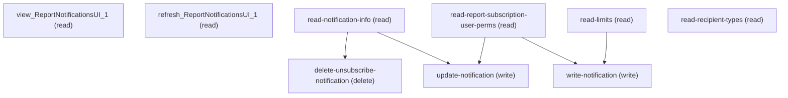

# Managing Report Notifications Ui

## When to Use This Skill

Setup page for managing AnalyticNotification records—Lightning Report and Dashboard subscriptions scoped to the calling user. The page lists existing subscriptions and supports creating, updating, and deleting subscriptions.

Programmatic CRUD operations are exposed through the SubscribeDialog Aura controller, mounted at /headless/invoke/analytics/analytics-home/subscribe-dialog/.

Each record-scoped operation requires a `source` parameter ("Report" or "Dashboard") and either:
- `recordId` — the target Report or Dashboard, or
- `notificationId` — an existing subscription.

Before performing subscription operations, call getReportSubscriptionUserPerms to determine permissions and gate flows involving Run As User and other-user recipients.

The two setup_page steps—view and refresh—are navigation-canonical. No programmatic API replaces the Setup page UI itself.

## Workflow

{'canonical_sequence': ['read-report-subscription-user-perms', 'read-limits', 'read-notification-info', 'read-recipient-types', 'write-notification', 'update-notification', 'delete-unsubscribe-notification'], 'notes': "Always read perms + limits before write operations. Use read-notification-info to check existing state before create/update/delete. For updates, prefer update-notification over delete+create. The `source` parameter is always 'Report' or 'Dashboard' — no other values are accepted."}

## Critical Constraints

**Preconditions:**

- Reports & Dashboards is enabled in the org. Default in every Salesforce edition; included for completeness.
- Caller has access to the Report or Dashboard identified by `recordId`. Subscription operations resolve recordId in the caller's sharing context; a record the caller cannot view will not be subscribable.
- For run-as-user or other-user-recipient subscriptions, caller must hold the corresponding perm — read via read-report-subscription-user-perms (CAN_SUBSCRIBE_REPORTS_RUN_AS_USER / CAN_SUBSCRIBE_REPORT_TO_OTHER_USERS). (check: `AnalyticsAccessCheck.CAN_SUBSCRIBE_REPORTS_RUN_AS_USER`)

**Destructive operations — require explicit user confirmation:**

- **`delete-unsubscribe-notification`** — Delete the AnalyticNotification identified by `notificationId`. Throws IllegalArgumentException if the id does not resolve to AnalyticNotification entity type. Obtain `notificationId` from a prior read-notification-info call.
  - Rollback: No automatic rollback.

## Operations Reference

Operations grouped by purpose. Use these as the building blocks for the workflows above.

### Summary

| Operation | Purpose | Status | Call | Depends on |
|-----------|---------|--------|------|------------|
| `view_ReportNotificationsUI_1` | read | — | `ReportNotificationsUI.view` | — |
| `refresh_ReportNotificationsUI_1` | read | — | `ReportNotificationsUI.refresh` | — |
| `read-notification-info` | read | — | `GET /headless/invoke/analytics/analytics-home/subscribe-dialog/get-notification-info` | — |
| `read-report-subscription-user-perms` | read | — | `GET /headless/invoke/analytics/analytics-home/subscribe-dialog/get-report-subscription-user-perms` | — |
| `write-notification` | write | — | `PATCH /headless/invoke/analytics/analytics-home/subscribe-dialog/create-notification` | `read-report-subscription-user-perms`, `read-limits` |
| `delete-unsubscribe-notification` | delete | — | `PATCH /headless/invoke/analytics/analytics-home/subscribe-dialog/unsubscribe-notification` | `read-notification-info` |
| `update-notification` | write | — | `PATCH /headless/invoke/analytics/analytics-home/subscribe-dialog/save-notification` | `read-notification-info`, `read-report-subscription-user-perms` |
| `read-limits` | read | — | `GET /headless/invoke/analytics/analytics-home/subscribe-dialog/get-limits` | — |
| `read-recipient-types` | read | — | `GET /headless/invoke/analytics/analytics-home/subscribe-dialog/get-recipient-types` | — |

### Dependency graph

### Read operations

#### `view_ReportNotificationsUI_1`

Open the Subscriptions Setup page for manual review of the caller's Lightning report/dashboard subscriptions. NAVIGATION — no programmatic API navigates the page UI; manage subscription records via subscribe-dialog steps.

**Call:** `ReportNotificationsUI.view`

#### `refresh_ReportNotificationsUI_1`

Reload the Subscriptions Setup page. NAVIGATION — no API analog; reissue the underlying subscribe-dialog reads (e.g. read-notification-info) to pick up record changes programmatically.

**Call:** `ReportNotificationsUI.refresh`

#### `read-notification-info`

Read caller's AnalyticNotification (subscription) for `recordId` scoped to `source`. `recordId` must be a Report or Dashboard; `source` must be 'Report' or 'Dashboard' — passing neither raises IllegalArgumentException.

**Call:** `GET /headless/invoke/analytics/analytics-home/subscribe-dialog/get-notification-info`

**Inputs:**

- `recordId` *(`String`)*
- `source` *(`String`)*

**Output:** AnalyticNotification record envelope. Returns the caller's subscription state for the recordId; absent/null when the user is not subscribed.

#### `read-report-subscription-user-perms`

Read caller's report-subscription perm flags. Returns `{runAsAccess, subscribeToOtherUsersAccess}` derived from AnalyticsAccessCheck.CAN_SUBSCRIBE_REPORTS_RUN_AS_USER and CAN_SUBSCRIBE_REPORT_TO_OTHER_USERS — gate before scripting create-notification with run-as-user or other-user recipients.

**Call:** `GET /headless/invoke/analytics/analytics-home/subscribe-dialog/get-report-subscription-user-perms`

**Output:** Returns `{runAsAccess: boolean, subscribeToOtherUsersAccess: boolean}` — the two perm bits that gate the dialog's run-as picker and other-user-recipient input.

#### `read-limits`

Read the org's subscription capacity limits for the given `source` ("Report" or "Dashboard"). Returns max subscriptions allowed and current count. Call before create-notification to pre-check capacity.

**Call:** `GET /headless/invoke/analytics/analytics-home/subscribe-dialog/get-limits`

**Inputs:**

- `source` *(`String`)*

**Output:** Returns subscription limit info for the source type — max allowed and current usage count.

#### `read-recipient-types`

Read available recipient types for the report/dashboard identified by `recordId`. Returns the list of valid recipient type options (e.g. User, Group) that can be used in the create-notification `data` payload.

**Call:** `GET /headless/invoke/analytics/analytics-home/subscribe-dialog/get-recipient-types`

**Inputs:**

- `recordId` *(`String`)*

**Output:** List of objects — each with type name and availability for the given record.

### Write operations

#### `write-notification`

Create an AnalyticNotification (subscription) from serialized `data` payload encoding recipients, schedule, run-as user, and other subscription parameters. Call read-limits first to verify capacity, and read-recipient-types to discover valid recipient options for the data payload.

**Call:** `PATCH /headless/invoke/analytics/analytics-home/subscribe-dialog/create-notification`

**Inputs:**

- `data` *(`String`)*

**Depends on:** `read-report-subscription-user-perms`, `read-limits`

**Output:** A JSON response from analytics direct-REST create — created AnalyticNotification record id and resolved schedule/recipients on success.

#### `update-notification`

Update an existing AnalyticNotification (subscription) identified by `notificationId`. The `data` payload encodes the same fields as create-notification (recipients, schedule, run-as user). Obtain `notificationId` from a prior read-notification-info call.

**Call:** `PATCH /headless/invoke/analytics/analytics-home/subscribe-dialog/save-notification`

**Inputs:**

- `notificationId` *(`String`)*
- `data` *(`String`)*

**Depends on:** `read-notification-info`, `read-report-subscription-user-perms`

**Output:** Returns the updated AnalyticNotification REST response body on success.

### Destructive operations

#### `delete-unsubscribe-notification`

Delete the AnalyticNotification identified by `notificationId`. Throws IllegalArgumentException if the id does not resolve to AnalyticNotification entity type. Obtain `notificationId` from a prior read-notification-info call.

**Call:** `PATCH /headless/invoke/analytics/analytics-home/subscribe-dialog/unsubscribe-notification`

**Inputs:**

- `notificationId` *(`String`)*

**Depends on:** `read-notification-info`

**Output:** Returns the analytics direct-REST delete response (typically empty/success on a successful unsubscribe).
