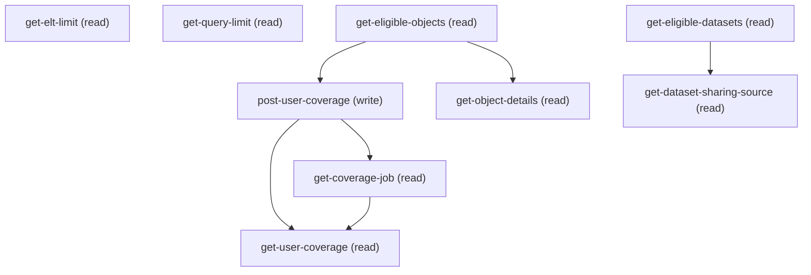

# Managing Insights Setup Sharing Inheritance Coverage

## When to Use This Skill

Setup page for CRM Analytics (Wave) Sharing Inheritance Coverage. Reads org-level descriptor limits, lists sObjects/datasets eligible for sharing inheritance, submits user-coverage calculation jobs (CoverageJobStatusEnum: NotStarted/InProgress/Success/Failure), polls job status, and reads back per-object/per-user coverage. 6 of 9 steps substitute to public Connect API `/wave/security/coverage/*` (insights-connect-api); the 2 org-value getters (MED_VIS_DESCRIPTOR_LIMIT, WAVE_V_S_MAX_DESCRIPTORS) and the dataset→sharingSource resolver remain Aura-canonical.

## Workflow

Workflow: read get-elt-limit + get-query-limit (descriptor caps driving unsupportedRecords / userCountCoverageUnknown). Discover via get-eligible-objects + get-eligible-datasets; get-object-details for per-object detail. User coverage: post-user-coverage → poll get-coverage-job until Success/Failure → read get-user-coverage. get-dataset-sharing-source resolves dataset→sObject.

## Critical Constraints

**Preconditions:**

- Setup page requires `Insights or analytics enabled && Insights enabled && OrgPreferences.WaveSharingInheritance && Insights Data Prep Editor` (per the setup-manifest access gate). None of the individual steps enforce this directly in the Aura controller — it's the page-level gate an admin/agent must satisfy before any of these operations are reachable at all, most notably the `WaveSharingInheritance` org preference and the `InsightsEltEditor` permission, neither of which is implied by a generic Insights/Wave license. (check: `InsightsSetupSharingInheritanceCoverage page access`)

## Operations Reference

Operations grouped by purpose. Use these as the building blocks for the workflows above.

### Summary

| Operation | Purpose | Status | Call | Depends on |
|-----------|---------|--------|------|------------|
| `get-elt-limit` | read | implemented | `GET /headless/invoke/platform/insights-setup-sharing-inheritance-coverage` | — |
| `get-query-limit` | read | implemented | `GET /headless/invoke/platform/insights-setup-sharing-inheritance-coverage/get-query-limit` | — |
| `get-coverage-job` | read | proposed | `GET /services/data/v66.0/wave/security/coverage/jobs/{jobId}` | `post-user-coverage` |
| `get-eligible-objects` | read | proposed | `GET /services/data/v66.0/wave/security/coverage/objects` | — |
| `get-eligible-datasets` | read | proposed | `GET /services/data/v66.0/wave/security/coverage/datasets` | — |
| `post-user-coverage` | write | proposed | `POST /services/data/v66.0/wave/security/coverage/objects/{objectApiName}/users` | `get-eligible-objects` |
| `get-user-coverage` | read | proposed | `GET /services/data/v66.0/wave/security/coverage/objects/{objectApiName}/users` | `post-user-coverage`, `get-coverage-job` |
| `get-object-details` | read | implemented | `GET /services/data/v66.0/wave/security/coverage/objects/{objectApiName}` | `get-eligible-objects` |
| `get-dataset-sharing-source` | read | proposed | `GET /headless/invoke/platform/insights-setup-sharing-inheritance-coverage/get-dataset-sharing-source` | `get-eligible-datasets` |

### Dependency graph

### Read operations

#### `get-elt-limit`

Read `MED_VIS_DESCRIPTOR_LIMIT` org-value (integer): per-record descriptor cap gating medium-visibility sharing predicates. AURA-IS-CANONICAL — no public Connect/Tooling/Metadata/sObject surface exposes this org-value.

**Call:** `GET /headless/invoke/platform/insights-setup-sharing-inheritance-coverage`   — status: `implemented`

**Output:** Returns an integer — the medium-visibility descriptor limit per the spec's `SharingInheritanceCoveragePageAuraGeteltlimitRepresentation` (type: integer, format: int32).

#### `get-query-limit`

Read `WAVE_V_S_MAX_DESCRIPTORS` org-value (integer): per-user descriptor ceiling driving `userCountCoverageUnknown` in user-coverage results. AURA-IS-CANONICAL — no public surface exposes this org-value.

**Call:** `GET /headless/invoke/platform/insights-setup-sharing-inheritance-coverage/get-query-limit`   — status: `implemented`

**Output:** Returns an integer — the per-user max-descriptors ceiling per the spec's `SharingInheritanceCoveragePageAuraGetquerylimitRepresentation` (type: integer, format: int32).

#### `get-coverage-job`

Read sharing-inheritance coverage job status by jobId. Returns CoverageJobRepresentation: status (CoverageJobStatusEnum: NotStarted/InProgress/Success/Failure), target object AssetReference, message, userCoverage URL for the read-back.

**Call:** `GET /services/data/v66.0/wave/security/coverage/jobs/{jobId}`   — status: `proposed`

**Inputs:**

- `JOB_ID` *(`String`)*

**Depends on:** `post-user-coverage`

**Output:** CoverageJobRepresentation: status (CoverageJobStatusEnum), object (AssetReference to the target sObject), message (string), userCoverage (ConnectUri to the get-user-coverage read-back).

#### `get-eligible-objects`

List sObjects whose access can be governed via sharing inheritance. Each ObjectCoverageRepresentation carries eligibleSharingSource, name, namespace, label, securityFields, url, and unsupportedRecords (records exceeding the medium-visibility descriptor limit).

**Call:** `GET /services/data/v66.0/wave/security/coverage/objects`   — status: `proposed`

**Output:** {objectsCovered: array of ObjectCoverageRepresentation}, where each row has eligibleSharingSource (boolean), name, namespace, label, securityFields (array), url (ConnectUri), unsupportedRecords (UnsupportedRecordCollectionRepresentation with values + count).

#### `get-eligible-datasets`

Get the org-wide dataset sharing-inheritance roll-up — total datasets, count whose sharing source is eligible, the resulting coverage percentage, a per-entity occurrence count, and asset references for the eligible datasets.

**Call:** `GET /services/data/v66.0/wave/security/coverage/datasets`   — status: `proposed`

**Output:** DatasetCoverageSummaryRepresentation: totalDatasets (integer), totalDatasetsCovered (integer), coveragePercentage (number), entityCount (object), datasetsCovered (array of AssetReferenceRepresentation).

#### `get-user-coverage`

Read user-coverage breakdown for the given sObject after the job completes: coveragePercentage, userCountCovered, userCountNotCovered, userCountCoverageUnknown (capped by WAVE_V_S_MAX_DESCRIPTORS), plus per-user usersNotCovered details.

**Call:** `GET /services/data/v66.0/wave/security/coverage/objects/{objectApiName}/users`   — status: `proposed`

**Inputs:**

- `OBJECT_NAME_PARAM` *(`String`)*

**Depends on:** `post-user-coverage`, `get-coverage-job`

**Output:** UserCoverageRepresentation: object (AssetReference), coveragePercentage (number), userCountCovered (integer), userCountNotCovered (integer), userCountCoverageUnknown (integer), usersNotCovered (array of UserCoverageDetailRepresentation with id/name/descriptorCount/reason), coverageJob (AssetReference to the producing job).

#### `get-object-details`

Read sharing-inheritance detail for one sObject: eligibleSharingSource flag, name/namespace/label, securityFields, self-URL, and unsupportedRecords (records whose descriptor count exceeds the MED_VIS_DESCRIPTOR_LIMIT from get-elt-limit).

**Call:** `GET /services/data/v66.0/wave/security/coverage/objects/{objectApiName}`   — status: `implemented`

**Inputs:**

- `OBJECT_NAME_PARAM` *(`String`)*

**Depends on:** `get-eligible-objects`

**Output:** ObjectCoverageRepresentation: eligibleSharingSource (boolean), name, namespace, label (strings), securityFields (array of string), url (ConnectUri), unsupportedRecords (UnsupportedRecordCollectionRepresentation with values + count).

#### `get-dataset-sharing-source`

Resolve a dataset (id or developer name) to its sharingSource sObject AssetReference. AURA-IS-CANONICAL: controller atomically resolves dataset → current version → sharingSource in one call; substituting splits into two round-trips losing atomicity.

**Call:** `GET /headless/invoke/platform/insights-setup-sharing-inheritance-coverage/get-dataset-sharing-source`   — status: `proposed`

**Inputs:**

- `DATASET_ID_PARAM` *(`String`)*

**Depends on:** `get-eligible-datasets`

**Output:** AssetReferenceRepresentation: id (ID), name, label, description (strings), url (ConnectUri) — pointing at the source sObject the dataset inherits sharing from.

### Write operations

#### `post-user-coverage`

Submit a sharing-inheritance user-coverage calculation for the given sObject. Returns CoverageJobRepresentation; the caller then polls get-coverage-job until status is Success or Failure, then reads get-user-coverage. Per the controller's own doc comment (SharingInheritanceCoveragePageAuraController.postUserCoverage), this endpoint "may throw an error when the report is run too often" (rate-limited) "and may also just throw a random error" — the controller's own guidance is to "make sure to handle the error code" rather than treat every thrown error as terminal; a caller/agent should be prepared to retry on failure rather than surfacing every error as a hard stop.

**Call:** `POST /services/data/v66.0/wave/security/coverage/objects/{objectApiName}/users`   — status: `proposed`

**Inputs:**

- `OBJECT_NAME_PARAM` *(`String`)* — Value for the objec nam param field.

**Depends on:** `get-eligible-objects`

**Output:** CoverageJobRepresentation: status (CoverageJobStatusEnum, typically NotStarted or InProgress on submit), object (AssetReference), message, userCoverage (ConnectUri to the eventual read-back).
