# Managing Briefcase

## When to Use This Skill

Manage Briefcase Definitions for offline mobile data priming. This setup page lets admins create, edit, activate/deactivate, and delete Briefcase definitions that control which records are cached on mobile devices for offline use. It also manages briefcase rule configurations, user/profile assignments, connected app associations, and profile-level briefcase regeneration. Use this SOR when a user needs to configure offline data availability for Salesforce mobile apps.

## Critical Constraints

**Preconditions:**

- User must have Briefcase EditBriefcase access (check: `Edit Briefcase permission`)
- User must have Briefcase ViewBriefcase access (check: `View Briefcase permission`)

**Destructive operations — require explicit user confirmation:**

- **`delete-briefcase-tooling`** — Permanently delete a Briefcase definition by its Salesforce ID via the Tooling API.
  - Rollback: Cannot be undone — the Briefcase definition and all its rules/assignments are permanently removed

## Verification Checklist

After every write operation, confirm the effect by re-reading state:

- After `get-briefcase-list-and-guardrail-org-values`: call `verify-acknowledge-hyperforce` (`GET /headless/invoke/platform/briefcase/get-briefcase-list-and-guardrail-org-values`)
- After `create-briefcase-tooling`: call `verify-create-briefcase-tooling` (`GET /services/data/v67.0/tooling/query`)
- After `update-briefcase-tooling`: call `verify-update-briefcase-tooling` (`GET /services/data/v67.0/tooling/sobjects/BriefcaseDefinition/{id}`)
- After `update-briefcase-state-tooling`: call `verify-update-briefcase-state-tooling` (`GET /services/data/v67.0/tooling/sobjects/BriefcaseDefinition/{id}`)
- After `delete-briefcase-tooling`: call `verify-delete-briefcase-tooling` (`GET /services/data/v67.0/tooling/query`)
- After `update-briefcase-assignments-sobject`: call `verify-update-briefcase-assignments-sobject` (`GET /services/data/v67.0/query`)

## Operations Reference

Operations grouped by purpose. Use these as the building blocks for the workflows above.

### Summary

| Operation | Purpose | Status | Call | Depends on |
|-----------|---------|--------|------|------------|
| `update-briefcase-connected-apps` | write | implemented | `PATCH /headless/invoke/platform/briefcase/update-briefcase-connected-apps` | — |
| `get-apps-list-for-briefcase` | read | implemented | `GET /headless/invoke/platform/briefcase/get-apps-list-for-briefcase` | — |
| `get-briefcase-list-and-guardrail-org-values` | read | implemented | `GET /headless/invoke/platform/briefcase/get-briefcase-list-and-guardrail-org-values` | — |
| `acknowledge-hyperforce-for-high-volume-priming` | write | implemented | `PATCH /headless/invoke/platform/briefcase/acknowledge-hyperforce-for-high-volume-priming` | — |
| `get-briefcase` | read | implemented | `GET /services/data/v67.0/tooling/sobjects/BriefcaseDefinition/{id}` | — |
| `verify-acknowledge-hyperforce` | verify | implemented | `GET /headless/invoke/platform/briefcase/get-briefcase-list-and-guardrail-org-values` | `get-briefcase-list-and-guardrail-org-values` |
| `create-briefcase-tooling` | write | implemented | `POST /services/data/v67.0/tooling/sobjects/BriefcaseDefinition` | `get-briefcase-list-and-guardrail-org-values`, `get-apps-list-for-briefcase` |
| `verify-create-briefcase-tooling` | verify | implemented | `GET /services/data/v67.0/tooling/query` | `create-briefcase-tooling` |
| `update-briefcase-tooling` | write | implemented | `PATCH /services/data/v67.0/tooling/sobjects/BriefcaseDefinition/{id}` | `get-briefcase-list-and-guardrail-org-values` |
| `verify-update-briefcase-tooling` | verify | implemented | `GET /services/data/v67.0/tooling/sobjects/BriefcaseDefinition/{id}` | `update-briefcase-tooling` |
| `update-briefcase-state-tooling` | write | implemented | `PATCH /services/data/v67.0/tooling/sobjects/BriefcaseDefinition/{id}` | `get-briefcase-list-and-guardrail-org-values` |
| `verify-update-briefcase-state-tooling` | verify | implemented | `GET /services/data/v67.0/tooling/sobjects/BriefcaseDefinition/{id}` | `update-briefcase-state-tooling` |
| `delete-briefcase-tooling` | delete | implemented | `DELETE /services/data/v67.0/tooling/sobjects/BriefcaseDefinition/{id}` | `get-briefcase-list-and-guardrail-org-values` |
| `verify-delete-briefcase-tooling` | verify | implemented | `GET /services/data/v67.0/tooling/query` | `delete-briefcase-tooling` |
| `update-briefcase-assignments-sobject` | write | implemented | `POST /services/data/v67.0/sobjects/BriefcaseAssignment` | `get-briefcase-list-and-guardrail-org-values` |
| `verify-update-briefcase-assignments-sobject` | verify | implemented | `GET /services/data/v67.0/query` | `update-briefcase-assignments-sobject` |

### Dependency graph

```mermaid
graph TD
  update_briefcase_connected_apps["update-briefcase-connected-apps (write)"]
  get_apps_list_for_briefcase["get-apps-list-for-briefcase (read)"]
  get_briefcase_list_and_guardrail_org_values["get-briefcase-list-and-guardrail-org-values (read)"]
  acknowledge_hyperforce_for_high_volume_priming["acknowledge-hyperforce-for-high-volume-priming (write)"]
  get_briefcase["get-briefcase (read)"]
  verify_acknowledge_hyperforce["verify-acknowledge-hyperforce (verify)"]
  create_briefcase_tooling["create-briefcase-tooling (write)"]
  verify_create_briefcase_tooling["verify-create-briefcase-tooling (verify)"]
  update_briefcase_tooling["update-briefcase-tooling (write)"]
  verify_update_briefcase_tooling["verify-update-briefcase-tooling (verify)"]
  update_briefcase_state_tooling["update-briefcase-state-tooling (write)"]
  verify_update_briefcase_state_tooling["verify-update-briefcase-state-tooling (verify)"]
  delete_briefcase_tooling["delete-briefcase-tooling (delete)"]
  verify_delete_briefcase_tooling["verify-delete-briefcase-tooling (verify)"]
  update_briefcase_assignments_sobject["update-briefcase-assignments-sobject (write)"]
  verify_update_briefcase_assignments_sobject["verify-update-briefcase-assignments-sobject (verify)"]
  get_briefcase_list_and_guardrail_org_values --> verify_acknowledge_hyperforce
  get_briefcase_list_and_guardrail_org_values --> create_briefcase_tooling
  get_apps_list_for_briefcase --> create_briefcase_tooling
  create_briefcase_tooling --> verify_create_briefcase_tooling
  get_briefcase_list_and_guardrail_org_values --> update_briefcase_tooling
  update_briefcase_tooling --> verify_update_briefcase_tooling
  get_briefcase_list_and_guardrail_org_values --> update_briefcase_state_tooling
  update_briefcase_state_tooling --> verify_update_briefcase_state_tooling
  get_briefcase_list_and_guardrail_org_values --> delete_briefcase_tooling
  delete_briefcase_tooling --> verify_delete_briefcase_tooling
  get_briefcase_list_and_guardrail_org_values --> update_briefcase_assignments_sobject
  update_briefcase_assignments_sobject --> verify_update_briefcase_assignments_sobject
```

### Read operations

#### `get-apps-list-for-briefcase`

Get apps list for briefcase.

**Call:** `GET /headless/invoke/platform/briefcase/get-apps-list-for-briefcase`   — status: `implemented`

#### `get-briefcase-list-and-guardrail-org-values`

Get briefcase list and guardrail org values.

**Call:** `GET /headless/invoke/platform/briefcase/get-briefcase-list-and-guardrail-org-values`   — status: `implemented`

#### `get-briefcase`

Retrieve a single Briefcase definition by its ID via the Tooling API. Returns full Metadata including briefcaseRules, filters, and relatedRules.

**Call:** `GET /services/data/v67.0/tooling/sobjects/BriefcaseDefinition/{id}`   — status: `implemented`

**Inputs:**

- `id` *(`String`)* — The Salesforce ID of the BriefcaseDefinition to retrieve. Source: query BriefcaseDefinition sObject or output of get-briefcase-list-and-guardrail-org-values.

**Output:** String representation of the Briefcase definition including masterLabel, developerName, description, id, active, type, briefcaseRules, assignments, connectedAppIds, syncStatus

### Write operations

#### `update-briefcase-connected-apps`

Update briefcase connected apps.

**Call:** `PATCH /headless/invoke/platform/briefcase/update-briefcase-connected-apps`   — status: `implemented`

**Inputs:**

- `briefcaseData` *(`Map<String, Object>`)* — Value for briefcase data.

#### `acknowledge-hyperforce-for-high-volume-priming`

Acknowledge hyperforce for high volume priming.

**Call:** `PATCH /headless/invoke/platform/briefcase/acknowledge-hyperforce-for-high-volume-priming`   — status: `implemented`

#### `create-briefcase-tooling`

Create a new Briefcase definition with rules, assignments, and connected app associations via the Tooling API. The Metadata field accepts the full BriefcaseDefinition shape including briefcaseRules and filters.

**Call:** `POST /services/data/v67.0/tooling/sobjects/BriefcaseDefinition`   — status: `implemented`

**Inputs:**

- `FullName` *(`String`)* — The developer name (unique identifier) for the Briefcase definition.
- `Metadata` *(`Object`)* — BriefcaseDefinition metadata. Required fields: masterLabel (string), briefcaseRules (array, at least one rule). Each BriefcaseRule requires: targetEntity (API name of the sObject, e.g. 'Account'), queryScope (allowed values: 'Everything', 'Mine'; additionally 'AssignedToMe' is supported only for the ServiceAppointment entity — source: BriefcaseRule.QueryScope restrictedPicklist). Optional rule fields: briefcaseRuleFilters (array — each filter requires targetEntityField, filterOperator (short form: 'e'=equals, 's'=startsWith, 'd'=endsWith, 'l'=lessThan, 'g'=greaterThan, 'm'=lessThanOrEqual, 'h'=greaterThanOrEqual; NOTE: 'n'=notEquals is NOT supported for Briefcase filters — source: BriefcaseRuleFilter.FilterOperator restrictedPicklist), filterValue, filterSeqNumber (required, 1-based index)), filterLogic (REQUIRED when briefcaseRuleFilters present, e.g. '1' or '1 AND 2'), isAscendingOrder (boolean), orderBy (field name), recordLimit (integer), relatedRules (array of nested related rules — each requires targetEntity, queryScope, relationshipField, relationshipType; relationshipType is 'ParentToChild' for parent→child lookups or 'ChildToParent' for child→parent lookups — source: BriefcaseRule.RelationshipType restrictedPicklist; multiple relatedRules under one parent rule are supported). Operator+field compatibility is validated server-side — not all operators work with all field types (error: 'The combination of the field X and the operator Y for the entity Z is invalid'). Optional top-level: description (string), isActive (boolean, default false), type ('Standard' (default) or 'HighVolume' — source: BriefcaseDefinition.Type restrictedPicklist; MobileAppSync excluded for agent use).

**Depends on:** `get-briefcase-list-and-guardrail-org-values`, `get-apps-list-for-briefcase`

**Rollback:** Delete the created Briefcase using delete-briefcase-tooling with the record Id

#### `update-briefcase-tooling`

Update an existing Briefcase definition's metadata (label, description, rules, filters) via the Tooling API. Note that PATCH requires the full Metadata object (complete replacement, not partial).

**Call:** `PATCH /services/data/v67.0/tooling/sobjects/BriefcaseDefinition/{id}`   — status: `implemented`

**Inputs:**

- `id` *(`String`)* — The Salesforce ID of the BriefcaseDefinition to update. Source: query BriefcaseDefinition sObject or output of get-briefcase-list-and-guardrail-org-values.
- `Metadata` *(`Object`)* — Full BriefcaseDefinition metadata (complete replacement): masterLabel, description, briefcaseRules, isActive. Must include all fields — omitted fields revert to defaults.

**Depends on:** `get-briefcase-list-and-guardrail-org-values`

**Rollback:** Call update-briefcase-tooling again with the previous field values retrieved from get-briefcase

#### `update-briefcase-state-tooling`

Activate or deactivate a Briefcase definition by updating the isActive flag in its Metadata via the Tooling API.

**Call:** `PATCH /services/data/v67.0/tooling/sobjects/BriefcaseDefinition/{id}`   — status: `implemented`

**Inputs:**

- `id` *(`String`)* — The Salesforce ID of the BriefcaseDefinition. Source: query BriefcaseDefinition sObject.
- `Metadata` *(`Object`)* — Full Metadata with isActive set to true (activate) or false (deactivate). Must include briefcaseRules and masterLabel even for state-only changes (full replacement semantics).

**Depends on:** `get-briefcase-list-and-guardrail-org-values`

**Rollback:** Call update-briefcase-state-tooling with the opposite active value to revert

#### `update-briefcase-assignments-sobject`

Manage Briefcase assignments by creating or deleting BriefcaseAssignment records. Each record links a BriefcaseDefinition to a user, group, or profile. Create one record per assignee; delete to unassign.

**Call:** `POST /services/data/v67.0/sobjects/BriefcaseAssignment`   — status: `implemented`

**Inputs:**

- `BriefcaseId` *(`String`)* — The ID of the BriefcaseDefinition to assign.
- `UserOrGroupId` *(`String`)* — Polymorphic reference — the ID of the User, Group, or Profile to assign. Accepts any of the three entity types in a single field.

**Depends on:** `get-briefcase-list-and-guardrail-org-values`

**Rollback:** DELETE /services/data/v67.0/sobjects/BriefcaseAssignment/{id} to remove the assignment

### Verify operations

#### `verify-acknowledge-hyperforce`

Check whether the org has acknowledged Hyperforce AND actually has HighVolume capacity enabled. Reads briefcaseHyperforceAck flag and HighVolume guardrail limits from get-briefcase-list-and-guardrail-org-values output. If ack is true but limits are 0, the org does not support HighVolume — do NOT proceed.

**Call:** `GET /headless/invoke/platform/briefcase/get-briefcase-list-and-guardrail-org-values`   — status: `implemented`

**Depends on:** `get-briefcase-list-and-guardrail-org-values`

#### `verify-create-briefcase-tooling`

Confirm the new Briefcase was created by querying via Tooling SOQL.

**Call:** `GET /services/data/v67.0/tooling/query`   — status: `implemented`

**Inputs:**

- `q` *(`string`)*

**Depends on:** `create-briefcase-tooling`

#### `verify-update-briefcase-tooling`

Confirm the Briefcase update landed by re-reading the definition via Tooling API.

**Call:** `GET /services/data/v67.0/tooling/sobjects/BriefcaseDefinition/{id}`   — status: `implemented`

**Inputs:**

- `id` *(`String`)* — The Salesforce ID of the BriefcaseDefinition to verify. Source: the id used in update-briefcase-tooling.

**Depends on:** `update-briefcase-tooling`

#### `verify-update-briefcase-state-tooling`

Confirm activation/deactivation by re-reading the BriefcaseDefinition via Tooling API.

**Call:** `GET /services/data/v67.0/tooling/sobjects/BriefcaseDefinition/{id}`   — status: `implemented`

**Inputs:**

- `id` *(`String`)* — The Salesforce ID of the BriefcaseDefinition to verify. Source: the id used in update-briefcase-state-tooling.
- `fields` *(`string`)*

**Depends on:** `update-briefcase-state-tooling`

#### `verify-delete-briefcase-tooling`

Confirm deletion by querying via Tooling SOQL and verifying the entry is gone.

**Call:** `GET /services/data/v67.0/tooling/query`   — status: `implemented`

**Inputs:**

- `developerName` *(`String`)* — The DeveloperName of the BriefcaseDefinition to verify was deleted. Source: the developerName of the record passed to delete-briefcase-tooling.
- `q` *(`string`)*

**Depends on:** `delete-briefcase-tooling`

#### `verify-update-briefcase-assignments-sobject`

Confirm assignment changes by querying BriefcaseAssignment via SOQL.

**Call:** `GET /services/data/v67.0/query`   — status: `implemented`

**Inputs:**

- `q` *(`string`)*

**Depends on:** `update-briefcase-assignments-sobject`

### Destructive operations

#### `delete-briefcase-tooling`

Permanently delete a Briefcase definition by its Salesforce ID via the Tooling API.

**Call:** `DELETE /services/data/v67.0/tooling/sobjects/BriefcaseDefinition/{id}`   — status: `implemented`

**Inputs:**

- `id` *(`String`)* — The Salesforce ID of the BriefcaseDefinition to delete. Source: query BriefcaseDefinition sObject.

**Depends on:** `get-briefcase-list-and-guardrail-org-values`

**Rollback:** Cannot be undone — the Briefcase definition and all its rules/assignments are permanently removed
