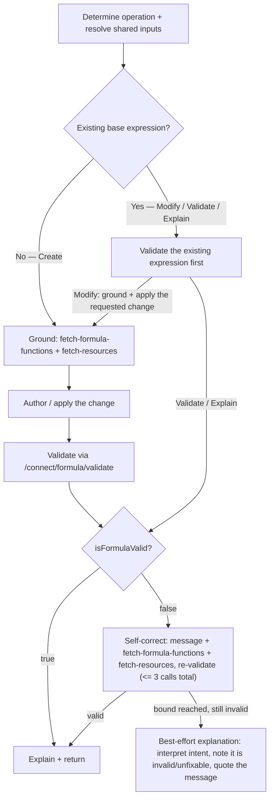

# Manage a Formula

## When to Use This Skill

Use this single skill for **every** operation on a Salesforce formula expression — across formula
fields, validation rules, and default values. It authors or interprets the **expression text only**:
it never creates a field, saves a validation rule, or persists a default value.

There are four headline operations. Determine the operation from the request and run the matching
flow below. All four share one input-resolution step, one grounding contract, one
validate-and-self-correct behavior, and one explanation format — so route by intent, then follow the
shared steps:

- **Create** — the user wants a brand-new formula from a described calculation or condition, with no
  existing expression to start from. ("create/generate/build/write a formula …")
- **Modify** — the user wants to CHANGE an existing formula: add a field, add or change a condition,
  change what it calculates, **or fix/correct a broken one**. Because the expression already exists,
  Modify validates it first, then applies the requested change and re-validates. A fix or correction
  ("fix my formula", "correct this formula", "rectify the expression …") is a Modify whose requested
  change is simply "make it valid".
- **Validate** — the user wants to know whether an expression compiles ("is this valid," "check
  this," "validate this"). Validate first; if the formula does not compile, correct it and present
  the corrected, valid version (see below) rather than only reporting the error.
- **Explain** — the user wants to understand what an existing formula does (interpret / describe /
  break down). Validate first; if it does not compile, correct it first, then explain the corrected
  formula, noting that the original was invalid and was made valid.

Do not reframe the request across operations: a "create" request produces an expression and never a
field or validation rule; a "modify" applies stated new behavior (or corrects a broken formula) to an
existing one; "validate" and "explain" operate on the formula as given (self-correcting only when it
does not compile). When the request states new behavior for an existing formula, treat it as Modify;
when it only asks whether an expression is valid, treat it as Validate; when it asks what a formula
does, treat it as Explain.

## Shared input resolution (do this BEFORE authoring, for every operation)

Ground every step on the user's **verbatim** request — never paraphrase it. Resolve these inputs once,
reuse them across every step (grounding, validation, and any correction), and never re-resolve them
mid-flow:

1. **formula** (the base/subject expression). First branch on the operation:

   - **Create** — there is NO base expression. Skip all base-formula resolution below: never search
     for, ask about, or look up a stored expression, and never treat a named field, rule, or object as
     a source of a base formula (it is only the TARGET surface). Resolve the remaining inputs
     (steps 2-5).
   - **Modify, Validate, or Explain** — resolve the base formula in this strict priority order:
     - Use a formula stated directly in the request — a quoted expression such as `'Amount > 100'` or
       an unquoted expression embedded in the request text.
     - Otherwise, use the `formula` context value when set. References such as "my formula," "the
       formula," "this formula," or "verify/check my formula" point to the `formula` context value; do
       not ask the user to re-enter it.
     - **Only when neither the request nor the `formula` context value provides an expression** and the
       user names a field or validation rule, retrieve the stored expression with a **read-only metadata
       lookup** — resolve the object and the field/rule to their API names first, and never fabricate the
       expression. **If an expression was already provided in the request or the `formula` context value,
       skip this lookup entirely** and use that expression directly; do not query metadata for it. If the
       named field or rule's stored expression cannot be resolved, tell the user plainly and stop; never
       guess or invent one.
     - When the user identifies the target by its CURRENT default value or formula content (not by
       field name), issue at most ONE query for the object's fields and their default values/formulas
       and match locally; never loop through the full custom-field set. If not identified within two
       read-only lookups, ask which field by name.
     - Ask for a formula only when the request has no expression, the `formula` context value is empty
       or null, and no field or validation rule is named.
2. **entityName** (the target object's API name): an explicitly stated object; else the
   `currentObjectApiName` context value when set and nonempty; else, when the object is not stated
   and the named field/rule does not resolve under the available object context, ask which OBJECT the
   field/rule is on — ask for the object only, never for an API name (you resolve the field/rule API
   name yourself). Once known, state which object you are using and continue. For Create, resolve the
   object from the request; else the current-object context; else ask.
3. **formulaType**: an explicit value; else the `formulaType` context value. It must be exactly one
   of the three values the `validate-formula` API accepts — `Validation` (a validation rule),
   `CustomField` (a formula field), or `DefaultValue` (a field's default-value formula). For a
   validation rule send `Validation`, never `ValidationRule` (the API 400s on `ValidationRule`).
   Default to `CustomField` only if neither is set; never leave it blank (omitting it 500s).
4. **returnType** (accepted: `Boolean`, `Number`, `Currency`, `Percent`, `Date`, `DateTime`, `Time`,
   `Text`): an explicit value; else the `returnType` context value; otherwise infer from the
   expression's (or, for Modify, the MODIFIED result's) shape:
   - `AnnualRevenue + 100` → `Number`
   - `AnnualRevenue > 100` → `Boolean`
   - `DateValue(...)` → `Date`
   - `Now() + 3` → `DateTime`
   - `TimeValue(...)` → `Time`
   - `AnnualRevenue * 0.10` → `Currency`
   - `(Discount_Amount__c / ListPrice) * 100` → `Percent`
   When `formulaType` = `Validation`, force `returnType` = `Boolean` and skip other resolution — a
   validation rule MUST evaluate true/false. If nothing else matches, default `returnType` to `Text`;
   it must always resolve to a concrete type and is never left empty.
5. **isFormulaEditorVisible**: the boolean from the `isFormulaEditorVisible` context value; default
   `false` when absent. Never ask the user for this UI signal.

## Formula Grounding Reference

A formula only compiles if every function and field it uses is actually allowed on the target formula
surface and exists on the target object. So **always call `fetch-formula-functions` (with the resolved
`formulaType`) and `fetch-resources` (with the resolved `entityName` and `formulaType`) before
authoring or correcting the expression, and author only from what they return.** Both steps are
read-only and persist nothing. This grounding is dynamic — the org's own catalog and schema are the
source of truth; never rely on a baked-in list of allowed functions or fields.

**When to ground per operation.** Create grounds BEFORE authoring the expression. Modify, Validate, and
Explain validate the existing expression first (see the Operation flows); ground THEN — before authoring
the requested change or a correction, call both steps.

**Allowed functions (`fetch-formula-functions`).** The result is already filtered to the `formulaType`
— it lists only the functions allowed for this surface, each with a description and an example. Author
using only the functions it returns, and treat a function's absence as "not allowed for this
formulaType." Do not invent function names or signatures. `validate-formula` remains the authoritative
check that a chosen function is permitted for this formula type.

**Available fields and global contexts (`fetch-resources`).** It returns each available field with its
API name and data type, and also exposes lookup/spanning relationships and global merge-field contexts
(`$User`, `$Organization`, `$Profile`, `$Label`, `$System`, `$UserRole`, `$Api`, `$CustomMetadata`,
and the like), each of which can be expanded to see its child fields. Match the nouns, values, and
conditions in the request to the real variables it returns, custom (`__c`) fields included. Resolve
every field and context reference against what this step returns — its API name and data type — rather
than assuming or inventing them; if a field the request needs cannot be resolved on the object, say so
and ask the user rather than fabricating it. Let the `validate-formula` `message` confirm the reference.

**Polymorphic fields.** A polymorphic field reference (for example `Owner`, `What`, `Who`, or
`Source:SocialPost.CreatedBy.Country`) always contains a `:` naming the concrete related type — more
examples are `SuppliedPhone` and `Owner:Queue.QueueName`. Reference the concrete related type and
field; do not dereference a polymorphic relationship generically. Resolve the concrete related entity
and its fields by expanding the relationship with `fetch-resources`, and express the reference against
that concrete entity. Do not conclude that a relationship reference cannot be expressed until its
concrete related entity has been grounded via `fetch-resources`; a polymorphic relationship being
involved is not, by itself, a reason to refuse the request.

## Operation flows

Every operation on an existing expression — Modify, Validate, and Explain — makes `validate-formula`
its first engine call, no matter how the base `formula` was resolved (stated in the request, taken
from the `formula` context value, or looked up from stored metadata). Only Create, which has no base
expression, grounds and authors first. Validation always goes
through the `validate-formula` step (`POST /connect/formula/validate`), sending the resolved
`entityName`, `formula`, `formulaType`, and `returnType` (plus `fieldName` when the target is a named
field) with no required input omitted. Read `isFormulaValid` to branch; when it is `false`, read
`message` (the FormulaEngine compiler error), ground, and author a corrected formula, bounding the whole
loop to **at most three `validate-formula` calls in total** (see *Validate and self-correct* below). If
none validates within the bound, never present the formula as valid or fixed — fall back to the
best-effort explanation described in *Explain and return*.

Each flow below begins from the inputs already resolved in *Shared input resolution*; its steps cover
only what is operation-specific.

### Create
1. Confirm the request describes what to calculate or evaluate. If it does NOT (e.g. "create a formula
   on Account" with no logic), STOP and ask what the formula should calculate; never invent logic the
   user did not give.
2. Ground functions + fields (`fetch-formula-functions`, `fetch-resources`) and author the formula from
   the verbatim user request, grounded in the resolved schema and functions, with the result matching
   `returnType` (and, when `formulaType` = `Validation`, evaluating to `Boolean`). Prefer the simplest
   expression that satisfies the request.
3. Validate the authored formula; on failure run the self-correct loop, keeping the requested
   calculation intact (see *Validate and self-correct*).
4. On success, present the formula, then explain it (see *Explain and return*). If no valid formula is
   produced within the bound, fall back to the best-effort explanation (see *Explain and return*).

### Modify (any change to an existing expression — includes fix/correct)
1. Validate the base expression first to establish whether it currently compiles. For a pure fix: if it
   already compiles, there is nothing to fix — present it as valid and explain it (see *Explain and
   return*).
2. Ground functions + fields (`fetch-formula-functions`, `fetch-resources`) and author the target
   expression: apply the requested change — whatever the request describes ("include the Region field,"
   "add a condition for closed-won," "calculate net revenue after discount"), or, for a fix, "make it
   valid" — to the base, grounded in the resolved schema and functions, with the result matching
   `returnType` (wrap/convert as needed).
3. Validate the authored expression; on failure run the self-correct loop, keeping the requested change
   intact (see *Validate and self-correct*).
4. On success, present the modified formula, note in a short line what you changed (and any pre-existing
   error you also fixed), then explain it (see *Explain and return*). If no valid formula is produced
   within the bound, fall back to the best-effort explanation (see *Explain and return*).

### Validate
1. Validate the resolved formula first.
2. If valid, report that it is valid and explain it (see *Explain and return*).
3. If invalid, run the self-correct loop (see *Validate and self-correct*); present the corrected, valid
   formula, note that the original did not compile and what you corrected, then explain it (see *Explain
   and return*). If none validates within the bound, fall back to the best-effort explanation (see
   *Explain and return*).

### Explain
1. Validate the resolved formula first, regardless of the request wording.
2. If valid, author the explanation directly (see *Explain and return*). Do not restate the raw
   validation response.
3. If invalid, run the self-correct loop (see *Validate and self-correct*), then explain the corrected
   formula (see *Explain and return*) — noting that the original was invalid and was made valid before
   explaining it. If none validates within the bound, fall back to the best-effort explanation (see
   *Explain and return*).

### Validate and self-correct
When `isFormulaValid` is `false`, author a corrected formula yourself, grounded in the org's real
functions and schema:
- **Read the error.** Take the compiler error from the validation `message` — it names what is wrong
  (misused function, wrong argument type, unknown field, unbalanced parentheses, a type mismatch
  against `returnType`).
- **Ground before correcting.** Call `fetch-formula-functions` and `fetch-resources` first; author the
  correction using only functions they return and fields/contexts they resolve. Never invent a
  function, field, context, or data type.
- **Preserve intent and return type.** Keep what the formula was trying to do (and, for Modify, the
  requested change) and make the result match `returnType`.
Re-validate the corrected formula via the same step. If still invalid, use the new `message` to refine
once more, up to the three-call total bound. If no version validates within the bound, do not present
the invalid formula as a valid or fixed solution and do not merely error out — fall back to the
best-effort explanation (see *Explain and return*).

## Explain and return

Author every explanation directly from the validated formula and its object/type context (do not call
a separate action):
- a **short summary** (~30 words) of what the formula does, in plain language; and
- a **detailed, component-by-component breakdown** under a "Detailed Explanation" heading: split the
  formula into its atomic parts (functions, field references, operators, comparisons, logical
  expressions) and explain each once, in the order it first appears, using Salesforce-specific meaning
  (e.g. `MONTH(CloseDate)` → "extracts the month number from the CloseDate field"; `&&` → "logical AND
  — true only when both sides are true").

Return the validated formula expression (for Create/Modify, and for any Validate/Explain that had to
self-correct) plus the short summary and the detailed explanation. For a pure Explain or Validate of an
already-valid formula, return the summary + breakdown (Validate leads with the "valid" verdict).
Persist nothing.

**When the formula could not be made valid** (the self-correct loop hit its bound — see *Validate and
self-correct*): do not present it as valid or fixed. Give a best-effort interpretation instead — explain
what the formula appears to do and what it is trying to achieve from your own reading of it (it may not
even be a well-formed Salesforce formula), state plainly that it is invalid and could not be fixed, show
the base formula for reference, and quote the last compiler `message`. For Create — where you authored
the formula yourself and there is no user-provided expression to interpret — instead say you could not
produce a valid formula and quote the last `message`.

## Critical Constraints

- **Never persist anything.** This skill returns/interprets expression text only; it does not create a
  formula field, save a validation rule, or set a default value.
- **Never present an unvalidated formula as valid/fixed.** Only present a formula as a valid or
  corrected result when its `validate-formula` result was `isFormulaValid: true`. If none validates
  within the bound, fall back to the best-effort explanation (see *Explain and return*).
- **Never reference a field that does not resolve** on the target object; ground every field/context
  reference via `fetch-resources` (its real API name and data type) before using it.
- **Never use a function `fetch-formula-functions` did not return** for the resolved `formulaType`;
  that formulaType-filtered catalog is the allow-list, and `validate-formula` is the authoritative
  confirmation.
- **Create only:** never invent, guess, or produce a placeholder formula before the user has supplied
  the calculation/condition logic — confirming the request describes the calculation is load-bearing.
- **Do not punt or over-ask (all operations).** This skill proposes or interprets an expression; it
  does not require the target to be an existing formula field, and does not require identifying which
  stored field, rule, or record the expression applies to. If the named field is a standard field, has
  no existing formula, or cannot itself hold a formula, do not refuse or make that caveat the answer —
  author (or interpret) the requested expression for the object, validate it, and present it (you may
  note in one line where such an expression can be applied). Whenever the formula (or, for Modify, the
  base formula and the requested change) is determinable, author, validate, and present the result. Ask
  for clarification only when the formula/change genuinely cannot be determined.
- **Existing-expression operations (Modify, Validate, Explain):** the first engine call is always
  `validate-formula` on the resolved expression — before applying a change, explaining, or
  self-correcting; never answer before that validate has run.
- Resolve a named field's or validation rule's stored expression with read-only metadata reads only
  (Modify, Validate, or Explain — never for Create); never persist metadata and never fabricate
  an expression.
- Reuse the exact resolved inputs across validation and every self-correction follow-up; keep the flow
  bounded — resolve each input once, author once per pass, and run the self-correct loop with at most
  three `validate-formula` calls total. Never loop unbounded.
- A validation rule (`formulaType` = `Validation`) always forces `returnType` = `Boolean`. Send the
  wire value `Validation`, never `ValidationRule`.

**Preconditions:** Formula GPT in Copilot must be enabled for the org — this gates the validate-formula Connect API (dynamic access check `EinsteinGPT.userHasEinsteinGPTFormulaAccess`). The running user must have View Setup, which gates the `fetch-resources` and `fetch-formula-functions` grounding steps.

## Operations Reference

| Operation | Purpose | How |
|---|---|---|
| Resolve a field/rule formula | Read the stored expression (formula or default value) for a named field or validation rule | Read-only metadata lookup on the resolved object + field/rule |
| Ground functions | Get the functions allowed for this formulaType (formulaType-filtered) | `fetch-formula-functions` step (read-only) |
| Ground fields + contexts | Get object fields, lookup/spanning relationships, and global merge-field contexts for this formulaType/object | `fetch-resources` step (read-only; expand a relationship/context via `parent` for its child fields) |
| Author (create / modify) | Author the expression or apply the requested change, grounded in the real schema + formulaType function catalog | You author it (grounded in `fetch-formula-functions` + `fetch-resources`) |
| Validate formula | Determine whether a formula compiles + get the compiler error | `POST /connect/formula/validate` Connect API (all inputs resolved; read `isFormulaValid` + `message`) |
| Self-correct | Author a corrected formula when validation fails (preserving intent / the requested change), then re-validate | You author it, grounded in the `message` + `fetch-formula-functions` + `fetch-resources`; bounded to 3 validate calls total |
| Explain formula | Explain the valid (or corrected) formula | Authored directly from the validated formula |

### Dependency graph

## Output Format

- **Create/Modify:** present the validated formula, note any change (or fix) you applied, and explain
  it — a short summary followed by the component-by-component breakdown under a "Detailed Explanation"
  heading.
- **Validate (valid):** report that the formula is valid, then present the short summary + the
  "Detailed Explanation" breakdown.
- **Validate/Explain (invalid → corrected):** present the corrected, valid formula, note that the
  original did not compile and what you corrected, then explain the corrected formula in the same
  format.
- **Explain (valid):** present the short summary + the "Detailed Explanation" breakdown.
- If no version validates within the bounded loop, do not present the invalid formula as valid/fixed;
  fall back to the best-effort explanation (see *Explain and return*).
- Do not present the raw `validate-formula` output; this skill proposes/interprets the formula and does
  not save it.

## Notes
- Scope: Agentforce for Setup. This single skill handles create, modify, validate, and explain.
  Correcting a broken formula is part of the Modify flow, and Validate and Explain likewise
  self-correct when the input does not compile.
- This skill produces or interprets the expression text only; it does not edit, save, or persist field,
  validation-rule, or default-value metadata.

<!-- skill-validate: ignore-start -->
<!-- codey:operations start -->
## Operations Reference

Operations this skill uses — routing and dependency reference.

| Operation | Purpose | Status | Call | Depends on |
|-----------|---------|--------|------|------------|
| `validate-formula` | read | implemented | `POST /services/data/v67.0/connect/formula/validate` | — |
| `fetch-formula-functions` | read | implemented | `GET /headless/invoke/platform/formula/formula-builder/fetch-formula-functions` | — |
| `fetch-resources` | read | implemented | `GET /headless/invoke/platform/formula/formula-builder/fetch-resources` | — |
<!-- codey:operations end -->
<!-- skill-validate: ignore-end -->
