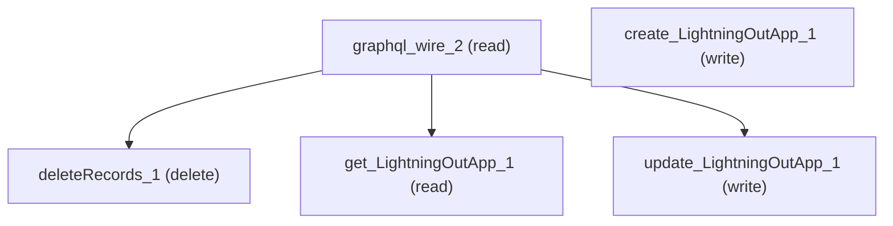

# Managing Lightning Out

## When to Use This Skill

Full lifecycle management of Lightning Out Apps — list, create, read, update, delete — without opening the Setup UI. The Setup page itself only lists (Setup GraphQL, 50 most recent) and deletes (Connect setup-entity adapter after a destructive confirm modal); create and edit on the page are navigations to a wizard, not API calls. This skill promotes the full CRUD surface to first-class steps: LightningOutApp is a Tooling-API metadata sObject (key prefix `1Us`; toolingApiAccess=always; all four CRUD verbs allowed per UDD), so create / get-by-id / update run as native Tooling sObject calls (verified live), while list stays on Setup GraphQL and delete on the page's Connect adapter. Every LightningOutApp has a restricted `Runtime` picklist (`CLWR` classic vs `LWR_CORE` label `LWR@Core`) that the Setup GraphQL list projection omits — use get-by-id or Tooling SOQL to see it. Permissions: ViewSetup to read; CustomizeApplication to create, update, or delete.

## Workflow

Full CRUD, all first-class steps.

- LIST — graphql_wire_2 (Setup GraphQL): up to 50 apps, newest first, projecting Id / ApplicationName / IsEnabled. NOTE it OMITS the Runtime picklist, DeveloperName and Language.
- CREATE — create_LightningOutApp_1 (Tooling sObject POST): required DeveloperName (unique API name, no spaces), MasterLabel (UI label), ApplicationName (the app to expose); optional IsEnabled (default false), Language (optional; server-defaulted to the org locale, e.g. en_US), Runtime (`CLWR` | `LWR_CORE`). Returns the new record's Id.
- GET — get_LightningOutApp_1 (Tooling GET by Id): full field set INCLUDING Runtime / DeveloperName / Language that the list step hides.
- UPDATE — update_LightningOutApp_1 (Tooling PATCH by Id): send only the fields to change; 204 on success.
- DELETE — deleteRecords_1 (Connect setup-entity adapter): the Setup page opens a destructive confirm modal first — replicate that gate. Do NOT loop deletes; each is an irreversible Tooling-backed delete. (Tooling sObject DELETE on `/tooling/sobjects/LightningOutApp/{id}` is the equivalent lateral verb if you're not on the Setup-shell binding.)

First-class concept — `Runtime` picklist. Every LightningOutApp has a restricted `Runtime` field (`CLWR` = classic Lightning Web Runtime; `LWR_CORE` label `LWR@Core`). Because the list step omits it, use get_LightningOutApp_1 or Tooling SOQL when the runtime distinction matters.

All Tooling CRUD steps bypass the Setup-shell access check, so gate them on ViewSetup (read) and CustomizeApplication (create / update / delete) at the caller.

## Critical Constraints

**Preconditions:**

- Caller must have the ViewSetup user permission (UDD access check `View Lightning Out access = UserPermissions.ViewSetup`) to read apps via graphql_wire_2 or get_LightningOutApp_1. (check: `UserPermissions.ViewSetup`)
- Create (create_LightningOutApp_1), update (update_LightningOutApp_1), and delete (deleteRecords_1) additionally require the CustomizeApplication user permission (UDD access check `Modify Lightning Out permission = Customize Application permission, UserPermissions.ViewSetup`). (check: `Customize Application permission`)

**Destructive operations — require explicit user confirmation:**

- **`deleteRecords_1`** — Delete one LightningOutApp record by recordId via the Connect setup-entity adapter (`force/ldsAdaptersSetupApi.deleteRecords` with `objectApiName: 'LightningOutApp'` and `setupEntityInputRepresentation.entities: [{ recordId }]`). The LWC opens a destructive ConfirmationModal first; only on confirm does it issue the call, then locally filters the row out and shows a success toast. recordId is the `id` from any graphql_wire_2 row.
  - Rollback: No automatic rollback.

## Operations Reference

Operations grouped by purpose. Use these as the building blocks for the workflows above.

### Summary

| Operation | Purpose | Status | Call | Depends on |
|-----------|---------|--------|------|------------|
| `graphql_wire_2` | read | — | `setup.query.LightningOutApp` | — |
| `deleteRecords_1` | delete | — | `deleteRecords` | `graphql_wire_2` |
| `create_LightningOutApp_1` | write | — | `sobjects/LightningOutApp` | — |
| `get_LightningOutApp_1` | read | — | `sobjects/LightningOutApp/{id}` | `graphql_wire_2` |
| `update_LightningOutApp_1` | write | — | `sobjects/LightningOutApp/{id}` | `graphql_wire_2` |

### Dependency graph

### Read operations

#### `graphql_wire_2`

Fetch up to 50 LightningOutApp records via Setup GraphQL (`setup.query.LightningOutApp`), ordered by LastModifiedDate desc. The query projects `Id`, `ApplicationName.value`, and `IsEnabled.value`. The LWC populates a sortable table with App Id, App Name, App Status columns; sorting after load is client-side.

**Call:** `setup.query.LightningOutApp`

**Output:** Setup-GraphQL value-wrap envelope under setup.query.LightningOutApp.edges[].node — each node carries Id (string, 18-char LightningOutApp record id, key prefix `1Us`), ApplicationName.value (string, the app's display name), IsEnabled.value (boolean, current activation status). Up to 50 entries, ordered LastModifiedDate desc. NOTE: the projection OMITS the restricted picklist `Runtime` (`CLWR` | `LWR_CORE` label `LWR@Core`) that distinguishes classic Lightning-Out apps from LWR@Core apps, as well as DeveloperName and Language. Callers that need Runtime or arbitrary field-set / WHERE-filters should switch to Tooling SOQL over `LightningOutApp` (see notes.coverage_gap on this step).

#### `get_LightningOutApp_1`

Read a single LightningOutApp record by Id via the Tooling sObject API (`GET /services/data/vXX.0/tooling/sobjects/LightningOutApp/{id}`). Unlike the Setup GraphQL list step, this projects the FULL field set — including the Runtime picklist, DeveloperName and Language that the list omits. The {id} is any `1Us` record Id (e.g. from graphql_wire_2 or create_LightningOutApp_1).

**Call:** `sobjects/LightningOutApp/{id}`

**Depends on:** `graphql_wire_2`

**Output:** Tooling sObject GET — 200 with the full record: Id, DeveloperName, MasterLabel, ApplicationName, IsEnabled (boolean), Runtime (`CLWR` | `LWR_CORE`), Language, plus audit fields (CreatedDate/CreatedById, LastModifiedDate/LastModifiedById, SystemModstamp, IsDeleted).

### Write operations

#### `create_LightningOutApp_1`

Create a new LightningOutApp record via the Tooling sObject API (`POST /services/data/vXX.0/tooling/sobjects/LightningOutApp`). Required body fields: DeveloperName (unique API name, no spaces), MasterLabel (UI display label), ApplicationName (the Aura/LWR app being exposed). Optional: IsEnabled (boolean, default false), Language (optional; server-defaulted to the org locale, e.g. en_US), Runtime (restricted picklist `CLWR` | `LWR_CORE`). This is a lateral programmatic surface — the Setup page routes 'New' to a navigation wizard rather than a direct create call.

**Call:** `sobjects/LightningOutApp`

**Output:** Tooling sObject create response — 201 with `{ id: <new 1Us record Id>, success: true, errors: [] }`. The returned id feeds get_LightningOutApp_1 / update_LightningOutApp_1 / deleteRecords_1.

**Notes:** required_fields: ['DeveloperName', 'MasterLabel', 'ApplicationName']; runtime_picklist: ['CLWR', 'LWR_CORE']

#### `update_LightningOutApp_1`

Update an existing LightningOutApp record by Id via the Tooling sObject API (`PATCH /services/data/vXX.0/tooling/sobjects/LightningOutApp/{id}`). Send only the fields to change in the body; omitted fields are left unchanged. This is a lateral programmatic surface — the Setup page routes 'Edit' to a navigation wizard rather than a direct update call.

Updateable fields (per the LightningOutApp Tooling describe, updateable=true): DeveloperName, MasterLabel, ApplicationName, IsEnabled, Runtime (`CLWR` | `LWR_CORE`), Language. The system/audit fields (Id, IsDeleted, CreatedDate/ById, LastModifiedDate/ById, SystemModstamp) are not updateable.

Verification precision: a live PATCH round-trip confirmed IsEnabled + MasterLabel (→ 204). The remaining updateable fields are confirmed by the object describe's per-field updateable=true flag, not by an individual live PATCH.

Cautions: DeveloperName is updateable but is the unique API name — renaming it is a breaking change for anything referencing the app by name; treat it as effectively immutable unless the caller explicitly wants a rename. Switching Runtime (`CLWR` ↔ `LWR_CORE`) is a behavioral migration between the classic and LWR@Core runtimes, not a cosmetic toggle — confirm intent before changing it.

**Call:** `sobjects/LightningOutApp/{id}`

**Depends on:** `graphql_wire_2`

**Output:** Tooling sObject PATCH — 204 No Content on success (empty body). Re-read via get_LightningOutApp_1 to confirm the new values.

**Notes:** runtime_picklist: ['CLWR', 'LWR_CORE']; updateable_fields: ['DeveloperName', 'MasterLabel', 'ApplicationName', 'IsEnabled', 'Runtime', 'Language']

### Destructive operations

#### `deleteRecords_1`

Delete one LightningOutApp record by recordId via the Connect setup-entity adapter (`force/ldsAdaptersSetupApi.deleteRecords` with `objectApiName: 'LightningOutApp'` and `setupEntityInputRepresentation.entities: [{ recordId }]`). The LWC opens a destructive ConfirmationModal first; only on confirm does it issue the call, then locally filters the row out and shows a success toast. recordId is the `id` from any graphql_wire_2 row.

**Call:** `deleteRecords`

**Depends on:** `graphql_wire_2`

**Output:** Connect setup-entity-adapter delete: promise resolves on success (the LWC discards the resolved value and removes the row locally); rejects with an error object whose `message` field surfaces in a UI error toast. Underlying delete is a Tooling-family delete on the LightningOutApp record (UDD declares `apiAccess=never` for the standard sObject family, only Tooling).
