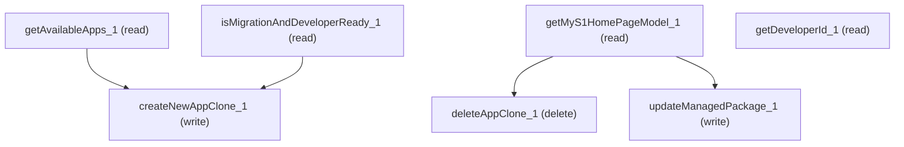

# Managing My Salesforce

## When to Use This Skill

MySalesforce1 setup home for non-CAMA Mobile Publisher app clones. Use this skill to read clone and readiness state, create eligible non-CAMA clones, acknowledge externally completed managed-package updates, delete clones, and read the registered developer identifier. CAMA creation through this Aura surface is rejected because CAMA is moving to Mobile App Designer; use the approved skill managing-mobile-publisher-connect-api-sfdc.mobile-publisher.connect.api-oas-67.0 for CAMA workflows.

## Workflow

Obtain the user's explicit permission immediately before every operation, including reads and writes. Read getMyS1HomePageModel for clones and capability flags. Before any create, isMigrationAndDeveloperReady must be true and getAvailableApps drives the appType selection. Thread createNewAppClone's AppCloneUIModel.id into updateManagedPackage or deleteAppClone. All writes refuse during ECA migration. This skill is approved only for non-CAMA app clones. Never call createNewAppClone with appType=CAMA or for an available-app entry whose hasCamaProject value is true. CAMA creation through this Aura surface is rejected because CAMA is moving to Mobile App Designer. Route CAMA requests to the approved skill managing-mobile-publisher-connect-api-sfdc.mobile-publisher.connect.api-oas-67.0. updateManagedPackage does not perform the external package installation: show the installPackageUrl, wait for the user to complete the installation, and obtain fresh explicit confirmation that it completed before calling updateManagedPackage to acknowledge the package update. Use getDeveloperId when the exact registered Mobile Publisher developer-account identifier is needed. For direct invocation, include className, action, params_schema, nested body, and query_params; never put parameter values in an args field.

## Critical Constraints

**Preconditions:**

- ECA migration must NOT be in progress for the org. Every operation on the mobile home surface throws AuraHandledException when AppCloneAccessCheck.IS_ECA_MIGRATION_IN_PROGRESS is true. (check: `AppCloneAccessCheck.IS_ECA_MIGRATION_IN_PROGRESS == false`)
- Caller must have View Setup permission, OR (in sandbox orgs) USER_HAS_MANAGED_ECAENABLED. Without one, getMyS1HomePageModel returns hasAccess=false and getAvailableApps returns an empty list. (check: `CAN_VIEW_APP_CLONE OR USER_HAS_MANAGED_ECAENABLED`)
- A Mobile Publisher developer-account id must be registered for the org before creating new clones. isMigrationAndDeveloperReady returns false until this is set. (check: `MobilePublisherDeveloperId org-pref set (non-blank)`)

**Destructive operations — require explicit user confirmation:**

- **`deleteAppClone_1`** — Deletes the AppClone by id. Honors org-level allowDelete pref and AppCloneStandardEntity validation; refuses during ECA migration. AURA-IS-CANONICAL — no Connect DELETE on /connect/mobilepublisher/appCloneApps/{id}; raw sObject DELETE bypasses both gates.
  - Rollback: No automatic rollback.

## Operations Reference

Operations grouped by purpose. Use these as the building blocks for the workflows above.

### Summary

| Operation | Purpose | Status | Call | Depends on |
|-----------|---------|--------|------|------------|
| `deleteAppClone_1` | delete | — | `DELETE /headless/invoke/platform/appclone-builder/delete-app-clone` | `getMyS1HomePageModel_1` |
| `getAvailableApps_1` | read | — | `GET /headless/invoke/platform/appclone-builder/get-available-apps` | — |
| `isMigrationAndDeveloperReady_1` | read | — | `GET /headless/invoke/platform/appclone-builder/is-migration-and-developer-ready` | — |
| `getMyS1HomePageModel_1` | read | — | `GET /headless/invoke/platform/appclone-builder` | — |
| `createNewAppClone_1` | write | — | `PATCH /headless/invoke/platform/appclone-builder/create-new-app-clone` | `getAvailableApps_1`, `isMigrationAndDeveloperReady_1` |
| `updateManagedPackage_1` | write | — | `PATCH /headless/invoke/platform/appclone-builder/update-managed-package` | `getMyS1HomePageModel_1` |
| `getDeveloperId_1` | read | — | `GET /headless/invoke/platform/appclone-setup/my-s1-home/get-developer-id` | — |

### Dependency graph

### Read operations

#### `getAvailableApps_1`

Lists AvailableApp entries for this org — each carries appType (AppCloneTypeEnum), license counts, displayName/icon, selectability, CAMA-pre-existence flag. Empty without View Setup. AURA-IS-CANONICAL — picklist describe on AppCloneTypeEnum drops the license + CAMA signals.

**Call:** `GET /headless/invoke/platform/appclone-builder/get-available-apps`

**Output:** AvailableApp[] with per-entry appType (AppCloneTypeEnum; live-observed members on this org: Salesforce1, MyCommunity — set is not closed, other orgs may expose more), appName, displayText, selectable, availableLicenses (int, remaining), totalLicences (int, British-spelling in wire), iconName, hasCamaProject. Empty array when caller lacks View Setup.

#### `isMigrationAndDeveloperReady_1`

Boolean readiness — true iff ECA migration NOT in progress AND caller has View Setup AND a non-blank Mobile Publisher developer id is registered. UI gates the create-affordance on this. AURA-IS-CANONICAL — composes three cross-feature signals no single sObject/Tooling field exposes.

**Call:** `GET /headless/invoke/platform/appclone-builder/is-migration-and-developer-ready`

**Output:** Boolean scalar. true when ECA migration is not in progress AND caller has View Setup AND a non-blank Mobile Publisher developer id is registered. false blocks the create-affordance in the UI.

#### `getMyS1HomePageModel_1`

Loads MyS1HomePageModel composing active+archived clones, available apps, ECA-migration flags, sandbox/prod, allowDelete, CAMA project+DistributionScope picklists, rename/archive gate, and per-user UX state. Returns hasAccess=false without CAN_VIEW_APP_CLONE / USER_HAS_MANAGED_ECAENABLED. AURA-IS-CANONICAL — AppClone sObject SOQL cannot reconstruct the cross-feature composition.

**Call:** `GET /headless/invoke/platform/appclone-builder`

**Output:** Composite model. appClones + archivedAppClones (AppCloneUIModel[]), availableApps (AvailableApp[]), org-state flags (isEcaMigrationOrgPrefEnabled, allowDelete, orgHasMyCommunity, orgHasEca, orgHasSAppEnabledForEca, isSandbox, isProjectRenameArchiveEnabled, hasArchivedAppClones, showPlannedMigrationWarning, hideCASwitcherModal), template (name required=true maxLength=50, isEcaEnabled, isArchived) constraining new clone names, and hasAccess=false when caller lacks View Setup / USER_HAS_MANAGED_ECAENABLED.

**Notes:** invocation_note: On mounts that support only direct-className dispatch, invoke via envelope body={className, action, params_schema, body, query_params} rather than {method, path, body, query_params}. Include every method parameter in params_schema and place argument values in the nested body. Route-mode envelopes 400 with 'className required for direct invocation' on such mounts.

#### `getDeveloperId_1`

Returns the Mobile Publisher developer-account identifier registered for this org, or null when the caller lacks View Setup. Refuses during ECA migration. Use this when the exact identifier is needed; isMigrationAndDeveloperReady only returns whether a non-blank identifier is present.

**Call:** `GET /headless/invoke/platform/appclone-setup/my-s1-home/get-developer-id`

**Output:** String developer-account identifier, or null when unavailable.

### Write operations

#### `createNewAppClone_1`

Provisions a non-CAMA AppClone. Before creation, require isMigrationAndDeveloperReady=true and a selectable matching entry from the current getAvailableApps response. Do not call this operation with appType=CAMA or for an entry whose hasCamaProject value is true. CAMA creation through this Aura surface is rejected; use the approved skill managing-mobile-publisher-connect-api-sfdc.mobile-publisher.connect.api-oas-67.0. Returns AppCloneUIModel and refuses during ECA migration.

**Call:** `PATCH /headless/invoke/platform/appclone-builder/create-new-app-clone`

**Depends on:** `getAvailableApps_1`, `isMigrationAndDeveloperReady_1`

#### `updateManagedPackage_1`

Acknowledges a managed-package update for the named clone and OS after the user has completed the external package installation using installPackageUrl. The controller forces the package-update lifecycle action regardless of the supplied lifecycleAction. Refuses during ECA migration. Do not call this operation to initiate or perform the package installation.

**Call:** `PATCH /headless/invoke/platform/appclone-builder/update-managed-package`

**Depends on:** `getMyS1HomePageModel_1`

### Destructive operations

#### `deleteAppClone_1`

Deletes the AppClone by id. Honors org-level allowDelete pref and AppCloneStandardEntity validation; refuses during ECA migration. AURA-IS-CANONICAL — no Connect DELETE on /connect/mobilepublisher/appCloneApps/{id}; raw sObject DELETE bypasses both gates.

**Call:** `DELETE /headless/invoke/platform/appclone-builder/delete-app-clone`

**Depends on:** `getMyS1HomePageModel_1`
