# Managing Navigation Menus

## When to Use This Skill

Manage Navigation Menus (App Manager) — this setup page lets administrators view, clone, and delete Lightning apps and navigation menus. It surfaces a list of apps via list views, allows inspecting individual app definitions, cloning an existing app as a starting point for a new one, and permanently removing apps. Use this SOR when a user needs to administer the set of Lightning apps available in their org, including deleting obsolete apps or cloning existing ones for customization.

## Critical Constraints

**Destructive operations — require explicit user confirmation:**

- **`delete-app`** — Delete app.
  - Rollback: No automatic rollback.

## Verification Checklist

After every write operation, confirm the effect by re-reading state:

- After `update-app`: call `verify-update-app` (`GET /headless/invoke/platform/navigation-menus`)
- After `delete-app`: call `verify-delete-app` (`GET /headless/invoke/platform/navigation-menus`)

## Operations Reference

Operations grouped by purpose. Use these as the building blocks for the workflows above.

### Summary

| Operation | Purpose | Status | Call | Depends on |
|-----------|---------|--------|------|------------|
| `create-app` | write | implemented | `PATCH /headless/invoke/platform/navigation-menus/create-app` | — |
| `update-app` | write | implemented | `PATCH /headless/invoke/platform/navigation-menus/update-app` | — |
| `verify-update-app` | verify | — | `GET /headless/invoke/platform/navigation-menus` | `update-app` |
| `delete-app` | delete | implemented | `DELETE /headless/invoke/platform/navigation-menus/delete-app` | — |
| `verify-delete-app` | verify | — | `GET /headless/invoke/platform/navigation-menus` | `delete-app` |
| `verify-create-app` | read | implemented | `GET /headless/invoke/platform/navigation-menus` | — |
| `get-cloned-app` | read | implemented | `GET /headless/invoke/platform/navigation-menus/get-cloned-app` | — |
| `is-developer-name-unique` | read | implemented | `GET /headless/invoke/platform/navigation-menus/is-developer-name-unique` | — |
| `upgrade-app` | write | implemented | `PATCH /headless/invoke/platform/navigation-menus/upgrade-app` | — |
| `get-list-views` | read | implemented | `GET /headless/invoke/platform/navigation-menus/get-list-views` | — |
| `ported-app-image-upload-controller-get-document-rendition-url` | — | implemented | `GET /headless/invoke/platform/nav-setup/app-image-upload/get-document-rendition-url` | — |
| `ported-app-image-upload-controller-delete-document` | — | implemented | `DELETE /headless/invoke/platform/nav-setup/app-image-upload/delete-document` | `app-image-upload-controller-get-document-rendition-url` |
| `ported-utility-bar-setup-controller-get-initialized-utility-bar-page` | — | implemented | `GET /headless/invoke/platform/nav-setup/utility-bar-setup/get-initialized-utility-bar-page` | — |
| `ported-utility-bar-setup-controller-get-utility-bar-page` | — | implemented | `GET /headless/invoke/platform/nav-setup/utility-bar-setup/get-utility-bar-page` | — |
| `ported-utility-bar-setup-controller-get-clone-utility-bar-page-node` | — | implemented | `GET /headless/invoke/platform/nav-setup/utility-bar-setup/get-clone-utility-bar-page-node` | `utility-bar-setup-controller-get-utility-bar-page` |

### Dependency graph

```mermaid
graph TD
  create_app["create-app (write)"]
  update_app["update-app (write)"]
  verify_update_app["verify-update-app (verify)"]
  delete_app["delete-app (delete)"]
  verify_delete_app["verify-delete-app (verify)"]
  verify_create_app["verify-create-app (read)"]
  get_cloned_app["get-cloned-app (read)"]
  is_developer_name_unique["is-developer-name-unique (read)"]
  upgrade_app["upgrade-app (write)"]
  get_list_views["get-list-views (read)"]
  ported_app_image_upload_controller_get_document_rendition_url["ported-app-image-upload-controller-get-document-rendition-url"]
  ported_app_image_upload_controller_delete_document["ported-app-image-upload-controller-delete-document"]
  ported_utility_bar_setup_controller_get_initialized_utility_bar_page["ported-utility-bar-setup-controller-get-initialized-utility-bar-page"]
  ported_utility_bar_setup_controller_get_utility_bar_page["ported-utility-bar-setup-controller-get-utility-bar-page"]
  ported_utility_bar_setup_controller_get_clone_utility_bar_page_node["ported-utility-bar-setup-controller-get-clone-utility-bar-page-node"]
  update_app --> verify_update_app
  delete_app --> verify_delete_app
```

### Read operations

#### `verify-create-app`

Get app.

**Call:** `GET /headless/invoke/platform/navigation-menus`   — status: `implemented`

**Inputs:**

- `id` *(`String`)*

#### `get-cloned-app`

Get cloned app.

**Call:** `GET /headless/invoke/platform/navigation-menus/get-cloned-app`   — status: `implemented`

**Inputs:**

- `id` *(`String`)*

#### `is-developer-name-unique`

Is developer name unique.

**Call:** `GET /headless/invoke/platform/navigation-menus/is-developer-name-unique`   — status: `implemented`

**Inputs:**

- `developerName` *(`String`)*

#### `get-list-views`

Get list views.

**Call:** `GET /headless/invoke/platform/navigation-menus/get-list-views`   — status: `implemented`

### Write operations

#### `create-app`

Create app.

**Call:** `PATCH /headless/invoke/platform/navigation-menus/create-app`   — status: `implemented`

**Inputs:**

- `model` *(`Map<String, Object>`)* — Value for model.
- `quickSave` *(`Boolean`)* — Toggle the quick save preference on or off.
- `utilityBarPage` *(`PageNode`)* — Value for utility bar page.
  - schema: `#/components/schemas/PageNode`

**Notes:** reject_on_attestation: Gate before autonomous invocation — writes app metadata and adds/removes the permission-set/profile rows that control which profiles can see the app, plus app-icon and Utility Bar configuration side effects. Permission-gated, but has zero live-validation evidence in this node's history and has no natural way to read back and confirm the result afterward. Not a confirmed bug — held pending live E2E confirmation and human attestation given the permission-set side effects.

#### `update-app`

Update app.

**Call:** `PATCH /headless/invoke/platform/navigation-menus/update-app`   — status: `implemented`

**Inputs:**

- `model` *(`Map<String, Object>`)* — Value for model.
- `utilityBarPage` *(`PageNode`)* — Value for utility bar page.
  - schema: `#/components/schemas/PageNode`

**Notes:** reject_on_attestation: Gate before autonomous invocation — same permission-set visibility and app-icon/Utility-Bar side effects as create-app. Permission-gated, has a chained follow-up read step that can confirm the result, but neither step has ever been live-validated. Held pending live E2E confirmation and human attestation.

#### `upgrade-app`

Upgrade app.

**Call:** `PATCH /headless/invoke/platform/navigation-menus/upgrade-app`   — status: `implemented`

**Inputs:**

- `id` *(`String`)* — Value for the id field.
- `label` *(`String`)* — Value for the label field.
- `developerName` *(`String`)* — Name of the developer.
- `preserveProfileSetting` *(`boolean`)* — Toggle the preserve profile setting preference on or off.

**Notes:** reject_on_attestation: Two-sided mutation: creates a new app cloned from an existing app's metadata AND mutates the old app in place, plus copies permission-set assignments to the new app. No natural way to read back and confirm the result afterward. Never live-validated. Too high-blast-radius and hard-to-reverse for autonomous invocation without human attestation.

### Verify operations

#### `verify-update-app`

Verify the effect of update-app: read back the current value via the companion read to confirm the write took effect.

**Call:** `GET /headless/invoke/platform/navigation-menus`

**Inputs:**

- `id` *(`String`)*

**Depends on:** `update-app`

#### `verify-delete-app`

Verify the effect of delete-app: read back the current value via the companion read to confirm the write took effect.

**Call:** `GET /headless/invoke/platform/navigation-menus`

**Inputs:**

- `id` *(`String`)*

**Depends on:** `delete-app`

### Destructive operations

#### `delete-app`

Delete app.

**Call:** `DELETE /headless/invoke/platform/navigation-menus/delete-app`   — status: `implemented`

**Inputs:**

- `id` *(`String`)*

**Notes:** reject_on_attestation: Irreversible delete of an app with cascading removal of its per-profile visibility, its utility-bar configuration, and its icon asset. Permission-gated, but never live-validated — the same risk class this repo gates to reject_on_attestation even when a similar delete is proven sound elsewhere; here soundness is unconfirmed. Do not auto-invoke; require explicit human attestation per invocation.

### Other operations

#### `ported-app-image-upload-controller-get-document-rendition-url`

Retrieve the rendition URL for a document that serves as the app's logo/icon. Used to display the current branding image in the app editor or preview.

**Call:** `GET /headless/invoke/platform/nav-setup/app-image-upload/get-document-rendition-url`   — status: `implemented`

#### `ported-app-image-upload-controller-delete-document`

Delete the document record that stores the app's custom logo. After deletion the app reverts to the default Salesforce icon.

**Call:** `DELETE /headless/invoke/platform/nav-setup/app-image-upload/delete-document`   — status: `implemented`

**Depends on:** `app-image-upload-controller-get-document-rendition-url`

**Notes:** reject_on_attestation: Irreversible delete of the file record backing the app's icon image. Defensively scoped — this step validates that the target record is actually the expected file-record type before deleting, so it cannot be redirected to delete an unrelated record — and permission-gated, but ported without ever receiving its own adoption review (unlike its sibling read step). Narrower blast radius than delete-app, but still an unreviewed irreversible delete; held to the same reject_on_attestation floor pending review.

#### `ported-utility-bar-setup-controller-get-initialized-utility-bar-page`

Fetch the fully initialized Utility Bar page model for a Lightning App, including available utility components and their default settings. Used when the admin first opens the Utility Bar panel in the app wizard.

**Call:** `GET /headless/invoke/platform/nav-setup/utility-bar-setup/get-initialized-utility-bar-page`   — status: `implemented`

#### `ported-utility-bar-setup-controller-get-utility-bar-page`

Retrieve the current Utility Bar configuration for an app, listing the utility items already added and their property values. Used to render the existing utility bar layout in the editor.

**Call:** `GET /headless/invoke/platform/nav-setup/utility-bar-setup/get-utility-bar-page`   — status: `implemented`

#### `ported-utility-bar-setup-controller-get-clone-utility-bar-page-node`

Obtain a cloned copy of a Utility Bar page node (a single utility item configuration) so the admin can duplicate an existing utility item within the same or a different app's utility bar.

**Call:** `GET /headless/invoke/platform/nav-setup/utility-bar-setup/get-clone-utility-bar-page-node`   — status: `implemented`

**Depends on:** `utility-bar-setup-controller-get-utility-bar-page`
