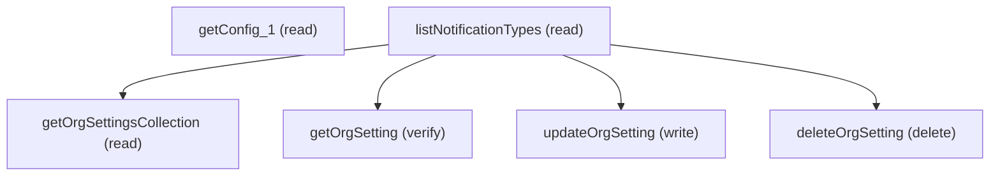

# Managing Notification Types Manager

## When to Use This Skill

Notification Types Manager is the Setup page where admins configure per-type delivery
channels (desktop, email, mobile, slack) for both standard system notifications and
admin-defined custom notification types. The canonical wire surface is the
Notifications Connect API at /services/data/v67.0/connect/notifications/* — it covers
type enumeration, org-level setting reads, per-type updates, and resets. The Aura
`getConfig` step returns the page-bootstrap wrapper (perm flags, feature gates, label
bundles) and is kept only because the Connect API has no equivalent wrapper.

Customer scenarios:
- Enable email delivery for the standard "Approval Request" notification org-wide.
- Roll out a new custom notification type to mobile + desktop only.
- Audit which org-level notification settings deviate from default.
- Reset a single type's settings to defaults (delete row → POST recreates with defaults
  on next change).

Variant axis: org-level (this SOR — POST/GET /settings/organization/...) vs user-level
(NotificationsSettings node — /settings/user/*) vs app-level (per connected app —
/app-settings/*). All three share the NotificationSettingsRepresentation shape but
target different scopes.

Required precondition: org has Notifications enabled
(Notifications enabled); without it every Connect endpoint returns
`403 FUNCTIONALITY_NOT_ENABLED [Notifications]`. The Aura controller mirrors the
same gate via `setupUtil.hasViewSetup()` and the View Setup user permission.

## Workflow

Workflow: (1) `listNotificationTypes` to enumerate notificationTypeOrId values
(use developerName or 18-char Id thereafter); (2) `getOrgSettingsCollection` to
read current org-level toggles for every type; (3) `updateOrgSetting` to flip
desktop/email/mobile/slack flags per type; (4) `getOrgSetting` to verify the write
reflected; (5) `deleteOrgSetting` to revert to defaults. The `getConfig_1` page
bootstrap is read only when the agent is mirroring page-load state for UI parity
— for any read/write of actual settings, use the Connect API steps.

## Critical Constraints

**Preconditions:**

- Org has Notifications feature enabled. Without it every Connect API endpoint returns 403 FUNCTIONALITY_NOT_ENABLED [Notifications]. (check: `org-access-check Notifications enabled`)
- Caller has the View Setup user permission (Aura `getConfig` enforces via `setupUtil.hasViewSetup()`). (check: `user has View Setup`)

**Destructive operations — require explicit user confirmation:**

- **`deleteOrgSetting`** — Remove the explicit org-level setting for `notificationTypeOrId`. The next
read returns the system default (typically all channels enabled for standard
types). Use as rollback target for `updateOrgSetting` when the prior state
was "no override".
  - Rollback: No automatic rollback.

## Verification Checklist

After every write operation, confirm the effect by re-reading state:

- After `listNotificationTypes`: call `getOrgSetting` (`GET /services/data/v67.0/connect/notifications/settings/organization/{notificationTypeOrId}`)

## Operations Reference

Operations grouped by purpose. Use these as the building blocks for the workflows above.

### Summary

| Operation | Purpose | Status | Call | Depends on |
|-----------|---------|--------|------|------------|
| `getConfig_1` | read | — | `GET /headless/invoke/platform/notification-types-manager/get-config` | — |
| `listNotificationTypes` | read | — | `GET /services/data/v67.0/connect/notifications/types` | — |
| `getOrgSettingsCollection` | read | — | `GET /services/data/v67.0/connect/notifications/settings/organization` | `listNotificationTypes` |
| `getOrgSetting` | verify | — | `GET /services/data/v67.0/connect/notifications/settings/organization/{notificationTypeOrId}` | `listNotificationTypes` |
| `updateOrgSetting` | write | — | `POST /services/data/v67.0/connect/notifications/settings/organization/{notificationTypeOrId}` | `listNotificationTypes` |
| `deleteOrgSetting` | delete | — | `DELETE /services/data/v67.0/connect/notifications/settings/organization/{notificationTypeOrId}` | `listNotificationTypes` |

### Dependency graph

### Read operations

#### `getConfig_1`

Read the Notification Types Manager page-bootstrap wrapper
(`NotificationTypesManagerConfig`) — perm flags, feature gates, label bundles for
the Setup page. No public Connect / Tooling / Metadata / sObject alternative —
Aura controller is canonical for this wrapper. Use the sibling Connect API steps
for the actual notification-type settings.

**Call:** `GET /headless/invoke/platform/notification-types-manager/get-config`

**Output:** NotificationTypesManagerConfig wrapper carrying page-init state (perm flags,
feature toggles, label-localization bundles). Schema is internal to the Aura
controller (not surfaced through Connect); treat as opaque from an automation
perspective.

#### `listNotificationTypes`

Enumerate all notification types (standard + custom). Returns
NotificationTypeRepresentation rows carrying `apiName`, `id`, `label`,
`namespace`, `actionGroups`. Use the returned `apiName` (preferred) or 18-char
`id` as `notificationTypeOrId` on subsequent /settings/organization/* calls.

**Call:** `GET /services/data/v67.0/connect/notifications/types`

**Output:** `{notificationTypes: [{id, apiName, label, namespace, actionGroups}]}` —
type catalog for the org.

#### `getOrgSettingsCollection`

Bulk read of every org-level notification setting in one call. Substitutes the
Aura controller's `getStandardNotificationTypesSettings` +
`getCustomNotificationTypesSettings` page-row reads with one typed Connect
response. Use this as the canonical "current state" view before computing diffs
for `updateOrgSetting`.

**Call:** `GET /services/data/v67.0/connect/notifications/settings/organization`

**Depends on:** `listNotificationTypes`

**Output:** `{notificationSettings: [NotificationSettingsRepresentation]}` —
each row: desktopEnabled, emailEnabled, mobileEnabled, slackEnabled,
multiChannelSlackEnabled, notificationLabel, notificationTypeName,
notificationTypeNamespace, notificationTypeOrId.

### Write operations

#### `updateOrgSetting`

Flip the desktop / email / mobile / slack flag(s) for one notification type
org-wide. Body keys (any subset; omitted keys preserve current state):
desktopEnabled, emailEnabled, mobileEnabled, slackEnabled. Returns the
post-update NotificationSettingsRepresentation echoing all four flags +
metadata. Replaces the Aura `saveSettings(List<Map<String,Object>>)` batch with
typed per-type writes.

**Call:** `POST /services/data/v67.0/connect/notifications/settings/organization/{notificationTypeOrId}`

**Inputs:**

- `notificationTypeOrId` *(`String`)* — Notification type developerName or 18-char Id.
- `desktopEnabled` *(`Boolean`)* — Enable desktop delivery.
- `emailEnabled` *(`Boolean`)* — Enable email delivery.
- `mobileEnabled` *(`Boolean`)* — Enable mobile (push) delivery.
- `slackEnabled` *(`Boolean`)* — Enable Slack delivery (requires multiChannelSlackEnabled at org level).

**Depends on:** `listNotificationTypes`

**Rollback:** deleteOrgSetting

### Verify operations

#### `getOrgSetting`

Read a single org-level notification setting by `notificationTypeOrId`
(apiName preferred — e.g. `ApprovalRequest` — or 18-char Id). Use after
`updateOrgSetting` to confirm the channel flags reflected.

**Call:** `GET /services/data/v67.0/connect/notifications/settings/organization/{notificationTypeOrId}`

**Inputs:**

- `notificationTypeOrId` *(`String`)* — Notification type developerName (e.g. `ApprovalRequest`) or 18-char Id
from `listNotificationTypes`.

**Depends on:** `listNotificationTypes`

**Output:** Single NotificationSettingsRepresentation: desktopEnabled, emailEnabled,
mobileEnabled, slackEnabled, multiChannelSlackEnabled, notificationLabel,
notificationTypeName, notificationTypeNamespace, notificationTypeOrId.

### Destructive operations

#### `deleteOrgSetting`

Remove the explicit org-level setting for `notificationTypeOrId`. The next
read returns the system default (typically all channels enabled for standard
types). Use as rollback target for `updateOrgSetting` when the prior state
was "no override".

**Call:** `DELETE /services/data/v67.0/connect/notifications/settings/organization/{notificationTypeOrId}`

**Inputs:**

- `notificationTypeOrId` *(`String`)* — Notification type developerName or 18-char Id.

**Depends on:** `listNotificationTypes`
