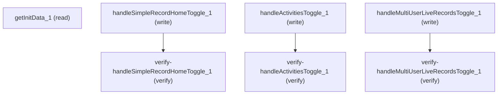

# Managing Simple Record Home

## When to Use This Skill

Setup-page controller for Simple Record Home — three org-wide preferences (master enable; Related-List vs Activities-Timeline view; Multi-User Live Records), plus a composite `getInitData` read that returns the activities-view enum and the provisioning gates. The canonical authoring surface differs per write: master-enable and related-list-view are declarative Metadata `RecordPageSettings` fields — prefer a Metadata deploy over the Aura toggle to persist them org-wide; Multi-User Live Records has no declarative equivalent, so its Aura toggle is canonical. All Aura steps stay dispatchable (and are the only surface on dispatcher-only orgs). See each step for the org-pref name, its `RecordPageSettings` field where one exists, the provisioning gate, and read-back guidance.

## Verification Checklist

After every write operation, confirm the effect by re-reading state:

- After `handleSimpleRecordHomeToggle_1`: call `verify-handleSimpleRecordHomeToggle_1` (`GET /headless/invoke/platform/force/simple-record-home-setup-page/get-init-data`)
- After `handleActivitiesToggle_1`: call `verify-handleActivitiesToggle_1` (`GET /headless/invoke/platform/force/simple-record-home-setup-page/get-init-data`)
- After `handleMultiUserLiveRecordsToggle_1`: call `verify-handleMultiUserLiveRecordsToggle_1` (`GET /headless/invoke/platform/force/simple-record-home-setup-page/get-init-data`)

## Operations Reference

Operations grouped by purpose. Use these as the building blocks for the workflows above.

### Summary

| Operation | Purpose | Status | Call | Depends on |
|-----------|---------|--------|------|------------|
| `getInitData_1` | read | — | `GET /headless/invoke/platform/force/simple-record-home-setup-page/get-init-data` | — |
| `handleSimpleRecordHomeToggle_1` | write | — | `PATCH /headless/invoke/platform/force/simple-record-home-setup-page/handle-simple-record-home-toggle` | — |
| `handleActivitiesToggle_1` | write | — | `PATCH /headless/invoke/platform/force/simple-record-home-setup-page/handle-activities-toggle` | — |
| `handleMultiUserLiveRecordsToggle_1` | write | — | `PATCH /headless/invoke/platform/force/simple-record-home-setup-page/handle-multi-user-live-records-toggle` | — |
| `verify-handleSimpleRecordHomeToggle_1` | verify | — | `GET /headless/invoke/platform/force/simple-record-home-setup-page/get-init-data` | `handleSimpleRecordHomeToggle_1` |
| `verify-handleActivitiesToggle_1` | verify | — | `GET /headless/invoke/platform/force/simple-record-home-setup-page/get-init-data` | `handleActivitiesToggle_1` |
| `verify-handleMultiUserLiveRecordsToggle_1` | verify | — | `GET /headless/invoke/platform/force/simple-record-home-setup-page/get-init-data` | `handleMultiUserLiveRecordsToggle_1` |

### Dependency graph

### Read operations

#### `getInitData_1`

Reads the Simple Record Home Setup page state. Requires Customize Application; returns null otherwise. Observed body on a fresh (non-provisioned) org carries four fields: `isEacEnabled`, `isLexEnabled`, `recordHomeActivitiesDisplaySetting` (enum: `TIMELINE` | `RELATED_LIST`), and `recordHomeActivitiesDisplayOptions` (radio-option label list). Additional fields (`isSRHAllowed`, `isMultiUserLiveRecordsAllowed`, and the three persisted-preference booleans `isSimpleRecordHomeEnabled` / `isRelatedListEnabled` / `isMultiUserLiveRecordsEnabled`) are provisioning-conditional — they surface once SRH is enabled for the org. AURA-IS-CANONICAL — the composite response cannot be reconstructed from a raw persistence read.

**Call:** `GET /headless/invoke/platform/force/simple-record-home-setup-page/get-init-data`

### Write operations

#### `handleSimpleRecordHomeToggle_1`

PATCH the org-wide SRH master-enable preference (org-pref `SRHSimpleRecordHomeEnabled`). Requires Customize Application AND the `SRHSimpleRecordHomeAllowed` provisioning gate (surfaced as `isSRHAllowed` in `getInitData_1`). CANONICAL SURFACE: this preference maps to a declarative Metadata field — `RecordPageSettings.enableFullRecordView` — so to persist it org-wide, deploy `RecordPageSettings` via the Metadata API. This Aura toggle is NOT the canonical authoring surface — it stays callable (and is the only surface wired on dispatcher-only orgs), but the generic org-preference Connect endpoint (`PATCH /services/data/vXX/setup/org/preferences/{name}`) does NOT accept this pref (allowlist-gated → 404). The response body echoes the caller-supplied `toggleValue` rather than a persistence outcome — chain `verify-handleSimpleRecordHomeToggle_1` and read `isSimpleRecordHomeEnabled` for the authoritative read-back (absent on non-provisioned orgs).

**Call:** `PATCH /headless/invoke/platform/force/simple-record-home-setup-page/handle-simple-record-home-toggle`

#### `handleActivitiesToggle_1`

Sets the Related-List vs Activities-Timeline preference (org-pref `SRHRelatedListViewEnabled`). `toggleValue: true` selects the Related-List view; `toggleValue: false` selects the Activities Timeline. Requires Customize Application and that Einstein Activity Capture is OFF (EAC forces Timeline; the call returns `false` while EAC is on). CANONICAL SURFACE: this preference maps to a declarative Metadata field — `RecordPageSettings.enableActivityRelatedList` — so deploy `RecordPageSettings` via the Metadata API to persist org config. This Aura toggle is NOT the canonical authoring surface (the generic org-preference Connect endpoint does not accept it — 404, allowlist-gated) but stays callable for driving the Setup page / dispatcher-only orgs. Request-body contract is permissive: a missing body, an unknown field, or a wrong-typed `toggleValue` all silently coerce to `false` and process as a write — construct the body carefully, no client-facing validation error surfaces. Chain `verify-handleActivitiesToggle_1` and read `recordHomeActivitiesDisplaySetting` (`TIMELINE` | `RELATED_LIST`) for the authoritative read-back.

**Call:** `PATCH /headless/invoke/platform/force/simple-record-home-setup-page/handle-activities-toggle`

#### `handleMultiUserLiveRecordsToggle_1`

PATCH the multi-user-live-records org preference (org-pref `MultiUserLiveRecords`). Requires Customize Application AND the `isMultiUserLiveRecordsAllowed` provisioning gate (surfaced from `getInitData_1`; gated by `RecordInvalidationEnabled`). CANONICAL SURFACE: unlike the other two SRH writes, this preference has NO declarative/Metadata equivalent — it is not exposed as a `RecordPageSettings` field, and the generic org-preference Connect endpoint does not accept it (404, allowlist-gated). This Aura toggle is therefore the canonical programmatic surface for this preference. The response body echoes the caller-supplied `toggleValue` rather than a persistence outcome — chain `verify-handleMultiUserLiveRecordsToggle_1` and read `isMultiUserLiveRecordsEnabled` for the authoritative read-back (absent on non-provisioned orgs).

**Call:** `PATCH /headless/invoke/platform/force/simple-record-home-setup-page/handle-multi-user-live-records-toggle`

### Verify operations

#### `verify-handleSimpleRecordHomeToggle_1`

Re-reads the Setup-page Model after `handleSimpleRecordHomeToggle_1` to confirm the master SRH preference persisted. Same underlying operation as `getInitData_1`; the persisted value surfaces as `isSimpleRecordHomeEnabled` in the response only once SRH is provisioned for the org.

**Call:** `GET /headless/invoke/platform/force/simple-record-home-setup-page/get-init-data`

**Depends on:** `handleSimpleRecordHomeToggle_1`

#### `verify-handleActivitiesToggle_1`

Re-reads the Setup-page Model after `handleActivitiesToggle_1` to confirm the activities-view preference persisted. The persisted value surfaces as `recordHomeActivitiesDisplaySetting` (`TIMELINE` | `RELATED_LIST`) — the enum is observable on every org (unlike the provisioning-conditional booleans).

**Call:** `GET /headless/invoke/platform/force/simple-record-home-setup-page/get-init-data`

**Depends on:** `handleActivitiesToggle_1`

#### `verify-handleMultiUserLiveRecordsToggle_1`

Re-reads the Setup-page Model after `handleMultiUserLiveRecordsToggle_1` to confirm the multi-user-live-records preference persisted. The persisted value surfaces as `isMultiUserLiveRecordsEnabled` in the response only once SRH is provisioned; a non-provisioned org will not surface this field.

**Call:** `GET /headless/invoke/platform/force/simple-record-home-setup-page/get-init-data`

**Depends on:** `handleMultiUserLiveRecordsToggle_1`

## Notes

- **factory_gaps:** {'kind': 'extractor_bug', 'step_id': 'getInitData_1', 'observed': 'The base SOR emitted `GET /headless/invoke/platform/simple-record-home/get-init-data`; a live probe returned "No controller mapping" on the target org.', 'correct': 'GET /headless/invoke/platform/force/simple-record-home-setup-page/get-init-data — matches the pattern the three PATCH write steps already use.', 'scope': "The same emit affects the spec's four path keys (all under the wrong prefix). SOR path + spec path keys corrected via overlays; source fix belongs in the pipeline-v2 emitter."}, {'kind': 'probe_environment', 'symptom': '`/headless/metadata` returns "No controller mapping" on the dev org — the Metadata-API deploy surface is not routed there.', 'impact': "The canonical `RecordPageSettings` deploy (enableFullRecordView / enableActivityRelatedList) could not be exercised live on this org; the org-pref → RecordPageSettings mapping was instead confirmed from the platform's canonical metadata definition.", 'disposition': 'Bucket-III coverage_gap RESOLVED (see `/notes/coverage_gap`). Canonical declarative surface confirmed via Core for two of the three writes; AURA-IS-CANONICAL overturned for those two and retained only for multi-user-live-records (no declarative equivalent) + the getInitData composite read.'}
