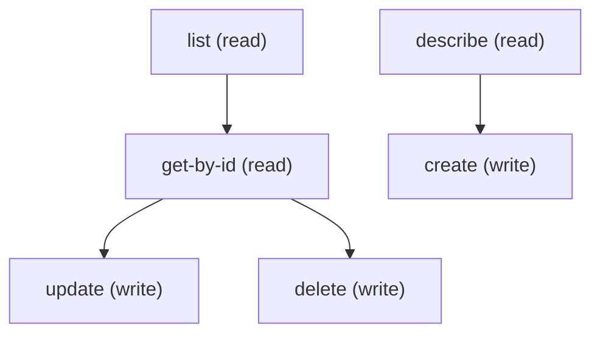

# Managing Appt Booking Config

## When to Use This Skill

Manage the Appointment Booking Config record (ApptBookingConfig), the parent setup record that tells Health Cloud Patient Appointment Scheduling how to reach a scheduling system. Use standard sObject REST (/services/data/v67.0/sobjects/ApptBookingConfig) for describe, query, get, create, update and delete. The Intelligent Appointment Management skill relies on an active config with ApptBookingUrlConfig children for slot search and booking; this skill covers the config record itself. Only one record may have IsActive=true. To create, send DeveloperName (unique) and MasterLabel; everything else is optional. Without other values a new record is created with IsActive=false, IsSingleSourceSystem=false, CanCreateDuplicateRecord=true and Language=en_US, so send IsActive=true to make it the active config. Optional fields seen on a working configuration: NamedCredentialId and ApexClassId (to reach an external scheduling system), AssignedProviderRole, AttendanceThresholdPct, ServiceApptRecordTypeName, BestTimeSlotsDefinition and GetSlotStatusTimeout. Create the config first, then its ApptBookingUrlConfig children (see the ApptBookingUrlConfig skill). To remove, delete the children first, then the config. Requires Patient Appointment Scheduling to be on and the Health Cloud license.

## Workflow

Call describe first and build payloads from the createable fields. Before activating, query ApptBookingConfig for IsActive=true: creating or activating a second one fails with "There's already an active appointment scheduling configuration record. Deactivate it to use this one." To switch configs, set the old record IsActive to false first. GetSlotStatusTimeout, if set, must be 0 to 60,000 (milliseconds); other values fail with "Enter a Get Slot Status Timeout value from 0 through 60,000." DeveloperName must be unique. Lookups are named NamedCredentialId and ApexClassId in the REST payload and are optional. After creating the config, create its ApptBookingUrlConfig children. Delete the URL-config children before the parent: deleting a config that still has children fails with a dependency error.

## Critical Constraints

**Preconditions:**

- The user needs create, read, update and delete access to ApptBookingConfig (Customize Application permission is required to create, edit or delete). (check: `<udd:crud:ApptBookingConfig>`)
- Patient Appointment Scheduling must be turned on in the org, and the org must hold the Health Cloud license. (check: `Patient Appointment Scheduling enabled`)
- Only one ApptBookingConfig can be active at a time. Query for an existing active record before activating a new one.
- To reach an external scheduling system, a Named Credential for that system must exist first; an Apex class implementing the booking interface is optional.

## Operations Reference

Operations grouped by purpose. Use these as the building blocks for the workflows above.

### Summary

| Operation | Purpose | Status | Call | Depends on |
|-----------|---------|--------|------|------------|
| `describe` | read | — | `GET /services/data/v67.0/sobjects/ApptBookingConfig/describe` | — |
| `list` | read | — | `GET /services/data/v67.0/query` | — |
| `get-by-id` | read | — | `GET /services/data/v67.0/sobjects/ApptBookingConfig/{Id}` | `list` |
| `create` | write | — | `POST /services/data/v67.0/sobjects/ApptBookingConfig` | `describe` |
| `update` | write | — | `PATCH /services/data/v67.0/sobjects/ApptBookingConfig/{Id}` | `get-by-id` |
| `delete` | write | — | `DELETE /services/data/v67.0/sobjects/ApptBookingConfig/{Id}` | `get-by-id` |

### Dependency graph

### Read operations

#### `describe`

Retrieve the ApptBookingConfig sObject describe — fields, picklist values, FLS, createable/updateable flags.

**Call:** `GET /services/data/v67.0/sobjects/ApptBookingConfig/describe`

**Output:** DescribeSObjectResult for ApptBookingConfig — use this to build the field list for list / create / update payloads.

#### `list`

List ApptBookingConfig records. Pair this with /describe first to pick field names.

**Call:** `GET /services/data/v67.0/query`

**Inputs:**

- `where` *(`String`)* — Optional SOQL WHERE clause to filter Appt Booking Config records.
- `limit` *(`int`)* — Optional SOQL LIMIT value.
- `q` *(`string`)*

**Output:** Query response with records[] of ApptBookingConfig — Id plus any SELECTed fields.

#### `get-by-id`

Retrieve a specific ApptBookingConfig record by Id.

**Call:** `GET /services/data/v67.0/sobjects/ApptBookingConfig/{Id}`

**Inputs:**

- `Id` *(`ID`)* — Id of the ApptBookingConfig record to fetch.

**Depends on:** `list`

**Output:** Single ApptBookingConfig record with all readable fields per user FLS.

### Write operations

#### `create`

Create an ApptBookingConfig record. Required: DeveloperName and MasterLabel. A new record defaults to IsActive=false, IsSingleSourceSystem=false, CanCreateDuplicateRecord=true; send IsActive=true to activate it. Only one config can be active; activating a second fails and the old one must be deactivated first. GetSlotStatusTimeout, if set, must be 0 to 60,000. Add NamedCredentialId (and optionally ApexClassId) only when integrating an external scheduling system.

**Call:** `POST /services/data/v67.0/sobjects/ApptBookingConfig`

**Inputs:**

- `body` *(`object`)* — Field/value map for the new ApptBookingConfig. Populate from /describe's createableFields list.

**Depends on:** `describe`

**Rollback:** Call delete with the returned Id to undo the create.

#### `update`

Update an existing ApptBookingConfig record. Merge-patch semantics.

**Call:** `PATCH /services/data/v67.0/sobjects/ApptBookingConfig/{Id}`

**Inputs:**

- `Id` *(`ID`)* — Id of the ApptBookingConfig to update.
- `body` *(`object`)* — Partial field/value map — only include fields you want to change.

**Depends on:** `get-by-id`

#### `delete`

Delete an ApptBookingConfig record. Delete all of its ApptBookingUrlConfig children first; the parent cannot be deleted while children exist. Deleting the active config leaves no active scheduling configuration until a new one is created.

**Call:** `DELETE /services/data/v67.0/sobjects/ApptBookingConfig/{Id}`

**Inputs:**

- `Id` *(`ID`)* — Id of the ApptBookingConfig to delete.

**Depends on:** `get-by-id`
