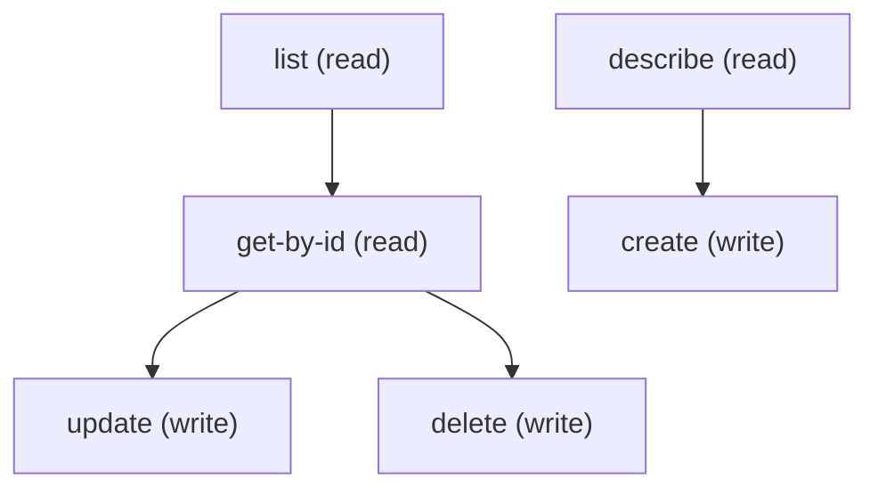

# Managing Appt Booking Url Config

## When to Use This Skill

Manage Appointment Booking URL Config records (ApptBookingUrlConfig, use this exact object name), the child records of an Appointment Booking Config that tell Health Cloud Patient Appointment Scheduling which endpoint to call for each scheduling operation. Use standard sObject REST (/services/data/v67.0/sobjects/ApptBookingUrlConfig). Required to create: DeveloperName, MasterLabel, ApptBookingConfigId (the parent Id) and EndpointName, which must be one of FIND_SLOTS, GET_SLOT_STATUS, CREATE_APPOINTMENT, CANCEL_APPOINTMENT, GET_APPOINTMENT or CREATE_PATIENT. UrlPath (up to 80 characters, the path appended to the base URL) and AdditionalHeaders are optional and used for an external scheduling system. The platform accepts more than one row for the same EndpointName under a config, so create one row per endpoint and check existing rows first. Create the parent ApptBookingConfig first (see the ApptBookingConfig skill). Requires Patient Appointment Scheduling to be on and the Health Cloud license.

## Workflow

Call describe first, then query existing ApptBookingUrlConfig rows for the parent so you do not create a second row for an endpoint that already has one. EndpointName is a restricted picklist: any other value fails with a bad-value error. ApptBookingConfigId and EndpointName are required. UrlPath longer than 80 characters is rejected. Delete the URL-config rows before deleting their parent ApptBookingConfig.

## Critical Constraints

**Preconditions:**

- The user needs create, read, update and delete access to ApptBookingUrlConfig (Customize Application permission is required to create, edit or delete). (check: `<udd:crud:ApptBookingUrlConfig>`)
- Patient Appointment Scheduling must be turned on in the org, and the org must hold the Health Cloud license. (check: `Patient Appointment Scheduling enabled`)
- The parent ApptBookingConfig record must already exist; its Id is required as ApptBookingConfigId.

## Operations Reference

Operations grouped by purpose. Use these as the building blocks for the workflows above.

### Summary

| Operation | Purpose | Status | Call | Depends on |
|-----------|---------|--------|------|------------|
| `describe` | read | — | `GET /services/data/v67.0/sobjects/ApptBookingUrlConfig/describe` | — |
| `list` | read | — | `GET /services/data/v67.0/query` | — |
| `get-by-id` | read | — | `GET /services/data/v67.0/sobjects/ApptBookingUrlConfig/{Id}` | `list` |
| `create` | write | — | `POST /services/data/v67.0/sobjects/ApptBookingUrlConfig` | `describe` |
| `update` | write | — | `PATCH /services/data/v67.0/sobjects/ApptBookingUrlConfig/{Id}` | `get-by-id` |
| `delete` | write | — | `DELETE /services/data/v67.0/sobjects/ApptBookingUrlConfig/{Id}` | `get-by-id` |

### Dependency graph

### Read operations

#### `describe`

Retrieve the ApptBookingUrlConfig sObject describe — fields, picklist values, FLS, createable/updateable flags.

**Call:** `GET /services/data/v67.0/sobjects/ApptBookingUrlConfig/describe`

**Output:** DescribeSObjectResult — `fields[]` (each with name, type, createable, updateable, nillable, picklistValues), `recordTypeInfos[]`, `childRelationships[]`, `keyPrefix: 0mI`, `feedEnabled`, `searchable`, plus FLS flags. Drives field selection for list / create / update.

#### `list`

List via SOQL. SELECT only FLS-readable fields — others silently omit the row from results. Run /describe first for the field set.

**Call:** `GET /services/data/v67.0/query`

**Inputs:**

- `where` *(`String`)* — Optional SOQL WHERE clause to filter Appt Booking Url Config records.
- `limit` *(`int`)* — Optional SOQL LIMIT value.
- `q` *(`string`)*

**Output:** Query response with records[] of ApptBookingUrlConfig — Id plus any SELECTed fields.

#### `get-by-id`

Retrieve a specific ApptBookingUrlConfig record by Id.

**Call:** `GET /services/data/v67.0/sobjects/ApptBookingUrlConfig/{Id}`

**Inputs:**

- `Id` *(`ID`)* — Id of the ApptBookingUrlConfig record to fetch.

**Depends on:** `list`

**Output:** Single ApptBookingUrlConfig record with all readable fields per user FLS.

### Write operations

#### `create`

Create an ApptBookingUrlConfig record for one endpoint of a config. Required: DeveloperName, MasterLabel, ApptBookingConfigId and EndpointName (FIND_SLOTS, GET_SLOT_STATUS, CREATE_APPOINTMENT, CANCEL_APPOINTMENT, GET_APPOINTMENT or CREATE_PATIENT). UrlPath (up to 80 characters) and AdditionalHeaders are optional. Check for an existing row for the endpoint first, because duplicates are accepted.

**Call:** `POST /services/data/v67.0/sobjects/ApptBookingUrlConfig`

**Inputs:**

- `body` *(`object`)* — Field/value map for the new ApptBookingUrlConfig. Populate from /describe's createableFields list.

**Depends on:** `describe`

**Rollback:** Call delete with the returned Id to undo the create.

#### `update`

Update an existing ApptBookingUrlConfig record. Merge-patch semantics.

**Call:** `PATCH /services/data/v67.0/sobjects/ApptBookingUrlConfig/{Id}`

**Inputs:**

- `Id` *(`ID`)* — Id of the ApptBookingUrlConfig to update.
- `body` *(`object`)* — Partial field/value map — only include fields you want to change.

**Depends on:** `get-by-id`

#### `delete`

Delete an ApptBookingUrlConfig record. Deleting a FIND_SLOTS row removes the slot-search endpoint for its config; delete all rows before deleting the parent ApptBookingConfig.

**Call:** `DELETE /services/data/v67.0/sobjects/ApptBookingUrlConfig/{Id}`

**Inputs:**

- `Id` *(`ID`)* — Id of the ApptBookingUrlConfig to delete.

**Depends on:** `get-by-id`
