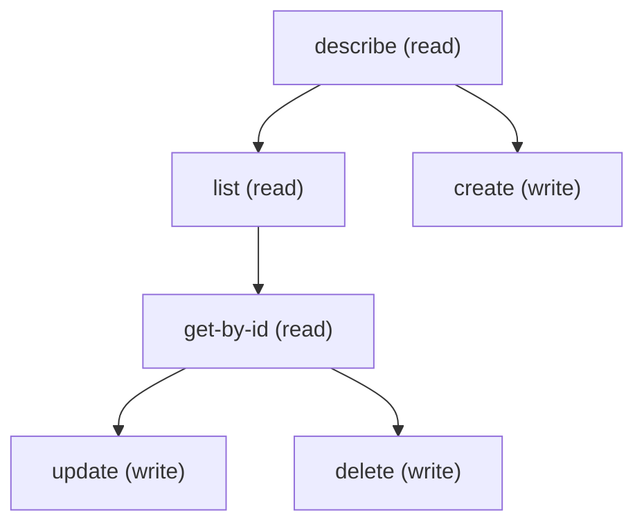

# Managing Care Provider Affl Role Config

## When to Use This Skill

Manage the Care Provider Affiliation Role Config (CareProviderAfflRoleConfig) with standard sObject REST (/services/data/v67.0/sobjects/CareProviderAfflRoleConfig). It sets ProviderRole, the role value Health Cloud uses for hospital-affiliation links created through the Provider API; the Provider Search More Details view shows a hospital affiliation only when the link's role matches it. Required to create: MasterLabel and DeveloperName (unique). ProviderRole (text, up to 255 characters) and AffiliationType are optional on create, but set both: AffiliationType is a restricted picklist with the single value HospitalAffiliation. A value of AffiliationType can be used by only one record, so a second HospitalAffiliation record fails with a duplicate-value error on create and on update; records with AffiliationType left blank are not limited. To change the role, update the existing HospitalAffiliation record rather than creating another. Set the role before creating providers, because existing affiliations may not be updated when the role changes. It is independent of CareProviderSearchConfig.

## Workflow

Query for an existing record with AffiliationType HospitalAffiliation first. If one exists, PATCH its ProviderRole; creating or updating a second record to HospitalAffiliation fails with DUPLICATE_VALUE. The only allowed AffiliationType value is HospitalAffiliation; any other value is rejected as a bad restricted-picklist value. ProviderRole longer than 255 characters is rejected. Set the role before provider data is created through the Provider API. This record does not choose which roles are searchable; it defines the single role value used for hospital affiliations.

## Critical Constraints

**Preconditions:**

- Provider Search must be enabled in the org and the user must have Provider Search access. (check: `Provider Search enabled`)
- At most one record can have AffiliationType HospitalAffiliation; update the existing record instead of creating another.

## Operations Reference

Operations grouped by purpose. Use these as the building blocks for the workflows above.

### Summary

| Operation | Purpose | Status | Call | Depends on |
|-----------|---------|--------|------|------------|
| `describe` | read | — | `GET /services/data/v67.0/sobjects/CareProviderAfflRoleConfig/describe` | — |
| `list` | read | — | `GET /services/data/v67.0/query` | `describe` |
| `get-by-id` | read | — | `GET /services/data/v67.0/sobjects/CareProviderAfflRoleConfig/{Id}` | `list` |
| `create` | write | — | `POST /services/data/v67.0/sobjects/CareProviderAfflRoleConfig` | `describe` |
| `update` | write | — | `PATCH /services/data/v67.0/sobjects/CareProviderAfflRoleConfig/{Id}` | `get-by-id` |
| `delete` | write | — | `DELETE /services/data/v67.0/sobjects/CareProviderAfflRoleConfig/{Id}` | `get-by-id` |

### Dependency graph

### Read operations

#### `describe`

Retrieve the CareProviderAfflRoleConfig sObject describe — fields, picklist values, FLS, createable/updateable flags.

**Call:** `GET /services/data/v67.0/sobjects/CareProviderAfflRoleConfig/describe`

**Output:** DescribeSObjectResult for CareProviderAfflRoleConfig — use this to build the field list for list / create / update payloads.

#### `list`

List CareProviderAfflRoleConfig records. Pair this with /describe first to pick field names.

**Call:** `GET /services/data/v67.0/query`

**Inputs:**

- `where` *(`String`)* — Optional SOQL WHERE clause to filter Care Provider Affl Role Config records.
- `limit` *(`int`)* — Optional SOQL LIMIT value.
- `q` *(`string`)*

**Depends on:** `describe`

**Output:** Query response with records[] of CareProviderAfflRoleConfig — Id plus any SELECTed fields.

#### `get-by-id`

Retrieve a specific CareProviderAfflRoleConfig record by Id.

**Call:** `GET /services/data/v67.0/sobjects/CareProviderAfflRoleConfig/{Id}`

**Inputs:**

- `Id` *(`ID`)* — Id of the CareProviderAfflRoleConfig record to fetch.

**Depends on:** `list`

**Output:** Single CareProviderAfflRoleConfig record with all readable fields per user FLS.

### Write operations

#### `create`

Create the Care Provider Affiliation Role Config record. Required: MasterLabel and DeveloperName. Also send ProviderRole and AffiliationType=HospitalAffiliation (both optional on create, but the HospitalAffiliation record is the one that sets the role). Only one record can hold AffiliationType HospitalAffiliation; if one already exists, update it instead.

**Call:** `POST /services/data/v67.0/sobjects/CareProviderAfflRoleConfig`

**Inputs:**

- `body` *(`object`)* — Field/value map for the new CareProviderAfflRoleConfig. Populate from /describe's createableFields list.

**Depends on:** `describe`

**Rollback:** Call delete with the returned Id to undo the create.

#### `update`

Update an existing CareProviderAfflRoleConfig record. Merge-patch semantics — only include fields you want to change. The mutable config columns are ProviderRole and AffiliationType; standard Setup audit fields are system-managed.

**Call:** `PATCH /services/data/v67.0/sobjects/CareProviderAfflRoleConfig/{Id}`

**Inputs:**

- `Id` *(`ID`)* — Id of the CareProviderAfflRoleConfig to update.
- `body` *(`object`)* — Partial field/value map — only include fields you want to change.

**Depends on:** `get-by-id`

#### `delete`

Delete a CareProviderAfflRoleConfig record.

**Call:** `DELETE /services/data/v67.0/sobjects/CareProviderAfflRoleConfig/{Id}`

**Inputs:**

- `Id` *(`ID`)* — Id of the CareProviderAfflRoleConfig to delete.

**Depends on:** `get-by-id`
