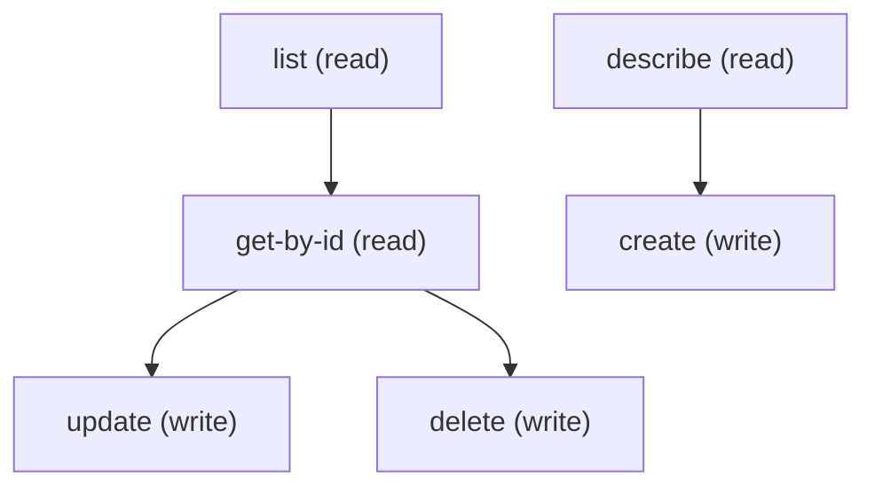

# Managing Care Provider Search Config

## When to Use This Skill

Manage Care Provider Search Config records (CareProviderSearchConfig) with standard sObject REST (/services/data/v67.0/sobjects/CareProviderSearchConfig). Each record maps one source field on Healthcare Provider or Healthcare Practitioner Facility onto a custom searchable field on Care Provider Searchable Field, so Provider Search can filter on it and show it on result cards. It is optional and additive: with no records, Provider Search still indexes the standard provider fields. Required to create: MasterLabel, DeveloperName (unique), SourceField and TargetField (API names). MappedObject defaults to HealthcareProvider; set it to HealthcarePractitionerFacility for a facility field, and the source field must belong to the mapped object. IsActive defaults to false, so send IsActive=true to use the mapping. The mapping rules are checked on every create and update, even when the record is inactive: the target must be a custom Text or Text Area field at least as long as the source and cannot be a standard field or another type, a Text Area target is allowed only for a multi-select picklist source, and a target can have only one active mapping (deactivate the old record to free it). A new mapping takes effect on a later Provider Search sync, and the field must also be added to the Provider Search page in the Lightning page builder.

## Workflow

Create the target custom field on Care Provider Searchable Field first (see the Provider Search Settings skill, step ensure-searchable-field-custom-field), then create the config record. Common errors and their causes: "This field isn't valid for this context" means the source or target field does not exist on the mapped object, or SourceField/TargetField was left out; "The target field's length must be at least equal to that of the source field"; "The target field cannot be a standard field"; "The provider search cannot be configured. The target field type needs to be text or text area"; "The source field type must be picklist (multi-select) if the target field is type text area"; "This target field already has a source field" means another active record uses that target. To move a target to a different source, set the old record IsActive to false (or delete it) first. This skill is optional for Provider Search; do not report Provider Search as broken just because no config record exists.

## Critical Constraints

**Preconditions:**

- Provider Search must be enabled in the org and the user must have Provider Search access. (check: `Provider Search enabled`)
- The user needs the Customize Application permission to create, edit or delete a config record.
- The target custom field (Text or Text Area) must already exist on Care Provider Searchable Field, and the source field must exist on the mapped object (Healthcare Provider or Healthcare Practitioner Facility).

## Operations Reference

Operations grouped by purpose. Use these as the building blocks for the workflows above.

### Summary

| Operation | Purpose | Status | Call | Depends on |
|-----------|---------|--------|------|------------|
| `describe` | read | — | `GET /services/data/v67.0/sobjects/CareProviderSearchConfig/describe` | — |
| `list` | read | — | `GET /services/data/v67.0/query` | — |
| `get-by-id` | read | — | `GET /services/data/v67.0/sobjects/CareProviderSearchConfig/{Id}` | `list` |
| `create` | write | — | `POST /services/data/v67.0/sobjects/CareProviderSearchConfig` | `describe` |
| `update` | write | — | `PATCH /services/data/v67.0/sobjects/CareProviderSearchConfig/{Id}` | `get-by-id` |
| `delete` | write | — | `DELETE /services/data/v67.0/sobjects/CareProviderSearchConfig/{Id}` | `get-by-id` |

### Dependency graph

### Read operations

#### `describe`

Retrieve the CareProviderSearchConfig sObject describe — fields, picklist values, FLS, createable/updateable flags.

**Call:** `GET /services/data/v67.0/sobjects/CareProviderSearchConfig/describe`

**Output:** DescribeSObjectResult for CareProviderSearchConfig — use this to build the field list for list / create / update payloads.

#### `list`

List CareProviderSearchConfig records. Pair this with /describe first to pick field names.

**Call:** `GET /services/data/v67.0/query`

**Inputs:**

- `where` *(`String`)* — Optional SOQL WHERE clause to filter Care Provider Search Config records.
- `limit` *(`int`)* — Optional SOQL LIMIT value.
- `q` *(`string`)*

**Output:** Query response with records[] of CareProviderSearchConfig — Id plus any SELECTed fields.

#### `get-by-id`

Retrieve a specific CareProviderSearchConfig record by Id.

**Call:** `GET /services/data/v67.0/sobjects/CareProviderSearchConfig/{Id}`

**Inputs:**

- `Id` *(`ID`)* — Id of the CareProviderSearchConfig record to fetch.

**Depends on:** `list`

**Output:** Single CareProviderSearchConfig record with all readable fields per user FLS.

### Write operations

#### `create`

Create a Care Provider Search Config record mapping one source field to one custom searchable field. Required: MasterLabel, DeveloperName, SourceField, TargetField. MappedObject defaults to HealthcareProvider (or set HealthcarePractitionerFacility); IsActive defaults to false, so send IsActive=true to use it. Fails if either field does not exist on the mapped object, the target is a standard field or not a Text/Text Area field at least as long as the source, a Text Area target is used with a source that is not a multi-select picklist, or the target already belongs to another active record.

**Call:** `POST /services/data/v67.0/sobjects/CareProviderSearchConfig`

**Inputs:**

- `body` *(`object`)* — Field/value map for the new CareProviderSearchConfig. Populate from /describe's createableFields list.

**Depends on:** `describe`

**Rollback:** Call delete with the returned Id to undo the create.

#### `update`

Update an existing CareProviderSearchConfig record. Merge-patch semantics.

**Call:** `PATCH /services/data/v67.0/sobjects/CareProviderSearchConfig/{Id}`

**Inputs:**

- `Id` *(`ID`)* — Id of the CareProviderSearchConfig to update.
- `body` *(`object`)* — Partial field/value map — only include fields you want to change.

**Depends on:** `get-by-id`

#### `delete`

Delete a CareProviderSearchConfig record.

**Call:** `DELETE /services/data/v67.0/sobjects/CareProviderSearchConfig/{Id}`

**Inputs:**

- `Id` *(`ID`)* — Id of the CareProviderSearchConfig to delete.

**Depends on:** `get-by-id`
