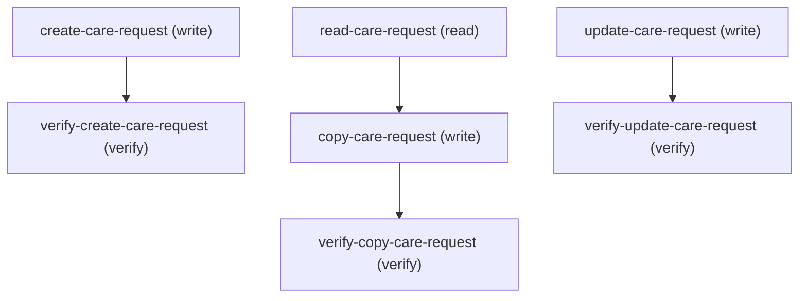

# Managing Health Cloud Services

## When to Use This Skill

Create, copy, update, and read Health Cloud care requests via the Care Services Connect API instead of the UI. Care requests are utilization-management records — authorizations, appeals, admissions, and a Referral request type among them: "create" posts a new CareRequest through POST /connect/health/care-services; "copy" reads an existing record with GET /connect/health/care-services/{ids} and re-creates it as a new CareRequest (there is no server-side copy endpoint — copy is a client-side read-then-create); "update" PATCHes the collection path. The request body is a top-level careRequestsList array; each item carries a careRequest sub-object (the record's own fields) plus optional related sections. A create requires name plus a request/record type on careRequest, and the request type must map to a CareRequest RecordType configured on the org (the requestType picklist is Admission, Appeal, Complaint, Concurrent Review, Drug Request, Grievance, Referral, Service Request). Use when a Health Cloud user wants to create/duplicate/update a utilization-management care request — for example an authorization request, an appeal, or a care request of type Referral. This is the utilization-management CareRequest object; it is NOT the Provider Search "refer to a provider" clinical-referral flow, which creates a ClinicalServiceRequest via POST /connect/health/referral-management/referrals — use that flow (not this skill) to refer a member to a provider found in Provider Search. Requires the HealthCloudUtilizationMgmtUser permission; care-services is available from API v46.0.

## Workflow

Create a care request / referral: create-care-request (POST /connect/health/care-services with a top-level careRequestsList array) → verify-create-care-request (GET the new id back). Copy a record: read-care-request (GET the source with a broad sectionNames list) → copy-care-request (POST the mapped sections as a new CareRequest, dropping the source id) → verify-copy-care-request (confirm the copied id differs from the source). Update: update-care-request (PATCH the collection path with the same careRequestsList array, id on the careRequest sub-object) → verify-update-care-request. Read only: read-care-request.

Contract truths:
- The backing object is the custom object CareRequest, NOT a standard Referral sObject. Create/copy/update/read all go through the Care Services Connect API, not sObject CRUD on a "Referral". A care request of type Referral is just a care-request operation with careRequest.requestType (or a Referral RecordType) set. This is NOT the Provider Search "refer to a provider" clinical-referral flow — that flow creates a ClinicalServiceRequest via POST /connect/health/referral-management/referrals, a different object and endpoint; use it (not this skill) to refer a member to a provider found in Provider Search.
- The requestType (Care Request Type) picklist values are Admission, Appeal, Complaint, Concurrent Review, Drug Request, Grievance, Referral, and Service Request (defined on CareRequestConfiguration.CareRequestType). Supply one of these as careRequest.requestType, OR supply careRequest.recordType directly as a matching Case+CareRequest RecordType developer name.
- The request body is a top-level careRequestsList array — there is NO createCareAuthData/updateCareAuthData wrapper. Both POST (create) and PATCH (update) use the identical top-level shape { "careRequestsList": [ ... ] } and the same collection path /connect/health/care-services (no id in the URL). For an update, the target record id lives on the careRequest sub-object of the list item, not in the URL.
- Each list item wraps the record's own fields in a careRequest sub-object and carries optional sibling sections (subscriber, patient, careDiagnoses, careRequestItems, careRequestDrugs, transportLocations, careRequestCase). A create requires careRequest.name and a request/record type (careRequest.requestType or careRequest.recordType); an empty item is rejected ("Specify a valid value for either request type or record type").
- The request type must map to a CareRequest RecordType configured on the org, or the create is rejected ("Specify a valid record type for the request type"). The resolved record-type developer name must exist as a RecordType on BOTH the Case and the CareRequest objects with the identical developer name (a care request creates a backing Case), and must be visible to the running user's profile — otherwise the create fails "Invalid record type in this care request." or "this ID value isn't valid for the user." Ensure the matching Case+CareRequest record-type pair exists and is assigned before creating (see preconditions).
- Record type must be supplied on UPDATE as well as create. A PATCH item carrying only an id and changed fields is rejected ("Invalid record type in this care request.") because the update re-resolves the record type. The published input schema marks recordType optional, but the service re-resolves it at runtime on every call, so in practice always include careRequest.recordType (or requestType) on the update item alongside the id.
- "Copy" has no server endpoint: it is a client-side GET-source → POST-new. Drop server-owned id fields from the mapped body so a new CareRequest is created instead of updating the source; keep the request/record type so the copy still resolves to a valid RecordType.
- The response is CareAuthorizationRequestResultRepresentation {code, message, isSuccess, result[]}; each result carries id, created, status, objectType, relatedRecords. Read new ids from result[].id and check created to tell create (true) from update (false).
- Requires the HealthCloudUtilizationMgmtUser permission; the care-services resource is available from v46.0.

## Critical Constraints

**Preconditions:**

- User must hold the Health Cloud Utilization Management user permission to call the Care Services API. (check: `UserPermissions.HealthCloudUtilizationMgmtUser`)
- The Care Services Connect API is available from API version 46.0 (v46.0+). Call it at v46.0 or later; older versions do not expose the care-services resource. (check: `API version >= v46.0`)
- At least one active CareRequest RecordType must be configured on the org before a create can succeed. A create supplies a request type (or record type) on the careRequest sub-object, and the API validates that the request type maps to an existing CareRequest RecordType — a create against an org with no matching RecordType is rejected ("Specify a valid record type for the request type"). Health Cloud utilization-management record types come as matching pairs — the resolved record-type developer name must exist as a RecordType on BOTH the Case and the CareRequest objects with the identical developer name, because a care request creates a backing Case. If only the CareRequest-side record type exists, the create still fails ("Invalid record type in this care request."), and the running user must have that record type visible on their profile (an unassigned record type is rejected with "this ID value isn't valid for the user"). This is org data configuration, not an API-contract input. (check: `an active RecordType with the same developer name exists on BOTH the CareRequest and the Case objects, visible to the running user, matching the request type used`)
- A create that identifies the member (the patient section, via patient.memberId or patient.firstName + patient.lastName) resolves that member by querying MemberPlan on the member's name — and because Member is an Account reference, the lookup reads Member.FirstName / Member.LastName. Those fields exist only when Person Accounts is enabled on the org; a member represented as a business Account has no first/last name and cannot be resolved, so the create is rejected ("Enter the member ID, or the member's first and last names"). Identifying a member BY NAME therefore requires Person Accounts enabled on the org and, for that name-based lookup, an enrolled member the name resolves to (a Person Account with a MemberPlan); identifying a member by patient.memberId instead passes the member's Account Id directly and does not depend on a name lookup. The patient section itself is optional in the published input schema, but once a create supplies member identity it must resolve, and on a non–Person-Account org a name-identified member cannot resolve. This is org data configuration, not an API-contract input. (check: `Person Accounts is enabled on the org; a member identified by name resolves via a MemberPlan-enrolled Person Account, while a member identified by patient.memberId is passed as the member's Account Id directly`)

## Verification Checklist

After every write operation, confirm the effect by re-reading state:

- After `create-care-request`: call `verify-create-care-request`
- After `copy-care-request`: call `verify-copy-care-request`
- After `update-care-request`: call `verify-update-care-request`

## Operations Reference

Operations grouped by purpose. Use these as the building blocks for the workflows above.

### Summary

| Operation | Purpose | Status | Call | Depends on |
|-----------|---------|--------|------|------------|
| `create-care-request` | write | implemented | `POST /connect/health/care-services` | — |
| `verify-create-care-request` | verify | — | `getCareServices` | `create-care-request` |
| `read-care-request` | read | — | `getCareServices` | — |
| `copy-care-request` | write | implemented | `postCareServices` | `read-care-request` |
| `verify-copy-care-request` | verify | — | `getCareServices` | `copy-care-request` |
| `update-care-request` | write | implemented | `patchCareServices` | — |
| `verify-update-care-request` | verify | — | `getCareServices` | `update-care-request` |

### Dependency graph

### Read operations

#### `read-care-request`

Read a care request in full — for direct inspection or as the source of a copy. Care Services exposes no server-side copy/clone operation, so a copy is a client-side read-then-create and this step is its read half: GET the CareRequest with idName=Id and a broad sectionNames list (Subscriber;Patient;CareDiagnoses;CareRequestItems;CareRequestDrugs;TransportLocations;CareRequest) so every section that should carry over is returned. The copy step maps this payload into a fresh create body.

**Call:** `getCareServices`

**Inputs:**

- `ids` *(`String`)* — The CareRequest id to read (the source id when copying).
- `idName` *(`string`)*
- `sectionNames` *(`string`)*

**Output:** Full CareRequest with the requested related sections; when copying, the fields to carry into the new record.

### Write operations

#### `create-care-request`

Create a care request (for a referral, supply the referral's fields). The body is a top-level careRequestsList array; each list item is a CareAuthorizationRequestInputRepresentation holding a careRequest sub-object (the record's own fields) plus optional related sections (subscriber, patient, careDiagnoses, careRequestItems, careRequestDrugs, transportLocations, careRequestCase). The careRequest sub-object requires name and a request/record type (requestType or recordType); the request type must map to a CareRequest RecordType configured on the org. Multiple records can be created in one call by adding more list items.

**Call:** `POST /connect/health/care-services`   — status: `implemented`

**Inputs:**

- `careRequestsList` *(`Array`)* — Top-level array of CareAuthorizationRequestInputRepresentation items, one per care request to create. Each item carries a careRequest sub-object (name + requestType/recordType required, plus serviceType/serviceLevel/sourceSystemIdentifier and other fields as needed) and optional related sections (subscriber, patient, careDiagnoses, careRequestItems, careRequestDrugs, transportLocations, careRequestCase).

**Output:** CareAuthorizationRequestResultRepresentation {code, message, isSuccess, result[]}. Each result carries id (new CareRequest id), created (true when freshly made), status, objectType, and relatedRecords. Read the new record id from result[].id.

#### `copy-care-request`

Create a copy of a care request. Map the sections read by read-care-request into a new careRequestsList item (careRequest sub-object plus related sections) and POST it through the create path — dropping server-owned identity fields (id and any auto-assigned keys) so a genuinely new CareRequest is made rather than an update. Keep the source's request/record type so the copy still maps to a valid CareRequest RecordType. This is the create half of the read-then-create copy; there is no dedicated copy endpoint.

**Call:** `postCareServices`   — status: `implemented`

**Inputs:**

- `careRequestsList` *(`Array`)* — One CareAuthorizationRequestInputRepresentation built from the source record's sections (careRequest sub-object + related sections), with server-owned id fields removed so a new CareRequest is created.

**Depends on:** `read-care-request`

**Output:** CareAuthorizationRequestResultRepresentation; result[].id is the copy's new CareRequest id, result[].created is true.

#### `update-care-request`

Update an existing care request. The update body uses the same top-level careRequestsList array as create (PATCH does NOT introduce a separate wrapper) and is sent as a PATCH to the collection path /connect/health/care-services — the record id travels inside the careRequest sub-object of the list item, not in the URL. Include the CareRequest id on the list item so the API updates rather than creates. The list item must ALSO carry a record type (careRequest.recordType or careRequest.requestType), exactly as a create does — the update re-resolves the record type, so an item with only an id and changed fields is rejected ("Invalid record type in this care request."). The published input schema marks recordType optional, but the service re-resolves it at runtime on every PATCH, so in practice you must include it. Pass the record's existing record type alongside the id and the fields to change.

**Call:** `patchCareServices`   — status: `implemented`

**Inputs:**

- `careRequestsList` *(`Array`)* — Top-level array of CareAuthorizationRequestInputRepresentation items, each carrying the target CareRequest id AND a record type (recordType or requestType) on the careRequest sub-object, plus the fields to change. The record type is required on update (not just create) because the update re-resolves it.

**Output:** CareAuthorizationRequestResultRepresentation; result[].created is false on an update (the record already existed).

### Verify operations

#### `verify-create-care-request`

Confirm the care request was created by reading it back with the Care Services GET. Pass the new CareRequest id (result[].id from create-care-request) as the path id with idName=Id, and request the sections you want to confirm (semicolon-delimited sectionNames). A record coming back with the expected sections confirms the create landed.

**Call:** `getCareServices`

**Inputs:**

- `ids` *(`String`)* — The new CareRequest id (result[].id).
- `idName` *(`string`)*
- `sectionNames` *(`string`)*

**Depends on:** `create-care-request`

#### `verify-copy-care-request`

Confirm the copy created a distinct new CareRequest by reading the copied id back and checking it differs from the source id read in read-care-request.

**Call:** `getCareServices`

**Inputs:**

- `ids` *(`String`)* — The copy's new CareRequest id.
- `idName` *(`string`)*
- `sectionNames` *(`string`)*

**Depends on:** `copy-care-request`

#### `verify-update-care-request`

Confirm the update landed by reading the record back and checking the changed fields reflect the new values. Uses the same Care Services GET with idName=Id and the sections covering the fields that were updated.

**Call:** `getCareServices`

**Inputs:**

- `ids` *(`String`)* — The updated CareRequest id (the id sent on the update list item).
- `idName` *(`string`)*
- `sectionNames` *(`string`)*

**Depends on:** `update-care-request`
