# Managing Patient Appointment Scheduling Settings

## When to Use This Skill

Set up, enable, and configure Intelligent Appointment Management (IAM) for Health Cloud — the patient appointment scheduling and booking capability. Use this SOR for requests like "set up Intelligent Appointment Management", "enable IAM on my org", "configure patient appointment scheduling for Health Cloud", or "turn on Health Cloud appointment booking". This is the Health Cloud Setup-node recipe (node PatientAppointmentSchedulingSettings) — NOT a generic Scheduler, Field Service, or appointment-booking Connect API. Mechanism: read the current Patient Appointment Scheduling org preference and flip it via the Metadata API IndustriesSettings package (field enablePatientAppointmentSchedulingOrgPref); this org preference gates the Intelligent Appointment Management workflow (the appointment list view reads this flag together with the Health Cloud org permission). Flipping that preference is only the FIRST step and is NOT "done": an unqualified "set up / enable / configure IAM" means run the whole ordered golden path (see agent_guidance) — turn on the preference, then ELICIT the clinic's real visit types and providers and stand up the scheduling data model (work types, care specialties, providers, service resources, operating hours, service territories, shifts, work-type code-set bundle, booking config), wire the booking surface (the appointment-console app, and optionally the patient self-scheduling Experience site), VERIFY that real bookable slots come back, and FINISH with the capability summary that hands the admin the app/portal link, what was created, what still needs a manual UI step, and the Help docs. Do not stop after the toggle, and never deploy the console app before visit types and providers exist — that is exactly what yields the empty, non-actionable "Patient Portal" app with no visit types. UI-only siblings (Salesforce Scheduler, EHR, Extended Functionality, Self-Scheduling, Multi-Slot tabs) are navigation links, not part of this SOR.

## Workflow

**Setting up Intelligent Appointment Management (IAM) means running the whole ordered golden path — not just flipping the org preference.** An unqualified "set up / enable / configure IAM" is complete only when a real appointment slot comes back for a real visit type and provider, the booking surface is wired, and you have handed the admin a capability summary. Flipping `enablePatientAppointmentSchedulingOrgPref` and stopping leaves an empty, non-actionable app (no visit types, nothing bookable) — that is the known failure mode this guidance exists to prevent.

This skill drives the **project-codey MCP** (`discover` -> `describe` -> `dispatch`) against the target org. Gate every write on an independent read-back (a `verify-*` step), never the write's own echo. Deferred/gapped steps are NOT stop signals — surface each with its remediation and Help link (see the `manual_step_references` block) and keep going.

## Scope & definition of done — READ THIS FIRST

An unqualified request means run **all eight acts in order (Act 0 -> ... -> Act 7)**; Act 6 is the only optional act, and Act 7 (the closing summary) is never skipped. "Done" requires: the preference is ON and verified; at least one visit type (WorkType) and one provider (HealthcareProvider + ServiceResource) exist; operating hours, a service territory, a shift, the WorkTypeCodeSetBundle (SchedulingSystem = Salesforce), and an ApptBookingConfig are in place; `verify-bookable-slots` returns a populated slot; the appointment-console app is deployed; and you have delivered the Act 7 capability summary. A run that ends partway through is a **partial** run — say so plainly, and never report "done" after only the toggle.

## MANDATORY elicitation — do this BEFORE any Act 2 data write

A good IAM setup asks the clinic what it actually schedules; an unintelligent one invents placeholders. Before creating work types or providers, either (a) read what already exists (query `WorkType`, `HealthcareProvider`, `ServiceResource`, `ServiceTerritory`) and reuse it, or (b) if the org is empty, **ASK the admin** for: the **visit types / reasons** patients book (-> WorkType + AppointmentReason), the **providers** and their **specialties** (-> HealthcareProvider, ServiceResource, WorkTypeCareSpecialty), the **locations / service territories** and their **operating hours**, and the **appointment durations**. Only seed generic sample data if the admin explicitly asks for a demo/sample build — and say so. Never deploy the console app (Act 5) before visit types and providers exist (Act 2); doing so is what produces the empty "Patient Portal".

## The eight acts (run in order; cite real step ids — Acts 0–6 below, Act 7 in its own section)

- **Act 0 — Preflight (tell the admin up front what will and will not work).** Run `preflight-iam-capabilities` FIRST — it is read-only and covers `gate-admin-permissions`, the current preference state (`getPatientAppointmentSchedulingOrgPref_1`), Person Accounts, licenses, visit-type routing, channel mode, territory links, practitioners, future shifts, customer appointment flows, org-wide email, capacity scheduling, no-show prediction and Data Processing Engine. Show the admin its table BEFORE any write: what this run will deliver, what this org cannot deliver and why, and the decisions you need from them. Do not discover a blocked capability halfway through the run when the preflight could have reported it. If a true prerequisite cannot be met, surface it and stop here. Then — and only with the admin's authorization — run the prerequisite WRITES: `ensure-account-record-type` (PUT) and the permission assignments `assign-data-pipelines-base-user` / `assign-appointment-management-permset` / `grant-lightning-scheduler-user-permset` (POST). `enable-person-accounts` is IRREVERSIBLE — run it only on explicit authorization. These are mutations: do not run them under the banner of a read-only check; treat them as the first writes of the setup, gated on authorization.
- **Act 1 — Turn IAM on:** `handlePatientAppointmentSchedulingToggle_2` then `verify-patient-appointment-scheduling-toggle`. This is the step most agents mistake for the whole job — it is only Act 1 of 8. Then `update-sharing-settings` + `verify-update-sharing-settings` — but ONLY with the admin's explicit approval: this write loosens org-wide record visibility for guest and external users. Before running it, show the admin the eight objects (ServiceResource, ServiceTerritory, WorkType, Asset, CareProviderSearchableField, HealthcarePractitionerFacility, HealthcareProvider, HealthcareProviderNpi) with their current vs new internal and external sharing models (new = Public Read Only for both), and get explicit approval. If they decline, skip it, list it as a manual step in the Act 7 summary (guest / self-scheduling provider search returns no records until it is done), and continue.
- **Act 2 — Build the clinical config (AFTER elicitation):** `create-work-type`, `link-work-type-care-specialty`, `create-appointment-scheduling-policy`, `seed-healthcare-providers`, `create-service-resource`, `create-appointment-reason`, and as needed `create-asset-type` / `link-work-type-asset-type`, `seed-work-procedure`, `create-engagement-channel-type` / `link-engagement-channel-work-type`, `create-business-account`.
- **Act 3 — Availability (hours / territory / shifts):** `create-operating-hours`, `create-operating-hours-time-slots`, `create-service-territory`, `create-service-territory-member`, `link-work-type-service-territory`, `create-shift`, `create-healthcare-practitioner-facility`, `create-work-type-code-set-bundle` (SchedulingSystem = Salesforce — the routing switch), `create-appt-booking-config`, `assign-scheduler-psl-to-provider-user`.
- **Act 4 — Prove it is actionable:** `verify-bookable-slots` (MUST return a populated slot; pass the WorkType's channel Id when the preflight found it in channel mode, and pass the same value when booking), then `book-appointment` + `verify-book-appointment`; `trigger-provider-search-sync`, `enable-data-processing-engine` as needed. If no slot comes back, the config is incomplete — go back to Act 2/3; do not proceed to the summary claiming success.
- **Act 5 — Surface the booking experience:** `deploy-scheduler-flexipage` + `verify-scheduler-flexipage-toggles` (never report a console toggle as set without this read-back) + `assign-scheduler-flexipage-activation`, `deploy-scheduler-launcher-flexipage`, `deploy-scheduler-launcher-tab`, `deploy-scheduler-launcher-app` (the admin/agent console app). For patient self-scheduling: `enable-digital-experiences`, `create-experience-site` (+ verify / `publish-experience-site` / `activate-experience-site` + verifies), `read-selfschedule-site-templates`, `enable-experience-bundle-metadata`, `deploy-selfscheduling-console-component` + verify.
- **Act 6 — Optional advanced (drive only if the admin wants it):** waitlist (`enable-waitlist-management`, `create-dropin-*`, `create-waitlist`), concurrent/overbooking (`enable-overbooking-org-pref`, `enable-multiple-topics-for-shifts`, `set-shift-work-topic-max-appointments`), recurring (`deploy-recurring-guidance-flow`, `wire-recurring-guidance-console`, `book-recurring-appointment` + verifies).

## Act 7 — MANDATORY closing summary (always run; this is the hand-off the reporter asked for)

Finish EVERY run — complete or partial — by running `report-iam-capability-status` (the mandatory closing report; it depends only on the Act-1 toggle verify, so it is always runnable and reports each capability as ENABLED / NOT ENABLED / MANUAL / UNKNOWN). If the run reached Act 4, run `validate-iam-configuration` first so the report's slot/booking-readiness row reflects a real validation; otherwise the report marks that row NOT ENABLED/UNKNOWN. Then give the admin a summary that contains ALL of:
- **Where to go next:** the appointment-console app you deployed (`deploy-scheduler-launcher-app`) and, if built, the self-scheduling site URL; the Setup node is at `view_url` (`/lightning/setup/PatientAppointmentSchedulingSettings/home`).
- **What was created:** counts of visit types (WorkType), providers (HealthcareProvider/ServiceResource), territories, shifts, and whether a test slot/booking succeeded.
- **What still needs a manual UI step or provisioning:** enumerate every capability `report-iam-capability-status` reports as not-enabled, plus every BLOCKED or NEEDS ADMIN ACTION row from the Act 0 preflight (so nothing the admin was told up front gets dropped), and for each cite its Help link(s) from the `manual_step_references` block (cite EVERY url in the entry) — e.g. self-scheduling theming, capacity scheduling, no-show prediction, group overbooking.
- **Clear partial-run disclosure:** if any act did not complete, say which and why — never imply a bare toggle is a finished setup.

## Critical Constraints

**Preconditions:**

- Caller has the View Setup permission. The setup page and its actions reject callers that lack it. (check: `Caller has the View Setup permission`)
- Org has Health Cloud enabled. Without it the Metadata API IndustriesSettings path returns no Patient Appointment Scheduling data and the setup page's access gate rejects the call. (check: `Org has Health Cloud enabled`)
- Caller has the Customize Application user permission. Both the Metadata deploy and the toggle require it. (check: `Caller has the Customize Application user permission`)
- IAM provider-search indexing (the DPE calc pipeline) requires the caller to hold the Data Pipelines Base User permission set — API name AnalyticsStoreUser (NamespacePrefix force). Without it the DPE owner-update / generation path returns a MissingDpePermToAdminUser error rather than failing cleanly. Assign it via PermissionSetAssignment before running the object-seeding + sync steps. (check: `PermissionSet AnalyticsStoreUser assigned (Data Pipelines Base User)`)
- The admin running IAM setup needs the Manage Health Cloud user permission (PermissionsManageHealthCloud). This is a user-permission FLAG, not a standalone named permission set — it is carried by the System Administrator profile or a custom permset. Confirm the running user has it (query PermissionSet/Profile perms) before setup; if not, assign a permset that carries the flag. Surfaces otherwise as an opaque mid-setup failure. (check: `PermissionsManageHealthCloud (Manage Health Cloud user permission)`)
- IAM setup writes org-wide sharing defaults and standard-object records across several objects; the admin needs Modify All Data (PermissionsModifyAllData). Like Manage Health Cloud this is a user-permission flag granted via profile or permset, not a standalone named permset. Confirm before setup. (check: `PermissionsModifyAllData (Modify All Data user permission)`)
- Person Accounts are REQUIRED for IAM (patients are modeled as Person Accounts; Mailing Address on the layout drives distance search). This is a hard Act-1 prerequisite the node previously omitted. Check whether Person Accounts are enabled before setup (the Account describe exposes IsPersonAccount when on); if not, run the enable step below. Note Person Accounts is a ONE-WAY enablement — once on it cannot be turned off. (check: `Person Accounts enabled (IsPersonAccount available on Account)`)
- IAM-15 (external connectivity, reuse existing skill): if the booking flow calls an external EHR/Scheduler system, a Named Credential (+ External Credential) must exist first. NamedCredential is createable=FALSE to the Data API and ExternalCredential is Metadata-only, so this is not inline sObject CRUD — use the Connectivity Foundation named-credentials-setup skill (connectivity-foundation/named-credentials-setup), which owns the Metadata/Tooling construct path. Only required when an external system is in the loop; pure in-org booking does not need it. (check: `EHR/external Scheduler Named Credential exists (IAM-15, conditional)`)
- IAM-21/25/26 (post-MVP, not authored): appointment statuses/config (IAM-21), multi-resource appointments (IAM-25 — multiple providers per slot), and recurring appointments (IAM-26) are post-MVP Scheduler behaviours carried on the AppointmentSchedulingPolicy record (authored in IAM-16) or the Scheduler settings surface — not new object CRUD. Set them on the policy when those features are scheduled; the write path is the same policy create/update this SOR already covers. Out of MVP scope, documented for completeness. (check: `Post-MVP Scheduler features (IAM-21/25/26, out of MVP scope)`)
- IAM-23/30 (post-MVP): the multi-step / Work Procedures path is gated by the MultiStepScheduling org-permission, which is driven by a Permission Set License of the same name (a write-time org-permission check). This is a NATURAL license/entitlement precondition — provisioned by Salesforce with the Health Cloud add-on, same category as Health Cloud access — NOT tech debt and NOT SOR-authorable. No customer/admin-facing API (Connect, Aura, Metadata, Apex) can flip it: every enable path is internal test-harness or scratch-org provisioning, and the only Setup surface is read-only telemetry. WorkProcedure / WorkProcedureStep report createable=TRUE in describe() but inserts are rejected by save-time validation until the PSL-backed bit is on — the gate is invisible to CRUD introspection. Once the PSL is provisioned the work-procedure chain is plain Data-API CRUD. Not authored as steps: there is no enable to call, only a license to provision. (check: `Multi-Step Scheduling PSL provisioned (IAM-23/30, post-MVP)`)
- IAM-5 (genuinely external — no enable API): the Salesforce Scheduler / Field Service master enablement bit is a provisioned org permission with no headless enable API (Salesforce-provisioned). IMPORTANT: the master bit does NOT gate Health Cloud IAM booking. The HC IAM slot engine (POST /connect/health/appointment-management/slots) has no Scheduler-master-bit check — it runs on the Patient Appointment Scheduling org preference (the IAM-13/14 org pref) alone. getAppointmentSlots returns a well-formed 200 through the NATIVE Salesforce Scheduler path with the master bit OFF on the org. The master bit only gates FSL-console extras (the AppointmentSchedulingPolicy setup entity and the multi-resource console save-pref, IAM-25). Do NOT block IAM setup on this; note it only if the FSL console surface is needed. (check: `Scheduler/FSL enablement (IAM-5, non-blocking external note)`)
- IAM-6 (post-MVP, reuse existing skill): Video/telehealth appointments require the video-visit provider setup owned by the ECI / experience video skills (eci-experience) — not a scheduling-object CRUD step. Once configured, a Video appointment type (IAM-19) and Video engagement channel (IAM-28) can be offered. Only needed for the video modality; In-Person MVP booking does not require it. (check: `Video-visit provider configured (IAM-6, post-MVP)`)
- The appointment console's display and scheduling-MODE options are boolean <design:attribute> properties on the healthcloud:appointmentConsole component — they are set as componentInstanceProperties when deploy-scheduler-flexipage builds the record page (see its componentToggles input), NOT via a separate org enable API and NOT a hand-only builder task: showProviderBadge, isTimeZoneManagementEnabled (min api 64), isGroupSchedulingEnabled (min 65), isMultiResourceSchedulingEnabled (min 63), isRecurringSchedulingEnabled (min 63), allowMultiSlot, showAppointmentList. A property name the component does not expose fails the Metadata deploy, so an intact retrieve confirms the set. These change the console's UX/mode surface only — the booking API still books one ServiceAppointment per create-appointment call (appointmentMode / attendeeLimit are rejected on the Connect create representation), so group / multi-resource / recurring behavior is a runtime console concern layered on the same booking path. Multi-STEP scheduling additionally needs WorkProcedure + WorkProcedureStep data (seed-work-procedure) with the MultiStepScheduling permset (both confirmed insertable once that permset is assigned). (check: `Appointment-component display/mode toggles (deployed on the scheduler FlexiPage)`)
- After the SOR runs, the residuals fall into two accurate buckets. FLOW CONTENT (the SOR deploys the mechanism; the branching content is clinic-specific authoring): appointment-guidance Flow content (the console exposes flowName/autoStartApptGuidance — the SOR deploys the console and sets the properties; the guidance Flow logic is Flow Builder authoring); the email/.ics companion (the record-triggered confirmation Flow is Metadata-deployable and deployed active, but a calendar attachment needs a companion Event or custom Apex — no ServiceAppointment-level .ics generator ships — and a VERIFIED org-wide email address is an env prerequisite). PROVISIONED ENTITLEMENTS: capacity-based scheduling (its org access is the provisioned SsCapacityScheduling feature — a from-scratch enableCapacitySchedulingPref deploy fails "prerequisites not met") and no-show prediction (the provisioned SmartDataDiscovery org perm + CRM Analytics Prediction for IAM add-on). NOT residuals — these are handled headlessly: patient self-scheduling (the site is created on an Aura template, published/activated to Live, and the healthcloud:appointmentConsole surface is placed on the page via an ExperienceBundle Metadata deploy — the same mechanism Provider Search uses; there is no OmniScript, a reference org serves a Live self-scheduling site with OmniProcess=0); waitlist enable + creation + the re-offer Flow (deployed active as HC_Waitlist_Reoffer); and concurrent scheduling end-to-end (the Metadata-deployable Overbooking and Multiple Topics for Shifts preferences via enable-overbooking-org-pref + enable-multiple-topics-for-shifts, plus the per-shift cap written to ShiftWorkTopic.MaxAppointments by set-shift-work-topic-max-appointments). In-Person single-appointment booking (the MVP) needs none of the entitlement-gated items. (check: `Flow-content + entitlement-gated capabilities (the genuine residuals)`)

## Verification Checklist

After every write operation, confirm the effect by re-reading state:

- After `handlePatientAppointmentSchedulingToggle_2`: call `verify-patient-appointment-scheduling-toggle`
- After `book-appointment`: call `verify-book-appointment`
- After `update-sharing-settings`: call `verify-update-sharing-settings`
- After `create-shift`, `create-operating-hours-time-slots`, `create-work-type`, `create-work-type-code-set-bundle`, `create-healthcare-practitioner-facility`, `create-appt-booking-config`, `assign-scheduler-psl-to-provider-user`, `grant-lightning-scheduler-user-permset`, `link-work-type-service-territory`: call `verify-bookable-slots` (`POST /connect/health/appointment-management/slots`)
- After `trigger-provider-search-sync`: call `validate-iam-configuration` (`POST /connect/industries/feature-validation`)
- After `create-experience-site`: call `verify-create-experience-site`
- After `publish-experience-site`: call `verify-publish-experience-site`
- After `activate-experience-site`: call `verify-activate-experience-site`
- After `deploy-selfscheduling-console-component`: call `verify-selfscheduling-console-component` (`POST /headless/metadata`)
- After `deploy-scheduler-flexipage`: call `verify-scheduler-flexipage-toggles`
- After `enable-overbooking-org-pref`: call `verify-overbooking-org-pref`
- After `verify-patient-appointment-scheduling-toggle`: call `report-iam-capability-status`
- After `book-recurring-appointment`: call `verify-book-recurring-appointment`
- After `deploy-recurring-guidance-flow`: call `verify-recurring-guidance-flow`
- After `wire-recurring-guidance-console`: call `verify-recurring-guidance-console` (`POST /headless/metadata`)

## Operations Reference

Operations grouped by purpose. Use these as the building blocks for the workflows above.

### Summary

| Operation | Purpose | Status | Call | Depends on |
|-----------|---------|--------|------|------------|
| `getPatientAppointmentSchedulingOrgPref_1` | read | implemented | `/headless/metadata` | — |
| `handlePatientAppointmentSchedulingToggle_2` | write | implemented | `/headless/metadata` | `getPatientAppointmentSchedulingOrgPref_1` |
| `verify-patient-appointment-scheduling-toggle` | verify | — | `verifyPatientAppointmentSchedulingOrgPref` | `handlePatientAppointmentSchedulingToggle_2` |
| `book-appointment` | write | implemented | `POST /connect/health/appointment-management/appointment` | `handlePatientAppointmentSchedulingToggle_2`, `verify-bookable-slots`, `enable-person-accounts`, `create-appt-booking-config` |
| `book-multi-slot-appointment` | write | implemented | `POST /connect/health/appointment-management/appointment` | `handlePatientAppointmentSchedulingToggle_2`, `verify-bookable-slots`, `enable-person-accounts`, `create-appt-booking-config` |
| `verify-book-appointment` | verify | — | `verifyBookAppointment` | `book-appointment` |
| `cancel-appointment` | write | implemented | `PATCH /connect/health/appointment-management/appointment/{id}` | `book-appointment` |
| `reschedule-appointment` | write | implemented | `POST /connect/health/appointment-management/appointment` | `book-appointment`, `cancel-appointment`, `verify-bookable-slots` |
| `update-sharing-settings` | write | implemented | `/headless/metadata` | — |
| `verify-update-sharing-settings` | verify | — | `verifySchedulingObjectSharing` | `update-sharing-settings` |
| `gate-admin-permissions` | read | implemented | `gateAdminPermissions` | — |
| `assign-data-pipelines-base-user` | write | implemented | `sobjects/PermissionSetAssignment` | `gate-admin-permissions` |
| `ensure-account-record-type` | write | implemented | `/headless/metadata` | `gate-admin-permissions` |
| `enable-person-accounts` | write | proposed | `PATCH /headless/invoke/platform/person-account-settings/enable-person-accounts` | `gate-admin-permissions`, `ensure-account-record-type` |
| `create-work-type` | write | implemented | `sobjects/WorkType` | — |
| `link-work-type-care-specialty` | write | implemented | `sobjects/WorkTypeCareSpecialty` | `create-work-type`, `seed-healthcare-providers` |
| `create-appointment-scheduling-policy` | write | implemented | `sobjects/AppointmentSchedulingPolicy` | — |
| `assign-appointment-management-permset` | write | implemented | `sobjects/PermissionSetAssignment` | — |
| `create-business-account` | write | implemented | `sobjects/Account` | — |
| `create-operating-hours` | write | implemented | `sobjects/OperatingHours` | — |
| `create-operating-hours-time-slots` | write | implemented | `sobjects/TimeSlot` | `create-operating-hours` |
| `seed-healthcare-providers` | write | implemented | `POST /connect/health/providers` | `assign-appointment-management-permset` |
| `create-service-resource` | write | implemented | `sobjects/ServiceResource` | — |
| `assign-scheduler-psl-to-provider-user` | write | implemented | `sobjects/PermissionSetLicenseAssign` | `create-service-resource` |
| `grant-lightning-scheduler-user-permset` | write | implemented | `sobjects/PermissionSetAssignment` | `assign-scheduler-psl-to-provider-user` |
| `create-service-territory` | write | implemented | `sobjects/ServiceTerritory` | `create-operating-hours` |
| `create-service-territory-member` | write | implemented | `sobjects/ServiceTerritoryMember` | `create-service-territory`, `create-service-resource` |
| `create-shift` | write | implemented | `sobjects/Shift` | `create-service-territory-member` |
| `create-healthcare-practitioner-facility` | write | implemented | `sobjects/HealthcarePractitionerFacility` | `seed-healthcare-providers`, `create-service-territory-member`, `create-business-account` |
| `create-work-type-code-set-bundle` | write | implemented | `sobjects/WorkTypeCodeSetBundle` | `create-work-type` |
| `create-appt-booking-config` | write | implemented | `sobjects/ApptBookingConfig` | — |
| `verify-bookable-slots` | verify | implemented | `POST /connect/health/appointment-management/slots` | `create-shift`, `create-operating-hours-time-slots`, `create-work-type`, `create-work-type-code-set-bundle`, `create-healthcare-practitioner-facility`, `create-appt-booking-config`, `assign-scheduler-psl-to-provider-user`, `grant-lightning-scheduler-user-permset`, `link-work-type-service-territory` |
| `deploy-scheduler-flexipage` | write | implemented | `POST /headless/metadata` | — |
| `assign-scheduler-flexipage-activation` | write | implemented | `POST /headless/metadata` | `deploy-scheduler-flexipage` |
| `deploy-scheduler-launcher-flexipage` | write | implemented | `POST /headless/metadata` | — |
| `deploy-scheduler-launcher-tab` | write | implemented | `POST /headless/metadata` | `deploy-scheduler-launcher-flexipage` |
| `deploy-scheduler-launcher-app` | write | implemented | `POST /headless/metadata` | `deploy-scheduler-launcher-tab` |
| `trigger-provider-search-sync` | write | proposed | `PATCH /headless/invoke/platform/provider-search-settings/handle-provider-search-sync-job-toggle` | `seed-healthcare-providers`, `enable-data-processing-engine` |
| `validate-iam-configuration` | verify | implemented | `POST /connect/industries/feature-validation` | `trigger-provider-search-sync` |
| `enable-data-processing-engine` | write | proposed | `PATCH /headless/invoke/platform/sonic-getting-started/handle-sonic-pref` | `assign-data-pipelines-base-user` |
| `link-work-type-service-territory` | write | implemented | `sobjects/ServiceTerritoryWorkType` | `create-work-type`, `create-service-territory` |
| `enable-digital-experiences` | write | implemented | `POST /headless/metadata` | — |
| `create-experience-site` | write | implemented | `POST /connect/communities` | `enable-digital-experiences`, `read-selfschedule-site-templates` |
| `verify-create-experience-site` | verify | — | `BackgroundOperation.query` | `create-experience-site` |
| `publish-experience-site` | write | implemented | `POST /connect/communities/{communityId}/publish` | `verify-selfscheduling-console-component` |
| `verify-publish-experience-site` | verify | — | `BackgroundOperation.query` | `publish-experience-site` |
| `activate-experience-site` | write | implemented | `Network.update` | `verify-publish-experience-site` |
| `verify-activate-experience-site` | verify | — | `Network.query` | `activate-experience-site` |
| `read-selfschedule-site-templates` | read | implemented | `GET /connect/communities/templates` | `enable-digital-experiences` |
| `enable-experience-bundle-metadata` | write | implemented | `POST /headless/metadata` | `enable-digital-experiences` |
| `deploy-selfscheduling-console-component` | write | implemented | `POST /headless/metadata` | `verify-create-experience-site`, `enable-experience-bundle-metadata` |
| `verify-selfscheduling-console-component` | verify | implemented | `POST /headless/metadata` | `deploy-selfscheduling-console-component` |
| `create-asset-type` | write | implemented | `sobjects/AssetType` | — |
| `link-work-type-asset-type` | write | implemented | `sobjects/WorkTypeAssetType` | `create-asset-type`, `create-work-type` |
| `create-appointment-reason` | write | implemented | `sobjects/AppointmentReason` | `create-work-type` |
| `create-engagement-channel-type` | write | implemented | `sobjects/EngagementChannelType` | — |
| `link-engagement-channel-work-type` | write | implemented | `sobjects/EngagementChannelWorkType` | `create-engagement-channel-type`, `create-work-type` |
| `verify-scheduler-flexipage-toggles` | verify | — | `verifySchedulerFlexiPageToggles` | `deploy-scheduler-flexipage` |
| `seed-work-procedure` | write | implemented | `sobjects/WorkProcedure` | — |
| `enable-waitlist-management` | write | implemented | `PATCH /headless/invoke/platform/waitlist-management-settings/handle-waitlist-management-pref-toggle` | — |
| `create-dropin-appointment-category` | write | implemented | `sobjects/AppointmentCategory` | — |
| `create-dropin-work-type` | write | implemented | `sobjects/WorkType` | `create-dropin-appointment-category` |
| `link-dropin-work-type-service-territory` | write | implemented | `sobjects/ServiceTerritoryWorkType` | `create-dropin-work-type`, `create-service-territory` |
| `create-waitlist` | write | implemented | `POST /actions/standard/createWaitlist` | `enable-waitlist-management`, `link-dropin-work-type-service-territory`, `create-service-resource` |
| `enable-overbooking-org-pref` | write | implemented | `POST /headless/metadata` | — |
| `verify-overbooking-org-pref` | verify | implemented | `verifyOverbookingOrgPref` | `enable-overbooking-org-pref` |
| `enable-multiple-topics-for-shifts` | write | implemented | `POST /headless/metadata` | `enable-overbooking-org-pref` |
| `set-shift-work-topic-max-appointments` | write | implemented | `sobjects/ShiftWorkTopic` | `enable-overbooking-org-pref`, `enable-multiple-topics-for-shifts`, `create-shift`, `create-work-type` |
| `preflight-iam-capabilities` | read | implemented | `preflightIamCapabilities` | — |
| `report-iam-capability-status` | verify | implemented | `reportIamCapabilityStatus` | `verify-patient-appointment-scheduling-toggle` |
| `deploy-recurring-guidance-flow` | write | implemented | `POST /headless/metadata` | — |
| `wire-recurring-guidance-console` | write | implemented | `POST /headless/metadata` | `deploy-scheduler-flexipage`, `deploy-recurring-guidance-flow` |
| `book-recurring-appointment` | write | implemented | `POST /connect/health/appointment-management/recurring-slots` | `handlePatientAppointmentSchedulingToggle_2`, `verify-bookable-slots`, `enable-person-accounts`, `create-appt-booking-config`, `create-work-type` |
| `verify-book-recurring-appointment` | verify | implemented | `sobjects/ServiceAppointment` | `book-recurring-appointment` |
| `verify-recurring-guidance-flow` | verify | implemented | `sobjects/FlowDefinitionView` | `deploy-recurring-guidance-flow` |
| `verify-recurring-guidance-console` | verify | implemented | `POST /headless/metadata` | `wire-recurring-guidance-console` |

### Dependency graph

```mermaid
graph TD
  getPatientAppointmentSchedulingOrgPref_1["getPatientAppointmentSchedulingOrgPref_1 (read)"]
  handlePatientAppointmentSchedulingToggle_2["handlePatientAppointmentSchedulingToggle_2 (write)"]
  verify_patient_appointment_scheduling_toggle["verify-patient-appointment-scheduling-toggle (verify)"]
  book_appointment["book-appointment (write)"]
  book_multi_slot_appointment["book-multi-slot-appointment (write)"]
  verify_book_appointment["verify-book-appointment (verify)"]
  cancel_appointment["cancel-appointment (write)"]
  reschedule_appointment["reschedule-appointment (write)"]
  update_sharing_settings["update-sharing-settings (write)"]
  verify_update_sharing_settings["verify-update-sharing-settings (verify)"]
  gate_admin_permissions["gate-admin-permissions (read)"]
  assign_data_pipelines_base_user["assign-data-pipelines-base-user (write)"]
  ensure_account_record_type["ensure-account-record-type (write)"]
  enable_person_accounts["enable-person-accounts (write)"]
  create_work_type["create-work-type (write)"]
  link_work_type_care_specialty["link-work-type-care-specialty (write)"]
  create_appointment_scheduling_policy["create-appointment-scheduling-policy (write)"]
  assign_appointment_management_permset["assign-appointment-management-permset (write)"]
  create_business_account["create-business-account (write)"]
  create_operating_hours["create-operating-hours (write)"]
  create_operating_hours_time_slots["create-operating-hours-time-slots (write)"]
  seed_healthcare_providers["seed-healthcare-providers (write)"]
  create_service_resource["create-service-resource (write)"]
  assign_scheduler_psl_to_provider_user["assign-scheduler-psl-to-provider-user (write)"]
  grant_lightning_scheduler_user_permset["grant-lightning-scheduler-user-permset (write)"]
  create_service_territory["create-service-territory (write)"]
  create_service_territory_member["create-service-territory-member (write)"]
  create_shift["create-shift (write)"]
  create_healthcare_practitioner_facility["create-healthcare-practitioner-facility (write)"]
  create_work_type_code_set_bundle["create-work-type-code-set-bundle (write)"]
  create_appt_booking_config["create-appt-booking-config (write)"]
  verify_bookable_slots["verify-bookable-slots (verify)"]
  deploy_scheduler_flexipage["deploy-scheduler-flexipage (write)"]
  assign_scheduler_flexipage_activation["assign-scheduler-flexipage-activation (write)"]
  deploy_scheduler_launcher_flexipage["deploy-scheduler-launcher-flexipage (write)"]
  deploy_scheduler_launcher_tab["deploy-scheduler-launcher-tab (write)"]
  deploy_scheduler_launcher_app["deploy-scheduler-launcher-app (write)"]
  trigger_provider_search_sync["trigger-provider-search-sync (write)"]
  validate_iam_configuration["validate-iam-configuration (verify)"]
  enable_data_processing_engine["enable-data-processing-engine (write)"]
  link_work_type_service_territory["link-work-type-service-territory (write)"]
  enable_digital_experiences["enable-digital-experiences (write)"]
  create_experience_site["create-experience-site (write)"]
  verify_create_experience_site["verify-create-experience-site (verify)"]
  publish_experience_site["publish-experience-site (write)"]
  verify_publish_experience_site["verify-publish-experience-site (verify)"]
  activate_experience_site["activate-experience-site (write)"]
  verify_activate_experience_site["verify-activate-experience-site (verify)"]
  read_selfschedule_site_templates["read-selfschedule-site-templates (read)"]
  enable_experience_bundle_metadata["enable-experience-bundle-metadata (write)"]
  deploy_selfscheduling_console_component["deploy-selfscheduling-console-component (write)"]
  verify_selfscheduling_console_component["verify-selfscheduling-console-component (verify)"]
  create_asset_type["create-asset-type (write)"]
  link_work_type_asset_type["link-work-type-asset-type (write)"]
  create_appointment_reason["create-appointment-reason (write)"]
  create_engagement_channel_type["create-engagement-channel-type (write)"]
  link_engagement_channel_work_type["link-engagement-channel-work-type (write)"]
  verify_scheduler_flexipage_toggles["verify-scheduler-flexipage-toggles (verify)"]
  seed_work_procedure["seed-work-procedure (write)"]
  enable_waitlist_management["enable-waitlist-management (write)"]
  create_dropin_appointment_category["create-dropin-appointment-category (write)"]
  create_dropin_work_type["create-dropin-work-type (write)"]
  link_dropin_work_type_service_territory["link-dropin-work-type-service-territory (write)"]
  create_waitlist["create-waitlist (write)"]
  enable_overbooking_org_pref["enable-overbooking-org-pref (write)"]
  verify_overbooking_org_pref["verify-overbooking-org-pref (verify)"]
  enable_multiple_topics_for_shifts["enable-multiple-topics-for-shifts (write)"]
  set_shift_work_topic_max_appointments["set-shift-work-topic-max-appointments (write)"]
  preflight_iam_capabilities["preflight-iam-capabilities (read)"]
  report_iam_capability_status["report-iam-capability-status (verify)"]
  deploy_recurring_guidance_flow["deploy-recurring-guidance-flow (write)"]
  wire_recurring_guidance_console["wire-recurring-guidance-console (write)"]
  book_recurring_appointment["book-recurring-appointment (write)"]
  verify_book_recurring_appointment["verify-book-recurring-appointment (verify)"]
  verify_recurring_guidance_flow["verify-recurring-guidance-flow (verify)"]
  verify_recurring_guidance_console["verify-recurring-guidance-console (verify)"]
  getPatientAppointmentSchedulingOrgPref_1 --> handlePatientAppointmentSchedulingToggle_2
  handlePatientAppointmentSchedulingToggle_2 --> verify_patient_appointment_scheduling_toggle
  handlePatientAppointmentSchedulingToggle_2 --> book_appointment
  verify_bookable_slots --> book_appointment
  enable_person_accounts --> book_appointment
  create_appt_booking_config --> book_appointment
  handlePatientAppointmentSchedulingToggle_2 --> book_multi_slot_appointment
  verify_bookable_slots --> book_multi_slot_appointment
  enable_person_accounts --> book_multi_slot_appointment
  create_appt_booking_config --> book_multi_slot_appointment
  book_appointment --> verify_book_appointment
  book_appointment --> cancel_appointment
  book_appointment --> reschedule_appointment
  cancel_appointment --> reschedule_appointment
  verify_bookable_slots --> reschedule_appointment
  update_sharing_settings --> verify_update_sharing_settings
  gate_admin_permissions --> assign_data_pipelines_base_user
  gate_admin_permissions --> ensure_account_record_type
  gate_admin_permissions --> enable_person_accounts
  ensure_account_record_type --> enable_person_accounts
  create_work_type --> link_work_type_care_specialty
  seed_healthcare_providers --> link_work_type_care_specialty
  create_operating_hours --> create_operating_hours_time_slots
  assign_appointment_management_permset --> seed_healthcare_providers
  create_service_resource --> assign_scheduler_psl_to_provider_user
  assign_scheduler_psl_to_provider_user --> grant_lightning_scheduler_user_permset
  create_operating_hours --> create_service_territory
  create_service_territory --> create_service_territory_member
  create_service_resource --> create_service_territory_member
  create_service_territory_member --> create_shift
  seed_healthcare_providers --> create_healthcare_practitioner_facility
  create_service_territory_member --> create_healthcare_practitioner_facility
  create_business_account --> create_healthcare_practitioner_facility
  create_work_type --> create_work_type_code_set_bundle
  create_shift --> verify_bookable_slots
  create_operating_hours_time_slots --> verify_bookable_slots
  create_work_type --> verify_bookable_slots
  create_work_type_code_set_bundle --> verify_bookable_slots
  create_healthcare_practitioner_facility --> verify_bookable_slots
  create_appt_booking_config --> verify_bookable_slots
  assign_scheduler_psl_to_provider_user --> verify_bookable_slots
  grant_lightning_scheduler_user_permset --> verify_bookable_slots
  link_work_type_service_territory --> verify_bookable_slots
  deploy_scheduler_flexipage --> assign_scheduler_flexipage_activation
  deploy_scheduler_launcher_flexipage --> deploy_scheduler_launcher_tab
  deploy_scheduler_launcher_tab --> deploy_scheduler_launcher_app
  seed_healthcare_providers --> trigger_provider_search_sync
  enable_data_processing_engine --> trigger_provider_search_sync
  trigger_provider_search_sync --> validate_iam_configuration
  assign_data_pipelines_base_user --> enable_data_processing_engine
  create_work_type --> link_work_type_service_territory
  create_service_territory --> link_work_type_service_territory
  enable_digital_experiences --> create_experience_site
  read_selfschedule_site_templates --> create_experience_site
  create_experience_site --> verify_create_experience_site
  verify_selfscheduling_console_component --> publish_experience_site
  publish_experience_site --> verify_publish_experience_site
  verify_publish_experience_site --> activate_experience_site
  activate_experience_site --> verify_activate_experience_site
  enable_digital_experiences --> read_selfschedule_site_templates
  enable_digital_experiences --> enable_experience_bundle_metadata
  verify_create_experience_site --> deploy_selfscheduling_console_component
  enable_experience_bundle_metadata --> deploy_selfscheduling_console_component
  deploy_selfscheduling_console_component --> verify_selfscheduling_console_component
  create_asset_type --> link_work_type_asset_type
  create_work_type --> link_work_type_asset_type
  create_work_type --> create_appointment_reason
  create_engagement_channel_type --> link_engagement_channel_work_type
  create_work_type --> link_engagement_channel_work_type
  deploy_scheduler_flexipage --> verify_scheduler_flexipage_toggles
  create_dropin_appointment_category --> create_dropin_work_type
  create_dropin_work_type --> link_dropin_work_type_service_territory
  create_service_territory --> link_dropin_work_type_service_territory
  enable_waitlist_management --> create_waitlist
  link_dropin_work_type_service_territory --> create_waitlist
  create_service_resource --> create_waitlist
  enable_overbooking_org_pref --> verify_overbooking_org_pref
  enable_overbooking_org_pref --> enable_multiple_topics_for_shifts
  enable_overbooking_org_pref --> set_shift_work_topic_max_appointments
  enable_multiple_topics_for_shifts --> set_shift_work_topic_max_appointments
  create_shift --> set_shift_work_topic_max_appointments
  create_work_type --> set_shift_work_topic_max_appointments
  verify_patient_appointment_scheduling_toggle --> report_iam_capability_status
  deploy_scheduler_flexipage --> wire_recurring_guidance_console
  deploy_recurring_guidance_flow --> wire_recurring_guidance_console
  handlePatientAppointmentSchedulingToggle_2 --> book_recurring_appointment
  verify_bookable_slots --> book_recurring_appointment
  enable_person_accounts --> book_recurring_appointment
  create_appt_booking_config --> book_recurring_appointment
  create_work_type --> book_recurring_appointment
  book_recurring_appointment --> verify_book_recurring_appointment
  deploy_recurring_guidance_flow --> verify_recurring_guidance_flow
  wire_recurring_guidance_console --> verify_recurring_guidance_console
```

### Read operations

#### `getPatientAppointmentSchedulingOrgPref_1`

Retrieve the IndustriesSettings package and read enablePatientAppointmentSchedulingOrgPref to determine current enablement. Returns false (default) when the org has never written the pref.

**Call:** `/headless/metadata`   — status: `implemented`

#### `gate-admin-permissions`

Upfront permission gate for IAM setup. Read the running user's effective permissions and confirm the two non-remediable prerequisites are present before any write step runs: Manage Health Cloud (PermissionsManageHealthCloud) and Modify All Data (PermissionsModifyAllData). The Data Pipelines Base User permission set (AnalyticsStoreUser) is NOT checked here — the next step (assign-data-pipelines-base-user) grants it idempotently (a DUPLICATE_VALUE response means it was already present). Stop and report which of the two are missing rather than letting a later write fail opaquely.

**Call:** `gateAdminPermissions`   — status: `implemented`

**Inputs:**

- `q` *(`string`)*

#### `read-selfschedule-site-templates`

List the available Experience Cloud site templates and locate an AURA-runtime template to back the patient self-scheduling site. Response is CommunityTemplateCollectionRepresentation {templates:[{templateName, publisher}], total}. CRITICAL: the self-scheduling surface placed later (healthcloud:appointmentConsole) is an AURA community component — it implements forceCommunity:availableForAllPageTypes and lives only in the Aura community palette. It is NOT placeable on a Lightning Web Runtime (LWR) site: an LWR site will DEPLOY the component node into the page content successfully but then FAIL AT PUBLISH with "component ... does not exist" (the LWR runtime cannot resolve an Aura community component). Select an AURA-runtime template here — e.g. "Customer Service" or an Aura "Build Your Own" (NOT the "(LWR)" variant) — and pass that exact templateName to create-experience-site. Same first step as the Provider Search guest-site recipe.

**Call:** `GET /connect/communities/templates`   — status: `implemented`

**Depends on:** `enable-digital-experiences`

**Output:** templates[]: each entry carries templateName (the value to pass to create-experience-site) and publisher. Pick an Aura-runtime template, NOT an LWR one.

#### `preflight-iam-capabilities`

READ-ONLY capability preflight — run it FIRST, before any write, and show the result to the admin before asking to proceed. Do NOT write anything. Each check is an independent read; if one read errors, mark that row UNKNOWN with the error and keep going. Compose a table with one row per capability and the columns: Capability | Status (READY / WILL BE SET UP / BLOCKED / NEEDS ADMIN ACTION / UNKNOWN) | What will not work if not ready | What it takes to fix.
Use these reads (IndustriesSettings goes to /tooling/query; everything else, including FlowDefinitionView, goes to the data /query endpoint):
(1) IAM preferences — tooling SELECT IsPatientAppointmentSchedulingOrgPrefEnabled, IsCapacitySchedulingPrefEnabled, IsOverbookingOrgPrefEnabled, IsMultipleTopicsForShiftsOrgPrefEnabled, IsWaitlistManagementPrefEnabled FROM IndustriesSettings. If this read fails, Health Cloud is not enabled — BLOCKED for the whole setup. The IAM preference itself is WILL BE SET UP when false (Act 1 flips it).
(2) Person Accounts — SELECT Id FROM RecordType WHERE SobjectType = 'Account' AND IsPersonType = true LIMIT 1. No row means Person Accounts are off; enabling them is IRREVERSIBLE, so mark NEEDS ADMIN ACTION and get explicit approval before enable-person-accounts.
(3) Licenses — SELECT DeveloperName, Status, TotalLicenses, UsedLicenses FROM PermissionSetLicense WHERE DeveloperName IN ('LightningSchedulerPsl', 'HealthCloudGA_HealthCloudPsl', 'MultiStepScheduling'). A provider that already holds a Scheduler license needs no new seat, so do not judge on free seats alone: also run SELECT AssigneeId FROM PermissionSetLicenseAssign WHERE PermissionSetLicense.DeveloperName = 'LightningSchedulerPsl' and compare it with the provider users (SELECT Id, Name, RelatedRecordId FROM ServiceResource WHERE ResourceType = 'T' AND IsActive = true, plus any provider users this run will create). Providers already assigned are READY. Count the providers still unassigned: if TotalLicenses - UsedLicenses covers them, licensing is WILL BE SET UP (assign-scheduler-psl-to-provider-user). If it does not, mark NEEDS ADMIN ACTION, name the unlicensed providers, and say they will return no slots until seats are freed or added; booking with the already-licensed providers still works. Only no active LightningSchedulerPsl, or no licensed provider and no free seat, is BLOCKED for slots and booking. No active MultiStepScheduling = BLOCKED for multi-step (work procedure) scheduling only.
(4) Existing visit types and their routing — SELECT Name, ParentId, SchedulingSystem FROM WorkTypeCodeSetBundle. A WorkType with no bundle, or with SchedulingSystem = External, books through the external-system path and gets no native slots; recurring booking also rejects it. Report which existing WorkTypes are Salesforce-routed; none = WILL BE SET UP (Act 2/3).
(5) Channel mode per visit type — SELECT WorkTypeId, EngagementChannelTypeId, EngagementChannelType.Name, EngagementChannelType.IsActive FROM EngagementChannelWorkType. For each WorkType with rows, slot search, booking and recurring booking all need one of those channel Ids passed explicitly; an inactive linked channel cannot be used until it is activated. Report the usable channel per WorkType.
(6) Bookable in a territory — SELECT WorkTypeId, ServiceTerritoryId FROM ServiceTerritoryWorkType. A WorkType with no row returns zero slots.
(7) Practitioners reachable — SELECT Id, Name, ServiceTerritoryMemberId, IsActive FROM HealthcarePractitionerFacility, and SELECT COUNT(Id) FROM CareProviderSearchableField. A practitioner facility without a ServiceTerritoryMember cannot back a booking; zero searchable-provider rows means provider search and recurring booking cannot resolve a provider until trigger-provider-search-sync runs.
(8) Future availability — SELECT Status, COUNT(Id), MAX(EndTime) FROM Shift GROUP BY Status. If there are no shifts, or MAX(EndTime) is in the past, nothing is bookable until new future shifts are created — say so explicitly, because an org seeded weeks ago often has only expired shifts.
(9) Customer automation on appointments — SELECT ApiName, Label, ProcessType, TriggerType FROM FlowDefinitionView WHERE IsActive = true AND TriggerObjectOrEventLabel = 'Service Appointment'. List every active record-triggered flow. Any of them can fail a booking, cancel or reschedule with 417 CANNOT_EXECUTE_FLOW_TRIGGER — for example an older waitlist flow that fires on Status = Canceled and calls the book-appointment action with an outdated input set blocks every cancel. Mark NEEDS ADMIN ACTION and name the flow; never modify a customer's flow without approval.
(10) Email and calendar (.ics) confirmations — SELECT Id, Address FROM OrgWideEmailAddress. No row = BLOCKED for appointment confirmation emails until an org-wide email address is added and verified.
(11) Capacity-based scheduling — IsCapacitySchedulingPrefEnabled from read (1). false = BLOCKED unless the org is provisioned for capacity scheduling; it is not self-serve.
(12) No-show prediction — not readable headlessly; it needs the org to be provisioned for Einstein prediction and a trained model. Report it as NEEDS ADMIN ACTION (contact the Salesforce account team) rather than promising it.
(13) Data Processing Engine (provider search sync) — SELECT COUNT() FROM BatchCalcJobDefinition. An INVALID_TYPE error means Data Processing Engine is not provisioned, so trigger-provider-search-sync and enable-data-processing-engine cannot run and provider search stays as currently populated.
(14) Admin permissions — run gate-admin-permissions; a missing permission is BLOCKED for every write.
Then tell the admin, in plain language: what this run WILL deliver, what it CANNOT deliver on this org and why, and which decisions you need from them (Person Accounts, sharing changes, any blocking flow) — and ask whether to proceed. Carry the BLOCKED and NEEDS ADMIN ACTION rows forward into the closing report-iam-capability-status summary.

**Call:** `preflightIamCapabilities`   — status: `implemented`

**Output:** A per-capability preflight table (Capability | Status | What will not work | Fix), plus the list of admin decisions required before any write. Status is READY, WILL BE SET UP, BLOCKED, NEEDS ADMIN ACTION, or UNKNOWN (read failed).

### Write operations

#### `handlePatientAppointmentSchedulingToggle_2`

Set enablePatientAppointmentSchedulingOrgPref to the target boolean by deploying a MINIMAL single-element Settings:Industries metadata component via the Metadata API — a Settings:Industries source containing ONLY the enablePatientAppointmentSchedulingOrgPref element set to the target boolean. Do NOT retrieve-modify-deploy the whole component: the Metadata API merges a single-element Settings deploy without clobbering the sibling Industries prefs, and a full-component redeploy can FAIL when a sibling element is not deployable in the target org. Setting it false disables Intelligent Appointment Management.

**Call:** `/headless/metadata`   — status: `implemented`

**Inputs:**

- `value` *(`boolean`)*

**Depends on:** `getPatientAppointmentSchedulingOrgPref_1`

#### `book-appointment`

Book one appointment through the native Salesforce Scheduler slot engine. POST /connect/health/appointment-management/appointment (v65+) with an AppointmentInputRepresentation. Requires Health Cloud + Patient Appointment Scheduling enabled and a WorkType routed to the native engine (see create-work-type-code-set-bundle: SchedulingSystem=Salesforce). Returns {id, isSuccess, status} — the created ServiceAppointment id and its status (Scheduled on success).

**Call:** `POST /connect/health/appointment-management/appointment`   — status: `implemented`

**Inputs:**

- `slots` *(`Array`)* — Array of {id: <slotId>, reference: <participant Id>} where slotId comes from the verify-bookable-slots response (resourceSlotDetails[].availableSlots[].slotId) and reference is the Id of the participant resource that slot belongs to (the HealthcarePractitionerFacility Id for a Practitioner/ slot, the Asset Id for an Asset/ slot). Use one slot for a single booking. The server keys slots by reference, so always set it — a single slot tolerates a missing reference, but two slots without one collide and return 500 UNKNOWN_EXCEPTION.
- `workTypeId` *(`String`)* — The bookable WorkType (create-work-type). MUST be the WorkType that has a WorkTypeCodeSetBundle with SchedulingSystem=Salesforce, or booking routes to the external FHIR path.
- `startDate` *(`String`)* — ISO-8601 start (matches the chosen slot's slotStartDate).
- `endDate` *(`String`)* — ISO-8601 end (matches slotEndDate); must be after startDate.
- `channelId` *(`String`)* — Conditionally required — and the most common cause of a 400 "Invalid channel ID". The server validates channelId against the list of channels valid for the WorkType, and the value must match one entry EXACTLY. Determine which list applies with one read, before booking: SELECT EngagementChannelTypeId, EngagementChannelType.Name, EngagementChannelType.IsActive FROM EngagementChannelWorkType WHERE WorkTypeId = '<workTypeId>'. If rows come back (channels mode), pass one of those EngagementChannelType Ids (0eF…), and the channel must be active; an appointment-type string such as "In-Person" is rejected with 400 "Invalid channel ID" in this mode, and omitting channelId is also rejected. If no rows come back (appointment-type mode), pass the WorkType's appointment-type picklist value (e.g. "In-Person"), and omit it only when the WorkType has no appointment types either. Use the SAME channel value you passed to verify-bookable-slots — slots are computed per channel, so booking a slot under a different channel fails. If a 400 "Invalid channel ID" still comes back, the org is on the other mode — retry once with the other mode's value rather than guessing further.
- `participants` *(`Array`)* — Array of {isReferenceRequired: true, reference: "<Type>/<Id>"}. The role is the literal lowercased prefix before the "/" — NOT inferred from the Id key-prefix; a bare Id fails with "Invalid participant data." Minimal native booking needs three: Patient/<Account Id 001…> (business Account; PersonAccount not enforced here), Facility/<ServiceTerritory Id 0Hh…> (the LOCATION, not the HPF), Practitioner/<HealthcarePractitionerFacility Id 0bS…> (its ServiceTerritoryMember supplies the SA's ServiceTerritory + ServiceResource). At least one Practitioner/ or Asset/ is required.

**Depends on:** `handlePatientAppointmentSchedulingToggle_2`, `verify-bookable-slots`, `enable-person-accounts`, `create-appt-booking-config`

**Output:** Returns {id, isSuccess, status}. Capture id (the ServiceAppointment) for the paired verify step (verify-book-appointment); success = isSuccess:true and status "Scheduled".

#### `book-multi-slot-appointment`

Book one appointment that holds a slot for EACH participant resource at once — typically a practitioner plus a room or device (Asset) — through the native Salesforce Scheduler engine. Same native Connect endpoint as book-appointment (POST /connect/health/appointment-management/appointment), with one slots[] entry per resource. "Multi-slot" means one slot per participant resource, NOT several consecutive time blocks for one provider: the server keys slots by their reference (the participant Id), and it honours at most one Practitioner/ and one Asset/ participant per booking. The appointment-management multi-slot book path is NOT invocable through the dispatcher. Requires Health Cloud + Patient Appointment Scheduling enabled and a native-routed WorkType.

**Call:** `POST /connect/health/appointment-management/appointment`   — status: `implemented`

**Inputs:**

- `slots` *(`Array`)* — Array of {id: <slotId>, reference: <participant Id>}, one entry per participant resource. reference is REQUIRED on every entry and must be distinct: the HealthcarePractitionerFacility Id for the practitioner's slot, the Asset Id for the room/device slot. Two entries with no reference (or the same reference) collide on the server and return 500 UNKNOWN_EXCEPTION. Each slotId comes from verify-bookable-slots (resourceSlotDetails[].availableSlots[].slotId) for that resource, over the same time window.
  - **Source:** output of `verify-bookable-slots`
- `workTypeId` *(`String`)* — Same native-routed WorkType as book-appointment.
- `channelId` *(`String`)* — Same conditional-channel rule as book-appointment (EngagementChannelType Id on the channels-supported path, else the WorkType DefaultAppointmentType string).
- `participants` *(`Array`)* — Same Type/Id participant contract as book-appointment: Patient/<Account>, Facility/<ServiceTerritory>, Practitioner/<HealthcarePractitionerFacility>, plus Asset/<Asset Id> for the room or device. At most one Practitioner/ and one Asset/ are honoured; each must have a matching slots[] entry whose reference is its Id.

**Depends on:** `handlePatientAppointmentSchedulingToggle_2`, `verify-bookable-slots`, `enable-person-accounts`, `create-appt-booking-config`

#### `cancel-appointment`

Cancel a scheduled appointment so its slot is released. PATCH /connect/health/appointment-management/appointment/{id} with a body carrying the SAME appointment id (id is required IN THE BODY, not just the path — a path-only call fails with "ServiceAppointment id cannot be blank"), status = the cancellation status value ("Canceled"), and a cancellationReason. Returns {id, isSuccess, status} with status reflecting the cancellation. This is the clean single-op lifecycle path and is the first half of the reschedule workaround (see reschedule-appointment).

**Call:** `PATCH /connect/health/appointment-management/appointment/{id}`   — status: `implemented`

**Inputs:**

- `id` *(`String`)* — ServiceAppointment id to cancel (from book-appointment.service_appointment_id). MUST be supplied in the body as well as the path.
  - **Source:** output of `book-appointment`
- `status` *(`String`)* — Target cancellation status.
- `cancellationReason` *(`String`)* — Reason for cancelling the appointment.

**Depends on:** `book-appointment`

**Output:** Returns {id, isSuccess, status}; success = isSuccess:true and status reflects cancellation.

#### `reschedule-appointment`

Change the date/time (or provider) of a booked appointment. The direct in-place update op — PUT /connect/health/appointment-management/appointment/{id} with the updated AppointmentInputRepresentation — is UNRELIABLE HEADLESSLY: with the appointment id in the body and a valid new slot (or a time-only change) it returns 417 INVALID_INPUT "Something went wrong with your appointment update. Try again or contact your Salesforce admin for help." (reproduced on both a slot-change and a time-only change). The update handler wraps any internal failure in one catch-all 417, so the specific reason is not surfaced; it is designed to be driven by the Modify component supplying a fully slot-resolved payload, and a hand-built PUT that does not exactly match that shape fails the same way. DO NOT rely on the PUT path headlessly. The durable working reschedule is CANCEL + REBOOK: (1) cancel-appointment on the existing id (PATCH, status=Canceled) to release the slot, then (2) create-appointment (this step) at the new slot with the same participants/workType — returns a NEW ServiceAppointment id, Scheduled. Capture the new id as the reschedule result.

**Call:** `POST /connect/health/appointment-management/appointment`   — status: `implemented`

**Inputs:**

- `slots` *(`Array`)* — Array of {id: <new slotId>} from a fresh verify-bookable-slots for the target window.
- `workTypeId` *(`String`)* — Same bookable WorkType used for the original booking.
- `startDate` *(`String`)* — New ISO-8601 start (matches the chosen new slot).
- `endDate` *(`String`)* — New ISO-8601 end (matches the chosen new slot); after startDate.
- `channelId` *(`String`)* — Same channel/appointment-type value used for the original booking.
- `participants` *(`Array`)* — Same participant set as the original booking (Patient/<Account>, Facility/<ServiceTerritory>, Practitioner/<HealthcarePractitionerFacility>).

**Depends on:** `book-appointment`, `cancel-appointment`, `verify-bookable-slots`

**Output:** Returns {id, isSuccess, status} for the NEW appointment; success = isSuccess:true and status "Scheduled". The original id is Canceled by the prerequisite cancel-appointment step.

#### `update-sharing-settings`

Set the org-wide default sharing model to Public Read Only on every object the IAM scheduling + provider-search engine reads over, so search returns provider records to guest and low-privilege callers. The full set is EIGHT objects: the four Scheduler objects ServiceResource, ServiceTerritory, WorkType, Asset AND the four Health Cloud provider objects CareProviderSearchableField, HealthcarePractitionerFacility, HealthcareProvider, HealthcareProviderNpi. Setting OWD on only the first four (the historical stopgap) leaves the provider objects Private, so search over the provider model returns nothing while setup reports success. Each object is a separate metadata write: a CustomObject fullName carrying BOTH sharingModel Read (internal OWD) AND externalSharingModel Read (external OWD). Both are required for guest/Experience-site callers, who are external users governed by the EXTERNAL sharing model — setting only the internal model leaves external Private and guest search returns nothing even though the write reports success (Read = Public Read Only; ReadWrite = Public Read/Write; Private restricts to owner). A sharing-table recalculation runs asynchronously after each write, so read access may lag the 200 by a short interval.

**Call:** `/headless/metadata`   — status: `implemented`

**Inputs:**

- `objectName` *(`String`)* — CustomObject fullName whose OWD is being set — one of the eight: ServiceResource, ServiceTerritory, WorkType, Asset, CareProviderSearchableField, HealthcarePractitionerFacility, HealthcareProvider, HealthcareProviderNpi.
- `sharingModel` *(`String`)* — Internal OWD sharing model. Read = Public Read Only (the value this step sets); ReadWrite = Public Read/Write; Private = private. Enum, case-sensitive.
- `externalSharingModel` *(`String`)* — External OWD sharing model — governs guest / external Experience-site users. Read = Public Read Only (the value this step sets); ReadWrite = Public Read/Write; Private = private. Must be set alongside sharingModel or guest search returns no records. Enum, case-sensitive.

#### `assign-data-pipelines-base-user`

Assign the Data Pipelines Base User permission set (Name AnalyticsStoreUser, NamespacePrefix force) to the admin user so the DPE provider-search indexing pipeline can run. Resolve the PermissionSet id first (SELECT Id FROM PermissionSet WHERE Name = 'AnalyticsStoreUser' AND NamespacePrefix = 'force'), then POST a PermissionSetAssignment with AssigneeId = the user and PermissionSetId = the resolved id. Idempotent: a DUPLICATE_VALUE error means the user already has it — treat as success.

**Call:** `sobjects/PermissionSetAssignment`   — status: `implemented`

**Inputs:**

- `userId` *(`String`)* — The Id of the user to grant Data Pipelines Base User (typically the running admin).

**Depends on:** `gate-admin-permissions`

#### `ensure-account-record-type`

Deploy a business (non-person) Account Record Type BEFORE attempting to enable Person Accounts. enablePersonAccounts silently no-ops when no Account Record Type exists: the readiness contract requires accountRecordTypeCreated=true, and when no Account Record Type exists the enable call returns allStepsComplete=false (NOT an error) with accountRecordTypeCreated=false as the sole failing sub-step even when terms are accepted, profile perms are set, and org-wide sharing is configured. Enabling Person Accounts converts the default Account Record Type into the Person Account master, so at least one business Account Record Type must pre-exist to hold ordinary (business) Accounts afterward. Deploy a minimal CustomObject/RecordType metadata element for Account (fullName Account.<DeveloperName>, active true) — a single element deploy is enough to satisfy the readiness gate. Confirm via the Person Accounts readiness check (accountRecordTypeCreated=true) before running enable-person-accounts.

**Call:** `/headless/metadata`   — status: `implemented`

**Inputs:**

- `recordTypeDeveloperName` *(`String`)* — DeveloperName for the business Account Record Type to deploy (fullName Account.<DeveloperName>). Any valid business Record Type satisfies the readiness gate.

**Depends on:** `gate-admin-permissions`

#### `enable-person-accounts`

Enable Person Accounts, the hard IAM prerequisite. Two-step DISPATCHER path (the accept-terms call MUST precede this enable): first PATCH /headless/invoke/platform/person-account-settings/accept-terms-and-conditions to set the Org Impact Acknowledgement, then PATCH /headless/invoke/platform/person-account-settings/enable-person-accounts (this step) to flip the switch. The bare Connect endpoint POST /connect/accounts/person-accounts-enablement/enable is present but returns "Accept the Org Impact Acknowledgement to enable Person Accounts" and will NOT accept the acknowledgement inline — the acknowledgement is set by the accept-terms dispatcher call, so the person-account- settings dispatcher pair is the real path (not the bare Connect endpoint). This is a ONE-WAY switch — surface it to the admin as a deliberate, irreversible decision rather than flipping it silently. After enabling, confirm IsPersonAccount is available on Account and ensure Mailing Address is on the Person Account layout for distance search.

**Call:** `PATCH /headless/invoke/platform/person-account-settings/enable-person-accounts`   — status: `proposed`

**Depends on:** `gate-admin-permissions`, `ensure-account-record-type`

#### `create-work-type`

Create a WorkType (the bookable service; required fields Name and EstimatedDuration). IAM-19: In-Person is the appointment MODE for MVP — there is no AppointmentMode object on-org; the mode/type is carried on the appointment path (ServiceAppointment.AppointmentMode picklist is [Regular, Group]; WorkType.DefaultAppointmentType names the type). Set DefaultAppointmentType to the In-Person type for the MVP mode. Data-API create.

**Call:** `sobjects/WorkType`   — status: `implemented`

**Inputs:**

- `Name` *(`String`)* — Work type name (the bookable service).
- `EstimatedDuration` *(`Number`)* — Estimated duration in the unit named by DurationType — required.
- `DurationType` *(`String`)* — Unit for EstimatedDuration. MUST be set to Minutes — the field otherwise defaults to Hours, which multiplies EstimatedDuration by 60 and trips the native Salesforce Scheduler slot validation ("total time of estimated duration, block time before/after appointment must be between 0 and 1440 minutes for the work type"), so get-slots fails before returning any slot.
- `DefaultAppointmentType` *(`String`)* — Default appointment type; set to the In-Person type for the MVP In-Person mode (IAM-19). Phone/Video types are post-MVP.

#### `link-work-type-care-specialty`

Link the WorkType to a CareSpecialty (specialty-mapped Work Types are the P0 requirement — without them there are no specialty-scoped bookable services). CONFIRMED on-org: the junction is the standard object WorkTypeCareSpecialty (keyPrefix 0mz, createable=true), a Data-API POST with two lookups — WorkTypeId (required, -> WorkType) and CareSpecialtyId (-> CareSpecialty). NOTE: CareSpecialty itself is read-only to the Data API (createable=false), seeded via the atomic provider-write step (seed-healthcare-providers); this step therefore depends_on that seed so the specialty exists before the junction is created, then links the existing CareSpecialty to the created WorkType.

**Call:** `sobjects/WorkTypeCareSpecialty`   — status: `implemented`

**Inputs:**

- `WorkTypeId` *(`String`)* — Id of the WorkType created by create-work-type (required lookup).
- `CareSpecialtyId` *(`String`)* — Id of an existing CareSpecialty to map to the WorkType. RESOLVE THIS BY NAME — SELECT Id FROM CareSpecialty WHERE Name = <the specialty name seeded by seed-healthcare-providers> — rather than trusting the id echoed back by the atomic POST /connect/health/providers seed. The seed response can return a non-CareSpecialty id (observed 0bO… where the actual CareSpecialty keyPrefix is 0bc…), so consuming the echoed id links the wrong record into the junction (or the insert fails); the name lookup returns the authoritative CareSpecialty Id.

**Depends on:** `create-work-type`, `seed-healthcare-providers`

#### `create-appointment-scheduling-policy`

Create the IAM configuration record that ties the Scheduler wiring together. There is no IamConfiguration object on-org; AppointmentSchedulingPolicy is the closest createable object (createable=true; required DeveloperName, MasterLabel, AppointmentStartTimeInterval, and a member-scope flag — set ShouldUsePrimaryMembers true (or ShouldUseSecondaryMembers) or the create fails with FIELD_INTEGRITY_EXCEPTION "Include Primary Service Territory Members"). Data-API create. Sequence after the IAM-5 Scheduler enablement gate.

**Call:** `sobjects/AppointmentSchedulingPolicy`   — status: `implemented`

**Inputs:**

- `DeveloperName` *(`String`)* — API/developer name of the scheduling policy.
- `MasterLabel` *(`String`)* — Display label of the scheduling policy.
- `AppointmentStartTimeInterval` *(`Number`)* — Slot start-time interval in minutes (e.g. 15, 30).
- `ShouldUsePrimaryMembers` *(`Boolean`)* — Whether the policy includes primary service-territory members. Set true (or set ShouldUseSecondaryMembers) — the create fails with FIELD_INTEGRITY_EXCEPTION "Include Primary Service Territory Members" if neither member-scope flag is set.

#### `assign-appointment-management-permset`

Grant console access for IAM by assigning the Health Cloud Appointment Management permission set (Name HealthCloudAppointmentManagement, NamespacePrefix force — confirmed on-org) to the user who will book/manage appointments. MVP scope (per the gap): narrow to the admin's own user for a first pass; the full Call Center Agent / Care Coordinator profiles + users are a post-MVP expansion (profiles are Metadata-API, users + PermissionSetAssignment are Data-API). Resolve the permset id by Name + NamespacePrefix, then POST a PermissionSetAssignment. DUPLICATE_VALUE = already assigned = success.

**Call:** `sobjects/PermissionSetAssignment`   — status: `implemented`

**Inputs:**

- `userId` *(`String`)* — User to grant console access (MVP: the running admin's own user).

#### `create-business-account`

Create the Business Account that owns the provider organization. Plain Data-API create (Account createable=true on-org; required field Name). This is the parent for the provider records seeded via the provider-write step, and it is the "facility" the Act-3 feature-validation gate (validate-iam-configuration) checks. IMPORTANT — the validator does NOT check the street/city/state fields: it reads ShippingLatitude and ShippingLongitude (surfaced with the misleading label "missing facility Shipping Address"), so set the Shipping* address AND ShippingLatitude/ShippingLongitude here. Populating only the textual Shipping address (street/city/state) leaves Lat/Long null and the validator still flags a missing facility address; distance-based provider search also relies on the geocode. If the org has automatic geocoding enabled the coordinates are derived asynchronously from the address — but that lag can fail the go/no-go gate, so set Lat/Long explicitly here rather than relying on background geocoding.

**Call:** `sobjects/Account`   — status: `implemented`

**Inputs:**

- `Name` *(`String`)* — Business Account name (the provider organization).
- `ShippingStreet` *(`String`)* — Facility street. Textual address for display; the validator keys off Lat/Long, not this.
- `ShippingCity` *(`String`)* — Facility city.
- `ShippingState` *(`String`)* — Facility state/province.
- `ShippingPostalCode` *(`String`)* — Facility postal code.
- `ShippingLatitude` *(`Double`)* — Facility latitude. REQUIRED by the Act-3 validator (it reads ShippingLatitude/ShippingLongitude; the "missing facility Shipping Address" error fires when these are null even if the textual address is set). Also drives distance-based provider search.
- `ShippingLongitude` *(`Double`)* — Facility longitude. REQUIRED alongside ShippingLatitude — see ShippingLatitude.

#### `create-operating-hours`

Create an OperatingHours record (required by ServiceTerritory). Plain Data-API create — required fields Name and TimeZone.

**Call:** `sobjects/OperatingHours`   — status: `implemented`

**Inputs:**

- `Name` *(`String`)* — Operating-hours label.
- `TimeZone` *(`String`)* — Time zone key, e.g. America/Los_Angeles.

#### `create-operating-hours-time-slots`

Create one TimeSlot per working weekday under the OperatingHours. CRITICAL and easily missed: that WITHOUT TimeSlot children the get-slots engine returns an empty slot list even with a published shift and a fully-wired territory — the OperatingHours defines the recurring weekly availability window the engine intersects with shifts. Required fields OperatingHoursId, DayOfWeek (Sunday..Saturday), Type (Normal|Extended), StartTime and EndTime (time-of-day, e.g. 09:00:00.000Z). Create one per bookable day (Monday..Friday for a standard clinic). Data-API create.

**Call:** `sobjects/TimeSlot`   — status: `implemented`

**Inputs:**

- `OperatingHoursId` *(`String`)* — The OperatingHours these slots belong to.
- `DayOfWeek` *(`String`)* — Day the slot recurs on (Monday..Friday for a standard clinic week).
- `Type` *(`String`)* — Normal working hours (vs Extended).
- `StartTime` *(`String`)* — Daily window start, time-of-day (e.g. 09:00:00.000Z).
- `EndTime` *(`String`)* — Daily window end, time-of-day (e.g. 17:00:00.000Z).

**Depends on:** `create-operating-hours`

#### `seed-healthcare-providers`

Seed the provider data model — HealthcareProvider, HealthcareProviderNpi, CareSpecialty, HealthcarePractitionerFacility, CareProviderSearchableField. These five objects are read-only to the Data API (createable=false), so they cannot be created with plain sObject CRUD; their write path is the atomic Connect call POST /connect/health/providers, which creates the provider together with its NPIs, specialties, and facility junctions in one call. A practitioner seed creates the HealthcareProvider, HealthcareProviderNpi and CareSpecialty together. Payload shape: {"providers":[{"type":"Practitioner","contact":{"fields":{"FirstName","LastName"}} (Account OR Contact, not both), "healthcareProvider":{"fields":{}}, "npis":[{"fields":{"Npi":"...", "NpiType":"Individual"}}] (the NPI field is Npi, not NpiNumber), "specialties":[{"fields": {"Name":"..."}}]}]}. Each sub-entity wraps real sObject fields under a "fields" map. Seed a Facility-type provider (type: Facility, with the Account Name set in its fields map) the same way for the facility side.

**Call:** `POST /connect/health/providers`   — status: `implemented`

**Inputs:**

- `providers` *(`Array`)* — Array of provider representations; each carries type (Practitioner/Facility) plus account-or-contact, healthcareProvider, npis[], and specialties[] sub-objects (fields-map form).

**Depends on:** `assign-appointment-management-permset`

**Output:** The atomic seed returns each created record's id under its representation. Extract the Practitioner-type HealthcareProvider id (practitioner_provider_id) and the Facility-type HealthcareProvider id (facility_provider_id) from the response — downstream steps (create-healthcare-practitioner-facility, link-work-type-care-specialty, validate-iam-configuration) consume these ids. If the response nests ids differently, re-query SELECT Id,PractitionerId,AccountId FROM HealthcareProvider to resolve them (practitioner = PractitionerId set/AccountId null; facility = AccountId set/PractitionerId null).

#### `create-service-resource`

Create a ServiceResource representing a bookable provider. Besides Name it requires RelatedRecordId (a reference to the backing User, ServiceCrew, or Asset) and should set IsActive=true — a bare Name create is rejected. Prerequisite for ServiceTerritoryMember. Data-API create.

**Call:** `sobjects/ServiceResource`   — status: `implemented`

**Inputs:**

- `Name` *(`String`)* — Service resource (provider) name.
- `RelatedRecordId` *(`String`)* — Id of the backing User (or ServiceCrew/Asset) this resource represents. Required on-org — the create fails without it.
- `IsActive` *(`Boolean`)* — Activate the resource so the scheduling engine considers it bookable.

#### `assign-scheduler-psl-to-provider-user`

CRITICAL for non-empty slots. Assign the Salesforce Scheduler permission-set LICENSE (PermissionSetLicense DeveloperName = LightningSchedulerPsl, MasterLabel "Salesforce Scheduler") to the User backing the ServiceResource (ServiceResource.RelatedRecordId). This is the prerequisite for the LightningSchedulerUserAccess user permission in the next step — assigning that permset WITHOUT this license first fails with INSUFFICIENT_ACCESS "The user license doesn't allow the permission: LightningSchedulerUserAccess". Resolve the PSL id (SELECT Id FROM PermissionSetLicense WHERE DeveloperName = 'LightningSchedulerPsl'), then POST a PermissionSetLicenseAssign with AssigneeId = the provider's user and PermissionSetLicenseId = the resolved id. Idempotent: a DUPLICATE_VALUE means it is already assigned — treat as success. The PSL ships provisioned with the HC/IAM enablement — no separate license grant needed.

**Call:** `sobjects/PermissionSetLicenseAssign`   — status: `implemented`

**Inputs:**

- `AssigneeId` *(`String`)* — Id of the User backing the ServiceResource (the ServiceResource.RelatedRecordId).
- `PermissionSetLicenseId` *(`String`)* — Id of the LightningSchedulerPsl PermissionSetLicense, resolved by DeveloperName.

**Depends on:** `create-service-resource`

#### `grant-lightning-scheduler-user-permset`

CRITICAL for non-empty slots. Grant the User backing the ServiceResource a PermissionSet that carries the LightningSchedulerUserAccess user permission (PermissionSet.PermissionsLightningSchedulerUserAccess = true). This is the permission the slot engine requires — without it the resource is dropped from slot results (200 with empty slots, no error). No stock permset granted the flag, so author a dedicated PermissionSet (PermissionsLightningSchedulerUserAccess = true) OR use one that carries it, then POST a PermissionSetAssignment (AssigneeId = provider user, PermissionSetId = the permset). Requires the Salesforce Scheduler PSL assigned first (previous step). Idempotent: a DUPLICATE_VALUE means already assigned — treat as success.

**Call:** `sobjects/PermissionSetAssignment`   — status: `implemented`

**Inputs:**

- `AssigneeId` *(`String`)* — Id of the User backing the ServiceResource (ServiceResource.RelatedRecordId).
- `PermissionSetId` *(`String`)* — Id of a PermissionSet with PermissionsLightningSchedulerUserAccess = true.

**Depends on:** `assign-scheduler-psl-to-provider-user`

#### `create-service-territory`

Create a ServiceTerritory (required fields Name and OperatingHoursId — link to the OperatingHours created earlier). Set IsActive=true so the engine treats it as bookable. Defines where providers are bookable. Data-API create.

**Call:** `sobjects/ServiceTerritory`   — status: `implemented`

**Inputs:**

- `Name` *(`String`)* — Territory name.
- `OperatingHoursId` *(`String`)* — Id of the OperatingHours record for this territory.
- `IsActive` *(`Boolean`)* — Activate the territory so its members are considered for slots.

**Depends on:** `create-operating-hours`

#### `create-service-territory-member`

Create a ServiceTerritoryMember linking a ServiceResource (provider) to a ServiceTerritory so the engine knows which providers are bookable where. Required fields ServiceTerritoryId, ServiceResourceId, EffectiveStartDate. Data-API create.

**Call:** `sobjects/ServiceTerritoryMember`   — status: `implemented`

**Inputs:**

- `ServiceTerritoryId` *(`String`)* — Territory the provider is bookable in.
- `ServiceResourceId` *(`String`)* — The provider (ServiceResource) being added.
- `EffectiveStartDate` *(`String`)* — Date the membership becomes effective (ISO date/datetime).

**Depends on:** `create-service-territory`, `create-service-resource`

#### `create-shift`

Create a Shift defining when a provider is bookable. It needs ServiceResourceId + ServiceTerritoryId + StartTime + EndTime AND Status=Published (a draft shift is ignored by the engine). StartTime/EndTime must be FUTURE — past-dated shifts produce no slots. Without a published, future shift the engine finds zero bookable slots. Data-API create.

**Call:** `sobjects/Shift`   — status: `implemented`

**Inputs:**

- `ServiceResourceId` *(`String`)* — The provider (ServiceResource) this shift belongs to.
- `ServiceTerritoryId` *(`String`)* — The territory the shift applies to.
- `StartTime` *(`String`)* — Shift start (ISO datetime, future).
- `EndTime` *(`String`)* — Shift end (ISO datetime, future, after StartTime).
- `Status` *(`String`)* — Must be Published — the engine ignores draft shifts.

**Depends on:** `create-service-territory-member`

#### `create-healthcare-practitioner-facility`

Create the HealthcarePractitionerFacility record that ties a HealthcareProvider to a practitioner Contact and a provider-organization Account (and its OperatingHours). This junction Id is exactly the resourceId the get-slots engine expects for a Provider resource (a ServiceResource Id is rejected with "Invalid resourceId"). Unlike the other five Healthcare* objects, HealthcarePractitionerFacility IS Data-API createable. IMPORTANT — "required" here means required for BOOKABLE SLOTS, not for insert: every FK on this object is nillable, so a bare create with only Name succeeds. But the get-slots engine resolves the Provider through AccountId + PractitionerId, so a minimal SLOT-YIELDING HPF sets: Name, AccountId (a reference to the provider-org Account), PractitionerId (a reference to the practitioner CONTACT — NOT a ServiceTerritoryMember), HealthcareProviderId, and OperatingHoursId. ServiceTerritoryMemberId and HealthcareFacilityId are OPTIONAL refinements (both can be null and slots still return) — set them for a fuller model but they are not required to book. An earlier shape that named ServiceTerritoryMemberId as the slot-critical FK was wrong: the slot-critical FKs are AccountId + PractitionerId.

**Call:** `sobjects/HealthcarePractitionerFacility`   — status: `implemented`

**Inputs:**

- `Name` *(`String`)* — Junction label.
- `AccountId` *(`String`)* — Reference to the provider-organization Account (create-business-account). Nillable at the schema layer, but the get-slots engine needs it to resolve the Provider — set it or slots come back empty.
- `PractitionerId` *(`String`)* — Reference to the practitioner CONTACT record (the person). Nillable at the schema layer, but slot-critical — the engine resolves the Provider through it. NOTE: this is a Contact reference, NOT a ServiceTerritoryMember — an earlier revision mislabeled this FK.
- `HealthcareProviderId` *(`String`)* — The HealthcareProvider (from seed-healthcare-providers) this facility link is for.
  - **Source:** output of `seed-healthcare-providers`
- `OperatingHoursId` *(`String`)* — OperatingHours governing this facility.
- `ServiceTerritoryMemberId` *(`String`)* — OPTIONAL. The ServiceTerritoryMember tying the provider to a territory/resource. Not required for slots (can be null); set it for a fuller model.
- `IsActive` *(`Boolean`)* — Active so the engine considers it.
- `IsPrimaryFacility` *(`Boolean`)* — Primary facility for the provider.

**Depends on:** `seed-healthcare-providers`, `create-service-territory-member`, `create-business-account`

#### `create-work-type-code-set-bundle`

Create a WorkTypeCodeSetBundle whose ParentId is the WorkType and whose SchedulingSystem is "Salesforce". CRITICAL routing switch: the booking engine picks the native Salesforce Scheduler slot service vs the external EHR-callout service by this field, and DEFAULTS TO External when no bundle exists for the WorkType. With no bundle, get-slots errored "Error during callout to the external system" (tried an EHR hop); after creating this bundle with SchedulingSystem=Salesforce the same call returned a clean native 200. Required fields Name, ParentId, HasPrerequisitesCheckInFlow; set SchedulingSystem=Salesforce. Data-API create.

**Call:** `sobjects/WorkTypeCodeSetBundle`   — status: `implemented`

**Inputs:**

- `Name` *(`String`)* — Bundle label.
- `ParentId` *(`String`)* — The WorkType this bundle configures.
- `SchedulingSystem` *(`String`)* — Route to the native Salesforce Scheduler slot engine (vs External EHR callout).
- `HasPrerequisitesCheckInFlow` *(`Boolean`)* — No prerequisite-check flow for the MVP path.

**Depends on:** `create-work-type`

#### `create-appt-booking-config`

Create an ApptBookingConfig plus at least one ApptBookingURLConfig child (EndpointName = FIND_SLOTS; add GET_SLOT_STATUS and CREATE_APPOINTMENT for the full booking flow). get-slots fails with "Make sure there's an active Appointment Booking Config and Appointment Booking URL Config record" until both exist. Note the on-org API names are ApptBookingConfig / ApptBookingURLConfig (NOT AppointmentBookingConfig). ApptBookingConfig required fields: DeveloperName, MasterLabel, IsSingleSourceSystem (true for a single Salesforce Scheduler source), IsActive (true), CanCreateDuplicateRecord (false). ApptBookingURLConfig required fields: DeveloperName, MasterLabel, ApptBookingConfigId, EndpointName (FIND_SLOTS | GET_SLOT_STATUS | CREATE_APPOINTMENT | CANCEL_APPOINTMENT | GET_APPOINTMENT | CREATE_PATIENT). Both Data-API createable.

**Call:** `sobjects/ApptBookingConfig`   — status: `implemented`

**Inputs:**

- `DeveloperName` *(`String`)* — API name for the booking config.
- `MasterLabel` *(`String`)* — Display label for the booking config.
- `IsSingleSourceSystem` *(`Boolean`)* — Single scheduling source system (native Salesforce Scheduler).
- `IsActive` *(`Boolean`)* — Active config — required for get-slots to find it.
- `CanCreateDuplicateRecord` *(`Boolean`)* — Disallow duplicate booking records.

#### `deploy-scheduler-flexipage`

Place the "Healthcare Appointment Scheduler" Lightning component (Aura healthcloud:appointmentConsole) on a record-page FlexiPage. Per the official IAM setup doc, the booking surface is this component dropped onto an existing record page — Person Account (recommended), Clinical Service Request, or Task — NOT an app-home page or a bespoke Lightning app. Deploy a standalone FlexiPage: type=RecordPage, sobjectType matching the target object (e.g. Account), a record-home template (flexipage:recordHomeTemplateDesktop), no parentFlexiPage, with a componentInstance for healthcloud:appointmentConsole in the main region. The component is a core platform component (empty namespace) and resolves once the Health Cloud license + IAM org pref are on. Without the component there is no booking UI surface. DISPLAY / MODE TOGGLES (optional, set via componentInstanceProperties on the componentInstance): the appointment console's scheduling modes and display options are boolean <design:attribute> properties, NOT separate org features or Connect-API create params — they are configured here on the FlexiPage component instance. Each is name+value under <componentInstanceProperties>: showProviderBadge (default true; provider badge in search/booking), isTimeZoneManagementEnabled (min apiVersion 64; time-zone selector), isGroupSchedulingEnabled (min 65; one appointment, multiple patients), isMultiResourceSchedulingEnabled (min 63; book two resources — two providers, or provider + asset), isRecurringSchedulingEnabled (min 63; repeating appointments), allowMultiSlot (multi-step / series booking, pairs with the WorkProcedure data + MultiStepScheduling permset), and showAppointmentList (the appointments list needed for the Modify/Cancel actions to surface). A property name the component does not expose fails the Metadata deploy, so an intact retrieve confirms the set is valid; deploy the FlexiPage at the org's apiVersion floored at 65 so every toggle name resolves. These are DISPLAY/UX modes on the console: GROUP and MULTI-RESOURCE booking are runtime console concerns, not an API-shape change — the single-appointment create still books one ServiceAppointment per create-appointment call (appointmentMode/attendeeLimit are NOT accepted on the Connect create representation). RECURRING is the exception: it has its OWN API shape — POST /connect/health/appointment-management/recurring-slots yields the per-occurrence slots; headlessly each occurrence is then booked as its own ServiceAppointment (see book-recurring-appointment). Its console entry is the native Appointment Guidance Flow wired by wire-recurring-guidance-console (deploy-recurring-guidance-flow + flowName / autoStartApptGuidance), NOT this display toggle — isRecurringSchedulingEnabled alone only feeds the splash card.

**Call:** `POST /headless/metadata`   — status: `implemented`

**Inputs:**

- `flexiPageName` *(`String`)* — FullName of the RecordPage FlexiPage to create/update (e.g. IAM_Account_Record_Page).
- `sobjectType` *(`String`)* — Target object for the record page — Account (Person Account), ClinicalServiceRequest, or Task. Account is the recommended surface per the setup doc.
- `componentToggles` *(`Object`)* — Optional map of appointmentConsole display/mode toggles to set as componentInstanceProperties (name -> "true"/"false"): showProviderBadge, isTimeZoneManagementEnabled (min api 64), isGroupSchedulingEnabled (min 65), isMultiResourceSchedulingEnabled (min 63), isRecurringSchedulingEnabled (min 63), allowMultiSlot, showAppointmentList. Omit to accept component defaults. Set showAppointmentList=true when the Modify/Cancel actions must be reachable from the console.

#### `assign-scheduler-flexipage-activation`

Activate the record page so the scheduler surface actually renders. This is the MDAPI equivalent of Lightning App Builder's "Activation → org default, desktop": deploy the target object's standalone <Object>.object-meta.xml carrying a single actionOverride (actionName=View, type=Flexipage, formFactor=Large, content=<the FlexiPage from deploy-scheduler-flexipage>). There is NO separate FlexiPageAssignment metadata type — the actionOverride IS the activation. The platform merges the one override into the object's existing overrides non-destructively (untouched defaults survive a round-trip retrieve). This is R2D2-reachable via Metadata; no external team API is required. Proceed without confirmation — the deploy is additive and non-destructive.

**Call:** `POST /headless/metadata`   — status: `implemented`

**Inputs:**

- `sobjectType` *(`String`)* — The object whose View action is overridden — must match deploy-scheduler-flexipage (e.g. Account).
- `flexiPageName` *(`String`)* — The FlexiPage FullName from deploy-scheduler-flexipage, used as the actionOverride content.
  - **Source:** output of `deploy-scheduler-flexipage`

**Depends on:** `deploy-scheduler-flexipage`

#### `deploy-scheduler-launcher-flexipage`

Deploy an AppPage FlexiPage that hosts the standard healthcloud:appointmentConsole component as a standalone "Schedule Appointments" console (the App-Launcher surface, distinct from the Account record page in deploy-scheduler-flexipage). Shape: type=AppPage, template flexipage:defaultAppHomeTemplate, a single componentInstance for healthcloud:appointmentConsole in the main region (name=main, type=Region), no sobjectType and no parentFlexiPage (an AppPage is not bound to an object). The same display/mode toggles apply as on the record-page surface — set them as componentInstanceProperties (name+value): schedulingOptions (AssetAndProvider / ProviderOnly / AssetOnly), isMultiResourceSchedulingEnabled, allowMultiSlot, showAppointmentList, showProviderBadge, isTimeZoneManagementEnabled, isGroupSchedulingEnabled, isRecurringSchedulingEnabled. Deploy at the org apiVersion floored at 65 so every toggle name resolves; a name the component does not expose fails the deploy, so a clean deploy confirms the set is valid. Use a SOR-owned neutral FullName (default IAM_Appointment_Console) rather than copying any single org's name — the launcher name is arbitrary per org.

**Call:** `POST /headless/metadata`   — status: `implemented`

**Inputs:**

- `flexiPageName` *(`String`)* — FullName of the AppPage FlexiPage to create/update. Default IAM_Appointment_Console. SOR-owned; do not copy a specific org's name.
- `componentToggles` *(`Object`)* — Optional map of appointmentConsole display/mode toggles to set as componentInstanceProperties (name -> value). Same set as the record-page surface. schedulingOptions takes AssetAndProvider/ProviderOnly/AssetOnly; the rest take "true"/"false". Omit to accept component defaults.

#### `deploy-scheduler-launcher-tab`

Deploy a CustomTab of type Flexipage that points at the AppPage FlexiPage from deploy-scheduler-launcher-flexipage (element <flexiPage>=<flexiPageName>). Give it a label (default "Schedule Appointments") and any motif; the tab is what makes the AppPage reachable in navigation and addable to an app. This is the metadata equivalent of Lightning App Builder creating the page's tab — real orgs show the tab description "Created by Lightning App Builder". Use a SOR-owned neutral FullName (default IAM_Appointment_Console) matching the FlexiPage.

**Call:** `POST /headless/metadata`   — status: `implemented`

**Inputs:**

- `tabName` *(`String`)* — FullName of the CustomTab. Default IAM_Appointment_Console (matches the FlexiPage).
- `flexiPageName` *(`String`)* — The AppPage FlexiPage FullName from deploy-scheduler-launcher-flexipage that this tab surfaces.
  - **Source:** output of `deploy-scheduler-launcher-flexipage`
- `tabLabel` *(`String`)* — Display label for the tab. Default "Schedule Appointments".

**Depends on:** `deploy-scheduler-launcher-flexipage`

#### `deploy-scheduler-launcher-app`

Deploy a Lightning CustomApplication (uiType=Lightning, navType=Standard) whose first tab is the console CustomTab from deploy-scheduler-launcher-tab, so a user can open the appointment console straight from the App Launcher (the "/lightning/n/<tab>" surface in the screenshots). Include supporting standard tabs so the console has working context — recommended tabs: <the console tab>, standard-Account, standard-ClinicalServiceRequest, standard-ClinicalServiceRequestDetail, standard-Task. formFactors Large (and Small if a phone layout is wanted). A utilityBar is optional and NOT required for the console to render; omit it unless a UtilityBar FlexiPage is also being deployed (referencing a missing utilityBar fails the deploy). Use a SOR-owned neutral label/FullName (default IAM_Appointment_Management, label "Appointment Management") rather than copying a specific org's app name.

**Call:** `POST /headless/metadata`   — status: `implemented`

**Inputs:**

- `appName` *(`String`)* — FullName of the CustomApplication. Default IAM_Appointment_Management. SOR-owned.
- `appLabel` *(`String`)* — Display label shown in the App Launcher. Default "Appointment Management".
- `consoleTabName` *(`String`)* — The console CustomTab FullName from deploy-scheduler-launcher-tab — the app's primary tab.
  - **Source:** output of `deploy-scheduler-launcher-tab`
- `supportingTabs` *(`Array`)* — Optional additional tab API names to include (e.g. standard-Account, standard-ClinicalServiceRequest, standard-ClinicalServiceRequestDetail, standard-Task). Omit to ship only the console tab.

**Depends on:** `deploy-scheduler-launcher-tab`

#### `trigger-provider-search-sync`

Re-run the provider-search indexing (the manual "Sync Now") so the newly seeded providers become searchable. Use the provider-search-settings sync-job toggle (PATCH /headless/invoke/platform/provider-search-settings/handle-provider-search-sync-job-toggle) — it fires jobTriggered:true. Sequence behind the IAM-1 DPE-enable gate. Poll the resulting job (BackgroundOperation) to Complete before treating the data as searchable. DO NOT use POST /connect/record-aggregation/dpe-generation for this: it returns 403 FUNCTIONALITY_NOT_ENABLED [RecordAggregationFamily] even on a fully DPE-enabled org (even on an org where DPE is enabled — the generic record-aggregation endpoint is still 403). The provider-search sync is driven by the provider-search-settings surface (and the DPE definition batch run), not the generic Connect record-aggregation endpoint.

**Call:** `PATCH /headless/invoke/platform/provider-search-settings/handle-provider-search-sync-job-toggle`   — status: `proposed`

**Depends on:** `seed-healthcare-providers`, `enable-data-processing-engine`

#### `enable-data-processing-engine`

Enable Data Processing Engine so the provider-search aggregation definition can run (prerequisite for IAM-29 trigger-provider-search-sync). Enable surface: PATCH /headless/invoke/platform/sonic-getting-started/handle-sonic-pref with {"value": true, "appType": "DataManager"} — appType must be exactly DataManager (other values write unrelated prefs and leave this one off). Owned by the Data Pipelines setup page, not the Patient Appointment Scheduling page. Filed as a TD in the steelthread but R2D2-buildable via the headless dispatcher.

**Call:** `PATCH /headless/invoke/platform/sonic-getting-started/handle-sonic-pref`   — status: `proposed`

**Inputs:**

- `value` *(`Boolean`)* — Enable flag; true turns the Sonic/DPE org pref on.
- `appType` *(`String`)* — Sonic app-type selector; must be exactly DataManager to toggle the DPE/Data Manager org pref (other values write unrelated prefs).

**Depends on:** `assign-data-pipelines-base-user`

#### `link-work-type-service-territory`

Create a ServiceTerritoryWorkType junction linking a WorkType to a ServiceTerritory so the service is offered (bookable) in that territory. Required fields ServiceTerritoryId and WorkTypeId. createable=true -> Data-API create. Completes the IAM-2 -> IAM-3 -> IAM-17 object chain; filed as TD in the steelthread but R2D2-buildable.

**Call:** `sobjects/ServiceTerritoryWorkType`   — status: `implemented`

**Inputs:**

- `ServiceTerritoryId` *(`String`)* — Territory the work type becomes bookable in.
- `WorkTypeId` *(`String`)* — The WorkType (bookable service) offered in the territory.

**Depends on:** `create-work-type`, `create-service-territory`

#### `enable-digital-experiences`

Enable Digital Experiences so an Experience Cloud site can be created for the patient booking portal. deploy Settings:Communities with <enableNetworksEnabled>true</enableNetworksEnabled> (retrieve-modify-deploy, dispatcher- independent). One-way enable. Filed under Experience Sites Platform but R2D2-reachable.

**Call:** `POST /headless/metadata`   — status: `implemented`

#### `create-experience-site`

Create the Experience Cloud site that hosts the patient booking portal via POST /connect/communities (name + urlPathPrefix + templateName). templateName MUST be an AURA-runtime template from read-selfschedule-site-templates (e.g. "Customer Service" or an Aura "Build Your Own", NOT the "(LWR)" variant): the self-scheduling surface placed later (healthcloud:appointmentConsole) is an Aura community component that only resolves on an Aura site — on an LWR site the component node deploys but publish fails to resolve it. Same recipe as the Provider Search guest-site (which likewise mandates an Aura template). R2D2-reachable. Publishing/activation follows the guest-site publish poll pattern, but publish now runs only after the console component is placed + verified (see deploy-selfscheduling-console-component).

**Call:** `POST /connect/communities`   — status: `implemented`

**Inputs:**

- `name` *(`String`)* — Site name.
- `templateName` *(`String`)* — Aura-runtime Experience template name from read-selfschedule-site-templates (NOT an LWR template, or the appointment-console component fails to resolve at publish).
  - **Source:** output of `read-selfschedule-site-templates`
- `urlPathPrefix` *(`String`)* — URL path prefix for the site.

**Depends on:** `enable-digital-experiences`, `read-selfschedule-site-templates`

**Output:** CommunityInputRepresentation result — create is ASYNCHRONOUS and returns a BackgroundOperation jobId, NOT the Network id. The Network id is obtained by the paired verify-create-experience-site step, which FIRST polls that jobId to Complete and THEN queries Network by NAME.

#### `publish-experience-site`

Publish the patient portal so its content becomes live-servable. Runs after the self-scheduling console component is placed + verified (deploy/verify-selfscheduling-console-component) so the published content carries the booking surface — publish independently re-validates the Aura component, so placing it before publish is required. Publish is ASYNCHRONOUS: the response is CommunityPublishRepresentation {id (Network id), name, url, message, jobId} — jobId is a BackgroundOperation to poll for publish completion. Publishing makes the built content available; it does NOT by itself set the site status to Live (that is the activate step). Same publish contract as the Provider Search guest site.

**Call:** `POST /connect/communities/{communityId}/publish`   — status: `implemented`

**Inputs:**

- `communityId` *(`String`)* — The site's Network/community id.

**Depends on:** `verify-selfscheduling-console-component`

**Output:** CommunityPublishRepresentation {id (Network id), name, url, message, jobId}.

#### `activate-experience-site`

Activate the portal by setting Network.Status = Live via the Data API. This is the headless activation path: the Connect community resource is GET-only (no PATCH), so activation is a Data-API write on the Network sObject, not a Connect call. Status is an enum — UnderConstruction (default), Live, DownForMaintenance; Live is the value that makes the patient booking portal reachable. Gated on verify-publish-experience-site so it runs only after the asynchronous publish job has reached Complete, never against the publish POST response.

**Call:** `Network.update`   — status: `implemented`

**Inputs:**

- `networkId` *(`String`)* — Network id (the publish response id).

**Depends on:** `verify-publish-experience-site`

#### `enable-experience-bundle-metadata`

Turn on the ExperienceBundle Metadata API so the self-scheduling site's Aura-site content is retrievable/deployable as text metadata. Deploy Settings:ExperienceBundle with <enableExperienceBundleMetadata>true</enableExperienceBundleMetadata> (retrieve-modify-deploy over the Metadata API transport; dispatcher-independent). Until it is on, a Metadata retrieve of the Aura site's ExperienceBundle returns "ExperienceBundle isn't enabled for Aura sites" and the console component cannot be placed. This is the same org pref the Provider Search guest-site recipe relies on (enable-experience-bundle-metadata there); enabling it here is idempotent if PS already turned it on. One-way-ish org setting, R2D2-reachable via the Metadata API directly.

**Call:** `POST /headless/metadata`   — status: `implemented`

**Inputs:**

- `metadataType` *(`String`)* — The Metadata type deployed (Settings component, fullName Experience) carrying the ExperienceBundle setting.
- `fullName` *(`String`)* — The Settings fullName (Experience) whose <experienceBundleSettings> / enableExperienceBundleMetadata flag is set true.
- `body` *(`String`)* — The Settings:Experience metadata XML with enableExperienceBundleMetadata=true (retrieve the current Experience settings, set the flag, redeploy).

**Depends on:** `enable-digital-experiences`

#### `deploy-selfscheduling-console-component`

Place the patient self-scheduling surface onto the Experience site by deploying the site's ExperienceBundle with a component node for healthcloud:appointmentConsole in the home view's content region. This is the SAME mechanism as the Provider Search guest-site recipe (deploy-provider-directory-component) — the console is a core Aura community component (healthcloud:appointmentConsole implements forceCommunity:availableForAllPageTypes, verified in core), so it is placed exactly like healthcloud:providerSearchCommunity. AURA MECHANISM (the site was created on an Aura-runtime template, so it is an ExperienceBundle, NOT a DigitalExperienceBundle): (1) retrieve the ExperienceBundle for the site (the ExperienceBundle member name is the site name with a "1" suffix appended by the platform, e.g. <siteName>1) — enable-experience-bundle-metadata must have run first or the retrieve fails "ExperienceBundle isn't enabled for Aura sites"; (2) open the home view at experiences/<siteName>1/views/home.json; (3) find the region with regionName "content" and append to its components[] array a node: {"type":"component","componentName":"healthcloud:appointmentConsole","id":"<uuid>", "componentAttributes":{},"renderPriority":"NEUTRAL","renditionMap":{}} — componentName (NOT "definition") is the Aura key, and id + renderPriority + renditionMap are ALL required (the deploy rejects a node missing any: "You seem to be missing the property renderPriority/renditionMap"); the id MUST be a hex UUID matching ^[0-9a-f]{8}-[0-9a-f]{4}-[0-9a-f]{4}-[0-9a-f]{4}-[0-9a-f]{12}$; (4) deploy the experiences/ directory back. Mirror the property set of any pre-existing sibling component in the same region to get the required keys right. KNOWN BEHAVIOR: the console is guarded by a design-time orgAccess check tied to Intelligent Appointment Management being enabled on the org (enabled by handlePatientAppointmentSchedulingToggle_2); if that pref is off the node is silently stripped on save, so the deploy can report success while the node is dropped — the next step re-reads the view to confirm the node actually persisted (necessary but NOT sufficient: publish independently re-validates the component).

**Call:** `POST /headless/metadata`   — status: `implemented`

**Inputs:**

- `siteName` *(`String`)* — The created site''s Network/ExperienceBundle name (the site name submitted at create).
- `componentName` *(`String`)* — The Experience-component name to place into the home view's content region. Literal: healthcloud:appointmentConsole (the core Aura appointment-scheduling console; the same component the record page uses). Optionally add the patient-facing companions healthcloud:myAppointmentsCommunity (manage/cancel) and healthcloud:providerSearchCommunity (find a provider) as sibling nodes.
- `componentAttributes` *(`Object`)* — Optional componentAttributes map for the console instance (e.g. schedulingMode, selectedView, autoStartApptGuidance, flowName). Defaults render the standard self-scheduling flow.

**Depends on:** `verify-create-experience-site`, `enable-experience-bundle-metadata`

#### `create-asset-type`

Create an AssetType for equipment/resource-constrained scheduling. createable=true on the org. Post-MVP; only needed when an appointment requires a specific equipment type. Data-API create.

**Call:** `sobjects/AssetType`   — status: `implemented`

**Inputs:**

- `Name` *(`String`)* — Asset type name.

#### `link-work-type-asset-type`

Link an AssetType to a WorkType (the service needs this equipment type). createable=true. Post-MVP. Data-API create.

**Call:** `sobjects/WorkTypeAssetType`   — status: `implemented`

**Inputs:**

- `WorkTypeId` *(`String`)* — Work type requiring the asset.
- `AssetTypeId` *(`String`)* — Required asset type.

**Depends on:** `create-asset-type`, `create-work-type`

#### `create-appointment-reason`

Create an AppointmentReason (reason-coded appointments). createable=true. Post-MVP. Data-API create. Beyond Name, the object requires THREE more fields (confirmed by live describe, not just Name): AppointmentReason (a picklist — the reason CODE, distinct from the Name label), DefaultWorkTypeId (a reference to the WorkType this reason defaults to), and Visibility (a RESTRICTED picklist whose ONLY valid value is PATIENT_SELF_SCHEDULING — AllUsers/All are rejected). Omitting any of the three fails the create with a required-field / bad-picklist error, so a Name-only payload (the earlier shape) does not work.

**Call:** `sobjects/AppointmentReason`   — status: `implemented`

**Inputs:**

- `Name` *(`String`)* — Appointment reason label (the human-readable name).
- `AppointmentReason` *(`String`)* — The appointment-reason CODE (picklist value on the AppointmentReason field, which shares the object name). Required — distinct from Name. Pick a value valid in the org's AppointmentReason picklist.
- `DefaultWorkTypeId` *(`String`)* — Reference to the WorkType this reason defaults to (create-work-type). Required.
- `Visibility` *(`String`)* — Restricted picklist governing who sees the reason. The ONLY valid value on-org is PATIENT_SELF_SCHEDULING — AllUsers/All are rejected. Required.

**Depends on:** `create-work-type`

#### `create-engagement-channel-type`

Create an EngagementChannelType (booking channel, e.g. In-Person/Phone/Video for multi-channel scheduling). createable=true. Post-MVP. Data-API create. UsageType MUST be set to "Salesforce Scheduler": it is a restricted picklist whose only valid value is "Salesforce Scheduler", and the downstream EngagementChannelWorkType junction (link-engagement-channel-work-type) REJECTS the link with "Select an engagement channel type that contains a scheduling usage type" if the parent channel does not carry it. So the channel is unusable for scheduling without this.

**Call:** `sobjects/EngagementChannelType`   — status: `implemented`

**Inputs:**

- `Name` *(`String`)* — Channel type name.
- `UsageType` *(`String`)* — Restricted picklist; the only valid value on-org is "Salesforce Scheduler". Required for the channel to be linkable to a WorkType for scheduling — the EngagementChannelWorkType junction rejects a channel that lacks a scheduling usage type.
- `IsActive` *(`Boolean`)* — Set explicitly. The checkbox defaults to false, and an inactive channel is not offered for slots or booking even when it is linked to the WorkType. When reusing an existing channel, check IsActive and PATCH it to true if needed.

#### `link-engagement-channel-work-type`

Link a WorkType to an EngagementChannelType (the service is offered on this channel). createable=true. Post-MVP. Data-API create. PREREQUISITE: the parent EngagementChannelType MUST have UsageType="Salesforce Scheduler" (set in create-engagement-channel-type) — otherwise this create fails with "Select an engagement channel type that contains a scheduling usage type".

**Call:** `sobjects/EngagementChannelWorkType`   — status: `implemented`

**Inputs:**

- `WorkTypeId` *(`String`)* — Work type offered on the channel.
- `EngagementChannelTypeId` *(`String`)* — Channel the work type is offered on (must carry UsageType=Salesforce Scheduler).

**Depends on:** `create-engagement-channel-type`, `create-work-type`

#### `seed-work-procedure`

Create the multi-step scheduling DATA: one WorkProcedure header, then one or more WorkProcedureStep children in sequence. This is the data half of multi-step (series) scheduling; the component half is the appointmentConsole allowMultiSlot toggle (see deploy-scheduler-flexipage componentToggles). CONFIRMED createable via Data-API sObject REST once the MultiStepScheduling permission set is assigned (before it, both objects describe createable=false and inserts throw CANNOT_INSERT_UPDATE_ACTIVATE_ENTITY). POST WorkProcedure with a Name; capture its id. Then POST each WorkProcedureStep with WorkProcedureId = that id and SequenceNumber = its order (1, 2, …). IMPORTANT: WorkProcedureStep.Name is a READ-ONLY auto-number — do NOT send Name on the child insert (it fails "Unable to create/update fields: Name"); supply only WorkProcedureId + SequenceNumber (plus any optional step detail fields). One POST per record — a single sObject POST cannot create the header and its steps together.

**Call:** `sobjects/WorkProcedure`   — status: `implemented`

**Inputs:**

- `Name` *(`String`)* — Display name for the WorkProcedure header (e.g. the visit series name).
- `steps` *(`Array`)* — Ordered WorkProcedureStep children — each {SequenceNumber: <n>} with the created WorkProcedure id as WorkProcedureId. Do NOT set Name (read-only auto-number).

#### `enable-waitlist-management`

Turn on the Health Cloud Waitlist Management org preference (IndustriesSettings.enableWaitlistManagementPref). This is the HC-native gate for waitlist actions: waitlist actions are permitted when either the drop-in-appointments setting OR the waitlist-management preference is enabled — so this preference is a genuine bypass of the generic Salesforce Scheduler "drop-in appointments" master bit, which is provisioned-only and cannot be enabled headlessly. Body {value:true}; returns 200 true. Verify with GET /headless/invoke/platform/waitlist-management-settings → {isWaitlistManagementPrefEnabled:true}. Also deployable via Metadata API (IndustriesSettings.enableWaitlistManagementPref). Proven live on a from-scratch org (200 true, verified enabled).

**Call:** `PATCH /headless/invoke/platform/waitlist-management-settings/handle-waitlist-management-pref-toggle`   — status: `implemented`

**Inputs:**

- `value` *(`Boolean`)* — true to enable Waitlist Management.

**Output:** 200 with body true on success; GET the settings resource to confirm isWaitlistManagementPrefEnabled:true.

#### `create-dropin-appointment-category`

Create an AppointmentCategory with IsDropIn=true — the createWaitlist action rejects any Work Type whose appointment category is not of type Drop In ("Select a work type that has the appointment category of type Drop In."). AppointmentCategory is a standard createable sObject with boolean flags IsScheduled / IsDropIn / IsGroup and a Name; set IsDropIn=true (the others false) for a waitlist-eligible category. Confirmed live.

**Call:** `sobjects/AppointmentCategory`   — status: `implemented`

**Inputs:**

- `Name` *(`String`)* — Category name, e.g. "Drop In".
- `IsDropIn` *(`Boolean`)* — Must be true — createWaitlist requires a Drop-In appointment category.

#### `create-dropin-work-type`

Create a WorkType whose AppointmentCategoryId points at the Drop-In category from create-dropin-appointment-category. This is the drop-in appointment topic the waitlist offers. Set DurationType=Minutes and EstimatedDuration. Confirmed live (201).

**Call:** `sobjects/WorkType`   — status: `implemented`

**Inputs:**

- `Name` *(`String`)* — Work type name, e.g. "Drop-In Visit".
- `AppointmentCategoryId` *(`String`)* — AppointmentCategory Id (must be the Drop-In category).
- `EstimatedDuration` *(`Integer`)* — Slot length in minutes.

**Depends on:** `create-dropin-appointment-category`

#### `link-dropin-work-type-service-territory`

Create a ServiceTerritoryWorkType junction linking the Drop-In work type to the service territory the waitlist runs in. createWaitlist rejects a work type not associated with the waitlist's service territory ("Select a work type that's associated with the service territory that's related to the selected waitlist."). Confirmed live (201).

**Call:** `sobjects/ServiceTerritoryWorkType`   — status: `implemented`

**Inputs:**

- `ServiceTerritoryId` *(`String`)* — The waitlist's service territory.
- `WorkTypeId` *(`String`)* — The Drop-In work type.

**Depends on:** `create-dropin-work-type`, `create-service-territory`

#### `create-waitlist`

Stand up a Waitlist via the standard createWaitlist invocable action — the headless mechanism behind Health Cloud waitlist management (auto-invite patients when slots open). Inputs (all comma-delimited id lists where plural): waitlistName, serviceTerritoryId, workTypeIds (must be Drop-In-category work types offered in that territory — see the three prerequisite steps), serviceResourceIds (bookable providers), optional selfCheckin + destinationUrl. Returns 200 isSuccess:true {waitlistId}. Proven live end-to-end on a from-scratch org (after seeding the Drop-In category + work type + ServiceTerritoryWorkType link). Related waitlist actions the platform exposes: getWaitlistParticipant, getWaitlistMetadata, saveAppointmentInvitationDetails.

**Call:** `POST /actions/standard/createWaitlist`   — status: `implemented`

**Inputs:**

- `waitlistName` *(`String`)* — Name of the waitlist.
- `serviceTerritoryId` *(`String`)* — Service territory the waitlist runs in.
- `workTypeIds` *(`String`)* — Comma-delimited Drop-In work type Ids (waitlist appointment topics).
- `serviceResourceIds` *(`String`)* — Comma-delimited service resource Ids (employees who meet drop-in customers).
- `body` *(`Object`)* — Invocable-action envelope: {inputs:[{waitlistName, serviceTerritoryId, workTypeIds, serviceResourceIds, selfCheckin}]}.

**Depends on:** `enable-waitlist-management`, `link-dropin-work-type-service-territory`, `create-service-resource`

**Output:** 200 with isSuccess:true and outputValues.waitlistId on success; errorMessage on the FIELD_INTEGRITY_EXCEPTION path (Drop-In category / territory-association guidance).

#### `enable-overbooking-org-pref`

Turn on Concurrent Scheduling (the customer-facing label; internally the Overbooking org preference) by deploying a MINIMAL Settings:Industries body carrying only enableOverbookingOrgPref = true (Metadata API updateMetadata). This is the org-level enablement of concurrent scheduling — it lets schedulers book multiple appointments in the same time slot, and it is the gate on the per-slot Maximum Appointments value (TimeSlot.MaxAppointments): with Overbooking OFF, writing MaxAppointments fails with an "overbooking preference not enabled" error until this preference is on. CONFIRMED on a from-scratch org: enableOverbookingOrgPref is a real Settings:Industries field, initially false; a minimal single-flag deploy flips it true (tooling IsOverbookingOrgPrefEnabled=true), after which the TimeSlot.MaxAppointments write that previously returned 400 SUCCEEDS. It is Metadata-deployable (not provisioned) and the only underlying requirement is the base Health Cloud appointment-booking scheduler permission, which a Health-Cloud-Scheduler org already holds — so this closes concurrent scheduling headlessly on any Scheduler-licensed org. Deploy a minimal body (only this flag) so unrelated industries org config is untouched. API VERSION: deploy at v64.0 or higher (prefer the org's own apiVersion, floored at 64). This is the ORG-ENABLEMENT half of concurrent scheduling; the companion org preference Multiple Topics for Shifts (enableMultipleTopicsForShiftsOrgPref, likewise Metadata-deployable) is deployed by enable-multiple-topics-for-shifts, and the per-work-type concurrency limit is then written headlessly as ShiftWorkTopic.MaxAppointments by set-shift-work-topic-max-appointments — so concurrent scheduling is closed end-to-end by the SOR with no admin-UI step required on a from-scratch org. (The shift-migration the Help article mentions applies only to orgs that already hold shift records BEFORE Multiple Topics for Shifts is enabled; a from-scratch org creates its shifts after enablement, so no migration runs.) Distinct from Capacity-Based Scheduling (enableCapacitySchedulingPref), whose org access is the PROVISIONED SsCapacityScheduling feature (a from-scratch dry-run fails "prerequisites not met") and which therefore stays a precondition.

**Call:** `POST /headless/metadata`   — status: `implemented`

**Inputs:**

- `metadataType` *(`String`)* — Metadata type — Settings (Industries).
- `fullName` *(`String`)* — Settings fullName — Industries.
- `body` *(`Object`)* — Minimal Settings:Industries body with enableOverbookingOrgPref = true.

**Output:** Deploy succeeds; verify via tooling SELECT IsOverbookingOrgPrefEnabled FROM <IndustriesSettings tooling entity> (reads true), or confirm indirectly by a TimeSlot write with MaxAppointments > 1 no longer returning the "overbooking preference not enabled" error.

#### `enable-multiple-topics-for-shifts`

Turn on Multiple Topics for Shifts (the companion concurrent-scheduling org preference) by deploying a minimal Settings:Industries body carrying only enableMultipleTopicsForShiftsOrgPref = true (Metadata API updateMetadata). This preference lets a single Shift carry a per-work-type appointment cap via a ShiftWorkTopic row keyed to a Work Type, which is the object set-shift-work-topic-max-appointments then writes MaxAppointments on. enableMultipleTopicsForShiftsOrgPref is a Settings:Industries field that is Metadata-deployable on any Scheduler-licensed org (API v64+) with no provisioning required; it just needs the Health Cloud appointment-booking scheduler permissions an IAM org already holds. Deploy a MINIMAL body (only this flag) so unrelated Industries config is untouched. API VERSION: deploy at v64.0 or higher (prefer the org's own apiVersion, floored at 64). On a from-scratch org this runs BEFORE any Shift or ShiftWorkTopic is created, so no shift-migration is involved (that migration only applies to orgs that already hold shift records when the preference is first turned on).

**Call:** `POST /headless/metadata`   — status: `implemented`

**Inputs:**

- `metadataType` *(`String`)* — Metadata type — Settings (Industries).
- `fullName` *(`String`)* — Settings fullName — Industries.
- `body` *(`Object`)* — Minimal Settings:Industries body with enableMultipleTopicsForShiftsOrgPref = true.

**Depends on:** `enable-overbooking-org-pref`

**Output:** Deploy succeeds; the org can now attach a per-work-type ShiftWorkTopic (with a MaxAppointments cap) to a Shift. Verify indirectly by a successful ShiftWorkTopic create in set-shift-work-topic-max-appointments.

#### `set-shift-work-topic-max-appointments`

Write the per-work-type concurrent-appointment cap for a shift by creating a ShiftWorkTopic row linking a Shift to a WorkType and setting MaxAppointments (the "Maximum Concurrent Appointments" value the Shifts admin UI exposes). MaxAppointments is a writable Integer on ShiftWorkTopic. SERVER VALIDATION: MaxAppointments must be between 1 and 99 inclusive — a value below 1 or above 99 is rejected with a field validation error. The default is 1 (no concurrency); set it to the desired concurrent cap (2 or more for true concurrent scheduling). Exactly ONE ShiftWorkTopic may exist per Shift + WorkType combination — creating a duplicate topic on the same shift is rejected — so create one row per (Shift, WorkType) pair. With Multiple Topics for Shifts enabled the row is keyed to a Work Type: set ShiftId (the create-shift Id), WorkTypeId (the create-work-type Id), and MaxAppointments; leave AreAllTopicsSupported false. Data-API create. This is the per-shift half of concurrent scheduling; enable-overbooking-org-pref + enable-multiple-topics-for-shifts are the org-level halves it depends on.

**Call:** `sobjects/ShiftWorkTopic`   — status: `implemented`

**Inputs:**

- `ShiftId` *(`String`)* — The Shift (create-shift Id) this concurrency cap applies to.
- `WorkTypeId` *(`String`)* — The WorkType (create-work-type Id) the cap is scoped to. Required when Multiple Topics for Shifts is on and AreAllTopicsSupported is false; exactly one ShiftWorkTopic may exist per Shift+WorkType.
- `MaxAppointments` *(`Integer`)* — The concurrent-appointment cap. Must be between 1 and 99; set 2 or more for concurrent scheduling. 1 means no concurrency.
- `AreAllTopicsSupported` *(`Boolean`)* — False — the cap is scoped to the named WorkType (WorkType-keyed row). Setting this true forbids naming a WorkType and is only for all-topics shifts.

**Depends on:** `enable-overbooking-org-pref`, `enable-multiple-topics-for-shifts`, `create-shift`, `create-work-type`

#### `deploy-recurring-guidance-flow`

Deploy a native screen Flow that the appointment console launches as its Appointment Guidance flow — the OmniStudio-free entry into RECURRING scheduling. The console's "Scheduling Mode" dropdown deliberately omits Recurring, so the only ways in are the Home-Page OmniScript splash (needs OmniStudio) OR this native Flow (needs none — a reference IAM org serves it with OmniProcess=0). Deploy a Flow (processType=Flow / screen flow) whose OUTPUT VARIABLES set schedulingMode="Recurring" and schedulingOption="Provider" (case-insensitive): on finish the console reads the schedulingMode output variable, and the value Recurring routes it into the recurring appointment scheduler. NOTE the output variable is schedulingMode, NOT "SchedulingOption" (the help doc is imprecise). The console only APPLIES the flow output when a scheduling option (Provider or Asset) is also present, so emit schedulingOption too. The console also passes accountId (=patientId) + userId INTO the flow only when the flow apiVersion is >= 63; recordId is always passed. Set apiVersion >= 62 (>= 63 to receive accountId/userId). CRITICAL DEPLOY ORDER: deploy this Flow ALONE and FIRST, before wire-recurring-guidance-console re-deploys the console FlexiPage — a combined Flow+FlexiPage deploy is transactional, so a FlexiPage rejection rolls the Flow back and the FlexiPage's flowName then cannot resolve. The scaffold routes straight into the recurring scheduler; richer clinic-specific branching questions are optional Flow-Builder authoring layered on top (see manual_step_references "Appointment guidance flow content").

**Call:** `POST /headless/metadata`   — status: `implemented`

**Inputs:**

- `flowApiName` *(`String`)* — FullName of the screen Flow to deploy (e.g. IAM_Recurring_Guidance). This exact name is what wire-recurring-guidance-console sets as the console's flowName property.
- `apiVersion` *(`String`)* — Flow apiVersion — the org's own apiVersion floored at 62 (use 63+ so the console passes accountId/userId into the flow).
- `schedulingOption` *(`String`)* — The output var that must accompany schedulingMode for the console to parse the flow output (Provider or Asset). Provider for the standard provider-first recurring flow.

**Output:** Flow deploy succeeds and the screen Flow is Active with output vars schedulingMode (=Recurring) and schedulingOption. Confirm via a tooling read (SELECT ApiName, IsActive FROM FlowDefinitionView WHERE ApiName = <flowApiName>) or a metadata retrieve of Flow:<flowApiName>.

#### `wire-recurring-guidance-console`

Re-deploy the appointment-console FlexiPage from deploy-scheduler-flexipage, adding three componentInstanceProperties on the healthcloud:appointmentConsole instance so the native guidance Flow becomes the OmniStudio-free entry into recurring scheduling: flowName = <flowApiName from deploy-recurring-guidance-flow>, autoStartApptGuidance = "true", isRecurringSchedulingEnabled = "true". Leave splashScreen EMPTY (setting a splash card competes with the guidance-flow entry). Behavior: when autoStartApptGuidance = true AND flowName is set, the console surfaces a "Use Appointment Guidance" card with a "Start Appointment Guidance" button; clicking it runs the Flow in a native Lightning flow runner (no OmniStudio), and on finish the flow's schedulingMode=Recurring output routes into the recurring appointment scheduler. Deploy the FlexiPage at the org's apiVersion floored at 63 so all three property names resolve (a name the component does not expose fails the deploy, so an intact retrieve confirms the set is valid). This re-deploy is a superset of deploy-scheduler-flexipage — carry forward any display/mode toggles that step already set.

**Call:** `POST /headless/metadata`   — status: `implemented`

**Inputs:**

- `flexiPageName` *(`String`)* — The console FlexiPage FullName from deploy-scheduler-flexipage to re-deploy with the guidance-flow properties.
  - **Source:** output of `deploy-scheduler-flexipage`
- `flowApiName` *(`String`)* — The screen-Flow FullName deployed by deploy-recurring-guidance-flow — set as the appointmentConsole flowName property.

**Depends on:** `deploy-scheduler-flexipage`, `deploy-recurring-guidance-flow`

#### `book-recurring-appointment`

Book a RECURRING series of patient appointments headlessly, in two phases.
Phase 1 — find the per-occurrence slots: POST /connect/health/appointment-management/recurring-slots with the body at the ROOT:
{ workTypeId (a Salesforce-Scheduler WorkType — see the hard gate below),
  resource: { careProviderId (the provider's CareProviderSearchableField Id) OR assetId — one is required },
  recurringRule (an iCal rule WITH the "RRULE:" prefix, e.g. "RRULE:FREQ=WEEKLY;INTERVAL=1;COUNT=4;BYDAY=TU"),
  startDate (a FULL ISO datetime that is not in the past, e.g. 2026-10-20T00:00:00Z — NOT a bare yyyy-MM-dd),
  engagementChannelId (required when the WorkType has engagement channels linked — same rule as verify-bookable-slots),
  optional preferredStartTime / preferredEndTime (ISO LOCAL time, no trailing Z), timeZone, recurringDatesOffset (integer 0-20) }.
Working body, proven live: {"workTypeId":"<WorkType>","resource":{"careProviderId":"<CareProviderSearchableField Id>"},"recurringRule":"RRULE:FREQ=WEEKLY;INTERVAL=1;COUNT=3;BYDAY=TU","startDate":"2026-10-20T00:00:00Z","engagementChannelId":"<EngagementChannelType Id>"}.
The response carries appointmentDates[], serviceResourceId, serviceTerritoryId and slotsByDate[{appointmentDate, appointmentSlotResults[{externalSlotId, slotStart, slotEnd, isPreferredSlot, isSuggestedSlot}]}].
CHECK THE BODY, NOT JUST THE STATUS: this endpoint returns HTTP 201 even when it fails, with the reason in a body "error" object (for example INVALID_INPUT "The resource isn't valid" or "Provide a single engagement channel type id…"). A 201 with an error and no slotsByDate is a FAILURE — fix the input and retry.
Phase 2 — book each occurrence: there is no headless series-booking call (the appointment create input has no recurrence fields). For EACH occurrence, pick one slot from slotsByDate[].appointmentSlotResults[] (prefer isSuggestedSlot / isPreferredSlot) and book it with book-appointment (POST /connect/health/appointment-management/appointment): slots [{id: <externalSlotId>, reference: <HealthcarePractitionerFacility Id>}], startDate/endDate = that slot's slotStart/slotEnd, the same workTypeId and channelId (the engagementChannelId above), and the usual Patient/, Facility/ (the returned serviceTerritoryId) and Practitioner/ participants. Each call returns its own Scheduled ServiceAppointment; collect the ids. The recurring scheduler UI books the series as a ServiceAppointmentGroup instead — that grouping is UI-only and is not produced by this headless path.

**Call:** `POST /connect/health/appointment-management/recurring-slots`   — status: `implemented`

**Inputs:**

- `workTypeId` *(`String`)* — The WorkType to book against. HARD GATE: it MUST use the Salesforce Scheduler scheduling system; a WorkType on any other scheduling system is rejected for recurring booking (the visit type is cleared).
- `resource` *(`Object`)* — { careProviderId } for a practitioner, or { assetId } for a room/device — one is required. careProviderId is the provider's CareProviderSearchableField Id (key prefix 0d0), NOT a HealthcarePractitionerFacility, HealthcareProvider or ServiceResource Id: passing any of those returns 201 with the body error "The resource isn't valid". Find it with SELECT Id, Name, ProviderId, Provider.PractitionerId FROM CareProviderSearchableField (validate-iam-configuration also lists these ids). The server resolves the territory and service resource from the practitioner's first HealthcarePractitionerFacility and its ServiceTerritoryMember, so any serviceTerritoryId / serviceResourceId sent here is ignored — read the ones actually used from the response.
- `recurringRule` *(`String`)* — An iCal rule WITH the "RRULE:" prefix, e.g. RRULE:FREQ=WEEKLY;INTERVAL=1;COUNT=4;BYDAY=TU. Without the prefix the call fails with 500 UNKNOWN_EXCEPTION. Exclusion dates may follow after "||", in the server's documented form RRULE:FREQ=DAILY;INTERVAL=1;COUNT=10;||EXDATE;VALUE=DATE:yyyyMMdd,yyyyMMdd. A WEEKLY rule MUST carry a weekday (BYDAY) or the scheduler rejects it.
- `startDate` *(`String`)* — The series start as a FULL ISO datetime (e.g. 2026-10-20T00:00:00Z), not in the past — NOT a bare yyyy-MM-dd date.
- `engagementChannelId` *(`String`)* — Required when the WorkType has engagement channels linked (SELECT EngagementChannelTypeId FROM EngagementChannelWorkType WHERE WorkTypeId = '<workTypeId>' returns rows): one active EngagementChannelType Id from that list. Omitting it returns 201 with the body error "Provide a single engagement channel type id…". Reuse it as channelId when booking each occurrence.
- `preferredStartTime` *(`String`)* — Optional. Preferred window start as ISO LOCAL time, no trailing Z.
- `preferredEndTime` *(`String`)* — Optional. Preferred window end as ISO LOCAL time, no trailing Z.
- `timeZone` *(`String`)* — Optional. IANA time zone for the series (e.g. America/Los_Angeles).
- `recurringDatesOffset` *(`Integer`)* — Optional. Integer 0-20 offset controlling how far out recurring dates are generated.

**Depends on:** `handlePatientAppointmentSchedulingToggle_2`, `verify-bookable-slots`, `enable-person-accounts`, `create-appt-booking-config`, `create-work-type`

**Output:** Phase 1 returns appointmentDates[] and slotsByDate[] (one entry per occurrence, each with appointmentSlotResults[]). A present error object means the call failed despite the 201. Phase 2 yields one ServiceAppointment id per booked occurrence — pass that list to verify-book-recurring-appointment.

### Verify operations

#### `verify-patient-appointment-scheduling-toggle`

Confirm the Metadata API deploy landed by re-reading IsPatientAppointmentSchedulingOrgPrefEnabled off the Tooling IndustriesSettings sObject and asserting it equals the value just written. The Metadata deploy is synchronous, so the value should read back immediately; re-read once if it does not.

**Call:** `verifyPatientAppointmentSchedulingOrgPref`

**Inputs:**

- `q` *(`string`)*

**Depends on:** `handlePatientAppointmentSchedulingToggle_2`

#### `verify-book-appointment`

Confirm the booking landed by re-reading the created ServiceAppointment (the id returned as book-appointment.service_appointment_id) and asserting it exists with a Scheduled status AND a populated ParentRecordId (the patient Account, from the Patient/ participant). A null ParentRecordId means the Patient/ participant reference was malformed or omitted — treat that as a failure even though the booking returned 200. Query: SELECT Id,Status,ParentRecordId FROM ServiceAppointment WHERE Id = the returned id.

**Call:** `verifyBookAppointment`

**Inputs:**

- `q` *(`string`)*

**Depends on:** `book-appointment`

#### `verify-update-sharing-settings`

Confirm the OWD change landed by reading InternalSharingModel AND ExternalSharingModel back off the EntityDefinition for each of the eight objects. Both must read Read: the external model governs guest/external Experience-site access, so a run that flipped only the internal model would pass an InternalSharingModel-only check while guest search still returns nothing. A Private->Read change may report the prior value until the async sharing recalculation completes, so re-read if either has not flipped yet.

**Call:** `verifySchedulingObjectSharing`

**Inputs:**

- `q` *(`string`)*

**Depends on:** `update-sharing-settings`

#### `verify-bookable-slots`

Confirm the native Salesforce Scheduler slot engine runs end-to-end for the seeded configuration — the end-state IAM-17 exists to guarantee. (API v65.0+ only): POST /connect/health/appointment-management/slots returns a well-formed 200 {"resourceSlotDetails":[...]} through the NATIVE Scheduler path with NO Scheduler master-bit license on the org, and — with the provider user's Lightning Scheduler permission in place — returns a POPULATED slot list (a populated slot list for the seeded model). Input contract: startDate and endDate MUST be full ISO-8601 datetimes with zone (e.g. 2026-08-01T00:00:00Z — a bare date fails to parse); each resources[] entry needs resourceType=Provider and, for a provider, resourceId = a HealthcarePractitionerFacility Id (NOT a ServiceResource Id), optionally refined by serviceResourceId + serviceTerritoryId; workTypeId is required. Assert HTTP 200 with a NON-EMPTY resourceSlotDetails array. If the array is EMPTY with a 200, the #1 cause is that the ServiceResource's backing User lacks the LightningSchedulerUserAccess user permission — the slot engine silently strips such resources; confirm the two Lightning Scheduler steps (assign-scheduler-psl-to-provider-user + grant-lightning-scheduler-user-permset) ran for the provider's user. There are THREE independent empty-but-200 causes to check, not one: (1) the provider user missing the LightningSchedulerUserAccess permission (the two Scheduler steps above); (2) a missing ServiceTerritoryWorkType junction (link-work-type-service-territory) — without the WorkType being bookable in the territory the engine returns zero slots even with everything else wired (confirmed live: slots only returned once this junction existed alongside the permset pair); (3) the resources[] entry lacking serviceResourceId + serviceTerritoryId alongside resourceId (the HPF Id). A fourth cause on orgs that were seeded earlier: every Shift has already ENDED — the engine only offers future shift time, so an org whose seeded shifts all lie in the past returns zero slots (SELECT Status, COUNT(Id), MAX(EndTime) FROM Shift GROUP BY Status; if MAX(EndTime) is in the past, create a future shift with create-shift). Secondary causes: widen the date window; confirm TimeSlots. It is NOT a contract or org-license failure.

**Call:** `POST /connect/health/appointment-management/slots`   — status: `implemented`

**Inputs:**

- `startDate` *(`String`)* — Window start as a full ISO-8601 datetime with zone (e.g. 2026-08-01T00:00:00Z).
- `endDate` *(`String`)* — Window end, ISO-8601 datetime with zone, future and after startDate.
- `workTypeId` *(`String`)* — The WorkType to find slots for (must have a Salesforce-system WorkTypeCodeSetBundle).
- `resources` *(`Array`)* — Array of {resourceType:"Provider", resourceId:<HealthcarePractitionerFacility Id>, serviceResourceId:<ServiceResource Id>, serviceTerritoryId:<ServiceTerritory Id>}.
- `channelId` *(`String`)* — The engagement channel to compute slots for. REQUIRED when the WorkType has engagement channels linked (rows in SELECT EngagementChannelTypeId FROM EngagementChannelWorkType WHERE WorkTypeId = '<workTypeId>'): pass ONE active EngagementChannelType Id from that list. Omitting it on such a WorkType returns 400 "Provide a single engagement channel type id…". The field name is channelId — a field named engagementChannelTypeIds is rejected with JSON_PARSER_ERROR. Omit it when the WorkType has no linked channels. Pass the same value to the booking step afterwards.

**Depends on:** `create-shift`, `create-operating-hours-time-slots`, `create-work-type`, `create-work-type-code-set-bundle`, `create-healthcare-practitioner-facility`, `create-appt-booking-config`, `assign-scheduler-psl-to-provider-user`, `grant-lightning-scheduler-user-permset`, `link-work-type-service-territory`

#### `validate-iam-configuration`

Run the Health Cloud Troubleshooter as the Act-3 go/no-go gate confirming IAM booking is configured correctly. POST /connect/industries/feature-validation with a FLAT payload {"useCase":"HealthCloudIAM","featureValidationInputDetails":[{"recordUsage":"practitioner", "bpoRecordId":<HealthcareProvider Id>},{"recordUsage":"facility","bpoRecordId":<HealthcareProvider Id>},{"recordUsage":"Scheduling System","bpoRecordId":"Salesforce"}]}. The "Scheduling System" entry is REQUIRED: the validator reads it into a scheduling-system value and dereferences it; if the entry is omitted the value stays null and the call fails with HTTP 500 UNKNOWN_EXCEPTION (practitioner+facility-only → 500; adding the Scheduling System entry → HTTP 201 with real validation output). bpoRecordId for that entry is the scheduling system name ("Salesforce" for native, or the external system name). Do NOT wrap it in "FeatureValidationData" (returns JSON_PARSER_ERROR Unrecognized field) and do NOT send an empty paramMap ({} triggers a "setterless property paramMap" error — omit paramMap/persona). The response is {isSuccess, featureValidationOutputDetails[], errorMessage}; each output detail carries messageType Error/Info per checked field (e.g. it flags a missing facility Shipping Address). Available from min v60/v244, reachable by direct REST. useCase enum includes HealthCloudIAM and HealthCloudIAMAccessChecks. Treat any messageType:Error in featureValidationOutputDetails as a configuration failure and surface it.

**Call:** `POST /connect/industries/feature-validation`   — status: `implemented`

**Inputs:**

- `useCase` *(`String`)* — Feature-validation use case; HealthCloudIAM for the IAM booking gate.
- `featureValidationInputDetails` *(`Array`)* — Array of {recordUsage, bpoRecordId}. REQUIRED entries: (1) {recordUsage: "practitioner", bpoRecordId:<HealthcareProvider Id>}, (2) {recordUsage: "facility", bpoRecordId:<HealthcareProvider Id>}, (3) {recordUsage: "Scheduling System", bpoRecordId:"Salesforce"} — the third is mandatory or the validator fails with a 500 (see description). At minimum one practitioner and one facility HealthcareProvider Id plus the Scheduling System entry are required.

**Depends on:** `trigger-provider-search-sync`

#### `verify-create-experience-site`

Confirm the async site create finished, THEN resolve the new site's Network id. create-experience-site is asynchronous — its response carries only a BackgroundOperation jobId, never the Network id — and depends_on only orders the call; it does NOT wait for the job to finish. So on a fresh org an immediate Network query can return 0 rows before the create job has persisted the Network, breaking the publish/activation chain. Two reads, mirroring the Provider Search guest-site create-verify contract: (1) poll the BackgroundOperation named by the create response jobId until Status == Complete (Error/Failed = create failed; do not proceed); (2) only once Complete, query Network BY NAME (the site name submitted at create time), NOT by urlPathPrefix — the platform normalizes/mangles the submitted urlPathPrefix on persistence, so a lookup on the exact submitted prefix returns 0 rows. The resolved Network id feeds publish + activation.

**Call:** `BackgroundOperation.query`

**Inputs:**

- `jobId` *(`String`)* — The BackgroundOperation id returned by create-experience-site; poll it to Complete before the Network lookup.
- `name` *(`String`)* — The site Name submitted to create-experience-site (the Network lookup key).
- `q` *(`string`)*

**Depends on:** `create-experience-site`

**Output:** The Network id (and current Status, expected UnderConstruction before publish), resolved only after the create BackgroundOperation reached Complete.

#### `verify-publish-experience-site`

Wait for the asynchronous publish to finish before activating. Publish returns a jobId (a BackgroundOperation) and completes asynchronously, so activation must gate on this poll rather than on the publish POST response — otherwise Network.Status can be set to Live while content is still being published. Poll the BackgroundOperation named by the publish response jobId until Status is Complete (Error/Failed = publish failed; do not activate).

**Call:** `BackgroundOperation.query`

**Inputs:**

- `jobId` *(`String`)* — The BackgroundOperation id returned by publish-experience-site.
- `q` *(`string`)*

**Depends on:** `publish-experience-site`

#### `verify-activate-experience-site`

Confirm the portal is live by reading Network.Status back and checking it equals Live. Only once Status is Live can a patient reach the booking portal. This closes IAM-4/31 — previously the site was created but left UnderConstruction, never published or activated.

**Call:** `Network.query`

**Inputs:**

- `q` *(`string`)*

**Depends on:** `activate-experience-site`

#### `verify-selfscheduling-console-component`

Re-retrieve the site's ExperienceBundle and confirm the appointment-console node is present in the home view's content region. This read-back is mandatory: the component is silently stripped on deploy when the org lacks Intelligent Appointment Management enabled (a design-time orgAccess check tied to that feature), so a successful deploy result alone does not prove the component landed. Parse experiences/<siteName>1/views/home.json and confirm a node with componentName == "healthcloud:appointmentConsole" exists in the "content" region components. If the node is missing, the component did not persist and the org's IAM enablement must be resolved before re-deploying.

**Call:** `POST /headless/metadata`   — status: `implemented`

**Depends on:** `deploy-selfscheduling-console-component`

#### `verify-scheduler-flexipage-toggles`

Read the deployed record page back and confirm every console toggle the admin asked for is actually on the healthcloud:appointmentConsole component instance. A successful deploy is NOT proof — only this read-back is. Two reads: (1) Tooling query SELECT Id FROM FlexiPage WHERE DeveloperName = '<flexiPageName>' to get the page Id; (2) GET /services/data/vXX.0/tooling/sobjects/FlexiPage/<Id>, then in Metadata.flexiPageRegions[].itemInstances[].componentInstance find the entry whose componentName is healthcloud:appointmentConsole and read its componentInstanceProperties (name/value pairs, values are the strings "true"/"false"). For each requested toggle (componentToggles from deploy-scheduler-flexipage), assert the property is present with the requested value. A property that is absent means the component default applies, NOT the requested value. Report any mismatch as NOT configured and redeploy the whole page with the missing properties; never report a toggle as set from the deploy response alone. The same read also shows schedulingOptions (for example AssetAndProvider), flowName, and autoStartApptGuidance.

**Call:** `verifySchedulerFlexiPageToggles`

**Inputs:**

- `flexiPageId` *(`string`)* — The FlexiPage Id, from SELECT Id FROM FlexiPage WHERE DeveloperName = <flexiPageName> on the Tooling query endpoint.

**Depends on:** `deploy-scheduler-flexipage`

#### `verify-overbooking-org-pref`

Read-back gate for enable-overbooking-org-pref. Re-read IsOverbookingOrgPrefEnabled off the Tooling IndustriesSettings sObject and assert it reads true — the authoritative confirmation that the minimal Settings:Industries deploy landed and that the per-slot TimeSlot.MaxAppointments write is now ungated. The Metadata deploy is synchronous, so the value should read back immediately; re-read once if it does not. If it still reads false the deploy did not take — re-run enable-overbooking-org-pref before writing any MaxAppointments value.

**Call:** `verifyOverbookingOrgPref`   — status: `implemented`

**Inputs:**

- `q` *(`string`)*

**Depends on:** `enable-overbooking-org-pref`

#### `report-iam-capability-status`

FINAL read-only status report for Intelligent Appointment Management. Do NOT write anything. Read the live org state behind each IAM capability gate and compose a table with one row per capability and columns: Capability | State (ENABLED / NOT ENABLED / MANUAL / ASYNC) | How it is gated | If not enabled, next step. This is the companion to manual_step_references: this step reports the live state, that block says how to close the gaps. Read these gates (each is an independent read; report per row, never fail the whole step because one read errors — mark that row UNKNOWN with the error): (1) Org preference ON -> tooling SELECT IsPatientAppointmentSchedulingOrgPrefEnabled FROM IndustriesSettings (true = ENABLED). (2) Concurrent scheduling -> tooling SELECT IsOverbookingOrgPrefEnabled, IsMultipleTopicsForShiftsOrgPrefEnabled FROM IndustriesSettings (both true = ENABLED via enable-overbooking-org-pref + enable-multiple-topics-for-shifts). The per-shift cap is written by set-shift-work-topic-max-appointments; confirm by SELECT MaxAppointments FROM ShiftWorkTopic for the seeded shift (a value >= 2 = concurrent cap set). Further per-shift tuning is optional (see manual_step_references). (3) Capacity-based scheduling -> tooling read IsCapacitySchedulingPrefEnabled if present; absent/false = NOT ENABLED, and it is a PROVISIONED gate (SsCapacityScheduling) so mark it MANUAL/PRECONDITION. (4) Slot/booking readiness -> reuse validate-iam-configuration (POST /connect/industries/feature-validation useCase HealthCloudIAM) isSuccess and per-detail messageType; ENABLED when isSuccess and no Error details. (5) Waitlist management -> GET the waitlist-management-settings (isWaitlistManagementPrefEnabled true = ENABLED); the re-offer flow is MANUAL. (6) Console display/mode toggles (multi-resource, recurring, group, time-zone, provider badge, multi-slot) -> reuse verify-scheduler-flexipage-toggles (or read the scheduler FlexiPage the same way) and check the componentInstanceProperties deployed by deploy-scheduler-flexipage; each present-and-true = ENABLED (config), with the noted runtime/UI caveats. A toggle absent from the page is NOT ENABLED, whatever an earlier step reported. (7) Self-scheduling site + surface -> confirm the Experience site is Live (Network.Status == Live) AND the appointment-console component is placed on the site (the verify-selfscheduling-console-component read-back found a healthcloud:appointmentConsole node in the site's home-view content region). Both true = ENABLED (site published to Live with the self-scheduling surface placed headlessly). This is NOT an OmniScript count — the surface is the core Aura component healthcloud:appointmentConsole placed via ExperienceBundle metadata, not an OmniProcess (reference orgs serve a Live self-scheduling site with OmniProcess=0). Guidance-Flow CONTENT (the console flowName Flow) is authored separately -> MANUAL. (8) Email confirmation / .ics -> SELECT Id FROM FlowDefinitionView (or tooling FlowDefinition) for the confirmation flow AND check for a verified OrgWideEmailAddress; both present = ENABLED, else MANUAL. (9) No-show prediction -> report as PROVISIONED/MANUAL (SmartDataDiscovery org perm + trained model); there is no self-serve enable read. (10) Person Accounts -> confirm via the account record type / IsPersonAccount availability (ENABLED once enable-person-accounts has run; one-way). Compose the final table in the output; do not stop at the first row.

**Call:** `reportIamCapabilityStatus`   — status: `implemented`

**Depends on:** `verify-patient-appointment-scheduling-toggle`

**Output:** A per-capability readiness table (Capability | State | Gate | Next step). State is one of ENABLED, NOT ENABLED, MANUAL/PRECONDITION, ASYNC (DPE-derived), or UNKNOWN (read failed). For every non-ENABLED row, cite the matching manual_step_references.help_urls so the user knows how to finish it.

#### `verify-book-recurring-appointment`

Confirm the headless series persisted: read back the ServiceAppointments booked in book-recurring-appointment phase 2 and assert there is one Scheduled appointment per requested occurrence, each linked to the patient. The Appointment List tab is not a reliable check for a series, so verify against the ServiceAppointment records directly.

**Call:** `sobjects/ServiceAppointment`   — status: `implemented`

**Inputs:**

- `serviceAppointmentIds` *(`Array`)* — The ServiceAppointment ids returned by each phase-2 booking.

**Depends on:** `book-recurring-appointment`

#### `verify-recurring-guidance-flow`

Confirm the guidance Flow from deploy-recurring-guidance-flow landed and is active. Read it back via the Data API (FlowDefinitionView is a Data-API object, NOT tooling — /tooling/query/ 400s INVALID_TYPE on it): the flow must exist and be active so the console flowName resolves at runtime. A successful deploy result alone does not prove the flow is active and routable.

**Call:** `sobjects/FlowDefinitionView`   — status: `implemented`

**Inputs:**

- `flowApiName` *(`String`)* — The screen-Flow FullName deployed by deploy-recurring-guidance-flow.

**Depends on:** `deploy-recurring-guidance-flow`

#### `verify-recurring-guidance-console`

Re-retrieve the appointment-console FlexiPage and confirm the three guidance-flow componentInstanceProperties from wire-recurring-guidance-console persisted on the healthcloud:appointmentConsole instance: flowName (= the deployed Flow's FullName), autoStartApptGuidance = "true", and isRecurringSchedulingEnabled = "true", with splashScreen left empty. A property name the component does not expose is silently dropped on deploy, so an intact retrieve is what proves the guidance-flow wiring is valid — a successful deploy result alone does not.

**Call:** `POST /headless/metadata`   — status: `implemented`

**Inputs:**

- `flexiPageName` *(`String`)* — The console FlexiPage FullName re-deployed by wire-recurring-guidance-console.

**Depends on:** `wire-recurring-guidance-console`
