# Managing Provider Search Settings

## When to Use This Skill

DPE-backed Provider Search Settings for Health Cloud. Toggle the master Provider Search preference (which atomically disables the legacy provider-search sync preference and triggers Provider Search index-definition creation), and four sub-preferences: sync-job scheduling, precise matching, guest-user access, and the custom transaction-observer flag. Manage the index definition's owner: list Salesforce-licensed users (with a server-set `selected` flag for the current owner), persist a new owner, and propagate the owner change to the existing definition. Also exposes a separate Create-DPE-Definition entry point (operation postProviderSearchDPE) that creates the Provider Search index definition. Two steps (save-frequency, handle-custom-sync) are no-ops that always report success but have no effect; agents should skip them. The master Provider Search preference must be ON before the sub-preference toggles take effect.

## Workflow

Inspect via get-dpe-settings-org-pref. Enable: toggle-dpe-provider-search (master also creates the Provider Search index definition + disables the legacy sync preference) → 4 sub-preferences (sync-job, precise-matching, guest-user, custom-observer). Owner chain: get-salesforce-licensed-users → save-owner → trigger-owner-id-update-definition. generate-dpe-definition creates the Provider Search index definition (operation postProviderSearchDPE). SKIP save-frequency, handle-custom-sync (they are no-ops). See also the health-cloud-services skill for creating, copying, and updating care requests — including referrals (CareRequest via the Care Services Connect API) — once Provider Search is configured. RESULT-FILTER DEPTH (optional): seed-facility-account-address sets the backing Account's billing address so the DISTANCE / sort-by-distance filter can geocode and resolve; seed-facility-network-panel-status seeds HealthcareFacilityNetwork.PanelStatus ("Panel Open") so the ACCEPTING-NEW-PATIENTS filter has data. Both are optional data- depth enrichments — a minimal searchable row needs neither, and on a customer org the real provider data supplies them. smoke-find-providers exercises name/specialty and (with the address seed) distance search end-to-end. CRITERIA-BASED SEARCH & FILTER (Spring '24+): the ENABLEMENT is in scope and automated — enable-criteria-based-search deploys the Settings:Industries feature flag (enableCriteriaBasedSearchAndFilter) and assign-criteria-based-search-permset grants the internal CriteriaBasedSearchAndFilterPsl runtime permission (both confirmed live). What remains manual is ONLY placing the Criteria-Based Search & Filter Lightning component on an Experience/Lightning page in the builder (no headless enable API) and — for guest/community criteria search — the license-gated Experience-Cloud variant permset (CriteriaBasedSearchFilterExpCloudPsl). OUT OF THIS SOR'S SCOPE — presentation/config that has no headless enable API and is a builder/admin task on the Experience/Lightning page, NOT a step here: placing any search component (incl. Criteria-Based Search & Filter) on a page, the Copy Records / Create Report result actions (Create Referral is delegated to the health-cloud-services skill), and per-component display options. Constructing/serving the L2 Provider Search Agentforce agent is license-gated at activation and not closeable here. These are documented rather than stubbed so the SOR does not silently imply it configures them.

## Critical Constraints

**Preconditions:**

- User must have the Customize Application or System Administrator permission — the setup page and its precise-matching, custom-observer, save-frequency, handle-custom-sync, and generate-dpe-definition actions are all access-guarded on it. (check: `Customize Application permission`)
- Org must have the Health Cloud org permission — both the setup page and its actions are guarded by it. (check: `Health Cloud access`)
- Org must hold the Health Cloud + Einstein/Data Pipelines license entitlement (the DPE settings read reflects this). This is the license/entitlement gate only. The Data Pipeline / Sonic / DPE org PREFERENCE that the master toggle also requires is NOT a manual prerequisite — the recipe enables it itself via enable-data-processing-engine (and assign-data-pipelines-base-user). Do not stop to enable Data Pipelines by hand; the recipe owns it. (check: `a license/entitlement`)

## Verification Checklist

After every write operation, confirm the effect by re-reading state:

- After `toggle-dpe-provider-search`: call `verify-toggle-dpe-provider-search` (`GET /headless/invoke/platform/provider-search-settings`)
- After `toggle-provider-search-sync-job`: call `verify-toggle-provider-search-sync-job` (`GET /headless/invoke/platform/provider-search-settings`)
- After `toggle-provider-search-precise-matching`: call `verify-toggle-provider-search-precise-matching` (`GET /headless/invoke/platform/provider-search-settings`)
- After `toggle-provider-search-for-guest-user`: call `verify-toggle-provider-search-for-guest-user` (`GET /headless/invoke/platform/provider-search-settings`)
- After `toggle-custom-dpe-transaction-observer`: call `verify-toggle-custom-dpe-transaction-observer` (`GET /headless/invoke/platform/provider-search-settings`)
- After `write-org-wide-sharing-defaults`: call `verify-write-org-wide-sharing-defaults`
- After `create-guest-search-site`: call `verify-create-guest-search-site`
- After `deploy-provider-directory-component`: call `verify-provider-directory-component` (`POST /headless/metadata`)
- After `publish-guest-search-site`: call `verify-publish-guest-search-site`
- After `activate-guest-search-site`: call `verify-activate-guest-search-site`
- After `enable-health-cloud-genai`: call `verify-enable-health-cloud-genai`
- After `enable-context-service`: call `verify-context-service-member-profile` (`GET /connect/contextservice/access/{preferenceName}/{uniqueIdentifier}`)
- After `verify-provider-search-sync-populated`: call `smoke-find-providers` (`GET /headless/invoke/industries/industries-healthcare/care-provider-search/find-providers`)
- After `smoke-find-providers`, `grant-guest-profile-provider-object-read`, `enable-criteria-based-search`: call `report-provider-search-capability-status`

## Operations Reference

Operations grouped by purpose. Use these as the building blocks for the workflows above.

### Summary

| Operation | Purpose | Status | Call | Depends on |
|-----------|---------|--------|------|------------|
| `get-dpe-settings-org-pref` | read | proposed | `GET /headless/invoke/platform/provider-search-settings` | — |
| `toggle-dpe-provider-search` | write | proposed | `PATCH /headless/invoke/platform/provider-search-settings/handle-dpe-provider-search-toggle` | `enable-data-processing-engine` |
| `toggle-provider-search-sync-job` | write | proposed | `PATCH /headless/invoke/platform/provider-search-settings/handle-provider-search-sync-job-toggle` | `toggle-dpe-provider-search`, `seed-provider-facility-specialty` |
| `toggle-provider-search-precise-matching` | write | proposed | `PATCH /headless/invoke/platform/provider-search-settings/handle-provider-search-precise-matching-toggle` | `toggle-dpe-provider-search` |
| `toggle-provider-search-for-guest-user` | write | proposed | `PATCH /headless/invoke/platform/provider-search-settings/handle-provider-search-for-guest-user-toggle` | `toggle-dpe-provider-search` |
| `toggle-custom-dpe-transaction-observer` | write | proposed | `PATCH /headless/invoke/platform/provider-search-settings/handle-custom-dpe-transaction-observer-user-toggle` | `toggle-dpe-provider-search`, `save-owner` |
| `get-salesforce-licensed-users` | read | implemented | `GET /headless/invoke/platform/provider-search-settings/get-salesforce-licensed-users` | `enable-provider-search-for-guest-user` |
| `save-owner` | write | implemented | `PATCH /headless/invoke/platform/provider-search-settings/save-owner` | `get-salesforce-licensed-users`, `enable-provider-search-for-guest-user`, `assign-health-cloud-provider-permsets` |
| `trigger-owner-id-update-definition` | write | proposed | `PATCH /headless/invoke/platform/provider-search-settings/trigger-owner-id-update-definition` | `save-owner`, `assign-health-cloud-provider-permsets` |
| `save-frequency` | write | proposed | `PATCH /headless/invoke/platform/provider-search-settings/save-frequency` | — |
| `handle-custom-sync` | write | proposed | `PATCH /headless/invoke/platform/provider-search-settings/handle-custom-sync` | — |
| `generate-dpe-definition` | write | implemented | `PATCH /headless/invoke/platform/provider-search-settings/generate-dpedefinition` | `assign-health-cloud-provider-permsets` |
| `verify-toggle-dpe-provider-search` | verify | — | `GET /headless/invoke/platform/provider-search-settings` | `toggle-dpe-provider-search` |
| `verify-toggle-provider-search-sync-job` | verify | — | `GET /headless/invoke/platform/provider-search-settings` | `toggle-provider-search-sync-job` |
| `verify-toggle-provider-search-precise-matching` | verify | — | `GET /headless/invoke/platform/provider-search-settings` | `toggle-provider-search-precise-matching` |
| `verify-toggle-provider-search-for-guest-user` | verify | — | `GET /headless/invoke/platform/provider-search-settings` | `toggle-provider-search-for-guest-user` |
| `verify-toggle-custom-dpe-transaction-observer` | verify | — | `GET /headless/invoke/platform/provider-search-settings` | `toggle-custom-dpe-transaction-observer` |
| `enable-data-processing-engine` | write | proposed | `PATCH /headless/invoke/platform/sonic-getting-started/handle-sonic-pref` | `assign-data-pipelines-base-user` |
| `assign-data-pipelines-base-user` | write | implemented | `sobjects/PermissionSetAssignment` | — |
| `assign-health-cloud-provider-permsets` | write | implemented | `sobjects/PermissionSetAssignment` | `assign-data-pipelines-base-user` |
| `ensure-searchable-field-custom-field` | write | implemented | `/headless/metadata` | — |
| `configure-care-provider-search` | write | implemented | `sobjects/CareProviderSearchConfig` | `ensure-searchable-field-custom-field` |
| `configure-care-provider-affl-role` | write | implemented | `sobjects/CareProviderAfflRoleConfig` | `configure-care-provider-search` |
| `seed-care-specialty` | write | implemented | `sobjects/CareSpecialty` | `configure-care-provider-affl-role`, `assign-health-cloud-provider-permsets` |
| `seed-healthcare-provider` | write | implemented | `sobjects/HealthcareProvider` | `seed-care-specialty` |
| `seed-healthcare-facility` | write | implemented | `sobjects/HealthcareProvider` | `seed-healthcare-provider` |
| `seed-practitioner-facility` | write | implemented | `sobjects/HealthcarePractitionerFacility` | `seed-healthcare-provider` |
| `seed-provider-facility-specialty` | write | implemented | `sobjects/CareProviderFacilitySpecialty` | `seed-care-specialty`, `seed-practitioner-facility` |
| `write-org-wide-sharing-defaults` | write | implemented | `/headless/metadata` | — |
| `verify-write-org-wide-sharing-defaults` | verify | — | `verifyOrgWideSharingDefaults` | `write-org-wide-sharing-defaults` |
| `enable-digital-experiences` | write | implemented | `POST /headless/metadata` | — |
| `read-experience-site-templates` | read | implemented | `GET /connect/communities/templates` | `enable-digital-experiences` |
| `create-guest-search-site` | write | implemented | `POST /connect/communities` | `read-experience-site-templates` |
| `verify-create-guest-search-site` | verify | — | `BackgroundOperation.query` | `create-guest-search-site` |
| `deploy-provider-directory-component` | write | implemented | `POST /headless/metadata` | `verify-create-guest-search-site`, `enable-experience-bundle-metadata`, `toggle-dpe-provider-search`, `enable-provider-search-for-guest-user` |
| `verify-provider-directory-component` | verify | — | `POST /headless/metadata` | `deploy-provider-directory-component` |
| `publish-guest-search-site` | write | implemented | `POST /connect/communities/{communityId}/publish` | `verify-provider-directory-component` |
| `verify-publish-guest-search-site` | verify | — | `BackgroundOperation.query` | `publish-guest-search-site` |
| `activate-guest-search-site` | write | implemented | `Network.update` | `verify-publish-guest-search-site` |
| `verify-activate-guest-search-site` | verify | — | `Network.query` | `activate-guest-search-site` |
| `enable-health-cloud-genai` | write | implemented | `POST /headless/metadata` | — |
| `verify-enable-health-cloud-genai` | verify | — | `IndustriesSettings.query` | `enable-health-cloud-genai` |
| `enable-context-service` | write | implemented | `PUT /connect/contextservice/access/{preferenceName}/{uniqueIdentifier}` | `verify-enable-health-cloud-genai` |
| `verify-context-service-member-profile` | verify | — | `GET /connect/contextservice/access/{preferenceName}/{uniqueIdentifier}` | `enable-context-service` |
| `smoke-find-providers` | verify | proposed | `GET /headless/invoke/industries/industries-healthcare/care-provider-search/find-providers` | `verify-provider-search-sync-populated` |
| `enable-provider-search-for-guest-user` | write | implemented | `POST /headless/metadata` | — |
| `enable-experience-bundle-metadata` | write | implemented | `POST /headless/metadata` | `enable-digital-experiences` |
| `seed-facility-account-address` | write | implemented | `sobjects/Account` | `seed-healthcare-facility` |
| `seed-facility-network-panel-status` | write | implemented | `sobjects/HealthcareFacilityNetwork` | `seed-practitioner-facility` |
| `enable-criteria-based-search` | write | implemented | `POST /headless/metadata` | — |
| `assign-criteria-based-search-permset` | write | implemented | `sobjects/PermissionSetAssignment` | `enable-criteria-based-search` |
| `create-referral-from-search` | write | implemented | `POST /connect/health/referral-management/referrals` | `seed-provider-facility-specialty` |
| `grant-guest-profile-provider-object-read` | write | implemented | `POST /headless/metadata` | `enable-provider-search-for-guest-user`, `write-org-wide-sharing-defaults` |
| `report-provider-search-capability-status` | verify | implemented | `reportProviderSearchCapabilityStatus` | `smoke-find-providers`, `grant-guest-profile-provider-object-read`, `enable-criteria-based-search` |
| `deploy-provider-search-flexipage` | write | implemented | `POST /headless/metadata` | `enable-criteria-based-search`, `assign-criteria-based-search-permset` |
| `assign-provider-search-flexipage-activation` | write | implemented | `POST /headless/metadata` | `deploy-provider-search-flexipage` |

### Dependency graph

```mermaid
graph TD
  get_dpe_settings_org_pref["get-dpe-settings-org-pref (read)"]
  toggle_dpe_provider_search["toggle-dpe-provider-search (write)"]
  toggle_provider_search_sync_job["toggle-provider-search-sync-job (write)"]
  toggle_provider_search_precise_matching["toggle-provider-search-precise-matching (write)"]
  toggle_provider_search_for_guest_user["toggle-provider-search-for-guest-user (write)"]
  toggle_custom_dpe_transaction_observer["toggle-custom-dpe-transaction-observer (write)"]
  get_salesforce_licensed_users["get-salesforce-licensed-users (read)"]
  save_owner["save-owner (write)"]
  trigger_owner_id_update_definition["trigger-owner-id-update-definition (write)"]
  save_frequency["save-frequency (write)"]
  handle_custom_sync["handle-custom-sync (write)"]
  generate_dpe_definition["generate-dpe-definition (write)"]
  verify_toggle_dpe_provider_search["verify-toggle-dpe-provider-search (verify)"]
  verify_toggle_provider_search_sync_job["verify-toggle-provider-search-sync-job (verify)"]
  verify_toggle_provider_search_precise_matching["verify-toggle-provider-search-precise-matching (verify)"]
  verify_toggle_provider_search_for_guest_user["verify-toggle-provider-search-for-guest-user (verify)"]
  verify_toggle_custom_dpe_transaction_observer["verify-toggle-custom-dpe-transaction-observer (verify)"]
  enable_data_processing_engine["enable-data-processing-engine (write)"]
  assign_data_pipelines_base_user["assign-data-pipelines-base-user (write)"]
  assign_health_cloud_provider_permsets["assign-health-cloud-provider-permsets (write)"]
  ensure_searchable_field_custom_field["ensure-searchable-field-custom-field (write)"]
  configure_care_provider_search["configure-care-provider-search (write)"]
  configure_care_provider_affl_role["configure-care-provider-affl-role (write)"]
  seed_care_specialty["seed-care-specialty (write)"]
  seed_healthcare_provider["seed-healthcare-provider (write)"]
  seed_healthcare_facility["seed-healthcare-facility (write)"]
  seed_practitioner_facility["seed-practitioner-facility (write)"]
  seed_provider_facility_specialty["seed-provider-facility-specialty (write)"]
  write_org_wide_sharing_defaults["write-org-wide-sharing-defaults (write)"]
  verify_write_org_wide_sharing_defaults["verify-write-org-wide-sharing-defaults (verify)"]
  enable_digital_experiences["enable-digital-experiences (write)"]
  read_experience_site_templates["read-experience-site-templates (read)"]
  create_guest_search_site["create-guest-search-site (write)"]
  verify_create_guest_search_site["verify-create-guest-search-site (verify)"]
  deploy_provider_directory_component["deploy-provider-directory-component (write)"]
  verify_provider_directory_component["verify-provider-directory-component (verify)"]
  publish_guest_search_site["publish-guest-search-site (write)"]
  verify_publish_guest_search_site["verify-publish-guest-search-site (verify)"]
  activate_guest_search_site["activate-guest-search-site (write)"]
  verify_activate_guest_search_site["verify-activate-guest-search-site (verify)"]
  enable_health_cloud_genai["enable-health-cloud-genai (write)"]
  verify_enable_health_cloud_genai["verify-enable-health-cloud-genai (verify)"]
  enable_context_service["enable-context-service (write)"]
  verify_context_service_member_profile["verify-context-service-member-profile (verify)"]
  smoke_find_providers["smoke-find-providers (verify)"]
  enable_provider_search_for_guest_user["enable-provider-search-for-guest-user (write)"]
  enable_experience_bundle_metadata["enable-experience-bundle-metadata (write)"]
  seed_facility_account_address["seed-facility-account-address (write)"]
  seed_facility_network_panel_status["seed-facility-network-panel-status (write)"]
  enable_criteria_based_search["enable-criteria-based-search (write)"]
  assign_criteria_based_search_permset["assign-criteria-based-search-permset (write)"]
  create_referral_from_search["create-referral-from-search (write)"]
  grant_guest_profile_provider_object_read["grant-guest-profile-provider-object-read (write)"]
  report_provider_search_capability_status["report-provider-search-capability-status (verify)"]
  deploy_provider_search_flexipage["deploy-provider-search-flexipage (write)"]
  assign_provider_search_flexipage_activation["assign-provider-search-flexipage-activation (write)"]
  enable_data_processing_engine --> toggle_dpe_provider_search
  toggle_dpe_provider_search --> toggle_provider_search_sync_job
  seed_provider_facility_specialty --> toggle_provider_search_sync_job
  toggle_dpe_provider_search --> toggle_provider_search_precise_matching
  toggle_dpe_provider_search --> toggle_provider_search_for_guest_user
  toggle_dpe_provider_search --> toggle_custom_dpe_transaction_observer
  save_owner --> toggle_custom_dpe_transaction_observer
  enable_provider_search_for_guest_user --> get_salesforce_licensed_users
  get_salesforce_licensed_users --> save_owner
  enable_provider_search_for_guest_user --> save_owner
  assign_health_cloud_provider_permsets --> save_owner
  save_owner --> trigger_owner_id_update_definition
  assign_health_cloud_provider_permsets --> trigger_owner_id_update_definition
  assign_health_cloud_provider_permsets --> generate_dpe_definition
  toggle_dpe_provider_search --> verify_toggle_dpe_provider_search
  toggle_provider_search_sync_job --> verify_toggle_provider_search_sync_job
  toggle_provider_search_precise_matching --> verify_toggle_provider_search_precise_matching
  toggle_provider_search_for_guest_user --> verify_toggle_provider_search_for_guest_user
  toggle_custom_dpe_transaction_observer --> verify_toggle_custom_dpe_transaction_observer
  assign_data_pipelines_base_user --> enable_data_processing_engine
  assign_data_pipelines_base_user --> assign_health_cloud_provider_permsets
  ensure_searchable_field_custom_field --> configure_care_provider_search
  configure_care_provider_search --> configure_care_provider_affl_role
  configure_care_provider_affl_role --> seed_care_specialty
  assign_health_cloud_provider_permsets --> seed_care_specialty
  seed_care_specialty --> seed_healthcare_provider
  seed_healthcare_provider --> seed_healthcare_facility
  seed_healthcare_provider --> seed_practitioner_facility
  seed_care_specialty --> seed_provider_facility_specialty
  seed_practitioner_facility --> seed_provider_facility_specialty
  write_org_wide_sharing_defaults --> verify_write_org_wide_sharing_defaults
  enable_digital_experiences --> read_experience_site_templates
  read_experience_site_templates --> create_guest_search_site
  create_guest_search_site --> verify_create_guest_search_site
  verify_create_guest_search_site --> deploy_provider_directory_component
  enable_experience_bundle_metadata --> deploy_provider_directory_component
  toggle_dpe_provider_search --> deploy_provider_directory_component
  enable_provider_search_for_guest_user --> deploy_provider_directory_component
  deploy_provider_directory_component --> verify_provider_directory_component
  verify_provider_directory_component --> publish_guest_search_site
  publish_guest_search_site --> verify_publish_guest_search_site
  verify_publish_guest_search_site --> activate_guest_search_site
  activate_guest_search_site --> verify_activate_guest_search_site
  enable_health_cloud_genai --> verify_enable_health_cloud_genai
  verify_enable_health_cloud_genai --> enable_context_service
  enable_context_service --> verify_context_service_member_profile
  enable_digital_experiences --> enable_experience_bundle_metadata
  seed_healthcare_facility --> seed_facility_account_address
  seed_practitioner_facility --> seed_facility_network_panel_status
  enable_criteria_based_search --> assign_criteria_based_search_permset
  seed_provider_facility_specialty --> create_referral_from_search
  enable_provider_search_for_guest_user --> grant_guest_profile_provider_object_read
  write_org_wide_sharing_defaults --> grant_guest_profile_provider_object_read
  smoke_find_providers --> report_provider_search_capability_status
  grant_guest_profile_provider_object_read --> report_provider_search_capability_status
  enable_criteria_based_search --> report_provider_search_capability_status
  enable_criteria_based_search --> deploy_provider_search_flexipage
  assign_criteria_based_search_permset --> deploy_provider_search_flexipage
  deploy_provider_search_flexipage --> assign_provider_search_flexipage_activation
```

### Read operations

#### `get-dpe-settings-org-pref`

Read the current Provider Search preference state. Returns a boolean map with keys isDpeOrgPreferenceEnabled, isDpeSyncEnabled, isProviderSearchPreciseMatchingEnabled, isProviderSearchForGuestUserEnabled, isCustomDpeTransactionObserverEnabled, plus an entitlement indicator reflecting whether the org holds the Einstein + Health Cloud licensing the feature requires. This read is the only reachable surface for these preferences; there is no public alternative.

**Call:** `GET /headless/invoke/platform/provider-search-settings`   — status: `proposed`

**Output:** Boolean map with keys isDpeOrgPreferenceEnabled, isDpeSyncEnabled, isProviderSearchPreciseMatchingEnabled, isProviderSearchForGuestUserEnabled, isCustomDpeTransactionObserverEnabled, plus an entitlement indicator reflecting whether the org holds the required Einstein + Health Cloud licensing.

#### `get-salesforce-licensed-users`

List Salesforce-licensed users eligible to own the Provider Search index definition. Returns id, name, profileName, email, and a server-computed `selected` boolean flagging the currently-saved owner. This is the only reachable surface — a raw User query would lose the server-side `selected` join.

**Call:** `GET /headless/invoke/platform/provider-search-settings/get-salesforce-licensed-users`   — status: `implemented`

**Depends on:** `enable-provider-search-for-guest-user`

**Output:** List of UserInfo records, each carrying id, name, profileName, email, and a server-computed `selected: boolean` flag (true for the currently-saved DPE owner).

#### `read-experience-site-templates`

List the available Experience Cloud site templates and locate an AURA-runtime template that backs a guest provider-directory site. The response is CommunityTemplateCollectionRepresentation {templates:[{templateName, publisher}], total}. CRITICAL: the Health Cloud provider-search component placed later (healthcloud:providerSearchCommunity) is an AURA community component — it implements forceCommunity:availableForAllPageTypes and is available ONLY in the Aura community component palette. It is NOT placeable on a Lightning Web Runtime (LWR) site: an LWR site (e.g. "Build Your Own (LWR)") will DEPLOY the component node into content.json successfully but then FAIL AT PUBLISH with the generic "component ... does not exist" (the LWR runtime cannot resolve an Aura community component). Select an AURA-runtime template here — e.g. "Customer Service" or an Aura "Build Your Own" (NOT the "(LWR)" variant) — and pass that exact templateName to create-guest-search-site. This is the first step of the guest-site creation recipe; it needs Digital Experiences already enabled (authored as the enable-digital-experiences step above, which this step depends on).

**Call:** `GET /connect/communities/templates`   — status: `implemented`

**Depends on:** `enable-digital-experiences`

**Output:** templates[]: each entry carries templateName (the value to pass to the create step) and publisher. Pick an Aura-runtime template, NOT an LWR one.

### Write operations

#### `toggle-dpe-provider-search`

Master Provider Search preference. Enabling creates the Provider Search index definition and atomically enables the master preference while disabling the legacy provider-search sync preference. Returns a map with definitionCreationSuccess, errorMessage, and the post-write state. This is the only reachable surface for this preference — the index-creation and preference write are coupled and cannot be reconstructed from separate public calls.

**Call:** `PATCH /headless/invoke/platform/provider-search-settings/handle-dpe-provider-search-toggle`   — status: `proposed`

**Inputs:**

- `value` *(`boolean`)* — Toggle the value preference on or off.

**Depends on:** `enable-data-processing-engine`

#### `toggle-provider-search-sync-job`

Toggle the Provider Search sync-job preference and trigger a Provider Search sync. Returns a status map. The master Provider Search preference must be ON (this is a sub-preference). This is the only reachable surface for this preference.

**Call:** `PATCH /headless/invoke/platform/provider-search-settings/handle-provider-search-sync-job-toggle`   — status: `proposed`

**Depends on:** `toggle-dpe-provider-search`, `seed-provider-facility-specialty`

#### `toggle-provider-search-precise-matching`

Toggle the Provider Search precise-matching preference. True = deterministic matching, false = fuzzy matching. The master Provider Search preference must be ON. On a save failure the call returns an error. This is the only reachable surface for this preference.

**Call:** `PATCH /headless/invoke/platform/provider-search-settings/handle-provider-search-precise-matching-toggle`   — status: `proposed`

**Inputs:**

- `value` *(`boolean`)* — Toggle the value preference on or off.

**Depends on:** `toggle-dpe-provider-search`

#### `toggle-provider-search-for-guest-user`

Toggle the Provider Search guest-user preference. True = Experience Cloud guests can use Provider Search. The master Provider Search preference must be ON. This is the only reachable surface for this preference.

**Call:** `PATCH /headless/invoke/platform/provider-search-settings/handle-provider-search-for-guest-user-toggle`   — status: `proposed`

**Inputs:**

- `value` *(`boolean`)* — Toggle the value preference on or off.

**Depends on:** `toggle-dpe-provider-search`

#### `toggle-custom-dpe-transaction-observer`

Toggle the custom transaction-observer preference. True = the saved owner runs as the transaction observer; false = platform default. The master Provider Search preference must be ON. This is the only reachable surface for this preference.

**Call:** `PATCH /headless/invoke/platform/provider-search-settings/handle-custom-dpe-transaction-observer-user-toggle`   — status: `proposed`

**Inputs:**

- `value` *(`boolean`)* — Toggle the value preference on or off.

**Depends on:** `toggle-dpe-provider-search`, `save-owner`

#### `save-owner`

Persist the Provider Search index-definition owner (a User Id). Pair with get-salesforce-licensed-users for a valid ownerId. Returns true; returns an error on save failure. This is the only reachable surface — the owner is stored in internal configuration with no Tooling exposure.

**Call:** `PATCH /headless/invoke/platform/provider-search-settings/save-owner`   — status: `implemented`

**Inputs:**

- `ownerId` *(`String`)* — Id of the owner.

**Depends on:** `get-salesforce-licensed-users`, `enable-provider-search-for-guest-user`, `assign-health-cloud-provider-permsets`

#### `trigger-owner-id-update-definition`

Propagate the saved owner to the live Provider Search index definition. Run AFTER save-owner. Requires the caller to hold the Provider Search DPE permission (otherwise it returns a MissingDpePermToAdminUser error). Returns true on success. This is the only reachable surface for this operation.

**Call:** `PATCH /headless/invoke/platform/provider-search-settings/trigger-owner-id-update-definition`   — status: `proposed`

**Depends on:** `save-owner`, `assign-health-cloud-provider-permsets`

#### `save-frequency`

No-op — this action returns success unconditionally and has no effect: the write does not persist and the frequency argument is ignored. Skip this step.

**Call:** `PATCH /headless/invoke/platform/provider-search-settings/save-frequency`   — status: `proposed`

**Inputs:**

- `frequency` *(`String`)* — Value for the frequency field.

#### `handle-custom-sync`

No-op — this action returns success unconditionally and triggers no sync. Skip this step.

**Call:** `PATCH /headless/invoke/platform/provider-search-settings/handle-custom-sync`   — status: `proposed`

#### `generate-dpe-definition`

Generate dpe definition.

**Call:** `PATCH /headless/invoke/platform/provider-search-settings/generate-dpedefinition`   — status: `implemented`

**Depends on:** `assign-health-cloud-provider-permsets`

#### `enable-data-processing-engine`

Enable the Data Pipelines (Sonic) org preference so the Provider Search DPE indexing pipeline can run. toggle-dpe-provider-search returns HTTP 500 ("you must first enable the Data Pipeline org preference") until the Data Pipeline org preference is on, so this step MUST precede it. The pref is owned by the separate Data Pipelines setup page, not Provider Search. Enable surface: PATCH /headless/invoke/platform/sonic-getting-started/handle-sonic-pref with {"value": true, "appType": "DataManager"} — appType must be exactly "DataManager" (other values write unrelated prefs and leave this one off). Enabling it auto-enables isDpeSyncEnabled. This was previously punted to a precondition; it is authored here so the recipe runs autonomously (mirrors IAM enable-data-processing-engine / IAM-1).

**Call:** `PATCH /headless/invoke/platform/sonic-getting-started/handle-sonic-pref`   — status: `proposed`

**Inputs:**

- `value` *(`Boolean`)* — Enable flag; true turns the Sonic/DPE org pref on.
- `appType` *(`String`)* — Sonic app-type selector; must be exactly DataManager to toggle the DPE/Data Manager org pref (other values write unrelated prefs and leave this one off).

**Depends on:** `assign-data-pipelines-base-user`

#### `assign-data-pipelines-base-user`

Assign the Data Pipelines Base User permission set (Name AnalyticsStoreUser, NamespacePrefix force) to the admin user driving the DPE enable path and trigger-owner-id-update-definition. Resolve the PermissionSet id first: SELECT Id FROM PermissionSet WHERE Name = 'AnalyticsStoreUser' AND NamespacePrefix = 'force' — querying Name = 'force__AnalyticsStoreUser' returns 0 rows (the namespace lives in NamespacePrefix, so Name holds only the bare 'AnalyticsStoreUser'). Then POST a PermissionSetAssignment with AssigneeId = the user and PermissionSetId = the resolved id. Idempotent: a DUPLICATE_VALUE response means the user already has it — treat as success. The fully-qualified force__AnalyticsStoreUser is correct for assignment/display; only the SOQL-by-Name form must use the bare name + NamespacePrefix. This was previously punted to a precondition; authored here so the recipe runs autonomously (mirrors IAM assign-data-pipelines-base-user / IAM-11).

**Call:** `sobjects/PermissionSetAssignment`   — status: `implemented`

**Inputs:**

- `userId` *(`String`)* — The Id of the user to grant Data Pipelines Base User (typically the running admin).

#### `assign-health-cloud-provider-permsets`

Assign the three Health Cloud Provider Search permission sets — HealthCloudFoundation, HealthCloudProviderSearch, and HealthCloudProviderSearchDpe — to the admin user driving the DPE trigger and the provider-graph seed. These grant BOTH (a) the org-level DPE access the trigger-owner-id-update-definition gate requires (HealthCloudProviderSearchDpe carries the Data Processing Engine org permission that gate checks) AND (b) createability on the provider-graph objects. Before these permsets are assigned, CareSpecialty / HealthcareProvider / HealthcareFacility / CareProviderFacilitySpecialty / HealthcarePractitionerFacility all describe createable=FALSE and inserts throw CANNOT_INSERT_UPDATE_ACTIVATE_ENTITY; once assigned, createable is TRUE and the trigger succeeds. Resolve each PermissionSet id by Name (SELECT Id FROM PermissionSet WHERE Name IN ('HealthCloudFoundation','HealthCloudProviderSearch','HealthCloudProviderSearchDpe')) and POST one PermissionSetAssignment per id with AssigneeId = the running user. Idempotent: a DUPLICATE_VALUE response means already-assigned = success. This is a RECIPE step (self-healable), not a precondition and not a TD on another team — the same assignment unblocks step 4 (the DPE trigger) and the entire provider-graph seed chain.

**Call:** `sobjects/PermissionSetAssignment`   — status: `implemented`

**Inputs:**

- `userId` *(`String`)* — The Id of the user to grant the Health Cloud Provider Search permsets (typically the running admin).
- `permissionSetNames` *(`Array`)* — The three permset Names to resolve and assign (one PermissionSetAssignment POST each).

**Depends on:** `assign-data-pipelines-base-user`

#### `ensure-searchable-field-custom-field`

Deploy a Text (or Text Area) custom field on CareProviderSearchableField BEFORE configuring the search. CareProviderSearchConfig's SourceField/TargetField reference fields that must ALREADY EXIST: core validation rejects the config with InvalidFieldTypeTarget / InvalidFieldTypeSource unless the TargetField is a text/textarea field on CareProviderSearchableField and the SourceField is a text/picklist field on the source object. When CareProviderSearchableField carries no custom fields, configure-care-provider-search cannot create a valid config → CareProviderSearchConfig stays empty → the DPE sync has nothing to index → provider search returns nothing while setup reports success. Deploy a CustomField metadata element (fullName CareProviderSearchableField.<FieldName>__c, type Text) so the search config has a valid TargetField to reference.

**Call:** `/headless/metadata`   — status: `implemented`

**Inputs:**

- `fieldApiName` *(`String`)* — API name of the Text custom field to deploy on CareProviderSearchableField (fullName CareProviderSearchableField.<FieldName>__c). Referenced by CareProviderSearchConfig as its TargetField.

#### `configure-care-provider-search`

Create the CareProviderSearchConfig record(s) that define WHICH objects are searchable (createable:true — standard sObject CRUD). This is only half the search config: the affiliation-role side lives on CareProviderAfflRoleConfig, authored as the separate configure-care-provider-affl-role step below (a POST to this endpoint cannot create CareProviderAfflRoleConfig rows — a different sObject needs its own request). There is no dedicated managing-care-provider-search-config skill in the corpus (discover returns none); standard CRUD is the mechanism. Previously punted to a precondition; authored here so the recipe configures the searchable surface autonomously. The TargetField each record references MUST be an existing text/textarea custom field on CareProviderSearchableField (and SourceField a text/picklist field on the source object) or the create is rejected with InvalidFieldTypeTarget/InvalidFieldTypeSource — deploy it first via ensure-searchable-field-custom-field.

**Call:** `sobjects/CareProviderSearchConfig`   — status: `implemented`

**Inputs:**

- `records` *(`Array`)* — CareProviderSearchConfig records defining which objects are searchable.

**Depends on:** `ensure-searchable-field-custom-field`

**Output:** Created CareProviderSearchConfig Id(s).

#### `configure-care-provider-affl-role`

Create the CareProviderAfflRoleConfig record(s) that define which affiliation roles are searchable (createable:true). This is a SEPARATE sObject from CareProviderSearchConfig, so it requires its own POST — the search-config step's endpoint cannot create these rows. Runs after configure-care-provider-search so the searchable-object surface exists before affiliation roles are attached to it.

**Call:** `sobjects/CareProviderAfflRoleConfig`   — status: `implemented`

**Inputs:**

- `records` *(`Array`)* — CareProviderAfflRoleConfig records defining which affiliation roles are searchable.

**Depends on:** `configure-care-provider-search`

**Output:** Created CareProviderAfflRoleConfig Id(s).

#### `seed-care-specialty`

Create a CareSpecialty (e.g. Name = "Primary Care") — the specialty the seeded provider is discoverable under. Independent root object; its Id feeds the CareProviderFacilitySpecialty junction below. First of the per-sObject provider-graph seed steps; gated behind the search config so the searchable surface is defined before data lands. CareSpecialty (and every provider-graph object) describes createable=FALSE until the Health Cloud permsets are assigned, and inserts throw CANNOT_INSERT_UPDATE_ACTIVATE_ENTITY — hence the depends_on on assign-health-cloud-provider-permsets.

**Call:** `sobjects/CareSpecialty`   — status: `implemented`

**Inputs:**

- `Name` *(`String`)* — Specialty name, e.g. "Primary Care".

**Depends on:** `configure-care-provider-affl-role`, `assign-health-cloud-provider-permsets`

**Output:** Created CareSpecialty Id.

#### `seed-healthcare-provider`

Create the PRACTITIONER-role HealthcareProvider — the searchable practitioner. CRITICAL DPE-contract shape: the provider-search DPE ingests a HealthcareProvider as a PRACTITIONER only when PractitionerId is set (a Contact reference) AND AccountId is null, with IsActive=true and IsNotSearchable=false (the two branch filters — practitioner vs facility — are mutually exclusive on the same HealthcareProvider row). Set PractitionerId to a Contact, leave AccountId null. There is NO separate HealthcareFacility object in the DPE datasource; the facility side is a SECOND HealthcareProvider row (seeded next) with the opposite fields. Required field Name.

**Call:** `sobjects/HealthcareProvider`   — status: `implemented`

**Inputs:**

- `Name` *(`String`)* — Practitioner provider name.
- `PractitionerId` *(`String`)* — Contact Id backing the practitioner (references Contact). MUST be set for the practitioner branch; AccountId MUST be left null on this row.
- `IsActive` *(`Boolean`)* — Active — the DPE practitioner filter requires IsActive=true.
- `IsNotSearchable` *(`Boolean`)* — Must be false — the DPE filter excludes IsNotSearchable=true rows.

**Depends on:** `seed-care-specialty`

**Output:** Created practitioner-role HealthcareProvider Id.

#### `seed-healthcare-facility`

Create the FACILITY-role HealthcareProvider — the searchable facility. This is a SECOND HealthcareProvider row (NOT a HealthcareFacility object — the provider-search DPE has no HealthcareFacility datasource, so a HealthcareFacility row is never ingested). DPE-contract shape for the FACILITY branch: AccountId set (an Account reference) AND PractitionerId null, with IsActive=true and IsNotSearchable=false. This is the mirror of the practitioner row: the two branch filters are mutually exclusive on the same object. Required field Name.

**Call:** `sobjects/HealthcareProvider`   — status: `implemented`

**Inputs:**

- `Name` *(`String`)* — Facility provider name.
- `AccountId` *(`String`)* — Account Id backing the facility (references Account). MUST be set for the facility branch; PractitionerId MUST be left null on this row.
- `IsActive` *(`Boolean`)* — Active — the DPE facility filter requires IsActive=true.
- `IsNotSearchable` *(`Boolean`)* — Must be false — the DPE filter excludes IsNotSearchable=true rows.

**Depends on:** `seed-healthcare-provider`

**Output:** Created facility-role HealthcareProvider Id.

#### `seed-practitioner-facility`

Create the HealthcarePractitionerFacility that pairs the practitioner-role provider with the facility — the link the CareProviderFacilitySpecialty junction references via PractitionerFacilityId. DPE-contract shape: this row MUST have IsActive=true, AccountId set (Account) AND PractitionerId set (the SAME Contact used on the practitioner-role HealthcareProvider) — the DPE joins HCPF.PractitionerId = HealthcareProvider.PractitionerId, so the Contact must match the practitioner row or the join drops it. Set HealthcareProviderId to the practitioner-role provider (seed-healthcare-provider). This object REQUIRES a `Name` value (REQUIRED_FIELD_MISSING [Name] if omitted).

**Call:** `sobjects/HealthcarePractitionerFacility`   — status: `implemented`

**Inputs:**

- `Name` *(`String`)* — Practitioner-facility link name (REQUIRED — insert fails with REQUIRED_FIELD_MISSING [Name] otherwise).
- `HealthcareProviderId` *(`String`)* — Practitioner-role HealthcareProvider Id from seed-healthcare-provider.
  - **Source:** output of `seed-healthcare-provider`
- `PractitionerId` *(`String`)* — Contact Id — MUST be the SAME Contact set as PractitionerId on the practitioner-role HealthcareProvider (the DPE inner-joins HCPF.PractitionerId = HCP.PractitionerId).
- `AccountId` *(`String`)* — Account Id — the DPE HCPF filter requires AccountId NOT NULL.
- `IsActive` *(`Boolean`)* — Must be true — the DPE HCPF filter requires IsActive=true.

**Depends on:** `seed-healthcare-provider`

**Output:** Created HealthcarePractitionerFacility Id (feeds the junction PractitionerFacilityId).

#### `seed-provider-facility-specialty`

Create the CareProviderFacilitySpecialty junction that attaches a specialty to the practitioner-facility link — this ENRICHES the practitioner search row with a specialty; it is NOT what makes a provider searchable. (Core-verified against ProviderSearchDPEdef.json: the DPE keys this junction on PractitionerFacilityId via a LEFT-OUTER (optional) join — a facility-role provider with zero junctions still emits a CareProviderSearchableField row, and a practitioner surfaces on the strength of its active HealthcarePractitionerFacility alone.) Carries SpecialtyId (seed-care-specialty), PractitionerFacilityId (seed-practitioner-facility), and AccountId — the DPE specialty-enrichment filter (Shared_Node_02_Active_Specialty) requires the junction be IsActive=true with AccountId NOT NULL and a non-null PractitionerFacilityId. HealthcareFacilityId is a lookup to a SEPARATE HealthcareFacility object and is NOT seeded or required (left null). REQUIRES a `Name` value (REQUIRED_FIELD_MISSING [Name] if omitted). This is the terminal seed node, so the sync job (toggle-provider-search-sync-job) depends on it. NOTE: CareProviderSearchableField is createable:false (DPE-sync-populated, read-only) — never inserted.

**Call:** `sobjects/CareProviderFacilitySpecialty`   — status: `implemented`

**Inputs:**

- `Name` *(`String`)* — Junction record name (REQUIRED — insert fails with REQUIRED_FIELD_MISSING [Name] otherwise).
- `SpecialtyId` *(`String`)* — CareSpecialty Id from seed-care-specialty.
  - **Source:** output of `seed-care-specialty`
- `PractitionerFacilityId` *(`String`)* — HealthcarePractitionerFacility Id from seed-practitioner-facility (the DPE specialty-enrichment join keys on this — must be non-null).
  - **Source:** output of `seed-practitioner-facility`
- `AccountId` *(`String`)* — Account Id — the DPE specialty-enrichment filter requires AccountId NOT NULL. Use the SAME Account set on the practitioner's HealthcarePractitionerFacility.
- `IsActive` *(`Boolean`)* — Must be true — the DPE specialty-enrichment filter requires the junction IsActive=true.

**Depends on:** `seed-care-specialty`, `seed-practitioner-facility`

#### `write-org-wide-sharing-defaults`

Set the org-wide default sharing model to Public Read Only on every object the Provider Search engine reads over, so guest and low-privilege search callers can see provider records without a per-object manual visit to Sharing Settings. The full set is EIGHT objects: the four Scheduler objects ServiceResource, ServiceTerritory, WorkType, Asset AND the four Health Cloud provider objects CareProviderSearchableField, HealthcarePractitionerFacility, HealthcareProvider, HealthcareProviderNpi. Setting OWD on only the first four (the historical stopgap) leaves the provider objects Private, so search over the provider model returns nothing for guest/external callers while setup reports success — the exact failure this step exists to prevent when Provider Search runs stand-alone (no IAM SOR on the same org to set them). Each object is a separate metadata write: PUT /headless/metadata with a CustomObject fullName of the object carrying BOTH sharingModel Read (internal OWD) AND externalSharingModel Read (external OWD). Both are required for the guest use case: guest/Experience-site users are external users governed by the EXTERNAL sharing model, so setting only the internal sharingModel leaves the external default Private and the guest Provider Search site returns no records even though the write reports success (Read = Public Read Only; ReadWrite = Public Read/Write; Private restricts to owner). Both fields live on the CustomObject metadata even for standard objects. A recalculation of the sharing tables runs asynchronously after the write, so read access may lag the 200 by a short interval.

**Call:** `/headless/metadata`   — status: `implemented`

**Inputs:**

- `objectName` *(`String`)* — CustomObject fullName whose OWD is being set — one of the eight: ServiceResource, ServiceTerritory, WorkType, Asset, CareProviderSearchableField, HealthcarePractitionerFacility, HealthcareProvider, HealthcareProviderNpi.
- `sharingModel` *(`String`)* — Internal OWD sharing model. Read = Public Read Only (the value this step sets); ReadWrite = Public Read/Write; Private = private. Enum, case-sensitive.
- `externalSharingModel` *(`String`)* — External OWD sharing model — governs guest / external Experience-site users, who are the callers this step exists to unblock. Read = Public Read Only (the value this step sets); ReadWrite = Public Read/Write; Private = private. Must be set alongside sharingModel or guest search returns no records. Enum, case-sensitive.

#### `enable-digital-experiences`

Enable Digital Experiences so the guest provider-search Experience Cloud site can be created. Deploy Settings:Communities with <enableNetworksEnabled>true</enableNetworksEnabled> (retrieve-modify-deploy, dispatcher- independent Metadata API transport). This is a ONE-WAY enable tied to a customer domain decision — once on it cannot be turned off. Previously this recipe punted it to a precondition ("stop and report; do not deploy as part of an autonomous run"); it is now authored as a step so Provider Search stands up fully autonomously exactly like its sibling IAM recipe (enable-digital-experiences / IAM-4/31), which already flips this same switch via the same deploy. The irreversibility is surfaced as a deliberate decision on the step rather than used to halt the run. PRECHECK / IDEMPOTENT: do NOT gate on SELECT IsNetworksEnabled FROM Organization — that column does not exist on this object and the query errors "No such column 'IsNetworksEnabled' on entity 'Organization'". Gate on the Network sObject instead: attempt SELECT COUNT() FROM Network — if it returns a count (valid type) Digital Experiences is already on and this step is a verified no-op; if it errors INVALID_TYPE ("sObject type 'Network' is not supported") DE is off and this deploy enables it.

**Call:** `POST /headless/metadata`   — status: `implemented`

#### `create-guest-search-site`

Create the guest site on an AURA-runtime template (see read-experience-site-templates — NOT an LWR template, or publish fails to resolve the Aura provider-search component). Body is CommunityInputRepresentation {name, urlPathPrefix, templateName, description}; templateName is the Aura template name from read-experience-site-templates. Creation is ASYNCHRONOUS: the response is CommunityCreateRepresentation {name, message, jobId} and does NOT carry the Network id — jobId is a BackgroundOperation id to poll. The site's Network id is obtained after the job completes (query Network BY NAME — the platform normalizes/mangles urlPathPrefix on persistence, so the stored prefix differs from the submitted value and a Network lookup keyed on the exact submitted urlPathPrefix returns 0 rows; match on the site Name instead), not from this call.

**Call:** `POST /connect/communities`   — status: `implemented`

**Inputs:**

- `name` *(`String`)* — Display name of the guest provider-search site.
- `urlPathPrefix` *(`String`)* — URL path prefix for the site (unique per org).
- `templateName` *(`String`)* — Exact LWR templateName returned by read-experience-site-templates.
- `description` *(`String`)* — Optional site description.

**Depends on:** `read-experience-site-templates`

**Output:** CommunityCreateRepresentation {name, message, jobId}. jobId → poll a BackgroundOperation; no Network id is returned here.

#### `deploy-provider-directory-component`

Place the provider-directory component onto the guest site by editing and redeploying the site's ExperienceBundle. The Aura-runtime sites the earlier steps create register in Metadata as an ExperienceBundle, NOT a DigitalExperienceBundle (a DigitalExperienceBundle list on an Aura-only org returns "No metadata found for type: DigitalExperienceBundle"), so this is a Metadata API deploy over the ExperienceBundle type — the LWR content.json / sfdc_cms__view path does NOT apply. Prerequisite: enable-experience-bundle-metadata must have run (it sets ExperienceBundleSettings.enableExperienceBundleMetadata = true), or the retrieve fails "ExperienceBundle isn't enabled for Aura sites". Concretely: (1) resolve the ExperienceBundle member name, then retrieve it. The member name is DERIVED from Network.Name — replace each run of non-alphanumeric characters with a single "_" and append a "1" suffix (e.g. "Provider Search Repro" -> "Provider_Search_Repro1"); it is NOT the urlPathPrefix and NOT siteName verbatim. Most robust: LIST the org's ExperienceBundle members (a Metadata list of type ExperienceBundle) and pick the one matching this site rather than blindly constructing the name — the list returns the exact member name the platform assigned. (2) Open the home view at experiences/<member>/views/home.json. (3) Find the region whose regionName is "content" and append to its components[] array the node {"type":"component","componentName":"healthcloud:providerSearchCommunity","id":"<uuid>", "componentAttributes":{},"renderPriority":"NEUTRAL","renditionMap":{}}. The Aura key is componentName (NOT "definition", which is the LWR DigitalExperienceBundle key), and id + renderPriority + renditionMap are ALL required — the deploy rejects a node missing any of them ("You seem to be missing the property renderPriority/renditionMap"). The node `id` MUST be a valid hex UUID matching ^[0-9a-f]{8}-[0-9a-f]{4}-[0-9a-f]{4}-[0-9a-f]{4}-[0-9a-f]{12}$ (or a 28-char [A-Z0-9] key); a non-hex id fails schema validation on deploy. (4) Deploy the experiences/ directory back. IMPORTANT RUNTIME CONSTRAINT: healthcloud:providerSearchCommunity is an AURA community component, so the site MUST have been created on an AURA-runtime template (see read-experience-site-templates); on an LWR site the deploy may succeed but publish later fails to resolve the component. Known behavior on the correct (Aura) template: the component is guarded by a design-time orgAccess check (Health Cloud Provider Search enabled); if the feature is off the node can be silently stripped on save, so the deploy can report success while the node is dropped — the next step re-reads views/home.json to confirm the node actually persisted (necessary but NOT sufficient: publish independently re-validates the component, see publish-guest-search-site).

**Call:** `POST /headless/metadata`   — status: `implemented`

**Inputs:**

- `siteName` *(`String`)* — The created site's Network.Name (site display name). The ExperienceBundle member name to retrieve/deploy is DERIVED from it: replace each run of non-alphanumeric characters with "_" and append "1" (e.g. "Provider Search Repro" -> "Provider_Search_Repro1"). Not the urlPathPrefix.
- `componentName` *(`String`)* — The Aura community-component name to append to the home view's "content" region components[] array (under the key componentName, NOT "definition"). Literal: healthcloud:providerSearchCommunity.

**Depends on:** `verify-create-guest-search-site`, `enable-experience-bundle-metadata`, `toggle-dpe-provider-search`, `enable-provider-search-for-guest-user`

#### `publish-guest-search-site`

Publish the site so its content becomes live-servable. Publish is ASYNCHRONOUS: the response is CommunityPublishRepresentation {id, name, url, message, jobId} — id is the site's Network id (usable to drive activation) and jobId is a BackgroundOperation to poll for publish completion. Publishing makes the built content available; it does not by itself set the site status to Live (that is the next step).

**Call:** `POST /connect/communities/{communityId}/publish`   — status: `implemented`

**Inputs:**

- `communityId` *(`String`)* — The site's Network/community id.

**Depends on:** `verify-provider-directory-component`

**Output:** CommunityPublishRepresentation {id (Network id), name, url, message, jobId}.

#### `activate-guest-search-site`

Activate the site by setting Network.Status = Live via the Data API. This is the headless activation path: the Connect community resource is GET-only (no PATCH), so activation is a Data-API write on the Network sObject, not a Connect call. Status is an enum — UnderConstruction (default), Live, DownForMaintenance; Live is the value that makes the guest site reachable. Gated on verify-publish-guest-search-site so it runs only after the asynchronous publish job has reached Complete, never against the publish POST response.

**Call:** `Network.update`   — status: `implemented`

**Inputs:**

- `networkId` *(`String`)* — Network id (the publish response id).

**Depends on:** `verify-publish-guest-search-site`

#### `enable-health-cloud-genai`

Enable Einstein for Health Cloud by deploying IndustriesSettings with enableHealthCloudGenAIPref = true (Metadata API updateMetadata, minimal body). This is the L1 GenAI-platform enablement Provider Search's generative/assistive features build on. The pref lives on the IndustriesSettings UDD bundle alongside many sibling industries booleans; deploy a minimal body carrying only this flag so unrelated industries org config is not touched. enableHealthCloudGenAIPref is a gated pref: a deploy can report Changed while the effective flag stays off if the org lacks the backing capability, so the paired verify reads the effective state rather than trusting the deploy result. API VERSION: the enableHealthCloudGenAIPref property does NOT exist below Metadata API v64.0 — a deploy at v63.0 or lower FAILS with "Property 'enableHealthCloudGenAIPref' not valid in version 63.0". Deploy at v64.0 or higher (prefer the org's own apiVersion, floored at 64). Do NOT pin this deploy to the /services/data/v63.0 default some headless paths use.

**Call:** `POST /headless/metadata`   — status: `implemented`

**Inputs:**

- `metadataType` *(`String`)* — Metadata type — IndustriesSettings.
- `fullName` *(`String`)* — Settings fullName — IndustriesSettings.
- `body` *(`Object`)* — Minimal IndustriesSettings body with enableHealthCloudGenAIPref = true.

#### `enable-context-service`

Enable Context Service for the org by calling the Context Service Access Connect resource (v244+) with a PUT — NOT a Metadata deploy. This flips the org preference ContextDefinitionsEnabled, the exact same preference the setup page writes, which is what materializes the context definitions that context-aware Provider Search features read. Path segment preferenceName MUST be the literal "contextServiceEnabled" (the impl allowlists only that key; any other value is a no-op); uniqueIdentifier is an opaque echo token (any non-empty string — the impl substitutes a timestamp if blank) and does not select a record or principal. Body carries isEnabled=true. Correcting a prior modeling error: the earlier version deployed IndustriesSettings with enableContextDefinitions=true, but enableContextDefinitions is a field of the IndustriesContextSettings type — deploying it under an IndustriesSettings fullName does not flip ContextDefinitionsEnabled. This Connect PUT is the verified in-org path and it also removes the IndustriesContextSettings prod metadata-CRUD allowlisting dependency. Prerequisites are unchanged from the deploy path: the org must have the Context Service capability (a provisioned license, usually bundled in the cloud add-on) and the caller must be a Context Service Admin or hold Customize Application. A gated pref can report success on the write while staying off if the backing capability is absent, so the paired verify reads the effective state rather than trusting the write. Runs after the GenAI verify so enablement is ordered.

**Call:** `PUT /connect/contextservice/access/{preferenceName}/{uniqueIdentifier}`   — status: `implemented`

**Inputs:**

- `preferenceName` *(`String`)* — Path param. MUST be the literal "contextServiceEnabled" — the impl allowlists only this key and maps it to the ContextDefinitionsEnabled org preference. NOT "ContextDefinitionsEnabled" (that is the internal pref name, not the API-facing key).
- `uniqueIdentifier` *(`String`)* — Path param. Opaque echo token, reflected back in the response and not otherwise used; any non-empty string works (a blank one is replaced with a server timestamp).
- `isEnabled` *(`Boolean`)* — Body field, sent FLAT as {"isEnabled": true} (the JSON Connect input representation is flat — do NOT wrap it in a contextServiceAccessInput object; that wrapper is the XML tag name only and a JSON PUT with it returns JSON_PARSER_ERROR "Unrecognized field contextServiceAccessInput"). true enables Context Service for the org, false disables it. PUT {"isEnabled":true} returns {"isEnabled":true,"uniqueIdentifier":<echo>} and a follow-up GET reports isEnabled=true.

**Depends on:** `verify-enable-health-cloud-genai`

**Output:** ContextServiceAccessRepresentation {isEnabled, uniqueIdentifier}. Success is HTTP 200 with isEnabled reflecting the value sent — verify isEnabled == true rather than relying on the status code, since a not-permitted branch can return the inverse or null.

#### `enable-provider-search-for-guest-user`

Enable the Provider Search guest-user org permission by deploying a MINIMAL Settings:Industries body carrying only enableProviderSearchForGuestUser = true (Metadata API updateMetadata). This is the cold-start prerequisite for the owner chain: when the ProviderSearchForGuestUser permission is not yet available, the owner steps (get-salesforce-licensed-users, save-owner) return HTTP 500 ("ProviderSearchForGuestUser isn't available") until it is on. This Metadata enable is INDEPENDENT of the master DPE toggle (it does not require toggle-dpe-provider-search first), so it can and must run BEFORE the owner chain. It is the same effective pref the later sub-preference step toggle-provider-search-for-guest-user manages through the setup-page surface; enabling it here up front makes both the owner chain and that sub-toggle succeed. API VERSION: deploy at v64.0 or higher (prefer the org's own apiVersion, floored at 64); do NOT pin to the v63.0 default some headless paths use. Minimal body — only this flag — so unrelated industries org config is untouched.

**Call:** `POST /headless/metadata`   — status: `implemented`

**Inputs:**

- `metadataType` *(`String`)* — Metadata type — Settings (Industries).
- `fullName` *(`String`)* — Settings fullName — Industries.
- `body` *(`Object`)* — Minimal Settings:Industries body with enableProviderSearchForGuestUser = true.

#### `enable-experience-bundle-metadata`

Enable the ExperienceBundle Metadata API by deploying ExperienceBundleSettings with enableExperienceBundleMetadata = true (Metadata API updateMetadata, minimal body). This org preference is OFF by default and gates programmatic access to Aura-site content: without it, a Metadata retrieve of the guest site's ExperienceBundle fails with "ExperienceBundle isn't enabled for Aura sites", so deploy-provider-directory-component cannot place the provider-search component. The setting lives on the ExperienceBundleSettings type (element enableExperienceBundleMetadata) — NOT on CommunitiesSettings. Deploy a minimal body carrying only this flag so unrelated Communities/Experience org config is untouched. Sequenced after enable-digital-experiences (Digital Experiences must be on first).

**Call:** `POST /headless/metadata`   — status: `implemented`

**Inputs:**

- `metadataType` *(`String`)* — Metadata type — ExperienceBundle (the Settings fullName is ExperienceBundle, settings type ExperienceBundleSettings).
- `fullName` *(`String`)* — Settings fullName — ExperienceBundle.
- `body` *(`Object`)* — Minimal ExperienceBundleSettings body with enableExperienceBundleMetadata = true.

**Depends on:** `enable-digital-experiences`

#### `seed-facility-account-address`

Populate the billing address on the ACCOUNT that backs the facility-role HealthcareProvider (the AccountId set on seed-healthcare-facility), so the Provider Search distance / sort-by-distance filter has a geocodable address to resolve against. CONFIRMED against the live org schema: neither HealthcareProvider nor HealthcarePractitionerFacility has any address or geolocation field — the facility address lives on Account.BillingAddress (a compound Address field; write its components BillingStreet, BillingCity, BillingState, BillingPostalCode, BillingCountry). Salesforce's automatic geocoding data-integration rule then populates BillingLatitude / BillingLongitude asynchronously (or set them directly if geocoding is off). Without a set + geocoded address the Troubleshooter reports "Facility address must be set … must be synced" and distance filtering returns no results. OPTIONAL enrichment: a minimal searchable row does not need it; it only unblocks the distance filter. Data-API PATCH on the existing Account.

**Call:** `sobjects/Account`   — status: `implemented`

**Inputs:**

- `accountId` *(`String`)* — The SAME Account Id passed as AccountId to seed-healthcare-facility — i.e. the backing Account of the facility-role HealthcareProvider, whose address is geocoded for distance search. This is NOT the seed-healthcare-facility output: that step returns the newly created HealthcareProvider record Id, not its AccountId, so a PATCH keyed on the HealthcareProvider Id would target the wrong sObject and never write the Account address. Bind this to the Account Id the facility seed was given (reuse the same value across the seed graph, as seed-facility-network-panel-status and seed-practitioner-facility do).
- `BillingStreet` *(`String`)* — Street of the facility address.
- `BillingCity` *(`String`)* — City of the facility address.
- `BillingState` *(`String`)* — State/province of the facility address.
- `BillingPostalCode` *(`String`)* — Postal code of the facility address.
- `BillingCountry` *(`String`)* — Country of the facility address.

**Depends on:** `seed-healthcare-facility`

#### `seed-facility-network-panel-status`

Create a HealthcareFacilityNetwork row carrying PanelStatus so the Provider Search "accepting new patients" filter has data to filter on. CONFIRMED on-org: HealthcareFacilityNetwork is a standard createable sObject; PanelStatus is a picklist with values Panel Open / Panel Full / Panel Termination / Panel Deleted — "Panel Open" is the accepting-new-patients state. Link the row to the seeded graph via PractitionerFacilityId (the HealthcarePractitionerFacility from seed-practitioner-facility) and/or HealthcareProviderId, with the SAME AccountId used across the seed graph and IsActive=true. Without such a row the new-patient filter returns acceptingNewPatients=false uniformly (the base graph never seeds it). OPTIONAL enrichment: a minimal searchable row does not need it; it only unblocks the new-patient filter. Data-API create.

**Call:** `sobjects/HealthcareFacilityNetwork`   — status: `implemented`

**Inputs:**

- `Name` *(`String`)* — Facility-network record name.
- `PanelStatus` *(`String`)* — Panel status — set to "Panel Open" to mark the facility as accepting new patients (other values: Panel Full, Panel Termination, Panel Deleted).
- `PractitionerFacilityId` *(`String`)* — HealthcarePractitionerFacility Id (links the panel status to the seeded provider- facility pair).
- `AccountId` *(`String`)* — Account Id — the SAME Account used across the seed graph.
- `IsActive` *(`Boolean`)* — Active facility-network row.

**Depends on:** `seed-practitioner-facility`

#### `enable-criteria-based-search`

Turn on the Criteria-Based Search & Filter feature by deploying a MINIMAL Settings:Industries body carrying only enableCriteriaBasedSearchAndFilter = true (Metadata API updateMetadata). This is the richer filterable provider search + card display introduced in Spring '24. CONFIRMED on-org: enableCriteriaBasedSearchAndFilter is a real Settings:Industries field, initially false, and flips to true via a minimal single-flag deploy — the same idiom as enable-provider-search-for-guest-user. Deploy a minimal body (only this flag) so unrelated industries org config is untouched. API VERSION: deploy at v64.0 or higher (prefer the org's own apiVersion, floored at 64); do NOT pin to the v63.0 default some headless paths use. This is the ENABLEMENT half only — the Criteria-Based Search & Filter Lightning component must still be placed on a page in the App/Experience Builder (a builder task with no headless enable API), and the internal runtime permission is granted by assign-criteria-based-search-permset.

**Call:** `POST /headless/metadata`   — status: `implemented`

**Inputs:**

- `metadataType` *(`String`)* — Metadata type — Settings (Industries).
- `fullName` *(`String`)* — Settings fullName — Industries.
- `body` *(`Object`)* — Minimal Settings:Industries body with enableCriteriaBasedSearchAndFilter = true.

#### `assign-criteria-based-search-permset`

Grant the internal Criteria-Based Search & Filter runtime permission by assigning the CriteriaBasedSearchAndFilterPsl permission set to the user who will run the search. Resolve the PermissionSet id by Name (SELECT Id FROM PermissionSet WHERE Name = 'CriteriaBasedSearchAndFilterPsl') and POST one PermissionSetAssignment with AssigneeId = that user. Idempotent: a DUPLICATE_VALUE response means already-assigned = success. NOTE the two variants: CriteriaBasedSearchAndFilterPsl is the INTERNAL permset (assignable on any Criteria-Based-Search-enabled org — this step); the sibling CriteriaBasedSearchFilterExpCloudPsl is the EXPERIENCE-CLOUD variant, which is a LICENSED seat — its assignment is rejected with "can't be assigned the permission set license" on an org lacking that Experience-Cloud entitlement. Assign the Experience-Cloud variant only for guest/community criteria-based search on a licensed org; it is not required for internal search.

**Call:** `sobjects/PermissionSetAssignment`   — status: `implemented`

**Inputs:**

- `userId` *(`String`)* — The Id of the user to grant Criteria-Based Search (typically the running admin or the search user).
- `permissionSetNames` *(`Array`)* — The internal Criteria-Based Search permset Name to resolve and assign (one PermissionSetAssignment POST per permset). Add CriteriaBasedSearchFilterExpCloudPsl ONLY on an Experience-Cloud-licensed org for guest search.

**Depends on:** `enable-criteria-based-search`

#### `create-referral-from-search`

Create a patient referral to a provider surfaced by Provider Search — the headless equivalent of the "Create Referral" result-card action on the Criteria-Based Search component (internal users only; the UI action launches the packaged healthcloud__CreateReferral screen flow). Calls the dedicated Referral Management Connect resource, NOT the generic Care Services CareRequest API. Creates a ClinicalServiceRequest (Status defaults to New). CRITICAL id-type contract (confirmed live): patient.id is an Account Id (Person Account of the patient); requester.id and each performers[].id are HealthcareProvider Ids — passing a User Id (005) or Contact Id (003) returns HTTP 400 "Requester ID: id value of incorrect type". Gate: the org must have Health Cloud Provider Search enabled, satisfied by the PS enablement spine. Copy Records and Create Report are the two OTHER result actions: Copy Records is client-side-only (the browser formats already-fetched result fields to the clipboard — no server call, nothing to invoke headlessly), and Create Report is a report-creation invocable action (POST /actions/standard/createReport) that only registers once Criteria-Based Search & Filter is fully active on the org and rejects portal/guest callers — so it is documented, not stubbed here.

**Call:** `POST /connect/health/referral-management/referrals`   — status: `implemented`

**Inputs:**

- `patientId` *(`String`)* — Account Id of the patient the referral is for (patient.id). Person Account.
- `requesterId` *(`String`)* — HealthcareProvider Id of the requesting provider (requester.id). MUST be a HealthcareProvider Id (0cm...) — a User or Contact Id returns 400 "incorrect type".
- `performerId` *(`String`)* — HealthcareProvider Id of the provider being referred to (performers[].id) — typically a provider returned by the search. MUST be a HealthcareProvider Id.
- `body` *(`Object`)* — Referral envelope: {patient:{id:<patientId>}, referral:{fields:{Type,Priority,Status}}, requester:{id:<requesterId>}, performers:[{id:<performerId>}]}. Optional sections: referralDetails, referralNotes, shouldUseHighConfidenceMatch.

**Depends on:** `seed-provider-facility-specialty`

**Output:** 201 with {referralsIds:[<ClinicalServiceRequest Id>]} on success; the created record has Status = New.

#### `grant-guest-profile-provider-object-read`

Grant the Experience Cloud site GUEST USER PROFILE object-level Read on the objects the Provider Search engine reads, so guest/unauthenticated visitors can run provider search. This is the object/field-permission layer of the guest recipe (help.salesforce.com "Give Guest Users Access to Provider Search"), DISTINCT from and additional to the record-visibility layer that write-org-wide-sharing-defaults sets: OWD (external Read) makes the records visible, the profile grant makes the OBJECT queryable — a guest with external-OWD Read but no profile object Read still gets zero results. Deploy a MINIMAL Profile metadata body for the site's guest profile carrying only <objectPermissions> with allowRead=true (all other CRUD false) for the Provider Search object graph: CareProviderSearchableField, CareSpecialty, CareTaxonomy, Contact, HealthcarePayerNetwork, HealthcarePractitionerFacility, HealthcareProvider, HealthcareProviderNpi, OperatingHours, PersonLanguage (the ten objects the article lists). Grant field-level Read on the card/display fields alongside. CONFIRMED live: a minimal Profile objectPermissions deploy flips PermissionsRead=true for the guest profile (verified for HealthcareProvider + CareProviderSearchableField). The guest profile Name is the one created with the site (create-guest-search-site) — resolve it from the site's guest profile, do not assume a fixed name. Deploy a minimal body so unrelated profile config is untouched; an object the guest license cannot hold (e.g. HealthcareFacility) is rejected — omit it (the searchable graph uses HealthcarePractitionerFacility, not HealthcareFacility). API VERSION: deploy at v64.0 or higher (prefer the org's own apiVersion, floored at 64). For a Criteria-Based-Search guest site, also assign CriteriaBasedSearchFilterExpCloudPsl to the guest profile (license-gated — see assign-criteria-based-search-permset) and, for card view, the OmniStudio guest permset.

**Call:** `POST /headless/metadata`   — status: `implemented`

**Inputs:**

- `metadataType` *(`String`)* — Metadata type — Profile.
- `fullName` *(`String`)* — The site guest profile Name (the profile Salesforce created with the Experience site). Resolve from the created site — do not hardcode.
- `body` *(`Object`)* — Minimal Profile body: <objectPermissions> allowRead=true (other CRUD false) for the ten Provider Search objects, plus <fieldPermissions> readable=true for the card/display fields.

**Depends on:** `enable-provider-search-for-guest-user`, `write-org-wide-sharing-defaults`

**Output:** Deploy succeeds; verify the guest profile shows PermissionsRead=true for the granted objects (e.g. tooling/SOQL on ObjectPermissions for the guest profile's PermissionSet), and that a guest provider search returns records once both this grant and the external OWD are in place.

#### `deploy-provider-search-flexipage`

Place the internal Provider Search / Criteria-Based Search & Filter Lightning component (healthcloud:providerSearch) on a record or app page by deploying a standalone FlexiPage via the Metadata API — the same mechanism IAM uses for its appointment console (deploy-scheduler-flexipage). healthcloud:providerSearch is the INTERNAL, page-placeable Provider Search component (registered flexipage component implementing flexipage:availableForAllPageTypes); it is DISTINCT from healthcloud:providerSearchCommunity, which is the guest/Experience-site component placed by deploy-provider-directory-component. Deploy a FlexiPage carrying a single componentInstance for healthcloud:providerSearch: for a record page use type=RecordPage with sobjectType=Account (or Case) and template flexipage:recordHomeTemplateDesktop; for a standalone app page use type=AppPage with an app-page template. The component's configurable design attributes (all optional; set as componentInstanceProperties) are: searchFields (ProviderSearchFields[]), resultCardFields (ResultCardFields[]), showActionsBar (Boolean — surfaces the result-card actions bar incl. Create Referral), hideAdvancedSearch (Boolean, default true), enableBedSearch (Boolean), distanceUnit (String), templateName (String). Omit componentToggles to accept component defaults. The feature flag (enable-criteria-based-search) and the internal runtime permset (assign-criteria-based-search-permset) must be on first, or the component renders with no results / no access. This deploy does NOT grant the license-gated Experience-Cloud (guest/community) variant permset (CriteriaBasedSearchFilterExpCloudPsl) — that seat is a separate licensed entitlement, see manual_step_references.

**Call:** `POST /headless/metadata`   — status: `implemented`

**Inputs:**

- `flexiPageName` *(`String`)* — FullName of the FlexiPage to create/update (e.g. Provider_Search_Account_Record_Page).
- `sobjectType` *(`String`)* — Target object for a record page — Account or Case (the component's supported entities). Omit for an app page (type=AppPage).
- `pageType` *(`String`)* — FlexiPage type — RecordPage (record home, needs sobjectType) or AppPage (standalone). healthcloud:providerSearch implements flexipage:availableForAllPageTypes so either is valid.
- `componentToggles` *(`Object`)* — Optional map of healthcloud:providerSearch design attributes to set as componentInstanceProperties: searchFields, resultCardFields, showActionsBar, hideAdvancedSearch, enableBedSearch, distanceUnit, templateName. Set showActionsBar=true to surface the result-card action bar. Omit to accept component defaults.

**Depends on:** `enable-criteria-based-search`, `assign-criteria-based-search-permset`

#### `assign-provider-search-flexipage-activation`

Activate the record page so the Provider Search surface actually renders as the object's default view. This is the MDAPI equivalent of Lightning App Builder's "Activation → org default, desktop": deploy the target object's standalone <Object>.object-meta.xml carrying a single actionOverride (actionName=View, type=Flexipage, formFactor=Large, content=<the FlexiPage from deploy-provider-search-flexipage>). There is NO separate FlexiPageAssignment metadata type — the actionOverride IS the activation (verified against a live Health Cloud org: FlexiPageAssignment is not a deployable Metadata type). The platform merges the one override into the object's existing overrides non-destructively (untouched defaults survive a round-trip retrieve). This is R2D2-reachable via Metadata; no external team API is required. Only meaningful for a record page (pageType=RecordPage) — skip for an AppPage, which has no object View action to override. Proceed without confirmation — the deploy is additive and non-destructive.

**Call:** `POST /headless/metadata`   — status: `implemented`

**Inputs:**

- `sobjectType` *(`String`)* — The object whose View action is overridden — must match deploy-provider-search-flexipage (Account or Case).
- `flexiPageName` *(`String`)* — The FlexiPage FullName from deploy-provider-search-flexipage, used as the actionOverride content.
  - **Source:** output of `deploy-provider-search-flexipage`

**Depends on:** `deploy-provider-search-flexipage`

### Verify operations

#### `verify-toggle-dpe-provider-search`

Read get-dpe-settings-org-pref and confirm isDpeOrgPreferenceEnabled matches the toggle value.

**Call:** `GET /headless/invoke/platform/provider-search-settings`

**Depends on:** `toggle-dpe-provider-search`

#### `verify-toggle-provider-search-sync-job`

Read get-dpe-settings-org-pref and confirm isDpeSyncEnabled matches the toggled state.

**Call:** `GET /headless/invoke/platform/provider-search-settings`

**Depends on:** `toggle-provider-search-sync-job`

#### `verify-toggle-provider-search-precise-matching`

Read get-dpe-settings-org-pref and confirm isProviderSearchPreciseMatchingEnabled matches the toggle value.

**Call:** `GET /headless/invoke/platform/provider-search-settings`

**Depends on:** `toggle-provider-search-precise-matching`

#### `verify-toggle-provider-search-for-guest-user`

Read get-dpe-settings-org-pref and confirm isProviderSearchForGuestUserEnabled matches the toggle value.

**Call:** `GET /headless/invoke/platform/provider-search-settings`

**Depends on:** `toggle-provider-search-for-guest-user`

#### `verify-toggle-custom-dpe-transaction-observer`

Read get-dpe-settings-org-pref and confirm isCustomDpeTransactionObserverEnabled matches the toggle value.

**Call:** `GET /headless/invoke/platform/provider-search-settings`

**Depends on:** `toggle-custom-dpe-transaction-observer`

#### `verify-write-org-wide-sharing-defaults`

Confirm the OWD landed by reading InternalSharingModel AND ExternalSharingModel back off the EntityDefinition for ALL EIGHT objects in a single query — the four Scheduler objects ServiceResource, ServiceTerritory, WorkType, Asset AND the four Health Cloud provider objects CareProviderSearchableField, HealthcarePractitionerFacility, HealthcareProvider, HealthcareProviderNpi. Every one of the eight records must read Read on BOTH models: querying all eight together (rather than one at a time) makes this gate fail unless every object was written, so a run that flipped only the Scheduler objects cannot pass while the provider objects stay Private. The external model is the one that governs guest/external Experience-site access, so a run that flipped only the internal model would pass an InternalSharingModel-only check while guest search still returns nothing. A Private→Read change may report the prior value until the async sharing recalculation completes, so re-read if any object has not flipped yet.

**Call:** `verifyOrgWideSharingDefaults`

**Inputs:**

- `q` *(`string`)*

**Depends on:** `write-org-wide-sharing-defaults`

#### `verify-create-guest-search-site`

Confirm the async create finished, then resolve the new site's Network id. Two reads: (1) poll the BackgroundOperation named by the create response jobId until Status is Complete (Error/Failed = create failed); (2) once Complete, query Network by the site NAME (the display name passed at create time — the platform normalizes/mangles urlPathPrefix on persistence, so a lookup on the exact submitted urlPathPrefix returns 0 rows) to obtain the Network id and name. The create response carries only a jobId, never the Network id, so this lookup is the source of the id/name the component-deploy, publish, and activation steps consume. Two downstream identifiers are exposed as outputs: networkId (the Network Id) and siteName (the Network.Name). CRITICAL for the component-deploy step: the earlier steps mandate an AURA-runtime template, so the site's Metadata artifact is an ExperienceBundle, NOT a DigitalExperienceBundle. Its ExperienceBundle member name is neither siteName verbatim nor the urlPathPrefix — the platform derives it from Network.Name by replacing each run of non-alphanumeric characters with a single "_" and appending a "1" suffix (e.g. Name "Provider Search Repro" -> member "Provider_Search_Repro1", while urlPathPrefix might be "psrepro"). deploy-provider-directory-component must retrieve the ExperienceBundle by that derived member name.

**Call:** `BackgroundOperation.query`

**Inputs:**

- `jobId` *(`String`)* — The BackgroundOperation id returned by create-guest-search-site.
- `urlPathPrefix` *(`String`)* — The urlPathPrefix used at create time; the key the Network lookup matches on.
- `q` *(`string`)*

**Depends on:** `create-guest-search-site`

**Output:** networkId = $.records[0].Id from the Network query (the site's Network id); siteName = $.records[0].Name (the site display name). Both feed the deploy, publish, and activation steps. The ExperienceBundle member name the component steps retrieve is DERIVED from siteName (Network.Name), not equal to it and not the urlPathPrefix: replace each run of non-alphanumeric characters in Network.Name with a single "_" and append "1" (e.g. "Provider Search Repro" -> "Provider_Search_Repro1"). It is an ExperienceBundle (Aura site), not a DigitalExperienceBundle.

#### `verify-provider-directory-component`

Re-retrieve the site's ExperienceBundle and confirm the directory component node persisted in experiences/<member>/views/home.json (member name = Network.Name with each run of non-alphanumeric characters replaced by "_" plus a "1" suffix). This read-back is mandatory: the component can be silently stripped on deploy when the org does not have Provider Search / Health Cloud enabled, so a successful deploy result alone does not prove the component landed. Parse the home view and confirm a node with componentName == "healthcloud:providerSearchCommunity" (the Aura key — NOT "definition") exists in the "content" region's components[] array. If the node is missing, the component did not persist and the org's feature enablement must be resolved before re-deploying.

**Call:** `POST /headless/metadata`

**Depends on:** `deploy-provider-directory-component`

#### `verify-publish-guest-search-site`

Wait for the asynchronous publish to finish before activating. Publish returns a jobId (a BackgroundOperation) and completes asynchronously, so activation must gate on this poll rather than on the publish POST response — otherwise Network.Status can be set to Live while content is still being published. Poll the BackgroundOperation named by the publish response jobId until Status is Complete (Error/Failed = publish failed; do not activate).

**Call:** `BackgroundOperation.query`

**Inputs:**

- `jobId` *(`String`)* — The BackgroundOperation id returned by publish-guest-search-site.
- `q` *(`string`)*

**Depends on:** `publish-guest-search-site`

#### `verify-activate-guest-search-site`

Confirm the site is live by reading Network.Status back and checking it equals Live. Only once Status is Live can a guest user reach the provider-search site.

**Call:** `Network.query`

**Inputs:**

- `q` *(`string`)*

**Depends on:** `activate-guest-search-site`

#### `verify-enable-health-cloud-genai`

Confirm Einstein for Health Cloud is effectively on by reading the IndustriesSettings pref back via Tooling. Verify the effective state rather than the deploy result: a gated pref can report Changed on deploy while staying off if the backing capability is absent.

**Call:** `IndustriesSettings.query`

**Inputs:**

- `q` *(`string`)*

**Depends on:** `enable-health-cloud-genai`

#### `verify-context-service-member-profile`

Confirm Context Service is effectively enabled by reading the same Context Service Access resource back with a GET on preferenceName=contextServiceEnabled. The GET returns the current org state of the ContextDefinitionsEnabled preference; isEnabled=true confirms Context Service is on. A GET returning isEnabled=false after the write means enablement did not take effect — typically the org lacks the Context Service capability or the caller lacks Context Service Admin / Customize Application; resolve the perm holding and re-run. (This replaces the former GET /connect/context-definitions "Member Profile" probe, which read a downstream artifact rather than the enablement pref itself.)

**Call:** `GET /connect/contextservice/access/{preferenceName}/{uniqueIdentifier}`

**Inputs:**

- `preferenceName` *(`String`)* — Path param — the same literal "contextServiceEnabled" key written by enable-context-service.
- `uniqueIdentifier` *(`String`)* — Path param — opaque echo token; any non-empty string works.

**Depends on:** `enable-context-service`

**Output:** ContextServiceAccessRepresentation {isEnabled, uniqueIdentifier}; isEnabled == true confirms Context Service is effectively enabled for the org.

#### `smoke-find-providers`

OPTIONAL end-to-end smoke test: actually EXECUTE a provider search and confirm it returns the seeded provider(s). Every other PS step only CONFIGURES the searchable surface (prefs, OWD, search config, DPE sync) — none exercises the search itself, so a run can report full config success while the search surface still returns nothing. This step closes that gap by calling the care-provider-search findProviders action through the dispatcher at /headless/invoke/industries/industries-healthcare/care-provider-search/find-providers (the qualified dispatcher route). The route is registered GET-only, so the search criteria are passed as QUERY parameters, not a request body: searchFilters carries the criterion (a specialty, facility name, or provider name), with latitude/longitude/radius for a geospatial window. A call with no criteria returns a validation error asking for one (which itself confirms the route is wired). NON-BLOCKING / ORG-VARIABLE: the care-provider-search controller is wired into the dispatcher on some orgs (returns 200 with results or a criteria-validation message) and not others (returns "NOT_IMPLEMENTED: Controller not available") — the latter is an org-capability/environment gap (the config is still correct), NOT a setup failure. Treat a non-empty result set as the strongest feature-level DoD; treat NOT_IMPLEMENTED as "search surface not reachable on this org, config verified by CareProviderSearchableField>0 instead" and do not fail the run on it.

**Call:** `GET /headless/invoke/industries/industries-healthcare/care-provider-search/find-providers`   — status: `proposed`   — _optional_

**Inputs:**

- `searchFilters` *(`Map`)* — Search criteria map carrying at least one of a specialty, facility name, or provider name. Two constraints, both enforced by the search's filter validation: (1) KEYS ARE CASE-SENSITIVE and must match the standard-field names EXACTLY — capitalized ProviderName / FacilityName / Specialty (a lowercase "providerName" is not recognized and the call is rejected as an unqualified search). (2) EVERY value must be a LIST, not a scalar — e.g. {"ProviderName": ["<seeded provider name>"]}, not {"ProviderName": "<seeded provider name>"} (a scalar String fails request parsing). At least one criterion is required; an empty map returns a validation error asking for one.
- `distanceUnit` *(`String`)* — Distance unit for the search ("miles" or "kilometers"). REQUIRED — the search errors if it is omitted (there is no server-side default). Pass "miles" for a standard search even when latitude/longitude/radius are not supplied.
- `latitude` *(`String`)* — Optional latitude of the search origin for a geospatial window (String; pair with longitude + radius). Omit for a non-geospatial name/specialty search.
- `longitude` *(`String`)* — Optional longitude of the search origin for a geospatial window (String; pair with latitude + radius).
- `radius` *(`Integer`)* — Optional search radius (Integer) for the geospatial window around latitude/longitude.

**Depends on:** `verify-provider-search-sync-populated`

#### `report-provider-search-capability-status`

FINAL read-only status report for Provider Search. Do NOT write anything. Read the live org state behind each PS capability gate and compose a table with one row per capability and columns: Capability | State (ENABLED / NOT ENABLED / ASYNC / MANUAL / UNKNOWN) | How it is gated | If not enabled, next step. Companion to manual_step_references: this step reports live state, that block says how to close gaps. Read these gates (each independent; report per row, never fail the whole step on one read): (1) DPE / Standard Data Sync enablement -> tooling read of the Provider Search prefs on IndustriesSettings (DpeProviderSearch / sync-job / precise-matching / guest-user prefs) — each true = ENABLED. (2) Searchable surface populated -> SELECT COUNT() FROM CareProviderSearchableField (>0 = populated; 0 with prefs on = ASYNC, awaiting the daily DPE flatten). (3) Run-a-search readiness -> reuse smoke-find-providers (a live search returning >=1 provider = ENABLED). (4) Criteria-Based Search & Filter -> tooling SELECT IsCriteriaBasedSearchAndFilterEnabled FROM IndustriesSettings (true = ENABLED; component placement + Experience-Cloud permset are MANUAL). (5) Guest Experience-site search -> site is Live (activate-guest-search-site) AND guest pref on AND the guest profile shows PermissionsRead=true across the 10 objects; all true = ENABLED except the public-page placement, which is MANUAL. (6) Accepting-new-patients / specialty filters -> report ASYNC (DPE-derived IsAcceptingNewPatients / Specialty columns; inputs seeded, derivation on the daily run). (7) Create Referral -> reachable (Connect POST proven) = ENABLED; Create Report = MANUAL (REST-blocklisted, Flow-invocable only); Copy Records = MANUAL (client-side only). (8) Context "Member Profile" -> verify the context definition exists (ENABLED once verify-context-service-member-profile passed). (9) Health Cloud GenAI -> report ENABLED where enable-health-cloud-genai succeeded; the underlying license is an entitlement PRECONDITION. Compose the final table in the output; do not stop at the first row.

**Call:** `reportProviderSearchCapabilityStatus`   — status: `implemented`

**Depends on:** `smoke-find-providers`, `grant-guest-profile-provider-object-read`, `enable-criteria-based-search`

**Output:** A per-capability readiness table (Capability | State | Gate | Next step). State is one of ENABLED, NOT ENABLED, ASYNC (DPE-derived), MANUAL/PRECONDITION, or UNKNOWN (read failed). For every non-ENABLED row, cite the matching manual_step_references.help_urls so the user knows how to finish it.
