# Managing Timeline

## When to Use This Skill

Configure the Health Cloud Timeline feature: toggle the org-level Timeline preference (one-way enable; CannotTurnPrefOffError on disable), then create/update/activate/delete TimelineMetadataDefinition records binding an anchor entity to event-bearing related entities and optionally Data Cloud DMOs. Anchor allowlist and Timeline-eligibility filters are server-enforced. All steps route through the timeline setup endpoint — AURA-IS-CANONICAL; no public Connect/Tooling/Metadata CRUD on TimelineMetadataDefinition exists (the /connect/timeline/* family is runtime read-only). Read flow: anchor → related-entities / parents / CRM objects → event / DMO details. Write flow: enable pref → save config (RecordId omitted=create, supplied=update) → activate via setActiveStatus. Config name + API name required on save.

## Workflow

Workflow: enable Timeline pref via handle-timeline-toggle (verify with get-timeline-org-pref) → list anchors via get-anchor-object → for the chosen anchor fan out via get-related-entities-of-anchor-entity / get-parent-objects-of-anchor-entity / get-related-crm-objects-of-anchor-entity (CDP path) → drill via get-event-object-details / get-related-entity-for-preview → read get-timeline-limits + get-timeline-cdp-limits to validate caps → call save-timeline-configuration with the assembled config (omit RecordId=create, supply=update) → set-timeline-configuration-active-status to activate. Use get-timeline-object-definitions(offset) for paged listing. Substitutions: none — every step is AURA-IS-CANONICAL; the /connect/timeline/* family is runtime read-by-name, not setup CRUD.

## Critical Constraints

**Preconditions:**

- User must have Timeline AccessTimeline access (check: `Timeline access`)
- User must have Timeline ConfigureCdpEventsOnTimeline access (check: `Configure Data Cloud events on timeline`)

**Destructive operations — require explicit user confirmation:**

- **`delete-timeline-configuration`** — Delete a saved Timeline definition by RecordId. Destructive — no soft-delete. AURA-IS-CANONICAL — no public CRUD alternative.
  - Rollback: No automatic rollback.

## Verification Checklist

After every write operation, confirm the effect by re-reading state:

- After `handle-timeline-toggle`: call `verify-handle-timeline-toggle` (`GET /headless/invoke/platform/timeline/get-timeline-org-pref`)
- After `save-timeline-configuration`: call `verify-save-timeline-configuration` (`GET /headless/invoke/platform/timeline/get-timeline-object-definitions`)
- After `delete-timeline-configuration`: call `verify-delete-timeline-configuration` (`GET /headless/invoke/platform/timeline/get-timeline-object-definitions`)
- After `set-timeline-configuration-active-status`: call `verify-set-timeline-configuration-active-status` (`GET /headless/invoke/platform/timeline/get-timeline-object-definitions`)

## Operations Reference

Operations grouped by purpose. Use these as the building blocks for the workflows above.

### Summary

| Operation | Purpose | Status | Call | Depends on |
|-----------|---------|--------|------|------------|
| `is-data-space-enabled` | read | implemented | `GET /headless/invoke/platform/timeline` | — |
| `get-data-spaces` | read | implemented | `GET /headless/invoke/platform/timeline/get-data-spaces` | — |
| `get-timeline-org-pref` | read | proposed | `GET /headless/invoke/platform/timeline/get-timeline-org-pref` | — |
| `get-timeline-data-cloud-events-enabled` | read | proposed | `GET /headless/invoke/platform/timeline/get-timeline-data-cloud-events-enabled` | `is-data-space-enabled` |
| `get-timeline-data-graph-events-enabled` | read | proposed | `GET /headless/invoke/platform/timeline/get-timeline-data-graph-events-enabled` | `is-data-space-enabled` |
| `handle-timeline-toggle` | write | proposed | `PATCH /headless/invoke/platform/timeline/handle-timeline-toggle` | — |
| `verify-handle-timeline-toggle` | verify | — | `GET /headless/invoke/platform/timeline/get-timeline-org-pref` | `handle-timeline-toggle` |
| `get-timeline-limits` | read | proposed | `GET /headless/invoke/platform/timeline/get-timeline-limits` | — |
| `get-timeline-cdp-limits` | read | proposed | `GET /headless/invoke/platform/timeline/get-timeline-cdplimits` | — |
| `get-anchor-object` | read | proposed | `GET /headless/invoke/platform/timeline/get-anchor-object` | — |
| `get-timeline-object-definitions` | read | proposed | `GET /headless/invoke/platform/timeline/get-timeline-object-definitions` | — |
| `save-timeline-configuration` | write | proposed | `PATCH /headless/invoke/platform/timeline/save-timeline-configuration` | `get-anchor-object` |
| `verify-save-timeline-configuration` | verify | — | `GET /headless/invoke/platform/timeline/get-timeline-object-definitions` | `save-timeline-configuration` |
| `set-timeline-configuration-active-status` | write | proposed | `PATCH /headless/invoke/platform/timeline/set-timeline-configuration-active-status` | `save-timeline-configuration` |
| `delete-timeline-configuration` | delete | proposed | `DELETE /headless/invoke/platform/timeline/delete-timeline-configuration` | `get-timeline-object-definitions` |
| `verify-delete-timeline-configuration` | verify | — | `GET /headless/invoke/platform/timeline/get-timeline-object-definitions` | `delete-timeline-configuration` |
| `get-reference-fields-for-entity` | read | proposed | `GET /headless/invoke/platform/timeline/get-reference-fields-for-entity` | `get-anchor-object` |
| `get-related-entities-of-anchor-entity` | read | proposed | `GET /headless/invoke/platform/timeline/get-related-entities-of-anchor-entity` | `get-anchor-object` |
| `get-parent-objects-of-anchor-entity` | read | proposed | `GET /headless/invoke/platform/timeline/get-parent-objects-of-anchor-entity` | `get-anchor-object` |
| `get-related-crm-objects-of-anchor-entity` | read | proposed | `GET /headless/invoke/platform/timeline/get-related-crmobjects-of-anchor-entity` | `get-anchor-object`, `get-data-spaces` |
| `get-related-entity-for-preview` | read | proposed | `GET /headless/invoke/platform/timeline/get-related-entity-for-preview` | `get-related-entities-of-anchor-entity` |
| `get-event-object-details` | read | proposed | `GET /headless/invoke/platform/timeline/get-event-object-details` | `get-related-entities-of-anchor-entity` |
| `get-dmo-object-api-name` | read | proposed | `GET /headless/invoke/platform/timeline/get-dmo-object-api-name` | `get-related-crm-objects-of-anchor-entity` |
| `get-cdp-screen-data-for-edit` | read | proposed | `GET /headless/invoke/platform/timeline/get-cdp-screen-data-for-edit` | `get-anchor-object`, `get-related-crm-objects-of-anchor-entity` |
| `verify-set-timeline-configuration-active-status` | verify | — | `GET /headless/invoke/platform/timeline/get-timeline-object-definitions` | `set-timeline-configuration-active-status` |

### Dependency graph

```mermaid
graph TD
  is_data_space_enabled["is-data-space-enabled (read)"]
  get_data_spaces["get-data-spaces (read)"]
  get_timeline_org_pref["get-timeline-org-pref (read)"]
  get_timeline_data_cloud_events_enabled["get-timeline-data-cloud-events-enabled (read)"]
  get_timeline_data_graph_events_enabled["get-timeline-data-graph-events-enabled (read)"]
  handle_timeline_toggle["handle-timeline-toggle (write)"]
  verify_handle_timeline_toggle["verify-handle-timeline-toggle (verify)"]
  get_timeline_limits["get-timeline-limits (read)"]
  get_timeline_cdp_limits["get-timeline-cdp-limits (read)"]
  get_anchor_object["get-anchor-object (read)"]
  get_timeline_object_definitions["get-timeline-object-definitions (read)"]
  save_timeline_configuration["save-timeline-configuration (write)"]
  verify_save_timeline_configuration["verify-save-timeline-configuration (verify)"]
  set_timeline_configuration_active_status["set-timeline-configuration-active-status (write)"]
  delete_timeline_configuration["delete-timeline-configuration (delete)"]
  verify_delete_timeline_configuration["verify-delete-timeline-configuration (verify)"]
  get_reference_fields_for_entity["get-reference-fields-for-entity (read)"]
  get_related_entities_of_anchor_entity["get-related-entities-of-anchor-entity (read)"]
  get_parent_objects_of_anchor_entity["get-parent-objects-of-anchor-entity (read)"]
  get_related_crm_objects_of_anchor_entity["get-related-crm-objects-of-anchor-entity (read)"]
  get_related_entity_for_preview["get-related-entity-for-preview (read)"]
  get_event_object_details["get-event-object-details (read)"]
  get_dmo_object_api_name["get-dmo-object-api-name (read)"]
  get_cdp_screen_data_for_edit["get-cdp-screen-data-for-edit (read)"]
  verify_set_timeline_configuration_active_status["verify-set-timeline-configuration-active-status (verify)"]
  is_data_space_enabled --> get_timeline_data_cloud_events_enabled
  is_data_space_enabled --> get_timeline_data_graph_events_enabled
  handle_timeline_toggle --> verify_handle_timeline_toggle
  get_anchor_object --> save_timeline_configuration
  save_timeline_configuration --> verify_save_timeline_configuration
  save_timeline_configuration --> set_timeline_configuration_active_status
  get_timeline_object_definitions --> delete_timeline_configuration
  delete_timeline_configuration --> verify_delete_timeline_configuration
  get_anchor_object --> get_reference_fields_for_entity
  get_anchor_object --> get_related_entities_of_anchor_entity
  get_anchor_object --> get_parent_objects_of_anchor_entity
  get_anchor_object --> get_related_crm_objects_of_anchor_entity
  get_data_spaces --> get_related_crm_objects_of_anchor_entity
  get_related_entities_of_anchor_entity --> get_related_entity_for_preview
  get_related_entities_of_anchor_entity --> get_event_object_details
  get_related_crm_objects_of_anchor_entity --> get_dmo_object_api_name
  get_anchor_object --> get_cdp_screen_data_for_edit
  get_related_crm_objects_of_anchor_entity --> get_cdp_screen_data_for_edit
  set_timeline_configuration_active_status --> verify_set_timeline_configuration_active_status
```

### Read operations

#### `is-data-space-enabled`

Read whether Data Cloud is enabled in the org. Required precondition for configuring Timeline Data Cloud / Data Graph events. Gated by Configure Data Cloud events on timeline.

**Call:** `GET /headless/invoke/platform/timeline`   — status: `implemented`

**Notes:** access_gating: A 403 {errorCode:ACCESS_DENIED} on this read means the org has NOT been provisioned for Data Cloud / data spaces (or the running user lacks data-space access) — it is an environmental precondition, NOT a broken endpoint. Confirmed live on hc-steelthread-test (403), consistent with get-timeline-data-cloud-events-enabled returning false on the same org. This read (and get-data-spaces) back the optional "Data Cloud events" section of the Timeline builder; the core Account-anchored CRM-event flow (get-anchor-object → get-event-object-details → save-timeline-configuration) does NOT depend on it. An agent should treat 403 here as "Data Cloud not enabled on this org" and skip the CDP branch, not retry.

#### `get-data-spaces`

List Data Cloud Data Spaces visible to Timeline configuration. Each space is a target for CDP-event mapping. Gated by Configure Data Cloud events on timeline.

**Call:** `GET /headless/invoke/platform/timeline/get-data-spaces`   — status: `implemented`

**Notes:** access_gating: Same environmental gate as is-data-space-enabled: 403 {errorCode:ACCESS_DENIED} = Data Cloud / data spaces not provisioned on the org (or running user lacks access). Not a skill defect. Skip the Data Cloud events branch when this returns 403.

#### `get-timeline-org-pref`

Read the org-level Timeline preference flag (boolean). False means the feature is not enabled — configuration writes will fail until handle-timeline-toggle is invoked. Also serves as the verify read for handle-timeline-toggle.

**Call:** `GET /headless/invoke/platform/timeline/get-timeline-org-pref`   — status: `proposed`

**Notes:** state_observation: Value on the target dev org has flipped from false (prior runs) to true this iteration.
This confirms the one-way-enable invariant: once true, the preference cannot be toggled
back to false via handle-timeline-toggle (500 CONTROLLER_ERROR "Timeline Org Preference
cannot be disabled."). Agents that read false in a prior session and cache the value
must re-read before deciding org readiness; the transition false → true is possible
between sessions, the reverse is not.

#### `get-timeline-data-cloud-events-enabled`

Check whether the org permits Data Cloud events on Timeline. Wraps Configure Data Cloud timeline events (Customize Application or sysadmin + ManageTimeline).

**Call:** `GET /headless/invoke/platform/timeline/get-timeline-data-cloud-events-enabled`   — status: `proposed`

**Depends on:** `is-data-space-enabled`

**Notes:** wire_contract: Returns a raw boolean literal in body (true|false). false means the Data-Cloud-events
capability on Timeline is not enabled for this org — even when the org-level Timeline
preference is true, agents that plan to add CDP-backed events to a configuration
must gate on this read. Enablement is orthogonal to the base Timeline pref: Timeline
can be on while DC events are off. Complementary to get-timeline-cdp-limits (which
returns the numeric cap once the capability is on).

#### `get-timeline-data-graph-events-enabled`

Check whether Data Graph events on Timeline are permitted. Wraps Configure Data Graph timeline events; gated by Timeline access.

**Call:** `GET /headless/invoke/platform/timeline/get-timeline-data-graph-events-enabled`   — status: `proposed`

**Depends on:** `is-data-space-enabled`

**Notes:** wire_contract: Returns a raw boolean literal in body (true|false). false means Data Graph events
on Timeline are not enabled for this org. Independent of both the base Timeline
preference and the Data Cloud events capability. Read this before offering
Data-Graph-derived events in a configuration payload.

#### `get-timeline-limits`

Read server-enforced numeric caps for CRM-event Timeline configuration (max events per anchor, max fields per event). Validate a config payload against these caps before save-timeline-configuration.

**Call:** `GET /headless/invoke/platform/timeline/get-timeline-limits`   — status: `proposed`

**Notes:** wire_contract: Returns a fixed-shape JSON envelope carrying three integer caps on a Timeline
configuration payload:
  - TimelineEventLimit: 5   — maximum number of event sub-objects in one config
  - TimelineConditionsLimit: 3 — maximum filter conditions per event
  - TimelineRecordTypeLimit: 3 — maximum record-type filters per event
Values are org-scoped and driven by the platform, not adjustable via SOR write.
Agents constructing a save-timeline-configuration body must validate the event
list length ≤ TimelineEventLimit and per-event condition/recordType arrays ≤
their respective caps before dispatch — the write controller rejects
over-limit payloads. Complementary to get-timeline-cdp-limits (which caps the
CDP-backed event subtree separately).

#### `get-timeline-cdp-limits`

Read server-enforced numeric caps for Data Cloud / DMO event sources on a Timeline. Use alongside get-timeline-limits when the payload includes CDP events.

**Call:** `GET /headless/invoke/platform/timeline/get-timeline-cdplimits`   — status: `proposed`

**Notes:** wire_contract: Returns a single-key JSON envelope `{"TimelineEventCDPLimit": 1}` — the cap on
CDP-backed events per Timeline configuration on the current org. When
get-timeline-data-cloud-events-enabled returns false this cap is still
readable but not exercisable (the write path rejects CDP-flow events until the
DC capability is on). Agents planning a mixed CRM + CDP event mix must gate
their DC-event count on this limit AND on the DC-events-enabled flag before
submitting a save-timeline-configuration body.

#### `get-anchor-object`

List entities allowlisted as Timeline anchor objects (TimelineSetupInfo entries: value=entity api-name, label=display name). Allowlist is server-controlled — not all sObjects qualify; treat as the authoritative input list for the anchor selector.

**Call:** `GET /headless/invoke/platform/timeline/get-anchor-object`   — status: `proposed`

**Output:** List<TimelineSetupInfo>: each item carries value=entity api-name and label=display name. Server-controlled allowlist of Timeline-anchor-eligible entities.

**Notes:** wire_contract: Returns a list of `{value, label}` entries where `value` is the entity API name and
`label` is the human-readable entity label. The list is the Timeline-specific anchor
allowlist (Account, AccountContactRelation, Accreditation, ActionPlan, ActionVisibility,
and many more). Members of this list are the only valid values for the write-side
TimelineObjectName field on save-timeline-configuration; sending a value outside the
allowlist returns a server-side rejection. The full list is dynamic (governed by
org licensing + Health Cloud add-ons) — always call this step live, do not cache.

#### `get-timeline-object-definitions`

List saved Timeline definitions paged by offset (returns generic field-bag entries with anchor entity, label, isActive, RecordId). The Connect API /connect/timeline/metadata/configurations only fetches by fullNames[] — does NOT page across all configurations. Coverage_gap filed for missing offset-paged Connect API.

**Call:** `GET /headless/invoke/platform/timeline/get-timeline-object-definitions`   — status: `proposed`

**Inputs:**

- `offset` *(`int`)*

**Notes:** wire_contract: Returns an array of saved Timeline definitions, offset-paged. Each entry is a
field-bag: `{RecordId, MasterLabel, DeveloperName, BaseObject, IsActive,
LastModifiedDate, Definition}` where BaseObject is the anchor entity API name
and Definition is a JSON blob of the persisted config body. On a fresh Health
Cloud scratch org the endpoint returns 4 seeded configs all anchored on
Account: HC_Assessments, HC_Clinical_Data, HC_Engagement_Data,
HC_Patients_Life_Story — all IsActive=true. Agents building a clean-slate
Timeline flow on HC should treat these as immovable unless the caller
explicitly asks to deactivate + delete them (see delete-timeline-configuration
notes).; variant_paging: offset is the ONLY page control — there is no limit/pageSize input; the server
chooses the page size. Empty response (past the end) is `[]`, not an error.
Read-only endpoint; do NOT use for fetch-by-Id (no filter inputs). To resolve
a single definition by name, page from offset 0 and filter client-side, or
pass the RecordId through save-timeline-configuration's edit branch.; write_side_field_mapping: Read-side BaseObject maps directly to write-side BaseObject on save-timeline-configuration.config — NO field name transformation is needed when round-tripping a definition through edit. (The autonomous pass had inferred a BaseObject→TimelineObjectName transform; that was disproven live — sending TimelineObjectName is silently ignored and the controller rejects with "required fields are missing: TimelineObjectName". See save-timeline-configuration.required_fields_wall for the proven anchor key.); list_shape_correction: CORRECTION (proven): the list entries carry header fields only — {Id, MasterLabel, DeveloperName, BaseObject, IsActive, LastModifiedDate}. There is NO `Definition` blob in the list response (the inferred contract claimed one). To read a config's full persisted Definition (the timeline/anchorObject/events subtree), SOQL the TimelineObjectDefinition sObject directly: SELECT Id, MasterLabel, DeveloperName, BaseObject, IsActive, Definition FROM TimelineObjectDefinition WHERE DeveloperName=... (Definition is a textarea holding the JSON). The list `Id` is the value to pass as config.RecordId on the save (edit) branch and as the RecordId query param on delete-timeline-configuration.

#### `get-reference-fields-for-entity`

List reference (lookup) fields on entityApiName, filtered against existing Timeline definitionId to avoid event-type collisions. Used to wire event entities into a Timeline's event-list.

**Call:** `GET /headless/invoke/platform/timeline/get-reference-fields-for-entity`   — status: `proposed`

**Inputs:**

- `entityApiName` *(`String`)*
- `definitionId` *(`String`)*

**Depends on:** `get-anchor-object`

**Notes:** wire_contract: Returns an array of field-descriptor entries. Shape depends on the definitionId
input:
  - definitionId empty ("") → array of 6 datetime fields on the entity
    (ClosedDate, CreatedDate, LastModifiedDate, LastReferencedDate,
    LastViewedDate, SystemModstamp). These are the fields eligible for use as
    the Timeline event date anchor.
  - definitionId set to a real config Id → array carries the same 6 datetime
    fields PLUS the full config record itself appended as the final element
    (Definition JSON blob + IsActive + MasterLabel + BaseObject + etc). This
    union shape lets the edit screen render both the "field to pick" list and
    the "current definition state" in a single call.
Agents constructing a fresh event should pass definitionId="". Agents editing an
existing event should pass the config Id and read both the field candidates and
the current definition state from one payload.

#### `get-related-entities-of-anchor-entity`

List event-eligible child entities for the anchor entityApiName (children with a lookup back to it). Each entry (TimelineSetupEventInfo): value=child entity api-name, label, referenceField=FK on the child.

**Call:** `GET /headless/invoke/platform/timeline/get-related-entities-of-anchor-entity`   — status: `proposed`

**Inputs:**

- `entityApiName` *(`String`)*

**Depends on:** `get-anchor-object`

**Output:** List<TimelineSetupEventInfo>: each item carries value=child entity api-name, label, referenceField=FK on the child pointing back to the anchor. Drives downstream get-event-object-details + get-related-entity-for-preview.

**Notes:** factory_gap: Endpoint returns HTTP 500 CONTROLLER_ERROR on a well-formed Account anchor input
(entityApiName=Account) on the current dev org. Reproduced across multiple
runs — indicates a defect in the related-entities lookup path, not a transient
state. Agents assembling a save-timeline-configuration payload that requires
the related-entity list must fall back to a client-side computation from
get-parent-objects-of-anchor-entity (parents) + Tooling API describe (children)
until the underlying issue is fixed server-side. This is not the same NPE as
get-related-crm-objects-of-anchor-entity — the failure mode here is a distinct
controller-layer error, not the app-context helper NPE.

#### `get-parent-objects-of-anchor-entity`

List parent entities the anchor entityApiName looks up to (TimelineSetupParentObjectInfo: value, label, domain). Throws CannotFetchParentObjectsError on null/blank input.

**Call:** `GET /headless/invoke/platform/timeline/get-parent-objects-of-anchor-entity`   — status: `proposed`

**Inputs:**

- `entityApiName` *(`String`)*

**Depends on:** `get-anchor-object`

**Notes:** wire_contract: Returns an array of `{fieldName, fieldLabel, referenceTo, referenceToLabel}` entries
describing the lookup parents on the anchor entity. For Account on Health Cloud orgs
the response contains 7 entries: MasterRecordId→Account, RecordTypeId→RecordType,
ParentId→Account, OwnerId→User, PersonContactId→Contact, PersonIndividualId→Individual,
OperatingHoursId→OperatingHours. The PersonContactId and PersonIndividualId tokens
appear when the org has Person Accounts enabled (typical for HC scratch orgs
provisioned with HealthCloudAddOn); agents must not assume their absence.; error_contract: Passing an empty string for entityApiName returns HTTP 500 with response message
"Something went wrong while loading objects. Try again." — the actual customer-facing
text, not a typed error code. Agents should validate entityApiName is non-empty
(a member of get-anchor-object) before dispatching this read.

#### `get-related-crm-objects-of-anchor-entity`

List CRM objects related to the anchor (entityApiName + entityLabel) for CDP/Data-Cloud event mapping. Each entry (TimelineSetupRelationshipObjectInfo) carries domain, domainLabel, relationship — used to map a CRM object to its DMO counterpart in a CDP-event Timeline.

**Call:** `GET /headless/invoke/platform/timeline/get-related-crmobjects-of-anchor-entity`   — status: `proposed`

**Inputs:**

- `entityApiName` *(`String`)*
- `entityLabel` *(`String`)*

**Depends on:** `get-anchor-object`, `get-data-spaces`

**Output:** List<TimelineSetupRelationshipObjectInfo>: each item carries value=CRM api-name, label, domain, domainLabel, relationship — the CRM-to-DMO mapping inputs for CDP-event Timelines.

**Notes:** factory_gap: Endpoint currently returns HTTP 500 with an internal null-pointer error in the
application-context helper on the target dev org. Reproduced on inputs
(entityApiName=Account, entityLabel=Account). The failure prevents the CDP-flow
UI screen from populating the related-CRM-object picker; agents attempting to
assemble a save-timeline-configuration payload for a CDP-backed event must fall
back to a manual lookup of related-CRM entities until the underlying null path
is guarded server-side. Companion endpoint get-cdp-screen-data-for-edit fails
with the same root cause — the fix likely applies to both.

#### `get-related-entity-for-preview`

Return a single TimelineSetupEventInfo for entityApiName (value, label, referenceField). Drives the wizard preview pane — call after get-related-entities-of-anchor-entity to detail one chosen event entity.

**Call:** `GET /headless/invoke/platform/timeline/get-related-entity-for-preview`   — status: `proposed`

**Inputs:**

- `entityApiName` *(`String`)*

**Depends on:** `get-related-entities-of-anchor-entity`

**Notes:** error_contract: Single-input GET with only entityApiName populated returns HTTP 500 with response
message "Unable to fetch Field to preview." Suggests the endpoint requires an
additional field-selection input beyond entityApiName — the preview surface is
field-scoped, not entity-scoped alone. Until the missing input is characterized,
agents should treat this step as advisory only; the preview UI can be built by
assembling field-descriptor data from get-event-object-details instead.

#### `get-event-object-details`

Bundle metadata for the event entity eventObjectName (TimelineSetupEventDetailsInfo): fields with data type, relatedLists, recordTypeDetails, indexedFieldsDetails. Composite shape — reconstructing from raw Tooling requires 3-4 calls + cross-record-type joins.

**Call:** `GET /headless/invoke/platform/timeline/get-event-object-details`   — status: `proposed`

**Inputs:**

- `eventObjectName` *(`String`)*

**Depends on:** `get-related-entities-of-anchor-entity`

**Output:** TimelineSetupEventDetailsInfo: fields[] (with data type), relatedLists[], recordTypeDetails[] (record-type metadata), indexedFieldsDetails (object). Inherits value+label+referenceField from TimelineSetupEventInfo.

**Notes:** wire_contract: Returns a rich JSON payload with four sub-shapes:
  - relatedLists: array of child-relationship entries reachable from the event object
  - recordTypeDetails: map of record-type-id → developer-name / label / defaultness
  - fields: array of field-descriptor entries with type, label, referenceTo
  - indexedFieldsDetails: array of picklist fields (Origin, Status, Priority, Reason,
    Type on Case) with their allowed values enumerated
On Case anchored orgs this endpoint returns ~35 relatedLists and ~35 fields. The
indexedFieldsDetails picklist enumeration is the source of truth for populating the
save-timeline-configuration event-condition filter dropdowns — do NOT synthesize
picklist values elsewhere (Tooling PicklistValue is unfiltered and includes inactive
entries).

#### `get-dmo-object-api-name`

Return the DMO api-name (string) mapped to a CRM entityApiName (1:1 helper for the CDP path). Pairs with get-related-crm-objects-of-anchor-entity.

**Call:** `GET /headless/invoke/platform/timeline/get-dmo-object-api-name`   — status: `proposed`

**Inputs:**

- `entityApiName` *(`String`)*

**Depends on:** `get-related-crm-objects-of-anchor-entity`

**Notes:** wire_contract: Returns a raw string in body — the DMO (Data Model Object) API name mapped to the
given CRM entity. When the entity has no DMO mapping the body is the empty string
`""` (an empty JSON string literal, NOT null and NOT a 404). Agents should treat
an empty string as "no mapping present" and skip the CDP-event branch for that
anchor. On the target dev org Account currently returns `""` — Health Cloud DMO
binding is not yet configured.

#### `get-cdp-screen-data-for-edit`

Return a composite map keyed crmObjectOfAnchorEntity + dmoObjectApiName for the edit wizard's CDP screen. Inputs: entityApiName + entityLabel + selectedRelatedCrmObject. Consolidates two upstream calls (CRM-objects + DMO-name) into one composite.

**Call:** `GET /headless/invoke/platform/timeline/get-cdp-screen-data-for-edit`   — status: `proposed`

**Inputs:**

- `entityApiName` *(`String`)*
- `entityLabel` *(`String`)*
- `selectedRelatedCrmObject` *(`String`)*

**Depends on:** `get-anchor-object`, `get-related-crm-objects-of-anchor-entity`

**Output:** Map<String,Object> with two keys: crmObjectOfAnchorEntity, dmoObjectApiName — composite consolidating get-related-crm-objects-of-anchor-entity + get-dmo-object-api-name for the edit wizard.

**Notes:** factory_gap: Endpoint currently returns HTTP 500 with an internal null-pointer error in the
application-context helper on the target dev org. Reproduced on inputs
(entityApiName=Account, entityLabel=Account, selectedRelatedCrmObject=Contact).
This is the same root cause as get-related-crm-objects-of-anchor-entity — the
CDP-flow edit screen cannot be assembled until the underlying application-context
helper is fixed to guard against a null app-info reference.

### Write operations

#### `handle-timeline-toggle`

Enable the Timeline org preference. Only value=true is accepted; sending value=false throws CannotTurnPrefOffError (one-way enable invariant). Required once per org before any save-timeline-configuration call. AURA-IS-CANONICAL — no public Connect/Tooling/Metadata alternative; controller enforces the one-way control.

**Call:** `PATCH /headless/invoke/platform/timeline/handle-timeline-toggle`   — status: `proposed`

**Inputs:**

- `value` *(`boolean`)* — Toggle the value preference on or off.

**Notes:** one_way_enable_invariant: This endpoint enables the org-level Timeline preference. It is a ONE-WAY
control: PATCH with the "enable" payload flips the pref from false → true
and returns 200. PATCH with a "disable" payload against an already-enabled
org is server-rejected with HTTP 500 CONTROLLER_ERROR "Timeline Org
Preference cannot be disabled." — there is no admin-callable path back to
false. Agents driving this step must confirm the caller understands the
commitment before dispatch, and must always precede the call with
get-timeline-org-pref to avoid an unnecessary write (idempotent on
already-true state, but wasteful).; companion_read: Chain with verify-handle-timeline-toggle (or get-timeline-org-pref directly)
immediately after the write to confirm true state before proceeding to
Timeline configuration writes.

#### `save-timeline-configuration`

Create a Timeline definition (omit RecordId in config) or update an existing one (supply RecordId). Throws DuplicateApiNameError when developer name collides. Returns the saved record id (Map<String,String>). AURA-IS-CANONICAL — no public CRUD on TimelineMetadataDefinition; coverage_gap filed.

**Call:** `PATCH /headless/invoke/platform/timeline/save-timeline-configuration`   — status: `proposed`

**Inputs:**

- `config` *(`LinkedHashMap<String, Object>`)* — Value for config.

**Depends on:** `get-anchor-object`

**Notes:** required_fields_wall: CORRECTION (proven, supersedes the inferred key name): the create body is a `config` map whose keys map 1:1 to the TimelineObjectDefinition sObject fields, NOT a custom envelope. The minimum required-field wall is:
  - MasterLabel   (human-readable name)
  - DeveloperName (api-safe token, unique across TimelineObjectDefinition;
                   DuplicateApiNameError on collision — page
                   get-timeline-object-definitions to check)
  - BaseObject    (anchor entity API name — MUST be a member of
                   get-anchor-object's allowlist). The anchor key is
                   `BaseObject`, NOT `TimelineObjectName`: sending
                   TimelineObjectName is silently ignored and the controller
                   rejects with "required fields are missing: TimelineObjectName".
  - Definition    (the events/anchor subtree — see create_body_shape; the
                   controller rejects with "Specify a definition for the
                   <label> timeline" when omitted)
IsActive (boolean) is optional at create; defaults per platform.; create_vs_update_branching: The same PATCH endpoint handles both create and update:
  - Create: omit `config.RecordId` entirely. Response is `{"RecordId":
    "<newId>"}` on success.
  - Update: supply `config.RecordId` from a prior get-timeline-object-definitions
    page. Response echoes the same RecordId.
Sending an empty-string RecordId (`""`) triggers the update branch and errors
because the empty Id does not resolve — always omit the key for create.; event_subtree_shape: SUPERSEDED — the inferred `config.events[]` shape (with EventObjectName / conditions[] / recordTypes[] at the event root) is NOT what the controller accepts. See `create_body_shape` for the proven structure: events live at config.Definition.timeline.events[], each wrapped in `oneToMany.eventObject`, the per-event condition key is `filters` (not `conditions`), and recordTypes nests inside eventObject.; create_body_shape: CORRECTION (proven, supersedes inferred `config.events[]` / `event_subtree_shape`): `config.Definition` is a nested MAP (LinkedHashMap), NOT a JSON string and NOT a bare `events` array. Passing a JSON string fails with "class java.lang.String cannot be cast to class java.util.LinkedHashMap". The proven structure is:
  config:
    MasterLabel: <str>
    DeveloperName: <str, unique>
    BaseObject: <anchor API name, e.g. Account>
    IsActive: <bool>
    Definition:
      timeline:
        anchorObject:
          object: {entity: <BaseObject>, label: <label>, source: "", icon: ""}
        age: {field: ""}
        events:
          - oneToMany:
              eventObject:
                name: <event object API name>
                recordTypes: []            # array; caps at TimelineRecordTypeLimit (3)
                fieldsToDisplay: [{field,label,type}, ...]
                relatedlistsToDisplay: [{entity,label}, ...]
                title: {field,label,type}
                subTitle: {field,label,type}
              filters: []                  # per-event condition list (NOT "conditions");
                                           # caps at TimelineConditionsLimit (3)
              sort: {field,label,type}
              anchorReferenceField: {field,label,type}
events[] length caps at TimelineEventLimit (5, from get-timeline-limits). The Definition field `type` values are the display types, mapped from the event object's field dataType: REFERENCE→EntityId, STRING→Text, PICKLIST→DynamicEnum, DATE/DATETIME→DateTime.; anchor_reference_field_rule: Each event's `anchorReferenceField.field` (and any reference in fieldsToDisplay) MUST be the real field API name, NOT the relationship alias. Create-time validation resolves against fieldApiName and rejects the alias with "Error resolving Entity/Field Names. Could not resolve fieldApiName: <alias> for entityApiName: <event>". Example: on CareProgramEnrollee use `AccountId` (the read side / stored Definition shows the alias "Account", which fails on create); on ClinicalEncounter the patient anchor is `PatientId` (labelled "Account ID"). Source the correct field names from get-event-object-details (fields[].value).; proven_north_star_example: PROVEN end-to-end (Account-anchored patient timeline showing Clinical Encounters + Care Plan events). config = {MasterLabel:"R2D2 Clinical + Care Plan", DeveloperName:"R2D2_CE_CarePlan_Verify", BaseObject:"Account", IsActive:true, Definition:{timeline:{anchorObject:{object:{entity:"Account", label:"Account",source:"",icon:""}}, age:{field:""}, events:[
  {oneToMany:{eventObject:{name:"ClinicalEncounter",recordTypes:[],
    fieldsToDisplay:[{field:"Status",label:"Status",type:"DynamicEnum"}],
    relatedlistsToDisplay:[],title:{field:"Name",label:"Name",type:"Text"},
    subTitle:{field:"Status",label:"Status",type:"DynamicEnum"}},filters:[],
    sort:{field:"StartDate",label:"Start Date",type:"DateTime"},
    anchorReferenceField:{field:"PatientId",label:"Account ID",type:"EntityId"}}},
  {oneToMany:{eventObject:{name:"CareProgramEnrollee",recordTypes:[],
    fieldsToDisplay:[{field:"Status",label:"Status",type:"DynamicEnum"}],
    relatedlistsToDisplay:[],title:{field:"Name",label:"Name",type:"Text"},
    subTitle:{field:"Status",label:"Status",type:"DynamicEnum"}},filters:[],
    sort:{field:"CreatedDate",label:"Created Date",type:"DateTime"},
    anchorReferenceField:{field:"AccountId",label:"Account ID",type:"EntityId"}}}
]}}}. Returned 200 {RecordId}. NOTE: Health Cloud has no standalone `CarePlan` object (get-event-object-details returns CONTROLLER_ERROR for CarePlan/CareVisit/HealthcareEncounter); the patient-level "care plan" event is CareProgramEnrollee (the patient's care-program enrollment). CareProgram references Account only as SponsorId (program sponsor, not the patient).; create_vs_update_confirmed: CONFIRMED live (was inferred): omit config.RecordId → create, response {RecordId:<newId>}. Supply config.RecordId → update, response echoes the same RecordId. Both branches share this one PATCH endpoint.

#### `set-timeline-configuration-active-status`

Toggle isActive on a saved Timeline definition (RecordId + isActivated). Activating makes the Timeline visible on its anchor entity's record pages. AURA-IS-CANONICAL — no public Tooling/sObject CRUD on the underlying record.

**Call:** `PATCH /headless/invoke/platform/timeline/set-timeline-configuration-active-status`   — status: `proposed`

**Inputs:**

- `RecordId` *(`String`)* — Id of the record.
- `isActivated` *(`boolean`)* — Whether activated is enabled.

**Depends on:** `save-timeline-configuration`

**Notes:** wire_contract: Request body is a two-field envelope `{"RecordId": <configId>, "isActivated": <bool>}`.
On success returns HTTP 200 with body `{"LastModifiedDate": <ISO datetime>,
"RecordId": <configId>}`. Idempotent when `isActivated` matches the current state
(re-activating an already-active config returns 200 with a fresh LastModifiedDate).; error_contract: Unknown RecordId (well-formed 18-char Id that does not resolve) returns HTTP 500
with response message "Timeline configuration not found." Malformed Id shape
typically returns a validation error from the dispatcher layer before reaching
the controller. Agents should validate the RecordId format client-side before
dispatching this write.; companion_precondition_for_delete: This step is a mandatory precondition for delete-timeline-configuration on any
currently-active config: the delete controller rejects active configs. Call
set-timeline-configuration-active-status with isActivated=false first, then
delete-timeline-configuration.

### Verify operations

#### `verify-handle-timeline-toggle`

Read getTimelineOrgPref to confirm handle-timeline-toggle persisted. Expects true; a false read indicates the toggle did not commit.

**Call:** `GET /headless/invoke/platform/timeline/get-timeline-org-pref`

**Depends on:** `handle-timeline-toggle`

#### `verify-save-timeline-configuration`

Page through saved Timeline definitions (offset=0) and confirm the RecordId returned from save-timeline-configuration is present with the expected masterLabel/fullName.

**Call:** `GET /headless/invoke/platform/timeline/get-timeline-object-definitions`

**Depends on:** `save-timeline-configuration`

#### `verify-delete-timeline-configuration`

Page through saved Timeline definitions (offset=0) and confirm the RecordId from delete-timeline-configuration is no longer present.

**Call:** `GET /headless/invoke/platform/timeline/get-timeline-object-definitions`

**Depends on:** `delete-timeline-configuration`

#### `verify-set-timeline-configuration-active-status`

Page saved Timeline definitions (offset=0) and confirm the RecordId touched by set-timeline-configuration-active-status now reports the expected isActive value. Pair-by-semantic-match: names don't share a stem so the deterministic verify-synth skipped this.

**Call:** `GET /headless/invoke/platform/timeline/get-timeline-object-definitions`

**Depends on:** `set-timeline-configuration-active-status`

### Destructive operations

#### `delete-timeline-configuration`

Delete a saved Timeline definition by RecordId. Destructive — no soft-delete. AURA-IS-CANONICAL — no public CRUD alternative.

**Call:** `DELETE /headless/invoke/platform/timeline/delete-timeline-configuration`   — status: `proposed`

**Inputs:**

- `RecordId` *(`String`)*

**Depends on:** `get-timeline-object-definitions`

**Notes:** precondition_deactivate_first: Deleting an ACTIVE Timeline configuration is server-rejected. HTTP DELETE against
a config whose IsActive=true returns HTTP 500 with response message
"You can't delete the active timeline configuration <MasterLabel>. Deactivate
the configuration and try again." (with <MasterLabel> substituted from the
target record). This applies to ALL configs including the four pre-seeded HC
configs (HC_Assessments, HC_Clinical_Data, HC_Engagement_Data,
HC_Patients_Life_Story), all of which ship IsActive=true — meaning none of them
can be removed by a single delete call. To remove any active config, agents
must first call set-timeline-configuration-active-status with isActivated=false
for that RecordId, then re-issue delete-timeline-configuration.; seeded_hc_configs_are_active: On Health Cloud orgs the four pre-seeded HC configs (HC_Assessments,
HC_Clinical_Data, HC_Engagement_Data, HC_Patients_Life_Story) all ship
IsActive=true. Attempts to delete any of them fail with the message above until
deactivation. This is a Health-Cloud-specific gotcha for admins scripting a
clean-slate Timeline setup.
