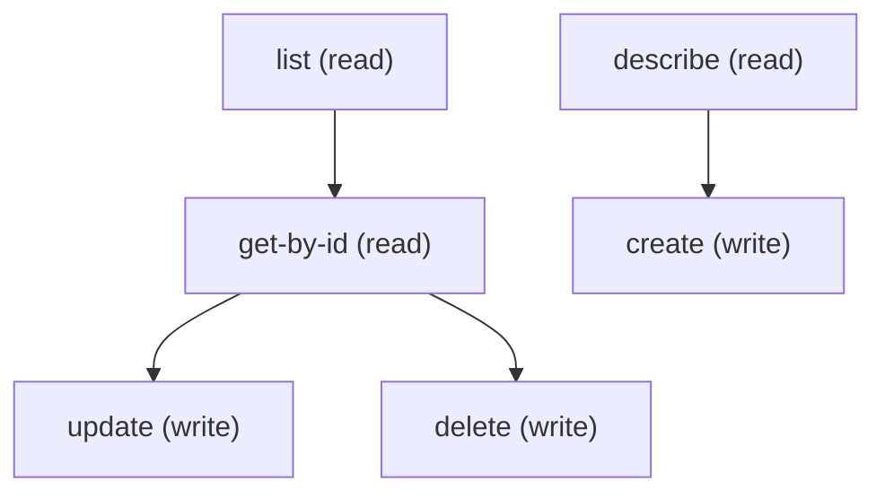

# Managing Virtual Visit Config

## When to Use This Skill

Manage VirtualVisitConfig records: the Health Cloud / Life Sciences Video Calls (telehealth) configuration behind the Video Visits Settings page in Setup. The steps use standard sObject REST for create, read, update and delete. The same configuration can also be deployed through the Metadata API. Required to create: DeveloperName (unique) and MasterLabel. UsageType (CHIME, INTELLIGENT_FORM_READER, SENTIMENT_ANALYSIS, KEY_PHRASE_EXTRACTION or ENTITY_DETECTION) can be used by only one record, so creating or updating a second record to the same UsageType fails with a duplicate-value error; records with a blank UsageType are not limited. A UsageType is accepted only when the org has the matching feature enabled, otherwise the save fails with "Invalid Value for Usage Type." Run describe first to get the createable fields and the picklist values for UsageType, VisitRegion and ComprehendServiceType. NamedCredentialId is a lookup to a Named Credential holding the external video service credentials; create that record first.

## Workflow

Standard sObject REST provides full CRUD plus describe on VirtualVisitConfig. The fields available at runtime depend on the org and the user's permissions, so run describe first and build the payload from the createable fields. Query existing records by UsageType before creating, because only one record per UsageType is allowed; to change a record's UsageType to one already in use, delete or re-type the other record first. If the save fails with "Invalid Value for Usage Type.", the feature behind that UsageType is not enabled in the org. Use a real Named Credential Id for NamedCredentialId.

## Critical Constraints

**Preconditions:**

- User needs create, read, update and delete access to VirtualVisitConfig. (check: `<udd:crud:VirtualVisitConfig>`)
- The org must have at least one of the supporting features enabled: Video Calls, Einstein Document Reader, Einstein Sentiment Analysis, or the Natural Language Service (key phrase or entity detection). Without one of them the configuration is not available and the Setup page does not render. (check: `Video Calls enabled || Einstein Document Reader enabled || Sentiment analysis enabled || Key phrase extraction enabled || Entity detection enabled`)
- User needs the Customize Application permission to create, update or delete records; reading needs View Setup. (check: `Customize Application permission`)
- User needs at least one of: the Video Calls permission, Health Cloud access, portal access, or administrator access to Einstein Document Reader, sentiment analysis or the Natural Language Service. (check: `Video Calls permission || Health Cloud access || Portal access || Administer Einstein Document Reader || Administer sentiment analysis || Administer natural language service`)

## Operations Reference

Operations grouped by purpose. Use these as the building blocks for the workflows above.

### Summary

| Operation | Purpose | Status | Call | Depends on |
|-----------|---------|--------|------|------------|
| `describe` | read | — | `GET /services/data/v67.0/sobjects/VirtualVisitConfig/describe` | — |
| `list` | read | — | `GET /services/data/v67.0/query` | — |
| `get-by-id` | read | — | `GET /services/data/v67.0/sobjects/VirtualVisitConfig/{Id}` | `list` |
| `create` | write | — | `POST /services/data/v67.0/sobjects/VirtualVisitConfig` | `describe` |
| `update` | write | — | `PATCH /services/data/v67.0/sobjects/VirtualVisitConfig/{Id}` | `get-by-id` |
| `delete` | write | — | `DELETE /services/data/v67.0/sobjects/VirtualVisitConfig/{Id}` | `get-by-id` |

### Dependency graph

### Read operations

#### `describe`

Retrieve the VirtualVisitConfig sObject describe — fields, picklist values, FLS, createable/updateable flags.

**Call:** `GET /services/data/v67.0/sobjects/VirtualVisitConfig/describe`

**Output:** DescribeSObjectResult for VirtualVisitConfig — use this to build the field list for list / create / update payloads.

#### `list`

List VirtualVisitConfig records. Pair this with /describe first to pick field names.

**Call:** `GET /services/data/v67.0/query`

**Inputs:**

- `where` *(`String`)* — Optional SOQL WHERE clause to filter Virtual Visit Config records.
- `limit` *(`int`)* — Optional SOQL LIMIT value.
- `q` *(`string`)*

**Output:** Query response with records[] of VirtualVisitConfig — Id plus any SELECTed fields.

#### `get-by-id`

Retrieve a specific VirtualVisitConfig record by Id.

**Call:** `GET /services/data/v67.0/sobjects/VirtualVisitConfig/{Id}`

**Inputs:**

- `Id` *(`ID`)* — Id of the VirtualVisitConfig record to fetch.

**Depends on:** `list`

**Output:** Single VirtualVisitConfig record with all readable fields per user FLS.

### Write operations

#### `create`

Create a VirtualVisitConfig record. Required: DeveloperName and MasterLabel. Run describe first for the createable fields. Only one record per UsageType is allowed in an org (duplicates fail), and a UsageType is accepted only when its feature is enabled in the org.

**Call:** `POST /services/data/v67.0/sobjects/VirtualVisitConfig`

**Inputs:**

- `body` *(`object`)* — Field/value map for the new VirtualVisitConfig. Populate from /describe's createableFields list.

**Depends on:** `describe`

**Rollback:** Call delete with the returned Id to undo the create.

#### `update`

Update an existing VirtualVisitConfig record. Merge-patch semantics.

**Call:** `PATCH /services/data/v67.0/sobjects/VirtualVisitConfig/{Id}`

**Inputs:**

- `Id` *(`ID`)* — Id of the VirtualVisitConfig to update.
- `body` *(`object`)* — Partial field/value map — only include fields you want to change.

**Depends on:** `get-by-id`

#### `delete`

Delete a VirtualVisitConfig record.

**Call:** `DELETE /services/data/v67.0/sobjects/VirtualVisitConfig/{Id}`

**Inputs:**

- `Id` *(`ID`)* — Id of the VirtualVisitConfig to delete.

**Depends on:** `get-by-id`
