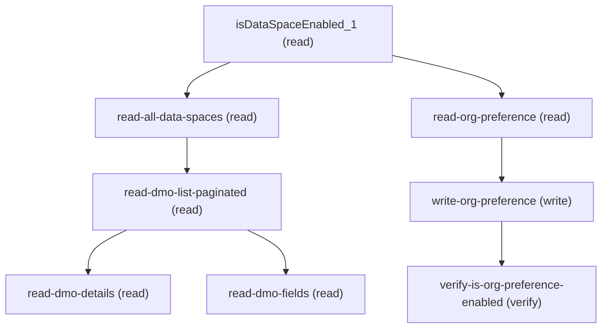

# Managing Actionable List Data Sources Dmo

## When to Use This Skill

Configure Data Cloud DMOs as Actionable List data sources. Read the Data-Space gate (`isDataSpaceEnabled` Aura — no Connect alternative for the org-feature-flag aggregate). Read and toggle the `ActionableListDMOPref` org preference via the canonical Setup Connect API `GET`/`PATCH /services/data/v67.0/setup/org/preferences/ActionableListDMOPref` (body `PreferenceCheckInputRepresentation{desiredState: boolean}` → response `PreferenceCheckOutputRepresentation{isPreferenceEnabled: boolean}`). Browse Data Spaces via Connect `setup.platform.data-clean-room-install-packages.getAllDataSpaces` (data-space rows), then DMOs in a chosen space via `getDmoListPaginated` (Aura — value-add DataModelListConfig filter + pagination), and inspect a DMO via `getDmoFields` / `getDmoDetails` (Aura — projected response shapes).

## Critical Constraints

**Preconditions:**

- User holds ActionableList feature access (`@ServiceComponentAccessGuard Actionable List access`, enforced by the Actionable List DMO setup operations.java); required for the Aura-routed steps in this SOR. (check: `Actionable List access`)
- Org has ActionableList enabled — `ActionableListDMOPref` registered behind `Actionable List enabled`; required for any pref read/write. (check: `Actionable List enabled`)
- Connect setup-metadata routes (`setOrgPreference` / `isOrgPreferenceEnabled`) require `View Setup permission` (setup-metadata operation.java) plus per-pref WRITE access — the setup metadata provider service.setOrgPreference` line 990 calls `validateAccess(orgPreferences.keySet(), ORG_PREFERENCES, Access_Type.WRITE)` and rejects unauthorized pref names. (check: `View Setup permission`)
- Connect `getAllDataSpaces` requires `Data Cloud setup access` (setup-access gate); apply only when the agent has admin-CDP access. (check: `Data Cloud setup access`)

## Verification Checklist

After every write operation, confirm the effect by re-reading state:

- After `write-org-preference`: call `verify-is-org-preference-enabled` (`GET /services/data/v67.0/setup/org/preferences/{preferenceName}`)

## Operations Reference

Operations grouped by purpose. Use these as the building blocks for the workflows above.

### Summary

| Operation | Purpose | Status | Call | Depends on |
|-----------|---------|--------|------|------------|
| `isDataSpaceEnabled_1` | read | implemented | `GET /headless/invoke/platform/actionable-list-data-sources-dmo` | — |
| `verify-is-org-preference-enabled` | verify | implemented | `GET /services/data/v67.0/setup/org/preferences/{preferenceName}` | `write-org-preference` |
| `read-all-data-spaces` | read | implemented | `GET /headless/invoke/platform/data-clean-room-install-packages/get-all-data-spaces` | `isDataSpaceEnabled_1` |
| `read-dmo-details` | read | implemented | `GET /headless/invoke/platform/actionable-list-data-sources-dmo/get-dmo-details` | `read-dmo-list-paginated` |
| `read-org-preference` | read | implemented | `GET /services/data/v67.0/setup/org/preferences/{preferenceName}` | `isDataSpaceEnabled_1` |
| `write-org-preference` | write | implemented | `PATCH /services/data/v67.0/setup/org/preferences/{preferenceName}` | `read-org-preference` |
| `read-dmo-list-paginated` | read | implemented | `GET /headless/invoke/platform/actionable-list-data-sources-dmo/get-dmo-list-paginated` | `read-all-data-spaces` |
| `read-dmo-fields` | read | implemented | `GET /headless/invoke/platform/actionable-list-data-sources-dmo/get-dmo-fields` | `read-dmo-list-paginated` |

### Dependency graph

### Read operations

#### `isDataSpaceEnabled_1`

Read whether Data Cloud Data Spaces are enabled in the org. AURA-IS-CANONICAL: no Connect/Tooling/Metadata surface exposes this org-feature-flag bit (`getAllDataSpaces` returns the list, not the enable flag). Gates the browse subgraph.

**Call:** `GET /headless/invoke/platform/actionable-list-data-sources-dmo`   — status: `implemented`

**Output:** boolean — true when Data Cloud's Data Space feature is enabled in the org (Setup admin sees the DMO data-source option), false otherwise.

#### `read-all-data-spaces`

Return every data-space row defined on the tenant — devName, prefix, status enum (ACTIVE|PROCESSING|ERROR), type enum (DEFAULT|CUSTOM), permSet, definitionId. Schema-perfect substitute for the Aura `getDataSpaces` (same data-spaces payload shape). Throws FailToGetDataspaces on backend failure.

**Call:** `GET /headless/invoke/platform/data-clean-room-install-packages/get-all-data-spaces`   — status: `implemented`

**Depends on:** `isDataSpaceEnabled_1`

**Output:** Array of data-space rows: id, devName, name, prefix, createdBy, modifiedDateTime, description, status (ACTIVE|PROCESSING|ERROR), type (DEFAULT|CUSTOM), permSet, definitionId, modifiedByUserName, isSharingRestricted, isPreSelectedSandboxDataspace. Agent uses `devName` as input to `read-dmo-list-paginated`.

#### `read-dmo-details`

Return `DataModelObject{id, name, label, category, creationType}` for one DMO by name. AURA-IS-CANONICAL: the controller projects from `MktDataModelRepresentation` (developerName/masterLabel/dataObjectCategoryDevName/creationType.apiValue); no public Connect API exposes this exact projection.

**Call:** `GET /headless/invoke/platform/actionable-list-data-sources-dmo/get-dmo-details`   — status: `implemented`

**Inputs:**

- `dmoName` *(`string`)* — DMO developerName from `read-dmo-list-paginated.dmo[].name`. Blank/null returns null.

**Depends on:** `read-dmo-list-paginated`

**Output:** `DataModelObject{id, name, label, category, creationType}` or null when the DMO is not found / lookup fails.

#### `read-org-preference`

Read the current `ActionableListDMOPref` org preference before deciding whether to toggle. Returns `PreferenceCheckOutputRepresentation{isPreferenceEnabled: boolean}`. Skip the write step if the current value already matches the desired state.

**Call:** `GET /services/data/v67.0/setup/org/preferences/{preferenceName}`   — status: `implemented`

**Inputs:**

- `preferenceName` *(`string`)* — Preference name path parameter. Use `ActionableListDMOPref` for this SOR.

**Depends on:** `isDataSpaceEnabled_1`

**Output:** `PreferenceCheckOutputRepresentation{isPreferenceEnabled: boolean}` — true when the actionable-list DMO data-source integration is enabled in the org.

#### `read-dmo-list-paginated`

List Data Cloud DMOs available in a chosen data space. AURA-IS-CANONICAL: the controller applies a `DataModelListConfig` filter + pagination that no public Connect API reconstructs. Returns `PaginatedDmosResponse{dmo[], totalCount}`.

**Call:** `GET /headless/invoke/platform/actionable-list-data-sources-dmo/get-dmo-list-paginated`   — status: `implemented`

**Inputs:**

- `dataSpaceName` *(`string`)* — `devName` of the target data space from `read-all-data-spaces`.
- `searchText` *(`string`)* — Optional case-insensitive substring filter over DMO name/label. Empty/null returns unfiltered.
- `limit` *(`integer`)* — Page size. Positive integer.
- `offset` *(`integer`)* — Zero-based offset for pagination. Combine with `limit` to page through results.

**Depends on:** `read-all-data-spaces`

**Output:** `PaginatedDmosResponse{dmo: array<{name, label, category, creationType}>, totalCount: integer}` — use `dmo[].name` as input to `read-dmo-details` / `read-dmo-fields`.

#### `read-dmo-fields`

Return the field metadata map for one DMO (used by the actionable-list field-picker UI). AURA-IS-CANONICAL: projects field metadata into a shape tailored to the actionable-list flow; no public Connect API reconstructs the same projection.

**Call:** `GET /headless/invoke/platform/actionable-list-data-sources-dmo/get-dmo-fields`   — status: `implemented`

**Inputs:**

- `dmoName` *(`string`)* — DMO `developerName` from `read-dmo-list-paginated.dmo[].name`. Blank/null returns null.

**Depends on:** `read-dmo-list-paginated`

**Output:** Field metadata projection (map keyed by field devName). Consumers read the map to populate the actionable-list field-picker UI.

### Write operations

#### `write-org-preference`

Toggle the `ActionableListDMOPref` org preference on or off via the canonical Setup Connect API. Body `PreferenceCheckInputRepresentation{desiredState: boolean}`. Response echoes the persisted value as `PreferenceCheckOutputRepresentation{isPreferenceEnabled}`. Resolves the enable-DMO-as-Actionable-List-source workflow.

**Call:** `PATCH /services/data/v67.0/setup/org/preferences/{preferenceName}`   — status: `implemented`

**Inputs:**

- `preferenceName` *(`string`)* — Preference name path parameter. Use `ActionableListDMOPref` for this SOR.
- `desiredState` *(`boolean`)* — `true` to enable the DMO data-source integration; `false` to disable it. Body is `PreferenceCheckInputRepresentation{desiredState: <this>}`.

**Depends on:** `read-org-preference`

**Output:** `PreferenceCheckOutputRepresentation{isPreferenceEnabled: boolean}` — echoes the value persisted by this call. Agent asserts this matches `desiredState`; the verify step re-reads to confirm durability.

### Verify operations

#### `verify-is-org-preference-enabled`

Read the `ActionableListDMOPref` org preference via the canonical Setup Connect API to confirm `write-org-preference` took effect. Returns `PreferenceCheckOutputRepresentation{isPreferenceEnabled: boolean}`; the value MUST match the boolean written by the prior step.

**Call:** `GET /services/data/v67.0/setup/org/preferences/{preferenceName}`   — status: `implemented`

**Inputs:**

- `preferenceName` *(`string`)* — Preference name path parameter. Use `ActionableListDMOPref` for this SOR — same value passed to the read/write preference steps. Binds the `{preferenceName}` URL segment of the verify GET.

**Depends on:** `write-org-preference`

**Output:** `PreferenceCheckOutputRepresentation{isPreferenceEnabled: boolean}`. Agent compares `isPreferenceEnabled` against the boolean it wrote in `write-org-preference`.
