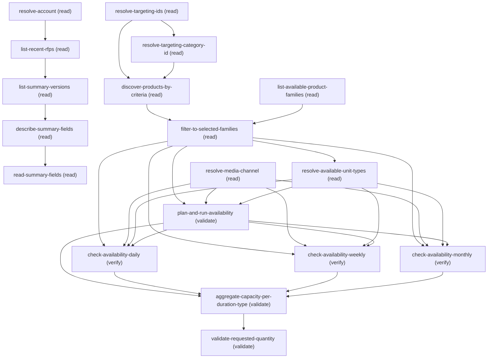

# Querying Media Product Discovery Inventory Verification

## When to Use This Skill

Use when a media sales planner wants to browse / filter media ad products (by price, targeting, price book, currency, media category/type, or search phrase) and then verify inventory availability. Trigger on intents like "Browse media ad products priced between $X and $Y", "Filter media ad products", "Give me media ad products which have targeting …". FIRST check whether the prompt already names filter criteria; if not, ask the user to enter criteria manually or pull them from an RFP record. Phase 1 also asks the user which product family/families to filter by (listing all families on the org when none was named) and keeps only discovered products in those families, grouped per family. Phase 1 filters the catalog; Phase 2 derives the products' distinct unit types (UnitOfMeasure.Name, e.g. Impressions / Fixed Units / SOV%) and lets the user pick at most 2 (default Impressions), then checks inventory over a flight window for each selected unit type, dimensioning on Media Channel × Product × Targeting, aggregates capacity per unit type per duration type, shows per-product max availability within each unit type, and validates a requested quantity against its unit type's max — never summing or comparing across unit types. Empty product list or empty capacity are valid, non-error answers — report them plainly, never fabricate numbers. Browse media ad products. Filter media ad products. Discover, list, or find media ad products in the existing catalog by price range, price book, currency, media type or media category (e.g. Digital, CTV, Display, Audio, Video), targeting, or search phrase. Search media ad products by channel and price range. This browses EXISTING media ad products.

## Critical Constraints

**Preconditions:**

- Org has Media Cloud Agentforce enabled (provisioned org perm). (check: `IndustriesMedia.orgHasMediaCloudAgentforceEnabled`)
- Caller can access Media Cloud Agentforce (AccessAgentforceForMediaCloud permission set — user perm UseAgentforceForMedia + PSL AgentforceForMediaPsl). Gates the Get Media Products Flow. (check: `IndustriesMedia.userCanAccessMediaCloudAgentforce`)
- Org has Media Cloud data/inventory access — gates AdSpace / AdSpaceCapacity and the /connect/media/inventory/* Connect APIs. (check: `Media Cloud access`)
- Org has Media Cloud Ultra (Media Plans). The read-only inventory Connect API (/connect/media/inventory/ad-space-availability) gates on orgHasMediaCloudAccess OR orgHasMediaCloudUltra, so Ultra orgs reach the same surface. (check: `Media Cloud Ultra enabled`)
- A price book with active PricebookEntry rows in the target currency/range exists. (check: `udd:exists:Pricebook2`)
- Ad-targeting reference data (AdTargetCategory / AdTargetSegmentValue) with product associations exists. (check: `udd:exists:AdTargetSegmentValue`)
- AdSpace + AdSpaceCapacity records loaded for the flight window (else Phase 2 is empty). (check: `udd:exists:AdSpaceCapacity`)
- RFP branch only — RequestForProposal + RequestForPrpsSummaryVer records exist for the account. (check: `udd:exists:RequestForProposal`)

**Operational rules:**

- FRONT-END (criteria gathering). The Get Media Products Flow filters on exactly THREE bases the user can mix and match (combined = AND / intersection): (A) BY PRODUCT NAME — a search phrase (product Name CONTAINS it); (B) BY PRICE — a min AND a max price (both needed; a missing bound defaults to 0, giving an empty 0-0 window), in a price book (defaults "Standard Price Book") and currency (defaults USD); optional media type and/or media category refine it and are reachable ONLY through this price base (so a media-type-only or media-category-only browse still needs a price window — use a wide one, e.g. 0 to 999999999); (C) BY TARGETING — ANY kind of targeting. MENU LABEL: when presenting this base in a menu or list of options, its label is EXACTLY the single word "Targeting" — never "Audience targeting", "Ad targeting", or any category name; the examples below are illustrations of what a facet may contain, NOT the label and NOT an allow-list. The user picks "Targeting" and supplies one or more targeting facets; each facet may name up to three parts: a targeting CATEGORY (the broad type, e.g. "Geo Targeting", "OS Targeting", "Audience Targeting" / "Demographics" — whatever the org defines), a category SEGMENT (the dimension within it, e.g. "Age", "Country", "Gender", "Operating System"), and a segment VALUE (the concrete value, e.g. "21 to 29", "India", "iOS"). The segment VALUE is the only MANDATORY part of this base — category and category-segment are optional refinements that narrow it. Accept whatever targeting the user gives, in either shape: fully qualified ("Geo Targeting: Country: India. Audience Targeting (Demographics): Age: 21 to 29") or value-first with the qualifier implied ("Age: 21 to 29, Country: India", or even bare "21 to 29, India"). Do NOT restrict to any one category — the examples above are illustrative, not an allow-list. (1) Inspect the prompt for any of these criteria. If present, set choice criteria-source=mentioned-in-prompt, MAP each detected value to its base — phrase → (A); any price/book/currency/media-type/media-category → (B); any segment value/category/category-segment → (C) — and go to Phase 1. Echo back to the user the criteria you detected and which base each maps to, so a misread is caught before discovery. (2) If absent, ask: enter criteria manually, or pull from an RFP record. (3) manual → PRESENT the three bases above to the user as a structured menu (name each base, its REQUIRED field(s), its optional refinements, and that they can combine bases), then collect values; do NOT dump a flat field list. Remind the user that media type/category need a price range, and that price needs both a min and a max. The Phase-2 flight window (start and end dates) and at least one media channel are REQUIRED for Phase 2 (inventory verification), not for Phase 1: gather them when known, but their absence does NOT block product discovery — never default or assume either, and gate on both only at Phase-2 entry (resolve-media-channel enforces the channel gate; the availability steps enforce the flight window). (4) rfp-record → run resolve-account → list-recent-rfps → list-summary-versions → describe-summary-fields → read-summary-fields. describe-summary-fields discovers WHICH field API name on this org's RequestForPrpsSummaryVer holds each of the four roles (targeting, media channel, flight start date, flight end date) — field names are org-specific and NOT hardcoded (commonly Product_Targeting_Details__c / Media_Channels__c / Start_Date__c / End_Date__c, but confirm, never assume): auto-detect candidates by name/label token, then present the determined mapping for all four roles and REQUIRE the user to confirm or correct it — a mandatory blocking gate, never skipped even when a match looks obvious (token match can mislink, e.g. a geography field to the audience role), and no field is read or threaded forward until the user confirms. If the user names a field they MUST give the exact field API NAME which is validated against the describe output (no match → re-ask; only a verbatim, user-confirmed describe field name is ever threaded into read-summary-fields). Then surface the confirmed targeting field's value as the targeting filter and ask if the user wants to add more criteria. Take the flight window from the confirmed start/end-date fields, but if EITHER is missing (null), ASK the user for it — never default a flight date (the flight window is enforced at Phase-2 entry, not Phase 1). Likewise take the media channel(s) from the confirmed channel field if present, but do NOT block Phase 1 on it — the channel is gathered here when the RFP carries it and otherwise asked for at Phase-2 entry (resolve-media-channel); never default or invent a channel. PHASE 1: resolve targeting with human-in-the-loop (resolve-targeting-ids) — the segment VALUE (AdTargetSegmentValue) is MANDATORY (ask for it if only a category/category segment was given); for every targeting facet AND every media channel try an EXACT match first, and on no exact match fuzzy-search and WAIT for the user to confirm the suggestion before discovery — never silently fall back or guess; if a segment-value Name is non-unique, ask the user which to pick; always show the user all three (segment value, category, category segment) in any targeting prompt. Media channel is NOT resolved in Phase 1 — product discovery and the family filter do not consume a channel, so Phase 1 completes without one; the channel is a Phase-2 entry gate (see PHASE 2 below). Then RESOLVE THE PRODUCT FAMILY FILTER (list-available-product-families): enumerate ALL product families on the org (SELECT Family FROM Product2 WHERE IsActive=true GROUP BY Family — this lists every family, media and non-media, and is deliberately NOT scoped to media products); if the user already named a family, validate it (exact → fuzzy → confirm) and skip the prompt, otherwise present the list (rendering a null family as "(No family set)") and ASK the user to pick ONE OR MORE families — never default to one, never invent a value. Then discover-products-by-criteria — BUILD productSearchCriteriaList from the criteria actually gathered (tokens are exactly "SearchPhrase" / "PriceRange" / "Targeting", case-sensitive, in that fixed order, intersected; NEVER "AdTarget" or "Keyword"), send only the fields for the selected bases (omit the rest — an unbound placeholder or unknown key faults the Flow), and pass targeting Names (NOT Ids) as JSON arrays. If the shortlist is empty, stop and report — do NOT run Phase 2. Then filter-to-selected-families — the Get Media Products Flow returns each product as {Id, Name} ONLY (Family is never projected out), so re-query Product2 by the shortlist Ids (SELECT Id,Name,Family FROM Product2 WHERE Id IN (...) AND Family IN (selected)) to keep ONLY products whose Family is among the user's picks, group the survivors per family, report how many were dropped for being in other families, and carry ONLY the surviving media_product_names into Phase 2. If none survive the family filter, stop and report (do NOT fall back to the unfiltered list). PHASE 2: FIRST resolve the media channel (resolve-media-channel) — it is REQUIRED for Phase 2 (but NOT Phase 1), treated with the same strict gate as the flight window: if none was detected in the prompt or the RFP summary, ASK the user and WAIT for at least one confirmed channel before any availability call — never default, assume, or run Phase 2 without a channel dimension (for every channel Name try an EXACT match first, and on no exact match fuzzy-search and WAIT for the user to confirm the suggestion; never silently drop or guess a channel). If the user cannot or will not name a channel, STOP Phase 2 and report that a channel is required (the Phase-1 shortlist still stands). THEN resolve-available-unit-types — derive the DISTINCT UnitOfMeasure.Name values carried by the AdSpaces of the shortlisted products (unit type is intrinsic to each AdSpace via AdSpace.UnitOfMeasureId → UnitOfMeasure.Name, NOT to the product). If more than 2 distinct unit types exist, present them all and ask the user to pick at most 2; if 2 or fewer exist, use them as-is (no prompt); if none can be derived, default to the single unit type "Impressions". Then, FOR EACH selected unit type, call /connect/media/inventory/ad-space-availability THREE times (durationType Daily, Weekly, Monthly) — so the availability calls fan out over (duration × selected unit type) — dimensioning adSpaceDimensionList on the Media Channel × Product × Targeting cross-product (single-value dimensions collapse to a top-level filter). unitType is a single scalar per call — it cannot carry multiple values, so each selected unit type is its own set of calls. Then aggregate-capacity-per-duration-type sums per product per unit type per duration type and takes the max across durations WITHIN each unit type; finally validate-requested-quantity compares the user's quantity — supplied WITH its unit type — to that unit type's max. Never sum across duration types, and never sum or compare across DIFFERENT unit types (Impressions and SOV% are not additive). Before the availability calls, confirm the endpoint path + current version via discover + describe rather than pinning a version. EFFICIENCY + SIZE GATE (see the plan-and-run-availability step for the full contract). First PRUNE DURATIONS — compute the flight-window span in days = endDate - startDate + 1. Always call Daily. Call Weekly ONLY if span >= 7. Call Monthly ONLY if span >= 28 (28, the shortest month — NOT 30/31; a 27-day window in a 28-day February would else wrongly skip a valid Monthly record). This is lossless: a pruned duration provably returns no row for the window, and the aggregation takes a MAX over durations, so max(kept, 0-for-pruned) is unchanged. It only skips durations that CANNOT match, never a duration that merely might be empty. Then apply the MANY-PRODUCTS GATE — after Phase 1, count the family-filtered shortlist (filter-to-selected-families media_product_names — the TOTAL across all selected families, not per-family). If it has MORE THAN 5 products, STOP and offer the user exactly TWO options: (1) filter on more criteria to narrow the shortlist [PREFERRED — fewer, more relevant products; rerun Phase 1 with a tighter criterion]; (2) name up to 5 specific products to check inventory for now — the user may PICK from the displayed shortlist OR FREE-TYPE product names, matched back to the shortlist (exact first, then fuzzy/contains with the user confirming the suggestion; drop anything matching nothing and say so — never invent a product not in the shortlist). Enforce the cap of 5: if the user names more than 5, ask them to trim to 5. NEVER silently check only "the first N" and present it as the whole answer, and never batch/stream across the whole shortlist. Run the kept (durationType x selected unitType) calls for the named set CONCURRENTLY (they are independent read-only calls; bounded retry on transient failure). The named-products check is USER-DRIVEN and REPEATABLE: after showing a round's results, ask the user whether to (a) validate a requested quantity against those products, or (b) check inventory for OTHER products — in which case they name the next up to 5 and the round repeats — and loop until the user is done. If the shortlist is 5 or fewer, skip the gate and check all of them directly.

## Verification Checklist

After every write operation, confirm the effect by re-reading state:

- After `filter-to-selected-families`, `resolve-media-channel`, `resolve-available-unit-types`, `plan-and-run-availability`: call `check-availability-daily` (`POST /connect/media/inventory/ad-space-availability`)
- After `filter-to-selected-families`, `resolve-media-channel`, `resolve-available-unit-types`, `plan-and-run-availability`: call `check-availability-weekly` (`POST /connect/media/inventory/ad-space-availability`)
- After `filter-to-selected-families`, `resolve-media-channel`, `resolve-available-unit-types`, `plan-and-run-availability`: call `check-availability-monthly` (`POST /connect/media/inventory/ad-space-availability`)

## Operations Reference

Operations grouped by purpose. Use these as the building blocks for the workflows above.

### Summary

| Operation | Purpose | Status | Call | Depends on |
|-----------|---------|--------|------|------------|
| `resolve-account` | read | implemented | `GET /services/data/v67.0/query` | — |
| `list-recent-rfps` | read | implemented | `GET /services/data/v67.0/query` | `resolve-account` |
| `list-summary-versions` | read | implemented | `GET /services/data/v67.0/query` | `list-recent-rfps` |
| `describe-summary-fields` | read | implemented | `GET /services/data/v67.0/sobjects/RequestForPrpsSummaryVer/describe` | `list-summary-versions` |
| `read-summary-fields` | read | implemented | `GET /services/data/v67.0/query` | `describe-summary-fields` |
| `resolve-targeting-ids` | read | implemented | `GET /services/data/v67.0/query` | — |
| `resolve-targeting-category-id` | read | implemented | `GET /services/data/v67.0/query` | `resolve-targeting-ids` |
| `resolve-media-channel` | read | implemented | `GET /services/data/v67.0/query` | — |
| `list-available-product-families` | read | implemented | `GET /services/data/v67.0/query` | — |
| `discover-products-by-criteria` | read | implemented | `POST /services/data/v67.0/actions/custom/flow/media_opp_flows__GetMediaProducts` | `resolve-targeting-ids`, `resolve-targeting-category-id` |
| `filter-to-selected-families` | read | implemented | `GET /services/data/v67.0/query` | `discover-products-by-criteria`, `list-available-product-families` |
| `resolve-available-unit-types` | read | implemented | `GET /services/data/v67.0/query` | `filter-to-selected-families` |
| `plan-and-run-availability` | validate | — | — | `filter-to-selected-families`, `resolve-media-channel`, `resolve-available-unit-types` |
| `check-availability-daily` | verify | implemented | `POST /connect/media/inventory/ad-space-availability` | `filter-to-selected-families`, `resolve-media-channel`, `resolve-available-unit-types`, `plan-and-run-availability` |
| `check-availability-weekly` | verify | implemented | `POST /connect/media/inventory/ad-space-availability` | `filter-to-selected-families`, `resolve-media-channel`, `resolve-available-unit-types`, `plan-and-run-availability` |
| `check-availability-monthly` | verify | implemented | `POST /connect/media/inventory/ad-space-availability` | `filter-to-selected-families`, `resolve-media-channel`, `resolve-available-unit-types`, `plan-and-run-availability` |
| `aggregate-capacity-per-duration-type` | validate | — | — | `plan-and-run-availability`, `check-availability-daily`, `check-availability-weekly`, `check-availability-monthly` |
| `validate-requested-quantity` | validate | — | — | `aggregate-capacity-per-duration-type` |

### Dependency graph

### Read operations

#### `resolve-account`

Find the Account the RFP belongs to. The only typed input in the RFP walk.

**Call:** `GET /services/data/v67.0/query`   — status: `implemented`

**Inputs:**

- `accountName` *(`String`)* — The advertiser account name, e.g. "Priyanka Sharma".
- `q` *(`string`)*

#### `list-recent-rfps`

List the newest 5 RequestForProposal records for the account; the user picks one. SummaryId on each RFP is the FK to that RFP's ACTIVE summary version.

**Call:** `GET /services/data/v67.0/query`   — status: `implemented`

**Inputs:**

- `account_id` *(`String`)* — Account Id from resolve-account.
  - **Source:** output of `resolve-account`
- `q` *(`string`)*

**Depends on:** `resolve-account`

#### `list-summary-versions`

List all RequestForPrpsSummaryVer versions for the chosen RFP, newest first. Flag the version whose Id equals the RFP's SummaryId as the active version.

**Call:** `GET /services/data/v67.0/query`   — status: `implemented`

**Inputs:**

- `rfpId` *(`String`)* — Chosen RequestForProposal Id.
- `activeSummaryId` *(`String`)* — The chosen RFP's SummaryId — the active summary version's Id.
- `q` *(`string`)*

**Depends on:** `list-recent-rfps`

#### `describe-summary-fields`

Describe RequestForPrpsSummaryVer and resolve WHICH field API name on this org's summary object holds each of the four filter roles — targeting, media channel, flight start date, flight end date — before reading them. Field API names are org-specific (custom __c fields, namespaced, or standard), so they are NOT hardcoded: they are discovered here, then the determined mapping is presented to the user for MANDATORY confirmation (a blocking gate — the user can confirm or correct any field before it is used), and only a verbatim, user-confirmed describe field name is ever threaded into read-summary-fields.

**Call:** `GET /services/data/v67.0/sobjects/RequestForPrpsSummaryVer/describe`   — status: `implemented`

**Inputs:**

- `userNamedFields` *(`Map`)* — Source: user input. OPTIONAL — any field API names the user explicitly named for a role (e.g. {"targeting": "Product_Targeting_Details__c"}). Each MUST be a field API NAME (not a label) and is only accepted if it exactly matches a describe field name.

**Depends on:** `list-summary-versions`

#### `read-summary-fields`

Read the filter-relevant fields off the chosen RequestForPrpsSummaryVer using the field API names CONFIRMED in describe-summary-fields — targeting (free-text), media channel (free-text), flight start date, flight end date — plus the standard Budget and CurrencyIsoCode. The four role field names are NOT hardcoded here; they are the verbatim describe names threaded from describe-summary-fields (commonly Product_Targeting_Details__c / Media_Channels__c / Start_Date__c / End_Date__c, but org-specific).

**Call:** `GET /services/data/v67.0/query`   — status: `implemented`

**Inputs:**

- `summaryVersionId` *(`String`)* — Chosen summary version Id.
- `targetingFieldName` *(`String`)* — CONFIRMED targeting field API name from describe-summary-fields. When present it MUST be a verbatim describe fields[*].name (validated to exist on the object). OPTIONAL — unset when the user confirmed in the (2) gate that no field maps to this role; when unset, OMIT it from the SELECT. Targeting is not mandatory for the workflow: an unmapped targeting role simply means the Targeting branch isn't seeded from the RFP — the user may still filter by price/name, or supply targeting values manually if they want that branch (do NOT force-collect a targeting value).
  - **Source:** output of `describe-summary-fields`
- `channelFieldName` *(`String`)* — CONFIRMED media-channel field API name from describe-summary-fields. When present it MUST be a verbatim describe fields[*].name (validated to exist on the object). OPTIONAL — unset when the user confirmed in the (2) gate that no field maps to this role; when unset, OMIT it from the SELECT and collect the channel value from the user instead.
  - **Source:** output of `describe-summary-fields`
- `startDateFieldName` *(`String`)* — CONFIRMED flight-start-date field API name from describe-summary-fields. When present it MUST be a verbatim describe fields[*].name (validated to exist on the object). OPTIONAL — unset when no date field maps to this role; when unset, OMIT it from the SELECT and ask the user for the flight start date instead.
  - **Source:** output of `describe-summary-fields`
- `endDateFieldName` *(`String`)* — CONFIRMED flight-end-date field API name from describe-summary-fields. When present it MUST be a verbatim describe fields[*].name (validated to exist on the object). OPTIONAL — unset when no date field maps to this role; when unset, OMIT it from the SELECT and ask the user for the flight end date instead.
  - **Source:** output of `describe-summary-fields`
- `selectColumns` *(`String`)* — DERIVED (built by the agent, not hardcoded) — the comma-joined SELECT column list substituted into the {selectColumns} placeholder in the invocation path. Built from ONLY the confirmed-mapped role field names among targetingFieldName, channelFieldName, startDateFieldName, endDateFieldName (each included IFF set), plus the always-present standard columns Budget and CurrencyIsoCode. An unmapped role contributes NO column (no empty placeholder, no leading/trailing/double comma). Every name MUST be a verbatim describe fields[*].name confirmed in describe-summary-fields — never a hardcoded or guessed field. Example with only targeting + channel mapped: "Target_Audience__c,Target_Channels__c,Budget,CurrencyIsoCode". Same author-built pattern as discover-products-by-criteria's productSearchCriteriaList.
- `q` *(`string`)*

**Depends on:** `describe-summary-fields`

#### `resolve-targeting-ids`

RESOLVE the targeting inputs before Phase 1, with fuzzy matching and human-in-the-loop confirmation. CONDITIONAL (machine-guarded): this step runs ONLY when targeting-scope == with-targeting (i.e. "Targeting" is among the selected productSearchCriteriaList tokens) — a SearchPhrase-only or PriceRange-only browse selects without-targeting, whose skip_steps drops this step. The segment VALUE (AdTargetSegmentValue) is MANDATORY within the Targeting branch; category and category segment are supporting context. For each candidate segment-value Name, try an EXACT match first; if it is missing, fuzzy-search and ASK the user to confirm before proceeding; if the Name is non-unique, ASK the user which to pick. The Flow resolves Names to Ids itself, so Phase 1 receives NAMES; Phase 2 dimensions on the same confirmed Names (and, when available, their category), so a wrong or unconfirmed Name silently drops its inventory combination. The query also traverses the AdTargetSegmentValue → AdTargetCategorySegment → AdTargetCategory chain to pull category + category-segment context for every candidate.

**Call:** `GET /services/data/v67.0/query`   — status: `implemented`

**Inputs:**

- `candidateSegmentValues` *(`String[]`)* — ALL candidate AdTargetSegmentValue Names parsed from every targeting facet (of ANY targeting type) of the RFP Product_Targeting_Details__c or supplied manually, e.g. ["21 to 29","outdoor activities","hiking","India"] — each already normalised to the bare stored value (dimension qualifier such as "Age " stripped, "Country: India" reduced to "India"). NOT just the first facet. CONDITIONAL (machine-guarded): this whole step runs ONLY when targeting-scope == with-targeting — a SearchPhrase-only or PriceRange-only browse selects without-targeting and never reaches it (skip_steps). WITHIN the Targeting branch the segment value IS compulsory: if the branch is used but only a category / category segment was given (no segment value), ASK the user for the segment value before proceeding.
- `targetingCategory` *(`String`)* — Optional targeting CATEGORY term for ANY targeting type the org defines — e.g. "Audience Targeting", "Geo Targeting", "OS Targeting", or any other (these are examples, not a fixed set). When given, it is fuzzy-matched (exact→LIKE→confirm) too and used to disambiguate a non-unique segment-value Name. If the user supplies several facets with different categories, apply this per facet.
- `targetingCategorySegment` *(`String`)* — Optional targeting CATEGORY SEGMENT term (the dimension label within a category) for ANY targeting type — e.g. "Age", "Country", "Gender", "Operating System", or any other the org defines (examples, not a fixed set). When given, it is fuzzy-matched (exact→LIKE→confirm) too and used to disambiguate a non-unique segment-value Name. If the user supplies several facets with different category segments, apply this per facet.
- `q` *(`string`)*

**Output:** confirmed_segment_names is the FLAT list of confirmed AdTargetSegmentValue Names that Phase 1's Flow consumes. category_segment_names is the CATEGORY SEGMENT dimension labels (records[*].TargetCategorySegment.Name — e.g. "Age", "Country"), which ride the direct FK and are reliably populated. segment_category_ids is the DISTINCT set of records[*].TargetCategorySegmentId values — the input the NEXT step (resolve-targeting-category-id) feeds to the AdAvailableTargetSegment junction to resolve the parent CATEGORY. NOTE: this step deliberately no longer emits category_names or targeting_pairs — the CATEGORY (e.g. "Geo Targeting") does NOT ride the direct FK records[*].TargetCategorySegment.TargetCategory.Name (that column is null for Audience/Geo/OS segments; only Linear-Demography DMAs populate it), so it is resolved authoritatively from the junction in resolve-targeting-category-id and both category_names and targeting_pairs are emitted THERE. Do not read a category from this step's direct-FK column.

#### `resolve-targeting-category-id`

CONDITIONAL (machine-guarded): this step is part of the Targeting branch and runs ONLY when targeting-scope == with-targeting (i.e. "Targeting" is among the selected productSearchCriteriaList tokens) — a SearchPhrase-only or PriceRange-only browse selects without-targeting, whose skip_steps drops this step AND resolve-targeting-ids, so it never renders an empty IN-clause. The downstream discovery step simply omits the (already-optional) AdTargetCategories / targeting_pairs inputs. WITHIN the Targeting branch it always has segment_ids to resolve. Resolve the parent CATEGORY (e.g. "Geo Targeting", "Audience Targeting") for the confirmed segments, then build the two forms the rest of the workflow consumes: category_names (the Phase-1 Flow's optional AdTargetCategories refinement) and targeting_pairs (the Phase-2 targeting axis, each segment value bound to ITS OWN category). The segment↔category relationship is MANY-TO-MANY, so it lives in the junction AdAvailableTargetSegment — NOT on the direct FK AdTargetCategorySegment.TargetCategoryId (which is null for Audience/Geo/OS segments; only Linear-Demography DMAs populate it). This step is the SINGLE SOURCE OF TRUTH for the category: a null on the earlier direct-FK column is a FALSE negative resolved here, and a segment ABSENT from the junction is the only real "no category" signal. Query every distinct TargetCategorySegmentId from resolve-targeting-ids in ONE IN-clause, dedupe the rows (the junction returns one row per product availability, so a (segment,category) pair repeats), and build a segmentId→categoryName map.

**Call:** `GET /services/data/v67.0/query`   — status: `implemented`

**Inputs:**

- `segment_ids` *(`String[]`)* — The DISTINCT TargetCategorySegmentId values from resolve-targeting-ids (segment_category_ids), single-quoted for the IN clause, e.g. ('<segmentId1>','<segmentId2>'). One per confirmed segment value's category-segment; de-duplicate before building the IN-list. REQUIRED here because this step only executes inside the Targeting branch (guarded by applies_when: targeting-scope == with-targeting). A SearchPhrase-only or PriceRange-only browse selects without-targeting, which skips this whole step via the choice's skip_steps — so the step never renders an empty IN-clause. WHEN it runs, resolve-targeting-ids has always confirmed at least one segment value (and thus its TargetCategorySegmentId), so segment_ids is guaranteed non-empty.
  - **Source:** output of `resolve-targeting-ids`
- `q` *(`string`)*

**Depends on:** `resolve-targeting-ids`

#### `resolve-media-channel`

Resolve the Media Channel Name(s) for the Phase-2 AdSpace filter. Media channel is REQUIRED for inventory verification (Phase 2) — treated with the same strict gate as the flight window — but it is NOT required for Phase 1 (product discovery and the family filter do not consume it). This is the FIRST Phase-2 step: it runs after the Phase-1 shortlist is settled and gates entry to inventory verification. If no channel was detected in the prompt or the RFP summary the workflow ASKS the user and WAITS for at least one confirmed channel before any availability call (see agent_guidance). For each supplied/entered channel Name, confirm it exists via an exact match; if none matches, fuzzy-search and ask the user to confirm before the availability calls. Never guess a channel, never silently drop one, and never run Phase 2 with no channel.

**Call:** `GET /services/data/v67.0/query`   — status: `implemented`

**Inputs:**

- `candidateChannelNames` *(`String[]`)* — Media Channel Names parsed from the free-text Media_Channels__c or supplied by the user (split on comma/semicolon/newline/" and "). REQUIRED for Phase 2 — if none is present, ASK the user and WAIT for at least one channel before any availability call; never run Phase 2 with no channel (see agent_guidance). Not needed for Phase 1.
- `q` *(`string`)*

#### `list-available-product-families`

PRE-DISCOVERY FAMILY GATE. Enumerate the product families present on the org so the user can scope discovery to one or more families, then feed only the picked families into the post-discovery filter. Product2.Family is an org-configured picklist (DYNAMICENUM) — there is NO fixed set of family values and no "media" flag on the record — so the family list is read LIVE from org data with a GROUP BY, never hardcoded. This lists ALL families on the org (media and non-media alike); it is NOT scoped to media/ad products. The Get Media Products Flow returns each product as {Id, Name} only (Family is never projected out of the Flow), so family selection is applied AFTER discovery in filter-to-selected-families using the selection made here.

**Call:** `GET /services/data/v67.0/query`   — status: `implemented`

**Inputs:**

- `mentionedFamily` *(`String[]`)* — OPTIONAL — any product family/families the user already named in the prompt or that were read from an RFP summary. When present, they are VALIDATED against the enumerated available_families (exact → fuzzy → confirm) and the multi-select prompt is skipped; when absent, the user is asked to pick from available_families. Never thread an unvalidated family forward.
- `q` *(`string`)*

#### `discover-products-by-criteria`

PHASE 1 filter. Invoke the "Get Media Products" Flow with WHICHEVER of the three filter bases the gathered criteria imply. The Flow has exactly 3 case-sensitive base tokens — "SearchPhrase" (product Name CONTAINS a phrase), "PriceRange" (UnitPrice BETWEEN min/max in a named price book; also carries the optional mediaType / mediaCategory refinements), and "Targeting" (audience segment / category / category-segment) — processed in the fixed order SearchPhrase → PriceRange → Targeting. The first selected token seeds the result set and each additional token INTERSECTS it (AND, never union). productSearchCriteriaList is built by the agent from the criteria actually supplied, so all 9 documented filtering ways are reachable (e.g. ["SearchPhrase"] name-only, ["PriceRange"] price-only, ["Targeting"] targeting-only, ["PriceRange","Targeting"] combined). CRITICAL: the ad-targeting token is "Targeting", NOT "AdTarget"; the search-phrase token is "SearchPhrase", NOT "Keyword" (an unrecognised token silently yields 0 products); targeting inputs are NAMES (not Ids) sent as JSON arrays.

**Call:** `POST /services/data/v67.0/actions/custom/flow/media_opp_flows__GetMediaProducts`   — status: `implemented`

**Inputs:**

- `MinimumProductPrice` *(`Double`)* — Inclusive lower bound of the product unit price (omit if not price-filtering).
- `MaximumProductPrice` *(`Double`)* — Inclusive upper bound of the product unit price.
- `AdTargetSegmentValues` *(`String[]`)* — Array of AdTargetSegmentValue NAMES (e.g. ["21 to 29"]) — NOT Ids. MUST be a JSON array. Source: resolve-targeting-ids confirmed_segment_names. At least one of AdTargetSegmentValues / AdTargetCategories / AdTargetCategorySegments is needed for the Targeting branch to filter.
- `AdTargetCategories` *(`String[]`)* — Array of AdTargetCategory NAMES (e.g. ["Geo Targeting"]) — NOT Ids. JSON array. Source: resolve-targeting-category-id category_names (the distinct non-null categories resolved from the AdAvailableTargetSegment junction — NOT the direct-FK column, which is null for most segments). Optional refinement of the Targeting branch (matched Name LIKE) — PASS IT whenever the junction resolved any non-null category; OMIT the key when there are none (do not send [] or null).
- `AdTargetCategorySegments` *(`String[]`)* — Array of AdTargetCategorySegment NAMES (e.g. ["Age","Country"]) — NOT Ids. JSON array. Source: resolve-targeting-ids category_segment_names (the confirmed non-null category segments). Optional refinement of the Targeting branch (matched Name LIKE), and a real, accepted Flow input variable — PASS IT whenever resolve-targeting-ids resolved any non-null category segment (common on this org even when category is null); OMIT the key when there are none (do not send [] or null).
- `priceBookName` *(`String`)* — NAME of the price book to search (the Flow resolves the name). REQUIRED when "PriceRange" is in productSearchCriteriaList; omit otherwise. Defaults to "Standard Price Book" when price-filtering.
- `currencyIsoCode` *(`String`)* — ISO 4217 currency code matching the PricebookEntry currency. Used with the "PriceRange" branch; defaults to USD when price-filtering. Omit otherwise.
- `productSearchPhrase` *(`String`)* — Product-name search phrase. REQUIRED when "SearchPhrase" is in productSearchCriteriaList (Name CONTAINS the phrase); omit otherwise.
- `mediaCategory` *(`String`)* — Optional media category (ProductCategory.Name, matched EXACT and VALIDATED — an invalid value faults the Flow). Only read when "PriceRange" is selected.
- `mediaType` *(`String`)* — Optional media type (Product.Family, matched EXACT and VALIDATED — an invalid value faults the Flow). Only read when "PriceRange" is selected.
- `productSearchCriteriaList` *(`String[]`)* — The base tokens to run, BUILT BY THE AGENT from the criteria actually gathered (not hardcoded). Case-sensitive; valid tokens are exactly "SearchPhrase", "PriceRange", "Targeting". Add "SearchPhrase" iff a productSearchPhrase was given; add "PriceRange" iff any of MinimumProductPrice / MaximumProductPrice / priceBookName / mediaType / mediaCategory apply; add "Targeting" iff any AdTargetSegmentValues / AdTargetCategories / AdTargetCategorySegments apply. Emit tokens in the fixed processing order SearchPhrase → PriceRange → Targeting. Multiple tokens INTERSECT (AND). NEVER "AdTarget"; NEVER "Keyword".

**Depends on:** `resolve-targeting-ids`, `resolve-targeting-category-id`

#### `filter-to-selected-families`

POST-DISCOVERY FAMILY FILTER + GROUPING. Intersect the Phase-1 shortlist against the families the user chose in list-available-product-families, and carry ONLY the surviving products into Phase 2. The Get Media Products Flow returns each product as {Id, Name} only — Product2.Family is NEVER projected out of the Flow — so this step re-queries Product2 by the shortlist Ids to read each product's Family and keep those whose Family is in selected_families. It then groups the survivors by family for display. This is the single place the family filter takes effect; every Phase-2 step consumes this step's media_product_names in place of the raw Flow output. Runs only when list-available-product-families produced a selection.

**Call:** `GET /services/data/v67.0/query`   — status: `implemented`

**Inputs:**

- `product_ids` *(`String[]`)* — The Phase-1 shortlist Product2 Ids from discover-products-by-criteria (parsed from each productList entry's Id) — the set to intersect against the selected families. Single-quote each Id for the IN clause (Ids are opaque 15/18-char keys with no special characters, but keep the same single-quote-and-URL-encode discipline used for the family values below).
  - **Source:** output of `discover-products-by-criteria`
- `selected_families` *(`String[]`)* — The confirmed family Names the user chose in list-available-product-families (selected_families). Product2.Family is an org-configured value that may legitimately contain an apostrophe (e.g. "Men's") or other reserved characters, so before building the IN-list SOQL-escape each value — replace every backslash with a double backslash, then every apostrophe with a backslash-apostrophe — then single-quote it and URL-encode the whole assembled query before dispatch (an unescaped apostrophe yields invalid SOQL and reserved characters corrupt the GET URL). When the user opted to include "(No family set)", handle null separately (see agent_guidance) — an IN-list cannot match null.
- `q` *(`string`)*

**Depends on:** `discover-products-by-criteria`, `list-available-product-families`

#### `resolve-available-unit-types`

DERIVE which unit types (UnitOfMeasure.Name) the availability calls should run for. Unit type is intrinsic to each AdSpace via AdSpace.UnitOfMeasureId → UnitOfMeasure.Name (NOT to the product — one product's AdSpaces can span Impressions, Fixed Units, SOV%), and the Connect API takes exactly one unitType per call, so the set of unit types must be resolved up front and each drives its own Daily/Weekly/Monthly calls. Query the DISTINCT UnitOfMeasure.Name across the AdSpaces of the shortlisted products. SELECTION RULE: if MORE THAN 2 distinct unit types come back, present ALL of them to the user and ask them to select AT MOST 2; if 2 or fewer come back, use them as-is with no prompt; if the query yields none, default to the single unit type ["Impressions"]. This step is the ONLY place unit types are chosen; every check-availability-* call consumes the result.

**Call:** `GET /services/data/v67.0/query`   — status: `implemented`

**Inputs:**

- `productNames` *(`String[]`)* — The family-filtered shortlist Product Names from filter-to-selected-families (media_product_names) — the SAME product set the availability calls dimension on. Source: output of filter-to-selected-families (NOT the raw discover-products-by-criteria output — the family filter has already been applied).
  - **Source:** output of `filter-to-selected-families`
- `q` *(`string`)*

**Depends on:** `filter-to-selected-families`

### Verify operations

#### `check-availability-daily`

Availability for capacity duration type DAILY over the flight window. Returns each matched AdSpace's contained, active DAILY AdSpaceCapacity records. Dimension on the Media Channel × Product × Targeting cross-product. This Connect API has no Agentforce Action wrapper — call it directly, at the version-free path.

**Call:** `POST /connect/media/inventory/ad-space-availability`   — status: `implemented`

**Inputs:**

- `startDate` *(`Date`)* — Flight start (yyyy-MM-dd). NEVER defaulted or assumed — always a real value the user gave. RFP path: use the summary Start_Date__c ONLY if it is non-null; if it is missing, ASK the user. Manual path: ALWAYS ask the user. Do not proceed to the availability calls without a confirmed start date. Source: user-confirmed flight window (asked directly, or read from a non-null RFP summary Start_Date__c); threaded through plan-and-run-availability, not an upstream step output.
- `endDate` *(`Date`)* — Flight end (yyyy-MM-dd). NEVER defaulted or assumed — always a real value the user gave. RFP path: use the summary End_Date__c ONLY if it is non-null; if it is missing, ASK the user. Manual path: ALWAYS ask the user. Must be on or after startDate. Do not proceed to the availability calls without a confirmed end date. Source: user-confirmed flight window (asked directly, or read from a non-null RFP summary End_Date__c); threaded through plan-and-run-availability, not an upstream step output.
- `unitType` *(`String`)* — The SINGLE UnitOfMeasure.Name for THIS call — one value from resolve-available-unit-types' selected_unit_types. This step runs ONCE PER selected unit type (the API takes one unitType per call, never an array). Source: output of resolve-available-unit-types. Matched by exact equality against UnitOfMeasure.Name, so it must be a real org value (Impressions when nothing else was derived).
  - **Source:** output of `resolve-available-unit-types`
- `productNames` *(`String[]`)* — Product Names from Phase 1 — one axis of the cross-product.
- `channelNames` *(`String[]`)* — ALL CONFIRMED Media Channel Names from resolve-media-channel (confirmed_channel_names) — never the raw multi-channel string and never just the first. Source: output of resolve-media-channel. REQUIRED and never empty — resolve-media-channel blocks Phase 2 until at least one channel is confirmed, so this axis always carries a value. Second axis: with 2+ channels this fans out into multiple cross-product OR-entries so an AdSpace on any listed channel is found.
  - **Source:** output of `resolve-media-channel`
- `targetingPairs` *(`object[]`)* — The confirmed targeting as PAIRED records from resolve-targeting-category-id's targeting_pairs (every parsed facet — Age, Interests, Geo-Country — NOT just one), each { segmentValue: <AdTargetSegmentValue Name>, category: <that value's junction-resolved AdTargetCategory Name, OMITTED when the junction returned no row> } — the third axis. Each pair keeps a category bound to ITS OWN segment value, replacing the old two parallel arrays (targetingNames + targetingCategoryNames) so a segment can never be zipped to the wrong category or emit an empty category filter. With 2+ pairs this axis fans out into multiple cross-product entries; inventory is often seeded on the Geo/Interest facet, so passing only the Age facet would miss it.
  - **Source:** output of `resolve-targeting-category-id`

**Depends on:** `filter-to-selected-families`, `resolve-media-channel`, `resolve-available-unit-types`, `plan-and-run-availability`

#### `check-availability-weekly`

Availability for capacity duration type WEEKLY over the flight window. Returns each matched AdSpace's contained, active WEEKLY AdSpaceCapacity records. Dimension on the Media Channel × Product × Targeting cross-product. This Connect API has no Agentforce Action wrapper — call it directly, at the version-free path.

**Call:** `POST /connect/media/inventory/ad-space-availability`   — status: `implemented`

**Inputs:**

- `startDate` *(`Date`)* — Flight start (yyyy-MM-dd). NEVER defaulted or assumed — always a real value the user gave. RFP path: use the summary Start_Date__c ONLY if it is non-null; if it is missing, ASK the user. Manual path: ALWAYS ask the user. Do not proceed to the availability calls without a confirmed start date. Source: user-confirmed flight window (asked directly, or read from a non-null RFP summary Start_Date__c); threaded through plan-and-run-availability, not an upstream step output.
- `endDate` *(`Date`)* — Flight end (yyyy-MM-dd). NEVER defaulted or assumed — always a real value the user gave. RFP path: use the summary End_Date__c ONLY if it is non-null; if it is missing, ASK the user. Manual path: ALWAYS ask the user. Must be on or after startDate. Do not proceed to the availability calls without a confirmed end date. Source: user-confirmed flight window (asked directly, or read from a non-null RFP summary End_Date__c); threaded through plan-and-run-availability, not an upstream step output.
- `unitType` *(`String`)* — The SINGLE UnitOfMeasure.Name for THIS call — one value from resolve-available-unit-types' selected_unit_types. This step runs ONCE PER selected unit type (the API takes one unitType per call, never an array). Source: output of resolve-available-unit-types. Matched by exact equality against UnitOfMeasure.Name, so it must be a real org value (Impressions when nothing else was derived).
  - **Source:** output of `resolve-available-unit-types`
- `productNames` *(`String[]`)* — Product Names from Phase 1 — one axis of the cross-product.
- `channelNames` *(`String[]`)* — ALL CONFIRMED Media Channel Names from resolve-media-channel (confirmed_channel_names) — never the raw multi-channel string and never just the first. Source: output of resolve-media-channel. REQUIRED and never empty — resolve-media-channel blocks Phase 2 until at least one channel is confirmed, so this axis always carries a value. Second axis: with 2+ channels this fans out into multiple cross-product OR-entries so an AdSpace on any listed channel is found.
  - **Source:** output of `resolve-media-channel`
- `targetingPairs` *(`object[]`)* — The confirmed targeting as PAIRED records from resolve-targeting-category-id's targeting_pairs (every parsed facet — Age, Interests, Geo-Country — NOT just one), each { segmentValue: <AdTargetSegmentValue Name>, category: <that value's junction-resolved AdTargetCategory Name, OMITTED when the junction returned no row> } — the third axis. Each pair keeps a category bound to ITS OWN segment value, replacing the old two parallel arrays (targetingNames + targetingCategoryNames) so a segment can never be zipped to the wrong category or emit an empty category filter. With 2+ pairs this axis fans out into multiple cross-product entries; inventory is often seeded on the Geo/Interest facet, so passing only the Age facet would miss it.
  - **Source:** output of `resolve-targeting-category-id`

**Depends on:** `filter-to-selected-families`, `resolve-media-channel`, `resolve-available-unit-types`, `plan-and-run-availability`

#### `check-availability-monthly`

Availability for capacity duration type MONTHLY over the flight window. Returns each matched AdSpace's contained, active MONTHLY AdSpaceCapacity records. Dimension on the Media Channel × Product × Targeting cross-product. This Connect API has no Agentforce Action wrapper — call it directly, at the version-free path.

**Call:** `POST /connect/media/inventory/ad-space-availability`   — status: `implemented`

**Inputs:**

- `startDate` *(`Date`)* — Flight start (yyyy-MM-dd). NEVER defaulted or assumed — always a real value the user gave. RFP path: use the summary Start_Date__c ONLY if it is non-null; if it is missing, ASK the user. Manual path: ALWAYS ask the user. Do not proceed to the availability calls without a confirmed start date. Source: user-confirmed flight window (asked directly, or read from a non-null RFP summary Start_Date__c); threaded through plan-and-run-availability, not an upstream step output.
- `endDate` *(`Date`)* — Flight end (yyyy-MM-dd). NEVER defaulted or assumed — always a real value the user gave. RFP path: use the summary End_Date__c ONLY if it is non-null; if it is missing, ASK the user. Manual path: ALWAYS ask the user. Must be on or after startDate. Do not proceed to the availability calls without a confirmed end date. Source: user-confirmed flight window (asked directly, or read from a non-null RFP summary End_Date__c); threaded through plan-and-run-availability, not an upstream step output.
- `unitType` *(`String`)* — The SINGLE UnitOfMeasure.Name for THIS call — one value from resolve-available-unit-types' selected_unit_types. This step runs ONCE PER selected unit type (the API takes one unitType per call, never an array). Source: output of resolve-available-unit-types. Matched by exact equality against UnitOfMeasure.Name, so it must be a real org value (Impressions when nothing else was derived).
  - **Source:** output of `resolve-available-unit-types`
- `productNames` *(`String[]`)* — Product Names from Phase 1 — one axis of the cross-product.
- `channelNames` *(`String[]`)* — ALL CONFIRMED Media Channel Names from resolve-media-channel (confirmed_channel_names) — never the raw multi-channel string and never just the first. Source: output of resolve-media-channel. REQUIRED and never empty — resolve-media-channel blocks Phase 2 until at least one channel is confirmed, so this axis always carries a value. Second axis: with 2+ channels this fans out into multiple cross-product OR-entries so an AdSpace on any listed channel is found.
  - **Source:** output of `resolve-media-channel`
- `targetingPairs` *(`object[]`)* — The confirmed targeting as PAIRED records from resolve-targeting-category-id's targeting_pairs (every parsed facet — Age, Interests, Geo-Country — NOT just one), each { segmentValue: <AdTargetSegmentValue Name>, category: <that value's junction-resolved AdTargetCategory Name, OMITTED when the junction returned no row> } — the third axis. Each pair keeps a category bound to ITS OWN segment value, replacing the old two parallel arrays (targetingNames + targetingCategoryNames) so a segment can never be zipped to the wrong category or emit an empty category filter. With 2+ pairs this axis fans out into multiple cross-product entries; inventory is often seeded on the Geo/Interest facet, so passing only the Age facet would miss it.
  - **Source:** output of `resolve-targeting-category-id`

**Depends on:** `filter-to-selected-families`, `resolve-media-channel`, `resolve-available-unit-types`, `plan-and-run-availability`

### Other operations

#### `plan-and-run-availability`

ORCHESTRATION ONLY (no API call). This step decides WHICH check-availability-* calls to run and over WHICH products, then drives them. It changes efficiency, never the numbers: the aggregation is identical and order-independent. Two levers: DURATION PRUNING — from the flight window, keep only the duration types that can return a row (Daily always; Weekly iff span >= 7 days; Monthly iff span >= 28 days). MANY-PRODUCTS GATE — if the Phase-1 shortlist has MORE THAN 5 products, STOP and ask the user to either (1) filter on more criteria to narrow it, or (2) name up to 5 products to check now (pick from the shortlist or free-type, matched back exact→fuzzy→confirm); never silently truncate to "the first N". The named check is user-driven and repeatable — after a round's results the user may name the next up to 5, so this step re-runs per round with that round's product set. If the shortlist is 5 or fewer, skip the gate and check all of them. The kept durationTypes drive which of check-availability-daily/weekly/monthly actually run; the round's named (or full, when <= 5) product set is the productNames each call carries, and those calls run concurrently.

**Inputs:**

- `startDate` *(`Date`)* — Flight start (yyyy-MM-dd) — same confirmed value the check-availability-* steps use. Source: user-confirmed flight window (asked directly, or read from a non-null RFP summary Start_Date__c); not an upstream step output.
- `endDate` *(`Date`)* — Flight end (yyyy-MM-dd) — same confirmed value the check-availability-* steps use. Source: user-confirmed flight window (asked directly, or read from a non-null RFP summary End_Date__c); not an upstream step output.
- `productNames` *(`String[]`)* — The family-filtered Phase-1 shortlist (filter-to-selected-families media_product_names) — the axis the size gate applies to. When it has more than 5 products the user narrows it (filter more) or names up to 5 to check this round. Source: output of filter-to-selected-families (the >5 gate counts this family-filtered TOTAL, not the raw discovery count and not per-family).
- `channelNames` *(`String[]`)* — Confirmed channel Names — a REQUIRED axis of the cross-product each availability call dimensions on (never empty; resolve-media-channel blocks Phase 2 until at least one channel is confirmed). Source: output of resolve-media-channel.
- `targetingPairs` *(`object[]`)* — Confirmed targeting_pairs — an axis of the cross-product each availability call dimensions on (may be empty). Source: output of resolve-targeting-category-id.
- `selectedUnitTypes` *(`String[]`)* — selected_unit_types from resolve-available-unit-types — each kept duration call runs once per unit type.
  - **Source:** output of `resolve-available-unit-types`

**Depends on:** `filter-to-selected-families`, `resolve-media-channel`, `resolve-available-unit-types`

#### `aggregate-capacity-per-duration-type`

EXPLICIT AGGREGATION (the Connect API does not aggregate). Aggregate CLIENT-SIDE from the NESTED availability_details ($.adSpaceAvailabilityDetails) — each entry carries its owning AdSpace.Product.Name on the PARENT and its capacity rows in the child capacityAvailabilityDetails[]. Group by (product × UNIT TYPE) using that parent Product Name and the unitType the call was made with; do NOT flatten the rows first (flattening discards the product name — the rows themselves carry only AdSpaceId, never the product). Dedup rows by their row Id WITHIN a (product, unitType, duration) bucket before summing (the same AdSpace can appear under two OR-entries, so its rows can repeat and would double-count). For each unit type and duration type, SUM TotalCapacity and AvailableCapacity per product across all its channel×targeting combos and all contained days. Then, per product per UNIT TYPE, compute the MAX across the three per-duration-type available sums — the headline available quantity for that unit type over the flight window. Capacities in DIFFERENT unit types (Impressions vs SOV% vs Fixed Units) are NOT the same measure — never sum or max across unit types; keep every unit type as its own line. No API call.

**Inputs:**

- `availabilityResultsByUnitType` *(`object[]`)* — One record PER selected unit type, each tagging its unitType alongside the three duration results: { unitType, dailyAvailabilityDetails, weeklyAvailabilityDetails, monthlyAvailabilityDetails }. Each *AvailabilityDetails is the availability_details ($.adSpaceAvailabilityDetails) from the matching check-availability-* call MADE WITH THAT unitType — the NESTED structure: each entry has the parent AdSpace.Product.Name plus a child capacityAvailabilityDetails[] of rows (each row has Id, TotalCapacity, AvailableCapacity, StartDate, EndDate, AdSpaceId). NOT a pre-flattened row list. Source: check-availability-daily/weekly/monthly, grouped by the unitType each ran with (from resolve-available-unit-types' selected_unit_types).
  - **Source:** output of `resolve-available-unit-types`

**Depends on:** `plan-and-run-availability`, `check-availability-daily`, `check-availability-weekly`, `check-availability-monthly`

#### `validate-requested-quantity`

Ask the user for the requested quantity AND the unit type it is expressed in, then compare it against that SAME unit type's max-available per product (from aggregate-capacity-per-duration-type). A quantity is only meaningful paired with a unit type — 50,000 Impressions and 50,000 SOV% are different asks — so the comparison is always within one unit type; never compare a requested quantity against a different unit type's capacity. No API call.

**Inputs:**

- `requestedQuantity` *(`Double`)* — The quantity the user wants to book, in the unit type given by requestedUnitType.
- `requestedUnitType` *(`String`)* — The unit type the requested quantity is expressed in — MUST be one of resolve-available-unit-types' selected_unit_types (present it as a choice if the user did not say). Determines which unit type's aggregated max the quantity is checked against; a quantity with no unit type cannot be validated. If only one unit type was selected, default to it (still state which unit type the check used).
- `aggregated` *(`object`)* — aggregated_by_product_unit_and_duration from the previous step (per product per unit type).

**Depends on:** `aggregate-capacity-per-duration-type`
