# Managing Advanced Account Forecast Settings

## When to Use This Skill

Configure the Manufacturing Cloud Advanced Account Forecasting feature end-to-end. Toggles the org-wide AAF preference (admin-gated), then authors the catalog (source dimensions via save-dimension-data; period groups via save-forecast-period-group-data) and the central Forecast Set (save-forecast-set-data returns forecastSetId). Sub-resources bind to forecastSetId in any order: dimension assignments, period-group-and-facts mapping, frequencies, field-mappings, DPEs, metrics, metric-groups, adjustments, formulas, active status. Reads cover the list (get-forecast-set-data) and the full configuration tree (get-forecast-set-detail). Activation publishes the configuration; deactivation freezes without deleting. Deletes consume the typed sub-resource id from the matching save.

## Workflow

Order: (1) set-advanced-account-forecast-pref enable=true. (2) Author catalog: save-dimension-data, save-forecast-period-group-data. (3) save-forecast-set-data returns forecastSetId — PRE-SANITIZE ForecastSetName (alphanumeric + underscores only, no spaces; this save does NOT auto-sanitize). (4) Bind sub-resources to forecastSetId; each nests its payload under a per-op inner-map key inside setupData — field-mappings under 'fieldMappings', frequencies under 'frequencies', dimensions under 'forecastDimensions', DPEs under 'DPEs' (wrong inner key = null-map error). (5) To activate: field mappings AND frequencies must be defined FIRST, then save-forecast-set-status with isActive='false' (string, not boolean) to ACTIVATE — the value maps counter to its name, so isActive='true' DEACTIVATES. Verify via get-forecast-set-detail(forecastSetId): isActive=true means Active. Deletes read the id under a DIFFERENT key than saves: delete-forecast-set uses PascalCase ForecastSetId, delete-forecast-set-dimension uses ForecastSetDimensionId (re-read before deleting — it changes across activate/deactivate), delete-dimension + delete-period-group use GroupId (also pass ForecastPeriodGroupName to delete-period-group to avoid a post-delete 500 error).

## Critical Constraints

**Preconditions:**

- Manufacturing Cloud (or a Manufacturing-Cloud-inclusive Industries)
license entitlement is provisioned on the org. Without it the
AdvAccountForecastSet sObject is not accessible and every step in
this SOR returns an entity-not-found error. (check: `GET /services/data/v67.0/sobjects/AdvAccountForecastSet/describe →
200 OK indicates the entity is provisioned.`)
- Running user holds the Advanced Account Forecast admin permission
(typically System Administrator or a Manufacturing admin permission
set). set-advanced-account-forecast-pref and every save-* / delete-*
step require it. (check: `GET /headless/invoke/platform/advanced-account-forecast-settings/get-advanced-account-forecast-pref
→ status=SUCCESS confirms the caller has read access; write-eligibility
is asserted by set-advanced-account-forecast-pref returning
status=SUCCESS on a no-op toggle to the current value.`)

**Destructive operations — require explicit user confirmation:**

- **`delete-dimension`** — Delete an AdvAcctForecastDimSource (catalog dimension) by GroupId. WIRE SHAPE: setupData = {GroupId}. The GroupId must reference an existing catalog dimension (validated before delete); a raw sObject DELETE skips that type check.
  - Rollback: No automatic rollback.
- **`delete-period-group`** — Delete an AdvAcctForecastPeriodGroup. WIRE SHAPE: setupData = {GroupId, ForecastPeriodGroupName}. GOTCHA: the delete keys off GroupId alone, but the service builds its SUCCESS message by reading setupData.ForecastPeriodGroupName — omit that key and the call returns a 500 error (a null-value failure while building the success message) EVEN THOUGH THE RECORD IS ALREADY DELETED. Always send ForecastPeriodGroupName too for a clean 200. Service may also reject when forecast sets currently reference the group; raw sObject DELETE skips that referential-integrity gate.
  - Rollback: No automatic rollback.
- **`delete-forecast-set-dimension`** — Delete an AdvAcctForecastDimension binding. WIRE SHAPE: setupData = {ForecastSetDimensionId} — the id from get-forecast-set-detail's dimensions.forecastSetDimensions[].ForecastSetDimensionId. NOTE: this id is regenerated across an activate/deactivate cycle, so re-read it via get-forecast-set-detail immediately before deleting rather than reusing a previously-captured value (a stale id returns 'invalid cross reference id'). The record type is validated before delete.
  - Rollback: No automatic rollback.
- **`delete-forecast-set`** — Delete an AdvAccountForecastSet. WIRE SHAPE: setupData = {ForecastSetId} — PascalCase 'ForecastSetId', NOT the camelCase 'forecastSetId' the save methods use. Sending camelCase yields an invalid-cross-reference / null error. The set must be Inactive first (deactivate via save-forecast-set-status isActive='true'). Deleting cascades to dependent dimensions/metrics/adjustments/formulas; the record type is validated before delete.
  - Rollback: No automatic rollback.
- **`delete-forecast-set-adjustment`** — Delete an AdvAcctForecastAdjPeriod by ForecastSetAdjustmentId (the id returned by save-forecast-set-adjustment). Controller entity-validates the type before delete.
  - Rollback: No automatic rollback.
- **`delete-forecast-set-metric`** — Delete an AdvAcctForecastMeasureDef by setupData.Id (the metric id returned by save-forecast-set-metrics). Controller entity-validates the type before delete.
  - Rollback: No automatic rollback.
- **`delete-forecast-formula`** — Delete an AdvAccountForecastFormula by setupData.Id (the formula id returned by save-forecast-formula). Controller entity-validates the type before delete.
  - Rollback: No automatic rollback.
- **`delete-forecast-set-metric-group`** — Delete an AdvAcctFrcstDisplayGroup by setupData.Id (the metric-group id returned by save-forecast-set-metric-group). Controller entity-validates the type before delete.
  - Rollback: No automatic rollback.

## Verification Checklist

After every write operation, confirm the effect by re-reading state:

- After `set-advanced-account-forecast-pref`: call `verify-set-advanced-account-forecast-pref` (`GET /headless/invoke/platform/advanced-account-forecast-settings/get-advanced-account-forecast-pref`)
- After `save-forecast-set-data`: call `verify-save-forecast-set-data` (`GET /headless/invoke/platform/advanced-account-forecast-settings/get-forecast-set-data`)
- After `update-forecast-set-data`: call `verify-update-forecast-set-data` (`GET /headless/invoke/platform/advanced-account-forecast-settings/get-forecast-set-data`)
- After `save-forecast-set-dimension`: call `verify-save-forecast-set-dimension` (`GET /headless/invoke/platform/advanced-account-forecast-settings/get-forecast-set-detail`)
- After `save-forecast-set-adjustment`: call `verify-save-forecast-set-adjustment` (`GET /headless/invoke/platform/advanced-account-forecast-settings/get-forecast-set-detail`)
- After `save-forecast-set-metrics`: call `verify-save-forecast-set-metrics` (`GET /headless/invoke/platform/advanced-account-forecast-settings/get-forecast-set-detail`)
- After `save-forecast-set-status`: call `verify-save-forecast-set-status` (`GET /headless/invoke/platform/advanced-account-forecast-settings/get-forecast-set-detail`)
- After `save-dimension-data`: call `verify-save-dimension-data` (`GET /headless/invoke/platform/advanced-account-forecast-settings/get-dimensions`)
- After `save-forecast-period-group-data`: call `verify-save-forecast-period-group-data` (`GET /headless/invoke/platform/advanced-account-forecast-settings/get-adv-acc-period-groups`)

## Operations Reference

Operations grouped by purpose. Use these as the building blocks for the workflows above.

### Summary

| Operation | Purpose | Status | Call | Depends on |
|-----------|---------|--------|------|------------|
| `get-period-group-enum-fields` | read | implemented | `GET /headless/invoke/platform/advanced-account-forecast-settings` | — |
| `get-advanced-account-forecast-pref` | read | implemented | `GET /headless/invoke/platform/advanced-account-forecast-settings/get-advanced-account-forecast-pref` | — |
| `set-advanced-account-forecast-pref` | write | proposed | `PATCH /headless/invoke/platform/advanced-account-forecast-settings/set-advanced-account-forecast-pref` | — |
| `verify-set-advanced-account-forecast-pref` | verify | — | `GET /headless/invoke/platform/advanced-account-forecast-settings/get-advanced-account-forecast-pref` | `set-advanced-account-forecast-pref` |
| `get-source-entities` | read | implemented | `GET /headless/invoke/platform/advanced-account-forecast-settings/get-source-entities` | — |
| `save-dimension-data` | write | proposed | `PATCH /headless/invoke/platform/advanced-account-forecast-settings/save-dimension-data` | — |
| `get-dimensions` | read | implemented | `GET /headless/invoke/platform/advanced-account-forecast-settings/get-dimensions` | — |
| `delete-dimension` | delete | proposed | `DELETE /headless/invoke/platform/advanced-account-forecast-settings/delete-dimension` | `save-dimension-data` |
| `save-forecast-period-group-data` | write | proposed | `PATCH /headless/invoke/platform/advanced-account-forecast-settings/save-forecast-period-group-data` | — |
| `get-adv-acc-period-groups` | read | implemented | `GET /headless/invoke/platform/advanced-account-forecast-settings/get-adv-acc-period-groups` | — |
| `delete-period-group` | delete | proposed | `DELETE /headless/invoke/platform/advanced-account-forecast-settings/delete-period-group` | `save-forecast-period-group-data` |
| `get-forecast-set-data` | read | implemented | `GET /headless/invoke/platform/advanced-account-forecast-settings/get-forecast-set-data` | — |
| `save-forecast-set-data` | write | proposed | `PATCH /headless/invoke/platform/advanced-account-forecast-settings/save-forecast-set-data` | `save-forecast-period-group-data` |
| `verify-save-forecast-set-data` | verify | — | `GET /headless/invoke/platform/advanced-account-forecast-settings/get-forecast-set-data` | `save-forecast-set-data` |
| `get-facts-objects` | read | implemented | `GET /headless/invoke/platform/advanced-account-forecast-settings/get-facts-objects` | — |
| `get-forecast-set-detail` | read | proposed | `GET /headless/invoke/platform/advanced-account-forecast-settings/get-forecast-set-detail` | `save-forecast-set-data` |
| `save-forecast-set-dimension` | write | proposed | `PATCH /headless/invoke/platform/advanced-account-forecast-settings/save-forecast-set-dimension` | `save-forecast-set-data`, `save-dimension-data` |
| `delete-forecast-set-dimension` | delete | proposed | `DELETE /headless/invoke/platform/advanced-account-forecast-settings/delete-forecast-set-dimension` | `save-forecast-set-dimension` |
| `delete-forecast-set` | delete | proposed | `DELETE /headless/invoke/platform/advanced-account-forecast-settings/delete-forecast-set` | `save-forecast-set-data` |
| `save-forecast-set-adjustment` | write | proposed | `PATCH /headless/invoke/platform/advanced-account-forecast-settings/save-forecast-set-adjustment` | `save-forecast-set-data` |
| `delete-forecast-set-adjustment` | delete | proposed | `DELETE /headless/invoke/platform/advanced-account-forecast-settings/delete-forecast-set-adjustment` | `save-forecast-set-adjustment` |
| `save-forecast-set-field-mappings` | write | proposed | `PATCH /headless/invoke/platform/advanced-account-forecast-settings/save-forecast-set-field-mappings` | `save-forecast-set-data` |
| `save-forecast-set-frequencies` | write | proposed | `PATCH /headless/invoke/platform/advanced-account-forecast-settings/save-forecast-set-frequencies` | `save-forecast-set-data` |
| `save-forecast-set-dpes` | write | proposed | `PATCH /headless/invoke/platform/advanced-account-forecast-settings/save-forecast-set-dpes` | `save-forecast-set-data` |
| `save-forecast-set-period-group-and-facts` | write | proposed | `PATCH /headless/invoke/platform/advanced-account-forecast-settings/save-forecast-set-period-group-and-facts` | `save-forecast-set-data`, `save-forecast-period-group-data` |
| `save-forecast-set-metrics` | write | proposed | `PATCH /headless/invoke/platform/advanced-account-forecast-settings/save-forecast-set-metrics` | `save-forecast-set-data` |
| `delete-forecast-set-metric` | delete | proposed | `DELETE /headless/invoke/platform/advanced-account-forecast-settings/delete-forecast-set-metric` | `save-forecast-set-metrics` |
| `save-forecast-set-status` | write | proposed | `PATCH /headless/invoke/platform/advanced-account-forecast-settings/save-forecast-set-status` | `save-forecast-set-data` |
| `update-forecast-set-data` | write | proposed | `PATCH /headless/invoke/platform/advanced-account-forecast-settings/update-forecast-set-data` | `save-forecast-set-data` |
| `verify-update-forecast-set-data` | verify | — | `GET /headless/invoke/platform/advanced-account-forecast-settings/get-forecast-set-data` | `update-forecast-set-data` |
| `get-formula-enums` | read | proposed | `GET /headless/invoke/platform/advanced-account-forecast-settings/get-formula-enums` | `save-forecast-set-data` |
| `save-forecast-formula` | write | proposed | `PATCH /headless/invoke/platform/advanced-account-forecast-settings/save-forecast-formula` | `get-formula-enums` |
| `delete-forecast-formula` | delete | proposed | `DELETE /headless/invoke/platform/advanced-account-forecast-settings/delete-forecast-formula` | `save-forecast-formula` |
| `save-forecast-set-metric-group` | write | proposed | `PATCH /headless/invoke/platform/advanced-account-forecast-settings/save-forecast-set-metric-group` | `save-forecast-set-metrics` |
| `delete-forecast-set-metric-group` | delete | proposed | `DELETE /headless/invoke/platform/advanced-account-forecast-settings/delete-forecast-set-metric-group` | `save-forecast-set-metric-group` |
| `verify-save-forecast-set-dimension` | verify | — | `GET /headless/invoke/platform/advanced-account-forecast-settings/get-forecast-set-detail` | `save-forecast-set-dimension` |
| `verify-save-forecast-set-adjustment` | verify | — | `GET /headless/invoke/platform/advanced-account-forecast-settings/get-forecast-set-detail` | `save-forecast-set-adjustment` |
| `verify-save-forecast-set-metrics` | verify | — | `GET /headless/invoke/platform/advanced-account-forecast-settings/get-forecast-set-detail` | `save-forecast-set-metrics` |
| `verify-save-forecast-set-status` | verify | — | `GET /headless/invoke/platform/advanced-account-forecast-settings/get-forecast-set-detail` | `save-forecast-set-status` |
| `verify-save-dimension-data` | verify | — | `GET /headless/invoke/platform/advanced-account-forecast-settings/get-dimensions` | `save-dimension-data` |
| `verify-save-forecast-period-group-data` | verify | — | `GET /headless/invoke/platform/advanced-account-forecast-settings/get-adv-acc-period-groups` | `save-forecast-period-group-data` |

### Dependency graph

```mermaid
graph TD
  get_period_group_enum_fields["get-period-group-enum-fields (read)"]
  get_advanced_account_forecast_pref["get-advanced-account-forecast-pref (read)"]
  set_advanced_account_forecast_pref["set-advanced-account-forecast-pref (write)"]
  verify_set_advanced_account_forecast_pref["verify-set-advanced-account-forecast-pref (verify)"]
  get_source_entities["get-source-entities (read)"]
  save_dimension_data["save-dimension-data (write)"]
  get_dimensions["get-dimensions (read)"]
  delete_dimension["delete-dimension (delete)"]
  save_forecast_period_group_data["save-forecast-period-group-data (write)"]
  get_adv_acc_period_groups["get-adv-acc-period-groups (read)"]
  delete_period_group["delete-period-group (delete)"]
  get_forecast_set_data["get-forecast-set-data (read)"]
  save_forecast_set_data["save-forecast-set-data (write)"]
  verify_save_forecast_set_data["verify-save-forecast-set-data (verify)"]
  get_facts_objects["get-facts-objects (read)"]
  get_forecast_set_detail["get-forecast-set-detail (read)"]
  save_forecast_set_dimension["save-forecast-set-dimension (write)"]
  delete_forecast_set_dimension["delete-forecast-set-dimension (delete)"]
  delete_forecast_set["delete-forecast-set (delete)"]
  save_forecast_set_adjustment["save-forecast-set-adjustment (write)"]
  delete_forecast_set_adjustment["delete-forecast-set-adjustment (delete)"]
  save_forecast_set_field_mappings["save-forecast-set-field-mappings (write)"]
  save_forecast_set_frequencies["save-forecast-set-frequencies (write)"]
  save_forecast_set_dpes["save-forecast-set-dpes (write)"]
  save_forecast_set_period_group_and_facts["save-forecast-set-period-group-and-facts (write)"]
  save_forecast_set_metrics["save-forecast-set-metrics (write)"]
  delete_forecast_set_metric["delete-forecast-set-metric (delete)"]
  save_forecast_set_status["save-forecast-set-status (write)"]
  update_forecast_set_data["update-forecast-set-data (write)"]
  verify_update_forecast_set_data["verify-update-forecast-set-data (verify)"]
  get_formula_enums["get-formula-enums (read)"]
  save_forecast_formula["save-forecast-formula (write)"]
  delete_forecast_formula["delete-forecast-formula (delete)"]
  save_forecast_set_metric_group["save-forecast-set-metric-group (write)"]
  delete_forecast_set_metric_group["delete-forecast-set-metric-group (delete)"]
  verify_save_forecast_set_dimension["verify-save-forecast-set-dimension (verify)"]
  verify_save_forecast_set_adjustment["verify-save-forecast-set-adjustment (verify)"]
  verify_save_forecast_set_metrics["verify-save-forecast-set-metrics (verify)"]
  verify_save_forecast_set_status["verify-save-forecast-set-status (verify)"]
  verify_save_dimension_data["verify-save-dimension-data (verify)"]
  verify_save_forecast_period_group_data["verify-save-forecast-period-group-data (verify)"]
  set_advanced_account_forecast_pref --> verify_set_advanced_account_forecast_pref
  save_dimension_data --> delete_dimension
  save_forecast_period_group_data --> delete_period_group
  save_forecast_period_group_data --> save_forecast_set_data
  save_forecast_set_data --> verify_save_forecast_set_data
  save_forecast_set_data --> get_forecast_set_detail
  save_forecast_set_data --> save_forecast_set_dimension
  save_dimension_data --> save_forecast_set_dimension
  save_forecast_set_dimension --> delete_forecast_set_dimension
  save_forecast_set_data --> delete_forecast_set
  save_forecast_set_data --> save_forecast_set_adjustment
  save_forecast_set_adjustment --> delete_forecast_set_adjustment
  save_forecast_set_data --> save_forecast_set_field_mappings
  save_forecast_set_data --> save_forecast_set_frequencies
  save_forecast_set_data --> save_forecast_set_dpes
  save_forecast_set_data --> save_forecast_set_period_group_and_facts
  save_forecast_period_group_data --> save_forecast_set_period_group_and_facts
  save_forecast_set_data --> save_forecast_set_metrics
  save_forecast_set_metrics --> delete_forecast_set_metric
  save_forecast_set_data --> save_forecast_set_status
  save_forecast_set_data --> update_forecast_set_data
  update_forecast_set_data --> verify_update_forecast_set_data
  save_forecast_set_data --> get_formula_enums
  get_formula_enums --> save_forecast_formula
  save_forecast_formula --> delete_forecast_formula
  save_forecast_set_metrics --> save_forecast_set_metric_group
  save_forecast_set_metric_group --> delete_forecast_set_metric_group
  save_forecast_set_dimension --> verify_save_forecast_set_dimension
  save_forecast_set_adjustment --> verify_save_forecast_set_adjustment
  save_forecast_set_metrics --> verify_save_forecast_set_metrics
  save_forecast_set_status --> verify_save_forecast_set_status
  save_dimension_data --> verify_save_dimension_data
  save_forecast_period_group_data --> verify_save_forecast_period_group_data
```

### Read operations

#### `get-period-group-enum-fields`

Read the picklist enum members + their group-by structure that the period-group editor uses (CalculationFrequency, RolloverFrequency, etc.) — assembled by the controller, not reproducible from raw FieldDefinition describe.

**Call:** `GET /headless/invoke/platform/advanced-account-forecast-settings`   — status: `implemented`

#### `get-advanced-account-forecast-pref`

Read the current org-wide Advanced Account Forecast preference (boolean). No public Connect/Tooling/Metadata alternative exists — this preference is only readable through this API.

**Call:** `GET /headless/invoke/platform/advanced-account-forecast-settings/get-advanced-account-forecast-pref`   — status: `implemented`

#### `get-source-entities`

Read the controller-curated allowlist of sObjects eligible to back forecast facts/dimensions (returned as List<SObjectInfo> with label decoration). Use as the dropdown source when authoring a dimension via save-dimension-data.

**Call:** `GET /headless/invoke/platform/advanced-account-forecast-settings/get-source-entities`   — status: `implemented`

#### `get-dimensions`

Read the org-wide AdvAcctForecastDimSource catalog (every dimension defined in this org). Returns rows decorated by source sObject + display group for the editor.

**Call:** `GET /headless/invoke/platform/advanced-account-forecast-settings/get-dimensions`   — status: `implemented`

#### `get-adv-acc-period-groups`

Read the org-wide AdvAcctForecastPeriodGroup catalog. Use as the source for ForecastPeriodGroupId before save-forecast-set-data, and for the period-group bind in save-forecast-set-period-group-and-facts.

**Call:** `GET /headless/invoke/platform/advanced-account-forecast-settings/get-adv-acc-period-groups`   — status: `implemented`

#### `get-forecast-set-data`

Read the org-wide list of AdvAccountForecastSet rows (id, name, description, status, period-group + fact-object summaries). Use as the picker source before configuring sub-resources or activating a set.

**Call:** `GET /headless/invoke/platform/advanced-account-forecast-settings/get-forecast-set-data`   — status: `implemented`

#### `get-facts-objects`

Read the controller-curated allowlist of sObjects eligible to serve as the fact source for a forecast set. Use as the dropdown source for ForecastFactObjectName in save-forecast-set-data.

**Call:** `GET /headless/invoke/platform/advanced-account-forecast-settings/get-facts-objects`   — status: `implemented`

#### `get-forecast-set-detail`

Composite read of one forecast set: id/name/description/status/isActive plus dimensions, adjustments, forecastMetrics, and buildingBlocks (period groups, fact tables, field sets, DPEs). Canonical verify target for any sub-resource save. Controller entity-validates forecastSetId.

**Call:** `GET /headless/invoke/platform/advanced-account-forecast-settings/get-forecast-set-detail`   — status: `proposed`

**Inputs:**

- `forecastSetId` *(`String`)*

**Depends on:** `save-forecast-set-data`

#### `get-formula-enums`

Read the per-forecast-set formula enum domain (metric tokens, fact-object fields, period-group refs) — the vocabulary save-forecast-formula validates against. Scoped by forecastSetId; controller entity-validates the id.

**Call:** `GET /headless/invoke/platform/advanced-account-forecast-settings/get-formula-enums`   — status: `proposed`

**Inputs:**

- `forecastSetId` *(`String`)*

**Depends on:** `save-forecast-set-data`

### Write operations

#### `set-advanced-account-forecast-pref`

Toggle the org-wide AAF preference. enable=true is the gate for all forecast-set work; false freezes existing sets without deleting them. No public alternative — pref absent from OrgPreferenceSettings + Metadata WSDL.

**Call:** `PATCH /headless/invoke/platform/advanced-account-forecast-settings/set-advanced-account-forecast-pref`   — status: `proposed`

**Inputs:**

- `enable` *(`boolean`)* — Toggle the enable preference on or off.

#### `save-dimension-data`

Create or update an AdvAcctForecastDimSource (a reusable dimension definition built from a source sObject + display group). Persists into the org-wide catalog later assigned to forecast sets via save-forecast-set-dimension.

**Call:** `PATCH /headless/invoke/platform/advanced-account-forecast-settings/save-dimension-data`   — status: `proposed`

**Inputs:**

- `setupData` *(`Map<String, Object>`)* — Value for setup data.

#### `save-forecast-period-group-data`

Create or update an AdvAcctForecastPeriodGroup (the period-window definition forecast sets reference for their fiscal calendar). When updating, controller entity-validates GroupId before persistence.

**Call:** `PATCH /headless/invoke/platform/advanced-account-forecast-settings/save-forecast-period-group-data`   — status: `proposed`

**Inputs:**

- `setupData` *(`Map<String, Object>`)* — Value for setup data.

#### `save-forecast-set-data`

Create or update an AdvAccountForecastSet from setupData (keys: ForecastSetName, Description, ForecastPeriodGroupId, ForecastFactObjectName). Returns forecastSetId — required by every sub-resource save. GOTCHA: unlike its sibling saves (period-group + dimension, which auto-sanitize), this method uses ForecastSetName directly as the record's API name WITHOUT sanitizing — so the caller MUST pre-sanitize the name (alphanumeric + underscores only, no spaces) or the write fails with 'API Name can only contain underscores and alphanumeric characters'. ForecastPeriodGroupId, when supplied, must reference an existing forecast period group or the write is rejected.

**Call:** `PATCH /headless/invoke/platform/advanced-account-forecast-settings/save-forecast-set-data`   — status: `proposed`

**Inputs:**

- `setupData` *(`Map<String, Object>`)* — Value for setup data.

**Depends on:** `save-forecast-period-group-data`

#### `save-forecast-set-dimension`

Persist AdvAcctForecastDimension records linking a dimension source to the forecast set. WIRE SHAPE: setupData = {forecastSetId (camelCase), forecastDimensions: {AdvAcctForecastDimName, AdvAcctForecastDimSourceId, DimensionFieldName, HierarchySequenceNumber}}. The inner-map key is literally 'forecastDimensions'. The forecastSetId must reference an existing forecast set or the write is rejected.

**Call:** `PATCH /headless/invoke/platform/advanced-account-forecast-settings/save-forecast-set-dimension`   — status: `proposed`

**Inputs:**

- `setupData` *(`Map<String, Object>`)* — Value for setup data.

**Depends on:** `save-forecast-set-data`, `save-dimension-data`

#### `save-forecast-set-adjustment`

Persist AdvAcctForecastAdjPeriod records linked to setupData.forecastSetId from setupData.forecastAdjustments (atomic multi-row write). Controller entity-validates forecastSetId before persistence.

**Call:** `PATCH /headless/invoke/platform/advanced-account-forecast-settings/save-forecast-set-adjustment`   — status: `proposed`

**Inputs:**

- `setupData` *(`Map<String, Object>`)* — Value for setup data.

**Depends on:** `save-forecast-set-data`

#### `save-forecast-set-field-mappings`

Update AdvAccountForecastSet field-name columns (Account/Period/ForecastSet/Status/Quantity/Revenue field bindings) from the inner map setupData.fieldMappings. WIRE SHAPE: setupData = {forecastSetId, fieldMappings: {AccountFieldName, PeriodFieldName, ForecastSetFieldName, ForecastStatusFieldName, ForecastQuantityFieldName, ForecastRevenueFieldName}}. The inner-map key is literally 'fieldMappings' — sending the columns at the top level, or under any other key, fails with a null-map error. forecastSetId is camelCase. The forecastSetId is validated before persistence.

**Call:** `PATCH /headless/invoke/platform/advanced-account-forecast-settings/save-forecast-set-field-mappings`   — status: `proposed`

**Inputs:**

- `setupData` *(`Map<String, Object>`)* — Value for setup data.

**Depends on:** `save-forecast-set-data`

#### `save-forecast-set-frequencies`

Update AdvAccountForecastSet frequency columns (CalculationFrequency, RolloverFrequency) from the inner map setupData.frequencies. WIRE SHAPE: setupData = {forecastSetId, frequencies: {CalculationFrequency, RolloverFrequency}} with values from the Monthly/Quarterly/Yearly enum. The inner-map key is literally 'frequencies' (NOT 'fieldMappings' as the sibling field-mappings save uses) — sending the wrong inner key fails with a null-map error ('fieldMappings is null'). forecastSetId is camelCase. The forecastSetId is validated before persistence.

**Call:** `PATCH /headless/invoke/platform/advanced-account-forecast-settings/save-forecast-set-frequencies`   — status: `proposed`

**Inputs:**

- `setupData` *(`Map<String, Object>`)* — Value for setup data.

**Depends on:** `save-forecast-set-data`

#### `save-forecast-set-dpes`

Update AdvAccountForecastSet DPE-name columns (Generation/Rollover/Recalculate/Regeneration DPE definitions) from setupData.DPEs. Service resolves DPE developer-names against BatchCalcJobDefinition; controller entity-validates forecastSetId before persistence.

**Call:** `PATCH /headless/invoke/platform/advanced-account-forecast-settings/save-forecast-set-dpes`   — status: `proposed`

**Inputs:**

- `setupData` *(`Map<String, Object>`)* — Value for setup data.

**Depends on:** `save-forecast-set-data`

#### `save-forecast-set-period-group-and-facts`

Bind a period group + fact-object pair to setupData.forecastSetId in one call (writes the AdvAccountForecastSet's ForecastPeriodGroupId + ForecastFactObjectName columns atomically). Controller entity-validates forecastSetId before persistence.

**Call:** `PATCH /headless/invoke/platform/advanced-account-forecast-settings/save-forecast-set-period-group-and-facts`   — status: `proposed`

**Inputs:**

- `setupData` *(`Map<String, Object>`)* — Value for setup data.

**Depends on:** `save-forecast-set-data`, `save-forecast-period-group-data`

#### `save-forecast-set-metrics`

Persist AdvAcctForecastMeasureDef records linked to setupData.forecastSetId from setupData.forecastMetricFieldValues (atomic multi-row write). Controller entity-validates forecastSetId before persistence.

**Call:** `PATCH /headless/invoke/platform/advanced-account-forecast-settings/save-forecast-set-metrics`   — status: `proposed`

**Inputs:**

- `setupData` *(`Map<String, Object>`)* — Value for setup data.

**Depends on:** `save-forecast-set-data`

#### `save-forecast-set-status`

Activate or deactivate a forecast set: sets its active status from setupData.forecastSetId + setupData.isActive. isActive is a STRING ('true' | 'false'), not a boolean. To ACTIVATE the set (status -> Active) send isActive='false'; to DEACTIVATE it (status -> Inactive) send isActive='true'. Send the literal string, not a boolean. Activation has preconditions: field mappings (save-forecast-set-field-mappings) AND frequencies (save-forecast-set-frequencies) must already be defined on the set, or the activate call fails with a precondition error. forecastSetId is validated first.

**Call:** `PATCH /headless/invoke/platform/advanced-account-forecast-settings/save-forecast-set-status`   — status: `proposed`

**Inputs:**

- `setupData` *(`Map<String, Object>`)* — Value for setup data.

**Depends on:** `save-forecast-set-data`

#### `update-forecast-set-data`

Update AdvAccountForecastSet name + description columns by id (setupData.id, name, description). Verb-distinct from save-forecast-set-data — this is the rename/redescribe path; sub-resource bindings are not touched. Controller entity-validates the id.

**Call:** `PATCH /headless/invoke/platform/advanced-account-forecast-settings/update-forecast-set-data`   — status: `proposed`

**Inputs:**

- `setupData` *(`Map<String, Object>`)* — Value for setup data.

**Depends on:** `save-forecast-set-data`

#### `save-forecast-formula`

Create or update an AdvAccountForecastFormula from setupData. Expresses derived measures over the forecast set's metrics; service validates the expression against the enum domain returned by get-formula-enums.

**Call:** `PATCH /headless/invoke/platform/advanced-account-forecast-settings/save-forecast-formula`   — status: `proposed`

**Inputs:**

- `setupData` *(`Map<String, Object>`)* — Value for setup data.

**Depends on:** `get-formula-enums`

#### `save-forecast-set-metric-group`

Persist AdvAcctFrcstDisplayGroup records linked to setupData.forecastSetId from setupData.forecastMetricGroupFieldValues (atomic multi-row write). A metric group bundles AdvAcctForecastMeasureDef rows for the editor; controller entity-validates forecastSetId before persistence.

**Call:** `PATCH /headless/invoke/platform/advanced-account-forecast-settings/save-forecast-set-metric-group`   — status: `proposed`

**Inputs:**

- `setupData` *(`Map<String, Object>`)* — Value for setup data.

**Depends on:** `save-forecast-set-metrics`

### Verify operations

#### `verify-set-advanced-account-forecast-pref`

Verify the effect of set-advanced-account-forecast-pref: read back the current value via the companion read to confirm the write took effect.

**Call:** `GET /headless/invoke/platform/advanced-account-forecast-settings/get-advanced-account-forecast-pref`

**Depends on:** `set-advanced-account-forecast-pref`

#### `verify-save-forecast-set-data`

Verify the effect of save-forecast-set-data: read back the current value via the companion read to confirm the write took effect.

**Call:** `GET /headless/invoke/platform/advanced-account-forecast-settings/get-forecast-set-data`

**Depends on:** `save-forecast-set-data`

#### `verify-update-forecast-set-data`

Verify the effect of update-forecast-set-data: read back the current value via the companion read to confirm the write took effect.

**Call:** `GET /headless/invoke/platform/advanced-account-forecast-settings/get-forecast-set-data`

**Depends on:** `update-forecast-set-data`

#### `verify-save-forecast-set-dimension`

Read-back via get-forecast-set-detail to confirm the dimension assignment took effect (the detail envelope's dimensions.forecastSetDimensions reflects the saved AdvAcctForecastDimension rows).

**Call:** `GET /headless/invoke/platform/advanced-account-forecast-settings/get-forecast-set-detail`

**Inputs:**

- `forecastSetId` *(`String`)*

**Depends on:** `save-forecast-set-dimension`

#### `verify-save-forecast-set-adjustment`

Read-back via get-forecast-set-detail to confirm the adjustment took effect (the detail envelope returns adjustments scoped to forecastSetId).

**Call:** `GET /headless/invoke/platform/advanced-account-forecast-settings/get-forecast-set-detail`

**Inputs:**

- `forecastSetId` *(`String`)*

**Depends on:** `save-forecast-set-adjustment`

#### `verify-save-forecast-set-metrics`

Read-back via get-forecast-set-detail to confirm metric persistence (the detail envelope returns forecastMetrics scoped to forecastSetId).

**Call:** `GET /headless/invoke/platform/advanced-account-forecast-settings/get-forecast-set-detail`

**Inputs:**

- `forecastSetId` *(`String`)*

**Depends on:** `save-forecast-set-metrics`

#### `verify-save-forecast-set-status`

Read-back via get-forecast-set-detail to confirm activation: the returned isActive boolean reflects the saved status — true means the set is Active, false means Inactive. Note: unlike the write flag on save-forecast-set-status (a string whose value is counter to its name), this read-back isActive is a normal, non-inverted boolean.

**Call:** `GET /headless/invoke/platform/advanced-account-forecast-settings/get-forecast-set-detail`

**Inputs:**

- `forecastSetId` *(`String`)*

**Depends on:** `save-forecast-set-status`

#### `verify-save-dimension-data`

Read-back via get-dimensions to confirm the dimension catalog row was persisted; both endpoints operate on AdvAcctForecastDimSource.

**Call:** `GET /headless/invoke/platform/advanced-account-forecast-settings/get-dimensions`

**Depends on:** `save-dimension-data`

#### `verify-save-forecast-period-group-data`

Read-back via get-adv-acc-period-groups to confirm the period group was persisted; both endpoints operate on AdvAcctForecastPeriodGroup.

**Call:** `GET /headless/invoke/platform/advanced-account-forecast-settings/get-adv-acc-period-groups`

**Depends on:** `save-forecast-period-group-data`

### Destructive operations

#### `delete-dimension`

Delete an AdvAcctForecastDimSource (catalog dimension) by GroupId. WIRE SHAPE: setupData = {GroupId}. The GroupId must reference an existing catalog dimension (validated before delete); a raw sObject DELETE skips that type check.

**Call:** `DELETE /headless/invoke/platform/advanced-account-forecast-settings/delete-dimension`   — status: `proposed`

**Inputs:**

- `setupData` *(`Map<String, Object>`)*

**Depends on:** `save-dimension-data`

#### `delete-period-group`

Delete an AdvAcctForecastPeriodGroup. WIRE SHAPE: setupData = {GroupId, ForecastPeriodGroupName}. GOTCHA: the delete keys off GroupId alone, but the service builds its SUCCESS message by reading setupData.ForecastPeriodGroupName — omit that key and the call returns a 500 error (a null-value failure while building the success message) EVEN THOUGH THE RECORD IS ALREADY DELETED. Always send ForecastPeriodGroupName too for a clean 200. Service may also reject when forecast sets currently reference the group; raw sObject DELETE skips that referential-integrity gate.

**Call:** `DELETE /headless/invoke/platform/advanced-account-forecast-settings/delete-period-group`   — status: `proposed`

**Inputs:**

- `setupData` *(`Map<String, Object>`)*

**Depends on:** `save-forecast-period-group-data`

#### `delete-forecast-set-dimension`

Delete an AdvAcctForecastDimension binding. WIRE SHAPE: setupData = {ForecastSetDimensionId} — the id from get-forecast-set-detail's dimensions.forecastSetDimensions[].ForecastSetDimensionId. NOTE: this id is regenerated across an activate/deactivate cycle, so re-read it via get-forecast-set-detail immediately before deleting rather than reusing a previously-captured value (a stale id returns 'invalid cross reference id'). The record type is validated before delete.

**Call:** `DELETE /headless/invoke/platform/advanced-account-forecast-settings/delete-forecast-set-dimension`   — status: `proposed`

**Inputs:**

- `setupData` *(`Map<String, Object>`)*

**Depends on:** `save-forecast-set-dimension`

#### `delete-forecast-set`

Delete an AdvAccountForecastSet. WIRE SHAPE: setupData = {ForecastSetId} — PascalCase 'ForecastSetId', NOT the camelCase 'forecastSetId' the save methods use. Sending camelCase yields an invalid-cross-reference / null error. The set must be Inactive first (deactivate via save-forecast-set-status isActive='true'). Deleting cascades to dependent dimensions/metrics/adjustments/formulas; the record type is validated before delete.

**Call:** `DELETE /headless/invoke/platform/advanced-account-forecast-settings/delete-forecast-set`   — status: `proposed`

**Inputs:**

- `setupData` *(`Map<String, Object>`)*

**Depends on:** `save-forecast-set-data`

#### `delete-forecast-set-adjustment`

Delete an AdvAcctForecastAdjPeriod by ForecastSetAdjustmentId (the id returned by save-forecast-set-adjustment). Controller entity-validates the type before delete.

**Call:** `DELETE /headless/invoke/platform/advanced-account-forecast-settings/delete-forecast-set-adjustment`   — status: `proposed`

**Inputs:**

- `setupData` *(`Map<String, Object>`)*

**Depends on:** `save-forecast-set-adjustment`

#### `delete-forecast-set-metric`

Delete an AdvAcctForecastMeasureDef by setupData.Id (the metric id returned by save-forecast-set-metrics). Controller entity-validates the type before delete.

**Call:** `DELETE /headless/invoke/platform/advanced-account-forecast-settings/delete-forecast-set-metric`   — status: `proposed`

**Inputs:**

- `setupData` *(`Map<String, Object>`)*

**Depends on:** `save-forecast-set-metrics`

#### `delete-forecast-formula`

Delete an AdvAccountForecastFormula by setupData.Id (the formula id returned by save-forecast-formula). Controller entity-validates the type before delete.

**Call:** `DELETE /headless/invoke/platform/advanced-account-forecast-settings/delete-forecast-formula`   — status: `proposed`

**Inputs:**

- `setupData` *(`Map<String, Object>`)*

**Depends on:** `save-forecast-formula`

#### `delete-forecast-set-metric-group`

Delete an AdvAcctFrcstDisplayGroup by setupData.Id (the metric-group id returned by save-forecast-set-metric-group). Controller entity-validates the type before delete.

**Call:** `DELETE /headless/invoke/platform/advanced-account-forecast-settings/delete-forecast-set-metric-group`   — status: `proposed`

**Inputs:**

- `setupData` *(`Map<String, Object>`)*

**Depends on:** `save-forecast-set-metric-group`
