# Managing Batch Document Ai

## When to Use This Skill

Configure batch IDP processing templates that schedule unattended document extraction over selected content folders. Steps: pick libraries and drill folders (filtered by DocExtractDefFldrType, default Content_Folder), preflight name uniqueness, create/update with multi-folder bindings + run-as user + start time + reviewBeforeSave flag, then activate/deactivate or delete. All operations route through the batch intelligent document extraction setup endpoint on the dispatcher; no Connect/Tooling alternative exists for this Health Cloud / Industries surface.

## Critical Constraints

**Preconditions:**

- Org has Intelligent Document Processing enabled (the IntelligentDocumentProcessingAccessCheck.ORG_HAS_INTELLIGENT_DOC_EXTRACT_GATE feature gate must be on). Every controller method calls checkAccessAndThrowException which fails closed when the gate is off. (check: `IntelligentDocumentProcessingAccessCheck.ORG_HAS_INTELLIGENT_DOC_EXTRACT_GATE`)
- Running user has Customize Application or System Administrator permission. The class-level @ServiceComponentAccessGuard is Customize Application permission and is also re-checked inside checkAccessAndThrowException. (check: `Customize Application permission`)
- Running user has View Setup access (setupUtil.hasViewSetup() must be true). Required by every method's access check. (check: `View Setup`)

**Destructive operations — require explicit user confirmation:**

- **`deleteBatchProcessingTemplate_10`** — Delete the BatchProcessingTemplate at batchTemplateId. The service-layer deleteConfiguration cascades to BatchDocumentExtractionFolder child rows; void return. AURA-IS-CANONICAL — raw sObject DELETE on the parent does not reproduce the cascade nor the IDP feature-gate check.
  - Rollback: No automatic rollback.

## Operations Reference

Operations grouped by purpose. Use these as the building blocks for the workflows above.

### Summary

| Operation | Purpose | Status | Call | Depends on |
|-----------|---------|--------|------|------------|
| `getBatchProcessingTemplates_7` | read | implemented | `GET /headless/invoke/industries/industries-common/batch-intelligent-doc-extract-setup/get-batch-processing-templates` | — |
| `getBatchProcessingTemplate_6` | read | implemented | `GET /headless/invoke/industries/industries-common/batch-intelligent-doc-extract-setup/get-batch-processing-template` | `getBatchProcessingTemplates_7` |
| `checkBatchTemplateExists_8` | read | implemented | `GET /headless/invoke/industries/industries-common/batch-intelligent-doc-extract-setup/check-batch-template-exists` | — |
| `getLibraries_1` | read | implemented | `GET /headless/invoke/industries/industries-common/batch-intelligent-doc-extract-setup/get-libraries` | — |
| `getFolderItems_2` | read | implemented | `GET /headless/invoke/industries/industries-common/batch-intelligent-doc-extract-setup/get-folder-items` | `getLibraries_1` |
| `getFolderItemsCount_3` | read | implemented | `GET /headless/invoke/industries/industries-common/batch-intelligent-doc-extract-setup/get-folder-items-count` | `getLibraries_1` |
| `getFolderLocationPath_4` | read | implemented | `GET /headless/invoke/industries/industries-common/batch-intelligent-doc-extract-setup/get-folder-location-path` | `getLibraries_1` |
| `createOrUpdateBatchProcessingTemplate_5` | write | implemented | `PATCH /headless/invoke/industries/industries-common/batch-intelligent-doc-extract-setup/create-or-update-batch-processing-template` | `getLibraries_1`, `checkBatchTemplateExists_8` |
| `updateBatchTemplateActiveStatus_9` | write | implemented | `PATCH /headless/invoke/industries/industries-common/batch-intelligent-doc-extract-setup/update-batch-template-active-status` | `getBatchProcessingTemplates_7` |
| `deleteBatchProcessingTemplate_10` | delete | implemented | `DELETE /headless/invoke/industries/industries-common/batch-intelligent-doc-extract-setup/delete-batch-processing-template` | `getBatchProcessingTemplates_7` |

### Dependency graph

```mermaid
graph TD
  getBatchProcessingTemplates_7["getBatchProcessingTemplates_7 (read)"]
  getBatchProcessingTemplate_6["getBatchProcessingTemplate_6 (read)"]
  checkBatchTemplateExists_8["checkBatchTemplateExists_8 (read)"]
  getLibraries_1["getLibraries_1 (read)"]
  getFolderItems_2["getFolderItems_2 (read)"]
  getFolderItemsCount_3["getFolderItemsCount_3 (read)"]
  getFolderLocationPath_4["getFolderLocationPath_4 (read)"]
  createOrUpdateBatchProcessingTemplate_5["createOrUpdateBatchProcessingTemplate_5 (write)"]
  updateBatchTemplateActiveStatus_9["updateBatchTemplateActiveStatus_9 (write)"]
  deleteBatchProcessingTemplate_10["deleteBatchProcessingTemplate_10 (delete)"]
  getBatchProcessingTemplates_7 --> getBatchProcessingTemplate_6
  getLibraries_1 --> getFolderItems_2
  getLibraries_1 --> getFolderItemsCount_3
  getLibraries_1 --> getFolderLocationPath_4
  getLibraries_1 --> createOrUpdateBatchProcessingTemplate_5
  checkBatchTemplateExists_8 --> createOrUpdateBatchProcessingTemplate_5
  getBatchProcessingTemplates_7 --> updateBatchTemplateActiveStatus_9
  getBatchProcessingTemplates_7 --> deleteBatchProcessingTemplate_10
```

### Read operations

#### `getBatchProcessingTemplates_7`

List every BatchProcessingTemplate visible to the admin, each row carrying templateBatchId, isActive, isBatchActive, processingStartTime, userId, sendForReview, plus joined folder bindings (folderName/folderPathOrId/folderType/lastProcessedFileTime). No public Connect/Tooling alternative — the controller's joined-folder shape is non-reconstructable.

**Call:** `GET /headless/invoke/industries/industries-common/batch-intelligent-doc-extract-setup/get-batch-processing-templates`   — status: `implemented`

#### `getBatchProcessingTemplate_6`

Fetch one BatchProcessingTemplate by id (or DeveloperName), returning the same extractTemplateData shape as the list view: templateBatchId, isActive/isBatchActive, processingStartTime, userId, sendForReview, plus joined folders. AURA-IS-CANONICAL — controller wraps a service-layer join the raw DocumentExtractionDef sObject does not expose.

**Call:** `GET /headless/invoke/industries/industries-common/batch-intelligent-doc-extract-setup/get-batch-processing-template`   — status: `implemented`

**Inputs:**

- `batchTemplateId` *(`String`)*

**Depends on:** `getBatchProcessingTemplates_7`

#### `checkBatchTemplateExists_8`

Probe DocumentExtractionDef by templateDeveloperName and return true only when the row exists AND IsBatchDefined=true. Pre-flight uniqueness gate before createOrUpdate. AURA-IS-CANONICAL — a raw SOQL probe would skip the IDP feature gate and the IsBatchDefined nullity check the controller enforces.

**Call:** `GET /headless/invoke/industries/industries-common/batch-intelligent-doc-extract-setup/check-batch-template-exists`   — status: `implemented`

**Inputs:**

- `templateDeveloperName` *(`String`)*

#### `getLibraries_1`

List ContentWorkspace records (libraries) eligible as document sources, after the controller's requireContentFolder(folderType) allowlist gate validates folderType against DocExtractDefFldrType (default Content_Folder when null). AURA-IS-CANONICAL — folderType allowlist is feature-specific, not present on generic content endpoints.

**Call:** `GET /headless/invoke/industries/industries-common/batch-intelligent-doc-extract-setup/get-libraries`   — status: `implemented`

**Inputs:**

- `folderType` *(`String`)*

#### `getFolderItems_2`

List items inside parentContentFolderId paged by offset+pageSize, after the same DocExtractDefFldrType allowlist gate. Returns entries (folder children). AURA-IS-CANONICAL — generic content data-provider lacks the feature-specific folderType filter.

**Call:** `GET /headless/invoke/industries/industries-common/batch-intelligent-doc-extract-setup/get-folder-items`   — status: `implemented`

**Inputs:**

- `parentContentFolderId` *(`String`)*
- `offset` *(`Integer`)*
- `pageSize` *(`Integer`)*
- `folderType` *(`String`)*

**Depends on:** `getLibraries_1`

#### `getFolderItemsCount_3`

Return the integer total of items under parentContentFolderId, after the DocExtractDefFldrType allowlist gate. Used to drive pagination-control state alongside getFolderItems_2. AURA-IS-CANONICAL — wraps the count with the IDP feature gate raw COUNT() bypasses.

**Call:** `GET /headless/invoke/industries/industries-common/batch-intelligent-doc-extract-setup/get-folder-items-count`   — status: `implemented`

**Inputs:**

- `parentContentFolderId` *(`String`)*
- `folderType` *(`String`)*

**Depends on:** `getLibraries_1`

#### `getFolderLocationPath_4`

Return the breadcrumb hierarchy from the root workspace down to contentFolderId as an ordered List<Map> (one entry per ancestor folder). Used to render the folder picker's location trail. AURA-IS-CANONICAL — service-layer breadcrumb composition is not reconstructable from raw ContentFolder parent walks.

**Call:** `GET /headless/invoke/industries/industries-common/batch-intelligent-doc-extract-setup/get-folder-location-path`   — status: `implemented`

**Inputs:**

- `contentFolderId` *(`String`)*
- `folderType` *(`String`)*

**Depends on:** `getLibraries_1`

### Write operations

#### `createOrUpdateBatchProcessingTemplate_5`

Atomically persist a BatchProcessingTemplate plus its folder bindings. All inputs are required; folders is List of {id, folderType} validated row-by-row against DocExtractDefFldrType. isUpdate=false inserts, true updates in place; existing folder lastProcessedFileTime is preserved. Returns {success, templateId, templateName, developerName, message}. AURA-IS-CANONICAL — the custom result shape and atomic template+folders write are non-reconstructable from raw sObject upsert.

**Call:** `PATCH /headless/invoke/industries/industries-common/batch-intelligent-doc-extract-setup/create-or-update-batch-processing-template`   — status: `implemented`

**Inputs:**

- `templateId` *(`String`)*
- `userId` *(`String`)*
- `startDateTime` *(`String`)*
- `reviewBeforeSave` *(`Boolean`)*
- `folders` *(`List<Map<String, Object>>`)*
- `isUpdate` *(`Boolean`)*

**Depends on:** `getLibraries_1`, `checkBatchTemplateExists_8`

#### `updateBatchTemplateActiveStatus_9`

Toggle isBatchActive on the template at batchTemplateId. The controller re-reads after the write and throws when the persisted value does not equal the requested isActive — a built-in readback verify. Returns the extractTemplateData shape. AURA-IS-CANONICAL — readback equality check is not present in raw sObject UPDATE.

**Call:** `PATCH /headless/invoke/industries/industries-common/batch-intelligent-doc-extract-setup/update-batch-template-active-status`   — status: `implemented`

**Inputs:**

- `batchTemplateId` *(`String`)*
- `isActive` *(`Boolean`)*

**Depends on:** `getBatchProcessingTemplates_7`

### Destructive operations

#### `deleteBatchProcessingTemplate_10`

Delete the BatchProcessingTemplate at batchTemplateId. The service-layer deleteConfiguration cascades to BatchDocumentExtractionFolder child rows; void return. AURA-IS-CANONICAL — raw sObject DELETE on the parent does not reproduce the cascade nor the IDP feature-gate check.

**Call:** `DELETE /headless/invoke/industries/industries-common/batch-intelligent-doc-extract-setup/delete-batch-processing-template`   — status: `implemented`

**Inputs:**

- `batchTemplateId` *(`String`)*

**Depends on:** `getBatchProcessingTemplates_7`
