# Managing Bre Decision Table Access

## When to Use This Skill

Toggle BRE Decision Tables org-level feature access — the base Decision Tables feature pref, the high-scale processing pref (gated by ExpsSetInfraScaleAccess, takes a usageType param), and the expression-set-version decimal-scale config pref. Also exposes per-DT operations (read details, activate/deactivate, sync, clone, CSV download) reachable from this Setup page; for full Decision Table CRUD prefer the BRE Taurus DecisionTables skill or the /connect/business-rules/decision-table/* Connect API. Pilot welcome-mat toggles require an internal early-access feature.

## Workflow

Read get-org-values-for-list-view first for org-level state. Toggle prefs (enable/disable, high-scale, decimal-scale) — each has a verify read. Per-DT ops need decisionTableId from sibling DecisionTables SOR or Tooling SOQL; no list endpoint here. Welcome-mat steps require Business Rules Engine pilot access.

## Critical Constraints

**Preconditions:**

- User must have ExpressionSet ExpsSetInfraScaleAccess access (check: `Expression Set scale access`)
- User must have ExpressionSet ExpsSetVersionDecimalScaleSettingAccess access (check: `Expression Set decimal-scale setting access`)
- User must have InteractionCalculation InteractionCalculationAdminAccess access (check: `Interaction Calculation admin access`)
- User must have InteractionPlatform access (check: `an internal early-access feature`)

## Verification Checklist

After every write operation, confirm the effect by re-reading state:

- After `handle-pref-disable`: call `verify-handle-pref-disable` (`GET /headless/invoke/platform/bredecision-table-access/get-access-check-values`)
- After `activate-decision-table`: call `verify-activate-decision-table` (`GET /services/data/v66.0/connect/business-rules/decision-table/definitions/{decisionTableId}`)
- After `deactivate-decision-table`: call `verify-deactivate-decision-table` (`GET /services/data/v66.0/connect/business-rules/decision-table/definitions/{decisionTableId}`)
- After `sync-decision-table`: call `verify-sync-decision-table` (`GET /headless/invoke/platform/bredecision-table-access/get-decision-table-last-sync-date`)

## Operations Reference

Operations grouped by purpose. Use these as the building blocks for the workflows above.

### Summary

| Operation | Purpose | Status | Call | Depends on |
|-----------|---------|--------|------|------------|
| `get-org-values-for-list-view` | read | implemented | `GET /headless/invoke/platform/bredecision-table-access` | — |
| `is-user-valid` | read | implemented | `GET /headless/invoke/platform/bredecision-table-access/is-user-valid` | — |
| `get-decision-tables-object-details` | read | proposed | `GET /headless/invoke/platform/bredecision-table-access/get-decision-tables-object-details` | — |
| `get-decision-table-details` | read | implemented | `GET /services/data/v66.0/connect/business-rules/decision-table/definitions/{decisionTableId}` | — |
| `get-payload-mapping-details` | read | implemented | `GET /headless/invoke/platform/bredecision-table-access/get-payload-mapping-details` | — |
| `get-org-values-for-details-page` | read | implemented | `GET /headless/invoke/platform/bredecision-table-access/get-org-values-for-details-page` | — |
| `activate-decision-table` | write | implemented | `PATCH /headless/invoke/platform/bredecision-table-access/activate-decision-table` | — |
| `deactivate-decision-table` | write | implemented | `PATCH /headless/invoke/platform/bredecision-table-access/deactivate-decision-table` | — |
| `get-decision-table-last-sync-date` | read | implemented | `GET /headless/invoke/platform/bredecision-table-access/get-decision-table-last-sync-date` | — |
| `download-csv-for-decision-table` | write | proposed | `GET /services/data/v66.0/connect/business-rules/decision-table/{decisionTableId}/file` | — |
| `handle-pref-enable` | write | implemented | `PATCH /headless/invoke/platform/bredecision-table-access/handle-pref-enable` | — |
| `handle-pref-disable` | write | proposed | `PATCH /headless/invoke/platform/bredecision-table-access/handle-pref-disable` | — |
| `verify-handle-pref-enable` | read | implemented | `GET /headless/invoke/platform/bredecision-table-access/get-access-check-values` | `handle-pref-enable` |
| `show-welcome-mat-to-user` | write | proposed | `PATCH /headless/invoke/platform/bredecision-table-access/show-welcome-mat-to-user` | — |
| `dont-show-welcome-mat-to-user` | write | proposed | `PATCH /headless/invoke/platform/bredecision-table-access/dont-show-welcome-mat-to-user` | — |
| `get-related-sobjects` | read | implemented | `GET /headless/invoke/platform/bredecision-table-access/get-related-sobjects` | — |
| `handle-pref-enable-high-scale` | write | proposed | `PATCH /headless/invoke/platform/bredecision-table-access/handle-pref-enable-high-scale` | — |
| `handle-pref-disable-high-scale` | write | proposed | `PATCH /headless/invoke/platform/bredecision-table-access/handle-pref-disable-high-scale` | — |
| `verify-handle-pref-enable-high-scale` | read | implemented | `GET /headless/invoke/platform/bredecision-table-access/check-dtsync-job-status-high-scale` | `handle-pref-enable-high-scale` |
| `org-has-bre-internal-pilot-enabled` | read | implemented | `GET /headless/invoke/platform/bredecision-table-access/org-has-breinternal-pilot-enabled` | — |
| `sync-decision-table` | write | implemented | `POST /services/data/v66.0/connect/decision-table/refresh` | — |
| `clone-decision-tables` | write | proposed | `PATCH /headless/invoke/platform/bredecision-table-access/clone-decision-tables` | — |
| `handle-expr-set-ver-decimal-scale-config-pref-enable` | write | proposed | `PATCH /headless/invoke/platform/bredecision-table-access/handle-expr-set-ver-decimal-scale-config-pref-enable` | — |
| `verify-handle-expr-set-ver-decimal-scale-config-pref-enable` | read | proposed | `GET /headless/invoke/platform/bredecision-table-access/get-expr-set-ver-decimal-scale-config-access-check-values` | `handle-expr-set-ver-decimal-scale-config-pref-enable` |
| `verify-handle-pref-disable` | verify | — | `GET /headless/invoke/platform/bredecision-table-access/get-access-check-values` | `handle-pref-disable` |
| `verify-activate-decision-table` | verify | — | `GET /services/data/v66.0/connect/business-rules/decision-table/definitions/{decisionTableId}` | `activate-decision-table` |
| `verify-deactivate-decision-table` | verify | — | `GET /services/data/v66.0/connect/business-rules/decision-table/definitions/{decisionTableId}` | `deactivate-decision-table` |
| `verify-sync-decision-table` | verify | — | `GET /headless/invoke/platform/bredecision-table-access/get-decision-table-last-sync-date` | `sync-decision-table` |

### Dependency graph

```mermaid
graph TD
  get_org_values_for_list_view["get-org-values-for-list-view (read)"]
  is_user_valid["is-user-valid (read)"]
  get_decision_tables_object_details["get-decision-tables-object-details (read)"]
  get_decision_table_details["get-decision-table-details (read)"]
  get_payload_mapping_details["get-payload-mapping-details (read)"]
  get_org_values_for_details_page["get-org-values-for-details-page (read)"]
  activate_decision_table["activate-decision-table (write)"]
  deactivate_decision_table["deactivate-decision-table (write)"]
  get_decision_table_last_sync_date["get-decision-table-last-sync-date (read)"]
  download_csv_for_decision_table["download-csv-for-decision-table (write)"]
  handle_pref_enable["handle-pref-enable (write)"]
  handle_pref_disable["handle-pref-disable (write)"]
  verify_handle_pref_enable["verify-handle-pref-enable (read)"]
  show_welcome_mat_to_user["show-welcome-mat-to-user (write)"]
  dont_show_welcome_mat_to_user["dont-show-welcome-mat-to-user (write)"]
  get_related_sobjects["get-related-sobjects (read)"]
  handle_pref_enable_high_scale["handle-pref-enable-high-scale (write)"]
  handle_pref_disable_high_scale["handle-pref-disable-high-scale (write)"]
  verify_handle_pref_enable_high_scale["verify-handle-pref-enable-high-scale (read)"]
  org_has_bre_internal_pilot_enabled["org-has-bre-internal-pilot-enabled (read)"]
  sync_decision_table["sync-decision-table (write)"]
  clone_decision_tables["clone-decision-tables (write)"]
  handle_expr_set_ver_decimal_scale_config_pref_enable["handle-expr-set-ver-decimal-scale-config-pref-enable (write)"]
  verify_handle_expr_set_ver_decimal_scale_config_pref_enable["verify-handle-expr-set-ver-decimal-scale-config-pref-enable (read)"]
  verify_handle_pref_disable["verify-handle-pref-disable (verify)"]
  verify_activate_decision_table["verify-activate-decision-table (verify)"]
  verify_deactivate_decision_table["verify-deactivate-decision-table (verify)"]
  verify_sync_decision_table["verify-sync-decision-table (verify)"]
  handle_pref_enable --> verify_handle_pref_enable
  handle_pref_enable_high_scale --> verify_handle_pref_enable_high_scale
  handle_expr_set_ver_decimal_scale_config_pref_enable --> verify_handle_expr_set_ver_decimal_scale_config_pref_enable
  handle_pref_disable --> verify_handle_pref_disable
  activate_decision_table --> verify_activate_decision_table
  deactivate_decision_table --> verify_deactivate_decision_table
  sync_decision_table --> verify_sync_decision_table
```

### Read operations

#### `get-org-values-for-list-view`

Returns DecisionTableOrgValueResponse for the BRE Decision Tables list page — feature-pref flags, view permissions, and breadcrumb hints. Read first to enumerate org-level state before any pref toggle.

**Call:** `GET /headless/invoke/platform/bredecision-table-access`   — status: `implemented`

#### `is-user-valid`

Returns boolean — true when the caller has the permset/role required to administer BRE Decision Tables. UI gate read; agents should still rely on the explicit access-check steps before write operations.

**Call:** `GET /headless/invoke/platform/bredecision-table-access/is-user-valid`   — status: `implemented`

#### `get-decision-tables-object-details`

Returns ImmutableMap of DT-aware sObject details for the supplied sObjectName — DT-IDs grouped by source entity, parameter columns, and sortable column order. Filter via decisionTableId/sortByColumn query params.

**Call:** `GET /headless/invoke/platform/bredecision-table-access/get-decision-tables-object-details`   — status: `proposed`

**Inputs:**

- `sObjectName` *(`String`)*
- `decisionTableId` *(`String`)*
- `sortByColumn` *(`String`)*

#### `get-decision-table-details`

Returns DecisionTableDefinitionOutputRepresentation — full DT definition (parameters, conditions, decisionResultPolicy, status). Connect API substitution returns higher-fidelity DTO than the Aura controller's Map<String,Object> wrapper.

**Call:** `GET /services/data/v66.0/connect/business-rules/decision-table/definitions/{decisionTableId}`   — status: `implemented`

**Inputs:**

- `decisionTableId` *(`String`)*

#### `get-payload-mapping-details`

Returns CDP/DLO dataset-link payload mapping for the DT — source DLO, field mappings, refresh cadence. No Connect equivalent for this Setup-specific schema.

**Call:** `GET /headless/invoke/platform/bredecision-table-access/get-payload-mapping-details`   — status: `implemented`

**Inputs:**

- `decisionTableId` *(`String`)*

#### `get-org-values-for-details-page`

Returns DecisionTableOrgValueResponse scoped to a specific DT's details page — pref flags, edit-permission flags, breadcrumb context. Companion to get-decision-table-details for full Setup-page UI bootstrapping.

**Call:** `GET /headless/invoke/platform/bredecision-table-access/get-org-values-for-details-page`   — status: `implemented`

**Inputs:**

- `decisionTableId` *(`String`)*

#### `get-decision-table-last-sync-date`

Returns last successful refresh timestamp for the DT's dataset-link payload. Use as the read-back step after sync-decision-table to confirm the refresh landed.

**Call:** `GET /headless/invoke/platform/bredecision-table-access/get-decision-table-last-sync-date`   — status: `implemented`

**Inputs:**

- `decisionTableId` *(`String`)*

#### `verify-handle-pref-enable`

Reads the Decision Tables org preference. Returns true after handle-pref-enable, false after handle-pref-disable.

**Call:** `GET /headless/invoke/platform/bredecision-table-access/get-access-check-values`   — status: `implemented`

**Depends on:** `handle-pref-enable`

#### `get-related-sobjects`

Returns Map<String, Map<String, List<String>>> — parent/child sObject relationships for entityApiName filtered to DT-relevant lookups. Used by the source-object picker; NOT a generic schema-introspection endpoint.

**Call:** `GET /headless/invoke/platform/bredecision-table-access/get-related-sobjects`   — status: `implemented`

**Inputs:**

- `entityApiName` *(`String`)*

#### `verify-handle-pref-enable-high-scale`

Returns DTAsyncJobStatusResponse — health of the high-scale sync job. NOT a direct pref-state read; checks infrastructure provisioning landed after the toggle.

**Call:** `GET /headless/invoke/platform/bredecision-table-access/check-dtsync-job-status-high-scale`   — status: `implemented`

**Depends on:** `handle-pref-enable-high-scale`

#### `org-has-bre-internal-pilot-enabled`

Returns boolean — true when the org has the BRE Internal Pilot feature gate (an internal early-access feature). Read this before any welcome-mat operation.

**Call:** `GET /headless/invoke/platform/bredecision-table-access/org-has-breinternal-pilot-enabled`   — status: `implemented`

#### `verify-handle-expr-set-ver-decimal-scale-config-pref-enable`

Composite read — returns true when both the Interaction Calculation access and Expression Set org preferences are enabled. Confirms the decimal-scale pref dependency chain after handle-expr-set-ver-decimal-scale-config-pref-enable.

**Call:** `GET /headless/invoke/platform/bredecision-table-access/get-expr-set-ver-decimal-scale-config-access-check-values`   — status: `proposed`

**Depends on:** `handle-expr-set-ver-decimal-scale-config-pref-enable`

### Write operations

#### `activate-decision-table`

Activates DT. Returns DecisionTableResponse {status, message, id}. AURA-IS-CANONICAL — Connect PATCH /definitions/{id} body lacks a status field.

**Call:** `PATCH /headless/invoke/platform/bredecision-table-access/activate-decision-table`   — status: `implemented`

**Inputs:**

- `decisionTableId` *(`String`)* — Id of the decision table.

#### `deactivate-decision-table`

Deactivates DT. Inverse of activate. Returns DecisionTableResponse. AURA-IS-CANONICAL — same Connect PATCH wire-shape constraint as activate-decision-table.

**Call:** `PATCH /headless/invoke/platform/bredecision-table-access/deactivate-decision-table`   — status: `implemented`

**Inputs:**

- `decisionTableId` *(`String`)* — Id of the decision table.

#### `download-csv-for-decision-table`

Downloads CSV of DT rows. The Connect substitution returns the file via GET; the Aura variant additionally requires Interaction Calculation admin access.

**Call:** `GET /services/data/v66.0/connect/business-rules/decision-table/{decisionTableId}/file`   — status: `proposed`

**Inputs:**

- `decisionTableId` *(`String`)* — Id of the decision table.

#### `handle-pref-enable`

Enables the Decision Tables org preference. No request body. AURA-IS-CANONICAL — no Metadata API for BRE pref settings.

**Call:** `PATCH /headless/invoke/platform/bredecision-table-access/handle-pref-enable`   — status: `implemented`

#### `handle-pref-disable`

Disables the Decision Tables org preference. Inverse of handle-pref-enable. No request body.

**Call:** `PATCH /headless/invoke/platform/bredecision-table-access/handle-pref-disable`   — status: `proposed`

#### `show-welcome-mat-to-user`

Marks welcome-mat as eligible for the calling user (persisted as a per-user preference). Pilot-only — gated by an internal early-access feature.

**Call:** `PATCH /headless/invoke/platform/bredecision-table-access/show-welcome-mat-to-user`   — status: `proposed`

#### `dont-show-welcome-mat-to-user`

Suppresses welcome-mat for the calling user. Inverse of show-welcome-mat-to-user. Pilot-only — gated by an internal early-access feature.

**Call:** `PATCH /headless/invoke/platform/bredecision-table-access/dont-show-welcome-mat-to-user`   — status: `proposed`

#### `handle-pref-enable-high-scale`

Enables high-scale processing pref for the named usageType (an ExpressionSet enum). Gated by Expression Set scale access. Triggers async sync-job provisioning (verify via verify-handle-pref-enable-high-scale).

**Call:** `PATCH /headless/invoke/platform/bredecision-table-access/handle-pref-enable-high-scale`   — status: `proposed`

**Inputs:**

- `usageType` *(`String`)* — Value for the usage type field.

#### `handle-pref-disable-high-scale`

Disables high-scale processing pref for the named usageType. Inverse of enable. Tears down associated sync infrastructure. Gated by Expression Set scale access.

**Call:** `PATCH /headless/invoke/platform/bredecision-table-access/handle-pref-disable-high-scale`   — status: `proposed`

**Inputs:**

- `usageType` *(`String`)* — Value for the usage type field.

#### `sync-decision-table`

Triggers refresh of DT source data. Connect API substitution returns DecisionTableRefreshStatus + errorMessage; accepts optional versionNumber (versioned DTs) and instantRefreshRecordsIds (incremental refresh).

**Call:** `POST /services/data/v66.0/connect/decision-table/refresh`   — status: `implemented`

**Inputs:**

- `decisionTableId` *(`String`)* — Id of the decision table.

#### `clone-decision-tables`

Saves a new DT from the freeform decisionTableDetails map (Map<String,Object>). AURA-IS-CANONICAL — Connect /definitions POST requires structured fields (collectOperator, conditionType, etc.); substituting would force lossy map→struct marshaling.

**Call:** `PATCH /headless/invoke/platform/bredecision-table-access/clone-decision-tables`   — status: `proposed`

**Inputs:**

- `decisionTableDetails` *(`Map<String, Object>`)* — Value for decision table details.

#### `handle-expr-set-ver-decimal-scale-config-pref-enable`

Enables the expression-set-version decimal-scale config org preference. Gated by Expression Set decimal-scale setting access.

**Call:** `PATCH /headless/invoke/platform/bredecision-table-access/handle-expr-set-ver-decimal-scale-config-pref-enable`   — status: `proposed`

### Verify operations

#### `verify-handle-pref-disable`

Reads the Decision Tables org preference. Returns false after handle-pref-disable, confirming the disable landed.

**Call:** `GET /headless/invoke/platform/bredecision-table-access/get-access-check-values`

**Depends on:** `handle-pref-disable`

#### `verify-activate-decision-table`

Reads DT definition via Connect getDecisionTableGet to confirm activation reflected in the returned DTO. Pairs with activate-decision-table; semantic verify (no shared name stem).

**Call:** `GET /services/data/v66.0/connect/business-rules/decision-table/definitions/{decisionTableId}`

**Inputs:**

- `decisionTableId` *(`String`)*

**Depends on:** `activate-decision-table`

#### `verify-deactivate-decision-table`

Reads DT definition via Connect getDecisionTableGet to confirm deactivation reflected in the returned DTO. Pairs with deactivate-decision-table; semantic verify.

**Call:** `GET /services/data/v66.0/connect/business-rules/decision-table/definitions/{decisionTableId}`

**Inputs:**

- `decisionTableId` *(`String`)*

**Depends on:** `deactivate-decision-table`

#### `verify-sync-decision-table`

Reads last successful refresh timestamp. A timestamp newer than the call to sync-decision-table confirms the refresh job completed.

**Call:** `GET /headless/invoke/platform/bredecision-table-access/get-decision-table-last-sync-date`

**Inputs:**

- `decisionTableId` *(`String`)*

**Depends on:** `sync-decision-table`
