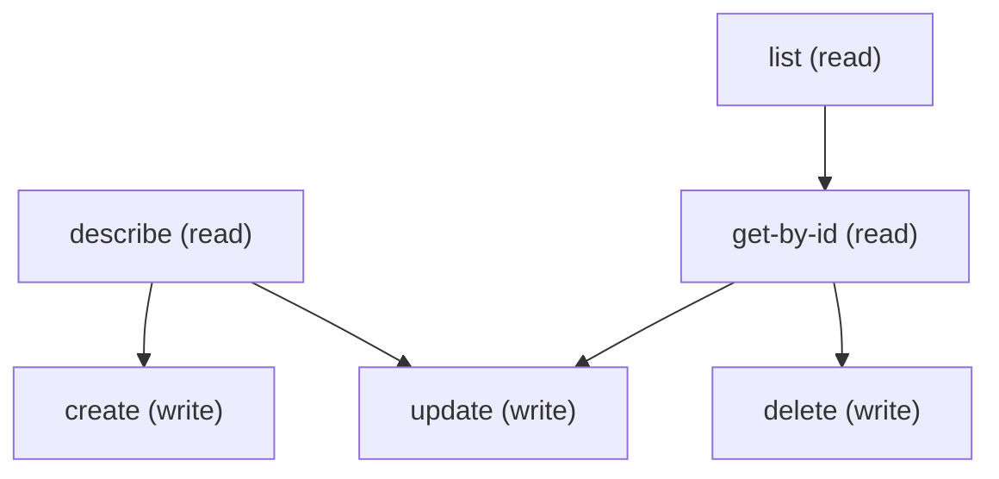

# Managing Care Request Settings

## When to Use This Skill

Manage Care Request Configuration records, the Health Cloud Utilization
Management setting that maps a care request type to a record type and
the related care-request objects that request uses. Covers everything the
Care Request Settings Setup page does: list, view, create, edit,
activate or deactivate, mark as default, and delete, via standard sObject
REST on /services/data/v67.0/sobjects/CareRequestConfiguration. Call
describe first for field names and the CareRequestType values (Drug
Request, Service Request, Admission, Concurrent Review, Appeal,
Complaint, Grievance, Referral) and CareRequestRecords values (Care
Request Drug, Care Request Item, Care Diagnosis, Care Request Extension).
CareRequestRecordType is effectively required: it holds the DeveloperName
(not the Id) of a record type that must exist on BOTH CareRequest and
Case, and on every object selected in CareRequestRecords. Otherwise the
write fails with 400 UNKNOWN_EXCEPTION "The selected record type is not
available for all the objects you have selected." For declarative
deployments the Metadata API type CareRequestConfiguration (Tooling:
/tooling/sobjects/CareRequestConfiguration) is the alternative;
/headless/metadata does not support this type.

## Workflow

Order of calls: (1) describe CareRequestConfiguration for picklist values.
(2) Confirm the record type: SELECT SobjectType FROM RecordType WHERE
DeveloperName = '<name>' AND IsActive = true must return CareRequest and
Case, plus each object chosen in CareRequestRecords (CareRequestDrug,
CareRequestItem, CareDiagnosis, CareRequestExtension). If any is
missing, the record types must be created first (Setup Object Manager or
Metadata API RecordType; a Case record type also needs a support
process). (3) Validate CareRequestType against the describe picklist
values yourself: the platform stores any string, including unknown
values, without error, and it does not require the field. (4) Defaults:
the API does not stop two records with the same CareRequestRecordType
from both having IsDefaultRecordType=true. Before marking one default,
query existing defaults for that record type and set them to false so
the admin ends up with one default. (5) IsActive defaults to false on
create; send IsActive=true to make the configuration live. Language
defaults to en_US. DeveloperName must be unique (400
DUPLICATE_DEVELOPER_NAME). Update is a partial PATCH: omitted fields
keep their values.

## Critical Constraints

**Preconditions:**

- Org must have Health Cloud Utilization Management enabled and the
caller must hold Care Request Configuration access to read/write
records via sObject or Tooling API. (check: `Care Request Configuration access`)
- User needs CRUD access to CareRequestConfiguration. (check: `<udd:crud:CareRequestConfiguration>`)
- User needs access to manage CareRequestConfiguration (CRUD on the
CareRequestConfiguration sObject). (check: `Utilization Management access`)
- Creating or editing a configuration needs an active record type,
with the DeveloperName used in CareRequestRecordType, on both the
CareRequest and Case objects, and on every object selected in
CareRequestRecords. Case record types also require a support
process. Create missing record types first in Setup Object Manager
or with the Metadata API. (check: `Matching record type on CareRequest, Case, and selected related objects`)

## Operations Reference

Operations grouped by purpose. Use these as the building blocks for the workflows above.

### Summary

| Operation | Purpose | Status | Call | Depends on |
|-----------|---------|--------|------|------------|
| `describe` | read | — | `GET /services/data/v67.0/sobjects/CareRequestConfiguration/describe` | — |
| `list` | read | — | `GET /services/data/v67.0/query` | — |
| `get-by-id` | read | — | `GET /services/data/v67.0/sobjects/CareRequestConfiguration/{Id}` | `list` |
| `create` | write | — | `POST /services/data/v67.0/sobjects/CareRequestConfiguration` | `describe` |
| `update` | write | — | `PATCH /services/data/v67.0/sobjects/CareRequestConfiguration/{Id}` | `get-by-id`, `describe` |
| `delete` | write | — | `DELETE /services/data/v67.0/sobjects/CareRequestConfiguration/{Id}` | `get-by-id` |

### Dependency graph

### Read operations

#### `describe`

Retrieve the CareRequestConfiguration sObject describe to pull the
field list, picklist values, FLS flags, and createable/updateable
bits. Required pre-step for create and update to resolve picklist
values for CareRequestType (8 enum values) and Language (standard
Salesforce language codes).

**Call:** `GET /services/data/v67.0/sobjects/CareRequestConfiguration/describe`

**Output:** DescribeSObjectResult for CareRequestConfiguration — use this to build the field list for list / create / update payloads.

#### `list`

List CareRequestConfiguration records via SOQL. Useful filters:
IsActive=true (live configurations), IsDefaultRecordType=true (defaults;
more than one per record type is possible, so check for duplicates),
CareRequestRecordType='<name>', and CareRequestType='<value>'. Pair with
describe first to pick field names.

**Call:** `GET /services/data/v67.0/query`

**Inputs:**

- `where` *(`String`)* — Optional SOQL WHERE clause to filter Care Request Configuration records.
- `limit` *(`int`)* — Optional SOQL LIMIT value.
- `q` *(`string`)*

**Output:** Query response with records[] of CareRequestConfiguration — Id plus any SELECTed fields.

#### `get-by-id`

Retrieve a specific CareRequestConfiguration record by Id.

**Call:** `GET /services/data/v67.0/sobjects/CareRequestConfiguration/{Id}`

**Inputs:**

- `Id` *(`ID`)* — Id of the CareRequestConfiguration record to fetch.

**Depends on:** `list`

**Output:** Single CareRequestConfiguration record with all readable fields per user FLS.

### Write operations

#### `create`

Create a CareRequestConfiguration record. Send DeveloperName,
MasterLabel, CareRequestRecordType, and CareRequestType; set
IsActive=true to make it live (defaults to false). CareRequestRecordType
is the DeveloperName of a record type that must exist on CareRequest,
Case, and every object selected in CareRequestRecords, or the create
returns 400 UNKNOWN_EXCEPTION on CareRequestRecordType.

**Call:** `POST /services/data/v67.0/sobjects/CareRequestConfiguration`

**Inputs:**

- `body` *(`object`)* — Field/value map for the new CareRequestConfiguration. Populate from /describe's createableFields list.

**Depends on:** `describe`

**Output:** SaveResult — id, success, errors[]. On success, id is the new CareRequestConfiguration record Id; on failure, errors carries StatusCode plus message and offending fields.

**Rollback:** Call delete with the returned Id to undo the create.

**Notes:** error_contracts: Record type missing on CareRequest, Case, or any selected
CareRequestRecords object: 400 UNKNOWN_EXCEPTION, "The selected record
type is not available for all the objects you have selected.",
fields=["CareRequestRecordType"]. Passing a record type Id instead of a
DeveloperName fails the same way. Duplicate DeveloperName: 400
DUPLICATE_DEVELOPER_NAME "Duplicate Label or Developer Name".; payload_fields: DeveloperName (unique, max 80 chars, API-name shape), MasterLabel (max
80 chars), CareRequestRecordType (record type DeveloperName, max 255),
CareRequestType (one of Drug Request | Service Request | Admission |
Concurrent Review | Appeal | Complaint | Grievance | Referral; not
validated by the platform), CareRequestRecords (semicolon-separated,
from Care Request Drug | Care Request Item | Care Diagnosis | Care
Request Extension), IsActive (default false), IsDefaultRecordType
(default false), Language (default en_US).; not_enforced: The platform accepts an unknown CareRequestType, an omitted
CareRequestType, and a second IsDefaultRecordType=true record for the
same record type. Validate these before calling create.

#### `update`

Update an existing CareRequestConfiguration record. Merge-patch
semantics: fields omitted from the body are preserved. If the body
includes CareRequestRecordType, its value must still equal a valid
DeveloperName of a RecordType on the CareRequest sObject — the same
400 UNKNOWN_EXCEPTION fires on an invalid change.

**Call:** `PATCH /services/data/v67.0/sobjects/CareRequestConfiguration/{Id}`

**Inputs:**

- `Id` *(`ID`)* — Id of the CareRequestConfiguration to update.
- `body` *(`object`)* — Partial field/value map — only include fields you want to change.

**Depends on:** `get-by-id`, `describe`

**Output:** 204 No Content on success. On failure, returns a JSON array of errors with StatusCode, message, and offending fields.

#### `delete`

Delete a CareRequestConfiguration record.

**Call:** `DELETE /services/data/v67.0/sobjects/CareRequestConfiguration/{Id}`

**Inputs:**

- `Id` *(`ID`)* — Id of the CareRequestConfiguration to delete.

**Depends on:** `get-by-id`

**Output:** 204 No Content on success. On failure, returns a JSON array of errors with StatusCode and message.
