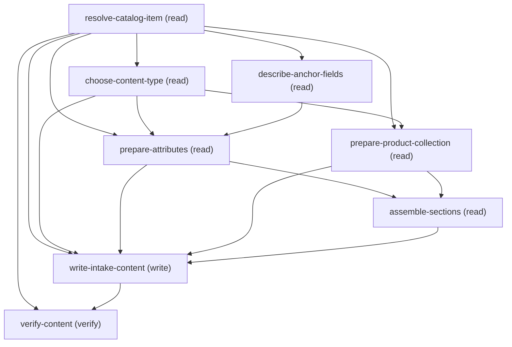

# Managing Configure Unified Catalog Service Process Attributes And Product Collection

## When to Use This Skill

CHILD of the create-unified-catalog-service-process orchestrator — one configuration pass over a service process that ALREADY EXISTS. Run standalone against an existing process (supply its catalogItemId), or as the phase that orchestrator routes to; for a NEW end-to-end process start at create-unified-catalog-service-process, which asks the creation fork FIRST.
Use this when an admin wants to define or edit the intake CONTENT — attributes and/or product collections — on a service process that ALREADY EXISTS, whether it was created from scratch or from a template. E.g. "add a Priority picklist and a laptops product collection to this service process". DONE when the chosen attributes and/or product collections read back on the verify GET with the anchor still intact. Org-gated on Unified Catalog. It does NOT create the process — run the create SOR first and pass its catalogItemId. The child lists (attributes, product collections) are MERGE-BY-ID — send only what you touch (see EDIT SEMANTICS in agent_guidance) — but the item's identity fields (anchor + intake container) ARE full-overwrite and must be re-sent every PATCH: see the content_patch_resends_anchor_and_container precondition and write-intake-content step for the DETACH TRAP; choice-backed-option rules are in the choice_backed_attributes_carry_inline_options precondition.

## Critical Constraints

**Preconditions:**

- Org must have Unified Catalog enabled.
 (check: `Unified Product Catalog enabled`)
- HARD CONSTRAINT — the service process must ALREADY EXIST and its catalogItemId (== productId) must be known before this workflow runs. The first step (resolve-catalog-item) GETs the item to confirm it exists and is usedFor=ServiceProcess and to capture the anchor + intake container before any write; a 404 there means the id is wrong or the process was never created — create the process first, then re-run here with its catalogItemId.
 (check: `process_exists_with_known_catalog_item_id`)
- HARD CONSTRAINT — the FIRST thing you ask each loop is the CONTENT TYPE: ATTRIBUTES (input fields), PRODUCT COLLECTION (products the requester picks), or DONE. This is the parent decision — it comes before any per-attribute detail. It is NOT either/or: the question repeats each loop, so a process can end up with BOTH attributes and product collections (add one this pass, the other next). Do NOT assume attributes and skip straight to defining fields; always offer the choice.
 (check: `user_has_chosen_content_type`)
- HARD CONSTRAINT — inside the ATTRIBUTES branch, each attribute's binding mode is the user's choice, never inferred: for every attribute the user picks ANCHOR-mapped (writes to a real anchor field) vs CUSTOM (intake-only). A single attribute is one or the other, never both — but the loop re-asks this every iteration, so the same process can freely mix anchor-mapped AND custom attributes. Do NOT auto-classify attributes or invent an attribute list. Ask one attribute at a time, not as an upfront questionnaire.
 (check: `user_has_chosen_attribute_binding_modes`)
- HARD CONSTRAINT — anchor-mapped attributes MUST use a real createable field on the process's anchor object (targetObject, captured on resolve-catalog-item), taken from describe-anchor-fields. The anchor object is one of three valid values the API accepts: Case, Incident, or ServiceRequest (a closed enum — the backend rejects any other SObject). Never guess an anchor field apiName.
 (check: `anchor_attributes_use_real_createable_fields`)
- HARD CONSTRAINT — every choice-backed attribute (dataType Picklist / MultiSelectPicklist / RadioButton) MUST carry a NON-EMPTY picklistOptions[], whether it is anchor-mapped or custom. The backend does NOT inline a field's own values: an anchor-mapped picklist sent BARE (isMappedAnchorField:true with no picklistOptions) persists with picklistOptions:[], so the later generate-intake-form step builds an optionless ChoiceSet and fails "The data type of ChoiceSet_<field> can't be Picklist". Anchor-mapping a choice-backed field is FINE as long as you ALSO send its options inline: keep isMappedAnchorField:true + apiName AND populate picklistOptions[] from the describe projection's picklistOptions (the field's own picklistValues). A CUSTOM choice-backed attribute (no binding flags) likewise MUST carry user-typed picklistOptions[]. Either way every option needs a non-empty, distinct displayName.
 (check: `choice_backed_attributes_carry_inline_options`)
- HARD CONSTRAINT — every REQUIRED attribute field must be collected non-empty from the user and saved. Required when defining an attribute: Name, API Name, Data Type, and (for choice-backed types Picklist / MultiSelectPicklist / RadioButton) a non-empty picklistOptions[] where EVERY option carries a non-empty, distinct displayName (blank displayNames make the later intake generate fail "Duplicate developer name: Choice_null_<apiName>"). Description is OPTIONAL. Do NOT skip, default, or invent a required field. Every required field the user supplied must read back on verify-content.
 (check: `required_attribute_fields_collected_and_persisted`)
- HARD CONSTRAINT — an attribute's dataType MUST be one the intake BUILDER supports, NOT merely one the write API accepts. The write accepts a wider set of data types than the builder does; four values — Boolean, Password, List, Map — are write-accepted yet UI-UNSUPPORTED. Sending one persists silently but leaves the builder's Data Type UNSET (blank "Select an Option"), so the process later fails activation with INPUTPARAM_INCOMPATIBLE_DATATYPE, which also blocks binding any agent action. Use only the builder-supported set: Text, Number, Currency, Percentage, CheckBox, Date, Datetime, Time, Email, Url, Phone, Range, Lookup, Attachment, Picklist, MultiSelectPicklist, RadioButton, ListOfString, ListOfInteger, ListOfDouble, ListOfBoolean, ListOfMaps, ListOfAttachment. For a true/false field the builder value is CheckBox — there is NO Boolean option.
 (check: `custom_attribute_datatype_is_ui_supported`)
- HARD CONSTRAINT — on the content PATCH (write-intake-content), the item's IDENTITY FIELDS are full-overwrite (unlike the child lists, which merge by id — see EDIT SEMANTICS). It MUST re-send those identity fields (targetObject, name, usedFor, isActive) captured on resolve-catalog-item, and carry the existing intake container forward as intakeForm:{id, operationType:"Update"} (plus intakeFormId + type when a Flow/OmniScript surface is already attached). Omitting targetObject CLEARS the anchor (it reads back absent on the next GET — NOT reset to a default); omitting the intakeForm block detaches the intake surface. The verify GET confirms the anchor and container are intact.
 (check: `content_patch_resends_anchor_and_container`)

**Operational rules:**

- MUST-DO CONTRACT (read before executing — each rule is enforced by the named precondition/step; do NOT skip because the detail is further down):
  1. RESOLVE the process first — run resolve-catalog-item (GET) and capture its identity
     fields (name, usedFor, isActive, targetObject), its intakeForm (id + any attached
     surface intakeFormId/type), and its CURRENT sections[].attributes + productRequests[]
     (so you can show the user what already exists and target an edit/removal at the right
     child by its id — the child lists are MERGE-BY-ID, see EDIT SEMANTICS). A 404 means
     the catalogItemId is wrong or the process was never created; do NOT proceed.
     [precondition: process_exists_with_known_catalog_item_id]
  2. ASK the CONTENT TYPE (attributes / product-collection / done) first each loop —
     never assume attributes. [precondition: user_has_chosen_content_type]
  3. Per attribute, ASK anchor-mapped vs custom every iteration — never infer.
     [precondition: user_has_chosen_attribute_binding_modes]
  4. COPY anchor-mapped dataType from the describe; never author it. A CUSTOM attribute's
     dataType MUST be one the intake builder supports (never Boolean/Password/List/Map; a
     true/false field is CheckBox). For choice-backed attributes
     (Picklist/MultiSelectPicklist/RadioButton), apply the inline-options rule.
     [preconditions: custom_attribute_datatype_is_ui_supported,
     choice_backed_attributes_carry_inline_options]
  5. COLLECT every required attribute field non-empty (per the
     required_attribute_fields_collected_and_persisted precondition) and verify round-trip.
  6. WRITE via the single write-intake-content PATCH — see the DETACH TRAP.
     [precondition: content_patch_resends_anchor_and_container]
- TIMING: resolve first, then run the content loop interactively, then write once, then verify. Ask every decision as you go, never as one upfront questionnaire.
ASK MODALITY: use a structured picker only for small bounded choices (it caps at a few options). Anchor fields are a BOUNDED palette (the object's createable fields the user chooses from) — list the COMPLETE set as numbered text and NEVER truncate or top-slice, so no valid field is hidden. For unbounded record lists (products), also list the fetched set as numbered text but PRESENT smartly — match a named target locally, list a small set in full, and narrow a large one (typed name or a recent top slice) rather than dumping every row.
EDIT SEMANTICS: the child lists (sections[].attributes and productRequests[]) are MERGE-BY-ID, not overwrite. Send ONLY what you touch: add with operationType:"Create", change an existing child with operationType:"Update" by its id, remove one with operationType:"Delete" by its id. Untouched children persist on their own — do NOT re-send them (a stale or wrong id on a needless re-send risks a bad Update or Delete). This is the OPPOSITE of the item's identity fields (name, targetObject, usedFor, isActive) and the intake container, which ARE full-overwrite and MUST be re-sent every PATCH — see write-intake-content for the DETACH TRAP.
LOOP:
  (a) Ask (yes/no) "Add or edit intake content now?" No -> done.
  (b) Ask the CONTENT TYPE (choose-content-type; options in choice_points): ATTRIBUTES,
      PRODUCT COLLECTION, or DONE. Never assume attributes. Not either/or — a process can
      have both (see the user_has_chosen_content_type precondition).
  (c) Collect per the chosen type. When the type is ATTRIBUTES, run an ATTRIBUTE LOOP:
      each iteration FIRST asks the sub-kind (attribute-source) — "Select an existing
      field (anchor-mapped) or type your own (custom)?" — then collects ONE attribute,
      then asks "Add another attribute?" and REPEATS from the sub-kind question until
      the user says no. Do NOT stay in one branch; do NOT stop after one attribute.
      - ATTRIBUTES, anchor-mapped ("select existing"): run describe-anchor-fields and
        list ALL createable fields as numbered text (label, API name, type); let the
        user type which to add (they may pick several). The set is org/object-specific;
        take it from the describe, never a fixed list. Build each attribute by copying
        from the describe — do NOT ask the user for Name/API Name/Data Type/Description:
          name       = field label
          apiName    = field name
          dataType   = field dataType from the describe (never chosen by you)
          isMappedAnchorField = true
        description defaults to the field label. The only things worth asking are
        behavior flags (Required, Visible, Read-only), and only if they matter.
        CHOICE-BACKED ANCHOR FIELDS (dataType Picklist / MultiSelectPicklist / RadioButton,
        i.e. describe projection isChoiceBacked==true): see the
        choice_backed_attributes_carry_inline_options precondition for the inline-options rule.
      - ATTRIBUTES, custom ("type your own"): collect ONE custom attribute (fields
        below). Collect a non-empty value for every required field; do NOT skip,
        default, or invent, and do NOT save until all are filled. Fields in order:
          1. Name
          2. API Name
          3. Data Type — single-select; send the enum string exactly, and it MUST be one the
             intake BUILDER supports (see the custom_attribute_datatype_is_ui_supported
             precondition for the allowed set). For a true/false field use CheckBox — there is
             NO "Boolean" option.
          4. Description — OPTIONAL. Goes in the attribute's `description` property.
             Offer it; do not block or fail if the user skips it.
          5. Option values — REQUIRED when Data Type is Picklist, MultiSelectPicklist, or
             RadioButton: elicit them via an "add value / add more" loop and send as
             non-empty picklistOptions[]. Empty options break the later generate step.
             Omit picklistOptions for all other types. A user-typed-options picklist is
             custom (set NO binding flags).
             Send each option with BOTH name AND a non-empty, distinct displayName (set
             displayName to the option label). Blank displayNames break the later generate
             step. displayName sets only on Create, not Update — to fix an option saved
             blank, Delete it then re-Create it with displayName in a SEPARATE PATCH (a
             combined delete+create in one PATCH drops the creates). A picklistOptions entry
             may read back isVisible:false on a GET, but the runtime intake form renders it
             regardless — do NOT treat that as a bug or fire follow-up Updates to flip it.
          6. Required — ALWAYS ASK (yes/no) -> isMandatory (default false).
          7. Visible to Requester — ALWAYS ASK (yes/no) -> isHidden INVERTED (there is no
             isVisible field; Visible=yes means isHidden:false, default false).
          8. Read-only (optional) -> isReadOnly (default false). Optionally defaultValue
             and displayWidth (LayoutWidth enum: one, two, three, four, five, six, seven,
             eight, nine, ten, eleven, twelve; default "twelve").
        Set no binding flags on custom attributes.
      - PRODUCT COLLECTION (one per section): Section Name; Products — query the
        selectable Product2 records via `GET /services/data/v67.0/query?q=` with
        `SELECT Id, Name, ProductCode FROM Product2 WHERE UsedFor != 'ServiceProcess'
        ORDER BY Name` (this matches the UI's picker exactly — it EXCLUDES products
        that are themselves service processes; `!=` intentionally KEEPS UsedFor=null
        products, and the picker is NOT active-only, so do not add an IsActive filter).
        Present the results as numbered text (name + id) and let the user type which to
        include. Each chosen -> productDetails
        {productId, operationType:"Create"}, never send `id`. Min/Max count
        (sectionMinCount >= 0, sectionMaxCount > 0 and >= min — elicit both, don't
        default); optional Section Description. Set `sequence` on every productRequests[]
        entry you send (a 0-based ordinal ordering the sections — first section 0, next
        1, ...), on Create AND Update. When you Update an existing section, re-send its
        existing sequence (from resolve-catalog-item) so the Update does not null it;
        sections you do not touch keep their sequence untouched (MERGE-BY-ID).
        DEDICATED PRODUCT PAGE — REQUIRED for the runtime product picker. A collection
        only renders a product-selection screen in the generated intake Flow when it sits
        on its OWN layout page of type ProductRequestSection — NOT on an attribute section,
        and NOT left in the "Existing Product Collection" bucket (a collection sent with no
        page placement lands in that bucket, and generate-intake-form then produces a Flow
        with NO product screen). So for every NEW collection, in the SAME write PATCH also
        emit a sections[] entry: operationType:"Create", a client-chosen sectionUuid (any
        unique string), a name, description "", a sequence, and attributes:[] — the empty
        attributes array is MANDATORY (omitting it 400s UNKNOWN_EXCEPTION "Cannot invoke
        List.iterator()"; empty attributes + a linked product group is how the server infers
        Type=ProductRequestSection). Link the collection to that page by setting
        svcProcessLayoutSectionUuid on its productRequests[] entry to the SAME sectionUuid
        (use svcProcessLayoutSectionUuid, NOT svcProcessLayoutSectionId — the latter refers
        to an already-existing section). When EDITING a collection that is ALREADY on a page,
        do NOT create a new page — Update the productRequests[] entry by its sectionId; its
        page persists. After this PATCH, the generate step (configure-intake SOR) will
        include the product picker automatically.
  (d) After each batch, ask "Add more content?" — LOOP back to (b) until the user says
      done.
  (e) Write the collected content in a SINGLE write step (write-intake-content) — never
      one call per item. First prepare each content type that applies (prepare-attributes
      shapes sections[]; prepare-product-collection shapes productRequests[]). Then
      write-intake-content fires ONE PATCH: sections when attributes were defined,
      productRequests when collections were defined, both together when both — always
      re-sending the anchor identity fields and the existing intake container.

## Verification Checklist

After every write operation, confirm the effect by re-reading state:

- After `resolve-catalog-item`, `write-intake-content`: call `verify-content` (`GET /connect/service-automation/catalog/catalog-item/{catalogItemId}`)

## Operations Reference

Operations grouped by purpose. Use these as the building blocks for the workflows above.

### Summary

| Operation | Purpose | Status | Call | Depends on |
|-----------|---------|--------|------|------------|
| `resolve-catalog-item` | read | implemented | `GET /connect/service-automation/catalog/catalog-item/{catalogItemId}` | — |
| `describe-anchor-fields` | read | implemented | `GET /services/data/v67.0/sobjects/{targetObject}/describe` | `resolve-catalog-item` |
| `choose-content-type` | read | — | — | `resolve-catalog-item` |
| `prepare-attributes` | read | — | — | `resolve-catalog-item`, `choose-content-type`, `describe-anchor-fields` |
| `prepare-product-collection` | read | — | — | `resolve-catalog-item`, `choose-content-type` |
| `assemble-sections` | read | — | — | `prepare-attributes`, `prepare-product-collection` |
| `write-intake-content` | write | implemented | `PATCH /connect/service-automation/catalog/catalog-item/{catalogItemId}` | `resolve-catalog-item`, `choose-content-type`, `prepare-attributes`, `prepare-product-collection`, `assemble-sections` |
| `verify-content` | verify | implemented | `GET /connect/service-automation/catalog/catalog-item/{catalogItemId}` | `resolve-catalog-item`, `write-intake-content` |

### Dependency graph

### Read operations

#### `resolve-catalog-item`

CONFIRM + CAPTURE — GET the existing service process to prove it exists and to capture the identity fields the write must re-send (name, usedFor, isActive, targetObject), the intake container (intakeForm.id and any attached surface intakeFormId/type), and the CURRENT sections[].attributes + productRequests[] (so you can show the user what exists and target an edit/removal at the right child by its id — the child lists are MERGE-BY-ID, see EDIT SEMANTICS). Fails fast (404) if the catalogItemId is wrong or the process was never created.

**Call:** `GET /connect/service-automation/catalog/catalog-item/{catalogItemId}`   — status: `implemented`

**Inputs:**

- `catalogItemId` *(`String`)* — The catalogItemId (== productId) of the EXISTING service process. If the user does not have it, the process must be created first before this workflow can run.

#### `describe-anchor-fields`

DISCOVERY — describe the process's anchor object (resolve-catalog-item.target_object) to get the valid anchor fields, on demand whenever the user picks an anchor-mapped attribute. The fields and their count are org/object-specific, never a fixed list. Filter to createable=true — those are the valid anchor targets. The sobject describe is a LARGE payload: do NOT read the whole thing into context or hand it to a model to eyeball — that drops fields non-deterministically. Extract with the filter below so the field list is complete and reproducible, then build the picker from the small projection. The projection gives, per createable field, a dataType (the agent copies it, never chooses it), an isChoiceBacked flag (true only for real picklist/multipicklist fields), and its picklistOptions. Filter to run:
  jq --argjson sys '["Id","IsDeleted","CreatedById","CreatedDate","LastModifiedById","LastModifiedDate","SystemModstamp","OwnerId"]' '
  [.fields[] | select(.createable==true and .type!="address" and .type!="location" and .type!="base64") | {
    name, label, type, nillable, defaultedOnCreate, nameField,
    dataType: (if   .type=="picklist"      then "Picklist"
               elif .type=="multipicklist" then "MultiSelectPicklist"
               elif .type=="boolean"       then "CheckBox"
               elif .type=="currency"      then "Currency"
               elif .type=="percent"       then "Percentage"
               elif (.type=="double" or .type=="int") then "Number"
               elif .type=="date"          then "Date"
               elif .type=="datetime"      then "Datetime"
               elif .type=="time"          then "Time"
               elif .type=="reference"     then "Lookup"
               elif .type=="phone"         then "Phone"
               elif .type=="email"         then "Email"
               elif .type=="url"           then "Url"
               else "Text" end),
    isChoiceBacked: (.type=="picklist" or .type=="multipicklist"),
    referenceObject: (if .type=="reference" then ((.referenceTo // []) | join(";")) else null end),
    picklistOptions: [ .picklistValues[]? | select(.active==true) | {name: .value, displayName: .label} ]
  }]'

**Call:** `GET /services/data/v67.0/sobjects/{targetObject}/describe`   — status: `implemented`

**Inputs:**

- `targetObject` *(`String`)* — The anchor object of the process — one of the three valid values the API accepts: Case, Incident, or ServiceRequest (a closed enum enforced by the backend). Captured on resolve-catalog-item. Must be that SAME value.

**Depends on:** `resolve-catalog-item`

#### `choose-content-type`

DECISION STEP (no API call) — a real walked step, not prose. At the top of every content iteration, ASK the choice in choice_points[id=content-type] and record the answer; collect that content, then loop back until the user answers "done". The WRITE happens after the loop and depends on WHAT WAS COLLECTED across all iterations. Set has_attributes / has_product_collections to reflect the full collected set; those booleans gate the prep + write steps.

**Depends on:** `resolve-catalog-item`

#### `prepare-attributes`

ASSEMBLY STEP (no API call) — shape the collected attributes into the sections[] payload write-intake-content sends (attributes nested under sections[].attributes; each with operationType Create/Update/Delete). Field order and wire mapping are in agent_guidance step (c) ATTRIBUTES. Enforce the required-field rule (see required_attribute_fields_collected_and_persisted precondition) HERE, before the write: do not emit any attribute missing a required field — go back and collect it. For every anchor-mapped attribute (isMappedAnchorField==true), copy dataType AND referenceObject from the matching describe-anchor-fields entry (dataType = projection[name==apiName].dataType, referenceObject = projection[name==apiName].referenceObject); do NOT re-derive them or accept a model-authored value. Only CUSTOM attributes take a user-supplied dataType. MERGE-BY-ID (see EDIT SEMANTICS): the sections[] this emits carries ONLY the attributes the user actually touched — new ones as operationType:"Create", an edited existing one as operationType:"Update" by its id (matched from resolve-catalog-item.existing_attributes by apiName), a removed one as operationType:"Delete" by its id. Do NOT re-emit untouched existing attributes — they persist on their own, and re-sending them risks a stale-id bad Update.

**Inputs:**

- `attributes` *(`array`)* — The attributes the user added or edited in the loop (anchor-mapped and/or custom).

- `existing_attributes` *(`array`)* — The attributes already on the process (from resolve-catalog-item). Used to LOOK UP the id of an attribute the user edits or removes (match by apiName) — NOT re-sent wholesale. Untouched existing attributes persist on their own (MERGE-BY-ID, see EDIT SEMANTICS).

  - **Source:** output of `resolve-catalog-item`
- `anchor_field_projection` *(`array`)* — The per-field projection (name, label, type, dataType, isChoiceBacked, picklistOptions). For anchor-mapped attributes, dataType is copied from here by matching projection.name == attribute.apiName — never assumed by the agent. A choice-backed field (isChoiceBacked==true), whether anchor-mapped or custom, sources its picklistOptions from this entry's picklistOptions.

**Depends on:** `resolve-catalog-item`, `choose-content-type`, `describe-anchor-fields`

#### `prepare-product-collection`

ASSEMBLY STEP (no API call) — runs only if the user defined or edited one or more product collections. Assemble the productRequests[] payload from the collections collected in the loop, AND (for new collections) the ProductRequestSection page entries that go in sections[] (see agent_guidance DEDICATED PRODUCT PAGE). Product collections do NOT touch the ATTRIBUTE sections[], but each NEW collection DOES emit its own sections[] entry of type ProductRequestSection (operationType:"Create", a client sectionUuid, attributes:[]) so it lands on a real page and the generated Flow renders a product picker; the collection's productRequests[] entry links to it via svcProcessLayoutSectionUuid. MERGE-BY-ID (see EDIT SEMANTICS): emit ONLY the collections the user touched — new ones as operationType:"Create" (WITH a new page entry + svcProcessLayoutSectionUuid), an edited existing one as operationType:"Update" by its sectionId (re-sending that section's existing `sequence` so the Update does not null it, and NO new page — its page persists), a removed one as operationType:"Delete" by its sectionId. Do NOT re-emit untouched existing collections — they persist on their own.

**Inputs:**

- `collections` *(`array`)* — The product collections collected or edited in the loop (section name, chosen products, min/max count, optional description).

- `existing_product_requests` *(`array`)* — The product collections already on the process (from resolve-catalog-item). Used to LOOK UP the sectionId (and existing sequence) of a collection the user edits or removes — NOT re-sent wholesale. Untouched existing collections persist on their own (MERGE-BY-ID, see EDIT SEMANTICS).

  - **Source:** output of `resolve-catalog-item`

**Depends on:** `resolve-catalog-item`, `choose-content-type`

#### `assemble-sections`

ASSEMBLY STEP (no API call) — build the SINGLE sections[] array the write PATCH sends by CONCATENATING the attribute sections (prepare-attributes.sections, present when attributes were defined) and the ProductRequestSection page entries for new collections (prepare-product-collection.product_sections, present when a NEW collection was defined). Either source may be absent: in the product-collection-only path prepare-attributes does NOT run, so sections is just the product page entries; in the attributes-only path it is just the attribute sections; when both ran, it is both. If BOTH are empty, emit nothing (write-intake-content then omits the sections field entirely). This is the ONLY place the two section sources are merged — write-intake-content reads sections from HERE, never from prepare-attributes directly, so a new product page is guaranteed into the payload even when no attributes were touched (the product-collection-only path that would otherwise drop the ProductRequestSection page and leave the collection unplaced → no runtime picker).

**Inputs:**

- `attribute_sections` *(`array`)* — The attribute sections[] from prepare-attributes (attributes nested under sections[].attributes). Absent when has_attributes == false (that step did not run) — treat as empty.

  - **Source:** output of `prepare-attributes`
- `product_sections` *(`array`)* — The ProductRequestSection page entries (one per NEW collection) from prepare-product-collection. Absent when has_product_collections == false or the user only edited/removed existing collections — treat as empty.

  - **Source:** output of `prepare-product-collection`

**Depends on:** `prepare-attributes`, `prepare-product-collection`

### Write operations

#### `write-intake-content`

THE SINGLE WRITE — one PATCH that persists whatever content was prepared. Send only the blocks that apply: sections (from prepare-attributes) when attributes were defined; productRequests (from prepare-product-collection) when collections were defined; both together when both. Send intakeForm:{id, operationType:"Update"} using resolve-catalog-item.intake_form_id — the item always has a container here (resolve stopped if it did not). DETACH TRAP (see content_patch_resends_anchor_and_container precondition): for the item's IDENTITY FIELDS (targetObject + the intakeForm block), operationType:"Update" is a FULL overwrite — an omitted identity field is cleared. (The child lists are separate: they merge by id — see EDIT SEMANTICS.) Two identity levels to guard:
  (1) intakeForm: if resolve-catalog-item captured intake_surface_form_id + intake_surface_type
      (a Flow/OmniScript attached by a prior configure-intake run), carry them forward —
      intakeForm:{id, operationType:"Update", intakeFormId:<surface id>, type:<type>} —
      or the attached surface is silently detached. Omit intakeFormId/type ONLY when no
      surface is attached yet.
  (2) ANCHOR: this PATCH MUST re-send the item's identity fields — targetObject (the
      anchor), name, usedFor, isActive — sourced from resolve-catalog-item, every time.
      Omitting targetObject CLEARS the anchor (it reads back absent on the next GET, NOT
      reset to a default), and any anchor-mapped attributes in this same payload then have
      no valid object to bind to. Confirm on the post-PATCH verify GET that targetObject
      is unchanged.

**Call:** `PATCH /connect/service-automation/catalog/catalog-item/{catalogItemId}`   — status: `implemented`

**Inputs:**

- `catalogItemId` *(`String`)* — The catalogItemId (== productId) of the process to update.
- `targetObject` *(`String`)* — The anchor object — one of the three valid values the API accepts: Case, Incident, or ServiceRequest (a closed enum enforced by the backend). Captured on resolve-catalog-item. MUST be re-sent on every Update or the anchor is CLEARED — it reads back absent, not reset to a default (see DETACH TRAP).

- `name` *(`String`)* — The process name — re-sent to preserve identity on this full-overwrite Update.
- `usedFor` *(`String`)* — The usedFor value (ServiceProcess) — re-sent to preserve identity.
- `isActive` *(`Boolean`)* — The isActive flag — re-sent to preserve identity.
- `intakeFormId` *(`String`)* — The intake container id (from resolve-catalog-item), sent as intakeForm:{id:<this>, operationType:"Update"}. Carry intake_surface_form_id + intake_surface_type forward too when a surface is attached (see DETACH TRAP).

  - **Source:** output of `resolve-catalog-item`
- `intakeSurfaceFormId` *(`String`)* — The attached surface's intakeFormId (from resolve-catalog-item), when a Flow/OmniScript is already bound. Included in the intakeForm block ONLY when present — the container block is a full overwrite, so sending id alone while a surface is attached detaches it (see DETACH TRAP). Empty (no surface attached yet) → omit intakeFormId + type entirely.

  - **Source:** output of `resolve-catalog-item`
- `intakeSurfaceType` *(`String`)* — The attached surface's type (Flow or Omniscript, from resolve-catalog-item). Carried forward alongside intakeSurfaceFormId under the same present/absent rule (see DETACH TRAP).

  - **Source:** output of `resolve-catalog-item`
- `sections` *(`array`)* — The single combined sections[] for the PATCH, from assemble-sections — the concatenation of the attribute sections (prepare-attributes.sections) AND the ProductRequestSection page entries for new collections (prepare-product-collection.product_sections). Sourced from assemble-sections (NOT prepare-attributes directly) so the product page entries reach this PATCH even in the product-collection-only path where prepare-attributes did not run. If assemble-sections produced nothing (neither source had entries), omit sections entirely.

  - **Source:** output of `assemble-sections`
- `productRequests` *(`array`)* — The assembled productRequests[] from prepare-product-collection. Every entry carries `sequence` (0-based ordinal ordering the sections), on Create AND Update; a new collection also carries svcProcessLayoutSectionUuid matching its page entry in sections[].

  - **Source:** output of `prepare-product-collection`

**Depends on:** `resolve-catalog-item`, `choose-content-type`, `prepare-attributes`, `prepare-product-collection`, `assemble-sections`

**Rollback:** To undo content written here, re-invoke this same PATCH with operationType=Delete on the specific children to remove (attributes, sections, and/or product-collection sections) — each identified by its server-assigned id, always re-sending the anchor identity fields and the full intakeForm block (id + intakeFormId + type when a surface exists) — the rollback PATCH is the same full-overwrite, so anchor-only re-send would wipe the surface. Removal is always via this PATCH; the catalog-item resource has no DELETE method.

### Verify operations

#### `verify-content`

Read the definition back and confirm the attributes and/or product collections are in place and the anchor + intake container held.

**Call:** `GET /connect/service-automation/catalog/catalog-item/{catalogItemId}`   — status: `implemented`

**Inputs:**

- `catalogItemId` *(`String`)* — The catalogItemId (== productId) of the process to verify.
- `isRuntime` *(`boolean`)* — Whether to fetch the runtime (intake) view. For design-time verification leave false/omit to read the full definition as authored.

**Depends on:** `resolve-catalog-item`, `write-intake-content`
