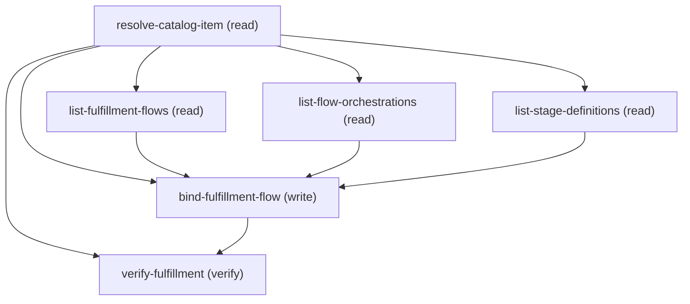

# Managing Configure Unified Catalog Service Process Fulfillment

## When to Use This Skill

CHILD of the create-unified-catalog-service-process orchestrator — one configuration pass over a service process that ALREADY EXISTS. Run standalone against an existing process (supply its catalogItemId), or as the phase that orchestrator routes to; for a NEW end-to-end process start at create-unified-catalog-service-process, which asks the creation fork FIRST.
Use this when an admin wants to associate a fulfilment flow with a service process that ALREADY EXISTS — e.g. "attach my order-fulfilment Flow Orchestrator to this service process" or "wire up the stage-management process for my replacement request". DONE when a Flow / Flow Orchestrator / Stage Management surface is bound to the process and reads back on the verify GET with the anchor still intact. Org-gated on Unified Catalog. One user decision drives the branch — the fulfilment type (Flow / FlowOrchestrator / StageManagement) — enforced in preconditions and a choice_point; step mechanics and the DETACH TRAP are in agent_guidance and step assertions. This attaches an EXISTING flow; it does not author the flow, orchestrator, or stage definition.

## Critical Constraints

**Preconditions:**

- Org must have Unified Catalog enabled.
 (check: `Unified Product Catalog enabled`)
- HARD CONSTRAINT — the service process must ALREADY EXIST and its catalogItemId (== productId) must be known before this workflow runs. The first step (resolve-catalog-item) GETs the item to confirm it exists and is usedFor=ServiceProcess before any write; a 404 there means the id is wrong or the process was never created — the process must be created first, then re-run here with its catalogItemId.
 (check: `process_exists_with_known_catalog_item_id`)
- HARD CONSTRAINT — the FULFILMENT TYPE (Flow vs FlowOrchestrator vs StageManagement) MUST be elicited from the user, never defaulted. It changes which list endpoint runs and the `type` sent when binding. Do NOT assume Flow.
 (check: `user_has_chosen_fulfillment_type`)
- HARD CONSTRAINT — the fulfilment surface to attach MUST be a real id taken from the matching list step (list-fulfillment-flows for Flow, list-flow-orchestrations for FlowOrchestrator, list-stage-definitions for StageManagement) for THIS org. Never guess or hand-construct an id. List the eligible records, let the user pick one, and bind that exact id as fulfillmentFlow.fulfillmentFlowId.
 (check: `attached_surface_is_a_real_listed_id`)
- HARD CONSTRAINT — binding via patchCatalogItemGet with operationType:"Update" is a FULL overwrite: it MUST re-send the item's identity fields (targetObject, name, usedFor, isActive). Omitting targetObject CLEARS the anchor — it reads back absent on the next GET, not reset to a default, even after it was set at create time. The intakeForm block is ALSO a full overwrite: sending it with only {id, operationType:Update} preserves the container but WIPES the bound surface (intakeFormId + type disappear). When the item has an intake surface, the bind MUST re-send intakeForm.intakeFormId AND intakeForm.type alongside the container id, not just the id. The bind PATCH always carries the four identity fields and re-sends the FULL intakeForm (id + intakeFormId + type) when one exists; the verify GET confirms the anchor and intake surface are intact.
 (check: `bind_patch_resends_anchor_identity_fields`)
- HARD CONSTRAINT — the fulfillmentFlow block's operationType is COMPUTED, not fixed. The bind follows a Create/Update split (same as the intake container): if resolve-catalog-item returned NO fulfillmentFlow (nothing bound yet), send operationType:"Create" with NO fulfillmentFlow.id — this mints the ProductFulfillmentScenario and binds the flow. If a fulfillmentFlow IS already bound, send operationType:"Update" AND carry resolve-catalog-item.existing_fulfillment_scenario_id forward as fulfillmentFlow.id — this repoints the existing scenario. A hardcoded operationType:"Update" on a first attach SILENTLY NO-OPS: the PATCH returns 200 but the fulfillmentFlow never persists (reads back absent on the verify GET). Determine Create-vs-Update from the presence of an existing fulfillmentFlow on resolve-catalog-item; never assume.
 (check: `bind_fulfillment_operation_type_rule`)
- HARD CONSTRAINT — if resolve-catalog-item shows a fulfilment flow is ALREADY bound, binding a different one REPLACES it (the existing ProductFulfillmentScenario is repointed to the new flow). Before replacing, CONFIRM with the user that they want to swap the currently-bound flow; do NOT silently overwrite. First attach (no existing fulfillment flow) needs no confirmation.
 (check: `replace_existing_fulfillment_confirmed`)

**Operational rules:**

- MUST-DO CONTRACT (read before executing — each rule is enforced by the named precondition/step; do NOT skip because the detail is further down):
  1. CONFIRM the process exists first — run resolve-catalog-item (GET) and capture its
     identity fields (name, usedFor, isActive, targetObject), its current intakeForm.id,
     and its current fulfillmentFlow (if any). A 404 means the catalogItemId is wrong; do
     NOT proceed. [precondition: process_exists_with_known_catalog_item_id]
  2. ELICIT the fulfilment type (Flow / FlowOrchestrator / StageManagement) up front.
     Never default it. [precondition: user_has_chosen_fulfillment_type]
  3. LIST via the matching step (list-fulfillment-flows for Flow, list-flow-orchestrations
     for FlowOrchestrator, list-stage-definitions for StageManagement), present the
     COMPLETE set as numbered text, and let the user type their pick.
     [precondition: attached_surface_is_a_real_listed_id]
  4. IF a fulfilment flow is ALREADY bound (resolve-catalog-item returned a fulfillmentFlow),
     CONFIRM with the user before replacing it — binding a different flow repoints the
     existing scenario. First attach (nothing bound) needs no confirmation.
     [precondition: replace_existing_fulfillment_confirmed]
  5. BIND that exact id via patchCatalogItemGet, sending fulfillmentFlow:{fulfillmentFlowId,
     type, operationType}. COMPUTE operationType: "Create" when NOTHING is bound yet (omit
     fulfillmentFlow.id) — a hardcoded "Update" on first attach silently no-ops (200 but the
     flow never persists); "Update" when replacing an existing binding, carrying
     resolve-catalog-item.existing_fulfillment_scenario_id forward as fulfillmentFlow.id.
     The PATCH is a FULL overwrite — ALWAYS re-send targetObject + name + usedFor + isActive.
     The intakeForm block is ALSO a full overwrite: when the item has an intake surface,
     re-send the FULL block — intakeForm.id AND intakeForm.intakeFormId AND intakeForm.type
     (operationType:Update). Sending only {id} preserves the container but WIPES the bound
     surface. Omit intakeForm only when the item has no surface. Otherwise the
     anchor clears (reads back absent) and/or the intake surface detaches.
     [precondition: bind_fulfillment_operation_type_rule]
     [precondition: bind_patch_resends_anchor_identity_fields]
  6. VERIFY: GET the item and confirm fulfillmentFlow.fulFillmentFlowId + fulfillmentFlow.type
     are the chosen surface AND targetObject is unchanged. [step: verify-fulfillment]
- ASK MODALITY: use a structured picker for the one bounded choice (fulfilment type). For the fulfilment surface list (Flows / Orchestrations / Stage Definitions), which is unbounded, list the COMPLETE set as numbered text (label, apiName/id) and let the user type their selection; PRESENT smartly — match a named target locally, list a small set in full, and narrow a large one (typed name or a recent top slice) rather than dumping every row. The Flow and Orchestration lists are paged GraphQL queries (first:N + pageInfo.hasNextPage/endCursor) — page through to completeness before asking.
TIMING: ask fulfilment type up front (it selects the branch), then run only the lister that applies (the other two are guarded by applies_when), then the single shared bind.
BRANCHES (exactly one lister runs, then the shared bind):
  - Flow             -> list-fulfillment-flows  -> bind-fulfillment-flow (type=Flow)
  - FlowOrchestrator -> list-flow-orchestrations -> bind-fulfillment-flow (type=FlowOrchestrator)
  - StageManagement  -> list-stage-definitions  -> bind-fulfillment-flow (type=StageManagement)
Every branch ends with verify-fulfillment. EXTENDING to a new fulfilment type: add it to choice_points[fulfillment-type].options, add its own lister step (guarded by applies_when on the new type value), and ensure bind-fulfillment-flow.fulfillmentType accepts the new wire value. No change to the anchor handling or verify.

## Verification Checklist

After every write operation, confirm the effect by re-reading state:

- After `resolve-catalog-item`, `bind-fulfillment-flow`: call `verify-fulfillment` (`GET /connect/service-automation/catalog/catalog-item/{catalogItemId}`)

## Operations Reference

Operations grouped by purpose. Use these as the building blocks for the workflows above.

### Summary

| Operation | Purpose | Status | Call | Depends on |
|-----------|---------|--------|------|------------|
| `resolve-catalog-item` | read | implemented | `GET /connect/service-automation/catalog/catalog-item/{catalogItemId}` | — |
| `list-fulfillment-flows` | read | implemented | `queryFulfillmentFlows` | `resolve-catalog-item` |
| `list-flow-orchestrations` | read | implemented | `queryFlowOrchestrations` | `resolve-catalog-item` |
| `list-stage-definitions` | read | implemented | `queryStageDefinitions` | `resolve-catalog-item` |
| `bind-fulfillment-flow` | write | implemented | `PATCH /connect/service-automation/catalog/catalog-item/{catalogItemId}` | `resolve-catalog-item`, `list-fulfillment-flows`, `list-flow-orchestrations`, `list-stage-definitions` |
| `verify-fulfillment` | verify | implemented | `GET /connect/service-automation/catalog/catalog-item/{catalogItemId}` | `resolve-catalog-item`, `bind-fulfillment-flow` |

### Dependency graph

### Read operations

#### `resolve-catalog-item`

CONFIRM + CAPTURE — GET the existing service process to prove it exists and to capture the identity fields the later bind must re-send. Fails fast (404) if the catalogItemId is wrong or the process was never created. Capture name, usedFor, isActive, targetObject (the anchor), the current intake surface (intakeForm.id AND intakeForm.intakeFormId + intakeForm.type — the bound Flow/OmniScript, NOT just the container id, so the bind carries the WHOLE surface forward) and the current fulfillmentFlow (to show what is already attached, if anything) — the bind step re-sends the identity fields to avoid the DETACH TRAP.

**Call:** `GET /connect/service-automation/catalog/catalog-item/{catalogItemId}`   — status: `implemented`

**Inputs:**

- `catalogItemId` *(`String`)* — The catalogItemId (== productId) of the EXISTING service process. If the user does not have it, the process must be created first before this workflow can run.

#### `list-fulfillment-flows`

ATTACH, FLOW — list the org's autolaunched Flows selectable as a fulfilment flow via UIAPI GraphQL: FlowRecord filtered to a non-draft ProgressStatus and an autolaunched FlowType. Present the COMPLETE set as numbered text (FlowLabel, FlowRecord_ApiName, and the bindable id) and let the user type their pick; page via pageInfo.endCursor (first:2000 + hasNextPage) — PRESENT smartly: if the user already NAMED the target, match it in the fetched set and show only the matches; if the set is small (≤ ~25) list it all as numbered text; if it is large, do NOT dump every row — show the most-recently-modified top slice (or ask a narrowing keyword) and invite the user to type a name to search (the full set is already fetched, so the local match stays exact). TARGETED LOOKUP: when the user has already NAMED the flow, add a label predicate to the where filter — {FlowLabel: {like: "%<name>%"}}, AND-combined with the ProgressStatus/FlowType filters above — to fetch just the matches in ONE call instead of paging the whole list; fall back to the full paged listing only when no name was given or the filtered query returns nothing. The list is org-specific — take it from this call, never a fixed list. ID TO BIND: bind the node.Id (the FlowRecord version id, 2aF-prefix), read from the chosen edge. node.Id is present for EVERY listed flow — including managed/packaged flows — and is the value the ProductFulfillmentScenario actually stores. A node.FlowDefinition.value (300-prefix definition id) ALSO binds when present, but managed/packaged flows carry a null FlowDefinition.value, so node.Id is the universal choice that matches what the "Associate a Fulfilment flow" modal binds. The catalog-item bind resolves either id form; only a value that is not a resolvable flow id (e.g. a namespaced DeveloperName string) is rejected.

**Call:** `queryFulfillmentFlows`   — status: `implemented`

**Depends on:** `resolve-catalog-item`

#### `list-flow-orchestrations`

ATTACH, FLOW ORCHESTRATOR — list the org's Flow Orchestrations selectable as a fulfilment flow via UIAPI GraphQL: FlowOrchestration filtered to a non-draft Status. Present the COMPLETE set as numbered text (OrchestrationLabel, id) and let the user type their pick; page via pageInfo.endCursor (first:2000 + hasNextPage) — PRESENT smartly: if the user already NAMED the target, match it in the fetched set and show only the matches; if the set is small (≤ ~25) list it all as numbered text; if it is large, do NOT dump every row — show the most-recently-modified top slice (or ask a narrowing keyword) and invite the user to type a name to search (the full set is already fetched, so the local match stays exact). TARGETED LOOKUP: when the user has already NAMED the orchestration, add a label predicate to the where filter — {OrchestrationLabel: {like: "%<name>%"}}, AND-combined with the Status filter above — to fetch just the matches in ONE call instead of paging the whole list; fall back to the full paged listing only when no name was given or the filtered query returns nothing. The list is org-specific — take it from this call, never a fixed list. ID TO BIND: bind the node.Id (the FlowOrchestration record id, 1Fe-prefix), read from the chosen edge. node.Id is present for EVERY listed orchestration — including managed/packaged ones — and is what the ProductFulfillmentScenario stores. A node.OrchestrationDefinition.value (300-prefix definition id) ALSO binds when present, but managed/packaged orchestrations carry a null OrchestrationDefinition.value, so node.Id is the universal choice.

**Call:** `queryFlowOrchestrations`   — status: `implemented`

**Depends on:** `resolve-catalog-item`

#### `list-stage-definitions`

ATTACH, STAGE MANAGEMENT — list the org's Stage Definitions selectable as a fulfilment flow via a SOQL query over the StageDefinition SObject (Id, MasterLabel, DeveloperName, IsActive). Present the COMPLETE set as numbered text (MasterLabel, id) and let the user type their pick; PRESENT smartly — match a named target locally, list a small set in full, and narrow a large one (typed name or a recent top slice) rather than dumping every row. TARGETED LOOKUP: when the user has already NAMED the stage definition, append AND MasterLabel LIKE '%<name>%' to the SOQL WHERE to fetch just the matches in ONE call instead of paging the whole list; fall back to the full listing only when no name was given or the filter returns nothing. The list is org-specific — take it from this call, never a fixed list. The chosen record's Id becomes fulfillmentFlow.fulfillmentFlowId on the bind.

**Call:** `queryStageDefinitions`   — status: `implemented`

**Inputs:**

- `q` *(`string`)*

**Depends on:** `resolve-catalog-item`

### Write operations

#### `bind-fulfillment-flow`

ATTACH BIND — bind the chosen Flow / Flow Orchestrator / Stage Definition to the process via patchCatalogItemGet, sending fulfillmentFlow:{fulfillmentFlowId:<chosen id>, operationType:<computed>, type:<Flow|FlowOrchestrator|StageManagement>}. OPERATIONTYPE IS COMPUTED (Create/Update split, same as the intake container): if resolve-catalog-item returned NO fulfillmentFlow, send operationType:"Create" with NO fulfillmentFlow.id — this mints the ProductFulfillmentScenario and binds the flow. A hardcoded operationType:"Update" on a first attach SILENTLY NO-OPS (the PATCH 200s but the flow never persists — reads back absent on the verify GET). If a fulfillmentFlow is already bound, send operationType:"Update" AND carry resolve-catalog-item.existing_fulfillment_scenario_id forward as fulfillmentFlow.id to repoint the existing scenario. [precondition: bind_fulfillment_operation_type_rule] DETACH TRAP: the PATCH is a FULL overwrite — it MUST also re-send the item's identity fields (targetObject, name, usedFor, isActive), sourced from resolve-catalog-item. Omitting targetObject CLEARS the anchor (it reads back absent on the next GET, not reset to a default); omitting name/usedFor nulls them too. The intakeForm block is ALSO a full overwrite: when the item has an intake surface, re-send the FULL block — intakeForm.id (container) AND intakeForm.intakeFormId (the bound Flow/OmniScript) AND intakeForm.type, all from resolve-catalog-item, with operationType:"Update". Sending only {id, operationType:Update} preserves the container but WIPES the bound surface (intakeFormId + type vanish). Omit the intakeForm block only if resolve-catalog-item returned no intake_surface_id.

**Call:** `PATCH /connect/service-automation/catalog/catalog-item/{catalogItemId}`   — status: `implemented`

**Inputs:**

- `catalogItemId` *(`String`)* — The catalogItemId (== productId) of the process to bind the fulfilment flow to.
- `fulfillmentFlowId` *(`String`)* — The chosen fulfilment surface id — for a Flow, the node.Id (2aF-prefix FlowRecord version id) from list-fulfillment-flows.flows; present for every flow including managed/packaged ones and what the scenario stores (node.FlowDefinition.value, the 300-prefix definition id, also binds when non-null but is absent for managed flows); for a Flow Orchestrator, the node.Id (1Fe-prefix record id) from list-flow-orchestrations.orchestration_record_ids (present for every orchestration; OrchestrationDefinition.value also binds when non-null but is absent for managed orchestrations); for Stage Management, an Id from list-stage-definitions.stage_definition_ids. MUST be one of the listed ids for this org, never hand-constructed. Sent as fulfillmentFlow.fulfillmentFlowId.

  - **Source:** output of `list-fulfillment-flows`, `list-flow-orchestrations`, `list-stage-definitions`
- `fulfillmentType` *(`String`)* — "Flow", "FlowOrchestrator", or "StageManagement" (the FulfillmentFlowEnums value) — the chosen fulfilment type. Sent as fulfillmentFlow.type.

- `fulfillmentOperationType` *(`String`)* — COMPUTED — "Create" when resolve-catalog-item returned NO fulfillmentFlow (first attach; mints the ProductFulfillmentScenario), "Update" when a fulfillmentFlow is already bound (repoints the existing scenario). Sent as fulfillmentFlow.operationType. A hardcoded "Update" on first attach silently no-ops. [precondition: bind_fulfillment_operation_type_rule]

- `fulfillmentScenarioId` *(`String`)* — The existing ProductFulfillmentScenario id (fulfillmentFlow.id, 1ax-prefix) from resolve-catalog-item — carried forward as fulfillmentFlow.id ONLY on the replace path (fulfillmentOperationType=="Update"). Omit fulfillmentFlow.id entirely on the first-attach (Create) path.

  - **Source:** output of `resolve-catalog-item`
- `intakeContainerId` *(`String`)* — The existing intake container id (intakeForm.id) from resolve-catalog-item, carried forward as intakeForm.id (with operationType:"Update"). NOTE the container id alone is NOT enough — the intakeForm block is a full overwrite, so intakeSurfaceId + intakeSurfaceType below must also be re-sent or the bound surface is wiped. Omit the whole intakeForm block only when resolve-catalog-item returned no intake_surface_id.

  - **Source:** output of `resolve-catalog-item`
- `intakeSurfaceId` *(`String`)* — The bound intake surface id (intakeForm.intakeFormId — the Flow/OmniScript definition id) from resolve-catalog-item. MUST be re-sent alongside the container id: sending intakeForm with only {id} wipes the surface. Present only when the item has a surface.

  - **Source:** output of `resolve-catalog-item`
- `intakeSurfaceType` *(`String`)* — The bound intake surface type (intakeForm.type — "Flow" or "OmniScript") from resolve-catalog-item. Re-sent with intakeSurfaceId to preserve the bound surface.

  - **Source:** output of `resolve-catalog-item`
- `targetObject` *(`String`)* — The anchor object — a CLOSED enum: Case, Incident, or ServiceRequest (TargetObjectEnums; other SObjects are rejected). Re-sent on this full-overwrite Update or the anchor CLEARS — it reads back absent on the next GET, not reset to a default (DETACH TRAP). Take the value from resolve-catalog-item, never a fixed assumption.

  - **Source:** output of `resolve-catalog-item`
- `name` *(`String`)* — The process name — re-sent to preserve identity on this full-overwrite Update.
- `usedFor` *(`String`)* — The usedFor value (ServiceProcess) — re-sent to preserve identity.
- `isActive` *(`Boolean`)* — The isActive flag — re-sent to preserve identity.

**Depends on:** `resolve-catalog-item`, `list-fulfillment-flows`, `list-flow-orchestrations`, `list-stage-definitions`

**Rollback:** To unbind, re-invoke patchCatalogItemGet with fulfillmentFlow:{id:<the 1ax scenario id from fulfillment_scenario_id>, fulfillmentFlowId, type, operationType:"Delete"}, always re-sending the anchor identity fields AND the full intakeForm block (id + intakeFormId + type when a surface exists) — the unbind PATCH is the same full-overwrite, so anchor-only re-send would wipe the surface; the verify GET then shows no fulfillmentFlow. To swap instead of remove, re-bind a different surface with operationType:"Update" carrying the same scenario id. The catalog-item resource itself has no DELETE method.

### Verify operations

#### `verify-fulfillment`

Read the process back and confirm the fulfilment flow is bound and the anchor held. Works for every branch (Flow / FlowOrchestrator / StageManagement).

**Call:** `GET /connect/service-automation/catalog/catalog-item/{catalogItemId}`   — status: `implemented`

**Inputs:**

- `catalogItemId` *(`String`)* — The catalogItemId (== productId) of the process to verify.

**Depends on:** `resolve-catalog-item`, `bind-fulfillment-flow`
