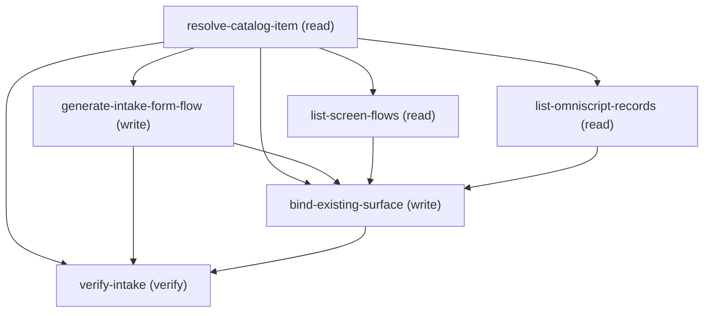

# Managing Configure Unified Catalog Service Process Intake

## When to Use This Skill

CHILD of the create-unified-catalog-service-process orchestrator — one configuration pass over a service process that ALREADY EXISTS. Run standalone against an existing process (supply its catalogItemId), or as the phase that orchestrator routes to; for a NEW end-to-end process start at create-unified-catalog-service-process, which asks the creation fork FIRST.
Use this when an admin wants to add or swap the intake form (request form) on a service process — e.g. "generate a Flow intake form for my order-replacement process" or "attach my existing OmniScript to this service process". DONE when a Flow or OmniScript surface is bound to the process and reads back on the verify GET with the anchor still intact. Org-gated on Unified Catalog. Two user decisions drive the branch — surface type (Flow / OmniScript) and mode (generate-new / attach-existing) — both enforced in preconditions and choice_points; step mechanics and the DETACH TRAP are in agent_guidance and step assertions.

## Critical Constraints

**Preconditions:**

- Org must have Unified Catalog enabled.
 (check: `Unified Product Catalog enabled`)
- HARD CONSTRAINT — the service process must ALREADY EXIST and its catalogItemId (== productId) must be known before this workflow runs. The first step (resolve-catalog-item) GETs the item to confirm it exists and is usedFor=ServiceProcess before any write; a 404 there means the id is wrong or the process was never created — the process must be created first, then re-run here with its catalogItemId.
 (check: `process_exists_with_known_catalog_item_id`)
- HARD CONSTRAINT — a service process should have its intake ATTRIBUTES saved before a surface is generated. generate-intake-form-flow builds the surface FROM the process's saved attributes; generating against a process with no attributes yields an empty form, and a malformed attribute can make generation fail. Confirm the process has its attributes (GET the item and check sections[] is non-empty) before choosing generate-new. If generation fails on a malformed attribute, the fix is on the process's attribute definitions, not in this workflow. Attach-existing is unaffected by this — it binds a pre-built surface.
 (check: `attributes_saved_before_generate`)
- HARD CONSTRAINT — the SURFACE TYPE (Flow vs OmniScript) MUST be elicited from the user, never defaulted. It changes which generate endpoint / list endpoint is used and the `type` sent when binding. Do NOT assume Flow.
 (check: `user_has_chosen_surface_type`)
- HARD CONSTRAINT — the MODE (generate a new surface vs attach an existing one) MUST be elicited from the user, never defaulted. Generate-new mints a fresh surface from the saved attributes; attach-existing binds a surface the org already has. Ask which one.
 (check: `user_has_chosen_intake_mode`)
- HARD CONSTRAINT — GENERATE-NEW is supported for Flow ONLY. An OmniScript intake surface can only be ATTACHED from an OmniScript that already exists in the org (attach-existing); there is no supported generate-new-OmniScript path in this workflow (getting OmniScript generation working requires changes in the OmniScript Builder and the Unified Catalog headless design-time experience, out of scope here). If the user chose surface-type Omniscript, the mode MUST be attach-existing — do NOT attempt to generate an OmniScript.
 (check: `omniscript_is_attach_existing_only`)
- HARD CONSTRAINT (attach-existing only) — the surface to attach MUST be a real id taken from the matching list step (list-screen-flows for Flow, list-omniscript-records for OmniScript) for THIS org. Never guess or hand-construct a Flow/OmniScript id. List the eligible surfaces, let the user pick one, and bind that exact id as intakeForm.intakeFormId.
 (check: `attached_surface_is_a_real_listed_id`)
- HARD CONSTRAINT (every branch — the bind runs in generate-new AND attach-existing) — binding via patchCatalogItemGet with operationType:"Update" is a FULL overwrite: it MUST re-send the item's identity fields (targetObject, name, usedFor, isActive). Omitting targetObject CLEARS the anchor (it reads back absent on the next GET, NOT reset to a default) even after it was set at create time. The bind PATCH always carries these four fields; the verify GET confirms the anchor is unchanged.
 (check: `bind_patch_resends_anchor_identity_fields`)
- HARD CONSTRAINT — if the process ALREADY HAS a surface bound (resolve-catalog-item returned a non-empty intakeForm.intakeFormId), binding a new one REPLACES it: the old surface is unbound (and, for a just-generated surface, the previous one is left orphaned in the org). This is a destructive swap of a live request form. CONFIRM with the user before binding — show the currently-bound surface (existing_intake_form_surface / existing_intake_form_type) and ask whether to replace it. If the item has no surface bound, this is a first attach and no confirmation is needed. This applies to EVERY branch, because the replacement always happens at bind-existing-surface (which runs in both generate-new and attach-existing), never at the generate step: a generate call on an already-bound item does NOT overwrite the binding on its own — it mints an orphan surface and leaves the old binding in place; only the follow-up bind performs the swap, which is exactly why the confirmation gates the bind, in whichever mode reached it.
 (check: `replace_existing_surface_confirmed`)

**Operational rules:**

- MUST-DO CONTRACT (read before executing — each rule is enforced by the named precondition/step; do NOT skip because the detail is further down):
  1. CONFIRM the process exists first — run resolve-catalog-item (GET) and capture its
     identity fields (name, usedFor, isActive, targetObject) and current intakeForm.id.
     A 404 means the catalogItemId is wrong; do NOT proceed.
     [precondition: process_exists_with_known_catalog_item_id]
  2. ELICIT BOTH decisions up front: surface type (Flow / OmniScript) and mode
     (generate-new / attach-existing). Never default either.
     [preconditions: user_has_chosen_surface_type, user_has_chosen_intake_mode]
  3. GENERATE-NEW (FLOW ONLY): call generate-intake-form-flow with the process's productId
     (== catalogItemId) to mint a Flow (type=Flow) FROM the saved attributes; it returns the
     id but does NOT reliably attach it — you MUST then run bind-existing-surface with the
     returned id to attach it. Confirm the process has attributes first. OmniScript has NO
     generate-new path — use attach-existing for OmniScript.
     [preconditions: attributes_saved_before_generate, omniscript_is_attach_existing_only]
  4. ATTACH-EXISTING: list via the matching step (list-screen-flows — the UIAPI GraphQL
     FlowRecord query the UI itself uses — for Flow; list-omniscript-records for
     OmniScript), present the COMPLETE set as numbered text, let the user type their pick,
     then bind that exact id via bind-existing-surface. For a Flow, bind the
     node.FlowDefinition.value (300-prefix definition id), NOT the 2aF version-view id.
     [precondition: attached_surface_is_a_real_listed_id]
  5. The bind PATCH is a FULL overwrite — ALWAYS re-send targetObject + name + usedFor +
     isActive, and carry the existing intakeForm.id forward, or the anchor is CLEARED
     (reads back absent, not reset to a default) and/or a previously attached surface detaches.
     [precondition: bind_patch_resends_anchor_identity_fields]
  6. IF a surface is ALREADY BOUND (resolve-catalog-item.existing_intake_form_surface is
     non-empty), binding replaces it — the old surface is unbound (generate-new also leaves
     the freshly minted one orphaned until bind swaps it). This is a destructive swap of a
     live request form: show the user the currently-bound surface and CONFIRM before binding.
     First attach (no surface bound) needs no confirmation.
     [precondition: replace_existing_surface_confirmed]
  7. VERIFY: GET the item and confirm intakeForm.intakeFormId + intakeForm.type are the
     chosen surface AND targetObject is unchanged. [step: verify-intake]
- ASK MODALITY: use a structured picker for the two small bounded choices (surface type, mode). For the attach-existing surface list (Flows / OmniScripts), which is unbounded, list the COMPLETE set as numbered text (name, apiName/uniqueName, id) and let the user type their selection; PRESENT smartly — match a named target locally, list a small set in full, and narrow a large one (typed name or a recent top slice) rather than dumping every row. The Flow list is a paged GraphQL query (first:2000 + pageInfo.hasNextPage/endCursor) — page through to completeness before asking.
TIMING: ask surface type + mode up front (they select the branch), then run only the steps that apply to the chosen branch (the rest are guarded by applies_when).
BRANCHES (2 modes × N surface types — exactly one surface-source path runs, then a common bind):
  - generate-new (FLOW ONLY): call generate-intake-form-flow to MINT the Flow (it returns the
      id but does not reliably attach). OmniScript has no generate-new path.
  - attach-existing: call the surface-specific lister and let the user pick. Flow ->
      list-screen-flows; OmniScript -> list-omniscript-records.
Both modes then converge on bind-existing-surface (the single attach step, runs in every branch) with the surface id + type, and end with verify-intake. EXTENDING to a new surface type (e.g. a future LWC form): add it to choice_points[surface-type].options, add its own generator + lister steps (each guarded by applies_when on the new surface-type value), and ensure bind-existing-surface.surfaceType accepts the new wire value. No change to the mode logic, the anchor handling, or verify.

## Verification Checklist

After every write operation, confirm the effect by re-reading state:

- After `resolve-catalog-item`, `generate-intake-form-flow`, `bind-existing-surface`: call `verify-intake` (`GET /connect/service-automation/catalog/catalog-item/{catalogItemId}`)

## Operations Reference

Operations grouped by purpose. Use these as the building blocks for the workflows above.

### Summary

| Operation | Purpose | Status | Call | Depends on |
|-----------|---------|--------|------|------------|
| `resolve-catalog-item` | read | implemented | `GET /connect/service-automation/catalog/catalog-item/{catalogItemId}` | — |
| `generate-intake-form-flow` | write | implemented | `POST /connect/service-automation/intake-form/generate-intake-form` | `resolve-catalog-item` |
| `list-screen-flows` | read | implemented | `queryScreenFlows` | `resolve-catalog-item` |
| `list-omniscript-records` | read | proposed | `GET /headless/invoke/platform/service-process-wizard-setup/get-omniscript-records` | `resolve-catalog-item` |
| `bind-existing-surface` | write | implemented | `PATCH /connect/service-automation/catalog/catalog-item/{catalogItemId}` | `resolve-catalog-item`, `generate-intake-form-flow`, `list-screen-flows`, `list-omniscript-records` |
| `verify-intake` | verify | implemented | `GET /connect/service-automation/catalog/catalog-item/{catalogItemId}` | `resolve-catalog-item`, `generate-intake-form-flow`, `bind-existing-surface` |

### Dependency graph

### Read operations

#### `resolve-catalog-item`

CONFIRM + CAPTURE — GET the existing service process to prove it exists and to capture the identity fields the later bind must re-send. Fails fast (404) if the catalogItemId is wrong or the process was never created. Capture name, usedFor, isActive, targetObject (the anchor) and the current intakeForm.id (the container minted at create time) — the bind step carries these forward to avoid the DETACH TRAP.

**Call:** `GET /connect/service-automation/catalog/catalog-item/{catalogItemId}`   — status: `implemented`

**Inputs:**

- `catalogItemId` *(`String`)* — The catalogItemId (== productId) of the EXISTING service process. If the user does not have it, the process must be created first before this workflow can run.

#### `list-screen-flows`

ATTACH-EXISTING, FLOW — list the org's active Screen Flows via UIAPI GraphQL: FlowRecord filtered to FlowType=="Screen" AND ProgressStatus=="InProgress" (InProgress is the active-version state). Present the COMPLETE set as numbered text (Name, FlowRecord_ApiName, and the bindable definition id) and let the user type their pick; page via pageInfo.endCursor (first:2000 + hasNextPage) — PRESENT smartly: if the user already NAMED the target, match it in the fetched set and show only the matches; if the set is small (≤ ~25) list it all as numbered text; if it is large, do NOT dump every row — show the most-recently-modified top slice (or ask a narrowing keyword) and invite the user to type a name to search (the full set is already fetched, so the local match stays exact). TARGETED LOOKUP: when the user has already NAMED the flow, add a label predicate to the where filter — {FlowLabel: {like: "%<name>%"}}, AND-combined with the FlowType/ProgressStatus filters above — to fetch just the matches in ONE call instead of paging the whole list; fall back to the full paged listing only when no name was given or the filtered query returns nothing. The list is org-specific — take it from this call, never a fixed list. ID TO BIND: the node.Id here is the FlowRecord (version-view) id (2aF… prefix). The id the catalog-item bind wants as intakeForm.intakeFormId is the FLOW DEFINITION id (300… prefix) — the same shape the generate path returns. Read it from node.FlowDefinition.value; for org-authored flows it is populated (a 300-prefixed FlowDefinition id). Managed-package standard flows show FlowDefinition==null and are generally not offered as custom intake surfaces; prefer flows with a non-null FlowDefinition.value.

**Call:** `queryScreenFlows`   — status: `implemented`

**Depends on:** `resolve-catalog-item`

#### `list-omniscript-records`

ATTACH-EXISTING, OMNISCRIPT — list the OmniScripts selectable as a service-process intake surface. Present the COMPLETE set as numbered text (name, uniqueName, type/subType, id) and let the user type their pick; PRESENT smartly — match a named target locally, list a small set in full, and narrow a large one (typed name or a recent top slice) rather than dumping every row. TARGETED LOOKUP: this controller returns the full active set with NO server-side name filter, so when the user has already NAMED the OmniScript, match it by name/uniqueName in the returned array and offer just those rows rather than making the user scroll the whole list. The chosen record's id becomes intakeForm.intakeFormId on the bind.

**Call:** `GET /headless/invoke/platform/service-process-wizard-setup/get-omniscript-records`   — status: `proposed`

**Depends on:** `resolve-catalog-item`

### Write operations

#### `generate-intake-form-flow`

GENERATE-NEW, FLOW — mint a new Screen Flow request form from the process's saved attributes. Sends {name, description, productId, type:"Flow"}; the server builds the Flow from the item's sections/attributes and returns 201 with the new Flow definition id (300-prefix). ATTACH IS NOT GUARANTEED BY GENERATE: the mint call does NOT reliably leave the Flow bound to the item — a follow-up bind PATCH (see bind-existing-surface) is required, passing the returned 300-prefix id as intakeForm.intakeFormId with type:"Flow" and re-sending the anchor identity fields (DETACH TRAP). Requires the process to already have its attributes saved (see the attributes_saved_before_generate precondition). PRODUCT-COLLECTION PRECONDITION: if the process uses a product collection, that collection must already sit on its own dedicated ProductRequestSection layout page BEFORE generating (see configure-unified-catalog-service-process-attributes-and-product-collection) — a collection left on the attribute section or in the unplaced bucket generates a Flow with NO product-selection screen.

**Call:** `POST /connect/service-automation/intake-form/generate-intake-form`   — status: `implemented`

**Inputs:**

- `productId` *(`String`)* — The catalogItemId (== productId) of the process to generate the Flow for.
- `name` *(`String`)* — Human-readable name for the generated intake Flow (the request-form label). Elicit it; do not default silently.

- `description` *(`String`)* — Description of the intake Flow. The Generate Intake Form UI marks this REQUIRED (Form Title + Description are both mandatory in the wizard) — elicit it, do not send empty.

**Depends on:** `resolve-catalog-item`

**Rollback:** Generate only MINTS the Flow; if bind-existing-surface has since attached it, detach via patchCatalogItemGet with intakeForm operationType semantics (see bind-existing-surface — re-send the anchor identity fields); the intake-form resource has no DELETE. If bind has not run, the minted Flow is orphaned metadata. Either way the Flow metadata itself is cleaned up through Flow tooling, not this API.

#### `bind-existing-surface`

BIND — attach a Flow/OmniScript surface to the process via patchCatalogItemGet, sending intakeForm:{id:<existing container id>, intakeFormId:<surface id>, operationType:"Update", type:<Flow|Omniscript>}. This is the SINGLE attach mechanism for ALL branches: in generate-new it binds the surface the generate step just minted (generate does NOT auto-attach); in attach-existing it binds the surface the user picked from a list. DETACH TRAP: operationType:"Update" is a FULL overwrite — this PATCH MUST also re-send the item's identity fields (targetObject, name, usedFor, isActive), sourced from resolve-catalog-item. Omitting targetObject CLEARS the anchor (it reads back absent, not reset to a default); omitting name/usedFor clears them too. Carry resolve-catalog-item.intake_form_id forward as intakeForm.id when the item already has a container (it does, if create provisioned one); omit it only if resolve-catalog-item returned no intakeForm.id. REPLACE GUARD: if resolve-catalog-item.existing_intake_form_surface is non-empty, this bind REPLACES the currently-bound surface — confirm the swap with the user first [precondition: replace_existing_surface_confirmed].

**Call:** `PATCH /connect/service-automation/catalog/catalog-item/{catalogItemId}`   — status: `implemented`

**Inputs:**

- `catalogItemId` *(`String`)* — The catalogItemId (== productId) of the process to bind the surface to.
- `intakeFormSurfaceId` *(`String`)* — The surface id to bind, sourced by mode. GENERATE-NEW (FLOW ONLY): the id returned by generate-intake-form-flow.intake_form_id (a 300-prefix Flow definition id). ATTACH-EXISTING: the user's pick — for a Flow, node.FlowDefinition.value (300-prefix definition id) from list-screen-flows.flow_definition_ids; for an OmniScript, an id from list-omniscript-records.omniscript_ids. In every case it MUST be a real id from the generate response or the org's list, never hand-constructed, and for Flow it must be the definition id (300…), NOT the 2aF version-view id. Sent as intakeForm.intakeFormId.

  - **Source:** output of `list-screen-flows`, `list-omniscript-records`
- `surfaceType` *(`String`)* — "Flow" or "Omniscript" (note the lower-case s on the wire) — the chosen surface type. Sent as intakeForm.type.

- `containerId` *(`String`)* — The existing intake container id (intakeForm.id) from resolve-catalog-item, carried forward as intakeForm.id so the Update does not orphan the container. Omit only when resolve-catalog-item returned no intakeForm.id.

  - **Source:** output of `resolve-catalog-item`
- `targetObject` *(`String`)* — The anchor object — a CLOSED enum accepting only Case, Incident, or ServiceRequest. Re-sent to avoid the DETACH TRAP [precondition: bind_patch_resends_anchor_identity_fields]. Take the value from resolve-catalog-item, never a fixed assumption.

  - **Source:** output of `resolve-catalog-item`
- `name` *(`String`)* — The process name — re-sent to preserve identity on this full-overwrite Update.
- `usedFor` *(`String`)* — The usedFor value (ServiceProcess) — re-sent to preserve identity.
- `isActive` *(`Boolean`)* — The isActive flag — re-sent to preserve identity.

**Depends on:** `resolve-catalog-item`, `generate-intake-form-flow`, `list-screen-flows`, `list-omniscript-records`

**Rollback:** To unbind, re-invoke patchCatalogItemGet clearing/replacing intakeForm.intakeFormId (or binding a different surface), always re-sending the anchor identity fields. The catalog-item resource has no DELETE method.

### Verify operations

#### `verify-intake`

Read the process back and confirm the intake surface is bound and the anchor held. Works for every branch — generate-new (Flow) and attach-existing (Flow or OmniScript).

**Call:** `GET /connect/service-automation/catalog/catalog-item/{catalogItemId}`   — status: `implemented`

**Inputs:**

- `catalogItemId` *(`String`)* — The catalogItemId (== productId) of the process to verify.

**Depends on:** `resolve-catalog-item`, `generate-intake-form-flow`, `bind-existing-surface`
