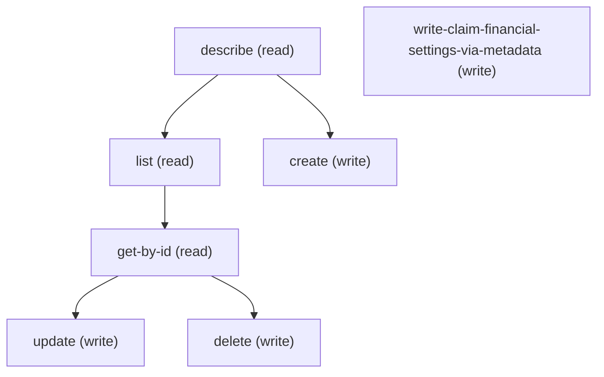

# Managing Claim Financial Settings

## When to Use This Skill

Manage ClaimFinancialSettings records (FSC Insurance Claim Management settings; keyPrefix 11Z) via sObject REST CRUD. Singleton entity — at most ONE record per org; a second POST returns 400 FIELD_INTEGRITY_EXCEPTION "You can't create more than one Claim Financial Settings record." An admin's canonical workflow is therefore configure-or-reconfigure the single row, not fan-out create. Three required TEXT(255) status fields define the row — ClaimCovPendingAuthStatus, ClmCovPymtDtlPendAuthSts, ClaimPendingAuthorityStatus — plus standard MasterLabel, DeveloperName, Language (restricted picklist; invalid values return 400 INVALID_OR_NULL_FOR_RESTRICTED_PICKLIST). DeveloperName provided on create is server-normalized (the platform assigns a canonical value derived from MasterLabel; do not depend on the caller-supplied DeveloperName round-tripping). Identity by Id for ad-hoc edits; upsert by DeveloperName is available but has limited utility given the singleton constraint. For source-controlled rollout, deploy via Metadata API (api_type metadata_api, POST /headless/metadata); Metadata READ is NOT supported (GET /headless/metadata for this type returns 400 UNSUPPORTED_OPERATION — read the row via sObject GET instead). No Aura controller exists; sObject REST, Tooling REST, and Metadata API deploy are the entire programmatic surface — pick by intent (CRUD / introspection / source-controlled deploy).

## Workflow

Standard sObject REST provides full CRUD + describe on ClaimFinancialSettings; no proprietary Aura controller is involved. Fields available at runtime come from /describe — the SOR doesn't enumerate them statically because the shape depends on the org's permission/profile setup. Run /describe first, then construct the payload from the createable fields list.

## Critical Constraints

**Preconditions:**

- User needs CRUD access to ClaimFinancialSettings. (check: `<udd:crud:ClaimFinancialSettings>`)
- Org has Insurance Claim Management or Insurance Policy Administration enabled — without one the entity is non-addressable and the setup node is hidden. (check: `Insurance Policy Administration enabled || Insurance Claim Management enabled`)
- Running user holds Insurance Policy Admin or Insurance Claim Management user access — gates UI + API CRUD on the entity. (check: `Insurance Policy Admin access || Insurance Claim Management access`)
- User needs access to manage ClaimFinancialSettings (CRUD on the ClaimFinancialSettings sObject). (check: `Insurance Policy Administration enabled || Insurance Claim Management enabled`)

## Operations Reference

Operations grouped by purpose. Use these as the building blocks for the workflows above.

### Summary

| Operation | Purpose | Status | Call | Depends on |
|-----------|---------|--------|------|------------|
| `describe` | read | — | `GET /services/data/v67.0/sobjects/ClaimFinancialSettings/describe` | — |
| `list` | read | — | `GET /services/data/v67.0/query` | `describe` |
| `get-by-id` | read | — | `GET /services/data/v67.0/sobjects/ClaimFinancialSettings/{Id}` | `list` |
| `create` | write | — | `POST /services/data/v67.0/sobjects/ClaimFinancialSettings` | `describe` |
| `update` | write | — | `PATCH /services/data/v67.0/sobjects/ClaimFinancialSettings/{Id}` | `get-by-id` |
| `delete` | write | — | `DELETE /services/data/v67.0/sobjects/ClaimFinancialSettings/{Id}` | `get-by-id` |
| `write-claim-financial-settings-via-metadata` | write | — | `POST /headless/metadata` | — |

### Dependency graph

### Read operations

#### `describe`

Returns DescribeSObjectResult — 3 required TEXT(255) status fields plus MasterLabel/DeveloperName/Language, FLS, createable/updateable. Field shape is statically known from UDD; describe verifies per-user FLS before write-payload construction.

**Call:** `GET /services/data/v67.0/sobjects/ClaimFinancialSettings/describe`

**Output:** DescribeSObjectResult — fields[] includes ClaimCovPendingAuthStatus, ClmCovPymtDtlPendAuthSts, ClaimPendingAuthorityStatus (each TEXT(255), nillable=false) plus MasterLabel, DeveloperName, Language and standard audit fields (CreatedBy/Date, LastModifiedBy/Date, SystemModstamp). recordTypeInfos and childRelationships are empty (no master-detail children).

#### `list`

SOQL list of ClaimFinancialSettings rows. UDD defaultFilterColumns are MasterLabel, ClaimCovPendingAuthStatus, ClmCovPymtDtlPendAuthSts, ClaimPendingAuthorityStatus — project these for setup-page-equivalent display.

**Call:** `GET /services/data/v67.0/query`

**Inputs:**

- `where` *(`String`)* — Optional SOQL WHERE clause to filter Claim Financial Settings records.
- `limit` *(`int`)* — Optional SOQL LIMIT value.
- `q` *(`string`)*

**Depends on:** `describe`

**Output:** QueryResult — records[] of ClaimFinancialSettings (Id + each SELECTed field), totalSize, done, nextRecordsUrl when paginated. Empty records[] when no rows exist (an unconfigured org returns 0 settings records by default).

#### `get-by-id`

Retrieve a specific ClaimFinancialSettings record by Id.

**Call:** `GET /services/data/v67.0/sobjects/ClaimFinancialSettings/{Id}`

**Inputs:**

- `Id` *(`ID`)* — Id of the ClaimFinancialSettings record to fetch.

**Depends on:** `list`

**Output:** Single ClaimFinancialSettings record with all readable fields per user FLS.

### Write operations

#### `create`

Create a new ClaimFinancialSettings record. Run /describe first to learn the required + createable fields.

**Call:** `POST /services/data/v67.0/sobjects/ClaimFinancialSettings`

**Inputs:**

- `body` *(`object`)* — Field/value map for the new ClaimFinancialSettings. Populate from /describe's createableFields list.

**Depends on:** `describe`

**Output:** SaveResult — id (15/18-char Id, keyPrefix 11Z), success (true on 201), errors[] (empty on success). Subsequent retrieve / update / delete keyed on the returned id.

**Rollback:** Call delete with the returned Id to undo the create.

**Notes:** singleton_constraint: Only ONE ClaimFinancialSettings record allowed per org. A second POST returns 400 FIELD_INTEGRITY_EXCEPTION "You can't create more than one Claim Financial Settings record." Query first (list step, LIMIT 1) — if a row exists, use update instead of create.; developer_name_normalization: DeveloperName supplied in the request body is NOT preserved verbatim. The platform assigns a canonical DeveloperName derived from MasterLabel (verified: request "B4Expertise_retry2_create" was returned as "Claim_Financial_Settings"). Downstream lookups by DeveloperName must use the server-assigned value from the GET-after-create, not the caller-supplied value.

#### `update`

Update an existing ClaimFinancialSettings record. Merge-patch semantics.

**Call:** `PATCH /services/data/v67.0/sobjects/ClaimFinancialSettings/{Id}`

**Inputs:**

- `Id` *(`ID`)* — Id of the ClaimFinancialSettings to update.
- `body` *(`object`)* — Partial field/value map — only include fields you want to change.

**Depends on:** `get-by-id`

**Output:** Empty 204 No Content on success. Errors return SaveError shape (statusCode, message, fields[]).

**Rollback:** Re-PATCH with the prior field values (capture them via get-by-id before update). PATCH is idempotent at the wire layer but not at the value layer — the rollback must replay the prior values explicitly.

**Notes:** merge_semantics: PATCH is partial-update (merge) — omitted fields are preserved. Confirmed via probe: PATCH {MasterLabel, Language} kept the 3 status fields unchanged in the subsequent GET.; enum_error_shape: Invalid Language value returns 400 INVALID_OR_NULL_FOR_RESTRICTED_PICKLIST with message "Master Language: bad value for restricted picklist field: <value>". Query /describe fields[?name=Language].picklistValues[] for the accepted locale set.

#### `delete`

Delete a ClaimFinancialSettings record.

**Call:** `DELETE /services/data/v67.0/sobjects/ClaimFinancialSettings/{Id}`

**Inputs:**

- `Id` *(`ID`)* — Id of the ClaimFinancialSettings to delete.

**Depends on:** `get-by-id`

**Output:** Empty 204 No Content on success. 404 ENTITY_IS_DELETED when the row was already deleted; 400 if the user lacks delete access (per UDD deleteAccess gate).

#### `write-claim-financial-settings-via-metadata`

Deploy ClaimFinancialSettings members via Metadata API — the source-controlled rollout path. Use for FSC release bundles rather than ad-hoc CRUD; transport routes via /headless/metadata.

**Call:** `POST /headless/metadata`

**Inputs:**

- `package` *(`object`)* — Metadata API package containing one or more ClaimFinancialSettings members keyed on fullName (=DeveloperName). Each member carries masterLabel + the 3 required status fields. destructiveChanges.xml may list fullNames to delete.

**Output:** DeployResult — id (AsyncResult), state (Pending|InProgress|Succeeded|SucceededPartial|Failed), details (componentSuccesses[] / componentFailures[] per fullName).

**Rollback:** Re-deploy with the prior package state, or attach destructiveChanges.xml listing the new fullNames to remove.

**Notes:** read_unsupported: The Metadata API supports POST/PUT deploy for ClaimFinancialSettings but does NOT support READ. GET /headless/metadata?type=ClaimFinancialSettings&fullName=... returns 400 UNSUPPORTED_OPERATION "MetadataCrud does not support READ on type: ClaimFinancialSettings". Read the current row via sObject GET (steps get-by-id or list) before crafting a deploy package.
