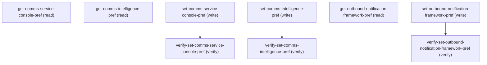

# Managing Comms Service Console Settings

## When to Use This Skill

Manage three Comms Cloud Setup org preferences via dispatcher-routed Setup Connect API: Comms Service Console (omnichannel agent console; ALSO gated by org-perm Identity Verification — when off, gated read/write returns Failure `IVPrefEnableError` and never touches the pref), Comms Intelligence (gated by `userHasAccessToCommsCloudSetup`), Outbound Notification Framework (gated by `userHasAccessToIndustriesCommsCloudFeature`). All ops require Customize Application or System Administrator. Each setter accepts an `enable` boolean; each call returns `ImmutableMap<String,Object>` — pref boolean on success, `{status: Failure, message: <localized label>}` on access/IV/save failure.

## Workflow

Three independent preferences; toggle in any order. Each: GET current, PATCH `enable` to write, companion GET to verify. Service Console additionally requires Identity Verification org-perm — without it, reads and writes return `IVPrefEnableError` Failure and never touch the pref.

## Critical Constraints

**Preconditions:**

- User must have CommsMsmServiceConsole AccessToCommsCloudSetup access (check: `Communications Cloud Setup access`)
- User must have IndustriesComms AccessToIndustriesCommsCloudFeature access (check: `Communications Cloud feature access`)
- Caller must have Customize Application OR System Administrator. The controller's `checkAccess()` (line 117) returns false otherwise; every read and write returns `{status: Failure, RestrictedAccessMessageBody}` and never invokes the underlying service method. (check: `USER_HAS_CUSTOMIZE_APPLICATION_OR_SYS_ADMIN`)
- Org must have the Identity Verification org permission ON for the Comms Service Console pref read and write only (Comms Intelligence and Outbound Notification Framework are unaffected). When off, those two operations return `{status: Failure, IVPrefEnableError}` and never touch the underlying pref. (check: `ORG_PERMISSION_IDENTITY_VERIFICATION`)

## Verification Checklist

After every write operation, confirm the effect by re-reading state:

- After `set-comms-service-console-pref`: call `verify-set-comms-service-console-pref` (`GET /headless/invoke/platform/comms-service-console-settings`)
- After `set-comms-intelligence-pref`: call `verify-set-comms-intelligence-pref` (`GET /headless/invoke/platform/comms-service-console-settings/get-comms-intelligence-pref`)
- After `set-outbound-notification-framework-pref`: call `verify-set-outbound-notification-framework-pref` (`GET /headless/invoke/platform/comms-service-console-settings/get-outbound-notification-framework-pref`)

## Operations Reference

Operations grouped by purpose. Use these as the building blocks for the workflows above.

### Summary

| Operation | Purpose | Status | Call | Depends on |
|-----------|---------|--------|------|------------|
| `get-comms-service-console-pref` | read | implemented | `GET /headless/invoke/platform/comms-service-console-settings` | — |
| `get-comms-intelligence-pref` | read | implemented | `GET /headless/invoke/platform/comms-service-console-settings/get-comms-intelligence-pref` | — |
| `set-comms-service-console-pref` | write | implemented | `PATCH /headless/invoke/platform/comms-service-console-settings/set-comms-service-console-pref` | — |
| `verify-set-comms-service-console-pref` | verify | — | `GET /headless/invoke/platform/comms-service-console-settings` | `set-comms-service-console-pref` |
| `set-comms-intelligence-pref` | write | implemented | `PATCH /headless/invoke/platform/comms-service-console-settings/set-comms-intelligence-pref` | — |
| `verify-set-comms-intelligence-pref` | verify | — | `GET /headless/invoke/platform/comms-service-console-settings/get-comms-intelligence-pref` | `set-comms-intelligence-pref` |
| `get-outbound-notification-framework-pref` | read | implemented | `GET /headless/invoke/platform/comms-service-console-settings/get-outbound-notification-framework-pref` | — |
| `set-outbound-notification-framework-pref` | write | implemented | `PATCH /headless/invoke/platform/comms-service-console-settings/set-outbound-notification-framework-pref` | — |
| `verify-set-outbound-notification-framework-pref` | verify | — | `GET /headless/invoke/platform/comms-service-console-settings/get-outbound-notification-framework-pref` | `set-outbound-notification-framework-pref` |

### Dependency graph

### Read operations

#### `get-comms-service-console-pref`

Read Comms Service Console (omnichannel agent console) org-pref state. When Identity Verification org-perm is OFF, returns `{status: Failure, IVPrefEnableError}` and never reads the underlying pref.

**Call:** `GET /headless/invoke/platform/comms-service-console-settings`   — status: `implemented`

**Output:** On success returns `{status: "SUCCESS", isPrefEnabled: <bool>}` — the boolean is the current Comms Service Console org-pref state. On Customize Application / System Administrator access denial returns `{status: Failure, message: <RestrictedAccessMessageBody label>}`; when the Identity Verification org-perm is off returns `{status: Failure, message: <IVPrefEnableError label>}` without reading the underlying pref.

#### `get-comms-intelligence-pref`

Read Comms Intelligence (AI-driven insights) org-pref state. Gated by Communications Cloud Setup access; access denial returns `{status: Failure, RestrictedAccessMessageBody}` without reading. No IV gating (unlike Service Console).

**Call:** `GET /headless/invoke/platform/comms-service-console-settings/get-comms-intelligence-pref`   — status: `implemented`

**Output:** On success returns `{status: "SUCCESS", isPrefEnabled: <bool>}` — the boolean is the current Comms Intelligence org-pref state. On access denial (userHasAccessToCommsCloudSetup guard) returns `{status: Failure, message: <RestrictedAccessMessageBody label>}`.

#### `get-outbound-notification-framework-pref`

Read Outbound Notification Framework (Comms Cloud notification pipeline) org-pref state. Gated by Communications Cloud feature access; access denial returns `{status: Failure, RestrictedAccessMessageBody}` without reading.

**Call:** `GET /headless/invoke/platform/comms-service-console-settings/get-outbound-notification-framework-pref`   — status: `implemented`

**Output:** On success returns `{status: "SUCCESS", isPrefEnabled: <bool>}` — the boolean is the current Outbound Notification Framework org-pref state. On access denial (userHasAccessToIndustriesCommsCloudFeature guard) returns `{status: Failure, message: <RestrictedAccessMessageBody label>}`.

### Write operations

#### `set-comms-service-console-pref`

Toggle Comms Service Console org-pref via `enable` boolean. Identity Verification org-perm gates the write — when off, returns `{status: Failure, IVPrefEnableError}` and never calls `setOrgPref`. Save failure surfaces as `PrefEnableError`.

**Call:** `PATCH /headless/invoke/platform/comms-service-console-settings/set-comms-service-console-pref`   — status: `implemented`

**Inputs:**

- `enable` *(`boolean`)* — Toggle the enable preference on or off.

**Output:** On a successful save returns `{status: "SUCCESS", isPrefEnabled: <new bool>}` — mirrors the read envelope with the just-written value. When the Identity Verification org-perm is off returns `{status: Failure, message: <IVPrefEnableError label>}` and never calls setOrgPref. On save failure/exception returns `{status: Failure, message: <PrefEnableError label>}` carrying the prior boolean.

#### `set-comms-intelligence-pref`

Toggle Comms Intelligence org-pref via `enable` boolean. Gated by Communications Cloud Setup access; access denial returns `{status: Failure, RestrictedAccessMessageBody}` without writing. Save failure surfaces as `PrefEnableError`.

**Call:** `PATCH /headless/invoke/platform/comms-service-console-settings/set-comms-intelligence-pref`   — status: `implemented`

**Inputs:**

- `enable` *(`boolean`)* — Toggle the enable preference on or off.

**Output:** On a successful save returns `{status: "SUCCESS", isPrefEnabled: <new bool>}`. On access denial (userHasAccessToCommsCloudSetup guard) returns `{status: Failure, message: <RestrictedAccessMessageBody label>}` without writing. On save failure/exception returns `{status: Failure, message: <PrefEnableError label>}`.

#### `set-outbound-notification-framework-pref`

Toggle Outbound Notification Framework org-pref via `enable` boolean. Gated by Communications Cloud feature access; access denial returns `{status: Failure, RestrictedAccessMessageBody}` without writing. Save/exception failures surface as `PrefEnableError` or `OutboundNotificationFrameworkEnableError`.

**Call:** `PATCH /headless/invoke/platform/comms-service-console-settings/set-outbound-notification-framework-pref`   — status: `implemented`

**Inputs:**

- `enable` *(`boolean`)* — Toggle the enable preference on or off.

**Output:** On a successful save returns `{status: "SUCCESS", isPrefEnabled: <new bool>}`. On access denial (userHasAccessToIndustriesCommsCloudFeature guard) returns `{status: Failure, message: <RestrictedAccessMessageBody label>}` without writing. On save/exception failure returns `{status: Failure, message: <PrefEnableError label>}` or `{status: Failure, message: <OutboundNotificationFrameworkEnableError label>}`.

### Verify operations

#### `verify-set-comms-service-console-pref`

Read back Service Console pref; boolean should equal the written `enable`. `{status: Failure, IVPrefEnableError}` means IV gate is off — neither read nor write touches the pref.

**Call:** `GET /headless/invoke/platform/comms-service-console-settings`

**Depends on:** `set-comms-service-console-pref`

#### `verify-set-comms-intelligence-pref`

Read back Comms Intelligence pref; boolean should equal the written `enable`. `{status: Failure, RestrictedAccessMessageBody}` means the userHasAccessToCommsCloudSetup guard denied — neither read nor write completed.

**Call:** `GET /headless/invoke/platform/comms-service-console-settings/get-comms-intelligence-pref`

**Depends on:** `set-comms-intelligence-pref`

#### `verify-set-outbound-notification-framework-pref`

Read back Outbound Notification Framework pref; boolean should equal the written `enable`. `{status: Failure, RestrictedAccessMessageBody}` means the userHasAccessToIndustriesCommsCloudFeature guard denied — neither read nor write completed.

**Call:** `GET /headless/invoke/platform/comms-service-console-settings/get-outbound-notification-framework-pref`

**Depends on:** `set-outbound-notification-framework-pref`
