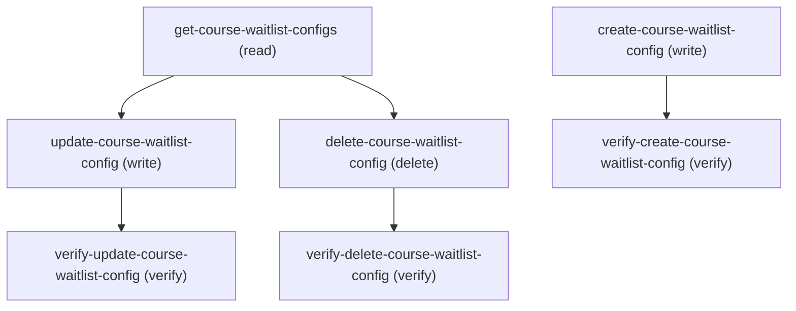

# Managing Course Waitlist Config

## When to Use This Skill

Configure CourseWaitlistConfig records that drive Education Cloud course-waitlist behavior. Two Type values: WaitlistPosition (ranking rules — agent rows with the same Type form a contiguous WaitlistPositionFieldOrder sequence the controller maintains server-side: insert shifts higher rows by +1, update reorders middle rows, delete compacts to 1..N) and EnrollmentOfferExpiration (single-config offer-acceptance window). All four CRUD steps are AURA-IS-CANONICAL because the controller's position cascade cannot be reconstructed by raw Tooling Insert/Update/Delete or by Metadata API XML deploy.

## Workflow

Read with get-course-waitlist-configs first; rows return ordered by WaitlistPositionFieldOrder ASC. Use the returned recordId for update/delete. The position cascade fires server-side only when Type=WaitlistPosition and waitlistPositionFieldOrder is set; EnrollmentOfferExpiration creates/updates do not reorder siblings.

## Critical Constraints

**Preconditions:**

- User must have IndustriesEducation EducationCloudAccess access (check: `Education Cloud access`)
- Org must have Academic Operations enabled (UDD orgAccess + userAccess on the CourseWaitlistConfig setupEntity). (check: `Education Cloud Academic Operations`)
- User must have the AccessEducationCloud user permission (UDD userAccess). (check: `UserPermissions.AccessEducationCloud`)
- Write/delete operations additionally require an admin user (UDD editAccess + createAccess + deleteAccess all combine isAdminUser with the org/user gates). (check: `Education Cloud admin access`)

**Destructive operations — require explicit user confirmation:**

- **`delete-course-waitlist-config`** — Deletes a CourseWaitlistConfig row by recordId. AURA-IS-CANONICAL — pre-delete the controller queries the row's Type; if it was WaitlistPosition, post-delete compactPositionsAfterDeletion renumbers every remaining WaitlistPosition row to a contiguous 1..N WaitlistPositionFieldOrder sequence to remove the gap. A raw Tooling Delete leaves a numbering gap (e.g. 1, 2, 4, 5).
  - Rollback: No automatic rollback.

## Verification Checklist

After every write operation, confirm the effect by re-reading state:

- After `create-course-waitlist-config`: call `verify-create-course-waitlist-config` (`GET /headless/invoke/platform/course-waitlist-config`)
- After `update-course-waitlist-config`: call `verify-update-course-waitlist-config` (`GET /headless/invoke/platform/course-waitlist-config`)
- After `delete-course-waitlist-config`: call `verify-delete-course-waitlist-config` (`GET /headless/invoke/platform/course-waitlist-config`)

## Operations Reference

Operations grouped by purpose. Use these as the building blocks for the workflows above.

### Summary

| Operation | Purpose | Status | Call | Depends on |
|-----------|---------|--------|------|------------|
| `get-course-waitlist-configs` | read | proposed | `GET /headless/invoke/platform/course-waitlist-config` | — |
| `create-course-waitlist-config` | write | proposed | `PATCH /headless/invoke/platform/course-waitlist-config/create-course-waitlist-config` | — |
| `update-course-waitlist-config` | write | proposed | `PATCH /headless/invoke/platform/course-waitlist-config/update-course-waitlist-config` | `get-course-waitlist-configs` |
| `delete-course-waitlist-config` | delete | proposed | `DELETE /headless/invoke/platform/course-waitlist-config/delete-course-waitlist-config` | `get-course-waitlist-configs` |
| `verify-create-course-waitlist-config` | verify | — | `GET /headless/invoke/platform/course-waitlist-config` | `create-course-waitlist-config` |
| `verify-update-course-waitlist-config` | verify | — | `GET /headless/invoke/platform/course-waitlist-config` | `update-course-waitlist-config` |
| `verify-delete-course-waitlist-config` | verify | — | `GET /headless/invoke/platform/course-waitlist-config` | `delete-course-waitlist-config` |

### Dependency graph

### Read operations

#### `get-course-waitlist-configs`

Lists every CourseWaitlistConfig row ordered by WaitlistPositionFieldOrder ASC. Each entry exposes Id, DeveloperName, MasterLabel, Type, Value, WaitlistPositionFieldOrder, SortOrder. AURA-IS-CANONICAL: UDD perApiAccess marks the entity Tooling-queryable, but no tooling_sobject_coverage evidence file is present in the corpus snapshot, so the substitution is held back as a coverage_gap (see notes).

**Call:** `GET /headless/invoke/platform/course-waitlist-config`   — status: `proposed`

**Output:** items: array<CourseWaitlistConfig> — each item carries Id (string), DeveloperName (string), MasterLabel (string), Type ("WaitlistPosition" | "EnrollmentOfferExpiration"), Value (string), WaitlistPositionFieldOrder (integer | null), SortOrder ("Ascending" | "Descending" | null). Empty list when no rows exist.

### Write operations

#### `create-course-waitlist-config`

Creates a CourseWaitlistConfig via CourseWaitlistConfigService. AURA-IS-CANONICAL — when type=WaitlistPosition and waitlistPositionFieldOrder is set, the controller calls shiftPositionsForInsertion which UPDATES every existing WaitlistPosition row at-or-above the new position by +1, then inserts the new row. A raw Tooling Insert would land the row but break the position-uniqueness invariant; a Metadata deploy cannot perform a bulk sibling reorder in one transaction.

**Call:** `PATCH /headless/invoke/platform/course-waitlist-config/create-course-waitlist-config`   — status: `proposed`

**Inputs:**

- `developerName` *(`String`)* — Name of the developer.
- `masterLabel` *(`String`)* — Label shown for master.
- `type` *(`String`)* — Value for the type field.
- `value` *(`String`)* — Value for the value field.
- `waitlistPositionFieldOrder` *(`Integer`)* — Numeric value for the waitlist position field order setting.
- `sortOrder` *(`String`)* — Value for the sort order field.

**Output:** Operation envelope: {success: true, recordId: <id of the new CourseWaitlistConfig row>}. ServiceException is wrapped as AuraHandledException by the controller — caller sees a logging-only and a generic error message.

#### `update-course-waitlist-config`

Updates an existing CourseWaitlistConfig row by recordId. AURA-IS-CANONICAL — when waitlistPositionFieldOrder changes, handlePositionUpdateIfNeeded → reorderPositionsForUpdate → calculateAdjustedPosition rewrites every sibling row in the affected window (move-up shifts middle rows down by 1; move-down shifts middle rows up by 1). developerName and type are not in the update signature — those are immutable post-create.

**Call:** `PATCH /headless/invoke/platform/course-waitlist-config/update-course-waitlist-config`   — status: `proposed`

**Inputs:**

- `recordId` *(`String`)* — Id of the record.
- `masterLabel` *(`String`)* — Label shown for master.
- `value` *(`String`)* — Value for the value field.
- `waitlistPositionFieldOrder` *(`Integer`)* — Numeric value for the waitlist position field order setting.
- `sortOrder` *(`String`)* — Value for the sort order field.

**Depends on:** `get-course-waitlist-configs`

**Output:** Operation envelope: {success: true, recordId: <the same recordId passed in>}. ServiceException is wrapped as AuraHandledException.

### Verify operations

#### `verify-create-course-waitlist-config`

Re-list all CourseWaitlistConfig rows and confirm the new recordId is present with the developerName/masterLabel/type/value supplied to create. Also confirms the post-cascade WaitlistPositionFieldOrder placement when type=WaitlistPosition.

**Call:** `GET /headless/invoke/platform/course-waitlist-config`

**Depends on:** `create-course-waitlist-config`

#### `verify-update-course-waitlist-config`

Re-list and locate the row by recordId; confirm masterLabel / value / waitlistPositionFieldOrder / sortOrder match the update inputs. When waitlistPositionFieldOrder changed, also confirm the sibling row positions reflect the cascade.

**Call:** `GET /headless/invoke/platform/course-waitlist-config`

**Depends on:** `update-course-waitlist-config`

#### `verify-delete-course-waitlist-config`

Re-list and confirm the deleted recordId is absent. When the deleted row was Type=WaitlistPosition, also confirm remaining WaitlistPosition rows have a contiguous 1..N WaitlistPositionFieldOrder (no gap).

**Call:** `GET /headless/invoke/platform/course-waitlist-config`

**Depends on:** `delete-course-waitlist-config`

### Destructive operations

#### `delete-course-waitlist-config`

Deletes a CourseWaitlistConfig row by recordId. AURA-IS-CANONICAL — pre-delete the controller queries the row's Type; if it was WaitlistPosition, post-delete compactPositionsAfterDeletion renumbers every remaining WaitlistPosition row to a contiguous 1..N WaitlistPositionFieldOrder sequence to remove the gap. A raw Tooling Delete leaves a numbering gap (e.g. 1, 2, 4, 5).

**Call:** `DELETE /headless/invoke/platform/course-waitlist-config/delete-course-waitlist-config`   — status: `proposed`

**Inputs:**

- `recordId` *(`String`)*

**Depends on:** `get-course-waitlist-configs`

**Output:** Operation envelope: {success: true, recordId: <the deleted recordId>}. ServiceException is wrapped as AuraHandledException.
